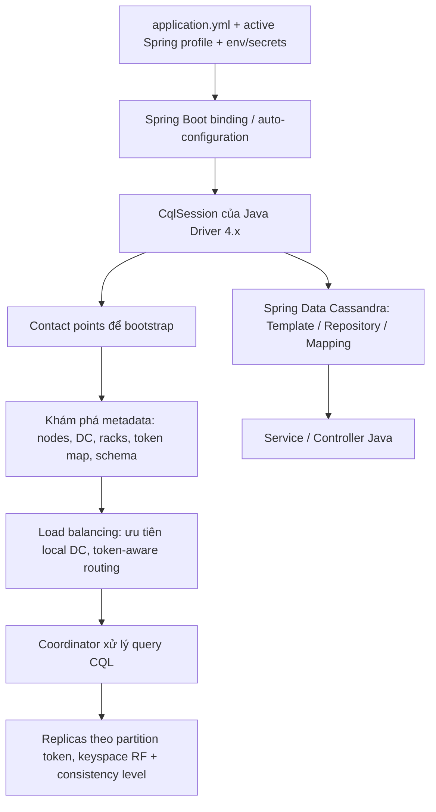

# Contact point, local datacenter, keyspace và cấu hình theo môi trường

> **Chương:** Spring Boot và Spring Data  
> **Mô-đun:** `DATABASE_ENGINE_WIDE_COLUMN_CASSANDRA` — hiểu kiến trúc phân tán và mô hình wide-column của Apache Cassandra; nắm khóa phân vùng, thiết kế bảng theo truy vấn, mức nhất quán đọc/ghi, CQL, replication, compaction, repair, xử lý lỗi và kết nối từ ứng dụng Java.  
> **Phạm vi:** Cấu hình kết nối Cassandra cho ứng dụng **Spring Boot + Spring Data Cassandra** theo môi trường local/staging/production; phân biệt **contact points**, **local datacenter**, **keyspace**, replication/consistency; quản lý secrets/TLS, Spring profiles, Java Driver `CqlSession`, kiểm thử và runbook vận hành.
>
> **Lưu ý phiên bản:** Ví dụ thuộc tính dùng **Spring Boot 3.x/4.x** (`spring.cassandra.*`); Spring Boot 2.7 dùng tiền tố **`spring.data.cassandra.*`**. Tài liệu tham chiếu Spring Boot 4.2/Spring Data Cassandra 5.x và 3.5/4.5 để minh họa cách đối chiếu. Khi triển khai, phải xác nhận property metadata, Java/JDK, Driver và các API ứng với **đúng phiên bản đang chạy**.

Một cấu hình ứng dụng nhìn qua có vẻ đơn giản:

```yaml
spring:
  cassandra:
    contact-points: "cassandra-1.internal:9042,cassandra-2.internal:9042"
    local-datacenter: "dc1"
    keyspace-name: "orders_service"
```

Tuy nhiên ba giá trị trên trả lời **ba câu hỏi khác nhau**:

- **Contact points:** “Lúc khởi tạo, driver nên liên lạc với các Cassandra node nào để **khám phá cluster**?”
- **Local datacenter:** “Đối với ứng dụng này, DC Cassandra nào được coi là **gần/ưu tiên phục vụ request**?”
- **Keyspace:** “Mặc định ứng dụng làm việc với **namespace CQL và replication strategy** nào?”

Chúng không thể thay thế nhau. Việc cấu hình đúng hai giá trị đầu nhưng sai keyspace vẫn có thể đọc nhầm dữ liệu môi trường khác nếu role đủ quyền. Ngược lại, keyspace đúng nhưng local DC sai có thể khiến không có node nào được chọn làm coordinator, làm tăng latency liên DC hoặc sai giả định về `LOCAL_QUORUM`.

Mục tiêu bài này là **tách rõ ý nghĩa**, sau đó kết hợp chúng thành một cấu hình có thể kiểm chứng, an toàn khi deploy qua nhiều môi trường.

## 1. Mục tiêu học tập

Sau bài này, bạn có thể:

1. Trình bày vai trò của contact points, local DC, keyspace và **mối quan hệ của chúng với topology Cassandra**.
2. Giải thích vì sao contact points **không phải** danh sách cố định các coordinator hoặc replica.
3. Lấy tên DC thực tế từ `nodetool status`/CQL metadata, không tự đặt tên theo vùng cloud.
4. Phân biệt keyspace mặc định trong Spring Data/`CqlSession` với **keyspace tồn tại ở Cassandra**, RF và CL.
5. Dùng chính xác `spring.cassandra.contact-points`, `spring.cassandra.local-datacenter`, `spring.cassandra.keyspace-name` trong Spring Boot 3.x/4.x.
6. Nhận diện sự khác biệt `spring.data.cassandra.*` của Boot 2.x để tránh lỗi khi nâng cấp.
7. Cấu hình `application.yml`, `application-local.yml`, `application-staging.yml` và `application-prod.yml`; hiểu thứ tự override bằng biến môi trường/command line.
8. Giữ secrets/CQL credentials và TLS certificates bên ngoài source code/build artifact.
9. Dùng Spring Boot auto-configuration để nhận `CqlSession`/`CassandraTemplate`/Spring Data repository mà không tạo nhiều sessions thừa.
10. Thiết kế lab keyspace theo `NetworkTopologyStrategy`, bảng theo partition key và truy vấn CQL/Java.
11. Hiểu ảnh hưởng của local DC đến routing, `LOCAL_QUORUM`, khả dụng và chi phí WAN.
12. Tìm được lỗi DNS/TCP/TLS/auth, wrong DC, missing keyspace, missing permission, schema drift và timeout.
13. Tạo các kiểm thử cấu hình/health checks cho từng environment trước khi rollout.
14. Lập checklist triển khai, canary, giám sát và rollback khi đổi contact points, DC hoặc keyspace.

## 2. Một bản đồ tư duy: Spring Boot, Java Driver và Cassandra

### 2.1. Các lớp cấu hình và trách nhiệm



Phân biệt:

- `application.yml` là **input cho Spring Boot**.
- Spring Boot chuyển thuộc tính thành **cấu hình Java Driver/`CqlSession`**.
- `CqlSession` quản lý connections/metadata/request execution trong **một cluster context**.
- Keyspace replication được Cassandra server quản lý; nó **không** được tạo ra chỉ bởi một dòng `spring.cassandra.keyspace-name`.
- Consistency level là chính sách đọc/ghi, không được tự suy từ contact points hay keyspace name.
- Spring Data cung cấp mapping, `CassandraTemplate` và repositories; nó không biến Cassandra thành RDBMS có JOIN hoặc ACID transactions xuyên bảng.

### 2.2. Một ví dụ multi-DC

```text
                      Cassandra cluster: prod-east-west
                            (một cluster, hai DC)
                    
              DC: dc-east                         DC: dc-west
       ┌──────────────────────┐          ┌──────────────────────┐
       │ east-1, east-2       │          │ west-1, west-2       │
       │ east-3               │          │ west-3               │
       └──────────────────────┘          └──────────────────────┘
                  ▲                                  ▲
                  │ bootstrap và local queries      │
     Spring Boot app ở East                 Spring Boot app ở West
     contact-points: east-1,east-2          contact-points: west-1,west-2
     local-datacenter: dc-east              local-datacenter: dc-west
     keyspace-name: orders_prod             keyspace-name: orders_prod
                  └────── Cùng keyspace, RF theo từng DC ───────┘
```

Nếu cả hai DC cùng thuộc một cluster, **keyspace name có thể giống nhau** trong hai app deployments. Nhưng `local-datacenter` phải phản ánh DC địa phương, và contact points nên thuộc DC đó. Không tạo “mỗi DC một keyspace” chỉ vì các ứng dụng chạy ở hai vùng khác nhau — trừ khi nghiệp vụ thực sự muốn chia namespaces/datasets.

### 2.3. Ba khái niệm không thể trộn lẫn

| Cấu hình | Thuộc về | Định nghĩa | Không quyết định trực tiếp |
|---|---|---|---|
| `contact-points` | Driver/bootstrap | Địa chỉ node thử lúc bắt đầu khám phá | RF, token owner, mọi coordinator được phép |
| `local-datacenter` | Driver/load balancing | DC được ưu tiên chọn local nodes | Tên cluster, keyspace, replication |
| `keyspace-name` | CQL session/Spring Data | Namespace CQL mặc định | Số replica, consistency level, quyền CQL |
| `spring.cassandra.port` | Driver transport | CQL native transport port khi hostname chưa có port | Cassandra gossip/internode ports |
| `spring.cassandra.request.consistency` | Request default | Mức CL mặc định nếu không override | Topology, RF hoặc snapshot isolation |
| `schema-action` | Spring Data mapping | Hành vi schema khi startup | Quyền migration, backup, deployment order |
| `ssl.*`, `username` | Security boundary | TLS/CQL identity | App-level tenant authorization |

## 3. Kiểm tra phiên bản Spring Boot trước khi cấu hình

### 3.1. Tại sao copy YAML từ bài viết cũ dễ sai?

Các dự án sử dụng Spring Boot 2.7, 3.x và 4.x có thể đều chứa Spring Data Cassandra, nhưng **tiền tố cấu hình thay đổi**.

| Dòng Spring Boot | Ví dụ thuộc tính Cassandra | Ghi chú |
|---|---|---|
| **2.7.x** | `spring.data.cassandra.contact-points`, `spring.data.cassandra.local-datacenter`, `spring.data.cassandra.keyspace-name` | Trích từ Spring Boot 2.7 reference |
| **3.x** | `spring.cassandra.contact-points`, `spring.cassandra.local-datacenter`, `spring.cassandra.keyspace-name` | Dòng cấu hình được Spring Boot 3.x công bố |
| **4.x** | `spring.cassandra.contact-points`, `spring.cassandra.local-datacenter`, `spring.cassandra.keyspace-name` | Tài liệu Spring Boot 4.x vẫn dùng nhóm này |
| **Java Driver trực tiếp** | `datastax-java-driver.basic.contact-points` và `basic.load-balancing-policy.local-datacenter` | HOCON config của driver, **không** phải Spring Boot binding |

Nếu copy `spring.data.cassandra.contact-points` từ Boot 2.7 vào Boot 4.x, thuộc tính có thể không được binder/auto-configuration hiện hành sử dụng như mong muốn. Nếu ứng dụng vẫn kết nối tới `127.0.0.1:9042`, có thể do **default contact point** hoặc bean được cấu hình thủ công, chứ không phải profile mới đã có hiệu lực.

### 3.2. Không suy version từ tên thư viện trong mã

Trong Spring Data Cassandra và Java Driver 4.x, một số packages vẫn có tên lịch sử như `com.datastax.oss.driver.api.*` dù artifact hoặc hệ sinh thái đã thay đổi. Để xác minh:

- Spring Boot parent/BOM đang dùng bản nào?
- Spring Data Cassandra được Boot BOM quản lý thuộc release train nào?
- Java Driver version có tương thích không?
- JDK version có đáp ứng yêu cầu của Boot/Spring Data không?
- Các property keys có tồn tại trong **configuration metadata** của bản Boot đó không?
- Có custom `@Configuration` hoặc `@Bean CqlSession` nào ghi đè auto-configuration không?

**Đừng nâng riêng một dependency** lên version mới chỉ vì một snippet dùng API đó; quản lý tương thích theo BOM và release notes.

### 3.3. Spring Data có thể dùng được mà không cần Spring Boot

`AbstractCassandraConfiguration`, `CqlSessionFactoryBean` và Java-based beans là những đường cấu hình Spring Data Cassandra độc lập. Nhưng nếu dự án **đã dùng Spring Boot auto-configuration**, việc thêm một lớp `extends AbstractCassandraConfiguration` không cần thiết có thể dẫn tới:

- Định nghĩa các bean trùng nhau.
- Một session được tạo từ properties, một session được tạo từ code hardcoded.
- `CassandraTemplate`/repositories sử dụng khác session/keyspace so với bạn mong.
- Phức tạp khi test Spring profiles và quản lý shutdown.

**Quy tắc:** ưu tiên **một nguồn cấu hình chính**. Dùng Spring Boot auto-config mặc định; chỉ custom khi có yêu cầu rõ và đã biết bean nào sẽ bị thay thế.

## 4. Contact points: cổng vào để khám phá, không phải danh sách replicas

### 4.1. Ví dụ cấu hình hợp lệ

```yaml
spring:
  cassandra:
    contact-points: "cass-a.dc1.internal:9042,cass-b.dc1.internal:9042"
    local-datacenter: "dc1"
    keyspace-name: "orders_service"
```

Spring Boot hỗ trợ danh sách `host:port` hoặc `host` khi dùng `spring.cassandra.port`. Theo tài liệu Boot 4.x, nếu không ghi port trên từng contact point thì port mặc định là `9042`, trừ khi đã cấu hình port khác.

Ví dụ tương đương trong cấu hình phổ biến:

```properties
spring.cassandra.contact-points=cass-a.dc1.internal,cass-b.dc1.internal
spring.cassandra.port=9042
spring.cassandra.local-datacenter=dc1
spring.cassandra.keyspace-name=orders_service
```

### 4.2. Contact point là “seed” cho driver

Quá trình điển hình:

1. Ứng dụng build `CqlSession`.
2. Driver kết nối một số contact points, thực hiện TCP/TLS/auth.
3. Driver đọc topology/schema metadata từ `system.local`/`system.peers*`.
4. Driver phát hiện những node khác và xác định local DC/rack/token map.
5. Khi query được gọi, load-balancing policy chọn coordinator phù hợp; không nhất thiết chọn contact point ban đầu.

```text
App bootstrap → seed A
                   └── Metadata: A, B, C cùng local DC
                                  └── Query #1 → B
                                  └── Query #2 → C
                                  └── Query #3 → A
```

Vì vậy một session được tạo qua node A **không bị buộc phải query mọi request qua A**. Token-aware routing còn có thể ưu tiên coordinator gần những replicas chứa partition cần đọc/ghi.

### 4.3. Tại sao thường dùng nhiều contact points?

Nếu node A Down ngay lúc app startup, chỉ có một contact point A khiến session không có đường bootstrap. Danh sách A/B/C giúp giảm single-point-of-bootstrap-failure. Tuy nhiên:

- Ba contact points **không tăng replication factor**.
- Ba contact points không bảo đảm cả ba nodes luôn là replicas cho một partition.
- Ba contact points không thay việc thiết kế RF, rack và repair.
- Không nên đưa toàn bộ mọi node vào config nếu không cần; một số node ổn định ở **local DC** thường đủ.
- Tất cả các contact points được chỉ định cho DefaultLoadBalancingPolicy nên thuộc **local DC** theo metadata Cassandra.

Số seed nodes là **quyết định vận hành**, không có công thức bất biến “luôn dùng đúng ba”.

### 4.4. Sự khác biệt seed address và discovered address

Một lỗi trong cloud/Kubernetes:

```text
Application kết nối seed qua DNS:
  cass-seed.service:9042  → OK

Driver phát hiện Cassandra peers:
  10.90.0.17:9042
  10.90.0.18:9042  → app không route tới những IP này
```

Kết quả: bootstrap có thể thành công nhưng request sau đó gặp `AllNodesFailedException`/connection errors vì metadata chứa địa chỉ **không thể truy cập từ app**. Cần kiểm:

- Cassandra native transport/broadcast RPC address.
- DNS, service discovery, advertised endpoint, network policies/firewall.
- NAT/proxy, SSL certificate SAN cho địa chỉ driver thực sự dùng.
- Khả năng app kết nối trực tiếp tới từng discovered node (không chỉ qua seed).
- Kubernetes pod DNS/headless service nếu áp dụng.

**Không giải quyết bằng cách thêm mọi endpoint không route được vào contact points**. Phải sửa topology/address translation/network hoặc dùng cơ chế gateway/translator được driver/distribution hỗ trợ.

### 4.5. Tránh nhầm cổng

| Port/endpoint | Dùng cho | Có đưa vào `contact-points` không? |
|---|---|---|
| **9042** mặc định | CQL native transport | **Có**, nếu server lắng nghe port đó |
| 7000/7001 (tùy config) | Internode communication | **Không** |
| JMX port (tùy config) | `nodetool`/JMX | **Không** |
| HTTP 8080 | REST application port | **Không** |
| Load balancer TCP tùy chọn | Proxy access | Chỉ nếu triển khai hỗ trợ driver topology/routing |

SSL cho CQL native protocol không nhất thiết đổi port; port cụ thể phụ thuộc Cassandra version và cấu hình của môi trường. Đừng hardcode 9042 khi nền tảng managed Cassandra cung cấp cổng/endpoint khác.

### 4.6. Không dùng public internet khi có private network

Cassandra cluster production nên giới hạn CQL endpoints trong VPC/private network hoặc đường kết nối được phê duyệt, với TLS/auth và network ACL. Việc một seed hostname trỏ được từ Internet không có nghĩa nó là đường truy cập an toàn cho service.

## 5. Local datacenter: ranh giới chọn coordinator

### 5.1. Tên DC phải khớp topology Cassandra thực sự

Ví dụ Cassandra báo:

```text
Datacenter: dc-east
===================
Status=Up/Down
|/ State=Normal/Leaving/Joining/Moving
-- Address      Load      Tokens  Owns    Host ID  Rack
UN 10.0.1.11    ...       ...     ...     ...      rack1
UN 10.0.2.12    ...       ...     ...     ...      rack2
UN 10.0.3.13    ...       ...     ...     ...      rack3
```

Thì ứng dụng colocated ở East cấu hình:

```yaml
spring:
  cassandra:
    local-datacenter: "dc-east"
```

**Không** tự đặt `local-datacenter: ap-southeast-1` chỉ vì app chạy tại cloud region đó, trừ khi snitch Cassandra cũng đặt DC đúng tên `ap-southeast-1`.

### 5.2. Kiểm DC ở đâu?

Ở node/cluster có quyền:

```bash
nodetool status
```

Hoặc CQL theo phiên bản/role:

```sql
SELECT data_center, rack
FROM system.local;
```

Java Driver metadata sau khi session kết nối:

```java
session.getMetadata().getNodes().forEach((id, node) -> {
    System.out.println(
        node.getEndPoint() + " / dc=" + node.getDatacenter()
        + " / rack=" + node.getRack()
    );
});
```

Metadata phía client có thể tạm stale trong topology changes. Đối chiếu với Cassandra admin view và tránh ghi IP/nội bộ ra logs công khai.

### 5.3. Vì sao bắt buộc đặt local DC?

DefaultLoadBalancingPolicy của Driver 4.x thường yêu cầu local DC khi contact points explicit; nó ưu tiên/đánh dấu nodes theo DC. Tài liệu Java Driver 4.19 xác nhận built-in policy mặc định chỉ sử dụng **local** hoặc **ignored** nodes để tránh network traffic liên DC không mong muốn.

Nhầm DC có thể gây:

- Driver không có local nodes để chọn coordinator, bootstrap/query fail.
- Gửi request qua WAN nếu policy bị custom sai.
- p95/p99 tăng và tính sẵn sàng phụ thuộc network xuyên khu vực.
- Chi phí egress lớn hơn.
- Sai giả định của ứng dụng về `LOCAL_QUORUM`/replica responses.

### 5.4. Một cluster nhiều DC, nhiều app deployments

```text
Spring service east:
  contact-points = east1,east2
  local-datacenter = dc-east
  keyspace = orders_prod

Spring service west:
  contact-points = west1,west2
  local-datacenter = dc-west
  keyspace = orders_prod
```

Cả hai app có thể cùng truy cập **một cluster multi-DC**, mỗi app dùng DC gần nhất. Dữ liệu có RF theo DC được xác định bởi `NetworkTopologyStrategy` trong keyspace. **Đổi local DC không tự chuyển dữ liệu hay tăng RF ở DC mới.**

### 5.5. Local QUORUM không phải cross-DC QUORUM

Ví dụ keyspace:

```sql
CREATE KEYSPACE orders_prod
WITH replication = {
  'class': 'NetworkTopologyStrategy',
  'dc-east': 3,
  'dc-west': 3
};
```

Với coordinator đặt tại `dc-east` và CL `LOCAL_QUORUM`, ngưỡng local thường là **2 trong 3 full replicas ở dc-east**. Không suy đồng nghĩa 2 ở dc-west cũng đã trả ACK. Với ứng dụng colocated ở West, `LOCAL_QUORUM` đánh giá DC West tương ứng.

Quy tắc quorum:

\[
Q_{\mathrm{local}} =
\left\lfloor \frac{RF_{\mathrm{local}}}{2}\right\rfloor + 1
\]

Áp dụng cho RF full replicas trong DC theo semantics CL của Cassandra; cần hiểu transient replication hoặc phiên bản mới nếu đang dùng.

### 5.6. Failover DC đòi kế hoạch, không chỉ đổi một dòng YAML

Nếu East mất cả DC, không tự cho mọi pods dùng `local-datacenter: dc-west` khi chưa có kế hoạch:

- Có đủ full replicas ở West không?
- Các writes gần nhất đã đến West chưa?
- Có yêu cầu RPO/read-your-write hoặc tenant residency không?
- App có network/TLS/credentials tới các endpoints West không?
- Service account và keyspace schema đã đúng trên cluster không?
- Driver đã được khởi tạo lại và metadata ổn định chưa?
- Traffic West có đủ capacity khi nhận tải East không?

Nếu mọi điều kiện đáp ứng, failover config có thể là một phần của runbook. Nhưng **local DC là quyết định routing**, không là nút khôi phục dữ liệu thần kỳ.

## 6. Keyspace: namespace CQL và replication policy

### 6.1. Keyspace không phải database connection riêng

Trong Cassandra, keyspace chứa các bảng, types và replication strategy. `spring.cassandra.keyspace-name` chọn **keyspace mặc định** cho Spring Data và session context; không tạo một database riêng hay “đăng nhập vào keyspace”.

Ví dụ:

```yaml
spring:
  cassandra:
    keyspace-name: "orders_service"
```

và:

```sql
SELECT order_id, state
FROM orders_service.orders_by_id
WHERE order_id = 11111111-1111-4111-8111-111111111111;
```

Một session có thể chạy fully qualified query sang keyspace khác nếu CQL role có quyền; keyspace mặc định **không thay authorization**.

### 6.2. Cấu hình keyspace không tự tạo schema

`spring.cassandra.keyspace-name: orders_service` **không phải** lệnh:

```sql
CREATE KEYSPACE orders_service ...;
```

Nó cần keyspace có thật và được tạo với RF/DC phù hợp trước khi service bắt đầu dùng nó. Nếu keyspace thiếu:

- `CqlSession` với keyspace mặc định có thể fail initialization.
- `CassandraTemplate`/repositories có thể báo missing keyspace/table.
- Một số bean khởi tạo sớm có thể khiến cả Spring context fail startup.

Nên tạo schema bằng migration/deployment process có kiểm soát và `schema-action: none` ở production; không trông chờ mỗi instance app tự làm schema changes.

### 6.3. Keyspace default không quyết định query có partition key

Nếu bảng `orders_by_id` có `PRIMARY KEY(order_id)`:

```sql
-- Query phù hợp:
SELECT order_id, state
FROM orders_service.orders_by_id
WHERE order_id = ?;
```

Không thể làm query:

```sql
SELECT order_id, state
FROM orders_service.orders_by_id
WHERE state = ?;
```

trở nên phù hợp chỉ bằng đổi keyspace. Cassandra yêu cầu **query-first data modeling**; muốn query theo state có thể cần một bảng phụ hoặc index/search phù hợp, và phải đánh giá cardinality/hot partitions.

### 6.4. Cẩn trọng với `USE` trong ứng dụng dùng CqlSession

`USE orders_service;` là CQL command hợp lệ trong một số ngữ cảnh tương tác, nhưng **đừng dùng nó để chuyển “current keyspace” theo mỗi HTTP request** trong driver session dùng chung. Query routing/prepare/metadata cần context ổn định. Thay bằng:

- `spring.cassandra.keyspace-name` cho service chủ yếu dùng một namespace.
- Fully qualified `keyspace.table` khi truy vấn keyspace khác.
- Statement/prepare keyspace context theo driver API nếu thực sự cần.
- Một session riêng **chỉ khi** khác cluster/security/config/lifecycle; không tạo session theo row/request.

### 6.5. Prod và staging không được trỏ chung keyspace tình cờ

Một lỗi cực nguy hiểm:

```yaml
# application-staging.yml (SAI)
spring:
  cassandra:
    contact-points: "prod-node-1.internal"
    local-datacenter: "prod-dc"
    keyspace-name: "orders_prod"
```

Nếu role staging có quyền MODIFY, test có thể **ghi trực tiếp dữ liệu production**. Phòng tránh:

- Tách clusters/credentials/network nếu môi trường yêu cầu isolation.
- Ánh xạ keyspace theo policy và fail fast nếu environment/keyspace không hợp lệ.
- Role staging không có quyền prod.
- Startup kiểm tra expected cluster identity, keyspace và local DC.
- Logging/metrics hiển thị environment và **logical cluster label** rõ ràng, không log secrets.
- Canary với read-only query trước khi bật traffic ghi.

### 6.6. Bảng tóm tắt keyspace và Cassandra server

| Mong muốn | Phải làm ở đâu? |
|---|---|
| Chọn keyspace mặc định cho Spring Data | `spring.cassandra.keyspace-name` |
| Tạo keyspace nếu chưa có | CQL `CREATE KEYSPACE`/schema migration tool |
| Đổi RF giữa DC | CQL `ALTER KEYSPACE`, sau đó thực hiện các thao tác streaming/repair thích hợp |
| Kiểm RF đang dùng | `system_schema.keyspaces` hoặc `DESCRIBE KEYSPACE` |
| Cấp SELECT/MODIFY | CQL `GRANT` với role quản trị |
| Đổi CL đọc/ghi | Spring/Driver request config hoặc statement level |
| Chọn local DC | Driver `local-datacenter` theo topology |
| Tối ưu truy vấn `WHERE` | Thiết kế table primary key/index theo query |

## 7. Lab CQL: keyspace và bảng dùng từ Spring

### 7.1. Giả định

Lab có Cassandra trên `127.0.0.1:9042` hoặc endpoint thực, Java/JDK và Spring Boot bản tương thích. Tên DC Cassandra là `dc1`. Nếu chỉ có **một node**, dùng RF=1; ví dụ RF=3 chỉ áp dụng khi thực sự có ít nhất ba full replicas đúng DC.

### 7.2. Tạo keyspace với NetworkTopologyStrategy

```sql
CREATE KEYSPACE IF NOT EXISTS lab_spring
WITH replication = {
  'class': 'NetworkTopologyStrategy',
  'dc1': 3
};
```

Với RF=3 tại `dc1`, `LOCAL_QUORUM` thường cần 2 full replicas local. Nếu một node lab mà vẫn dùng RF=3, nhiều CQL requests ở `LOCAL_QUORUM` sẽ không có đủ replicas — đó là cấu hình thí nghiệm sai, không phải bug của Spring.

### 7.3. Tạo bảng point lookup

```sql
CREATE TABLE IF NOT EXISTS lab_spring.accounts_by_id (
    account_id text PRIMARY KEY,
    display_name text,
    account_state text,
    updated_at timestamp
);
```

Ứng dụng sẽ query qua `WHERE account_id = ?`, được định tuyến theo token của partition key `account_id`.

### 7.4. Dữ liệu lab

```sql
CONSISTENCY LOCAL_QUORUM;

INSERT INTO lab_spring.accounts_by_id (
    account_id, display_name, account_state, updated_at
) VALUES (
    'user-001', 'Người dùng Spring',
    'ACTIVE', '2026-11-21 08:00:00+0000'
);

SELECT account_id, display_name, account_state
FROM lab_spring.accounts_by_id
WHERE account_id = 'user-001';
```

Lệnh `CONSISTENCY` ở đây dành cho `cqlsh`, **không phải** một CQL statement gửi trực tiếp qua `CqlSession.execute("CONSISTENCY ...")`.

### 7.5. Kiểm keyspace metadata

```sql
SELECT keyspace_name, replication
FROM system_schema.keyspaces
WHERE keyspace_name = 'lab_spring';
```

Nếu cấu hình NTS của keyspace có một DC tên `dc1` nhưng node Cassandra thật báo `dc-east`, đó là mismatch cần sửa **schema/topology**, không thể giải quyết bằng cách thay tên hiển thị trong YAML cho có vẻ khớp.

### 7.6. Thử sai keyspace trong môi trường lab

Trỏ `spring.cassandra.keyspace-name` tới `lab_spring_missing` mà chưa tạo keyspace, quan sát lỗi startup/session. Sau đó khôi phục `lab_spring`. Không thử tương tự trên production có nhiều app pods vì có thể gây rollout toàn bộ không healthy.

## 8. Cài dependency và tận dụng auto-configuration

### 8.1. Maven starter

Trong ứng dụng Spring Boot dùng Spring Data Cassandra:

```xml
<!-- Maven: phần dependency minh họa; dùng version từ Boot BOM. -->
<dependency>
  <groupId>org.springframework.boot</groupId>
  <artifactId>spring-boot-starter-data-cassandra</artifactId>
</dependency>
```

Tùy stack có thể dùng starter Reactive Cassandra hoặc driver core riêng. Không khai báo bừa một version riêng cho driver và Spring Data nếu Boot BOM đã quản lý: có thể tạo lỗi `NoSuchMethodError` hoặc API không tương thích.

### 8.2. Gradle dependency

```groovy
dependencies {
    implementation 'org.springframework.boot:spring-boot-starter-data-cassandra'
}
```

Đây là *snippet* build configuration, **không phải yêu cầu chạy Gradle trong bước viết tài liệu**. Ứng dụng phải chọn Java language level phù hợp Spring Boot version của mình.

### 8.3. Boot tạo bean gì?

Khi dependencies/conditions phù hợp và không có override làm back-off, Spring Boot có thể auto-configure:

- `CqlSession` — điểm vào Java Driver dùng chung.
- `CqlTemplate` — thao tác CQL mức thấp.
- `CassandraTemplate` — object mapping/operations của Spring Data.
- Hạ tầng Spring Data repositories khi được bật và quét đúng package.
- Connection/driver health indicator khi Actuator có trên classpath và điều kiện thỏa.

**Không nên** đồng thời tạo `@Bean CqlSession` bằng tay **chỉ để truyền contact points** khi đã có các properties `spring.cassandra.*`. Điều đó có thể thay đổi auto-config behavior và nguồn metadata thực dùng.

### 8.4. Scope của CqlSession

`CqlSession` được thiết kế để dùng chung theo process/cluster/security context. Trong Spring Boot, nó thường là singleton application bean, được inject vào repositories/services, rồi được đóng theo application context lifecycle.

Không dùng:

```java
// ANTI-PATTERN: mỗi HTTP request tự build một session mới.
@GetMapping("/account/{id}")
public String load(@PathVariable String id) {
    try (CqlSession session = CqlSession.builder()
            .addContactPoint(new InetSocketAddress("127.0.0.1", 9042))
            .withLocalDatacenter("dc1")
            .build()) {
        // ...
    }
}
```

Đúng hơn: inject bean `CqlSession` đã auto-configure, tái sử dụng prepared statements; tránh connection churn, metadata bootstrap, TLS/auth handshakes và resource leaks.

## 9. Cấu hình chung application.yml: một template, nhiều môi trường

### 9.1. Chọn giá trị bắt buộc và fail fast

Ví dụ theo Spring Boot 3.x/4.x:

```yaml
# application.yml (ví dụ minh họa)
spring:
  application:
    name: account-service
  cassandra:
    contact-points: "${CASSANDRA_CONTACT_POINTS}"
    local-datacenter: "${CASSANDRA_LOCAL_DC}"
    keyspace-name: "${CASSANDRA_KEYSPACE}"
    port: 9042
    schema-action: none
    request:
      consistency: LOCAL_QUORUM
      timeout: 3s
    connection:
      connect-timeout: 5s

management:
  endpoint:
    health:
      show-details: never
```

Các environment variables được tham chiếu bằng cú pháp placeholder `${NAME}` của Spring (khi đọc file thực hãy dùng ký tự dollar chuẩn). **Không đặt default localhost/prod cho các giá trị nhạy cảm môi trường production**. Nếu biến bắt buộc thiếu, ứng dụng nên fail startup thay vì âm thầm kết nối nhầm.

YAML trên là *một phương án*, không phải yêu cầu mọi service phải có đúng 3 giây request timeout. SLO, row width, multi-DC latency và retry policy quyết định giá trị thích hợp.

### 9.2. Giải thích từng thuộc tính

| Property Boot 3/4 | Ý nghĩa |
|---|---|
| `spring.cassandra.contact-points` | Seed hosts/IP và optional ports |
| `spring.cassandra.local-datacenter` | Tên DC driver ưu tiên theo metadata Cassandra |
| `spring.cassandra.keyspace-name` | Keyspace mặc định |
| `spring.cassandra.port` | Port khi contact point không kèm port |
| `spring.cassandra.username/password` | CQL credentials nếu cluster yêu cầu |
| `spring.cassandra.ssl.enabled` | Bật TLS client-to-node |
| `spring.cassandra.ssl.bundle` | Chọn SSL bundle có trust/key material phù hợp |
| `spring.cassandra.request.consistency` | Request consistency default, có thể override theo statement |
| `spring.cassandra.request.timeout` | Driver request deadline, không phải lifetime của business workflow |
| `spring.cassandra.connection.connect-timeout` | Timeout khi tạo transport connection |
| `spring.cassandra.schema-action` | Hành vi Spring Data schema management lúc startup |

Dùng metadata tương ứng đúng phiên bản Boot để xác nhận tên keys/giá trị khả dụng; không tự suy tất cả Java Driver HOCON keys đều có bản sao `spring.cassandra.*`.

### 9.3. Ba ngộ nhận cần gỡ

- `port: 9042` **không** có nghĩa Cassandra nodes đang lắng nghe CQL ở tất cả địa chỉ; network/TLS phải đúng.
- `keyspace-name: orders_prod` **không** tạo keyspace hoặc đảm bảo role có quyền.
- `schema-action: none` giữ app không cố sửa schema tại startup, **không** bảo đảm schemas ở source/target đã được deploy đúng. Migration phải đi trước deployment app.

## 10. Profile local: dễ chạy nhưng không được đem nguyên lên production

### 10.1. application-local.yml

```yaml
# application-local.yml
spring:
  cassandra:
    contact-points: "127.0.0.1:9042"
    local-datacenter: "dc1"
    keyspace-name: "lab_spring"
    schema-action: none
    request:
      consistency: LOCAL_QUORUM
      timeout: 5s
```

Nếu chỉ có một Cassandra node, dùng RF=1 trong `lab_spring` như đã lưu ý; `LOCAL_QUORUM` khi RF=1 cần 1 replica, phù hợp để test cú pháp, **không** chứng minh tính chịu lỗi RF=3.

### 10.2. Kích hoạt profile

```bash
# Ví dụ cú pháp shell/POSIX khi chạy Spring Boot.
java -jar account-service.jar --spring.profiles.active=local
```

PowerShell tương đương:

```powershell
$env:SPRING_PROFILES_ACTIVE = 'local'
java -jar account-service.jar
```

Không commit `spring.profiles.active=prod` thành mặc định trong artifact để ép mọi instance chạy vào production. Environment activation thuộc deployment manifest/launcher; hãy xác minh `active profiles` ở runtime theo cơ chế không lộ secrets.

### 10.3. Docker/Testcontainers không cùng địa chỉ localhost

Nếu Spring Boot chạy trong container:

`127.0.0.1:9042` trỏ tới **container ứng dụng đó**, không phải host/container Cassandra khác. Cần:

- Docker Compose service DNS, ví dụ `cassandra:9042` trong cùng bridge network.
- Hoặc hostname host gateway phù hợp nền tảng.
- Hoặc connection details do Testcontainers/`@ServiceConnection` cung cấp khi test.
- Và quan trọng: discovered Cassandra node endpoints phải route được từ app container.

Đổi contact point từ `localhost` thành `cassandra` chỉ giải quyết bước bootstrap, không tự sửa network topology/advertised addresses của cluster.

### 10.4. Local environment khác production cả về RF/CL

Một-node Cassandra lab không có:

- Multi-rack placement.
- RF=3 quorum real failures.
- DC-local vs remote DC traffic.
- Cross-DC WAN latency/replica lag.
- Repair/streaming/topology dynamics ở production.

Do đó không lấy benchmark/local health check làm chứng cứ hệ thống production sẽ đạt SLO.

## 11. Staging: gần topology production, tách dữ liệu

### 11.1. application-staging.yml

```yaml
# application-staging.yml
spring:
  cassandra:
    contact-points: "stage-cass-a.internal:9042,stage-cass-b.internal:9042"
    local-datacenter: "stage-dc1"
    keyspace-name: "orders_stage"
    schema-action: none
    ssl:
      enabled: true
      verify-hostname: true
    request:
      consistency: LOCAL_QUORUM
      timeout: 3s
```

Đây là **tên địa chỉ minh họa**, không phải tài nguyên thực. Staging phải có identity/permissions/network độc lập với production khi mức rủi ro yêu cầu.

### 11.2. Vì sao staging nên giống production?

- Kiểm đúng NTS/DC/rack, không chỉ query RF=1.
- Kiểm TLS SAN và endpoint discovery.
- Kiểm secret rotation/new session initialization.
- Kiểm behavior khi một contact point Down.
- Kiểm API Spring Data mapping với schema migration thực.
- Kiểm CL `LOCAL_QUORUM` khi một replica chậm.
- Kiểm startup khi keyspace hoặc bảng mới chưa tồn tại.
- Kiểm observability/Actuator không lộ node addresses/credentials.
- Kiểm rollout blue/green với cấu hình profile khác nhau.

**Giống cấu trúc** không có nghĩa được phép dùng **chung data/keyspace** production.

### 11.3. Nguyên tắc “fail closed”

Staging deployment nếu thiếu `CASSANDRA_LOCAL_DC` phải fail/alert, **không** fallback sang `dc1` của laptop. Nếu staging DNS trỏ nhầm production mà role không có quyền sẽ giảm rủi ro write sai, nhưng vẫn phải ngăn từ network/cluster identity và deployment policy.

## 12. Production: cấu hình không chứa secrets

### 12.1. application-prod.yml

```yaml
# application-prod.yml; không chứa mật khẩu hoặc certificate private key.
spring:
  cassandra:
    contact-points: "${CASSANDRA_CONTACT_POINTS}"
    local-datacenter: "${CASSANDRA_LOCAL_DC}"
    keyspace-name: "${CASSANDRA_KEYSPACE}"
    username: "${CASSANDRA_USERNAME}"
    password: "${CASSANDRA_PASSWORD}"
    schema-action: none
    ssl:
      bundle: cassandra-client
      verify-hostname: true
    request:
      consistency: LOCAL_QUORUM
      timeout: 2s
```

**Lưu ý:** `spring.cassandra.ssl.bundle` chọn bundle tên `cassandra-client` được cấu hình theo `spring.ssl.bundle.*` ở phần dưới. Không đưa PEM private key/truststore password trực tiếp vào Git repository.

Các giá trị `2s` và `LOCAL_QUORUM` là **ví dụ**, cần được xem xét theo RF, SLO, p99 và retry budget. Nếu dùng cloud-managed Cassandra, port, identity và SSL requirements có thể khác.

### 12.2. Ví dụ deployment env, không hardcode secrets

```text
SPRING_PROFILES_ACTIVE=prod
CASSANDRA_CONTACT_POINTS=prod-east-1.internal:9042,prod-east-2.internal:9042
CASSANDRA_LOCAL_DC=dc-east
CASSANDRA_KEYSPACE=orders_prod
CASSANDRA_USERNAME=<injected-secret>
CASSANDRA_PASSWORD=<injected-secret>
```

Đây là **bảng minh họa biến runtime**, không phải file env thật và không chứa credentials. Trong Kubernetes, lấy credential từ Secret/secret manager hoặc volume có chính sách truy cập; không lưu secret vào container image, ConfigMap công khai, script log hoặc các pipeline build artifacts.

### 12.3. Production có nhiều region

Một cluster có `dc-east` và `dc-west` thường deploy hai nhóm ứng dụng:

| App deployment | Contact points | Local DC | Keyspace |
|---|---|---|---|
| `account-service-east` | East CQL seed nodes | `dc-east` | `orders_prod` |
| `account-service-west` | West CQL seed nodes | `dc-west` | `orders_prod` |
| `account-service-stage` | Staging cluster seeds | `stage-dc1` | `orders_stage` |

Cùng một image Java có thể chạy ba nơi bằng **environment-specific config**, không cần build ba binaries chứa ba danh sách IP/mật khẩu.

### 12.4. Không đặt fallback nhầm sản xuất

```yaml
# RẤT NGUY HIỂM làm production default:
spring:
  cassandra:
    keyspace-name: "${CASSANDRA_KEYSPACE:orders_prod}"
```

Khi operator quên biến `CASSANDRA_KEYSPACE`, app âm thầm dùng production keyspace. Trong config production, những giá trị định danh cluster/DC/keyspace quan trọng nên được coi là **required** và có kiểm tra cross-field.

## 13. Spring Environment, profiles và thứ tự override

### 13.1. Nguồn cấu hình thường gặp

Spring Boot có hệ `Environment` với nhiều property sources, trong đó có:

- `application.yml` chung.
- `application-{profile}.yml` cho local/staging/prod.
- Biến môi trường của OS/container.
- Java system properties.
- Command-line arguments.
- Config import/volume/config tree/secret manager.
- `application.conf` HOCON của Java Driver **nếu** được Boot load theo cấu hình.

**Không** tự viết một bảng thứ tự ưu tiên tuyệt đối cho mọi nguồn khi chưa xem phiên bản Boot và cách deploy. Nguyên tắc quan trọng ở đây là **kiểm chứng resolved config runtime** và hiểu source nào đang override.

### 13.2. Ví dụ override bằng biến môi trường

Với Spring Boot 3.x/4.x:

```text
Property: spring.cassandra.local-datacenter
Environment variable: SPRING_CASSANDRA_LOCAL_DATACENTER

Property: spring.cassandra.keyspace-name
Environment variable: SPRING_CASSANDRA_KEYSPACE_NAME

Property: spring.cassandra.contact-points
Environment variable: SPRING_CASSANDRA_CONTACT_POINTS
```

Bên cạnh đó, `${CASSANDRA_LOCAL_DC}` trong YAML là **một placeholder do ta chủ động đặt tên**, không phải cách duy nhất Boot bind environment. Hai cơ chế này **khác nhau**:

1. Property binding theo tên `SPRING_CASSANDRA_*`.
2. Placeholder `CASSANDRA_*` mà developer khai báo trong YAML.

Đừng cấu hình cả hai đường cùng lúc mà không định nghĩa precedence/owner, vì rất dễ có hai giá trị đối nghịch.

### 13.3. Command-line override

Ví dụ:

```bash
java -jar account-service.jar \
  --spring.profiles.active=staging \
  --spring.cassandra.keyspace-name=orders_stage
```

Khi có CLI override như vậy, cần biết job/deployment có quyền đổi keyspace không. Đừng cho một wrapper script không kiểm soát set `--spring.cassandra.keyspace-name=orders_prod` rồi chạy bằng credentials có quyền write ở production.

### 13.4. Config files dùng trong lab không phải file hiện đang tồn tại

Trong bài học này, các đoạn `application.yml`, `application-local.yml`, `application-staging.yml` và `application-prod.yml` là **mẫu người học tự tạo trong project của họ**, không phải thay đổi file cấu hình trên máy hiện hành. Quy trình thực tế: lưu vào `src/main/resources` nếu phù hợp, nhưng secrets không được nằm đó.

### 13.5. Tránh đặt `spring.profiles.active` trong profile-specific file

Một nguồn lỗi cấu hình là cố khai báo hoặc chuyển profile active ngay bên trong `application-prod.yml`. Hãy kích hoạt profile qua environment/launcher hoặc `application.yml` theo hướng dẫn Boot version, không tạo vòng kích hoạt tự tham chiếu phức tạp.

### 13.6. Ghi log cấu hình đã resolve — có giới hạn

Một startup log hữu ích:

```text
app=account-service
profile=prod
dbCluster=prod-east-west
dbLocalDatacenter=dc-east
dbKeyspace=orders_prod
dbSeedCount=2
tlsEnabled=true
cqlCredentialsPresent=true
```

**Không** ghi:

- Password/token.
- Nội dung private key/certificate.
- Toàn bộ environment variables.
- Full config source có cả secrets.
- Tất cả contact-point IPs ra response public.
- Java Driver auth exception raw message cho HTTP caller.

Đọc cấu hình qua Spring `Environment`/`@ConfigurationProperties`; validation nên **ngăn khởi động** khi thiếu hoặc sai expected environment.

## 14. TLS và CQL authentication trong từng environment

### 14.1. Hai tầng độc lập

TLS trả lời: **“Transport có được mã hóa và máy chủ có đúng danh tính?”**  
CQL auth trả lời: **“Service đang dùng identity/role nào để gửi CQL?”**

Một CQL username/password đúng **không** chữa được TLS handshake `PKIX path building failed`. Một CA/truststore đúng **không** tự cấp quyền `SELECT`/`MODIFY` cho role.

### 14.2. SSL bundle với PEM trust CA

Theo Spring Boot 3.1+/4.x, có thể khai báo SSL bundle:

```yaml
spring:
  ssl:
    bundle:
      pem:
        cassandra-client:
          truststore:
            certificate: "file:/etc/cassandra/tls/ca-chain.pem"
  cassandra:
    ssl:
      bundle: "cassandra-client"
      verify-hostname: true
```

Mẫu này áp dụng trust material cho kết nối **ứng dụng → Cassandra**. File `/etc/cassandra/tls/ca-chain.pem` phải thực sự được mount vào app container; nó không nên được fake bằng một placeholder rồi bỏ qua validation.

Nếu cluster yêu cầu **mTLS**, client còn cần private key + client certificate hợp lệ trong keystore/bundle. Tham chiếu SSL bundle docs đúng version và policy của Cassandra/distribution.

### 14.3. SSL enabled khác SSL bundle

`spring.cassandra.ssl.enabled=true` bật TLS support trên auto-configured session; nếu cluster dùng CA tùy chỉnh, phải cấp **trust material** đúng. `spring.cassandra.ssl.bundle=cassandra-client` chọn một bundle cụ thể. Các options/precedence cần được xác minh theo Boot version; không ghép ngẫu nhiên hai cách cấu hình rồi đoán cái nào thắng.

### 14.4. Hostname verification và discovered nodes

Cassandra Java Driver có thể bootstrap qua hostname seed nhưng truy cập node khác qua IP/advertised hostname. Certificate SAN phải phù hợp **địa chỉ driver thật sự kết nối**. Nếu seed TLS OK nhưng node B lỗi certificate:

- Kiểm DNS/IP SAN của node B.
- Kiểm endpoint metadata/discovery/translation.
- Kiểm CA chain và expiration.
- Không tắt `verify-hostname` để sửa tạm trong production.
- Không dùng một certificate không đúng danh tính cho mọi nodes chỉ để qua handshake.

### 14.5. CQL credentials từ Secret manager

Ví dụ production:

```yaml
spring:
  cassandra:
    username: "${CASSANDRA_USERNAME}"
    password: "${CASSANDRA_PASSWORD}"
```

Đây là **template**, không phải credentials. Nếu dùng secret rotation:

1. Cập nhật nguồn secret theo chính sách.
2. Bảo đảm app nhận giá trị mới đúng lúc.
3. Test **new connections**, không chỉ query trên existing connection.
4. Theo dõi auth failures và driver reconnection.
5. Không log secrets để chẩn đoán.
6. Rollback theo change plan, tránh thay credentials vô hạn trên mỗi request.

### 14.6. Môi trường nào nên bật TLS?

Trong production và nhiều staging environments có yêu cầu bảo mật, bật TLS client-to-node theo chính sách. Một lab nội bộ không bật TLS có thể phục vụ học cơ bản; **không** biến cấu hình plaintext đó thành default trong production. Ngay cả trên mạng private, quyền truy cập và kiểm chứng danh tính vẫn quan trọng.

### 14.7. Quyền truy cập keyspace

Sau authentication, service role nên có quyền **tối thiểu** trên các bảng mình dùng:

```sql
-- Admin thực hiện sau khi đã rà soát quyền và tên role:
GRANT SELECT ON TABLE lab_spring.accounts_by_id TO app_reader;
```

Không cấp `ALL PERMISSIONS ON ALL KEYSPACES` chỉ để một repository hoạt động. Nếu app dùng `CassandraRepository.save(...)` thì cần quyền ghi theo action CQL và policy; kiểm role permissions thay vì cố retry lỗi `UnauthorizedException`.

## 15. Spring Boot properties và Java Driver application.conf

### 15.1. Hai lớp cấu hình có thể cùng xuất hiện

Java Driver 4.x có cơ chế HOCON:

```hocon
# Driver config mẫu (nếu Boot được cấu hình để load).
datastax-java-driver {
  basic {
    request {
      timeout = 3 seconds
      consistency = LOCAL_QUORUM
      page-size = 500
    }
  }
}
```

Trong Spring Boot 3/4 có `spring.cassandra.config` để yêu cầu Boot load file driver config thích hợp; Spring Boot **không mặc nhiên** load file HOCON bất kỳ chỉ vì nó nằm trong classpath theo cách bạn mong. Tài liệu Boot 4.x cho biết khi cùng một option được đặt ở cả `spring.cassandra.*` và file driver config, **Spring Boot property sẽ ưu tiên**.

### 15.2. Ví dụ một giá trị được định nghĩa hai nơi

```yaml
spring:
  cassandra:
    config: "classpath:my-driver.conf"
    request:
      timeout: 2s
```

Còn file HOCON:

```hocon
datastax-java-driver {
  basic.request.timeout = 8 seconds
}
```

Theo precedence của Spring Boot, giá trị `2s` ở Boot property tương ứng có thể thắng. Đừng thấy HOCON `8 seconds` rồi kết luận job có 8s timeout nếu config bị override.

### 15.3. Dùng một nguồn cho mỗi trách nhiệm

Một policy dễ kiểm toán:

- Boot `spring.cassandra.*`: cluster, DC, keyspace, SSL, credentials và common request settings.
- Driver HOCON: chi tiết nâng cao **chưa được Boot expose** và đã kiểm tra version compatibility.
- Secret manager/SSL bundle: passwords, CA/client cert private material.
- CQL schema deployment: keyspace RF, tables, indexes, roles.
- CI/CD manifests: lựa chọn environment/profile và rollout barrier.
- Application code: typed query, consistency/idempotency overrides nếu thực sự cần.

Không scatter ba bản copy của contact points ở Boot YAML, HOCON và custom Java bean nếu không có ai sở hữu precedence.

### 15.4. Timeout không tự giải quyết truy vấn xấu

Nếu một CQL query thiếu partition key hoặc `ALLOW FILTERING` buộc scan rộng:

- Tăng `request.timeout` có thể tăng số requests in-flight.
- Thay contact points không biến scan thành point lookup.
- Đổi local DC không tạo index.
- Tăng page size có thể tăng memory và latency.
- CL thấp hơn không bảo đảm nghiệp vụ đúng.

Sửa **query-first schema** và giới hạn phạm vi trước khi tối ưu driver settings.

## 16. Spring Data Cassandra mapping: cấu hình keyspace được dùng ra sao?

### 16.1. Từ bảng CQL tới entity Java

Giả sử keyspace `lab_spring` đã có bảng `accounts_by_id` trong lab. Entity Spring Data:

```java
import java.time.Instant;

import org.springframework.data.annotation.Id;
import org.springframework.data.cassandra.core.mapping.Column;
import org.springframework.data.cassandra.core.mapping.PrimaryKey;
import org.springframework.data.cassandra.core.mapping.Table;

@Table("accounts_by_id")
public class Account {

    @PrimaryKey("account_id")
    private String accountId;

    @Column("display_name")
    private String displayName;

    @Column("account_state")
    private String accountState;

    @Column("updated_at")
    private Instant updatedAt;

    public Account() { }

    public Account(String accountId, String displayName,
                   String accountState, Instant updatedAt) {
        this.accountId = accountId;
        this.displayName = displayName;
        this.accountState = accountState;
        this.updatedAt = updatedAt;
    }

    public String getAccountId() { return accountId; }
    public void setAccountId(String accountId) {
        this.accountId = accountId;
    }

    public String getDisplayName() { return displayName; }
    public void setDisplayName(String displayName) {
        this.displayName = displayName;
    }

    public String getAccountState() { return accountState; }
    public void setAccountState(String accountState) {
        this.accountState = accountState;
    }

    public Instant getUpdatedAt() { return updatedAt; }
    public void setUpdatedAt(Instant updatedAt) {
        this.updatedAt = updatedAt;
    }
}
```

`@Table("accounts_by_id")` chỉ mô tả tên table; mặc định mapping dùng **session keyspace**. `@PrimaryKey("account_id")` ánh xạ full PK của ví dụ lab, còn `@Column` ánh xạ Java camelCase sang CQL snake_case rõ ràng. Đừng giả định naming strategy tự làm đúng tất cả tên schema.

**Không phải** Spring Boot tự tạo table từ class chỉ vì có `@Table`. Nếu `schema-action: none`, schema phải được tạo bởi migration/CQL trước đó.

### 16.2. Repository kế thừa CassandraRepository

```java
import org.springframework.data.cassandra.repository.CassandraRepository;

public interface AccountRepository
        extends CassandraRepository<Account, String> {
}
```

Vì `account_id` là `text PRIMARY KEY`, ID type là `String`. Spring Data sử dụng mapping metadata và session/Cassandra infrastructure đã được cấu hình. Nếu là composite primary key, ID type và annotations khác — không copy interface này cho bảng `((tenant_id,day),event_id)` một cách nguyên xi.

### 16.3. Service nhận repository qua constructor

```java
import java.time.Instant;
import java.util.Optional;

import org.springframework.stereotype.Service;

@Service
public class AccountService {
    private final AccountRepository accounts;

    public AccountService(AccountRepository accounts) {
        this.accounts = accounts;
    }

    public Optional<Account> find(String accountId) {
        return accounts.findById(accountId);
    }

    public Account createOrUpdate(
            String accountId, String displayName) {
        Account account = new Account(
            accountId, displayName, "ACTIVE", Instant.now());
        return accounts.save(account);
    }
}
```

Đây là ví dụ mapping đơn giản, **không phải** REST API an toàn hoàn chỉnh. Một sản phẩm thật cần authentication, authorization, validation, idempotency/TTL policy và consistency theo use case.

Với Cassandra, `save()` thường có semantics upsert theo primary key, không phải `INSERT` với unique constraint kiểu SQL. Một entity có `accountId` trùng có thể cập nhật các columns. Khi dùng business invariant “chỉ tạo nếu chưa có”, cần thiết kế LWT/`IF NOT EXISTS` khi thực sự phù hợp.

### 16.4. Có cần một session cho mỗi repository?

**Không.** Khi repositories dùng cùng cluster/CQL identity/keyspace config, Boot/Spring Data thường dùng chung session và connection pools. Nếu mỗi repository tự gọi `CqlSession.builder().build()`, bạn có thể tạo nhiều sessions/connection pools không cần thiết và làm tăng startup latency.

### 16.5. Repository mapping có nghĩa keyspace bị khóa cứng không?

Một session có thể query nhiều keyspaces nếu role có quyền. Tuy nhiên Spring Data entity/repository mapping có **keyspace context**, nên một repository có thể không tự đổi keyspace theo HTTP request. Khi muốn multi-tenant per-keyspace:

- Kiểm mô hình multi-tenancy đã được Spring Data Cassandra hỗ trợ đúng version chưa.
- Không đổi `USE` trên shared session theo từng request.
- Cân nhắc số lượng keyspaces/tables và schema metadata overhead khi tenant count lớn.
- Có thể dùng qualified CQL queries hoặc custom routing/SessionFactory nếu có lý do rõ.
- Phải tách ranh giới tenant authorization ở application/DB role; session default không phải security sandbox.

## 17. Dùng CqlSession trực tiếp bên cạnh Spring Data

### 17.1. Repository thấp hơn dùng PreparedStatement

Nếu cần CQL tinh chỉnh, bạn có thể inject `CqlSession` từ Boot thay vì tạo một session mới:

```java
import java.util.Optional;

import com.datastax.oss.driver.api.core.CqlSession;
import com.datastax.oss.driver.api.core.DefaultConsistencyLevel;
import com.datastax.oss.driver.api.core.cql.PreparedStatement;
import com.datastax.oss.driver.api.core.cql.Row;

import org.springframework.stereotype.Repository;

@Repository
public final class AccountCqlLookup {
    private final CqlSession session;
    private final PreparedStatement find;

    public AccountCqlLookup(CqlSession session) {
        this.session = session;
        this.find = session.prepare(
            "SELECT account_id, display_name " +
            "FROM lab_spring.accounts_by_id " +
            "WHERE account_id = ?");
    }

    public Optional<String> findDisplayName(String id) {
        Row row = session.execute(
            find.bind(id).setConsistencyLevel(
                DefaultConsistencyLevel.LOCAL_QUORUM)
        ).one();

        return row == null
            ? Optional.empty()
            : Optional.ofNullable(
                row.getString("display_name"));
    }
}
```

Điểm cần nhớ:

- `@Repository` là bean singleton mặc định; Spring inject **một session auto-configured**.
- `PreparedStatement` được prepare một lần trong constructor và reuse cho nhiều request.
- Mỗi request tạo `BoundStatement` mới để bind `id`.
- `LOCAL_QUORUM` chỉ phù hợp nếu keyspace RF/DC và nghiệp vụ cần; không phải lúc nào cũng bắt buộc.
- `SELECT` có đầy đủ partition key.
- Câu query dùng full name `lab_spring.accounts_by_id` nên **không phụ thuộc** session default keyspace, hữu ích khi kiểm chứng context.
- Repository **không gọi `session.close()`** vì Boot sở hữu resource.
- Nếu keyspace/bảng/permission thiếu, `session.prepare` có thể fail lúc bean khởi tạo: đây là fail-fast hợp lệ nhưng cần deployment order/diagnostics.

### 17.2. Đổi session keyspace chỉ để “đúng query” là sai lớp sửa lỗi

Nếu query đang gọi `lab_spring.accounts_by_id` nhưng YAML để `keyspace-name=orders_prod`, câu query **vẫn nhắm tới lab_spring** vì đã fully qualified. Điều đó tốt cho debug, nhưng có thể che lỗi cấu hình. Ở production cần chính sách:

- Một số query cố định theo keyspace được phê duyệt.
- Hoặc dùng session keyspace mặc định nhất quán cho Spring Data.
- Không cho request input tự chọn namespace tùy ý.
- Có startup validation đối chiếu expected keyspace, tránh hai cơ chế vô tình khác nhau.

### 17.3. CqlSession và CassandraTemplate cùng tồn tại

Ứng dụng có thể inject cả:

```java
import com.datastax.oss.driver.api.core.CqlSession;
import org.springframework.data.cassandra.core.CassandraTemplate;
import org.springframework.stereotype.Component;

@Component
public final class DataAccessDiagnostics {
    private final CqlSession session;
    private final CassandraTemplate template;

    public DataAccessDiagnostics(
            CqlSession session, CassandraTemplate template) {
        this.session = session;
        this.template = template;
    }
}
```

`CassandraTemplate` cung cấp higher-level mapping; `CqlSession` cung cấp lower-level CQL/metadata. Cả hai thường dùng cùng driver context khi Boot auto-configured. Không suy rằng mỗi bean tạo một kết nối TCP độc lập.

## 18. Kiểm chứng ba giá trị đã resolve ngay lúc startup

### 18.1. Kiểm keyspace/DC qua metadata

Có thể thêm một `ApplicationRunner` **chỉ đọc metadata** và fail fast nếu cấu hình không khớp:

```java
import com.datastax.oss.driver.api.core.CqlIdentifier;
import com.datastax.oss.driver.api.core.CqlSession;

import org.springframework.boot.ApplicationRunner;
import org.springframework.context.annotation.Bean;
import org.springframework.context.annotation.Configuration;
import org.springframework.core.env.Environment;

@Configuration(proxyBeanMethods = false)
public class CassandraStartupCheck {

    @Bean
    ApplicationRunner checkCassandraSettings(
            CqlSession session, Environment env) {
        return args -> {
            String dc = env.getRequiredProperty(
                "spring.cassandra.local-datacenter");
            String expectedKeyspace = env.getRequiredProperty(
                "spring.cassandra.keyspace-name");

            String sessionKeyspace = session.getKeyspace()
                .map(CqlIdentifier::asInternal)
                .orElseThrow(() -> new IllegalStateException(
                    "CqlSession has no default keyspace"));

            if (!expectedKeyspace.equals(sessionKeyspace)) {
                throw new IllegalStateException(
                    "Session keyspace does not match config");
            }

            boolean hasNodeInDc =
                session.getMetadata().getNodes().values()
                    .stream()
                    .anyMatch(node ->
                        dc.equals(node.getDatacenter()));

            if (!hasNodeInDc) {
                throw new IllegalStateException(
                    "No discovered nodes in configured local DC");
            }

            CqlIdentifier keyspaceId =
                CqlIdentifier.fromCql(expectedKeyspace);

            if (session.getMetadata()
                    .getKeyspace(keyspaceId).isEmpty()) {
                throw new IllegalStateException(
                    "Required keyspace not found in metadata");
            }

            // Chỉ log logical label, không log passwords/secrets.
            System.out.println(
                "Cassandra config verified: keyspace=" +
                expectedKeyspace + ", localDC=" + dc);
        };
    }
}
```

**Giới hạn quan trọng:**

- Code trên minh họa **startup check**, không thay thế kiểm CL/replica, backup, repair hoặc một query nghiệp vụ thực.
- `getNodes()` phản ánh metadata client tại một thời điểm; một node được khám phá chưa chắc Up/Normal, và không đủ chứng minh RF/quorum.
- `getKeyspace(...)` phụ thuộc schema metadata được bật/cập nhật; trong hệ có metadata filtering hoặc quyền hạn hạn chế, phải điều chỉnh cách kiểm.
- Nếu keyspace được tạo với **quoted mixed-case identifier**, `CqlIdentifier.fromCql(expectedKeyspace)` cần đúng syntax hoặc `fromInternal` từ tên nội bộ đã biết; ví dụ lab dùng lowercase `lab_spring`.
- Nếu ứng dụng chạy trên Boot 2.7, property keys trong code cũng phải đổi sang `spring.data.cassandra.*` hoặc tách ra cấu hình app riêng.
- Nếu một service chủ ý không dùng default keyspace, không áp dụng invariant “session phải có keyspace”; dùng kiểm tra resource/query của service thay thế.

### 18.2. Kiểm node và cluster identity an toàn

Các seed contact points có thể cùng hostname trỏ nhầm cluster. Vì vậy cần thêm một **expected cluster environment identity** do deployment kiểm soát. Các lựa chọn:

- Network isolation và DNS policy.
- CQL service role chỉ được cấp quyền trên đúng keyspace/cluster.
- Cluster logical ID mà app/ops xác minh từ metadata/nền tảng (nếu tin cậy).
- Canary read từ một **sentinel record** dành riêng môi trường, không chứa PII.
- Namespace keyspace theo chính sách (ví dụ `orders_stage` vs `orders_prod`).

Không log một secret sentinel raw; không dùng chỉ riêng cluster name như ranh giới bảo mật nếu ai đó có thể clone cùng tên.

### 18.3. Kiểm API ở CL nghiệp vụ

Một query health đại diện:

```java
import com.datastax.oss.driver.api.core.DefaultConsistencyLevel;
import com.datastax.oss.driver.api.core.cql.SimpleStatement;

var query = SimpleStatement.newInstance(
        "SELECT account_id FROM lab_spring.accounts_by_id " +
        "WHERE account_id = ?",
        "health-sentinel")
    .setConsistencyLevel(
        DefaultConsistencyLevel.LOCAL_QUORUM);

var row = session.execute(query).one();
```

Ngay cả khi không có hàng `health-sentinel`, query thành công tại CL mong muốn là một tín hiệu **khả dụng của đường truy vấn**, nhưng không chứng minh toàn bộ dữ liệu/replicas đúng. Đừng chạy `COUNT(*)` toàn bảng như một health probe.

### 18.4. Tránh health check quá nặng lúc startup toàn bộ pods

Nếu 100 pods đồng thời bắt đầu sau deployment và mỗi pod query hàng loạt endpoints, có thể tạo start-up stampede. Giữ checks nhẹ, có giới hạn, TTL cache/timeout và rollout có kiểm soát.

**Không** dùng health check tự động sửa schema/GRANT permissions lúc startup; quyền schema và ứng dụng nên tách biệt.

## 19. Khi nào cần CqlSessionBuilderCustomizer hoặc Java config?

### 19.1. Ưu tiên properties cho ba giá trị kết nối

Nếu chỉ cần contact points, local DC, keyspace, auth và SSL cơ bản, `application.yml` là đủ. Spring Boot lo binding/auto-config; hạn chế Java configuration cho những giá trị mà Spring đã expose.

### 19.2. Customizer có thể thêm metadata/behavior chuyên biệt

Ví dụ **Spring Boot 4.x** có interface `CqlSessionBuilderCustomizer`:

```java
import org.springframework.boot.cassandra.autoconfigure.CqlSessionBuilderCustomizer;
import org.springframework.context.annotation.Bean;
import org.springframework.context.annotation.Configuration;

@Configuration(proxyBeanMethods = false)
public class CassandraDriverIdentity {

    @Bean
    CqlSessionBuilderCustomizer applicationNameCustomizer() {
        return builder ->
            builder.withApplicationName("account-service");
    }
}
```

Trong Boot 3.x, package của interface này có thể là `org.springframework.boot.autoconfigure.cassandra.CqlSessionBuilderCustomizer`. **Đổi import theo bản Boot thực**, không copy import 4.x vào code 3.x. Cả hai trường hợp, builder được Boot chuẩn bị với cluster/DC/keyspace từ properties; customizer dùng để điều chỉnh một chi tiết cụ thể chứ không hardcode topology.

### 19.3. Vì sao không tạo @Bean CqlSession cho mỗi service class?

```java
// ANTI-PATTERN minh họa:
@Bean
CqlSession orderSession() {
    return CqlSession.builder()
        .addContactPoint(...)
        .withLocalDatacenter("dc1")
        .build();
}
```

Nếu Boot đã auto-config một `CqlSession`, bean mới có thể làm auto-config back off hoặc tạo sự mơ hồ injection. Một service nên **sử dụng bean được quản lý**, không tạo session mới chỉ để đọc bảng khác.

### 19.4. Khi nào tự định nghĩa beans là hợp lý?

- Phải kết nối **hai clusters** độc lập.
- Cần CQL credentials/TLS identities khác nhau trong cùng process.
- Có custom driver codec/policy/config không diễn đạt bằng properties.
- Có nền tảng managed Cassandra yêu cầu secure connect bundle/gateway.
- Có kiến trúc tenant/session isolation đã đo connection budget.

Khi đó:

1. Cấu hình sessions có tên, `@Qualifier` và ownership rõ.
2. Xử lý Spring Boot auto-config back-off/exclude và mapping `CassandraTemplate`/repositories theo session đúng.
3. Đóng tất cả sessions ở shutdown.
4. Test không có bean ambiguity, wrong cluster, credentials leak.
5. Không dùng một mutable `CqlSessionBuilder` instance chung để tạo đồng thời nhiều sessions; build mỗi session với builder/config độc lập.

## 20. Đa cluster và migration: vì sao không dùng một session?

### 20.1. Một Cassandra cluster multi-DC khác hai Cassandra clusters

```text
Một cluster:
    DC-east + DC-west
    └── Cùng system metadata/token ring, keyspaces/replication

Hai clusters:
    Cluster source  ─────┐
                         ├── Migration Java application
    Cluster target  ─────┘
    └── Metadata/token ring/keyspaces độc lập
```

Một `CqlSession` được thiết kế cho **một cluster context**. Nếu ứng dụng migration đọc từ cluster A và ghi sang cluster B, cần hai sessions, mỗi session có:

- Contact points của cluster riêng.
- Local DC của cluster đó.
- Keyspace/schema/credentials riêng.
- TLS trust material phù hợp.
- Metrics/lifecycle/connection budget riêng.

### 20.2. Mẫu code nhỏ để thấy phạm vi

```java
import com.datastax.oss.driver.api.core.CqlSession;
import java.net.InetSocketAddress;

public final class TwoClusterMigration {
    public static void main(String[] args) {
        try (CqlSession source = CqlSession.builder()
                .addContactPoint(new InetSocketAddress(
                    "source-node.internal", 9042))
                .withLocalDatacenter("source-dc")
                .withKeyspace("orders_source")
                .build();

             CqlSession target = CqlSession.builder()
                .addContactPoint(new InetSocketAddress(
                    "target-node.internal", 9042))
                .withLocalDatacenter("target-dc")
                .withKeyspace("orders_target")
                .build()) {

            // Chỉ là skeleton: chuẩn bị CQL, backfill, CDC,
            // timestamp/TTL/tombstone, checkpoint và reconciliation
            // là các bước riêng bắt buộc với migration online.
        }
    }
}
```

**Không có transaction atomic xuyên hai clusters** dù mỗi bên dùng `LOCAL_QUORUM`. Khi cutover, phải xử lý change stream, dual-write failure, backfill races, tombstones, idempotency và rollback.

Đoạn code trên phục vụ **khái niệm**, không chứa auth/TLS nên chỉ phù hợp môi trường thử nghiệm đơn giản. Production cần secret/config injection.

### 20.3. Không sử dụng một keyspace name để suy hai clusters giống nhau

`orders_prod` trên source và `orders_prod` trên target có thể:

- Chứa schema khác nhau.
- Dùng RF/DC khác.
- Có dữ liệu ở thời điểm khác.
- Khác partitioner/topology.
- Có CQL roles khác.

Phải kiểm **cluster identity, schema and data version/cutover watermark**, không chỉ so tên keyspace.

## 21. Triển khai trong Kubernetes, container và cloud

### 21.1. Ứng dụng nên ở gần local DC

Đặt pod/service ở cùng network region/DC với Cassandra local DC giúp giảm WAN latency và egress, nhưng cần hiểu ranh giới:

- Vùng Kubernetes node không mặc nhiên là Cassandra `datacenter`.
- Rack Cassandra không đồng nghĩa Kubernetes `zone` nếu snitch chưa cấu hình tương ứng.
- Pod bị reschedule sang region khác nhưng giữ `local-datacenter=dc-east` có thể tăng latency.
- Hạ tầng cần strategy topology-aware placement và config per-region.

### 21.2. StatefulSet/Service DNS

Với Cassandra chạy trên Kubernetes, có thể dùng stable DNS tên pod/hostname từ headless service cho contact points **khi** Cassandra operator/distribution hỗ trợ. Nhưng:

1. Kiểm endpoint bootstrapping route được.
2. Kiểm Cassandra advertise/broadcast addresses phù hợp pod DNS/network.
3. Kiểm SAN certificates cho từng discovered hostname.
4. Kiểm network policies cho từng app-to-node TCP CQL connection.
5. Kiểm pods chuyển/restart không làm metadata stale quá lâu.
6. Dùng operator khuyến nghị để tránh tự cấu hình vnodes/racks/replicas không nhất quán.

Không dùng một `ClusterIP Service` cân bằng load vào một node ngẫu nhiên rồi giả định driver token-aware routing vẫn hoạt động tối ưu; phải hiểu server topology discovery/driver address translation.

### 21.3. ConfigMap và Secret khác chức năng

| Kênh | Phù hợp cho | Không nên chứa |
|---|---|---|
| ConfigMap | Logical cluster label, DC name, seed DNS, keyspace nonsecret | Password, private key |
| Kubernetes Secret/secret manager | Username/password, certificate/private key, token | Public nonsecret config không cần giấu |
| Mounted cert volume | CA chain/client certificate/private key theo policy | File được world-readable không kiểm soát |
| Environment/CLI args | Profile, seed names, keyspace, secret refs phù hợp policy | Secret trong process arguments public/proc logs nếu tránh được |
| Image | Ứng dụng Java và config chung an toàn | Prod credentials, hardcoded cluster IP |

Kubernetes `Secret` chỉ là object lưu secrets của API; mức bảo vệ còn phụ thuộc encryption at rest, RBAC và audit. Không đồng nhất “đã lưu trong Secret” với bảo mật tuyệt đối.

### 21.4. Startup order và readiness

Nếu ứng dụng start trước Cassandra cluster/schema:

- `CqlSession` có thể không kết nối được contact points.
- Một Spring Data repository có thể fail prepare/map khi bảng chưa tồn tại.
- Service có thể crash-loop do fail-fast configuration.
- Readiness có thể Down do Cassandra health indicator.
- Kubernetes liveness quá gắt có thể khiến service restart liên tục, khó hồi phục.

Thiết kế readiness/liveness và startup probes theo policy; không mở traffic ghi cho app trước khi schema/auth/TLS và quorum sẵn sàng. Việc tăng retry count vô hạn không thay một orchestration/readiness gate đúng.

### 21.5. Managed Cassandra / cloud bundle

Một số dịch vụ Cassandra managed yêu cầu secure connect bundle hoặc custom endpoint/SSL/driver options. Khi đó chỉ một chuỗi contact points có thể không đủ. Cần dùng cách config do nhà cung cấp/Driver 4.x hỗ trợ, và kiểm SSL/credentials policy. Vẫn phải hiểu **local DC, keyspace và role** trong môi trường managed; không áp dụng mù quáng ví dụ self-managed.

## 22. Connection config và CL/RF không được hiểu lẫn nhau

### 22.1. Một bảng read đúng partition key

Với keyspace `lab_spring`, bảng `accounts_by_id`, query:

```sql
SELECT account_id, display_name
FROM lab_spring.accounts_by_id
WHERE account_id = ?;
```

Driver có thể tính routing key từ `account_id` và chọn coordinator phù hợp. Contact point ban đầu **không** quyết định partition đó nằm ở đâu; server đặt replicas dựa trên partition token và `NetworkTopologyStrategy`.

### 22.2. Kịch bản RF=3 tại dc1

Khi ba full replicas Up trong dc1:

| CL | ACK/đọc cần trong local DC | Đổi contact point có làm thay CL không? |
|---|---|---|
| `ONE` | Thường 1 replica phù hợp | Không |
| `LOCAL_QUORUM` | Thường 2/3 full replicas | Không |
| `ALL` | Mọi replica theo CL across DC/total RF | Không |

**Lưu ý:** `ONE` có thể do coordinator chọn replica local khi policy phù hợp; quy tắc chi tiết theo Cassandra version và placement. `ALL` không đồng nghĩa “chỉ mọi replica local” nếu keyspace có nhiều DC.

### 22.3. Một node Down

Khi RF=3 local và một full replica Down, `LOCAL_QUORUM` có thể vẫn đạt 2/3. Khi hai replicas Down, request ở CL này có thể báo `UnavailableException`. Tạo thêm `CqlSession` hoặc đổi seeds **không thêm một replica** để phục hồi quorum.

### 22.4. Keyspace RF sai không sửa bằng config application

Nếu `orders_prod` được tạo với:

```sql
CREATE KEYSPACE orders_prod
WITH replication = {
  'class': 'NetworkTopologyStrategy',
  'dc-east': 1
};
```

thì cấu hình Java `spring.cassandra.request.consistency=LOCAL_QUORUM` với RF=1 sẽ chỉ cần một replica local, **không tạo ra độ chịu lỗi RF=3**. Muốn RF=3 cần thay keyspace replication, đủ nodes/racks và vận hành repair/streaming theo quy trình.

### 22.5. LOCAL_QUORUM và multi-DC data freshness

Một write ở East `LOCAL_QUORUM` không tự bảo đảm West đã ACK đủ replicas. Nếu business failover sang West yêu cầu RPO=0/strong read-your-write across DC, phải thiết kế consistency/replication/failover phù hợp, không chỉ giữ cùng keyspace-name.

### 22.6. Static contact points không thay repair

Driver routing là vấn đề client-side/coordinator. Repair, compaction, hints, tombstones và streaming thuộc cơ chế vận hành Cassandra; chúng không được tự động xử lý bởi `application.yml`.

## 23. Actuator health, metrics và kiểm tra topology

### 23.1. Health indicator có sẵn

Khi Spring Boot Actuator được cài và điều kiện tự động cấu hình phù hợp, Spring Boot có `CassandraDriverHealthIndicator` hoặc reactive variant để quan sát kết nối Cassandra.

Ví dụ dependency:

```xml
<dependency>
  <groupId>org.springframework.boot</groupId>
  <artifactId>spring-boot-starter-actuator</artifactId>
</dependency>
```

`/actuator/health` có thể báo trạng thái liên quan Cassandra; **không** tự suy rằng health xanh nghĩa toàn bộ keyspace/bảng/replicas/CL/repair đều đúng.

### 23.2. Tách ba lớp health

| Cấp độ | Ví dụ | Giới hạn |
|---|---|---|
| Transport/session | Có node đáp ứng basic query | Có thể chỉ một node/khác keyspace |
| Business readiness | Query mẫu theo PK/keyspace/CL quan trọng chạy được | Không chứng minh toàn dataset đúng |
| Data/operational health | RF/quorum, replica lag, repair, compaction, disk | Cần Cassandra metrics/runbook riêng |

Nếu Actuator trả một trạng thái tổng hợp, đừng bỏ qua nguyên nhân và chẩn đoán cụ thể của từng layer.

### 23.3. Đừng để health check tự gây quá tải

Không dùng:

```sql
-- ANTI-PATTERN cho health:
SELECT COUNT(*) FROM orders_prod.orders_by_id;
```

Cassandra COUNT toàn bảng có thể phải scan rất nhiều dữ liệu. Health check nên là request theo một primary key đã biết và được giới hạn/timeout phù hợp. Nếu cần kiểm liệu bảng có dữ liệu gần đây không, dùng một sentinel/counter được thiết kế riêng, không scan raw table.

### 23.4. Các chỉ số nên đo

| Lớp | Metric | Mục đích |
|---|---|---|
| App config | Active profile, expected DC, expected keyspace logical label | Phát hiện drift |
| Driver | Connected local nodes, in-flight requests, retries, request latency | Chất lượng kết nối |
| Cassandra | Client reads/writes p95/p99, timeouts, dropped messages | Tải server |
| Topology | Node Up/Down, Joining/Leaving, RF/DC/racks | Khả dụng replica |
| Storage | SSTables-per-read, compaction backlog, disk utilization | Read amplification |
| Security | TLS handshake/auth failures, Unauthorized | Secrets/cert/role drift |
| Business | Request success, read-your-write, error budget | SLO thực |
| Deployment | Image/schema/config version | Khoanh vùng regression |

Không dùng raw username/password, full query parameter hoặc PII làm label. Đặt giới hạn cardinality cho metrics.

### 23.5. Kiểm Cassandra server độc lập với ứng dụng

```bash
nodetool status
nodetool describecluster
nodetool compactionstats
nodetool tpstats
nodetool tablestats lab_spring.accounts_by_id
```

Công cụ chạy trên host có quyền JMX và cấu hình version tương ứng; kết quả không phải từ Spring Boot Actuator. Nếu app báo timeout nhưng `nodetool status` cho các nodes UN, vẫn có thể do network client, client driver, TLS, GC, oversized partitions hoặc CL behavior.

## 24. Kiểm thử cấu hình: những điều cần assert

### 24.1. Không chỉ kiểm “application context load”

Một `@SpringBootTest` chỉ pass khi tất cả beans đã tạo được có thể **vẫn dùng nhầm cluster/keyspace** nếu cấu hình thiếu validation. Integration test nên xác minh:

- Active profile.
- Contact points/endpoint được resolve từ test environment.
- Local DC khớp snitch metadata.
- Session keyspace đúng.
- Required keyspace/tables tồn tại.
- CQL query theo primary key và CL mong muốn chạy được.
- CQL service role chỉ có quyền cần thiết.
- TLS trust/SAN đúng với discovered nodes.
- Driver/request metrics và readiness đúng khi node Down.

### 24.2. @SpringBootTest + @ActiveProfiles

```java
import com.datastax.oss.driver.api.core.CqlIdentifier;
import com.datastax.oss.driver.api.core.CqlSession;
import org.junit.jupiter.api.Test;
import org.springframework.beans.factory.annotation.Autowired;
import org.springframework.boot.test.context.SpringBootTest;
import org.springframework.core.env.Environment;
import org.springframework.test.context.ActiveProfiles;

import static org.assertj.core.api.Assertions.assertThat;

@SpringBootTest
@ActiveProfiles("test")
class CassandraConnectionIT {

    @Autowired
    private CqlSession session;

    @Autowired
    private Environment environment;

    @Test
    void configuredKeyspaceIsTheSessionKeyspace() {
        String expected = environment.getRequiredProperty(
            "spring.cassandra.keyspace-name");

        assertThat(session.getKeyspace())
            .contains(CqlIdentifier.fromCql(expected));
    }
}
```

Test này cần **Cassandra cluster/companion test container đang chạy và test profile có contact points/keyspace phù hợp**; không có môi trường thật thì nó sẽ fail theo thiết kế. Nếu muốn không phụ thuộc live cluster, hãy test property binding riêng với `ApplicationContextRunner` hoặc config-properties tests, rồi có một nhóm integration tests độc lập.

### 24.3. Testcontainers

Một chiến lược integration test:

1. Khởi động Cassandra container/test cluster phù hợp version.
2. Lấy host/mapped port được Testcontainers cung cấp.
3. Bơm các giá trị ấy vào Spring test environment (có thể dùng `@DynamicPropertySource` hoặc `@ServiceConnection` nếu Boot/module/version hỗ trợ).
4. Lấy local DC thật từ test cluster.
5. Tạo keyspace/table qua CQL setup.
6. Inject `CqlSession` và chạy repository test.
7. Không dùng `127.0.0.1:9042` cố định trong test container port mapping nếu port được gán động.
8. Đóng resources sau test suite.

**Không** copy cấu hình Testcontainers sang production. API container classes khác nhau giữa các phiên bản Testcontainers; đối chiếu docs dependency đang dùng.

### 24.4. Unit test cho profile guard

Một policy ví dụ:

```text
if profile == "prod":
    require CASSANDRA_CONTACT_POINTS
    require CASSANDRA_LOCAL_DC
    require CASSANDRA_KEYSPACE
    require TLS trust bundle
    require service role credentials
    assert expected cluster logical identity
    assert schema-action == none

if profile == "staging":
    reject keyspace names reserved for production
    reject production-only secret path
    verify isolated role permissions
```

Đây là **pseudocode policy**, không phải behavior mặc định của Spring Boot. Cần implement bằng `@ConfigurationProperties` + validation hoặc application startup guard theo quy tắc dự án. Không dùng kiểm “tên chứa prod” như ranh giới bảo mật duy nhất.

### 24.5. Test thay contact point khi một seed Down

Mục tiêu: app vẫn bootstrap nếu một seed Down **và các seed còn lại/cluster reachable**. Đồng thời test rằng khi toàn bộ seed/discovered nodes không route được, app báo failure rõ thay vì lặng lẽ trả HTTP 200.

### 24.6. Test wrong local DC

Đặt `local-datacenter: dc-does-not-exist` trong lab/test. Driver có thể không tìm được local nodes và fail. Test phải dừng trước khi service nhận traffic thật, đồng thời log category an toàn.

### 24.7. Test wrong keyspace

Đặt `keyspace-name: lab_missing`. Kỳ vọng context/session/repository readiness fail khi không có keyspace, nhưng lỗi cụ thể tùy auto-config/Driver. Quan trọng là **không fallback sang system keyspace hoặc prod keyspace một cách âm thầm**.

### 24.8. Test sai profile sau upgrade

Khi nâng Boot 2.7 → 3/4:

- Đổi prefix properties sang `spring.cassandra.*`.
- Tạo một test assert resolved properties/actual session keyspace.
- Không dựa vào việc app có thể tự chạy bằng default localhost như dấu hiệu đã migrate thành công.
- Kiểm custom configuration classes/imports sau package refactoring.
- Đọc startup condition evaluation report nếu beans không xuất hiện/auto-config back off.

## 25. Ma trận lỗi thường gặp

| Triệu chứng | Nguyên nhân có thể | Kiểm tra | Hướng xử lý |
|---|---|---|---|
| App cố kết nối localhost dù YAML có hosts | Dùng prefix `spring.data.cassandra.*` trong Boot 3/4 hoặc profile chưa active | Active profile, bound properties, config report | Đổi prefix/profile, test runtime |
| Session bootstrap `AllNodesFailedException` | Seeds unreachable/TLS/auth/DC metadata | Per-node errors và cause chain | Sửa network/TLS/credentials/DC |
| `NoNodeAvailableException` | Không có node được load balancer chọn | Local DC, node distance, connected nodes | Cấu hình đúng DC/topology |
| Startup thất bại khi keyspace được chỉ định | Keyspace thiếu hoặc chưa có quyền | `system_schema.keyspaces`, role/permissions | Deploy schema trước app |
| `InvalidQueryException` cho table | Bảng/cột không tồn tại, query sai PK/phiên bản | DESCRIBE, schema agreement | Sửa schema/query |
| `UnauthorizedException` | CQL role thiếu SELECT/MODIFY | Grants, role inheritance | Cấp quyền tối thiểu |
| `AuthenticationException` khi mở connection | Password/LOGIN/auth provider sai | Secret version, authenticator | Sửa secret/role; test new connection |
| `SSLHandshakeException`/PKIX | CA/SAN/cert expiry sai | Trust bundle, node endpoints | Sửa CA/cert, không tắt verify |
| Chạy local được nhưng Docker fail | localhost trỏ container, DNS/advertise sai | Exec inside app container, DNS routes | Sửa service DNS/advertise |
| Seed kết nối được, các node khác fail | Advertised node IP unrouteable | Driver discovered nodes, network policies | Sửa endpoints/NAT/operator |
| Latency cao sau deploy ở West | local DC còn là East, gửi qua WAN | Local DC, coordinator metrics | Sửa deployment routing theo DC |
| `LOCAL_QUORUM` unavailable | RF và số replicas Up không đủ | RF/DC, `nodetool status` | Phục hồi replicas hoặc sửa RF |
| Một application tạo nhiều sessions | Config bean trùng/repo tự build | Bean graph, connection counts | Dùng shared auto-configured session |
| Health xanh nhưng query nghiệp vụ fail | Health query khác keyspace/CL hoặc schema | Business sentinel query | Readiness theo use case |
| Staging ghi vào prod | Environment/secret/DNS/keyspace drift | Cluster identity/role/Canary | Block deployment, revoke access, audit |
| Secret rotation gây lỗi muộn | Existing connections còn sống; new auth fail | New connection canary, secret version | Rolling secret rollout |
| Timeout tăng khi queries nặng | Partition lớn, tombstones, compaction | Query trace, p99, table stats | Sửa query/capacity, không chỉ tăng timeout |
| Schema bị tạo/drop ngoài ý muốn | `schema-action` không an toàn | Effective value, migration logs | `none` prod, migration pipeline riêng |

### 25.1. Không có một exception nghĩa là luôn “wrong contact point”

`AllNodesFailedException` là một **wrapper tình trạng chọn/kết nối node**, không tự chứng minh sai DNS. Nó có thể chứa:

- Authentication errors theo node.
- TLS handshake/hostname mismatch.
- TCP reset/firewall timeout.
- Local DC mismatch/load-balancing.
- Startup query/metadata failures.

Cần mở `getAllErrors()` của Driver và phân loại nguyên nhân theo node. Đừng liên tục sửa contact point trong khi secret sai.

### 25.2. Không dùng retry để chữa lỗi cấu hình

`UnauthorizedException`, `SyntaxError`, `InvalidQueryException` là các lỗi query-validation không được driver retry policy tự thử lại theo cách chữa lỗi tạm thời. Nếu sai keyspace hoặc role:

- Sửa cấu hình/schema/permissions.
- Deploy có kiểm soát.
- Kiểm lại new session/prepare/execute.
- Không tăng request timeout hoặc retry count vô hạn.

### 25.3. Khi app chạy nhưng dữ liệu không đúng

Một query thành công không đồng nghĩa nó nhắm đúng data. Nếu staging vô tình đọc prod bằng role được phép, **không có exception**. Đó là lý do cần expected environment identity, keyspace guard, network isolation và audit.

## 26. Runbook triển khai cấu hình qua môi trường

### Giai đoạn A — Chuẩn bị

- [ ] Xác định Boot version, Spring Data/Java Driver compatibility và JDK.
- [ ] Chọn đúng property prefix `spring.cassandra.*` hoặc `spring.data.cassandra.*`.
- [ ] Kiểm cluster, local DC, racks, contact point endpoints và native port.
- [ ] Kiểm keyspace tồn tại, replication strategy/RF đúng các DC dự kiến.
- [ ] Kiểm role permissions SELECT/MODIFY tối thiểu.
- [ ] Kiểm TLS/SSL bundle, CA/SAN/client cert nếu mTLS.
- [ ] Kiểm network route từ app/container tới **mọi discovered node**.
- [ ] Kiểm không có session bean custom trùng Boot auto-config.
- [ ] Đặt `schema-action: none` production; migration schema riêng.

### Giai đoạn B — Cấu hình theo môi trường

- [ ] Config chung không có endpoint hoặc keyspace prod fallback nguy hiểm.
- [ ] Profile local trỏ cluster lab và keyspace lab.
- [ ] Profile staging trỏ cluster/role/schema staging độc lập.
- [ ] Profile prod dùng secrets/SSL bundle/labels đúng region.
- [ ] Có cơ chế khai báo biến bắt buộc, không fallback khi thiếu.
- [ ] Có guard expected cluster identity/DC/keyspace.
- [ ] Có cách khôi phục config cũ khi deployment fail.

### Giai đoạn C — Canary validation

1. Start một application instance với profile đúng.
2. Log logical environment/DC/keyspace và presence of credentials **không log secrets**.
3. Kiểm `CqlSession` build, local node metadata và keyspace.
4. Kiểm một `SELECT` theo PK ở CL nghiệp vụ.
5. Nếu có write path, chỉ dùng test record/sandbox cho phép, không ghi data thật của user.
6. Kiểm TLS auth, role permissions, p99/readiness.
7. Kiểm không có traffic liên DC không mong muốn.
8. Quan sát Cassandra server metrics/driver errors.
9. Chỉ sau đó mới mở traffic thật từng phần.

### Giai đoạn D — Rollout production

- [ ] Thay dần pods/instances theo rollout policy.
- [ ] Không khởi tạo hàng trăm sessions cùng một lúc nếu Cassandra đang chịu tải.
- [ ] Theo dõi driver connected nodes, timeouts, retries và authentication failures.
- [ ] Theo dõi Cassandra RF/CL, compaction, GC và disk.
- [ ] Nếu local DC mismatch/SSL errors tăng, dừng rollout.
- [ ] Không sửa schema-action để ép app tự tạo bảng.
- [ ] Khi chỉ một seed Down, xác nhận các seeds/peers khác vẫn hoạt động.
- [ ] Xem app query SLO, không chỉ Actuator “UP”.

### Giai đoạn E — Incident rollback

- [ ] Xác định vấn đề ở config, schema, network, TLS hay replica availability.
- [ ] Với wrong DC/contact points: quay về config đã được phê duyệt và rolling restart khi cần.
- [ ] Với wrong keyspace: **dừng writes ngay**, xác định dữ liệu đã bị ảnh hưởng; không chỉ đổi keyspace lại rồi coi hết sự cố.
- [ ] Với schema/role drift: sửa qua migration/permission change có audit.
- [ ] Với secret rotation: canary new connection và rollback secrets theo policy.
- [ ] Nếu có mutations đã ghi nhầm cluster/keyspace, thực hiện data reconciliation/compensation/backup restore theo quy trình.
- [ ] Kiểm lại error budget, role permissions và data correctness sau rollback.

### Giai đoạn F — Hậu kiểm

- [ ] Cập nhật manifest config version/owner và môi trường.
- [ ] Ghi postmortem nếu có sai environment hoặc credential exposure.
- [ ] Thêm automated test cho trường hợp lỗi đã xảy ra.
- [ ] Rà soát network policies và secrets đã cấp quyền.
- [ ] Đánh giá bootstrap DNS, TLS SAN, topology changes và expected DC guard.
- [ ] Không để temporary elevated permissions hoặc plaintext TLS exception tồn tại.

## 27. Bài tập thực hành

### Bài 1 — Ba thuộc tính

Giải thích khác nhau giữa `spring.cassandra.contact-points`, `local-datacenter` và `keyspace-name`. Cái nào quyết định replication factor?

### Bài 2 — Seed node Down

App có contact points A, B và C cùng DC. A Down trước khi startup. Có nhất thiết phải sửa YAML để app kết nối được không? Điều kiện nào cần thỏa?

### Bài 3 — Coordinator và seed

Session bootstrap qua node A nhưng một truy vấn theo `account_id` chạy ở B. Đây có phải lỗi không? Nêu lý do token-aware/load balancing.

### Bài 4 — Cấu hình Spring Boot 2.7

Project từ Boot 2.7 lên Boot 4.x nhưng vẫn dùng `spring.data.cassandra.contact-points`. Điều gì có thể xảy ra? Cần kiểm như thế nào?

### Bài 5 — Tên datacenter

Cassandra `nodetool status` báo `Datacenter: dc-east` nhưng YAML đặt `local-datacenter: us-east-1`. Vấn đề gì? Cách khắc phục?

### Bài 6 — Keyspace không tồn tại

Boot YAML đặt `keyspace-name: payments_prod` nhưng keyspace chưa được tạo. Spring Boot có tự tạo keyspace chỉ từ tên không? Ai nên chịu trách nhiệm tạo keyspace?

### Bài 7 — RF/CL

Keyspace `dc1:3`, ứng dụng dùng `LOCAL_QUORUM`, có hai replicas Up. Query có thể thành công không? Nếu chỉ một replica Up?

### Bài 8 — Local vs remote DC

Cluster có `dc-east:3`, `dc-west:3`. Service ở East ghi `LOCAL_QUORUM`. Có bảo đảm West đã ACK 2/3 không?

### Bài 9 — Profile local

App chạy trong Docker container, YAML `contact-points: 127.0.0.1`. Cassandra ở container khác. Vì sao có thể không kết nối được?

### Bài 10 — TLS truststore

CQL password đúng nhưng SSLHandshakeException báo `PKIX path building failed`. Nên thay password, tắt verify hay sửa truststore/CA?

### Bài 11 — SAN mismatch sau discovery

Seed `cass-seed.internal` TLS thành công, nhưng discovered `10.90.0.18` lỗi SAN. Vì sao chỉ test seed chưa đủ? Hãy đề xuất giải pháp.

### Bài 12 — Staging vô tình đọc prod

Staging đang trỏ prod cluster/keyspace và service role có quyền. Có thể không ném exception nào? Kiểm soát nào nên ngăn sớm?

### Bài 13 — Một CqlSession hay nhiều?

Một Spring Boot process có ba Spring Data repositories cùng cluster và role. Có nên tạo ba `@Bean CqlSession` không? Khi nào có thể cần session khác?

### Bài 14 — Auto-configuration

Một team tự tạo `@Bean CqlSession` trong config, nhưng cũng giữ `spring.cassandra.*`. Rủi ro nào với auto-config, keyspace và beans?

### Bài 15 — Health xanh

Actuator báo Cassandra UP nhưng business query ở `LOCAL_QUORUM` fail. Có mâu thuẫn không? Nêu cách kiểm tra.

### Bài 16 — Timeout

Query theo regular column không có partition key thường timeout. Đổi contact points hoặc tăng timeout lên 2 phút có phải sửa gốc không?

### Bài 17 — Secrets

Trong `application-prod.yml`, password được hardcode. Đề xuất cách cấu hình lại và cách rotation kiểm **new connection**.

### Bài 18 — Config override

`application.yml` đặt request timeout 3s, HOCON được Boot load đặt 8s; Boot property tương ứng được ưu tiên. Timeout thực hiệu lực là gì? Cách xác minh?

### Bài 19 — Cluster nhiều DC

Hai deployments Spring Boot trong East và West cùng cluster và keyspace. Có nhất thiết dùng cùng `local-datacenter` không? Vì sao?

### Bài 20 — Upgrade migration

Ứng dụng Boot 2.7 → 4.2, startup được nhưng kết nối vào localhost thay vì production seed. Hãy đề xuất checklist kiểm tra properties, override và session beans.

### Bài 21 — Keyspace và quyền

Đổi `keyspace-name` có thay CQL role grants không? Nếu role không có `SELECT` trong keyspace mới, lỗi gì có thể xảy ra?

### Bài 22 — CREATE TABLE ở startup

Team đổi `schema-action` để Spring tự tạo hoặc drop/recreate schema trên production cho nhanh. Rủi ro nào và đường triển khai đúng?

### Bài 23 — Token-aware routing

Một query `WHERE account_id=?` có full partition key. Driver dùng metadata nào để ưu tiên coordinator? Nếu app dùng `WHERE account_state=?` trên bảng chỉ có PK `account_id` thì điều gì xảy ra?

### Bài 24 — Mạng Kubernetes

Service A chỉ mở route tới seed service, nhưng chặn pods Cassandra cụ thể. Vì sao query sau bootstrap fail? Cần kiểm đâu?

### Bài 25 — Rollback sau ghi nhầm

Một đợt deployment staging đã ghi 100 orders vào keyspace production. Đổi config staging về đúng ngay có đủ chưa? Các bước tiếp theo?

## 28. Gợi ý giải đáp

1. Contact points = seed bootstrap; local DC = routing preference; keyspace = namespace CQL/default replication policy. RF do `CREATE/ALTER KEYSPACE` quyết định, không phải ba property này.
2. Không nhất thiết. Nếu B/C reachable, cùng cluster/local DC và topology/discovered nodes hợp lệ, driver có thể bootstrap thành công.
3. Không. A là seed; policy/token-aware routing có thể chọn B theo partition token, load và local DC.
4. Prefix cũ có thể không được dùng bởi Boot 3/4, app fallback localhost/default. Kiểm Boot metadata, active profile, resolved properties và session endpoints.
5. Tên cloud region không khớp Cassandra snitch. Sửa YAML theo `dc-east` thực tế hoặc sửa topology bằng kế hoạch vận hành nếu thiết kế yêu cầu.
6. Không. Schema migration/admin tạo keyspace với NTS RF đúng trước app. `schema-action: none` prod.
7. Hai replicas Up có thể đủ 2/3 ở `LOCAL_QUORUM`; một replica Up thì không đủ và có thể unavailable.
8. Không. `LOCAL_QUORUM` yêu cầu quorum ở local DC của coordinator, không chứng nhận remote DC đã ACK.
9. `127.0.0.1` là loopback của **container ứng dụng**; dùng Docker/Kubernetes service DNS đúng và bảo đảm discovered nodes route được.
10. Sửa trust CA/SAN/SSL bundle và endpoint. Không tắt hostname validation/TLS để “qua lỗi”.
11. Driver kết nối discovered nodes, không chỉ seed; certificate SAN phải phù hợp IP/DNS thực dùng hoặc network/address translation phải được sửa.
12. Có. Network isolation, role permissions, startup expected cluster/keyspace check và audit phải chặn nhầm môi trường.
13. Thường chỉ một session dùng chung. Sessions khác khi khác cluster, credentials, TLS/config hoặc isolation có chủ đích.
14. Bean custom có thể làm auto-config back off/ambiguity, Spring Data repositories và direct CQL dùng session khác. Chọn một nguồn cấu hình, có test bean wiring.
15. Không. Health indicator cơ bản không chứng minh query tại RF/CL/schema/keyspace cụ thể. Kiểm business sentinel và node/server metrics.
16. Không. Cần sửa query-first table/index theo PK, giới hạn partition/clustering và kiểm read amplification.
17. Secrets ngoài source/image; env injection/secret manager/volume, audit access; canary new connection sau rotation và theo dõi auth failures.
18. Theo precedence Boot property tương ứng thường là 3s. Kiểm driver effective config/Boot metadata và logs an toàn.
19. Không. East dùng local DC East, West dùng West, contact points mỗi nhóm ở local DC riêng; keyspace có thể giống nhau.
20. Đổi `spring.data.cassandra.*` thành `spring.cassandra.*`, kiểm active profile, env/CLI precedence, bean auto-config/custom overrides và driver-discovered DC.
21. Không. CQL grants gắn với resource/role; truy vấn có thể bị `UnauthorizedException` nếu thiếu quyền.
22. Tự động schema action có thể thay/drop bảng và mất dữ liệu. Dùng controlled migration/expand-contract, schema agreement, backup, `none` ở prod.
23. Driver dùng schema partition key, token map và load balancing; WHERE regular column thiếu đường truy cập có thể bị InvalidQuery/reject/scan nếu ALLOW FILTERING, không được route point lookup.
24. Seed chỉ bootstrap; driver cần kết nối các discovered peers. Kiểm native broadcast addresses, service DNS, network policies và TLS SAN.
25. Chưa. Dừng/khóa writes nhầm, audit 100 records và hậu quả, xác minh backups, reconcile/compensate theo approval rồi mới đóng incident.

## 29. Tài liệu tham khảo chính thức

Tài liệu được tham chiếu khi viết và cần đối chiếu với đúng phiên bản dự án:

- [Spring Boot 4.2 — Working with NoSQL Technologies: Cassandra](https://docs.spring.io/spring-boot/reference/data/nosql.html): `spring.cassandra.*`, contacts points, local DC, keyspace, SSL bundle, session auto-config và driver config precedence.
- [Spring Boot — Common Application Properties](https://docs.spring.io/spring-boot/appendix/application-properties/index.html): `contact-points`, `keyspace-name`, `local-datacenter`, `ssl.*`, `schema-action`, `request.*`.
- [Spring Boot 3.5 — NoSQL Technologies](https://docs.spring.io/spring-boot/3.5/reference/data/nosql.html): cấu hình tương ứng dòng 3.x.
- [Spring Boot 2.7 — Common Application Properties](https://docs.spring.io/spring-boot/docs/2.7.x/reference/html/application-properties.html): nhóm thuộc tính legacy `spring.data.cassandra.*`.
- [Spring Boot — Externalized Configuration](https://docs.spring.io/spring-boot/reference/features/external-config.html): profiles, environment variables, config import, property source order và binding.
- [Spring Boot — SSL Bundles](https://docs.spring.io/spring-boot/reference/features/ssl.html): PEM/JKS truststore và keystore.
- [Spring Boot — Actuator Health Endpoints](https://docs.spring.io/spring-boot/reference/actuator/endpoints.html): Cassandra health indicators và quyền xem details.
- [Spring Data Cassandra — Connecting to Cassandra with Spring](https://docs.spring.io/spring-data/cassandra/reference/cassandra/configuration.html): `CqlSession`, `AbstractCassandraConfiguration`, `CqlSessionFactoryBean`, Spring Data beans.
- [Spring Data Cassandra — Mapping](https://docs.spring.io/spring-data/cassandra/reference/object-mapping.html): `@Table`, `@PrimaryKey` và entity mapping.
- [Spring Data Cassandra — Repositories](https://docs.spring.io/spring-data/cassandra/reference/repositories.html): `CassandraRepository`, ID mapping.
- [Apache Cassandra Java Driver 4.19 — Core](https://apache.github.io/cassandra-java-driver/4.19.0/core/): session, seed contact points, keyspace, local DC.
- [Java Driver 4.19 — Load Balancing](https://apache.github.io/cassandra-java-driver/4.19.0/core/load_balancing/): local DC policy, node distance và coordinator routing.
- [Java Driver 4.19 — Configuration](https://apache.github.io/cassandra-java-driver/4.19.0/core/configuration/): HOCON/DriverConfigLoader, request timeout, profiles.
- [Apache Cassandra — CQL Data Definition](https://cassandra.apache.org/doc/latest/cassandra/developing/cql/ddl.html): `CREATE KEYSPACE`, `NetworkTopologyStrategy`, schema CQL.
- [Apache Cassandra — Data Modeling](https://cassandra.apache.org/doc/latest/cassandra/developing/data-modeling/): partition key, clustering key và bảng theo truy vấn.
- [Apache Cassandra — Operations](https://cassandra.apache.org/doc/latest/cassandra/managing/operating/): topology, repair, security, metrics và troubleshooting.

**Đối chiếu version trước khi dùng:** Spring Boot 2.7 và Boot 3/4 dùng property namespaces khác nhau. Spring Boot 4.x có thay đổi một số package auto-configuration so với 3.x. Spring Data 4.x/5.x và Java Driver API có release compatibility cụ thể; code snippet chỉ nên được copy sau khi xác nhận BOM, JDK, imports và CQL schema tương ứng.

## 30. Kết luận và các nguyên tắc vận hành

1. **Contact points = các điểm khởi đầu để driver khám phá cluster**, không phải danh sách cố định của mọi node/coordinator/replica. Phải kiểm network tới **discovered endpoints**, không chỉ seed.
2. **Local datacenter = DC Cassandra thật** được driver dùng để ưu tiên local nodes. Lấy tên từ snitch/`nodetool status`/metadata; đừng tự suy từ AWS/Azure/Kubernetes region name.
3. **Keyspace = namespace CQL/default session context**. Tên keyspace trong YAML không tự tạo bảng, không tự đặt RF và không cấp quyền.
4. **Cassandra placement/consistency là một lớp khác**: partition key → token → RF/DC replica placement → CL yêu cầu ACK. Sửa seeds không thêm replicas hoặc chữa `Unavailable` do thiếu quorum.
5. **Spring Boot 2.7 dùng `spring.data.cassandra.*`; Boot 3.x/4.x dùng `spring.cassandra.*`.** Nâng version phải chuyển đúng properties và kiểm effective config.
6. **Local/staging/prod dùng cùng binary nhưng khác config/credentials/network**. Fail fast khi thiếu cluster/DC/keyspace, không fallback về localhost/prod một cách nguy hiểm.
7. **TLS và CQL authentication tách biệt**. Dùng SSL bundle/trust CA, giữ hostname verification và inject secrets; đừng log password/private key hoặc tắt TLS để chữa lỗi.
8. **Ưu tiên Boot auto-configured `CqlSession` dùng chung**, inject vào Spring Data repositories/`CassandraTemplate`/service; tạo thêm sessions chỉ khi khác cluster/security config thực sự.
9. **`schema-action: none` production** và quản lý schema/role/RF bằng migration process được kiểm soát, có backup và rollback.
10. **Readiness phải bao phủ đường truy vấn nghiệp vụ** theo keyspace/CL, không chỉ Actuator basic connectivity. Theo dõi driver errors, node health, latency, compaction và SLO.
11. **Rollback config không tự rollback dữ liệu**: nếu app đã ghi nhầm keyspace/cluster, phải audit, reconcile/compensate và kiểm tính đúng đắn.
12. Mọi thay đổi contact points/DC/keyspace phải có **canary, runtime validation, observability và kế hoạch dừng/khôi phục**.

Cấu hình Spring Boot cho Cassandra tốt không chỉ là ba chuỗi trong YAML. Đó là **hợp đồng giữa ứng dụng, driver, topology Cassandra và môi trường triển khai**: đúng cluster, đúng DC, đúng keyspace, đúng quyền, đúng mức nhất quán và có thể xác minh khi vận hành.
