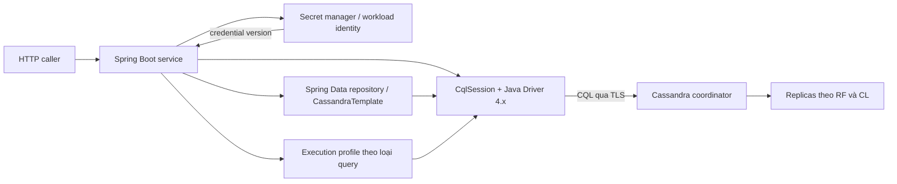
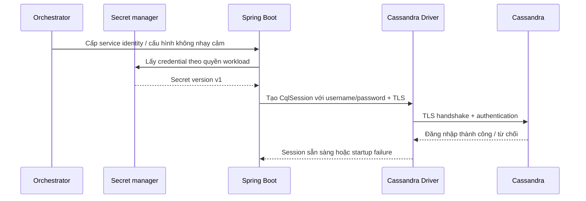
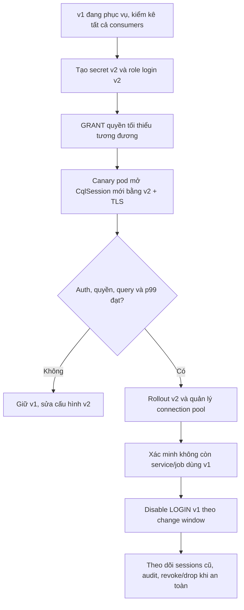

# Secret, xác thực, TLS và execution profile trong ứng dụng Spring Boot kết nối Cassandra

## 1. Bài toán: cấu hình chạy được chưa chắc đã đủ an toàn

Apache Cassandra là cơ sở dữ liệu **wide-column phân tán**. Ứng dụng Java gửi CQL qua driver tới coordinator, dữ liệu nằm trên các replica được chọn bởi **partition key** và **replication factor (RF)**, còn kết quả đọc/ghi được xác nhận theo **consistency level (CL)**. Trong Spring Boot và Spring Data Cassandra, phần kết nối thường được tự động cấu hình, nhưng điều đó không tự bảo đảm ba yêu cầu khác nhau:

1. **Secret và xác thực:** service dùng đúng danh tính, mật khẩu hoặc cơ chế đăng nhập được phê duyệt, không để lộ thông tin nhạy cảm.
2. **TLS:** kết nối CQL bảo vệ dữ liệu trên mạng và xác minh được server hợp lệ.
3. **Execution profile:** từng nhóm truy vấn có timeout, CL, page size và hành vi driver phù hợp với SLO/ngữ nghĩa nghiệp vụ.

Ví dụ `orders-api` có hai đường truy vấn:

- `GET /orders/{id}` cần đọc theo partition key, độ trễ thấp, `LOCAL_QUORUM` và timeout chặt.
- Job backfill đọc theo khóa/manifest có kiểm soát, có thể chịu timeout lớn hơn và page size khác, nhưng **không được tự hạ CL** để chạy nhanh.

Nếu dùng chung một cấu hình mặc định cho mọi thao tác, có thể vô tình để `SELECT` quan trọng chạy với consistency yếu, job backfill chiếm connection pool, hoặc secret từ môi trường test xuất hiện trong production.

### Kết quả học tập

- Phân biệt **Spring Boot application profiles** (`dev`, `staging`, `prod`) với **Java Driver execution profiles** (`interactive-read`, `backfill`).
- Kết nối Cassandra từ Spring Boot 3.x/Spring Data qua Java Driver 4.x mà không ghi password vào Git.
- Hiểu `PasswordAuthenticator`, `CassandraAuthorizer`, role tối thiểu và các giới hạn của TLS.
- Cấu hình TLS trust material, xác minh server identity và luân chuyển secret có kiểm soát.
- Áp dụng `setExecutionProfileName(...)` cho truy vấn CQL cần policy riêng.
- Biết ranh giới Spring Data Repository/CassandraTemplate so với API `CqlSession` trực tiếp.
- Kiểm thử startup, authorization, TLS, RF/CL, SLO, retry và failover trước triển khai.

**Nguyên tắc:** *Một session có thể phục vụ nhiều loại truy vấn, nhưng danh tính, TLS và chính sách thực thi của từng loại truy vấn phải được mô hình hóa rõ và kiểm chứng bằng hành vi thật.*

## 2. Sơ đồ ranh giới tin cậy trong ứng dụng



Các lớp có trách nhiệm riêng:

| Thành phần | Trách nhiệm chính | Không tự bảo đảm |
| --- | --- | --- |
| Spring Boot configuration | Inject cấu hình môi trường, tạo bean/session | Secret lưu an toàn chỉ vì có `@Value` |
| Secret manager | Kiểm soát cấp phát và phiên bản bí mật | Cassandra tự đổi password khi secret version đổi |
| Cassandra authenticator | Xác minh danh tính đăng nhập | Quyền `SELECT`/`MODIFY` trên từng bảng |
| Cassandra authorizer | Kiểm tra quyền role trên tài nguyên | Row-level authorization theo `tenant_id` |
| TLS | Bảo vệ kênh truyền và, khi cấu hình đúng, kiểm tra danh tính máy chủ | Ngăn một role hợp lệ đọc bảng ngoài phạm vi quyền |
| CqlSession / Java Driver | Kết nối, routing, prepared query, request policy | Tự hiểu SLO/nghiệp vụ của mọi request |
| Execution profile | Policy driver có tên cho một nhóm request | Thay đổi schema, RF hoặc tự tạo replica còn thiếu |
| Spring Data repository | Mapping entity/query theo abstraction | Tự cung cấp transaction ACID xuyên nhiều partition |

Đừng coi việc Spring Actuator báo `UP` là bằng chứng đã kiểm tra hết TLS, quyền của tất cả service accounts, consistency của mọi keyspace và khả năng phục vụ khi một replica bị dừng.

## 3. Version gate: Boot, Spring Data và Java Driver có thể khác nhau

Spring Boot và Spring Data thay đổi property namespace, cấu hình tự động và phiên bản driver theo từng release. Với một dự án production, phải ghi rõ:

| Kiểm tra | Lý do |
| --- | --- |
| Spring Boot version | Xác định namespace property, auto-configuration và các customizer hỗ trợ |
| Spring Data Cassandra version | Xác định entity annotations, repository/template API và reactive integration |
| Java Driver 4.x version/distribution | Xác định `CqlSession`, execution profile, retry, TLS và driver configuration |
| Apache Cassandra server version | Xác định native protocol/CQL features, auth, TLS và clustering behavior |
| JDK version | Spring Boot 3.x cần nền Java phù hợp; TLS/cryptography và SSLContext phụ thuộc JVM |
| Cassandra distribution/operator | Một dịch vụ managed hoặc distribution có thể có auth/TLS/config khác upstream |

Ví dụ phân biệt cấu hình:

| Nhánh công nghệ | Property prefix phổ biến | Lưu ý |
| --- | --- | --- |
| Spring Boot 2.x với Spring Data Cassandra | `spring.data.cassandra.*` | Kiểm tra đúng minor version |
| Spring Boot 3.x auto-configuration Cassandra | `spring.cassandra.*` | Ví dụ bài này dùng nhánh này |
| Java Driver 4.x config | `datastax-java-driver.*` trong HOCON | Không phải tên khác của Spring Boot property |

**Không copy file `application.yml` của Boot 2.x sang Boot 3.x mà không kiểm tra binding.** Một property cũ không còn được bind có thể khiến ứng dụng chạy với giá trị mặc định khác kỳ vọng.

### Dependency tối thiểu theo Spring Boot BOM

Ví dụ Maven dùng Spring Boot dependency management có sẵn:

```xml
<dependency>
    <groupId>org.springframework.boot</groupId>
    <artifactId>spring-boot-starter-data-cassandra</artifactId>
</dependency>

<dependency>
    <groupId>org.springframework.boot</groupId>
    <artifactId>spring-boot-starter-actuator</artifactId>
</dependency>
```

Không tự ghép các version Spring Data, Netty và Java Driver ngẫu nhiên với starter. Nếu cần override driver để vá lỗi, phải dùng **ma trận tương thích của bản Spring Boot đang chạy** và regression test auth/TLS/serialization.

## 4. CQL lab: keyspace, bảng và quyền tối thiểu

Giả sử lab có DC tên `dc1` với ít nhất ba node. `NetworkTopologyStrategy` với RF3 cho phép thử `LOCAL_QUORUM` khi đủ hai replica địa phương khỏe.

```sql
CREATE KEYSPACE IF NOT EXISTS commerce
WITH replication = {
    'class': 'NetworkTopologyStrategy',
    'dc1': 3
}
AND durable_writes = true;

CREATE TABLE IF NOT EXISTS commerce.orders_by_id (
    order_id uuid PRIMARY KEY,
    customer_id text,
    status text,
    total_cents bigint,
    updated_at timestamp
);

INSERT INTO commerce.orders_by_id (
    order_id, customer_id, status, total_cents, updated_at
) VALUES (
    11111111-1111-4111-8111-111111111111,
    'customer-42', 'CREATED', 125000,
    '2026-11-20T10:00:00Z'
);
```

**Partition key** ở đây là `order_id`; truy vấn theo ID không cần `ALLOW FILTERING`. Nếu cần danh sách đơn theo khách hàng/ngày, nên tạo bảng riêng theo query thay vì quét `orders_by_id` trên mọi partition.

### Quyền cho service chỉ đọc

Chỉ chạy các lệnh quản lý role trong **lab có authentication/authorization được cấu hình** và qua kết nối quản trị được phép. Password trong ví dụ là placeholder, **không dùng nguyên văn**:

```sql
CREATE ROLE IF NOT EXISTS orders_reader
WITH LOGIN = false AND SUPERUSER = false;

GRANT SELECT ON TABLE commerce.orders_by_id
TO orders_reader;

-- TEMPLATE: password phải do secret manager sinh và cấp an toàn.
CREATE ROLE app_orders_read_v1
WITH PASSWORD = '<GENERATED_LAB_SECRET>'
AND LOGIN = true
AND SUPERUSER = false;

GRANT orders_reader TO app_orders_read_v1;
```

Trên một phiên đăng nhập **mới** bằng `app_orders_read_v1`:

```sql
SELECT order_id, status, total_cents
FROM commerce.orders_by_id
WHERE order_id = 11111111-1111-4111-8111-111111111111;

-- Test phủ định: role chỉ đọc phải không được phép UPDATE.
UPDATE commerce.orders_by_id
SET status = 'PAID'
WHERE order_id = 11111111-1111-4111-8111-111111111111;
```

Trong test này, `UPDATE` bị authorization từ chối là **kết quả đúng**. Nếu update thành công, phải kiểm tra grant/inheritance và quyền superuser trước khi kết luận rằng service có least privilege.

### Authenticator và authorizer là hai lớp riêng

Các lựa chọn cấu hình thường gặp trong triển khai Cassandra tự quản lý:

```yaml
# cassandra.yaml, chỉ minh họa khái niệm.
authenticator: PasswordAuthenticator
authorizer: CassandraAuthorizer
role_manager: CassandraRoleManager
```

Đừng bật/tắt các lựa chọn này trực tiếp trên production đang hoạt động mà không có migration plan, quyền quản trị dự phòng và rolling deployment phù hợp. `system_auth` cần replication/availability thích hợp; bảo đảm dữ liệu nghiệp vụ khỏe không đồng nghĩa auth metadata luôn khả dụng.

## 5. Secret không thuộc Git, image hay log

Trong ứng dụng Spring Boot, credential có thể đi vào JVM theo nhiều cách. Cách tốt nhất phụ thuộc nền tảng, nhưng các nguyên tắc không thay đổi:

1. Password **ngẫu nhiên, riêng cho service/environment**, không dùng superuser.
2. Secret manager là nơi phát hành/version/audit; code chỉ biết **secret reference**.
3. Workload identity/RBAC chỉ cho phép service đọc secret được cấp.
4. Quyền **đọc secret** và **đổi secret/role** thuộc hai vai trò riêng.
5. Không ghi plaintext vào `application.yml`, `application-prod.yml`, Dockerfile, Git history, CI output, logs, metrics, trace hoặc ticket.
6. Có cơ chế rotate/revoke và phương án khi secret manager không truy cập được.

### Đường đi khi khởi động



Sơ đồ dùng secret fetch lúc startup như một phương án. Nền tảng cũng có thể inject secret qua file/volume hoặc environment. **Inject không đồng nghĩa auto refresh `CqlSession`**.

### So sánh những cách đưa secret vào app

| Cách | Lợi ích | Nguy cơ cần kiểm soát |
| --- | --- | --- |
| Workload identity + secret manager SDK | Có IAM, audit, versioning, rotate workflow | Startup/refresh phụ thuộc mạng/secret manager; cần caching và backoff |
| Secret volume được mount | Có thể thay file theo cơ chế nền tảng | Quyền file, atomically replace, session chưa re-authenticate |
| Environment variables | Tích hợp Boot đơn giản | Process environment, debug/heap dump, rollout/restart khi thay |
| Kubernetes Secret | Cách phân phối phổ biến | Base64 **không phải mã hóa**; cần etcd encryption/RBAC/audit |
| Command-line arguments | Dễ thử tay | Có thể lộ qua process list/shell history; **tránh trên production** |
| Secret trong `application.yml` | Dễ chạy ngay | Dễ bị commit, copy, in hoặc snapshot; **không chấp nhận** |

Không coi mã hóa ở storage là đủ nếu service account có quyền đọc quá rộng. **Secret manager bảo vệ credential, còn CassandraAuthorizer kiểm soát việc role đó làm được gì sau khi đăng nhập.**

## 6. Spring Boot 3.x: cấu hình kết nối bằng property

Ví dụ `application-prod.yml` dành cho **Spring Boot 3.x tương thích với property prefix được xác minh**:

```yaml
spring:
  cassandra:
    contact-points: ${CASSANDRA_CONTACT_POINTS}
    local-datacenter: ${CASSANDRA_LOCAL_DC}
    keyspace-name: commerce
    username: ${CASSANDRA_USERNAME}
    password: ${CASSANDRA_PASSWORD}
    request:
      timeout: 3s
    ssl:
      enabled: true

management:
  endpoint:
    health:
      show-details: never
```

Ký hiệu môi trường ở ví dụ **phải được platform inject bằng cơ chế secret được bảo vệ**. Không dùng các giá trị mặc định như password `admin123` hoặc `ssl.enabled=false` cho profile prod. Các property chính xác, nhất là phần TLS và request timeout, phải kiểm tra với **minor version Spring Boot hiện dùng**.

### Những lưu ý quan trọng

- `contact-points` nên gồm các node/địa chỉ hợp lệ theo topology; không phụ thuộc duy nhất một node đang bảo trì.
- `local-datacenter` phải khớp tên DC mà driver nhìn thấy, không thay bằng tên region ngẫu nhiên.
- `keyspace-name` chọn keyspace mặc định; **không tự cấp quyền** cho role trên keyspace.
- `username/password` được Java Driver dùng khi tạo connection; **đổi secret bên ngoài không tự làm session hiện tại đăng nhập lại bằng credential mới**.
- `request.timeout` là cấu hình theo đường Spring Boot; named execution profile ở driver có thể đặt timeout theo request riêng.
- `ssl.enabled` chỉ là bước kích hoạt; phải cấu hình **trust material và xác minh server identity** đúng.
- Không bật endpoint configuration dump hoặc Actuator `env` công khai để “kiểm tra password đã load chưa”.

### Không hard-code secret trong file profile môi trường

`application-dev.yml` và `application-prod.yml` có thể chứa host/DC hoặc policy khác nhau, nhưng file prod **không chứa secret thật**. Trường hợp local dev cần Cassandra không bật auth để học tập phải được cô lập; không copy sự thuận tiện này làm production default.

Nếu dùng Spring Cloud hoặc một connector secret manager khác, hãy xác minh **thứ tự property sources**. Một environment variable cũ hoặc flag command line có thể override cấu hình secret đúng, dẫn tới đăng nhập bằng version không mong đợi.

## 7. Hai loại “profile”: Spring profile khác execution profile

Tên giống nhau nhưng cấp độ hoạt động hoàn toàn khác:

| Đặc tính | Spring profile | Java Driver execution profile |
| --- | --- | --- |
| Mục tiêu | Chọn config/bean theo môi trường triển khai | Chọn policy cho **từng CQL request** |
| Ví dụ | `dev`, `test`, `prod` | `interactive-read`, `backfill`, `audit-write` |
| Cách chọn | `spring.profiles.active`, `@Profile`, config data | `setExecutionProfileName("...")` trên statement |
| Phạm vi | Application context và property sources | Request/driver config trong một `CqlSession` |
| Secret | Có thể trỏ tới secret reference của môi trường | **Không nên chứa username/password riêng theo query** |
| Thay đổi CL | Không trực tiếp là CL của request | Có thể định nghĩa CL mặc định cho nhóm statement |
| Rủi ro | Chạy nhầm prod config ở staging | Truy vấn nhạy cảm dùng profile CL/timeout sai |

**Đừng đặt tên driver execution profile là `prod` rồi giả định nó được Spring Boot kích hoạt khi `spring.profiles.active=prod`.** Không có phép nối tự động đó nếu ứng dụng không cấu hình rõ.

### Hai chiều cấu hình cần phối hợp

```text
Spring profile = prod
  → Chọn cluster prod, secret ref prod, trust store prod
  → Tạo một CqlSession kết nối prod

Driver execution profile = interactive-read
  → Chọn consistency LOCAL_QUORUM, timeout 2 s, page size 100

Driver execution profile = backfill
  → Chọn consistency LOCAL_QUORUM, timeout 10 s, page size 250
  → Vẫn là cùng cluster/role nếu không cấu hình session khác
```

Một Java Driver execution profile **không phải identity mới**. Nếu backfill cần một role có quyền rộng hơn hoặc cluster khác, thường cần **một session/configuration riêng có kiểm soát**, không lách authorization bằng profile tên `admin`.

## 8. TLS: bật mã hóa và tin đúng máy chủ

Đối với xác thực bằng password, cần bảo vệ **client ↔ Cassandra coordinator** bằng TLS. Hãy hiểu đủ hai khía cạnh:

1. **Confidentiality/integrity:** traffic không đi ở dạng rõ trên đường truyền; phát hiện được chỉnh sửa trái phép trong TLS session.
2. **Server authentication:** client tin CA/chứng chỉ đúng và xác nhận danh tính endpoint phù hợp chính sách.

Chỉ gọi `withSslContext(...)` với một trust manager tùy tiện **không tự chứng minh hostname verification được bật**. Phải kiểm tra rõ **đường driver/SSL engine thực tế** có đối chiếu DNS/IP/SAN của chứng chỉ và đang chạy validation đúng yêu cầu.

### Các lớp TLS cần phân biệt

| Đường truyền | Nằm ở đâu? | Thông số liên quan |
| --- | --- | --- |
| CQL client TLS | Spring Boot/Java Driver ↔ Cassandra node | Client encryption, trust material, server identity |
| Internode TLS | Replica/coordinator ↔ replica | Server encryption, cert/trust riêng theo topology |
| Secret manager TLS | JVM/orchestrator ↔ secret manager | CA/endpoint/identity của kho bí mật |
| Actuator/HTTP TLS | User/API gateway ↔ Spring Boot | Web server/gateway TLS |

**Bật TLS cho CQL không tự bật internode TLS hoặc TLS cho secret manager**. Mỗi đường cần cấu hình, chính sách chứng chỉ và giám sát độc lập.

### Certificate rotation khác password rotation

Password rotation thay thông tin xác thực của một role. Certificate rotation có thể thay **CA, trust store, leaf certificate hoặc node identity**. Cả hai đều có thể đòi tạo connection mới và kiểm thử trước/sau rollout, nhưng điểm cắt/rollback khác nhau:

- Thêm CA mới vào trust store trước khi server dùng cert mới khi chính sách cho phép.
- Kiểm tra hostname/SAN hợp lệ trên từng contact point.
- Canary connection mới từ một instance sạch.
- Không vô hiệu hóa trust CA cũ trước khi hoàn tất chuyển đổi theo kế hoạch.
- Không tắt certificate validation để “xử lý nhanh” lỗi handshake.

## 9. Tùy biến TLS và driver config trong Spring Boot

Với Spring Boot có bean `CqlSessionBuilderCustomizer` tương thích, có thể tùy biến session builder thay vì tự tạo thêm một `CqlSession` độc lập. Mẫu dưới đây cấu hình **SSLContext từ PKCS#12 trust store** và yêu cầu driver đọc file execution profile đã được đặt trên classpath.

```java
import java.io.InputStream;
import java.nio.file.Files;
import java.nio.file.Path;
import java.security.KeyStore;
import java.security.SecureRandom;
import java.util.Arrays;

import javax.net.ssl.SSLContext;
import javax.net.ssl.TrustManagerFactory;

import org.springframework.beans.factory.annotation.Value;
import org.springframework.boot.autoconfigure.cassandra.CqlSessionBuilderCustomizer;
import org.springframework.context.annotation.Bean;
import org.springframework.context.annotation.Configuration;

import com.datastax.oss.driver.api.core.config.DriverConfigLoader;

@Configuration(proxyBeanMethods = false)
public class CassandraClientSecurityConfiguration {

    @Bean
    CqlSessionBuilderCustomizer cassandraSessionCustomizer(
            @Value("${app.cassandra.tls.trust-store-path}")
            String trustStorePath,
            @Value("${app.cassandra.tls.trust-store-password}")
            String trustStorePassword) throws Exception {

        SSLContext trustedTls = loadTrustContext(
            Path.of(trustStorePath), trustStorePassword);
        DriverConfigLoader loader = DriverConfigLoader.fromClasspath(
            "cassandra-driver.conf");

        return builder -> {
            builder.withConfigLoader(loader);
            builder.withSslContext(trustedTls);
        };
    }

    private static SSLContext loadTrustContext(
            Path path, String password) throws Exception {
        char[] passwordChars = password.toCharArray();
        try {
            KeyStore trustStore = KeyStore.getInstance("PKCS12");
            try (InputStream input = Files.newInputStream(path)) {
                trustStore.load(input, passwordChars);
            }

            TrustManagerFactory factory =
                TrustManagerFactory.getInstance(
                    TrustManagerFactory.getDefaultAlgorithm());
            factory.init(trustStore);

            SSLContext context = SSLContext.getInstance("TLS");
            context.init(null, factory.getTrustManagers(),
                new SecureRandom());
            return context;
        } finally {
            Arrays.fill(passwordChars, '\0');
        }
    }
}
```

Đây là **ví dụ kỹ thuật**, không phải hardening recipe hoàn chỉnh:

- `app.cassandra.tls.trust-store-password` là secret được inject ở runtime, **không được commit giá trị** vào repository.
- Trust store dùng để tin **CA/server certificate phù hợp**, không phải danh sách “trust all” vô điều kiện.
- `SSLContext` trong ví dụ tập trung vào trust chain. **Bắt buộc kiểm tra cơ chế hostname/SAN validation trên đúng driver 4.x và SSL engine được dùng**; nếu cần, cấu hình engine factory theo tài liệu phiên bản thay vì đoán rằng context đã đủ.
- Nếu cluster yêu cầu **mutual TLS**, cần cấu hình key material/certificate của client qua quy trình riêng; chỉ trust store không đủ.
- Tránh tạo cùng lúc hai bean `CqlSession` ngoài dự kiến hoặc một customizer khác ghi đè SSL/config loader.
- `DriverConfigLoader` phải giữ được các thông số contact points, local DC, auth và pool mà Boot đã cấu hình; xác minh effective config khi dùng nhiều config sources.
- Credential ở dạng `String` khó xóa khỏi heap ngay; không in `trustStorePassword`, `CassandraProperties` hoặc snapshot environment.

### Property dùng cho ví dụ TLS customizer

Trong `application-prod.yml`:

```yaml
app:
  cassandra:
    tls:
      trust-store-path: ${CASSANDRA_TRUST_STORE_PATH}
      trust-store-password: ${CASSANDRA_TRUST_STORE_PASSWORD}
```

Các biến này phải được inject bởi hệ thống phân phối secret/cert có kiểm soát. Một số phiên bản Spring Boot hỗ trợ **SSL bundles** hoặc cấu hình TLS declarative; nếu dùng cách đó, không cần tự viết SSLContext như ví dụ. **Chỉ chọn một đường cấu hình TLS được version hỗ trợ và kiểm thử thực tế**.

## 10. Driver execution profiles: HOCON có tên và kế thừa

Java Driver 4.x có thể đọc file HOCON trên classpath. Ví dụ đặt `cassandra-driver.conf` trong resources, được customizer ở mục 9 nạp:

```hocon
datastax-java-driver {
  profiles {
    "interactive-read" {
      basic.request {
        consistency = LOCAL_QUORUM
        timeout = 2 seconds
        page-size = 100
      }
    }

    "backfill" {
      basic.request {
        consistency = LOCAL_QUORUM
        timeout = 10 seconds
        page-size = 250
      }
    }
  }
}
```

Trong ví dụ, hai profile **kế thừa các giá trị driver mặc định còn lại** theo cơ chế config loader của phiên bản được dùng. Tên config, loại option được profile hóa và cú pháp duration nên được xác minh bằng startup test/driver effective config. Không tự sáng chế key HOCON rồi mong driver dùng nó.

| Profile | Truy vấn ví dụ | Policy | Vì sao? |
| --- | --- | --- | --- |
| `interactive-read` | Đọc một đơn theo `order_id` | `LOCAL_QUORUM`, 2 s, page size 100 | Ưu tiên SLO của HTTP API |
| `backfill` | Đọc có manifest/token-range do job quản lý | `LOCAL_QUORUM`, 10 s, page size 250 | Budget khác, nhưng giữ CL yêu cầu |
| Default profile | Truy vấn không gắn profile | Cấu hình mặc định của session | Phải xác minh, tránh vô tình dùng policy yếu |

**Timeout 2 s và 10 s chỉ là số minh họa, không phải đề xuất chung**. Workload ở hai DC qua WAN, node đang compaction hoặc API có deadline 500 ms cần budget riêng.

### Profile không tạo bulkhead hay capacity

Đặt `timeout=10 seconds` cho backfill **không tự giới hạn** số request đồng thời. Một job gửi 10.000 request có thể gây:

- Connection pool saturation.
- Pending read/write tasks tăng trên node.
- Disk I/O, heap/GC và compaction backlog tăng.
- API interactive p99 xấu dù hai loại query có tên profile khác.

Với backfill, còn cần **rate limit, bounded concurrency, checkpoint, retry budget và đo headroom**. Muốn cách ly mạnh hơn phải tính đến pool/session hoặc workload separation theo kiến trúc được phê duyệt.

## 11. Áp dụng execution profile vào `BoundStatement`

Trong Java Driver 4.x, một statement có thể chọn profile theo tên:

```java
BoundStatement statement = prepared.bind(orderId)
    .setExecutionProfileName("interactive-read")
    .setIdempotent(true);

session.executeAsync(statement);
```

`setExecutionProfileName` không đổi role Cassandra và không cấp quyền. Nó chọn policy đã được cấu hình sẵn bên trong driver session.

Nếu trên statement có cấu hình trực tiếp như `setConsistencyLevel(...)` hoặc `setTimeout(...)` (theo API được driver version hỗ trợ), **per-statement override** có thể thay giá trị profile cho request đó. Vì vậy phải thống nhất quy tắc:

1. Profile định nghĩa **mặc định theo loại query**.
2. Per-statement override chỉ dùng khi có lý do và được kiểm thử.
3. Không để nhiều layer tự ghi đè CL/timeout mà khó truy vết.
4. Metrics/logs ghi `queryTemplate` và `executionProfileName` thay vì password/cột nhạy cảm.
5. Startup hoặc integration test phải phát hiện **profile name sai/missing** trước khi traffic production.

### Không gọi profile mới là một consistency level mới

`interactive-read` không phải một loại CL trong Cassandra; `LOCAL_QUORUM` mới là CL. Việc profile có tên “strong-read” không chứng minh query đang dùng quorum nếu HOCON sai hoặc bị statement override.

## 12. Spring service dùng driver trực tiếp để chọn profile per request

Spring Data repository có ích cho CRUD/mapping, nhưng khi một query cần **điều khiển rõ execution profile**, việc inject `CqlSession` và tạo `PreparedStatement` giúp thể hiện chính sách ngay nơi gọi.

```java
import java.util.Optional;
import java.util.UUID;
import java.util.concurrent.CompletionStage;
import java.util.Iterator;

import org.springframework.stereotype.Service;

import com.datastax.oss.driver.api.core.CqlSession;
import com.datastax.oss.driver.api.core.cql.AsyncResultSet;
import com.datastax.oss.driver.api.core.cql.BoundStatement;
import com.datastax.oss.driver.api.core.cql.PreparedStatement;
import com.datastax.oss.driver.api.core.cql.Row;

@Service
public final class OrderLookupService {
    private final CqlSession session;
    private final PreparedStatement selectById;

    public OrderLookupService(CqlSession session) {
        this.session = session;
        this.selectById = session.prepare(
            "SELECT order_id, status, total_cents " +
            "FROM commerce.orders_by_id WHERE order_id = ?"
        );
    }

    public CompletionStage<Optional<OrderSummary>> findById(
            UUID orderId) {
        BoundStatement statement = selectById.bind(orderId)
            .setExecutionProfileName("interactive-read")
            .setIdempotent(true);

        return session.executeAsync(statement).thenApply(result -> {
            Iterator<Row> rows = result.currentPage().iterator();
            if (!rows.hasNext()) {
                return Optional.empty();
            }
            Row row = rows.next();
            return Optional.of(new OrderSummary(
                row.getUuid("order_id"),
                row.getString("status"),
                row.getLong("total_cents")
            ));
        });
    }

    public static final class OrderSummary {
        public final UUID orderId;
        public final String status;
        public final long totalCents;

        public OrderSummary(UUID orderId, String status, long totalCents) {
            this.orderId = orderId;
            this.status = status;
            this.totalCents = totalCents;
        }
    }
}
```

Ví dụ trả `CompletionStage` để không chặn thread HTTP; một Spring WebFlux controller có thể chuyển stage thành `Mono` nếu phù hợp. **Không gọi `join()` hoặc JDBC sync trong `thenApply`**: continuation có thể chạy trên đường completion của driver.

### Những điểm kỹ thuật cần kiểm tra

- `session.prepare(...)` trong constructor gọi Cassandra khi bean được tạo; startup có thể fail nếu database chưa sẵn sàng. Cần startup/readiness policy, không đặt retry vòng lặp vô hạn.
- `currentPage()` đủ cho query theo khóa chính trả tối đa một hàng; với query nhiều hàng phải thiết kế paging riêng.
- `@Service` không tự làm cho việc chuẩn bị truy vấn hay đọc dữ liệu trở thành một transaction xuyên các partition.
- `total_cents bigint` ánh xạ với Java `long`; nếu cột có thể null, phải dùng `row.isNull(...)` trước khi đọc primitive.
- Không ghi `orderId` hoặc raw row vào metric labels gây lộ dữ liệu/high cardinality.
- `setIdempotent(true)` phù hợp đọc thuần; không áp dụng mù cho counter, list append hoặc LWT.

## 13. Spring Data Repository và CassandraTemplate: dùng đúng phạm vi

Một entity tối giản:

```java
import java.util.UUID;

import org.springframework.data.cassandra.core.mapping.PrimaryKey;
import org.springframework.data.cassandra.core.mapping.Table;
import org.springframework.data.cassandra.core.mapping.Column;

@Table("orders_by_id")
public class OrderRecord {
    @PrimaryKey("order_id")
    private UUID orderId;

    @Column("status")
    private String status;

    @Column("total_cents")
    private Long totalCents;

    public OrderRecord() { }

    public UUID getOrderId() { return orderId; }
    public void setOrderId(UUID id) { this.orderId = id; }
    public String getStatus() { return status; }
    public void setStatus(String value) { this.status = value; }
    public Long getTotalCents() { return totalCents; }
    public void setTotalCents(Long value) { this.totalCents = value; }
}
```

Repository:

```java
import java.util.UUID;
import org.springframework.data.cassandra.repository.CassandraRepository;

public interface OrderRepository
        extends CassandraRepository<OrderRecord, UUID> {
}
```

Spring Data có thể đọc/ghi entity theo mapping; ví dụ `orderRepository.findById(id)` tiện cho CRUD cơ bản. Tuy nhiên:

| Tình huống | Lựa chọn phù hợp |
| --- | --- |
| CRUD theo khóa chính, mapping entity đơn giản | Spring Data `CassandraRepository` |
| Truy vấn điều kiện/CQL đơn giản trong phạm vi hỗ trợ của Spring Data | Repository `@Query` hoặc `CassandraTemplate` |
| Cần chỉ rõ named execution profile trên từng statement | `CqlSession`/driver statement hoặc integration Spring Data được **version hỗ trợ** |
| Cần điều khiển paging state/cancellation/read CL đặc biệt | Thường dùng Java Driver trực tiếp |
| Cần đọc Reactive Streams và backpressure | Spring Data Reactive Cassandra hoặc driver reactive, theo version |
| Cần nhiều keyspace hoặc nhiều identity/TLS trust | Thiết kế session/template riêng có định danh rõ |

**Không mặc định annotation repository sẽ tự chọn Java Driver execution profile theo tên method**. Chọn profile là một khả năng của driver; Spring Data có abstraction khác và phạm vi expose option phụ thuộc release. Nếu ứng dụng phải kiểm soát chặt từng request, thể hiện rõ đường gọi sử dụng `CqlSession`.

### Schema action trong production

Spring Data/Spring Boot có thể hỗ trợ schema initialization hoặc `SchemaAction` theo cấu hình. Trên production, **không tự động DROP/RECREATE bảng khi service restart**. Hãy quản lý migration CQL qua quy trình riêng, kiểm tra schema agreement và tương thích các bản ứng dụng cũ/mới.

Một `@Table` mapping đúng không có nghĩa Spring Boot đã tự tạo keyspace, replication factor hoặc quyền role. DBA/platform phải xác minh những thành phần này trước startup.

## 14. Execution profile không được làm yếu RF/CL của nghiệp vụ

Giả sử `commerce` có `RF(dc1)=3`:

| CL | Số replica địa phương cần cho một request thông thường | Khi dừng một replica |
| --- | ---: | --- |
| `LOCAL_ONE` | 1 | Có thể phục vụ khi còn local replica khỏe, nhưng độ tươi/consistency khác |
| `LOCAL_QUORUM` | 2 | Còn đúng 2 local replica, cần cả hai đáp ứng kịp |
| `ALL` trong keyspace một DC RF3 | 3 | Không đạt khi một replica offline |

Một execution profile đặt timeout dài **không bù cho thiếu replica**. Nếu một API dùng `LOCAL_QUORUM` và RF3, dừng hai node cùng chịu trách nhiệm một partition sẽ làm request không đủ quorum. Thay profile sang `LOCAL_ONE` có thể làm request chạy được nhưng **đã thay đổi bảo đảm dữ liệu**.

### Nhiều datacenter

Với `NetworkTopologyStrategy` có RF3 ở `dc1` và RF3 ở `dc2`:

- `LOCAL_QUORUM` từ dc1 yêu cầu quorum **ở dc1**.
- `QUORUM` toàn keyspace có semantics khác và có thể liên quan WAN.
- `EACH_QUORUM` của ghi yêu cầu quorum theo từng DC.
- `LOCAL_SERIAL`/`SERIAL` cho LWT/Paxos có vai trò riêng với conditional updates.

**Không tạo profile `fast` với CL yếu rồi cho mọi service dùng chỉ vì p99 đẹp hơn.** Phân loại read/write/counter/LWT theo yêu cầu consistency và idempotency, sau đó benchmark timeout trên cluster có tải đại diện.

### Không dùng execution profile thay retry policy nghiệp vụ

- `SELECT` thuần đọc thường có thể đánh dấu idempotent.
- `counter = counter + 1` có thể nhân đôi tác dụng khi retry.
- `list = list + [?]` có thể append lại một phần tử.
- `USING TTL` replay sau một khoảng trễ có thể đổi expiration.
- `INSERT ... IF NOT EXISTS` timeout có outcome chưa xác định; retry có thể trả `[applied]=false` dù lần đầu đã thành công.

Execution profile chỉ cấu hình **cách request được thực thi**, không cung cấp exactly-once semantics. Cờ `setIdempotent`, retry budget và operation ID vẫn phải được thiết kế theo từng mutation.

## 15. Quản lý secret rotation: staged v1 → v2 → revoke

Trong hệ thống Spring Boot có nhiều pod, việc thay password cùng một role ngay lập tức có thể tạo lỗi ở **new connections** của những pod chưa nhận secret mới. Một chiến lược thường dễ kiểm soát hơn là **hai login roles song song** trong cửa sổ luân chuyển:



### Các bước vận hành

1. Lập danh sách tất cả consumer: Spring Boot pods, batch jobs, admin tools, ETL, CI, scheduled workers.
2. Sinh secret version mới trong kho bí mật; không gửi password qua chat hoặc ticket.
3. Tạo login role mới với **quyền tối thiểu**, ví dụ cùng `orders_reader`.
4. Kiểm tra **một CqlSession mới** mở kết nối TLS đến nhiều node, thực thi `SELECT` theo CL yêu cầu.
5. Canary một số pod, đo auth failures, connection creation, timeout, API p95/p99.
6. Chuyển dần traffic; không chỉ thay environment variable khi JVM đang chạy.
7. Đảm bảo các cron/batch job không tiếp tục dùng credential v1.
8. Chỉ sau khi đã xác minh, mới `ALTER ROLE old WITH LOGIN = false` và xử lý connection/session hiện hữu theo runbook.
9. Hết rollback window mới revoke/drop role cũ theo chính sách, lưu audit không chứa secret.

**Việc khóa `LOGIN=false` không bảo đảm mọi session đã xác thực bị ngắt lập tức**; cache và connection lifecycle có thể kéo dài. Phải kiểm tra new connection và có chính sách đóng session cũ, không chỉ nhìn trạng thái trong secret manager.

### Nếu bắt buộc đổi password tại chỗ

Trong trường hợp không cho phép hai role, `ALTER ROLE ... WITH PASSWORD = ...` có thể tạo khoảng thời gian server chấp nhận v2 nhưng client vẫn giữ v1. Cần maintenance plan, client rollout, cơ chế test new auth và rollback **cả phía Cassandra lẫn phía ứng dụng**.

Chỉ revert secret store về v1 **không có nghĩa** Cassandra đã quay lại password v1. Không hứa zero downtime khi chưa đo ở phiên bản, topology và pool thực tế.

## 16. Lỗi cấu hình và triệu chứng thường gặp

| Triệu chứng | Nguyên nhân cần kiểm tra | Hành động |
| --- | --- | --- |
| Spring Boot không tạo được `CqlSession` | Property thiếu, contact points/DC sai, DNS/port không thông | Kiểm tra cấu hình hiệu lực và root cause; không in password |
| `AuthenticationException` | Username/password sai, role disabled, auth backend lỗi | Secret version, role, `system_auth`, thử new connection |
| `UnauthorizedException` hoặc CQL bị từ chối | Đăng nhập đúng nhưng role thiếu `SELECT`/`MODIFY` | Kiểm tra grants/inheritance; không cấp ALL bừa |
| TLS handshake failed | Trust store, cert chain, hostname/SAN, TLS version | Kiểm chứng certificate/trust, không tắt validation |
| Kết nối sang DC sai | `local-datacenter` hoặc discovery sai | Đối chiếu `nodetool status`/snitch/DC và driver |
| Profile không tìm thấy | HOCON không được load, tên profile sai | Integration test startup + explicit profile query |
| Truy vấn timeout nhanh hơn kỳ vọng | Per-statement override/profile/default hoặc deadline HTTP | Kiểm tra config precedence và latency thực |
| App đang chạy nhưng new connection fail sau rotation | Session cũ vẫn sống, secret v1 chưa được cập nhật | Kiểm tra pod/job version và rollout |
| Spring Data `findById` chạy CL khác manual query | Repository và raw driver dùng policy khác | Ghi rõ default profile/driver config và test cả hai đường |
| API p99 tăng khi backfill | Concurrency cao, disk I/O, pool saturation | Rate-limit/bulkhead, đo node và driver |
| `UnavailableException` | Thiếu replica để đạt CL ở DC | Kiểm tra RF/CL/status, không hạ CL tùy tiện |
| `AllNodesFailedException` | Nhiều nguyên nhân auth/TLS/network/connection | Phân tích root causes theo node, không mặc định một lỗi |

**Lỗi xác thực khác lỗi phân quyền**: auth failure nghĩa danh tính chưa được xác thực; authorization failure nghĩa đã nhận diện caller nhưng hành động không được cho phép. Tách hai loại để tránh cấp thêm quyền khi thực ra password sai.

## 17. Health/readiness và quan sát an toàn

Spring Boot Actuator có health contributors tùy starter/auto-configuration. Tuy nhiên:

- `health=UP` có thể chỉ kiểm tra một đường truy cập, không chứng minh các execution profiles đều hoạt động.
- Readiness nên xác minh session/driver kết nối được đúng cluster và chạy được **query nhẹ, có partition key**, với role/CL yêu cầu.
- Không chạy full scan, `ALLOW FILTERING` hoặc ghi dữ liệu nghiệp vụ thật trong health probe.
- Không expose thông tin config, environment, password, contact point nội bộ và stack trace nhạy cảm ra endpoint công khai.
- Nếu secret manager tạm lỗi, xác định policy startup/refresh; không tạo retry storm ở mỗi HTTP request.

### Các nhóm metric cần có

| Nguồn | Chỉ số | Ý nghĩa |
| --- | --- | --- |
| Spring Boot HTTP | p95/p99, error rate, active requests | Ảnh hưởng người dùng |
| Driver request metrics | Latency, timeout, retry/attempt, pool saturation | Query chịu tải hoặc config profile sai |
| Profile/query template | Phân bố truy vấn `interactive-read` và `backfill` | Phân nhóm SLO và phát hiện profile dùng sai |
| TLS/auth logs | Handshake/auth failure đã redact | Certificate, secret rotation, role availability |
| Secret manager audit | Secret reads/rotations theo workload identity | Bất thường quyền truy cập secret |
| Cassandra `tpstats` | Pending/dropped work | Replica/coordinator có bị quá tải |
| Cassandra `compactionstats` | Active/pending compactions | Backfill có tranh I/O |
| Cassandra `tablestats` | SSTable/memtable/local latency | Khác biệt theo node/bảng |
| JVM/OS | Heap/GC/CPU/disk/network | Phân biệt client/server bottleneck |

Lệnh quan sát node:

```bash
nodetool status
nodetool describecluster
nodetool tpstats
nodetool compactionstats
nodetool tablestats commerce.orders_by_id
```

`nodetool` chủ yếu cho thông tin theo node và topology; nó **không biết** Spring Boot đang dùng secret version nào hoặc đã chọn execution profile gì. Cần kết hợp metrics trên JVM/driver và audit ở secret manager.

### Đừng ghi secret hoặc dữ liệu nhạy cảm vào metric labels

Có thể log `service=orders-api`, `profile=interactive-read`, `queryTemplate=ordersById` và version config đã làm sạch. Không log:

- Password, bearer token, key material và full cursor/paging state.
- Kết quả `toString()` của property beans chứa secret.
- Raw CQL với parameter nhạy cảm khi logging driver.
- Tenant/customer ID làm label high cardinality không được phê duyệt.

## 18. Playbook triển khai production từng giai đoạn

### Giai đoạn A — Chuẩn bị

1. Ghi version Spring Boot/Spring Data/Driver/JDK/Cassandra, xác minh prefix property/API.
2. Kiểm tra RF theo DC, CL thực tế, keyspace, schema và query shape.
3. Cấp riêng role đọc/ghi theo bảng/luồng nghiệp vụ, không dùng superuser.
4. Cấu hình secret manager IAM, trust CA, certificate SAN, network rules và key rotation.
5. Thử TLS handshake và authentication từ một instance mới ở staging.
6. Đặt execution profiles rõ mục đích, giữ default profile an toàn.

### Giai đoạn B — Canary

1. Deploy một pod đọc secret mới, mở CqlSession và test `SELECT` theo partition key.
2. Test phủ định role không có quyền `UPDATE`/DDL.
3. Gọi query với `interactive-read` rồi `backfill`, kiểm tra profile thực sự được chọn.
4. Đo API p99, timeout, retry, driver connection pool và Cassandra pending/compaction.
5. Restart canary để buộc tạo **new connections**, tránh chỉ dựa trên connection cũ còn hoạt động.
6. Nếu lỗi cert/secret/config, **dừng rollout**, không hạ TLS/CL để chữa tạm.

### Giai đoạn C — Rollout và hậu kiểm

1. Mở rộng rollout theo từng nhóm instance có thể rollback.
2. Kiểm tra scheduled jobs/ETL cùng phiên bản secret/schema/profile.
3. Theo dõi metrics khi traffic cao và khi một node được bảo trì.
4. Chỉ thu hồi credential cũ sau khi đã chuyển mọi consumer và có bằng chứng.
5. Lưu audit và playbook, chuẩn bị rotate cert/password tiếp theo.

### Quy tắc dừng

**Dừng rollout** khi auth/TLS failures tăng, `Unavailable` theo CL xuất hiện, API p99 vượt SLO, profile không được load, job backfill làm disk/compaction quá tải hoặc có nguy cơ dùng nhầm credentials giữa environments.

Không biến một lỗi cấu hình thành sự cố dữ liệu bằng cách thử `DROP/ALTER KEYSPACE`, giảm RF, ép repair hay đổi CL không được phê duyệt.

## 19. Tình huống tự đánh giá

### Tình huống A — Spring `prod` không chọn profile `interactive-read`

Ứng dụng chạy `spring.profiles.active=prod` nhưng query vẫn dùng driver default CL. Team nghĩ Spring profile phải tự bật `interactive-read`.

**Đáp án:** Sai. Spring profile chọn cấu hình/bean môi trường; Java Driver execution profile được chọn qua statement hoặc cấu hình driver. Cần áp dụng `setExecutionProfileName("interactive-read")` và kiểm tra HOCON đã load.

### Tình huống B — File YAML có password trong Git

Repository chứa `spring.cassandra.password: "secret-value"`, sau đó nhóm xóa dòng ở commit mới. Credential đã an toàn chưa?

**Đáp án:** Chưa. Password có thể tồn tại trong Git history, artifact và cache. Coi là secret lộ, **rotate/revoke**, điều tra truy cập và chuyển sang secret manager.

### Tình huống C — TLS bật nhưng không kiểm tra hostname

App tin một CA dùng chung, nhưng không kiểm tra server hostname/SAN. Có thể khẳng định đã chống kết nối nhầm server không?

**Đáp án:** Không. Trust chain và server identity là hai lớp xác minh cần kiểm thử. Phải kiểm tra cấu hình SSL engine/driver thực tế, không tự tắt validation khi cert sai.

### Tình huống D — Kho bí mật đổi phiên bản, pool cũ vẫn dùng v1

Secret manager ghi v2 là current, nhưng Java pods đã chạy nhiều ngày và giữ `CqlSession` cũ. Sau khi restart một Cassandra node, một số connections mới bị `AuthenticationException`.

**Đáp án:** Secret được cập nhật không tự re-authenticate session. Cần quy trình tạo session/rollout pods với v2 trước khi vô hiệu hóa v1, theo dõi new connection success và có rollback.

### Tình huống E — Backfill profile timeout 30 giây

Team tăng timeout lên 30 giây và cho job chạy 10.000 queries đồng thời; API interactive p99 xấu đi. Có phải lỗi Cassandra vì profile đã riêng?

**Đáp án:** Execution profile không phải bulkhead. Giới hạn concurrency/throughput/page size, đo driver pool và I/O, điều phối backfill ngoài peak và cân nhắc tách workload theo kiến trúc.

### Tình huống F — Spring Data repository và driver query khác CL

`repository.findById` dùng default policy, còn `OrderLookupService.findById` dùng `interactive-read` có `LOCAL_QUORUM`. Hai endpoint có thể quan sát dữ liệu khác nhau sau write ở DC khác.

**Đáp án:** Có thể. CL/query route khác dẫn đến bảo đảm đọc khác. Cần thống nhất contract SLO/CL, kiểm thử repository default và raw driver, tránh dựa vào tên method để suy policy.

### Tình huống G — Service được xác thực nhưng không thể cập nhật

Role `app_orders_read_v1` mở session được nhưng `UPDATE commerce.orders_by_id` bị từ chối. Đội định cấp `ALL PERMISSIONS ON ALL KEYSPACES`.

**Đáp án:** Không. Đây có thể chính là least privilege như thiết kế. Nếu service cần ghi, tạo role riêng hoặc grant `MODIFY` trên đúng bảng, duyệt quyền và kiểm tra audit.

### Tình huống H — `LOCAL_QUORUM` khi RF2

Keyspace RF2 tại dc1, một node Down, request `LOCAL_QUORUM` thất bại. Có thể chọn profile `fast` dùng `ONE` để giữ SLA?

**Đáp án:** `LOCAL_QUORUM` RF2 cần cả hai replica. Hạ CL thay đổi bảo đảm nhất quán, không phải sửa lỗi cấu hình Spring. Cần xử lý hạ tầng/thiết kế RF và thỏa thuận availability contract.

### Tình huống I — Expose Actuator env

Team mở toàn bộ Actuator endpoints công khai để debug và hy vọng property masking sẽ luôn che secret.

**Đáp án:** Không an toàn. Chỉ expose endpoint cần thiết, bắt buộc xác thực/phân quyền/mạng nội bộ, không dùng môi trường công khai để xem secret/config dump.

### Tình huống J — Retry mọi write sau timeout

Job Spring Data có retry annotation cho cả counter increment, list append và `INSERT IF NOT EXISTS`. Điều gì nguy hiểm?

**Đáp án:** Timeout không chứng minh mutation chưa áp dụng; retry có thể nhân đôi counter/list hoặc LWT lần hai trả `[applied]=false`. Phân loại idempotency, dùng operation ID và đối soát thay vì retry chung.

## 20. Checklist production

**Version, schema và kết nối**

- [ ] Xác minh Boot/Spring Data/Java Driver/Cassandra/JDK versions và compatibility matrix.
- [ ] Dùng `spring.cassandra.*` hoặc prefix **đúng nhánh Boot**, không copy cấu hình cũ vô thức.
- [ ] Query theo partition key/clustering key đúng; không dùng execution profile để che full scan.
- [ ] RF, DC và CL được ghi thành contract; kiểm thử một node down và các failure scenarios.
- [ ] Session được tái sử dụng, có contact points/local DC đúng và startup/readiness policy.

**Secret và authorization**

- [ ] Role ứng dụng không phải superuser, `SELECT`/`MODIFY` chỉ cấp đúng nhu cầu.
- [ ] Secret phát hành ngẫu nhiên, tách biệt theo service và môi trường.
- [ ] Secret manager có workload identity/IAM, audit và phiên bản/rotation rõ ràng.
- [ ] Không ghi secret vào Git, image, shell flags, logs, metrics, Actuator output hoặc CI.
- [ ] Có canary tạo **new CqlSession** bằng credential mới trước khi revoke credential cũ.
- [ ] Thử unauthorized request để chứng minh least privilege.

**TLS và certificate**

- [ ] TLS bật cho client ↔ coordinator và internode TLS được đánh giá riêng.
- [ ] Trust store/CA hợp lệ, không có trust-all/insecure skip verification.
- [ ] **Server hostname/SAN** được kiểm chứng theo driver SSL engine/version.
- [ ] Có kế hoạch trust/cert rotation, rollover và restart/pool refresh.
- [ ] Không disable TLS/hostname validation chỉ để vượt startup error.

**Execution profiles và dữ liệu**

- [ ] Phân biệt Spring profile và Java Driver execution profile.
- [ ] HOCON profiles được nạp đúng classpath/config loader, có startup test.
- [ ] `setExecutionProfileName(...)` được dùng ở những query yêu cầu policy riêng.
- [ ] Default profile của repository được kiểm tra, không vô tình CL yếu hơn contract.
- [ ] Timeout/page size là lựa chọn theo SLO, không phải bảo đảm consistency.
- [ ] Backfill có rate limit, bounded concurrency, retries và checkpoint riêng.
- [ ] Counter/list/TTL/LWT có chính sách idempotency và đối soát thích hợp.

**Quan sát và vận hành**

- [ ] Đo HTTP p95/p99, Cassandra request latency, retry, error, pool, auth/TLS failures.
- [ ] Quan sát `tpstats`, `compactionstats`, disk/GC và replica health khi rollout.
- [ ] Actuator/health endpoints được hạn chế truy cập, không lộ thông tin nhạy cảm.
- [ ] Có runbook dừng rollout và rollback secret/config với bằng chứng new connection.
- [ ] Test được lỗi profile name sai, certificate hết hạn, secret manager down và role không đủ quyền.

**Ghi nhớ:** Trong Spring Boot kết nối Cassandra, **secret manager** quản lý thông tin đăng nhập nhưng không tự đổi password Cassandra; **TLS** phải xác minh cả trust chain và danh tính server; **Spring profiles** chọn môi trường triển khai còn **Java Driver execution profiles** chọn policy cho từng statement. Spring Data giúp mapping/CRUD, nhưng truy vấn cần điều khiển CL/timeout/page size chính xác có thể dùng `CqlSession` và `setExecutionProfileName`. Chỉ khi kiểm thử đầy đủ role, TLS, effective config, RF/CL, connection lifecycle và SLO mới có thể coi cấu hình ứng dụng là sẵn sàng production.
