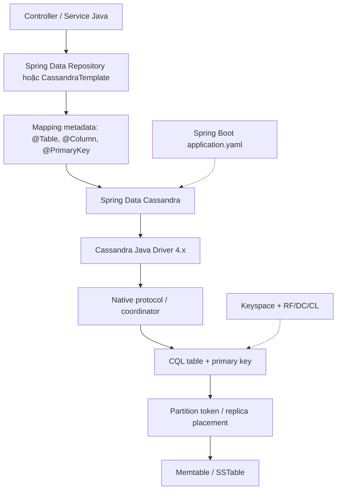

# @Table, @Column và ánh xạ tên định danh

> **Chương:** Spring Boot và Spring Data  
> **Ngữ cảnh:** Apache Cassandra — cơ sở dữ liệu phân tán kiểu *wide-column*, thiết kế bảng theo truy vấn, partition key, replication và consistency level — được truy cập từ ứng dụng Java bằng Spring Boot, Spring Data Cassandra và Cassandra Java Driver 4.x.
>
> **Mục tiêu học tập:** Hiểu vì sao tên class/field Java không nhất thiết là tên bảng/cột CQL; dùng `@Table`, `@Column`, `@PrimaryKey` và các annotation khóa tổng hợp để mapping tường minh; phân biệt định danh CQL viết thường không quote với định danh quoted có phân biệt hoa/thường; kiểm tra effective mapping và schema thật; thiết kế migration an toàn, kiểm thử repository và tránh nhầm keyspace, cột hoặc partition key.

## 1. Bài toán mở đầu: Java có `displayName` nhưng Cassandra lưu `display_name`

Giả sử bảng thực tế ở Cassandra là:

```cql
CREATE TABLE lab.customer_profile_by_id (
    customer_id uuid PRIMARY KEY,
    display_name text,
    email_address text,
    created_at timestamp
);
```

Trong Java, tên property theo camelCase:

```java
public class CustomerProfile {
    private UUID customerId;
    private String displayName;
    private String emailAddress;
    private Instant createdAt;
}
```

Một lập trình viên có thể nghĩ: “Spring Data tự biết `displayName` chính là `display_name`.” Nhưng điều đó chỉ đúng nếu **quy tắc đặt tên thực sự đang được cấu hình** cho kiểu ánh xạ đó. Nếu tên mặc định khác kỳ vọng, chương trình có thể phát CQL tới tên cột sai, không đọc được dữ liệu hoặc thất bại lúc khởi động/truy vấn.

Giải pháp rõ ràng là khai báo tên thực:

```java
@Table("customer_profile_by_id")
public class CustomerProfile {

    @PrimaryKey("customer_id")
    private UUID customerId;

    @Column("display_name")
    private String displayName;

    @Column("email_address")
    private String emailAddress;

    @Column("created_at")
    private Instant createdAt;
}
```

Các annotation này thuộc **Spring Data Cassandra**. Trong file Java đầy đủ cần import đúng package, constructor và accessor phù hợp.

**Bài học chính:** tên Java là cách code diễn đạt domain; tên CQL là hợp đồng với schema đã tồn tại. `@Table` và `@Column` nối hai bên, nhưng **không tự sửa schema, replication hay quyền truy cập**.

## 2. Bức tranh từ Spring Boot đến SSTable



Các tầng cần phân biệt:

| Tầng | Ví dụ | Trách nhiệm |
| --- | --- | --- |
| Model Java | `CustomerProfile`, `displayName` | Đối tượng và tên property trong ứng dụng |
| Spring Data mapping | `@Table`, `@Column` | Tên bảng/cột CQL hiệu lực đối với entity |
| Driver | `CqlSession` | Kết nối, prepare/bind, encode/decode và coordinator |
| CQL schema | `lab.customer_profile_by_id`, `display_name` | Bảng/cột/kiểu dữ liệu/primary key thực trên server |
| Keyspace | `lab` | Namespace, replication strategy và RF |
| Consistency level | `LOCAL_QUORUM` | Điều kiện phản hồi từ replica theo RF/DC |

**Không được đồng nhất** mapping annotation với những thiết lập còn lại. `@Table("x")` không tạo partition key tối ưu; `@Column("y")` không biến một truy vấn thiếu partition key thành truy vấn hiệu quả.

## 3. Tên Java, tên CQL và kiểu dữ liệu là ba chiều độc lập

Một property có ít nhất ba thông tin:

```text
Java property name:     displayName
CQL column identifier:  display_name
Java type:              String
CQL type:               text
```

Với `createdAt`:

```text
Java property name:     createdAt
CQL column identifier:  created_at
Java type:              java.time.Instant
CQL type:               timestamp
```

`@Column("created_at")` chỉ cho Spring Data biết **tên cột**. Nó không bảo đảm mọi kiểu Java có thể lưu vào mọi kiểu CQL; việc chuyển đổi thuộc mapping conversions, Cassandra codecs và schema thực tế.

Nếu tên đúng nhưng type sai, vẫn có thể gặp lỗi codec/conversion. Nếu type đúng nhưng tên sai, có thể gặp lỗi “undefined column” hoặc dữ liệu bị truy vấn từ chỗ khác.

## 4. Quy tắc định danh CQL: không quote thì chuẩn hóa về lowercase

Cassandra CQL có quy tắc quan trọng về tên keyspace, bảng và cột:

- Định danh **không đặt trong dấu ngoặc kép** thường không phân biệt hoa/thường và được chuẩn hóa về dạng lowercase.
- Định danh **đặt trong dấu ngoặc kép kép** giữ cách viết và có thể phân biệt hoa/thường.
- Một từ khóa hoặc tên chứa ký tự không phù hợp với identifier thường có thể đòi quote.
- Hai tên khác nhau theo case khi đã quote có thể trở thành **hai tên phân biệt**.

Ví dụ:

```cql
-- Tên không quote: ba cách viết thường chỉ cùng một tên CQL.
SELECT display_name FROM lab.customer_profile_by_id;
SELECT DISPLAY_NAME FROM LAB.CUSTOMER_PROFILE_BY_ID;
SELECT Display_Name FROM Lab.Customer_Profile_By_Id;
```

Nhưng:

```cql
-- Nếu schema thực có cột quoted "DisplayName":
SELECT "DisplayName" FROM lab."CustomerProfile";

-- Không đồng nghĩa:
SELECT displayname FROM lab.customerprofile;
```

Câu lệnh ở khối thứ hai chỉ hợp lệ nếu các bảng/cột tương ứng tồn tại theo đúng tên. Không chạy câu ví dụ quoted trên một schema chưa tạo.

**Khuyến nghị:** dùng tên CQL **lowercase_snake_case, không quote**, tránh từ khóa, dấu cách và chữ hoa hỗn hợp. Đây là cách giảm lỗi naming đáng kể trong hệ thống Java/Spring.

## 5. Ví dụ schema quoted để thấy khác biệt

Chỉ dùng trên **lab** và khi keyspace `lab` đã tồn tại:

```cql
CREATE TABLE IF NOT EXISTS lab."CustomerProfile" (
    "CustomerId" uuid PRIMARY KEY,
    "DisplayName" text
);
```

Câu truy vấn cần quote đúng:

```cql
SELECT "CustomerId", "DisplayName"
FROM lab."CustomerProfile"
WHERE "CustomerId" = 11111111-1111-4111-8111-111111111111;
```

Nếu không quote:

```cql
-- CQL sẽ diễn giải các tên theo dạng không quote/lowercase.
-- Đây không phải đường viết tương đương bảng ở trên.
SELECT customerid, displayname
FROM lab.customerprofile
WHERE customerid = 11111111-1111-4111-8111-111111111111;
```

### Liên hệ với annotation

Đừng đoán rằng `@Table("CustomerProfile")` luôn được Spring Data quote đúng thành `"CustomerProfile"`. Việc xây `CqlIdentifier` từ annotation, quote handling và naming strategy cần xác minh theo phiên bản Spring Data Cassandra đang chạy.

Với schema quoted kế thừa, phải kiểm tra **effective mapping metadata/CQL thực thi** và integration test đầy đủ; nếu có cơ chế force quoting hoặc mapping tùy chỉnh do release hỗ trợ, cấu hình theo tài liệu chính thức của đúng phiên bản.

**Không tùy tiện bỏ quote để “sửa” lỗi**: như vậy có thể trỏ đến một bảng khác hoặc tiếp tục báo không tìm thấy bảng.

## 6. Spring Data Cassandra `@Table` làm gì?

Annotation `@Table` của Spring Data Cassandra đánh dấu một Java class là entity được ánh xạ tới một CQL table hoặc cấu trúc phù hợp.

```java
import org.springframework.data.cassandra.core.mapping.Table;

@Table("customer_profile_by_id")
public class CustomerProfile {
    // ...
}
```

Trong ví dụ, tên bảng CQL muốn dùng là `customer_profile_by_id`. Những điểm cần hiểu:

1. `@Table` mô tả **mapping**, không tự quyết định replication strategy.
2. `@Table` không chỉ định consistency level cho từng statement.
3. Một class có thể được repository/template quản lý dựa trên metadata mapping của Spring Data.
4. Tên bảng trong annotation nên phản ánh **bảng CQL đã thiết kế theo truy vấn**.
5. Đặt `@Table` không biến class thành entity JPA; đây là mô hình Cassandra, không phải RDBMS.
6. Khi schema đã được quản lý bằng migration, annotation phải **khớp schema thật**.

### Tên trong `@Table` không phải tên keyspace

Sai về mặt thiết kế nếu định dùng một string ghép hai định danh như một tên bảng:

```java
// Không giả định API @Table nhận "keyspace.table"
// như một table identifier duy nhất:
@Table("lab.customer_profile_by_id")
public class WrongIdea {
}
```

Với Spring Data Cassandra, keyspace mặc định thường được xác lập ở **CqlSession/Spring configuration** hoặc cơ chế mapping có hỗ trợ riêng theo release. Không nhét `lab.` vào tên table mà không kiểm chứng.

Nếu muốn thao tác nhiều keyspace, cần thiết kế rõ các session/template/mapping contexts hoặc dùng cú pháp fully qualified ở CQL tùy khả năng framework — không tự coi dấu chấm trong annotation là tên chuẩn.

## 7. Spring Data Cassandra `@Column` làm gì?

Annotation `@Column` đặt tên cột CQL tương ứng với property của entity.

```java
import org.springframework.data.cassandra.core.mapping.Column;

@Column("display_name")
private String displayName;
```

Ý nghĩa:

- Property trong Java vẫn tên `displayName`.
- Cột CQL là `display_name` theo mapping.
- Spring Data dùng metadata để tạo/đọc statement khi repository/template truy cập entity.
- Annotation không tự thêm cột vào bảng Cassandra đang tồn tại.
- Annotation không quy định giá trị default của cột khi dữ liệu thiếu.
- Annotation không tự kiểm soát quyền SELECT/MODIFY trên cột.
- Annotation không làm kiểu Java `String` tương đương mọi CQL type.

### Cột không khai `@Column` có được lưu không?

Trong mô hình object mapping, Spring Data có thể suy ra tên cho những persistent properties không có `@Column` theo quy tắc mapping/naming strategy hiện hành.

Ví dụ:

```java
@Table("customer_profile_by_id")
public class CustomerProfile {

    @PrimaryKey("customer_id")
    private UUID customerId;

    private String displayName; // Không chỉ định cột CQL tường minh
}
```

**Không suy ra chắc chắn** mapping của `displayName` là `display_name` nếu chưa xem naming strategy đang chạy. Trong module học này, với schema đã tồn tại dạng snake_case, nên **ghi rõ `@Column("display_name")`** hoặc thống nhất naming strategy và kiểm chứng nó bằng test.

### `@Column` không đặt trên khóa chính để thay `@PrimaryKey`

Nếu property chính là khóa của row, dùng annotation về **primary key** phù hợp. `@Column` chỉ định tên cột nhưng không mô tả đầy đủ vai trò partition/clustering key.

## 8. `@PrimaryKey` phải khớp khóa chính thật

Bảng:

```cql
CREATE TABLE IF NOT EXISTS lab.customer_profile_by_id (
    customer_id uuid PRIMARY KEY,
    display_name text,
    email_address text,
    created_at timestamp
);
```

Entity:

```java
import java.time.Instant;
import java.util.UUID;

import org.springframework.data.cassandra.core.mapping.Column;
import org.springframework.data.cassandra.core.mapping.PrimaryKey;
import org.springframework.data.cassandra.core.mapping.Table;

@Table("customer_profile_by_id")
public class CustomerProfile {

    @PrimaryKey("customer_id")
    private UUID customerId;

    @Column("display_name")
    private String displayName;

    @Column("email_address")
    private String emailAddress;

    @Column("created_at")
    private Instant createdAt;

    public CustomerProfile() {
    }

    public CustomerProfile(
            UUID customerId, String displayName,
            String emailAddress, Instant createdAt) {
        this.customerId = customerId;
        this.displayName = displayName;
        this.emailAddress = emailAddress;
        this.createdAt = createdAt;
    }

    public UUID getCustomerId() {
        return customerId;
    }

    public void setCustomerId(UUID customerId) {
        this.customerId = customerId;
    }

    public String getDisplayName() {
        return displayName;
    }

    public void setDisplayName(String displayName) {
        this.displayName = displayName;
    }

    public String getEmailAddress() {
        return emailAddress;
    }

    public void setEmailAddress(String emailAddress) {
        this.emailAddress = emailAddress;
    }

    public Instant getCreatedAt() {
        return createdAt;
    }

    public void setCreatedAt(Instant createdAt) {
        this.createdAt = createdAt;
    }
}
```

### Vì sao cần `@PrimaryKey("customer_id")`?

Với Spring Data Cassandra, `@PrimaryKey` giúp mapping biết khóa của entity. Khi ID trong Java là `customerId` nhưng schema là `customer_id`, khai báo tường minh giúp tránh mismatch và giúp những thao tác như `findById` có cơ sở.

**Một property có `@PrimaryKey` không tự làm server đổi partition key.** Định nghĩa thực nằm trong `CREATE TABLE`; annotation và schema phải cùng nói một điều.

### Constructor/accessor

Ví dụ dùng no-arg constructor + getters/setters cho người mới học. Spring Data còn hỗ trợ các kiểu materialization dựa trên constructor, immutable entity và version-specific features. Với record/Kotlin/Lombok, phải kiểm tra constructor binding và mapping metadata của phiên bản sử dụng.

Đừng thêm getter có side effect hoặc biến đổi tên dữ liệu theo cách khiến lưu–đọc không đối xứng.

## 9. Chạy Spring Boot với keyspace `lab`

Một cấu hình Spring Boot tương ứng dòng có prefix `spring.cassandra`:

```yaml
spring:
  cassandra:
    contact-points: cassandra-1.internal,cassandra-2.internal
    port: 9042
    local-datacenter: dc1
    keyspace-name: lab
    schema-action: none
```

Cấu hình này **chỉ là skeleton**, chưa có authentication, TLS/truststore, password, timeouts hoặc mapping customization. Các tên property cụ thể phụ thuộc **Spring Boot release**; những dòng Boot cũ có thể dùng prefix `spring.data.cassandra`. Phải kiểm tra configuration metadata của đúng release đang deploy.

Một số nguyên tắc:

- `keyspace-name` xác lập keyspace ứng dụng làm việc mặc định.
- `local-datacenter` giúp Java Driver chọn coordinator phù hợp.
- `contact-points` là các điểm bắt đầu khám phá cluster, **không phải tất cả replica cố định**.
- `schema-action: none` thể hiện chủ trương **không tự tạo/đổi schema** tại startup, nếu property/action được release đó hỗ trợ.
- Tên bảng ở `@Table("customer_profile_by_id")` không tự chuyển app sang keyspace khác.

Với production, nên cấp auth/TLS qua secret management và cấu hình tương ứng. Không lưu mật khẩu hay private key trong repo chỉ vì ví dụ YAML không chứa chúng.

## 10. Tạo keyspace và schema thật trong lab

Giả sử cluster lab có DC thực tên `dc1` và đủ node/replica cho RF=3:

```cql
CREATE KEYSPACE IF NOT EXISTS lab
WITH replication = {
    'class': 'NetworkTopologyStrategy',
    'dc1': 3
}
AND durable_writes = true;
```

Tiếp đó:

```cql
CREATE TABLE IF NOT EXISTS lab.customer_profile_by_id (
    customer_id uuid PRIMARY KEY,
    display_name text,
    email_address text,
    created_at timestamp
);
```

RF=3 là **giả định lab ba replica khả dụng**; trên cluster ít node hoặc tên DC khác phải điều chỉnh theo topology được phép. Không copy nguyên câu CQL vào production.

Kiểm tra schema ở `cqlsh`:

```cql
DESCRIBE KEYSPACE lab;
DESCRIBE TABLE lab.customer_profile_by_id;
```

`DESCRIBE` ở đây là lệnh trợ giúp của client `cqlsh`; không coi nó là câu CQL sẽ chạy nguyên dạng trong mọi API Java.

### Spring Data có tự tạo schema không?

Tùy cấu hình schema action và phiên bản, Spring Data có khả năng hỗ trợ các thao tác schema. Tuy nhiên:

- Có `@Table` không đồng nghĩa bảng chắc chắn đã tồn tại.
- Auto-create trong môi trường nhiều node/DC có thể không phải cơ chế migration thích hợp.
- Chỉ thay mapping class không bảo đảm cột mới đã được thêm vào bảng thật.
- Migration production cần quản lý quyền, rollout, rollback và schema agreement.

**Khuyến nghị vận hành:** quản lý schema bằng CQL/migration có kiểm soát và giữ startup app ở chế độ không tự sửa schema, trừ môi trường lab/test đặc biệt.

## 11. Repository đọc/ghi theo mapping đã khai báo

Tạo repository:

```java
import java.util.UUID;

import org.springframework.data.cassandra.repository.CassandraRepository;

public interface CustomerProfileRepository
        extends CassandraRepository<CustomerProfile, UUID> {
}
```

Một service đơn giản:

```java
import java.time.Instant;
import java.util.Optional;
import java.util.UUID;

import org.springframework.stereotype.Service;

@Service
public class CustomerProfileService {

    private final CustomerProfileRepository repository;

    public CustomerProfileService(
            CustomerProfileRepository repository) {
        this.repository = repository;
    }

    public Optional<CustomerProfile> findById(UUID id) {
        if (id == null) {
            throw new IllegalArgumentException("customer ID required");
        }
        return repository.findById(id);
    }

    public CustomerProfile upsert(
            UUID id, String displayName, String email) {
        CustomerProfile profile = new CustomerProfile(
            id, displayName, email, Instant.now()
        );
        return repository.save(profile);
    }
}
```

Trong lab, thử:

```cql
SELECT customer_id, display_name, email_address, created_at
FROM lab.customer_profile_by_id
WHERE customer_id = 11111111-1111-4111-8111-111111111111;
```

### Điều cần hiểu về `save`

Cassandra không có `INSERT` giống transaction/constraint RDBMS; nhiều thao tác ghi có tính **upsert**. Nếu một row đã tồn tại, lưu entity mới có thể ảnh hưởng những cột được mapping, kể cả hành vi với null phụ thuộc API/version/config.

**Không dùng `repository.save` như một PATCH an toàn theo mặc định** nếu API chỉ cung cấp vài field; phải xác định chính xác null/unset/write strategy để tránh tạo tombstone hoặc xóa dữ liệu ngoài ý muốn.

### Repository không tự thực thi mọi truy vấn một cách hiệu quả

`findById` phù hợp khi biết primary key. Nếu cần “tìm tất cả theo email” nhưng bảng chỉ keyed theo customer_id, Spring Data không thể tự phát minh một index hoặc thay đổi mô hình dữ liệu.

Cassandra yêu cầu **thiết kế bảng theo truy vấn**, ví dụ tạo thêm bảng `customer_profile_by_email` với primary key phù hợp nhu cầu (khi bảo mật và uniqueness được thiết kế). Không bật `ALLOW FILTERING` trên production chỉ để làm tên method repository chạy.

## 12. Mapping không thay các bước validate input

Một entity có:

```java
@PrimaryKey("customer_id")
private UUID customerId;
```

không có nghĩa một controller có thể cho người dùng gửi `customer_id` tùy ý để đọc mọi hồ sơ.

Ứng dụng vẫn phải:

1. Xác thực người gọi.
2. Xác nhận quyền sở hữu/quyền xem resource.
3. Kiểm tra ID hợp lệ, không null.
4. Bind khóa đầy đủ vào query theo partition key.
5. Chọn consistency level phù hợp RF/DC.
6. Không log dữ liệu nhạy cảm tùy tiện.

**`@Table` và `@Column` là metadata ánh xạ, không phải hàng rào authorization hoặc multi-tenancy.**

## 13. Tên cột ngầm định: đừng dựa vào “đoán thông minh”

Giả sử entity viết:

```java
@Table("customer_profile_by_id")
public class IncompleteMapping {

    @PrimaryKey("customer_id")
    UUID customerId;

    String emailAddress;
}
```

Cột có thể được suy ra bằng naming strategy. Nhưng nếu naming strategy đang dùng không khớp schema, query đọc/ghi sẽ thất bại hoặc trỏ nhầm tên.

| Property Java | Cột CQL mong muốn | Cách tường minh |
| --- | --- | --- |
| `customerId` | `customer_id` | `@PrimaryKey("customer_id")` |
| `displayName` | `display_name` | `@Column("display_name")` |
| `emailAddress` | `email_address` | `@Column("email_address")` |
| `createdAt` | `created_at` | `@Column("created_at")` |
| `enabled` | `enabled` | `@Column("enabled")` tùy convention |
| `isVerified` | `is_verified` | `@Column("is_verified")` |

Khi codebase dùng hàng trăm entity, annotation tường minh có chi phí duy trì. Một **NamingStrategy nhất quán** có thể giảm lặp, nhưng vẫn cần integration tests bảo đảm không có ngoại lệ.

**Hãy ưu tiên tính dự đoán được** hơn tiết kiệm vài dòng annotation trong hệ thống đang lưu dữ liệu thật.

## 14. Naming strategy là chính sách ánh xạ có thể cấu hình

Spring Data Cassandra hỗ trợ cơ chế naming strategy trong mapping layer. Nó quyết định tên mặc định khi class/property không có tên được khai báo tường minh.

Có thể gặp các quy ước:

- Giữ/canonicalize tên property theo mặc định của framework release.
- Chuyển camelCase thành snake_case.
- Thêm prefix hoặc tuân một convention doanh nghiệp.
- Quy tắc riêng cho bảng, cột và user-defined types.

**Không khẳng định mọi phiên bản Spring Data Cassandra mặc định đổi camelCase → snake_case.** Đây phải là một giả định được kiểm tra.

### Chiến lược áp dụng trong dự án lớn

1. Chốt convention CQL: lowercase_snake_case, không quoted.
2. Chốt mapping/naming strategy được cấu hình.
3. Với schema kế thừa hoặc ngoại lệ, dùng `@Table`/`@Column` tường minh.
4. Có test đọc metadata để xác nhận tên hiệu lực.
5. Đảm bảo mọi service dùng cùng convention trong shared tables.
6. Không đổi naming strategy toàn cục trong một deployment mà không inventory các entities bị ảnh hưởng.

Nếu framework cung cấp cấu hình `CassandraMappingContext` hoặc extension point về naming strategy, cần sử dụng API của đúng Spring Data release và kiểm chứng hiệu quả bằng integration test. Bài này tránh đưa một signature config tùy phiên bản như thể bất biến.

## 15. Bằng chứng quan trọng nhất: effective mapping metadata

Đọc annotation bằng mắt chưa đủ nếu có naming strategy, aliases, custom converters hoặc thay đổi phiên bản.

Spring Data Cassandra có mapping context để truy vấn metadata ánh xạ thực:

```java
import com.datastax.oss.driver.api.core.CqlIdentifier;

import org.springframework.data.cassandra.core.mapping.CassandraMappingContext;
import org.springframework.data.cassandra.core.mapping.CassandraPersistentEntity;
import org.springframework.data.cassandra.core.mapping.CassandraPersistentProperty;

public final class MappingInspection {

    private final CassandraMappingContext context;

    public MappingInspection(CassandraMappingContext context) {
        this.context = context;
    }

    public void printCustomerProfileMapping() {
        CassandraPersistentEntity<?> entity =
            context.getRequiredPersistentEntity(
                CustomerProfile.class);

        CqlIdentifier tableName = entity.getTableName();
        System.out.println(
            "CQL table = " + tableName.asCql(true)
        );

        CassandraPersistentProperty property =
            entity.getRequiredPersistentProperty("displayName");

        CqlIdentifier columnName = property.getColumnName();
        System.out.println(
            "Java displayName -> CQL " + columnName.asCql(true)
        );
    }
}
```

Đoạn này minh họa API thường gặp của Spring Data Cassandra tương thích với driver 4. Nếu dự án đang dùng major release khác hoặc custom mapping context, cần đối chiếu signature ở **dependency đã resolve**.

### Vì sao dùng `asCql(true)`?

`CqlIdentifier` phân biệt **tên nội bộ** và **cách biểu diễn khi viết CQL**, kể cả quoting. In ra một tên theo dạng CQL giúp nhìn thấy dấu ngoặc kép khi identifier cần quote.

Khi debug, hãy thu **effective table identifier**, **effective column identifier** và câu CQL thật được phát ở mức logging an toàn. Không chỉ in tên Java field rồi cho rằng framework dùng đúng tên.

## 16. `CqlIdentifier`: phân biệt “tên bên trong” và “cú pháp CQL”

Trong Java Driver 4.x có `com.datastax.oss.driver.api.core.CqlIdentifier`. Một vài ví dụ:

```java
import com.datastax.oss.driver.api.core.CqlIdentifier;

public final class IdentifierExamples {
    public static void main(String[] args) {

        CqlIdentifier a =
            CqlIdentifier.fromCql("customer_profile_by_id");

        CqlIdentifier b =
            CqlIdentifier.fromCql("CustomerProfile");

        CqlIdentifier c =
            CqlIdentifier.fromCql("\"CustomerProfile\"");

        CqlIdentifier d =
            CqlIdentifier.fromInternal("CustomerProfile");

        System.out.println(a.asInternal());
        System.out.println(b.asInternal());
        System.out.println(c.asInternal());
        System.out.println(d.asCql(true));
    }
}
```

Khái niệm:

- `fromCql(...)` nhận một **identifier theo cú pháp CQL**, nên tên **không quote** bị chuẩn hóa theo quy tắc CQL.
- `fromCql("\"CustomerProfile\"")` biểu diễn tên quoted, giữ hoa/thường.
- `fromInternal(...)` nhận **tên nội bộ**, không phải một string CQL cần parse.
- `asInternal()` trả tên nội bộ; `asCql(...)` cho biểu diễn có thể dùng trong CQL.

Ví dụ tên “CustomerProfile” không quote sẽ được hiểu khác tên quoted `"CustomerProfile"`.

**Không xây tên bằng cách nối raw HTTP input vào CQL** rồi tự thêm dấu quote. Với định danh động, dùng allowlist và API identifier đúng theo release; prepared statement chỉ bind **giá trị dữ liệu**, không bind table/column identifier như một giá trị.

## 17. Dấu ngoặc kép trong Java string không phải quote CQL tự động

Ba cách viết dễ gây nhầm:

```java
String a = "CustomerProfile";           // Java string thường
String b = "\"CustomerProfile\"";       // Java string có hai ký tự quote
String c = "customer_profile_by_id";    // Java string lowercase_snake_case
```

Chúng là các chuỗi Java, **không tự mang đầy đủ semantics của Spring Data annotation**. Cách framework chuyển string sang identifier phụ thuộc API và context cụ thể.

Đừng “sửa” bằng cách tự thêm backslash ở mọi `@Column`:

```java
// Không áp dụng tùy tiện nếu chưa xác minh mapping:
@Column("\"DisplayName\"")
private String displayName;
```

Với schema chứa tên quoted vì lịch sử, phải kiểm chứng annotation/forceQuote/naming APIs của phiên bản và test câu CQL thực tế. Cách dễ duy trì nhất cho schema mới vẫn là **lowercase_snake_case không quote**.

## 18. Tên CQL là hợp đồng xuyên nhiều service

Một bảng có thể được nhiều service truy cập:

```text
orders-service:    OrderById.customerId
analytics-job:     customer_id
admin-tool:        customer_id
Java driver raw:   row.getUuid("customer_id")
```

Nếu service A đổi `@Column("customer_id")` thành `@Column("customerId")` nhưng không đổi schema, nó có thể làm hỏng truy vấn riêng service A. Ngược lại, nếu migration đổi tên cột vật lý mà service B chưa cập nhật, service B hỏng dù Spring Boot của A vẫn chạy.

### Ba loại rename khác nhau

| Thay đổi | Tác động đúng | Điều phải kiểm tra |
| --- | --- | --- |
| Đổi tên field Java nhưng giữ `@Column("customer_id")` | Thường không đổi tên CQL | Constructor/getters, JSON/API, mapping tests |
| Đổi giá trị `@Column("customer_id")` thành tên khác | Đổi mapping mà Spring Data phát | Schema mới tồn tại? Client khác? |
| Thực hiện migration schema CQL | Đổi dữ liệu/schema thực ở Cassandra | Upgrade path, compatibility, backfill, queries, rollback |

**Không coi rename field Java tương đương rename cột CQL.** Đây là nguồn lỗi phổ biến khi refactor entity.

## 19. Ví dụ refactor Java an toàn khi tên CQL không đổi

Trước refactor:

```java
@Table("customer_profile_by_id")
public class CustomerProfile {
    @PrimaryKey("customer_id")
    private UUID customerId;

    @Column("display_name")
    private String displayName;
}
```

Sau khi đổi tên property cho rõ domain:

```java
@Table("customer_profile_by_id")
public class CustomerProfile {
    @PrimaryKey("customer_id")
    private UUID customerId;

    @Column("display_name")
    private String preferredName;
}
```

Ở tầng Cassandra, cả hai phiên bản đều muốn đọc/ghi cột `display_name`. Nhưng ở tầng Java, thay đổi này có thể ảnh hưởng:

- Constructors/setters/getters.
- Repository derived queries dùng tên property.
- JSON serialization nếu trả entity trực tiếp.
- Mapper DTO, reflection/validation.
- Tests và code gọi property cũ.

Không trả entity persistence trực tiếp ra public API nếu cần ổn định hợp đồng JSON; ưu tiên DTO độc lập để việc refactor mapping không làm thay đổi response ngoài ý muốn.

## 20. Khóa tổng hợp: một property Java chưa đủ mô tả partition key

Cassandra thường dùng **composite partition key** hoặc **clustering columns** để phục vụ truy vấn theo access pattern.

Ví dụ bảng đa tenant:

```cql
CREATE TABLE IF NOT EXISTS lab.orders_by_tenant (
    tenant_id text,
    order_id uuid,
    customer_id uuid,
    status text,
    total decimal,
    PRIMARY KEY ((tenant_id, order_id))
);
```

Partition key ở đây gồm **hai thành phần**: `tenant_id` và `order_id`. Không thể chỉ dùng `@PrimaryKey("order_id")` như table đơn khóa của ví dụ đầu.

Spring Data Cassandra cung cấp cơ chế **`@PrimaryKeyClass`, `@PrimaryKeyColumn` và `@PrimaryKey`** để mô tả composite key.

### Key class đầy đủ

```java
import java.io.Serializable;
import java.util.Objects;
import java.util.UUID;

import org.springframework.data.cassandra.core.cql.PrimaryKeyType;
import org.springframework.data.cassandra.core.mapping.PrimaryKeyClass;
import org.springframework.data.cassandra.core.mapping.PrimaryKeyColumn;

@PrimaryKeyClass
public class OrderByTenantKey implements Serializable {

    @PrimaryKeyColumn(
        name = "tenant_id",
        ordinal = 0,
        type = PrimaryKeyType.PARTITIONED
    )
    private String tenantId;

    @PrimaryKeyColumn(
        name = "order_id",
        ordinal = 1,
        type = PrimaryKeyType.PARTITIONED
    )
    private UUID orderId;

    public OrderByTenantKey() {
    }

    public OrderByTenantKey(String tenantId, UUID orderId) {
        this.tenantId = tenantId;
        this.orderId = orderId;
    }

    public String getTenantId() {
        return tenantId;
    }

    public void setTenantId(String tenantId) {
        this.tenantId = tenantId;
    }

    public UUID getOrderId() {
        return orderId;
    }

    public void setOrderId(UUID orderId) {
        this.orderId = orderId;
    }

    @Override
    public boolean equals(Object other) {
        if (this == other) {
            return true;
        }
        if (!(other instanceof OrderByTenantKey key)) {
            return false;
        }
        return Objects.equals(tenantId, key.tenantId)
            && Objects.equals(orderId, key.orderId);
    }

    @Override
    public int hashCode() {
        return Objects.hash(tenantId, orderId);
    }
}
```

Đoạn code dùng Java 17 với pattern matching `instanceof`. Có thể chuyển thành syntax Java cũ nếu dependency/JDK của dự án yêu cầu.

### Entity chứa khóa tổng hợp

```java
import java.math.BigDecimal;
import java.util.UUID;

import org.springframework.data.cassandra.core.mapping.Column;
import org.springframework.data.cassandra.core.mapping.PrimaryKey;
import org.springframework.data.cassandra.core.mapping.Table;

@Table("orders_by_tenant")
public class OrderByTenant {

    @PrimaryKey
    private OrderByTenantKey key;

    @Column("customer_id")
    private UUID customerId;

    @Column("status")
    private String status;

    @Column("total")
    private BigDecimal total;

    public OrderByTenant() {
    }

    public OrderByTenant(
            OrderByTenantKey key,
            UUID customerId,
            String status,
            BigDecimal total) {
        this.key = key;
        this.customerId = customerId;
        this.status = status;
        this.total = total;
    }

    public OrderByTenantKey getKey() {
        return key;
    }

    public void setKey(OrderByTenantKey key) {
        this.key = key;
    }

    public UUID getCustomerId() {
        return customerId;
    }

    public void setCustomerId(UUID customerId) {
        this.customerId = customerId;
    }

    public String getStatus() {
        return status;
    }

    public void setStatus(String status) {
        this.status = status;
    }

    public BigDecimal getTotal() {
        return total;
    }

    public void setTotal(BigDecimal total) {
        this.total = total;
    }
}
```

Repository:

```java
import org.springframework.data.cassandra.repository.CassandraRepository;

public interface OrderByTenantRepository
        extends CassandraRepository<OrderByTenant, OrderByTenantKey> {
}
```

**Điểm trọng tâm về tên:** `tenantId` và `orderId` nằm trong key class nhưng được khai báo rõ mapping tới `tenant_id` và `order_id`. Thứ tự, loại `PARTITIONED` và primary key CQL phải tương thích.

### Cẩn thận với equals/hashCode

Composite ID thường được dùng trong repository methods và collections, vì vậy cần `equals`/`hashCode` ổn định. Không thay đổi key sau khi nó đã dùng làm identity của entity hoặc key trong map theo cách phá invariant.

## 21. Clustering column và thứ tự khóa: không thể giải quyết bằng `@Column`

Bảng wide-column phục vụ danh sách đơn theo khách/ngày:

```cql
CREATE TABLE IF NOT EXISTS lab.orders_by_customer_day (
    tenant_id text,
    customer_id uuid,
    day_bucket date,
    created_at timestamp,
    order_id uuid,
    status text,
    total decimal,
    PRIMARY KEY ((tenant_id, customer_id, day_bucket),
                 created_at, order_id)
) WITH CLUSTERING ORDER BY (
    created_at DESC, order_id ASC
);
```

Mapping composite key phải phản ánh:

- Partition components: `tenant_id`, `customer_id`, `day_bucket`.
- Clustering components: `created_at`, `order_id`.
- Thứ tự khai báo/ordinal.
- Ordering nếu framework/schema dùng metadata liên quan.
- Tên cột CQL chính xác theo schema.

`@Column("created_at")` trên một regular property **không đủ** mô tả nó là clustering key. Khi tạo composite key class, dùng `@PrimaryKeyColumn` với `type = PrimaryKeyType.PARTITIONED` hoặc `CLUSTERED` và ordinal phù hợp.

### Một ví dụ ngắn về ý định mapping

```java
// Trích đoạn ý tưởng thuộc @PrimaryKeyClass.
// Các field còn lại của composite key cũng phải được khai báo.
@PrimaryKeyColumn(
    name = "created_at",
    ordinal = 3,
    type = PrimaryKeyType.CLUSTERED
)
private Instant createdAt;
```

Đây chỉ là **trích đoạn**, không phải composite key đầy đủ có thể dùng ngay. Với schema clustering `DESC`, kiểm tra support của annotation ordering/mapping theo Spring Data Cassandra release và đối chiếu với **DDL là nguồn sự thật**.

### Vì sao liên quan hiệu năng?

Đọc một partition:

```cql
SELECT created_at, order_id, status
FROM lab.orders_by_customer_day
WHERE tenant_id = 'tenant-a'
  AND customer_id = 11111111-1111-4111-8111-111111111111
  AND day_bucket = '2026-11-21'
LIMIT 20;
```

Query phù hợp partition key và clustering order. Nếu mapping primary key sai, repository có thể bind thiếu thành phần hoặc phát query không được Cassandra chấp nhận. Không sửa bằng `ALLOW FILTERING` chỉ vì annotation thiếu vai trò khóa.

## 22. `@Column` không đồng nghĩa mọi field phải tồn tại trong persistence model

Một class domain có thể chứa trường tính toán:

```java
import java.math.BigDecimal;
import org.springframework.data.annotation.Transient;
import org.springframework.data.cassandra.core.mapping.Column;

public class OrderSummaryView {

    @Column("total")
    private BigDecimal total;

    @Transient
    private String totalLabel;
}
```

`@Transient` giúp thể hiện field không thuộc persistence mapping khi dùng đúng mô hình/annotation Spring Data.

Nếu bỏ `@Transient`, mapping framework có thể cố coi field Java đó là cột Cassandra, dẫn đến lỗi hoặc schema mismatch.

**Không tự cho rằng một field chỉ để hiển thị sẽ được Spring Data bỏ qua** vì nó không có `@Column`.

Đối với DTO phức tạp, tách entity persistence và response DTO thường làm hợp đồng rõ hơn.

## 23. `@Column` không phải converter: kiểu CQL vẫn phải đúng

Một vài mapping dữ liệu phổ biến:

| Java type | CQL type điển hình | Lưu ý |
| --- | --- | --- |
| `UUID` | `uuid` | Phân biệt UUID thường và `timeuuid` |
| `String` | `text`/`varchar` | Tên cột phải đúng; không tự mã hóa PII |
| `BigDecimal` | `decimal` | Precision/scale và business rules |
| `Instant` | `timestamp` | Thời điểm UTC/precision; hiển thị múi giờ ở API |
| `LocalDate` | `date` | Ngày không gắn timezone |
| `Long`/`long` | `bigint` | Nullable vs primitive |
| `Boolean`/`boolean` | `boolean` | Giá trị null và primitive default |
| Collections | `list`, `set`, `map` | Frozen/non-frozen, null, tombstone, codec |
| Custom class | UDT hoặc mapping custom | Cần mapping/converter đúng release |

Nếu một field `@Column("total") BigDecimal total` trỏ vào cột CQL `text`, tên có thể hoàn toàn đúng mà conversion vẫn sai.

### Null và partial update

Một entity được materialize từ Cassandra có thể nhận `null` cho cột không có giá trị sống. Điều đó **không đồng nghĩa** client API bỏ trường khi PATCH.

Khi gọi `save` với entity thiếu dữ liệu, phải hiểu cách Spring Data/driver phiên bản đó encode null hoặc unset. Truyền CQL `NULL` cho regular column có thể tạo tombstone; `UNSET` chỉ bỏ qua cột trong mutation phù hợp.

**Đừng dùng `@Column` như một “default value” hay “ignore null” annotation**: nó không diễn đạt những ngữ nghĩa này.

## 24. Định danh trường reserved keyword hoặc chứa ký tự đặc biệt

Các tên như `order` hoặc `group` có thể va với cú pháp CQL; các tên chứa khoảng trắng, dấu gạch ngang hoặc chữ hoa quoted tạo gánh nặng quoting.

Ví dụ CQL:

```cql
-- Ví dụ tên quoted: hợp lệ về ý tưởng nhưng khó bảo trì.
CREATE TABLE IF NOT EXISTS lab."Order Ledger" (
    "Order Id" uuid PRIMARY KEY,
    "Status Text" text
);
```

Muốn query phải dùng:

```cql
SELECT "Order Id", "Status Text"
FROM lab."Order Ledger"
WHERE "Order Id" = 11111111-1111-4111-8111-111111111111;
```

Tên này có thể được map bằng cơ chế quoted identifier được Spring Data release hỗ trợ, nhưng cần test rất kỹ. Trong schema mới, đổi convention ngay từ đầu:

```cql
CREATE TABLE IF NOT EXISTS lab.order_ledger_by_id (
    order_id uuid PRIMARY KEY,
    status_text text
);
```

**Đừng chọn tên khó quote nếu không có lý do bắt buộc.** Nếu schema kế thừa, mapping tests và release-specific quoting configuration là cần thiết.

## 25. Khi viết custom `@Query` phải kiểm tra tên CQL thật

Spring Data Repository có hỗ trợ các phương thức tùy chỉnh hoặc query được định nghĩa tường minh tùy phiên bản.

Ví dụ raw CQL:

```cql
SELECT customer_id, display_name
FROM lab.customer_profile_by_id
WHERE customer_id = ?;
```

Khi viết câu query tường minh, **hãy dùng tên table/column CQL**, không tự thay bằng property Java:

```cql
-- SAI nếu schema chỉ có display_name:
SELECT customerId, displayName
FROM lab.customer_profile_by_id
WHERE customerId = ?;
```

### Prepared values khác identifier

Dấu `?` trong CQL binding biểu diễn **giá trị**, như UUID. Nó không phải một cơ chế an toàn để bind tên cột:

```text
SELECT ? FROM ? WHERE customer_id = ?
       ^      ^
       |      +-- không phải tên bảng được bind tùy ý
       +--------- không phải tên cột được bind tùy ý
```

Dynamic table/column names cần allowlist và cơ chế xây CQL identifier an toàn ở tầng được kiểm soát. Không bao giờ nối tên bảng do HTTP client gửi vào query rồi cho rằng repository đã bảo vệ.

## 26. Spring Data repository và Java Driver raw khác nhau ở mapping layer

Giả sử entity có:

```java
@Column("display_name")
private String displayName;
```

Khi dùng Spring Data Repository/Template có mapping, framework có thể ánh xạ property tới `display_name`.

Nhưng khi dùng raw driver:

```java
Row row = session.execute(
    "SELECT display_name FROM lab.customer_profile_by_id " +
    "WHERE customer_id = 11111111-1111-4111-8111-111111111111"
).one();

if (row != null) {
    String value = row.getString("display_name");
}
```

Cassandra Java Driver **không tự biết `CustomerProfile.displayName` mapping annotation** khi code làm việc trực tiếp với `Row` và chuỗi CQL. Lúc đó lập trình viên tự dùng tên CQL thật.

### Hai kiểu code cần cùng một quy ước

Một dự án có thể kết hợp:

- `CassandraRepository` cho CRUD đơn giản.
- `CassandraTemplate` hoặc mapping operations cho query tùy chỉnh.
- `CqlSession` trực tiếp cho prepared/batch/async path cần kiểm soát sâu.

Đừng để ba tầng tự định nghĩa tên field khác nhau. Dùng constants, schema tests, hoặc mapping inspection theo nhu cầu — và **đừng lấy entity field name làm CQL identifier nếu không kiểm tra**.

## 27. Lỗi naming thường gặp và cách chẩn đoán

| Triệu chứng | Nguyên nhân khả dĩ | Bước xác minh |
| --- | --- | --- |
| `unconfigured table` | Tên `@Table` sai hoặc keyspace sai | `DESCRIBE TABLE`, effective table identifier, session keyspace |
| `Undefined column name` | `@Column`/strategy không khớp schema | `system_schema.columns`, CQL được phát |
| Bảng quoted chỉ chạy khi có dấu quote | Identifier giữ case | `CqlIdentifier.asCql`, schema quoted |
| `findById` không trả row | Khóa ID mapping sai, dữ liệu không ở partition mong đợi, CL | DDL primary key, bound ID, query theo PK |
| Repository không được tạo | Package scan, config, entity/repository setup | Component/repository scan, dependency, startup logs |
| Đọc ra `null` dù có dữ liệu | Sai cột, dữ liệu hết TTL, CL/replica, projection | Schema/name, query trực tiếp, TTL/WRITETIME |
| Lỗi codec/conversion | Java type và CQL type không phù hợp | `system_schema.columns.type`, converters, driver |
| Startup báo tạo bảng mới ngoài ý muốn | Schema action đang bật, tên mapping khác | Effective config và DDL review |
| Refactor Java làm query derived sai | Method name phụ thuộc property cũ | Compile/test repository method, CQL hiệu lực |
| Tên `OrderLedger` bị normalize sai | Quote handling/case | CQL quoted vs unquoted, mapping inspection |
| Một service chạy, service khác lỗi | Shared schema đã đổi nhưng client chưa migrate | Client inventory, rollout/migration plan |
| Multi-tenant request truy cập nhầm | WHERE thiếu tenant/authorization | Primary key, principal checks, CQL bind |

**Không sửa bằng cách tắt kiểm tra schema, bật `ALLOW FILTERING` hoặc dùng superuser**. Phải xác định đúng lỗi naming, keyspace, data type hay quyền.

## 28. Đọc metadata bảng thực từ Cassandra

Nếu có quyền truy cập hệ thống metadata, có thể kiểm tra:

```cql
SELECT keyspace_name, table_name
FROM system_schema.tables
WHERE keyspace_name = 'lab'
  AND table_name = 'customer_profile_by_id';
```

Kiểm tra cột:

```cql
SELECT column_name, kind, position, type
FROM system_schema.columns
WHERE keyspace_name = 'lab'
  AND table_name = 'customer_profile_by_id';
```

Các trường `kind` và `position` giúp xem vai trò partition/clustering/regular và thứ tự khóa khi có ý nghĩa. Kết quả/tên cột metadata có thể khác theo release hoặc dịch vụ tương thích CQL.

### Bằng chứng cần so ba nguồn

1. **Spring Data entity mapping:** effective table/column/PK metadata.
2. **Cassandra schema:** `system_schema` hoặc `DESCRIBE` trong `cqlsh`.
3. **Request thật:** CQL được phát, keyspace, bound key, coordinator và exception.

Nếu chỉ so annotation với code, có thể bỏ sót schema thật. Nếu chỉ so schema với CQL query viết tay, có thể bỏ sót naming strategy của repository.

Không cần truy vấn mọi cột của `system_schema` trên mỗi HTTP request; đây là bước **debug/integration validation**, không phải business logic thường trực.

## 29. Thiết kế test phát hiện mapping sai từ sớm

Một integration test nên thực sự kết nối tới cluster Cassandra test với schema CQL đã tạo, thay vì chỉ mock repository.

### Test flow

1. Khởi tạo keyspace/table bằng DDL cố định của môi trường test.
2. Dùng `CustomerProfileRepository` lưu entity với UUID riêng.
3. Đọc lại bằng repository `findById`, so giá trị Java.
4. Đọc trực tiếp CQL với **tên snake_case** đã định nghĩa.
5. So với kết quả repository.
6. Kiểm tra metadata tên bảng/cột theo Spring mapping context.
7. Dùng role phù hợp và xóa dữ liệu test theo khóa cụ thể.
8. Đảm bảo không có auto-DDL sửa schema ngầm trong test khi mục tiêu là đối chiếu.

### Ví dụ JUnit với repository

```java
import static org.junit.jupiter.api.Assertions.*;

import java.time.Instant;
import java.util.UUID;

import org.junit.jupiter.api.Test;
import org.springframework.beans.factory.annotation.Autowired;
import org.springframework.boot.test.context.SpringBootTest;

@SpringBootTest
class CustomerProfileMappingIT {

    @Autowired
    CustomerProfileRepository repository;

    @Test
    void roundTripUsesExplicitCqlColumns() {
        UUID id = UUID.randomUUID();

        CustomerProfile profile = new CustomerProfile(
            id,
            "Mai Nguyen",
            "mai@example.test",
            Instant.parse("2026-11-21T10:00:00Z")
        );

        repository.save(profile);

        CustomerProfile found =
            repository.findById(id).orElseThrow();

        assertEquals("Mai Nguyen", found.getDisplayName());
        assertEquals("mai@example.test",
                     found.getEmailAddress());
        assertEquals(id, found.getCustomerId());

        repository.deleteById(id);
    }
}
```

Đây là ví dụ về **ngữ nghĩa test**; cần dependency JUnit/Spring Boot Test tương ứng, môi trường Cassandra test được cung cấp và schema đã được tạo. Không chạy test tích hợp này trên production vì nó chủ động ghi/xóa dữ liệu.

**Test round-trip qua repository là cần nhưng chưa đủ:** nếu framework tự tạo sai schema mà test không đối chiếu với DDL độc lập, test có thể PASS trên một schema sai hợp đồng. Vì vậy nên có bước raw CQL/schema metadata ở trên.

## 30. Kiểm tra tên bảng/cột ngay ở test startup

Một test mapping context có thể khẳng định những tên mong đợi:

```java
import static org.junit.jupiter.api.Assertions.assertEquals;

import com.datastax.oss.driver.api.core.CqlIdentifier;

import org.junit.jupiter.api.Test;
import org.springframework.beans.factory.annotation.Autowired;
import org.springframework.boot.test.context.SpringBootTest;
import org.springframework.data.cassandra.core.mapping.CassandraMappingContext;
import org.springframework.data.cassandra.core.mapping.CassandraPersistentEntity;

@SpringBootTest
class EntityIdentifierMappingIT {

    @Autowired
    CassandraMappingContext context;

    @Test
    void customerProfileNamesMatchTheSchemaContract() {
        CassandraPersistentEntity<?> entity =
            context.getRequiredPersistentEntity(
                CustomerProfile.class
            );

        assertEquals(
            CqlIdentifier.fromCql("customer_profile_by_id"),
            entity.getTableName()
        );

        assertEquals(
            CqlIdentifier.fromCql("display_name"),
            entity.getRequiredPersistentProperty("displayName")
                  .getColumnName()
        );

        assertEquals(
            CqlIdentifier.fromCql("email_address"),
            entity.getRequiredPersistentProperty("emailAddress")
                  .getColumnName()
        );
    }
}
```

Giá trị của test này là làm **naming strategy thay đổi một cách âm thầm trở thành lỗi CI**. Nếu Spring Data release đang dùng có API mapping context khác, điều chỉnh theo API thực tế; mục tiêu bất biến là kiểm tra **effective identifier**, không chỉ đọc annotation raw.

### Vì sao test này chưa xác nhận PK?

Nó xác nhận tên bảng/cột được nêu, nhưng cần test thêm metadata `@PrimaryKey`, composite key ordinal/type và truy vấn `findById` đúng partition. Không đánh đồng “tên cột đúng” với “mô hình primary key đúng”.

## 31. Schema naming và chiến lược migration

Giả sử hệ cũ có cột `displayName` dạng quoted hoặc tên legacy và ta muốn đưa về `display_name`.

Không nên:

```text
1. Sửa @Column trong một commit.
2. Deploy mọi instance.
3. Hy vọng Cassandra tự đổi tên cột.
```

Cách tiếp cận an toàn thường gồm:

1. Inventory tên cột hiện tại và loại identifier quoted/unquoted.
2. Lập kế hoạch schema CQL đích, quyền tạo/sửa và đường nâng cấp.
3. Xác minh CQL release có hỗ trợ thao tác cần làm; không giả định rename primary key hoặc thay kiểu bất kỳ là an toàn.
4. Với thay đổi lớn, cân nhắc **tạo bảng mới theo truy vấn**, backfill và dual-read/dual-write có kiểm soát.
5. Giữ compatibility window để các service cũ và mới cùng hoạt động.
6. Chạy integrity tests trên mẫu dữ liệu và đo repair/compaction impact.
7. Chuyển traffic/canary sang mapping mới, theo dõi p95/p99 và errors.
8. Chỉ loại bỏ schema cũ sau khi xác nhận tất cả clients đã rời nó.
9. Có rollback/restore dựa trên backup và schema plan.

### Vì sao Cassandra rename có ràng buộc?

Khóa phân vùng và clustering columns ảnh hưởng lưu trữ, token và thứ tự dữ liệu. Một thay đổi “tên” có thể liên quan prepared statements, schema agreement, drivers và thậm chí yêu cầu mô hình bảng mới.

**Đừng hứa “ALTER TABLE RENAME chắc chắn làm được”** cho mọi trường hợp hay release. Kiểm tra tài liệu Cassandra cụ thể và test ngoài production.

## 32. Migration theo phương pháp expand–migrate–contract

Một quy trình tổng quát cho schema thay đổi không tương thích:

```text
EXPAND
  |
  +--> Tạo bảng/cột hoặc đường đọc mới được hỗ trợ
  +--> Deploy code đọc được cấu trúc cũ và mới nếu cần
  |
MIGRATE
  |
  +--> Backfill dữ liệu có checkpoint
  +--> Dual-write hoặc event-driven sync có kiểm soát
  +--> So sánh dữ liệu theo partition key
  |
CUTOVER
  |
  +--> Chuyển read path bằng feature flag/canary
  +--> Theo dõi consistency, timeout, p99, compaction
  |
CONTRACT
  |
  +--> Chỉ bỏ schema cũ sau khi các clients đã migrate
  +--> Cập nhật @Table/@Column, tests và runbook
```

Không phải mọi đổi tên cột đều cần dual-write dài ngày. Nhưng **mọi thay đổi ảnh hưởng nhiều application versions** cần kế hoạch tương thích trong rolling deployment.

Nếu cùng dữ liệu được phản chiếu sang nhiều bảng theo query-first design, phải có nguồn sự thật và cơ chế đồng bộ/đối soát; Cassandra không tự cập nhật mọi bảng denormalized khi một entity Spring Data đổi tên.

## 33. Không nhầm mapping table với mô hình JPA

Một số lập trình viên Spring Boot đã quen `@Entity`, `@Table`, `@Column` của Jakarta Persistence.

Spring Data Cassandra dùng **annotation package riêng**:

```java
// ĐÚNG cho Spring Data Cassandra:
import org.springframework.data.cassandra.core.mapping.Table;
import org.springframework.data.cassandra.core.mapping.Column;
import org.springframework.data.cassandra.core.mapping.PrimaryKey;
```

Không phải:

```java
// Các annotation JPA này KHÔNG thay cho mapping Cassandra:
import jakarta.persistence.Entity;
import jakarta.persistence.Table;
import jakarta.persistence.Column;
```

Hai tên annotation giống chữ nhưng metadata consumer khác nhau.

### Khác biệt mô hình dữ liệu

- Cassandra thiết kế bảng theo truy vấn, không ưu tiên join/foreign key.
- Composite partition key ảnh hưởng token/replica placement.
- CQL read/write consistency là lựa chọn theo request.
- Ghi thường có upsert semantics và LSM tombstone/TTL.
- Repository không tự tạo transaction ACID xuyên partition như JPA/RDBMS.
- Schema migration phải hiểu DC, RF, compaction, repair và SSTable behavior.

**Đừng dùng annotation trông giống JPA để suy diễn hiệu năng hoặc transaction semantics của Cassandra.**

## 34. Spring Boot version, dependency và mapping behavior

Trong thực tế, một hệ thống có nhiều lớp phiên bản:

```text
Spring Boot version
  -> Spring Data Cassandra version
     -> Cassandra Java Driver dependency
        -> Native protocol negotiated
           -> Cassandra server / CQL schema
```

Không có một đẳng thức kiểu “Spring Boot 3 ⇒ Cassandra 3 ⇒ Driver 3”. Các số này là những đối tượng khác nhau.

### Những điều cần ghi khi debug

- Release của Spring Boot và Spring Data Cassandra.
- Artifact/version Java Driver thực sau dependency resolution.
- Cassandra server release trên các node liên quan.
- Keyspace, table/column identifiers thực.
- Native protocol/TLS/auth config khi có lỗi kết nối.
- Naming strategy/custom converters của mapping context.
- Schema action, repository scanning package.
- App image/config digest và thời điểm deployment.

Dùng dependency tree từ project tương ứng:

```bash
mvn dependency:tree
```

Hoặc:

```bash
./gradlew dependencyInsight \
  --dependency spring-data-cassandra \
  --configuration runtimeClasspath
```

Các lệnh chỉ để tham khảo khi vận hành dự án; bài học không chạy build/test repository được giao. Không chọn một tập version bất kỳ từ trí nhớ rồi mặc định nó được hỗ trợ.

## 35. Primary key mapping đúng mà query vẫn chậm?

Ví dụ `@PrimaryKey("customer_id")` trên bảng `customer_profile_by_id` cho phép `findById` theo khóa. Nhưng một yêu cầu “liệt kê tất cả khách hàng thuộc một thành phố” không thể được tối ưu chỉ bằng cách thêm `@Column("city")`.

Nếu cần truy vấn theo thành phố với phân trang, cân nhắc bảng phù hợp, ví dụ:

```cql
CREATE TABLE IF NOT EXISTS lab.customers_by_city (
    city text,
    customer_id uuid,
    display_name text,
    PRIMARY KEY ((city), customer_id)
);
```

Đây là **ví dụ mô hình truy vấn**, không phải schema đủ cho production: partition `city` có thể quá lớn với đô thị đông dân; cần thiết kế bucketing/sharding theo tải và access pattern.

Một entity Spring Data khác có thể ánh xạ sang bảng thứ hai, nhưng **không có quan hệ tự động làm bảng đó cập nhật khi bảng thứ nhất thay đổi**. Cần thiết kế write fan-out, idempotency, dữ liệu sao chép và reconciliation riêng.

**Mapping đúng tên là điều kiện cần để truy vấn chạy; thiết kế partition key đúng mới là điều kiện quan trọng để truy vấn scale.**

## 36. Quyền truy cập, keyspace và bảo mật

Nếu service dùng role `orders_reader` với quyền SELECT bảng `lab.customer_profile_by_id`, annotation không cấp thêm quyền cho role đó.

Một lỗi “không có permission” khác hẳn lỗi “không tìm thấy cột”. Khi debug cần phân biệt:

| Lớp | Dấu hiệu | Hành động đúng |
| --- | --- | --- |
| Authentication | Credentials sai, role không thể login | Kiểm tra authenticator và secret |
| Authorization | Role thiếu SELECT/MODIFY | Kiểm tra RBAC/grants, không dùng superuser chữa tạm |
| TLS | CA/SAN/hostname mismatch | Sửa truststore, chứng chỉ hoặc endpoint |
| Keyspace | Không tìm thấy table dù tên đúng | Xác nhận session keyspace và schema |
| Mapping | Tên `@Column` sai | Sửa annotation/strategy cho khớp CQL |
| Schema | Table/column/type chưa migration | Thực hiện DDL có kiểm soát |
| Query | Thiếu partition key | Thiết kế bảng/query-first, không lạm dụng filtering |

Với multi-tenant, role DB thường là service account, còn quyền theo tenant/customer ở **ứng dụng** phải kiểm tra độc lập. Không tin tenant ID do UI tự gửi khi dùng nó làm partition key.

## 37. Tác động của quoted identifier khi nâng cấp

Một hệ thống dùng bảng `"OrderLedger"` quoted có thể gặp rủi ro khi:

- Nâng Spring Data và naming strategy thay đổi.
- Chuyển Java Driver API hoặc configuration.
- Thay cơ chế auto schema creation.
- Cùng schema được dùng bởi client Python/Go không quote nhất quán.
- Viết raw CQL string trong migration nhưng bỏ quote.
- Tạo composite key class mà `@PrimaryKeyColumn` name dùng khác case.

Vì vậy kế hoạch nâng cấp cần:

1. Ghi đầy đủ danh sách identifiers quoted và CQL representation.
2. Khóa contract bằng integration tests.
3. Xác nhận Java Driver `CqlIdentifier` semantics ở release đang dùng.
4. Test schema agreement và các node mixed-version khi nâng Cassandra theo đường hỗ trợ.
5. Chỉ đổi naming strategy sau khi toàn bộ entities được rà soát.
6. Giữ rollback hợp lệ nếu prepared queries của app mới không khớp schema.

**Không suy từ việc một SELECT trong `cqlsh` chạy được sang việc toàn bộ repository methods đều có tên cột đúng.**

## 38. Checklist khi review một entity Cassandra

Khi nhìn một PR thêm entity mới, hãy hỏi:

1. Bảng CQL nào phục vụ **truy vấn nào**?
2. Keyspace đúng chưa, RF/DC và replication có phù hợp?
3. Tên bảng có dùng lowercase_snake_case không?
4. `@Table` có khớp schema thật?
5. Mỗi property có mapping cột đúng tên CQL?
6. Có field nào cần `@Transient`?
7. Cột nào là partition key, clustering key?
8. `@PrimaryKey`/`@PrimaryKeyColumn` có đúng vai trò và ordinal?
9. Java type và CQL type có tương thích?
10. Có tên quoted/reserved keyword cần xử lý đặc biệt?
11. Có naming strategy global nào ảnh hưởng?
12. Có repository method sinh query thiếu key?
13. Có query dùng raw CQL bỏ qua Spring mapping?
14. Có bài test đối chiếu DDL độc lập?
15. Schema action production có an toàn?
16. Có migration khi đổi tên cột không?
17. Có tác động đến services khác trong shared keyspace?
18. Có kiểm soát tenant/auth/PII?
19. Có kiểm thử trên cluster đúng version của Cassandra?
20. Có đo p99 và partition size ở workload đại diện?

Đây là checklist thực dụng để bắt lỗi **sớm tại code review/CI**, trước khi phải chẩn đoán production.

## 39. Những ngộ nhận cần tránh

**“Java field `displayName` chắc chắn map thành CQL `display_name`.”** Không nên giả định khi chưa biết naming strategy.

**“`@Table` chính là annotation JPA.”** Sai trong ngữ cảnh này; phải dùng package Spring Data Cassandra.

**“Đổi `@Column` sẽ tự đổi tên cột trong Cassandra.”** Sai. Mapping và schema migration là hai việc.

**“`@Column` cũng khai partition key.”** Không đầy đủ; phải dùng key-specific mapping tương ứng.

**“Đặt `@Table("lab.orders")` luôn có nghĩa keyspace=lab, table=orders.”** Không nên giả định. Keyspace cần cấu hình/định danh đúng.

**“CQL phân biệt hoa/thường cho tất cả identifiers.”** Sai. Unquoted names thường chuẩn hóa lowercase; quoted names có thể phân biệt.

**“Dùng `@Table("OrderLedger")` chắc chắn truy vấn bảng `"OrderLedger"`.”** Không đủ bằng chứng nếu chưa kiểm tra quote handling của mapping context.

**“`CqlIdentifier.fromCql` và `fromInternal` giống nhau.”** Sai: một API parse cú pháp CQL, một API nhận tên nội bộ.

**“Không khai `@Column` nghĩa là field không được lưu.”** Không phải quy tắc an toàn; persistent property có thể được map ngầm.

**“Đổi tên Java field sẽ rename data ở Cassandra.”** Sai nếu mapping vẫn giữ CQL name cũ; data không tự di chuyển.

**“Repository save là PATCH chỉ ghi các field được client gửi.”** Không được giả định; phải kiểm tra null/UNSET behavior.

**“Có repository nên Cassandra tự tạo index cho query theo mọi property.”** Sai. Cần thiết kế query-first.

**“findById đúng nghĩa là query khác cũng dùng partition key đúng.”** Sai. Mỗi query phải được phân tích access pattern.

**“Một table annotation tương đương một collection JPA nhiều quan hệ.”** Sai. Cassandra không tự join/cascade như ORM quan hệ.

**“Dùng quoted camelCase đẹp hơn và vô hại.”** Thường tăng rủi ro nhầm quote, migration và client interoperability.

**“Test Spring Data với auto-create schema PASS là production schema đúng.”** Không đủ. Test phải dùng DDL độc lập hoặc đối chiếu metadata thật.

**“Đổi naming strategy toàn cục chỉ ảnh hưởng entity vừa sửa.”** Sai. Nó có thể thay tên nhiều tables/columns không annotated.

**“Một lỗi query qua Java chứng minh toàn cluster version không tương thích.”** Không hẳn; kiểm tra schema, metadata, permissions và app build trước.

## 40. Bài tập thực hành

1. Giải thích khác nhau giữa tên property Java và CQL column identifier.
2. `@Table("customer_profile_by_id")` giải quyết vấn đề gì?
3. `@Column("display_name")` khác `@PrimaryKey("customer_id")` ra sao?
4. Viết entity Java mapping bảng `customer_profile_by_id` và bốn cột đã cho.
5. Nếu field `createdAt` không có annotation, cách nào chứng minh tên mapping thực?
6. Vì sao không thể mặc định mọi Spring Data release dùng cùng quy tắc camelCase→snake_case?
7. So sánh `customerprofile` không quote và `"CustomerProfile"` quoted.
8. Cho bảng quoted `"OrderLedger"`, viết câu SELECT có đầy đủ quote đúng.
9. `CqlIdentifier.fromCql("OrderLedger")` khác `fromCql("\"OrderLedger\"")` như thế nào?
10. Vì sao phải kiểm tra `CqlIdentifier.asCql(true)` khi debug?
11. Nếu `@Table` dùng tên đúng nhưng keyspace cấu hình sai, dấu hiệu gì có thể xuất hiện?
12. `spring.cassandra.schema-action: none` có ý nghĩa gì trong quy trình migration?
13. Vì sao không nên cho mỗi pod tự tạo/đổi schema lúc startup trên production?
14. Viết repository `CassandraRepository<CustomerProfile, UUID>`.
15. Khi `repository.findById` trả empty, ngoài mapping sai còn nguyên nhân nào?
16. Giải thích nguy cơ khi dùng `save` để cập nhật một field theo PATCH.
17. Viết CQL đọc metadata cột từ `system_schema.columns`.
18. Vì sao một unit test mock repository không phát hiện sai tên cột?
19. Làm thế nào kiểm tra Spring mapping context tên bảng và tên property hiệu lực?
20. Khi code dùng raw `CqlSession`, liệu driver tự đọc `@Column` của entity không?
21. Hãy xây composite key cho `PRIMARY KEY ((tenant_id, order_id))`.
22. Trong `@PrimaryKeyColumn`, `PARTITIONED` và `CLUSTERED` khác nhau gì?
23. Vì sao `created_at` trong clustering key không chỉ là regular `@Column`?
24. Khi đổi Java field `displayName` thành `preferredName` mà giữ `@Column`, điều gì giữ nguyên?
25. Khi muốn đổi tên cột Cassandra thực, tại sao cần migration/rollout?
26. Đề xuất quy trình expand–migrate–contract cho một bảng được nhiều service dùng.
27. Với tên bảng `"Order Ledger"`, vì sao migration và raw queries dễ sai?
28. Java type `BigDecimal` nhưng CQL column `text`: đây là lỗi naming hay conversion?
29. Vì sao Spring Data Cassandra không tự sinh JOIN giống JPA?
30. Một truy vấn theo city sẽ thiết kế bảng khác `customer_profile_by_id` như thế nào?
31. Nếu một city có hàng triệu customers, partition key `city` có rủi ro gì?
32. Vì sao role Cassandra và multi-tenant authorization của API là hai tầng?
33. Liệt kê ba nguồn bằng chứng để chẩn đoán mismatch naming.
34. Viết integration test round-trip và một bước raw CQL kiểm chứng tên cột.
35. Khi nâng Spring Boot/Spring Data, tại sao phải hồi quy mapping của toàn bộ entities?
36. Vì sao thay naming strategy toàn cục có thể làm nhiều bảng “biến mất” trong mắt ứng dụng?
37. Nếu lỗi chỉ xảy ra trên một số app instances sau deploy, bạn sẽ kiểm tra những versions/config nào?
38. Với composite clustering order DESC, cần đảm bảo mapping và DDL nhất quán thế nào?
39. Hãy liệt kê những thay đổi **không được** làm chỉ bằng việc sửa annotation.
40. Tạo checklist go/no-go khi triển khai tên cột mới vào production.

## 41. Runbook từ thiết kế đến triển khai

### A. Thiết kế

1. Viết truy vấn nghiệp vụ trước, xác định partition key và clustering key.
2. Chốt schema CQL lowercase_snake_case, tránh quoted identifiers khi có thể.
3. Chốt replication strategy/RF/DC và CL theo yêu cầu dữ liệu.
4. Tạo migration CQL cho keyspace/table, không phụ thuộc annotation để tự đổi schema.
5. Xây entity `@Table`, `@Column`, `@PrimaryKey` rõ ràng.
6. Với composite keys, khai `@PrimaryKeyClass`/`@PrimaryKeyColumn` đúng ordinal/type.
7. Chọn naming strategy và ghi thành coding convention.

### B. Kiểm chứng trước rollout

8. Kiểm tra resolved Spring Boot/Spring Data/Driver artifacts.
9. Chạy mapping metadata tests và integration tests với DDL độc lập.
10. So `DESCRIBE TABLE` và `system_schema.columns` với annotation mapping.
11. Chạy repository CRUD theo đầy đủ PK, kiểm tra đúng cột/kiểu.
12. Test null/unset/TTL nếu API có PATCH hoặc dữ liệu hết hạn.
13. Kiểm tra raw driver CQL và repository cùng dùng tên schema đúng.
14. Xem schema action có bị bật vô ý không.
15. Thử quyền SELECT/MODIFY bằng role service và xác minh TLS/auth.

### C. Canary và vận hành

16. Deploy phạm vi nhỏ theo service/region, không đổi mọi client một lúc nếu schema shared.
17. Theo dõi error types: undefined column, unconfigured table, codec, auth và timeout.
18. Kiểm tra coordinator/DC, p95/p99, query counts và partition hot spots.
19. Kiểm tra đồng thời clients cũ và mới trong compatibility window.
20. Có rollback app/config và hướng xử lý schema/data nếu mapping sai.
21. Không xóa cột/bảng cũ trước khi tất cả workloads đã được kiểm kê.
22. Lưu mapping contract, schema migration ID và bằng chứng test.

**Tiêu chí hoàn tất:** annotation, mapping context, CQL schema và truy vấn thật **cùng gọi một tên**, đồng thời partition key/query pattern đúng và service đạt SLO dưới tải đại diện.

## 42. Sơ đồ quyết định khi một entity mapping gặp lỗi

```text
      ENTITY JAVA ĐỌC/GHI CASSANDRA LỖI
                       |
                       v
             Đúng Spring Data Cassandra?
                |                  |
               Không               Có
                |                  |
          Sửa import/API           v
                    Keyspace + table tồn tại?
                        |                |
                       Không             Có
                        |                |
                  Kiểm tra schema        v
                  /keyspace config    Tên CQL có quoted?
                                          |
                                   +------+------+
                                   |             |
                                  Có            Không
                                   |             |
                             So case/SAN?    So naming
                             (case/quote)    strategy
                                   |             |
                                   +------+------+
                                          |
                                          v
                               @Column/@PrimaryKey
                               khớp system_schema?
                                  |             |
                                 Không          Có
                                  |             |
                             Sửa mapping/       v
                             migration       Data types/
                                             codecs đúng?
                                             |         |
                                            Không      Có
                                             |         |
                                        Sửa mapping    v
                                        /converters  Query theo
                                                    partition key?
                                                      |       |
                                                     Không    Có
                                                      |       |
                                                Thiết kế      v
                                                bảng lại  RBAC/CL,
                                                          runtime,
                                                          integration
                                                          tests/SLO
```

**Ghi nhớ:** Trong Spring Data Cassandra, **`@Table` chỉ ánh xạ class Java tới table CQL, `@Column` ánh xạ property tới column CQL, còn `@PrimaryKey`/`@PrimaryKeyColumn` mô tả khóa phù hợp schema**. Những tên **unquoted** trong CQL thường được chuẩn hóa về lowercase, trong khi tên **quoted** có thể phân biệt hoa/thường; **naming strategy không nên bị đoán**. Dùng explicit lowercase_snake_case mappings, kiểm tra `CqlIdentifier` và Spring mapping metadata, đối chiếu `system_schema`/DDL thật, rồi chạy integration tests. **Đổi annotation không tự migrate dữ liệu, thay replication hay sửa query-first partition design** — đó là những quyết định riêng cần kiểm thử và rollout an toàn.
