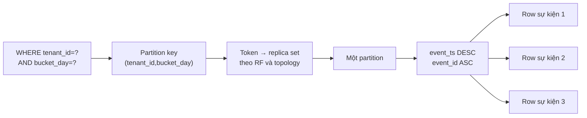
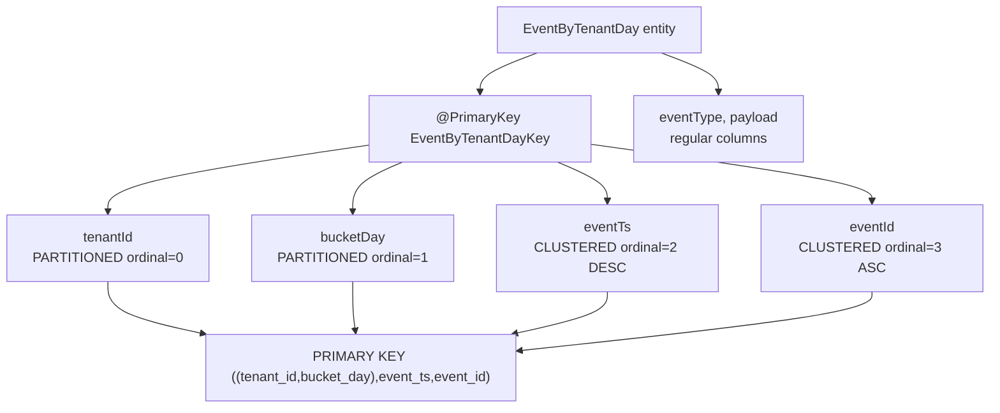

# @PrimaryKey, @PrimaryKeyClass, @PrimaryKeyColumn và thứ tự khóa

**Chương:** Spring Boot và Spring Data  
**Module:** `DATABASE_ENGINE_WIDE_COLUMN_CASSANDRA` — Apache Cassandra

Một entity Java có thể nhìn giống một bảng quan hệ, nhưng **primary key trong Apache Cassandra không chỉ xác định một hàng**. Nó quyết định **partition nằm ở replica nào, hàng nào nằm chung partition, thứ tự lưu/đọc trong partition và những điều kiện `WHERE` có thể thực hiện hiệu quả**. Vì vậy, khi dùng Spring Boot và Spring Data Cassandra, chọn nhầm `@PrimaryKey`, `@PrimaryKeyClass`, `@PrimaryKeyColumn`, `ordinal` hoặc `ordering` có thể làm model Java không khớp CQL schema, sinh query không hợp lệ hoặc tạo phân bố tải không như dự kiến.

Bài viết tập trung vào cách đi **từ yêu cầu truy vấn → CQL `PRIMARY KEY` → mapping annotation → repository/service → kiểm chứng schema và kết quả**. Các nội dung về partition token, clustering, consistency level, replication, lỗi vận hành và Java kết nối được liên hệ khi ảnh hưởng trực tiếp tới thiết kế khóa.

> **Phạm vi:** Các import và ví dụ dựa trên Spring Data for Apache Cassandra **4.x/5.x** và Spring Boot **3.x/4.x**, dùng Apache Cassandra và Java Driver tương thích với bộ phiên bản được chọn. Tài liệu Spring chính thức có thể thay đổi theo release; kiểm tra BOM/version matrix của Spring Boot đang triển khai. Trong lab, tạo schema bằng CQL trước và đặt `spring.cassandra.schema-action: none` để tránh framework tự thay schema. Không chạy DDL thay khóa chính trên production.

## 1. Kết quả học tập

Sau bài này, bạn có thể:

1. Tách rõ **partition key**, **clustering columns**, **full primary key** trong Cassandra và so chúng với annotation của Spring.
2. Hiểu `PRIMARY KEY (a)`, `PRIMARY KEY (a,b)` và `PRIMARY KEY ((a,b),c)` khác nhau thế nào.
3. Dùng `@PrimaryKey("column_name")` cho khóa đơn và `@PrimaryKeyClass` + `@PrimaryKey` cho khóa ghép.
4. Cấu hình `@PrimaryKeyColumn(name, ordinal, type, ordering)` chính xác theo DDL hiện có.
5. Biết `ordinal` biểu thị **vị trí thành phần khóa**, còn `ordering` là **hướng sắp xếp của clustering column**.
6. Phân biệt khóa ghép lồng trong đối tượng key với **flat composite key** dùng `MapId`.
7. Dùng `CassandraRepository<Entity, Key>`, `findById(Key)` và `@Query` có đầy đủ partition key.
8. Viết `equals/hashCode` nhất quán cho key class và biết vì sao không nên sửa key khi entity đã được lưu.
9. Đọc `system_schema.columns`, `DESCRIBE TABLE` để đối chiếu Spring mapping với Cassandra schema.
10. Nhận diện lỗi thứ tự khóa, thiếu partition predicate, `ALLOW FILTERING`, hot partition và schema drift.
11. Thiết kế thực hành CQL + Java có các ca kiểm chứng kết quả và truy vấn sai cần loại trừ.
12. Lập runbook thay đổi primary key bằng **bảng mới và di trú dữ liệu**, không trông chờ sửa annotation là đổi cấu trúc đã lưu.

## 2. Primary key Cassandra khác primary key quan hệ ra sao?

### 2.1. Ba vai trò của khóa

Một `PRIMARY KEY` Cassandra có thể gồm hai phần:

- **Partition key:** một hoặc nhiều cột cùng được băm để xác định token và nhóm replicas lưu partition. Mọi hàng có cùng **toàn bộ** partition key thuộc cùng một logical partition.
- **Clustering columns:** những cột theo sau partition key, giúp định danh hàng **bên trong một partition** và quyết định thứ tự clustering.
- **Full primary key:** tổ hợp partition key + tất cả clustering columns xác định duy nhất một hàng trong bảng.



Với primary key ghép, không nên xem bốn cột đều có vai trò giống nhau. Hai cột partition dùng để xác định phạm vi truy cập dữ liệu và phân bố; các clustering columns xác định vị trí/sắp xếp bên trong partition.

### 2.2. Ba cách khai báo DDL

| CQL | Partition key | Clustering columns | Hệ quả |
| --- | --- | --- | --- |
| `PRIMARY KEY (a)` | `a` | Không có | Mỗi partition chỉ có một hàng logic |
| `PRIMARY KEY (a, b)` | `a` | `b` | Nhiều hàng trong cùng `a`, sắp theo `b` |
| `PRIMARY KEY ((a, b), c)` | **(a, b)** | `c` | Token băm từ hai thành phần `a` và `b` |
| `PRIMARY KEY ((a, b), c, d)` | **(a, b)** | `c` rồi `d` | Thứ tự clustering là cột `c` trước `d` |
| `PRIMARY KEY (a, b, c)` | `a` | `b` rồi `c` | **Không** tương đương `PRIMARY KEY ((a,b),c)` |

**Dấu ngoặc tròn có ý nghĩa về cấu trúc khóa:** CQL `((a,b),c)` biểu thị **composite partition key**, không phải chỉ để nhóm cho dễ đọc. Với composite partition key, thứ tự các thành phần cũng là thành phần của cách hình thành khóa/token; tự đổi thứ tự không phải sửa cosmetic.

### 2.3. Clustering order là thuộc tính của bảng

Ví dụ:

```sql
CREATE TABLE lab_spring_keys.events_by_tenant_day (
    tenant_id text,
    bucket_day date,
    event_ts timestamp,
    event_id uuid,
    event_type text,
    payload text,
    PRIMARY KEY ((tenant_id, bucket_day), event_ts, event_id)
) WITH CLUSTERING ORDER BY (event_ts DESC, event_id ASC);
```

Trong **một** partition `(tenant_id,bucket_day)`, hàng được sắp theo `event_ts` mới đến cũ, rồi `event_id` tăng dần khi trùng thời điểm. `CLUSTERING ORDER BY` **không thay đổi partition hash**, không tự tạo global ordering giữa nhiều tenant/day, cũng không cho phép truy vấn `ORDER BY` tùy ý trên mọi cột.

## 3. Bản đồ annotation của Spring Data Cassandra

| Annotation / thuộc tính | Đặt ở đâu | Diễn giải |
| --- | --- | --- |
| `@Table("table_name")` | Entity class | Mapping entity tới CQL table |
| `@PrimaryKey("column_name")` | Một property trong entity | Khóa **đơn**, hoặc một property tham chiếu key class |
| `@PrimaryKeyClass` | **Class** riêng | Class mô tả toàn bộ thành phần của composite primary key |
| `@PrimaryKeyColumn` | Fields trong key class hoặc mô hình flat | Khai báo một thành phần khóa, loại và vị trí |
| `@PrimaryKeyColumn(type = PARTITIONED)` | Thành phần partition | Cột tham gia partition key |
| `@PrimaryKeyColumn(type = CLUSTERED)` | Thành phần clustering | Cột định danh/thứ tự bên trong partition |
| `ordinal = 0, 1, 2...` | Từng thành phần khóa | Vị trí theo khai báo CQL primary key |
| `ordering = Ordering.DESCENDING` | **Clustering** column | Chiều sắp xếp giảm, nếu DDL cũng quy định vậy |
| `ordering = Ordering.ASCENDING` | **Clustering** column | Chiều tăng (mặc định) |
| `@Column("column_name")` | Trường dữ liệu thường | Đặt tên column khác với Java property |
| `@Id` | Annotation chung Spring Data | Có use case cho identity; với flat key cần xem model và version |
| `@CassandraType` | Property khi cần override type inference | Type mapping bổ sung; không quyết định partition/clustering |

`@PrimaryKeyColumn` có các default đáng chú ý theo Javadoc: `type()` mặc định `PrimaryKeyType.CLUSTERED`, `ordering()` mặc định `Ordering.ASCENDING`, còn `ordinal()` có giá trị mặc định **`Integer.MIN_VALUE`**. Vì vậy trong bài học và schema production cần rõ thứ tự, nên **điền tường minh tất cả ordinal và type**, không chỉ dựa vào thứ tự khai báo các field Java.

**Cảnh báo:** Thứ tự **field xuất hiện trong source code Java** không phải cam kết thứ tự khóa của Cassandra. Hai giá trị làm việc cần đối chiếu là **DDL column order** và **annotation `ordinal`**.

## 4. Trường hợp đơn giản: một partition key

### 4.1. Tạo keyspace và table trong lab

Giả sử cluster disposable có DC tên `datacenter1`. Nếu khác, thay tên DC; RF=1 chỉ để thực hành mapping, không phải cấu hình chịu lỗi production.

```sql
CREATE KEYSPACE IF NOT EXISTS lab_spring_keys
WITH replication = {
  'class': 'NetworkTopologyStrategy',
  'datacenter1': 1
}
AND durable_writes = true;

CREATE TABLE IF NOT EXISTS lab_spring_keys.device_status_by_id (
    device_id uuid PRIMARY KEY,
    state text,
    updated_at timestamp
);
```

`device_id` là partition key duy nhất. Một `INSERT` cùng `device_id` sẽ upsert vào logical row tương ứng thay vì tạo một row thứ hai với cùng key.

### 4.2. Entity dùng `@PrimaryKey`

```java
import java.time.Instant;
import java.util.UUID;

import org.springframework.data.cassandra.core.mapping.Column;
import org.springframework.data.cassandra.core.mapping.PrimaryKey;
import org.springframework.data.cassandra.core.mapping.Table;

@Table("device_status_by_id")
public class DeviceStatus {

    @PrimaryKey("device_id")
    private UUID deviceId;

    @Column("state")
    private String state;

    @Column("updated_at")
    private Instant updatedAt;

    public DeviceStatus() { }

    public DeviceStatus(UUID deviceId, String state, Instant updatedAt) {
        this.deviceId = deviceId;
        this.state = state;
        this.updatedAt = updatedAt;
    }

    public UUID getDeviceId() { return deviceId; }
    public void setDeviceId(UUID deviceId) { this.deviceId = deviceId; }
    public String getState() { return state; }
    public void setState(String state) { this.state = state; }
    public Instant getUpdatedAt() { return updatedAt; }
    public void setUpdatedAt(Instant updatedAt) {
        this.updatedAt = updatedAt;
    }
}
```

**Ý nghĩa:** `@PrimaryKey("device_id")` là một property có kiểu đơn giản `UUID`, khớp cột `device_id uuid PRIMARY KEY`. Không cần tạo `@PrimaryKeyClass` chỉ để bọc một UUID.

```java
import java.util.UUID;
import org.springframework.data.cassandra.repository.CassandraRepository;

public interface DeviceStatusRepository
        extends CassandraRepository<DeviceStatus, UUID> {
}
```

Generic parameter thứ hai của repository là kiểu **identity chính xác**, ở đây `UUID`. Không dùng `Long` chỉ vì ứng dụng quen JPA.

### 4.3. Khi một @PrimaryKey đơn không đủ

Nếu bạn muốn nhiều events của cùng device theo thời gian, table `device_id PRIMARY KEY` không chứa được các **hàng độc lập** cho mỗi event (ghi mới cùng id sẽ update row). Bạn cần clustering column như `event_ts` và có thể `event_id` để phân biệt hai events cùng timestamp.

**Không** dùng trường `@Column Instant eventTs` trong entity rồi mong nó trở thành clustering key; Cassandra phải có cột ấy trong CQL `PRIMARY KEY`.

## 5. Bài toán chính: khóa ghép có hai partition columns và hai clustering columns

### 5.1. Yêu cầu truy vấn

Giả sử sản phẩm ghi events, cần:

- Lấy **20 sự kiện mới nhất** của một tenant trong một ngày.
- Tìm một sự kiện theo đầy đủ `tenant_id`, `bucket_day`, `event_ts`, `event_id`.
- Giữ số hàng theo một partition có giới hạn bằng bucket ngày.
- Không quét toàn bộ cluster để trả một timeline.
- Có thể ghi nhiều events cùng `event_ts`; thêm `event_id` để đảm bảo uniqueness.

Từ các yêu cầu này, chọn khóa:

```text
PRIMARY KEY ((tenant_id, bucket_day), event_ts, event_id)
             \_____________________/  \_________________/
                 partition key           clustering keys

partition order: tenant_id (0), bucket_day (1)
cluster order:   event_ts  (2), event_id  (3)
sort direction:  event_ts DESC, event_id ASC
```

### 5.2. DDL chuẩn nguồn sự thật

```sql
CREATE TABLE IF NOT EXISTS lab_spring_keys.events_by_tenant_day (
    tenant_id text,
    bucket_day date,
    event_ts timestamp,
    event_id uuid,
    event_type text,
    payload text,
    PRIMARY KEY ((tenant_id, bucket_day), event_ts, event_id)
) WITH CLUSTERING ORDER BY (event_ts DESC, event_id ASC);
```

Đây là **schema được quản lý bằng CQL**; ở các mục sau Java annotation sẽ mapping **khớp nó**, không tự ý sửa đổi schema thật.

### 5.3. Thử dữ liệu CQL đã xác định

```sql
INSERT INTO lab_spring_keys.events_by_tenant_day (
    tenant_id, bucket_day, event_ts, event_id, event_type, payload
) VALUES (
    'tenant-a', '2026-11-21', '2026-11-21T10:00:00Z',
    10000000-0000-4000-8000-000000000001, 'OPEN', 'home'
);

INSERT INTO lab_spring_keys.events_by_tenant_day (
    tenant_id, bucket_day, event_ts, event_id, event_type, payload
) VALUES (
    'tenant-a', '2026-11-21', '2026-11-21T10:03:00Z',
    10000000-0000-4000-8000-000000000002, 'CLICK', 'item-2'
);

INSERT INTO lab_spring_keys.events_by_tenant_day (
    tenant_id, bucket_day, event_ts, event_id, event_type, payload
) VALUES (
    'tenant-a', '2026-11-21', '2026-11-21T10:03:00Z',
    10000000-0000-4000-8000-000000000003, 'CLICK', 'item-3'
);

INSERT INTO lab_spring_keys.events_by_tenant_day (
    tenant_id, bucket_day, event_ts, event_id, event_type, payload
) VALUES (
    'tenant-b', '2026-11-21', '2026-11-21T10:05:00Z',
    10000000-0000-4000-8000-000000000004, 'OPEN', 'other'
);
```

Truy vấn:

```sql
SELECT event_ts, event_id, event_type, payload
FROM lab_spring_keys.events_by_tenant_day
WHERE tenant_id = 'tenant-a'
  AND bucket_day = '2026-11-21'
LIMIT 20;
```

Kỳ vọng trong partition tenant-a/ngày 21: events tại 10:03 trước 10:00. Hai hàng cùng `event_ts=10:03` sắp theo `event_id ASC`. Event của tenant-b **không xuất hiện** vì partition key khác.

## 6. `@PrimaryKeyClass`: mô hình identity thành một Java type

### 6.1. Toàn bộ key class

Một `@PrimaryKeyClass` nên có **mọi thành phần PK** theo đúng CQL, không thiếu clustering column và không chứa payload. Ví dụ hoàn chỉnh:

```java
import java.io.Serializable;
import java.time.Instant;
import java.time.LocalDate;
import java.util.Objects;
import java.util.UUID;

import org.springframework.data.cassandra.core.cql.Ordering;
import org.springframework.data.cassandra.core.cql.PrimaryKeyType;
import org.springframework.data.cassandra.core.mapping.PrimaryKeyClass;
import org.springframework.data.cassandra.core.mapping.PrimaryKeyColumn;

@PrimaryKeyClass
public class EventByTenantDayKey implements Serializable {

    private static final long serialVersionUID = 1L;

    @PrimaryKeyColumn(
        name = "tenant_id",
        ordinal = 0,
        type = PrimaryKeyType.PARTITIONED)
    private String tenantId;

    @PrimaryKeyColumn(
        name = "bucket_day",
        ordinal = 1,
        type = PrimaryKeyType.PARTITIONED)
    private LocalDate bucketDay;

    @PrimaryKeyColumn(
        name = "event_ts",
        ordinal = 2,
        type = PrimaryKeyType.CLUSTERED,
        ordering = Ordering.DESCENDING)
    private Instant eventTs;

    @PrimaryKeyColumn(
        name = "event_id",
        ordinal = 3,
        type = PrimaryKeyType.CLUSTERED,
        ordering = Ordering.ASCENDING)
    private UUID eventId;

    // Constructor rỗng để Spring Data materialize qua property access.
    public EventByTenantDayKey() { }

    public EventByTenantDayKey(
            String tenantId,
            LocalDate bucketDay,
            Instant eventTs,
            UUID eventId) {
        this.tenantId = tenantId;
        this.bucketDay = bucketDay;
        this.eventTs = eventTs;
        this.eventId = eventId;
    }

    public String getTenantId() { return tenantId; }
    public void setTenantId(String tenantId) { this.tenantId = tenantId; }

    public LocalDate getBucketDay() { return bucketDay; }
    public void setBucketDay(LocalDate bucketDay) {
        this.bucketDay = bucketDay;
    }

    public Instant getEventTs() { return eventTs; }
    public void setEventTs(Instant eventTs) { this.eventTs = eventTs; }

    public UUID getEventId() { return eventId; }
    public void setEventId(UUID eventId) { this.eventId = eventId; }

    @Override
    public boolean equals(Object other) {
        if (this == other) return true;
        if (!(other instanceof EventByTenantDayKey that)) return false;
        return Objects.equals(tenantId, that.tenantId)
            && Objects.equals(bucketDay, that.bucketDay)
            && Objects.equals(eventTs, that.eventTs)
            && Objects.equals(eventId, that.eventId);
    }

    @Override
    public int hashCode() {
        return Objects.hash(tenantId, bucketDay, eventTs, eventId);
    }
}
```

**Các điểm quan trọng:**

1. `type = PARTITIONED` có mặt **hai lần**, đúng hai cột trong tuple `(tenant_id, bucket_day)`.
2. `type = CLUSTERED` có mặt cho `event_ts` và `event_id`; chúng **không** tham gia hash partition.
3. `ordinal 0,1,2,3` biểu thị **thứ tự thành phần** trong CQL `PRIMARY KEY`, không phải sort ASC/DESC.
4. `ordering DESCENDING` chỉ dành cho `event_ts` vì DDL nói `event_ts DESC`.
5. `LocalDate` ánh xạ CQL `date`; `Instant` ánh xạ CQL `timestamp`; `UUID` ánh xạ `uuid`. Đừng dùng `LocalDateTime` rồi suy time zone theo JVM một cách tùy tiện.
6. Khóa thường nên là **value object ổn định**. Ví dụ dùng setters để mapping thuận tiện; code nghiệp vụ **không thay key của entity đã persist**. Có thể dùng constructor-only/immutable mapping khi đã kiểm tra phiên bản và cách Spring Data materialize.
7. `equals/hashCode` phải bao gồm **đúng các thành phần identity** và nhất quán với equality của kiểu CQL. Đừng gộp payload vào equals và đừng bỏ `event_id`.
8. `Serializable` là một lựa chọn thực hành phổ biến với key class, không phải “cơ chế phân phối dữ liệu” của Cassandra.

### 6.2. Vì sao equals/hashCode cần nhất quán?

Với Java objects:

```java
var t = java.time.Instant.parse("2026-11-21T10:03:00Z");
var d = java.time.LocalDate.of(2026, 11, 21);
var e = java.util.UUID.fromString(
    "10000000-0000-4000-8000-000000000002");

var k1 = new EventByTenantDayKey("tenant-a", d, t, e);
var k2 = new EventByTenantDayKey("tenant-a", d, t, e);

assert k1.equals(k2);
assert k1.hashCode() == k2.hashCode();
```

Nếu `k1` và `k2` có cùng các giá trị CQL nhưng Java không coi bằng nhau, repository identity/caches/collections trong application có thể xử lý sai. Ngược lại, một Java equality quá lỏng không khớp equality Cassandra có thể làm app tưởng hai hàng khác PK là một.

Nếu key chứa kiểu có chuẩn hóa hoặc so sánh đặc thù (ví dụ một số kiểu số có scale), cần xem semantics Java/Cassandra và viết test cho từng type. Trong ví dụ này dùng các kiểu có equality rõ ràng.

## 7. `@PrimaryKey` đặt trên entity để tham chiếu key class

### 7.1. Entity chứa một property `key`

```java
import org.springframework.data.cassandra.core.mapping.Column;
import org.springframework.data.cassandra.core.mapping.PrimaryKey;
import org.springframework.data.cassandra.core.mapping.Table;

@Table("events_by_tenant_day")
public class EventByTenantDay {

    @PrimaryKey
    private EventByTenantDayKey key;

    @Column("event_type")
    private String eventType;

    @Column("payload")
    private String payload;

    public EventByTenantDay() { }

    public EventByTenantDay(
            EventByTenantDayKey key,
            String eventType,
            String payload) {
        this.key = key;
        this.eventType = eventType;
        this.payload = payload;
    }

    public EventByTenantDayKey getKey() { return key; }
    public void setKey(EventByTenantDayKey key) { this.key = key; }

    public String getEventType() { return eventType; }
    public void setEventType(String eventType) {
        this.eventType = eventType;
    }

    public String getPayload() { return payload; }
    public void setPayload(String payload) { this.payload = payload; }
}
```

**Đọc đúng:** `@PrimaryKey` ở `EventByTenantDay.key` **không tạo một CQL column tên `key`**. Spring Data dùng metadata của `@PrimaryKeyClass` để ánh xạ 4 fields bên trong thành **4 columns thật** của table.

Với khóa ghép, không dùng `@PrimaryKey("tenant_id")` trên property kiểu `EventByTenantDayKey` để mong chỉ thành phần tenant là partition: đối với key class, tên truyền cho `@PrimaryKey` không thay sơ đồ bốn thành phần.

### 7.2. Dòng dữ liệu từ Java đến CQL



Khi tạo event mới, phải có đủ bốn key fields và đúng type. Cassandra không cho `null` trong primary key columns. Không dùng `UUID.randomUUID()` cho `eventId` **mỗi khi retry cùng một business event**, nếu yêu cầu không tạo hàng trùng; event ID nên được tạo một lần ở nguồn tin cậy.

## 8. Spring Data repository với composite ID

### 8.1. Repository type thứ hai là key class

```java
import java.time.LocalDate;
import java.util.List;

import org.springframework.data.cassandra.repository.CassandraRepository;
import org.springframework.data.cassandra.repository.Query;

public interface EventByTenantDayRepository
        extends CassandraRepository<EventByTenantDay, EventByTenantDayKey> {

    @Query("SELECT * FROM events_by_tenant_day " +
           "WHERE tenant_id = ?0 AND bucket_day = ?1 LIMIT 20")
    List<EventByTenantDay> latest20(String tenantId, LocalDate bucketDay);
}
```

`findById` được kế thừa sẽ nhận **`EventByTenantDayKey`**, không phải chỉ `UUID eventId` hoặc `String tenantId`:

```java
import java.time.Instant;
import java.time.LocalDate;
import java.util.Optional;
import java.util.UUID;

public final class EventReadExample {
    public static Optional<EventByTenantDay> getExact(
            EventByTenantDayRepository repository) {
        EventByTenantDayKey id = new EventByTenantDayKey(
            "tenant-a",
            LocalDate.of(2026, 11, 21),
            Instant.parse("2026-11-21T10:03:00Z"),
            UUID.fromString("10000000-0000-4000-8000-000000000002")
        );
        return repository.findById(id);
    }
}
```

**Không viết** `CassandraRepository<EventByTenantDay, UUID>` rồi `findById(eventId)`; Cassandra không có index tìm event theo clustering key `event_id` khi thiếu partition key và các thành phần PK trước nó.

### 8.2. Query mới nhất theo partition

Method `latest20` sử dụng đầy đủ **partition key**, không cần biết `event_ts`/`event_id` để đọc **toàn bộ một phạm vi partition** rồi `LIMIT`. Nếu app muốn giới hạn theo thời gian:

```sql
SELECT event_ts, event_id, event_type, payload
FROM lab_spring_keys.events_by_tenant_day
WHERE tenant_id = 'tenant-a'
  AND bucket_day = '2026-11-21'
  AND event_ts >= '2026-11-21T10:00:00Z'
  AND event_ts < '2026-11-21T11:00:00Z'
LIMIT 50;
```

Đây là predicate hợp lý vì `event_ts` là **clustering column đầu tiên**. Nếu query chỉ có `event_id` mà thiếu `event_ts`, Cassandra thông thường không thể thực hiện trực tiếp như một point lookup trong table này. Cần thiết kế **bảng truy vấn khác** (ví dụ `event_by_id`) nếu use case là tìm event chỉ bằng `event_id`.

### 8.3. Đừng nhầm `findAll()` là danh sách “toàn bảng” an toàn

Spring Data repositories có các method tiện như `findAll()`, nhưng chạy chúng trên bảng Cassandra lớn có thể tạo scan và gây I/O/latency rất cao. Thiết kế repository theo **query patterns đã biết**, thường có toàn bộ partition key. Không tự thêm `ALLOW FILTERING` vào query bị từ chối để có cảm giác “giống SQL”.

## 9. `@PrimaryKeyColumn`: thuộc tính và thứ tự chính xác

### 9.1. Đọc từng tham số

```java
@PrimaryKeyColumn(
    name = "event_ts",
    ordinal = 2,
    type = PrimaryKeyType.CLUSTERED,
    ordering = Ordering.DESCENDING
)
private Instant eventTs;
```

- **`name`:** tên CQL column; không phải tên Java property, không nhất thiết giống nhau.
- **`ordinal`:** thứ tự thành phần PK so với các `@PrimaryKeyColumn` còn lại.
- **`type`:** `PARTITIONED` hay `CLUSTERED`, quyết định thành phần thuộc partition key hay clustering key.
- **`ordering`:** chỉ có tác dụng với **`CLUSTERED`**, mô tả chiều sắp xếp. Trên `PARTITIONED`, giá trị này **không được dùng** để thay đổi cách token băm.

### 9.2. `ordinal` không phải sort direction

Hai annotation:

```java
@PrimaryKeyColumn(name = "event_ts", ordinal = 2,
    type = PrimaryKeyType.CLUSTERED,
    ordering = Ordering.DESCENDING)

@PrimaryKeyColumn(name = "event_id", ordinal = 3,
    type = PrimaryKeyType.CLUSTERED,
    ordering = Ordering.ASCENDING)
```

Nói rằng **so theo event_ts trước** và khi bằng nhau **so event_id sau**; hướng so mỗi cột lại là việc riêng. `ordinal = 3` không có nghĩa `event_id` tăng hay giảm.

### 9.3. Thứ tự field Java không quyết định schema

Ví dụ cách sắp field trong source code dưới đây có thể đọc khó hiểu:

```java
// PHẢN VÍ DỤ VỀ KHẢ NĂNG ĐỌC CODE (không phải cú pháp lỗi):
@PrimaryKeyColumn(name="event_id", ordinal=3, type=PrimaryKeyType.CLUSTERED)
private UUID eventId;

@PrimaryKeyColumn(name="tenant_id", ordinal=0, type=PrimaryKeyType.PARTITIONED)
private String tenantId;
```

Mapper dùng metadata `ordinal` chứ không dựa vào thứ tự xuất hiện của dòng Java. Nhưng một codebase dễ bảo trì nên sắp fields **theo ordinal 0→N** để reviewer đối chiếu với CQL nhanh.

### 9.4. Đừng bỏ `type` vì mặc định không phải PARTITIONED

Javadoc chỉ ra `type` mặc định `CLUSTERED`. Nếu thiếu `type = PrimaryKeyType.PARTITIONED` ở `tenantId` hoặc `bucketDay`, metadata mapping có thể phân loại nhầm các thành phần khóa. Với bảng đã tồn tại, hậu quả là **mapping mismatch hoặc truy vấn sai**, không phải Cassandra “tự chữa”.

### 9.5. `name`, `value` và quoting

`@PrimaryKeyColumn(name = "tenant_id")` map trường `tenantId` sang `tenant_id`. Javadoc có alias `value` cho tên cột; dùng thống nhất một style.

Tránh dùng tên cột nhạy với chữ hoa/chữ thường hoặc reserved words làm keys nếu không cần. Cassandra CQL identifier không được quote thường quy về lowercase; khi dùng tên có quote như `"TenantID"`, hãy kiểm tra mapping naming strategy và `CqlIdentifier`. **Không** sửa annotation để “đổi tên column tại chỗ” khi schema/data chưa được di trú.

## 10. Composite partition key khác nhiều clustering columns

### 10.1. Ba trường hợp đặt cạnh nhau

```sql
-- A. Partition theo tenant, bucket_day là clustering:
CREATE TABLE lab_spring_keys.sample_a (
    tenant_id text,
    bucket_day date,
    event_id uuid,
    value text,
    PRIMARY KEY (tenant_id, bucket_day, event_id)
);

-- B. Partition theo (tenant,bucket_day), event_id clustering:
CREATE TABLE lab_spring_keys.sample_b (
    tenant_id text,
    bucket_day date,
    event_id uuid,
    value text,
    PRIMARY KEY ((tenant_id, bucket_day), event_id)
);

-- C. Partition theo tenant, event_id clustering:
CREATE TABLE lab_spring_keys.sample_c (
    tenant_id text,
    event_id uuid,
    value text,
    PRIMARY KEY (tenant_id, event_id)
);
```

A và B có cùng các **tên cột** nhưng chiến lược phân bố rất khác.

| Schema | Partition key | Dữ liệu chung partition | Khi nào hợp lý |
| --- | --- | --- | --- |
| A | `tenant_id` | Tất cả ngày của một tenant | Chỉ khi partition size đã được chứng minh nhỏ và truy vấn theo tenant |
| B | `(tenant_id,bucket_day)` | Chỉ events của một tenant/ngày | Timeline theo ngày, tránh một partition tăng vô hạn |
| C | `tenant_id` | Mọi eventId của tenant | Tra cứu mọi events của tenant trong partition, có nguy cơ quá rộng |

Thêm `bucket_day` vào clustering (A) **không giới hạn kích thước một partition theo ngày**; chỉ khi `bucket_day` là **một phần của partition key** (B) mới tạo partition khác theo ngày.

### 10.2. Tác động tới token, replicas và RF

Cassandra băm **toàn bộ composite partition key**. Với B, `(tenant-a, 2026-11-21)` và `(tenant-a, 2026-11-22)` có thể phân bố tới các replica sets khác nhau theo token/ring. `NetworkTopologyStrategy` cùng RF quyết định số replica theo DC; annotation **không thay RF**.

Một code review chỉ kiểm tra `@PrimaryKeyColumn` có tên đúng mà bỏ `type` có thể làm mất ý nghĩa bucket và gây hot partition.

## 11. Flat composite key: không tạo `@PrimaryKeyClass`

Spring Data Cassandra hỗ trợ một **cách ánh xạ thay thế**: khai báo trực tiếp các `@PrimaryKeyColumn` trên entity.

> **Chọn một cách trong app chính:** Các đoạn `EventByTenantDay` với key class và `EventFlat` dưới đây là **hai phương án mapping cùng schema để so sánh**, không cần đăng ký cả hai entity cùng tên table khi sử dụng schema auto-generation.

### 11.1. Flat entity

```java
import java.time.Instant;
import java.time.LocalDate;
import java.util.UUID;

import org.springframework.data.cassandra.core.cql.Ordering;
import org.springframework.data.cassandra.core.cql.PrimaryKeyType;
import org.springframework.data.cassandra.core.mapping.Column;
import org.springframework.data.cassandra.core.mapping.PrimaryKeyColumn;
import org.springframework.data.cassandra.core.mapping.Table;

@Table("events_by_tenant_day")
public class EventFlat {

    @PrimaryKeyColumn(
        name = "tenant_id", ordinal = 0,
        type = PrimaryKeyType.PARTITIONED)
    private String tenantId;

    @PrimaryKeyColumn(
        name = "bucket_day", ordinal = 1,
        type = PrimaryKeyType.PARTITIONED)
    private LocalDate bucketDay;

    @PrimaryKeyColumn(
        name = "event_ts", ordinal = 2,
        type = PrimaryKeyType.CLUSTERED,
        ordering = Ordering.DESCENDING)
    private Instant eventTs;

    @PrimaryKeyColumn(
        name = "event_id", ordinal = 3,
        type = PrimaryKeyType.CLUSTERED,
        ordering = Ordering.ASCENDING)
    private UUID eventId;

    @Column("event_type")
    private String eventType;

    @Column("payload")
    private String payload;

    public EventFlat() { }

    // Getters/setters cho các thuộc tính ở trên
    // theo convention của Spring Data; lược bỏ để tập trung mapping.
}
```

Tài liệu Spring Data có ví dụ flat composite key dùng `@PrimaryKeyColumn` trên từng field và tìm kiếm bằng predicates/`MapId`. Javadoc cũng mô tả phối hợp `@Id` cho trường hợp cần đánh dấu **một property** là identity; **không** tự thêm `@Id` lên mọi thành phần của flat composite key. Kiểm chứng cách mapping flat trên **phiên bản Spring Data** đang sử dụng trước khi triển khai. Nếu dùng repository ID type rõ ràng, `@PrimaryKeyClass` thường dễ kiểm soát hơn.

### 11.2. Dùng `MapIdCassandraRepository`

```java
import org.springframework.data.cassandra.repository.MapIdCassandraRepository;

public interface EventFlatRepository
        extends MapIdCassandraRepository<EventFlat> {
}
```

Với `MapId`, ứng dụng cung cấp **một map giá trị cho tất cả PK properties**:

```java
import java.time.Instant;
import java.time.LocalDate;
import java.util.UUID;

import org.springframework.data.cassandra.core.mapping.BasicMapId;
import org.springframework.data.cassandra.core.mapping.MapId;

// Ví dụ gọi findById với property names trong Java mapping.
MapId id = BasicMapId.id("tenantId", "tenant-a")
    .with("bucketDay", LocalDate.of(2026, 11, 21))
    .with("eventTs", Instant.parse("2026-11-21T10:03:00Z"))
    .with("eventId", UUID.fromString(
        "10000000-0000-4000-8000-000000000002"));

// eventFlatRepository.findById(id);
```

`BasicMapId.id(...).with(...)` là API tạo identifier được tài liệu Spring Data cung cấp. **Tên trong MapId phải khớp property mà mapper mong đợi**, kiểm tra behavior khi Java property khác CQL column name.

### 11.3. Chọn flat hay key class?

| Tiêu chí | `@PrimaryKeyClass` | Flat `@PrimaryKeyColumn` + `MapId` |
| --- | --- | --- |
| ID trong repository | `EventByTenantDayKey` rõ type | `MapId` linh hoạt nhưng ít type-safe |
| Truyền identity qua service | Một value object | Nhiều field hoặc map |
| `equals/hashCode` | Do key class định nghĩa | MapId/container tự quản lý cấu trúc map |
| Tính tự mô tả | Cao với nhiều thành phần | Tốt nếu entity ít field |
| Nguy cơ thiếu thành phần key | Compiler có thể hỗ trợ qua constructor/type | MapId thiếu key chỉ lộ khi runtime/test |
| Query read theo partition | Repository/custom query | Custom query hoặc MapId |
| Khuyến nghị cho nhiều clustering columns | Thường dễ review | Dùng khi có lý do đơn giản hóa model |

Không biến lựa chọn này thành quyết định ORM mang tính thẩm mỹ; chọn theo **cách repository, service và team sử dụng identity**, cùng khả năng kiểm thử schema thực tế.

## 12. Thứ tự khóa quyết định truy vấn hợp lệ

### 12.1. Với bảng events chính

```text
Partition:  (tenant_id, bucket_day)
Clustering: event_ts DESC, event_id ASC
```

| Truy vấn | Hợp lệ theo access pattern? | Vì sao |
| --- | --- | --- |
| `WHERE tenant_id=? AND bucket_day=?` | Có | Đủ partition key |
| `WHERE tenant_id=? AND bucket_day=? AND event_ts>=?` | Có | Clustering prefix/range |
| `WHERE tenant_id=? AND bucket_day=? AND event_ts=? AND event_id=?` | Có | Full primary key |
| `WHERE tenant_id=?` | Không phù hợp cho point partition read | Thiếu `bucket_day` của composite partition key |
| `WHERE bucket_day=?` | Không | Thiếu `tenant_id` |
| `WHERE event_id=?` | Không | Chỉ biết clustering column cuối, không biết partition |
| `WHERE tenant_id=? AND bucket_day=? AND event_id=?` | Thông thường không | Bỏ qua `event_ts` trước `event_id` |
| `WHERE payload=?` | Không với schema này | Regular column không indexed và không là primary key |
| `WHERE ... ALLOW FILTERING` | Tránh | Có thể quét/lọc tốn tài nguyên, không sửa model |

Nên định nghĩa **một bảng bổ sung** cho truy vấn `event_id` độc lập, thay vì cố ép repository tạo query không phù hợp.

### 12.2. Sorting được hỗ trợ

Bảng định nghĩa:

```sql
WITH CLUSTERING ORDER BY (event_ts DESC, event_id ASC)
```

Ví dụ:

```sql
-- Thứ tự đã định nghĩa:
SELECT event_ts, event_id
FROM lab_spring_keys.events_by_tenant_day
WHERE tenant_id = 'tenant-a'
  AND bucket_day = '2026-11-21'
ORDER BY event_ts DESC, event_id ASC;

-- Đảo NGƯỢC toàn bộ hướng:
SELECT event_ts, event_id
FROM lab_spring_keys.events_by_tenant_day
WHERE tenant_id = 'tenant-a'
  AND bucket_day = '2026-11-21'
ORDER BY event_ts ASC, event_id DESC;
```

Cassandra cho phép ordering tương thích với clustering order của bảng hoặc **đảo ngược** nó. Không suy mọi tổ hợp `event_ts ASC, event_id ASC` đều được hỗ trợ. `ORDER BY payload` không trở thành hợp lệ chỉ vì payload là một Java property.

### 12.3. Hướng sắp xếp không phải cột “mới nhất toàn cluster”

`ORDER BY event_ts DESC LIMIT 20` cho **một partition đã chỉ định** phù hợp hơn truy vấn “20 events mới nhất của mọi tenant”. Nếu nghiệp vụ cần global feed, cần read model/materialized projections khác theo query và đánh giá phân bố tải. Thứ tự clustering không tạo global index.

### 12.4. Vì sao không dùng JPA `@OrderBy`?

`@PrimaryKeyColumn(ordering=...)` là metadata **Spring Data Cassandra** cho schema clustering. Nó không phải Spring Data JPA `@OrderBy` trên collection. Cassandra không có general sorting trên arbitrary columns như RDBMS; cần thiết kế từ `PRIMARY KEY`.

## 13. Mã Java service minh họa lưu và đọc

```java
import java.time.Instant;
import java.time.LocalDate;
import java.util.List;
import java.util.UUID;

import org.springframework.stereotype.Service;

@Service
public class EventByTenantDayService {

    private final EventByTenantDayRepository repository;

    public EventByTenantDayService(
            EventByTenantDayRepository repository) {
        this.repository = repository;
    }

    public EventByTenantDay appendEvent(
            String tenantId,
            Instant occurredAt,
            UUID stableEventId,
            String eventType,
            String payload) {

        // Ngày bucket tính theo UTC, không phụ thuộc timezone mặc định host.
        LocalDate bucketDay = occurredAt.atOffset(
            java.time.ZoneOffset.UTC).toLocalDate();

        EventByTenantDayKey key = new EventByTenantDayKey(
            tenantId, bucketDay, occurredAt, stableEventId);

        EventByTenantDay entity = new EventByTenantDay(
            key, eventType, payload);

        return repository.save(entity);
    }

    public List<EventByTenantDay> latest20(
            String tenantId, LocalDate day) {
        return repository.latest20(tenantId, day);
    }
}
```

**Giới hạn quan trọng của ví dụ:**

- `stableEventId` phải được tạo **một lần cho cùng business event**; tạo UUID mới khi retry sẽ tạo PK khác và duplicate.
- `occurredAt` được dùng đồng thời cho `event_ts` và tính `bucket_day` theo UTC. Nếu nơi viết khác dùng timezone local, cùng event có thể bị chuyển sang partition khác.
- `repository.save(...)` hoạt động theo semantics Cassandra (mutation/upsert) và không phải một transaction SQL tổng quát.
- Không tự khai báo `@Transactional` rồi suy đảm bảo atomicity xuyên nhiều partition. Cassandra có atomicity/LWT giới hạn khác RDBMS.
- Nếu cần `LOCAL_QUORUM`, driver/session/execution profile và query cần cấu hình CL phù hợp; annotation khóa không đặt consistency level.
- Tránh logging raw `payload` khi chứa PII; không đưa secret/credential vào DTO.

### 13.1. Kiểm tra tính idempotent của INSERT

Lưu hai lần cùng `EventByTenantDayKey` với cùng payload/dữ liệu deterministic thường **không tạo hai CQL rows khác nhau**. Nhưng khi payload/timestamp hay TTL thay đổi, có thể update data tại key đó. Đặc biệt nếu `eventId` được tạo mới mỗi attempt, đó **không còn cùng key**.

**Bài học:** Chọn primary key hợp lý giúp quản lý duplicate event logic, nhưng không thay cơ chế exactly-once của toàn bộ workflow hoặc các side effects bên ngoài.

## 14. Spring Boot: dependency và cấu hình kết nối

### 14.1. Dùng starter được quản lý phiên bản

Ví dụ trong `pom.xml` minh họa phần dependency (parent/BOM phải được cấu hình trong project thực tế):

```xml
<dependency>
    <groupId>org.springframework.boot</groupId>
    <artifactId>spring-boot-starter-data-cassandra</artifactId>
</dependency>
```

Không chọn bừa phiên bản Spring Data Cassandra và Java Driver bên ngoài BOM Spring Boot; có thể gây lỗi API/mapping/runtime. Với project Gradle dùng dependency tương ứng trong danh sách của Boot plugin/BOM.

### 14.2. `application.yml` cho môi trường lab

Với Spring Boot hiện đại (3.x/4.x), namespace là **`spring.cassandra.*`**, không phải `spring.data.cassandra.*` trong nhiều ví dụ Boot 2.x cũ:

```yaml
spring:
  cassandra:
    contact-points: "127.0.0.1:9042"
    local-datacenter: "datacenter1"
    keyspace-name: "lab_spring_keys"
    schema-action: none
```

- `contact-points` giúp driver khám phá cluster; không đồng nghĩa mọi query luôn đi tới đúng node đầu tiên.
- `local-datacenter` cần khớp DC thực tế.
- `keyspace-name` phải tồn tại, có RF phù hợp; ví dụ RF1 chỉ dùng lab.
- `schema-action: none` không tự tạo/drop table khi app khởi động. Trong production cần schema migration được review.
- Với auth/TLS, dùng secret manager và SSL trust material hợp lệ; không đặt mật khẩu thật trong Git hoặc ví dụ lab.
- Spring Boot auto-configure `CqlSession`, `CassandraTemplate`, repositories theo classpath/config; không tạo session mới cho mỗi HTTP request.

### 14.3. Vấn đề `schema-action` và source of truth

| Giá trị | Ý nghĩa | Rủi ro |
| --- | --- | --- |
| `none` | Không tự tạo/drop CQL tables ở startup | Cần provision schema riêng |
| `create` | Tạo schema từ entity | Khó kiểm soát khi đã có bảng/schema khác |
| `create_if_not_exists` | Tạo nếu thiếu | **Không** sửa drift của bảng đã tồn tại |
| `recreate` | Drop/recreate các đối tượng quản lý | **Mất dữ liệu** |
| `recreate_drop_unused` | Drop/recreate rộng hơn | **Cực kỳ nguy hiểm trên môi trường có dữ liệu** |

Không đặt `recreate` hoặc `recreate_drop_unused` trong production để “sửa lỗi annotation thứ tự khóa”. **Thay thứ tự/loại cột primary key đòi thiết kế lại table và migrate data**, không chỉ deploy code.

## 15. Đối chiếu schema thật trước khi chạy service

### 15.1. `DESCRIBE TABLE`

Trong `cqlsh`:

```sql
DESCRIBE TABLE lab_spring_keys.events_by_tenant_day;
```

Kỳ vọng thấy:

```sql
PRIMARY KEY ((tenant_id, bucket_day), event_ts, event_id)
WITH CLUSTERING ORDER BY (event_ts DESC, event_id ASC)
```

Đây là **trích phần cần đối chiếu**, không phải toàn bộ output literal của `DESCRIBE TABLE` (cassandra có thể in thêm table options).

### 15.2. Đọc `system_schema.columns`

```sql
SELECT column_name, kind, position, clustering_order, type
FROM system_schema.columns
WHERE keyspace_name = 'lab_spring_keys'
  AND table_name = 'events_by_tenant_day';
```

Các cột metadata có thể biểu diễn `kind` là `partition_key`, `clustering` hoặc `regular`, `position` tính theo từng nhóm và `clustering_order` cho clustering. Không giả định `position` toàn bộ rows chạy thẳng 0→3 giống `ordinal` Java: vị trí của **partition** và **clustering** có thể được đánh số riêng.

Bảng kiểm đối chiếu:

| Java key property | CQL column | `type` Java | `ordinal` Java | Metadata CQL kỳ vọng |
| --- | --- | --- | ---: | --- |
| `tenantId` | `tenant_id` | PARTITIONED | 0 | partition key position 0 |
| `bucketDay` | `bucket_day` | PARTITIONED | 1 | partition key position 1 |
| `eventTs` | `event_ts` | CLUSTERED | 2 | clustering position 0, DESC |
| `eventId` | `event_id` | CLUSTERED | 3 | clustering position 1, ASC |

**Quy tắc kiểm thử:** `ordinal` là một **thứ tự liên tục trong metadata mapping Java**; CQL `system_schema.columns.position` có thể **bắt đầu lại từ 0** cho nhóm clustering. Đừng so hai số cứng một–một mà không phân biệt nhóm.

### 15.3. Kiểm tra kiểu dữ liệu

- Java `String` ↔ CQL `text`.
- Java `LocalDate` ↔ CQL `date`.
- Java `Instant` ↔ CQL `timestamp`.
- Java `UUID` ↔ CQL `uuid`.

Nếu schema đang dùng CQL `timeuuid` thay `uuid`, không tự cho rằng ý nghĩa/ordering giống hệt; cần converter/type mapping phù hợp. `@CassandraType` có thể giúp chỉ định type ở nơi cần thiết; không dùng nó thay `@PrimaryKeyColumn(type=...)` vì hai `type` thuộc **hai khái niệm** khác nhau: kiểu CQL và vai trò khóa.

## 16. Kiểm chứng round-trip Java ↔ Cassandra

### 16.1. Bộ test dương

Trên lab:

1. Tạo keyspace/table CQL theo mục 4–5.
2. Chạy app với `schema-action=none`.
3. `repository.save(new EventByTenantDay(...))` với key bốn thành phần cụ thể.
4. `repository.findById(sameKey)` trả đúng một logical row.
5. `repository.latest20("tenant-a", day)` trả đúng partition/ngày và thứ tự sự kiện.
6. CQL `SELECT` kiểm tra chính các PK columns.
7. Dùng hai objects key cùng giá trị khác instance để kiểm `equals/hashCode`.
8. Test không có bản ghi tenant-b lọt vào query tenant-a.

Ví dụ pseudocode JUnit:

```java
// Giả định đây là @SpringBootTest hoặc integration test có Cassandra lab.
// Không chạy trong unit test thiếu cluster thực.
@Test
void compositeKeyRoundTrip() {
    UUID id = UUID.fromString(
        "10000000-0000-4000-8000-000000000091");

    EventByTenantDayKey key = new EventByTenantDayKey(
        "tenant-test",
        LocalDate.of(2026, 11, 21),
        Instant.parse("2026-11-21T12:00:00Z"),
        id);

    EventByTenantDay saved = repository.save(
        new EventByTenantDay(key, "TEST", "payload"));

    assertEquals(key, saved.getKey());

    EventByTenantDay loaded = repository.findById(key).orElseThrow();
    assertEquals("TEST", loaded.getEventType());
    assertEquals(key, loaded.getKey());
}
```

Test snippet cần imports JUnit/`repository` từ test fixture, và một cluster Cassandra disposable. Đây không phải tuyên bố đã chạy test hoặc bảo đảm đoạn code compile trong mọi version.

### 16.2. Bộ test âm

Test các trường hợp nên bị từ chối hoặc dẫn đến thiết kế khác:

- Thiếu `tenant_id` nhưng có `bucket_day`: không có đầy đủ partition key.
- Tìm theo `event_id` duy nhất: clustering key cuối không đủ point lookup.
- Dùng `ORDER BY payload`: không phải clustering column.
- Tìm theo `event_ts` xuyên tất cả tenants/days: cần bảng/index khác.
- Thiếu `eventId` khi tạo entity: PK column null.
- Đổi thứ tự `ordinal` Java nhưng không đổi CQL schema: mapping bị lệch.
- Cấu hình `schema-action=create_if_not_exists` với table có PK khác: table cũ vẫn không được sửa.
- Dùng `LocalDateTime` mà không định nghĩa quy tắc UTC/timezone cho timestamp.
- Truy vấn không có partition key rồi thêm `ALLOW FILTERING` để “qua lỗi”: không được coi là lời giải hiệu năng.

**Chú ý:** Test âm không cần gây lỗi trên production. Chỉ dùng keyspace disposable với RF/CL phù hợp lab.

## 17. Hệ quả phân bố dữ liệu và hiệu năng

### 17.1. Composite partition key giúp tách ngày, nhưng không chữa mọi hotspot

Một partition `(tenant-a, 2026-11-21)` vẫn có thể rất lớn nếu tenant-a gửi hàng triệu events mỗi ngày. Việc thêm `bucket_day` không bảo đảm partition đủ nhỏ. Khi đo vượt ngưỡng workload, xem bucket giờ hoặc shard index (có quy tắc đọc được), rồi sửa query/table tương ứng.

**Không** chỉ đổi annotation `tenantId` từ `PARTITIONED` sang `CLUSTERED` để “giảm hot partition”: thay đổi đó làm đổi **data model thật** và access pattern, không có migration tự động.

### 17.2. Clustering key ảnh hưởng read amplification và pagination

Khi truy vấn 20 events mới nhất theo một partition, `event_ts DESC` giúp truy cập theo thứ tự mong muốn mà không cần sort toàn bảng. Nhưng nếu partition chứa nhiều tombstones/TTL, query vẫn có thể chịu read amplification. Cần xem compaction strategy và partition size thay vì đổ lỗi cho `@PrimaryKeyColumn(ordering)`.

### 17.3. Key size và memory

Primary key cột text quá dài có thể tăng index/network/memory overhead. Không cho phép user input tùy ý thành `tenant_id` dài vô hạn. Key với quá nhiều components làm queries/repositories phức tạp và tăng khả năng thiếu predicate.

### 17.4. Wide rows và bucket

Clustering columns cho phép nhiều rows trong một partition. Nhưng một partition là đơn vị storage/distribution, **không chia đều lên mọi node**. Bucket theo ngày giúp kiểm soát size theo thời gian, nhưng vẫn phải chọn đúng với volume và retention. Với TTL events, tombstones và compaction cần được theo dõi theo runbook.

## 18. Replication/consistency không do annotation quyết định

Spring Data mapping xác định **khóa**, không thay:

- `NetworkTopologyStrategy` RF của keyspace.
- Mức `LOCAL_QUORUM`, `ONE`, `ALL` khi đọc/ghi.
- Driver timeout/retry policy.
- Snitch, DC/rack placement, token ownership.
- Anti-entropy repair, hints, streaming và compaction.

Với composite partition key, mỗi partition được đặt theo token, cùng replication strategy. Nếu RF=3 một DC, một read `LOCAL_QUORUM` cần hai replica theo semantics đó; không phải vì có hai partition columns mà cần hai replicas.

Một query repository `findById(key)` có thể trả timeout/unavailable; **không** bắt exception rồi xóa `bucketDay`/`eventTs` để “retry query rộng hơn”. Khi lookup theo full PK thất bại, cần phân loại lỗi cluster/driver/CL, không làm hỏng semantics khóa.

## 19. Các lỗi thường gặp

### A. Dùng `@PrimaryKey` trên từng field của khóa ghép

`@PrimaryKey` mô tả **một identity property** của entity. Không đánh dấu bốn properties riêng thành bốn `@PrimaryKey`. Dùng `@PrimaryKeyClass` chứa các `@PrimaryKeyColumn` rồi entity có một `@PrimaryKey`, hoặc flat composite mapping được hỗ trợ.

### B. Quên `type = PARTITIONED`

Mặc định `@PrimaryKeyColumn.type` là `CLUSTERED`. Mapping có thể tạo PK khác ý định hoặc không khớp schema đã tồn tại. Đối chiếu `DESCRIBE TABLE` và chú thích tường minh.

### C. Đổi `ordinal` 0/1 giữa tenant và day

`(tenant_id,bucket_day)` và `(bucket_day,tenant_id)` không còn cùng dạng composite partition key; thay order ảnh hưởng token encoding/identity. Đây là **schema change có migration**, không phải format code.

### D. Nhầm `ordinal=2` với `ordering=DESCENDING`

Ordinal nói cột đứng **thứ mấy trong primary key**; ordering nói **cột clustering** xếp tăng/giảm. Đừng dùng ordinal âm để biểu diễn descending.

### E. Đặt `ordering=DESCENDING` trên partition column

`ordering` bị bỏ qua với `PARTITIONED`; token hash không có ý nghĩa ASC/DESC. Chỉ dùng ordering trên clustering columns tương ứng.

### F. Source code Java sắp field khác CQL

Java field declaration order không thay `ordinal`. Sắp fields theo thứ tự DDL để dễ đọc và kiểm tra metadata.

### G. Repository ID type là `UUID` dù bảng có 4 key fields

`findById(UUID)` không thể tạo full CQL `PRIMARY KEY ((tenant,bucket),ts,id)`. Dùng `CassandraRepository<Event, EventKey>` hoặc `MapIdCassandraRepository` cho flat model.

### H. Thêm một `@Column eventId` rồi tưởng nó là clustering

`@Column` không biến property thành primary key. Cần CQL DDL và `@PrimaryKeyColumn` cùng tương ứng.

### I. Query theo `event_id` đơn lẻ rồi thêm `ALLOW FILTERING`

Bỏ partition key khiến Cassandra phải quét/range rộng. Thiết kế read model riêng theo event ID nếu cần point lookup thường xuyên.

### J. Đặt `@PrimaryKey("key")` cho key class

Với kiểu composite key, tên ở `@PrimaryKey` không tạo CQL column `key`. Nội dung khóa nằm trong `@PrimaryKeyClass`; không dùng chuỗi annotation để thay cách mapping.

### K. Không định nghĩa `equals/hashCode` cho key class

Hai objects có cùng giá trị PK không được nhận là equal trong Java collections hoặc domain identity. Implement và test với các cột khóa; không include `payload`.

### L. Sửa các thành phần key sau khi lưu entity

Một key đã persist tương ứng một row address. Thay `bucketDay` hoặc `eventId` làm identity đổi; không có thao tác relational “UPDATE PRIMARY KEY” an toàn tổng quát. Tạo row mới/migrate và xóa cũ có kiểm soát nếu nghiệp vụ yêu cầu.

### M. Java `LocalDateTime` không có timezone

CQL timestamp biểu diễn instant. Không dùng default JVM timezone để suy UTC. Với `Instant` và `LocalDate` bucket theo UTC, đảm bảo test qua múi giờ và DST.

### N. Kích hoạt `schema-action=recreate` để sửa annotation

Có thể **drop data**. Dùng schema migration được phê duyệt, DDL explicit, shadow table và validation.

### O. Đánh dấu mọi table với cùng schema trong app lúc auto-generate

Nếu bạn đăng ký cả entity key class và flat entity cho **cùng table** với schema auto-generation, metadata/registration có thể gây khó chẩn đoán. Chọn một mapping chính cho production, dùng phương án còn lại như ví dụ học tập hoặc test riêng.

### P. Giả định `@PrimaryKeyColumn` tạo index

Annotation này mô tả **primary key components**, không tạo secondary index trên payload hoặc bảo đảm query mọi column. Đừng nhầm với `@Indexed`, SAI và data modeling khác.

## 20. Khi cần đổi primary key: quy trình an toàn

Trong Cassandra, thay partition/clustering key nghĩa là **đổi tổ chức vật lý và đường truy vấn**. Thường không thể chỉ `ALTER TABLE` để thay thứ tự/loại PK của table đang có dữ liệu.

### P0 — Thiết kế lại theo query

Liệt kê các CQL queries đang phục vụ, tần suất, tenant size, time buckets và latency. Chọn DDL mới có đủ partition predicates, clustering order phù hợp, tránh hotspot.

### P1 — Tạo table mới

Ví dụ muốn đổi bucket ngày sang bucket giờ:

```sql
CREATE TABLE IF NOT EXISTS lab_spring_keys.events_by_tenant_hour_v2 (
    tenant_id text,
    bucket_hour timestamp,
    event_ts timestamp,
    event_id uuid,
    event_type text,
    payload text,
    PRIMARY KEY ((tenant_id, bucket_hour), event_ts, event_id)
) WITH CLUSTERING ORDER BY (event_ts DESC, event_id ASC);
```

Tạo **key class/entity mới** map chính xác table v2; không sửa annotation của entity v1 rồi deploy trước khi data được di trú.

### P2 — Backfill có kiểm soát

Đọc nguồn theo partition/key ranges, viết row đích với event ID/timestamp xác định, theo rate và timeout budget; dùng cơ chế streaming/ETL được phê duyệt. Không dùng `SELECT *` toàn bảng không kiểm soát hoặc giả định một transaction bao trùm v1/v2.

### P3 — Dual write / CDC hoặc catch-up

Trong khoảng chuyển tiếp, ứng dụng có thể phải ghi cả hai tables hoặc dùng pipeline CDC/đối soát. Phải xác định lỗi một bên thành công bên kia thất bại và sử dụng idempotency key. Không tuyên bố dual-write tự động atomic/ exactly-once.

### P4 — Đối chiếu và cutover

So row counts **theo partitions/ranges** (không chỉ total), sample keys, timestamps, tombstones/TTL, latency và consistency. Chuyển read traffic từng phần, theo dõi p99/timeout/replica health.

### P5 — Rollback và cleanup

Giữ table cũ theo retention được phê duyệt cho đến khi v2 ổn định; rollback routes/read logic nếu cần. Chỉ drop table cũ sau khi đã xác minh backup/khả năng restore và quyết định ngừng dùng. **Không** tự drop trong startup hook Spring Boot.

## 21. Runbook rà soát annotation trước merge

1. Ghi **use cases và CQL query shapes** theo thứ tự ưu tiên.
2. Viết CQL DDL, bao gồm `PRIMARY KEY` và `CLUSTERING ORDER BY` trước.
3. Gạch dưới partition key tuple, liệt kê clustering columns đúng thứ tự.
4. Điền các `@PrimaryKeyColumn` với `name`, `ordinal` và `type` **tường minh**.
5. Điền `ordering` cho các clustering columns theo DDL; không gắn vào partition key.
6. Với key class, entity có **một** `@PrimaryKey` trỏ đến key class.
7. Định nghĩa `equals/hashCode`, constructor/mapping và tests cho identity.
8. Dùng repository ID type `KeyClass` hoặc `MapId` đúng mô hình; không dùng UUID rời.
9. Kiểm tra các queries đều chứa đầy đủ partition key; range đúng clustering prefix.
10. Kiểm tra timestamp/zone/bucket, duplicate event ID và null PK fields.
11. So schema thật với `DESCRIBE TABLE` và `system_schema.columns`.
12. Đặt `schema-action: none` trong môi trường đã có dữ liệu.
13. Chạy round-trip integration tests trên cluster disposable cùng phiên bản.
14. Review RF/CL, hot partitions, TTL/tombstones, compaction và paging theo workload.
15. Có rollback/migration plan khi thay đổi cấu trúc khóa.

### Mẫu đối chiếu mapping

```text
CHANGE_ID:
CASSANDRA_VERSION:
SPRING_BOOT_VERSION:
SPRING_DATA_CASSANDRA_VERSION:
KEYSPACE / TABLE:
REPLICATION_STRATEGY / RF / DC:
CQL_PRIMARY_KEY_LITERAL:
CQL_CLUSTERING_ORDER:
QUERY_PATTERNS:
JAVA_ENTITY:
JAVA_PRIMARY_KEY_CLASS_OR_MAPID:
PARTITION_COLUMNS / ORDINALS:
CLUSTERING_COLUMNS / ORDINALS / ORDERING:
COLUMN_TYPE_MAPPING:
EQUALS_HASHCODE_TEST:
SCHEMA_ACTION:
DESCRIBE_TABLE_VERIFIED:
SYSTEM_SCHEMA_POSITION_VERIFIED:
FIND_BY_ID_TEST:
PARTITION_QUERY_TEST:
ORDERING_TEST:
INVALID_QUERY_TEST:
PARTITION_SIZE / HOT_KEY_CHECK:
BACKUP_AND_MIGRATION_PLAN:
REVIEWER / DECISION:
```

Nếu một trường chưa đo, ghi **chưa xác minh**, không điền “PASS” mặc định. Các bài lab cần người phụ trách thay schema ở production review kết quả trước khi chuyển dữ liệu.

## 22. Bài tập tình huống

### Tình huống A — Một UUID cho mỗi device

Bảng có `PRIMARY KEY (device_id)`. Hãy chọn annotation Java, generic repository ID type và chỉ ra vì sao không cần `@PrimaryKeyClass`.

### Tình huống B — Timeline nhiều ngày

Bảng `PRIMARY KEY (tenant_id, bucket_day, event_ts)` và bảng `PRIMARY KEY ((tenant_id,bucket_day),event_ts)` có cùng ba column. Hãy giải thích partition nào lớn hơn theo workload nhiều ngày của một tenant.

### Tình huống C — Nhầm ordinal

Trong CQL, `PRIMARY KEY ((tenant_id,bucket_day),event_ts,event_id)`. Trong Java, `eventId.ordinal=2` và `eventTs.ordinal=3`. Hãy xác định mismatch và rủi ro khi dùng schema generation vs kết nối schema đã tồn tại.

### Tình huống D — Nhầm sort direction

CQL `WITH CLUSTERING ORDER BY (event_ts DESC,event_id ASC)`; Java ghi `eventTs.ordering=ASCENDING`. Hãy nêu kết quả có thể khác nhau khi schema đã tồn tại và tại sao chỉ sửa annotation không đổi storage order.

### Tình huống E — Lookup bằng eventId

Product team chỉ biết `event_id`, muốn gọi `repository.findById(eventId)` trên bảng composite key. Hãy đề xuất bảng projection mới và cách giữ dữ liệu đồng bộ.

### Tình huống F — Flat composite key

Không muốn tạo key class nhưng cần repository lookup. Hãy chọn `MapIdCassandraRepository`, liệt kê đầy đủ các fields MapId và rủi ro dùng map có key name sai.

### Tình huống G — Hot partition

Một tenant phát 100 triệu events/ngày. Bucket ngày vẫn quá lớn. Hãy đề xuất bucket giờ hoặc shard, tác động tới API đọc latest events và truy vấn xuyên bucket.

### Tình huống H — Đổi schema trên production

Developer đổi `type=PARTITIONED` thành `CLUSTERED` và đặt `spring.cassandra.schema-action=recreate` để app start. Nêu những gì có thể mất, phương án migration đúng và stop condition.

### Tình huống I — Java timestamp lệch ngày

Event xảy ra `2026-11-21T23:59:59Z` nhưng server chạy timezone UTC+7, code tính bucket bằng `LocalDate.now()`. Làm sao cùng event có thể rơi vào partition sai? Đề xuất quy tắc tính bucket ổn định.

### Tình huống J — Consistency level

Key class có hai `PARTITIONED` fields, RF local=3 và read `LOCAL_QUORUM`. Cần bao nhiêu replica trả lời trong DC? Vì sao con số không bằng số thành phần partition key?

## 23. Câu hỏi tự kiểm tra

1. Partition key quyết định điều gì trong Cassandra ring?
2. Clustering column quyết định điều gì trong một partition?
3. `PRIMARY KEY (a,b,c)` khác `PRIMARY KEY ((a,b),c)` thế nào?
4. Trong `PRIMARY KEY ((tenant_id,bucket_day),event_ts,event_id)`, cột nào tham gia hash partition?
5. Trong schema ví dụ, hai events có cùng `event_ts` nhưng khác `event_id` có thể cùng tồn tại không?
6. `@PrimaryKey("device_id")` phù hợp khi nào?
7. Vì sao entity chỉ nên có một property `@PrimaryKey` khi dùng `@PrimaryKeyClass`?
8. `@PrimaryKeyClass` được đặt trên class hay trên một field?
9. `@PrimaryKeyColumn` mô tả những metadata nào?
10. Giá trị mặc định của `PrimaryKeyColumn.type` là gì? Vì sao nên ghi tường minh?
11. `ordinal` và `ordering` khác nhau thế nào?
12. `Ordering.DESCENDING` trên partition key có thay token không?
13. Thứ tự khai báo fields Java có đủ để xác định khóa không?
14. Repository `CassandraRepository<Entity, Key>` nhận generic ID nào cho composite key?
15. Vì sao `findById(UUID eventId)` sai đối với composite PK bốn cột?
16. `MapIdCassandraRepository` hữu ích trong mô hình mapping nào?
17. Tại sao key class cần `equals/hashCode` nhất quán?
18. Vì sao không nên thay một key object đã được lưu trong Java HashMap/repository cache?
19. `LocalDate` và `Instant` tương ứng với kiểu CQL nào?
20. Vì sao `WHERE tenant_id=?` thiếu cho composite partition key có `bucket_day`?
21. Cassandra có cho `ORDER BY payload` như SQL quan hệ trên bảng ví dụ không?
22. Với `event_ts DESC,event_id ASC`, hướng đảo ngược được phép là gì?
23. Tại sao chỉ thêm `ALLOW FILTERING` không phải lời giải cho query sai partition key?
24. `@CassandraType(type=...)` có thay `PrimaryKeyType.PARTITIONED` không?
25. `schema-action=create_if_not_exists` có sửa bảng đã tồn tại với khóa sai không?
26. Rủi ro của `schema-action=recreate` trên production là gì?
27. Làm sao kiểm chứng PK column kind/position trên cluster thật?
28. Vì sao `system_schema.columns.position` có thể không bằng liên tục `ordinal=0...3`?
29. Khi muốn đổi primary key, kế hoạch migration tối thiểu phải có những bước nào?
30. Hãy thiết kế một bảng/query/entity theo yêu cầu “20 sự kiện mới nhất của một tenant mỗi giờ”.

### Checklist trước khi đánh dấu entity mapping đạt

- [ ] CQL DDL và access patterns đã được review trước khi viết annotation.
- [ ] Phân biệt partition key, clustering columns và full primary key.
- [ ] Dấu ngoặc composite partition key đúng theo mục tiêu bucket/distribution.
- [ ] `@PrimaryKey` chỉ dùng theo kiểu khóa đơn hoặc tham chiếu key class đúng cách.
- [ ] `@PrimaryKeyClass` chứa đủ thành phần PK, không chứa payload.
- [ ] Mỗi `@PrimaryKeyColumn` có `name`, `ordinal`, `type` rõ.
- [ ] `ordinal` khớp thứ tự CQL; `ordering` khớp chiều clustering.
- [ ] Không nhầm ASC/DESC với thứ tự hash của partition key.
- [ ] Kiểu Java ↔ CQL khớp, timestamps/bucket được tính nhất quán UTC.
- [ ] Key class có `equals/hashCode` và tests.
- [ ] Repository ID type là key class/`MapId` đúng mapping.
- [ ] Các queries quan trọng có partition key đầy đủ.
- [ ] Không dựa vào `ALLOW FILTERING` để chữa thiếu predicate.
- [ ] Đã kiểm tra `DESCRIBE TABLE`, `system_schema.columns` và sort order.
- [ ] Đã chạy round-trip test ở cluster disposable.
- [ ] Có hạn chế partition size/hot keys, TTL/tombstone/compaction theo workload.
- [ ] `schema-action=none` cho môi trường đã có dữ liệu; migrations được quản trị.
- [ ] Không tự thay PK annotation trên bảng cũ mà thiếu data migration.
- [ ] Đã phân biệt mapping key với RF/CL, retry và repair.
- [ ] Có owner, rollback và bằng chứng đối chiếu trước production.

**Ghi nhớ:** **CQL `PRIMARY KEY` là nguồn sự thật về tổ chức dữ liệu.** `@PrimaryKey` đánh dấu identity property; `@PrimaryKeyClass` đóng gói khóa ghép; `@PrimaryKeyColumn` chỉ rõ **cột nào là partition/clustering, đứng thứ mấy và sắp xếp ra sao**. `ordinal` không đồng nghĩa `ordering`; đổi annotation không tự thay schema vật lý. Viết khóa **theo truy vấn**, đối chiếu CQL với Java bằng test và migration có kiểm soát.

## Tài liệu kỹ thuật tham khảo

- [Spring Data Cassandra — Object Mapping, Working with Primary Keys](https://docs.spring.io/spring-data/cassandra/reference/object-mapping.html).
- [Spring Data Cassandra — Javadoc `PrimaryKey`](https://docs.spring.io/spring-data/cassandra/docs/current/api/org/springframework/data/cassandra/core/mapping/PrimaryKey.html).
- [Spring Data Cassandra — Javadoc `PrimaryKeyColumn`](https://docs.spring.io/spring-data/cassandra/docs/current/api/org/springframework/data/cassandra/core/mapping/PrimaryKeyColumn.html).
- [Spring Data Cassandra — `Ordering` enum](https://docs.spring.io/spring-data/cassandra/docs/current/api/org/springframework/data/cassandra/core/cql/Ordering.html).
- [Spring Data Cassandra — `MapIdCassandraRepository`](https://docs.spring.io/spring-data/cassandra/docs/current/api/org/springframework/data/cassandra/repository/MapIdCassandraRepository.html).
- [Spring Data Cassandra — `BasicMapId` Javadoc](https://docs.spring.io/spring-data/cassandra/docs/current/api/org/springframework/data/cassandra/core/mapping/BasicMapId.html).
- [Spring Data Cassandra — Schema Management](https://docs.spring.io/spring-data/cassandra/reference/4.5/cassandra/schema-management.html).
- [Spring Boot — Cassandra connection properties](https://docs.spring.io/spring-boot/reference/data/nosql.html).
- [Spring Boot — Application Properties, `spring.cassandra.schema-action`](https://docs.spring.io/spring-boot/appendix/application-properties/index.html).
- [Apache Cassandra — CQL primary key, partition/clustering columns](https://cassandra.apache.org/doc/stable/cassandra/developing/cql/ddl.html).
- [Apache Cassandra — CQL SELECT và restrictions](https://cassandra.apache.org/doc/stable/cassandra/developing/cql/dml.html).

Các ví dụ nhằm minh họa **mapping và thiết kế khóa**. Kết quả sản xuất còn phụ thuộc schema đã triển khai, Spring Boot/Spring Data/Cassandra versions, RF/CL, quy mô partitions và quyền truy cập. Nội dung chưa thay thế biên dịch Java, integration test và quy trình kiểm chứng chuyên môn trên cluster thật.

