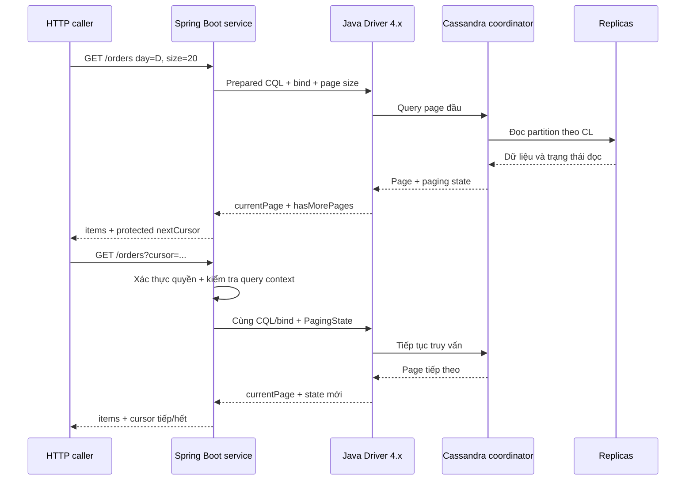
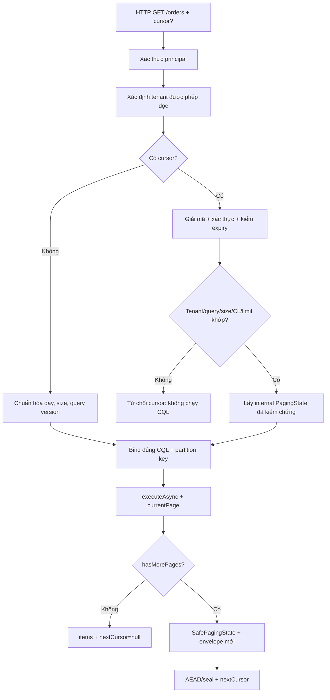

# Slice, paging state và chi phí đếm tổng kết quả trong Spring Boot và Spring Data Cassandra

## 1. Tại sao phân trang Cassandra khác phân trang SQL?

Apache Cassandra là hệ quản trị **wide-column phân tán**: **partition key** xác định nơi dữ liệu được đặt, **clustering columns** sắp xếp dữ liệu trong partition, các replica được bố trí theo **replication factor (RF)** và yêu cầu đọc/ghi đạt **consistency level (CL)**. Khi ứng dụng Java dùng Spring Boot, Spring Data Cassandra hoặc Java Driver 4.x để hiển thị danh sách đơn hàng, một yêu cầu tưởng chừng quen thuộc lại có nhiều hàm ý:

```text
GET /tenants/tenant-01/orders?day=2026-11-20&size=20
→ 20 đơn hàng, có trang tiếp không?
→ tổng số đơn là bao nhiêu?
→ có bao nhiêu trang và nhảy đến trang 500 được không?
```

Trong cơ sở dữ liệu quan hệ, ứng dụng có thể nghĩ đến `LIMIT ... OFFSET ...` và một câu `COUNT(*)` để biết tổng. Trong Cassandra, tiếp tục một truy vấn lớn thường dựa trên **paging state**, không phải offset truy cập ngẫu nhiên. Mặt khác, `COUNT(*)` không có bảo đảm được trả về bằng phép tra metadata rẻ; nó có thể phải đọc rất nhiều dữ liệu.

Chủ đề này tập trung vào ba ý tưởng:

1. **`Slice<T>`:** cần biết nội dung hiện tại và **có thể có trang tiếp hay không**, không đòi tổng số hàng.
2. **`PagingState`:** trạng thái opaque để tiếp tục **cùng truy vấn CQL với các tham số gốc**, không phải chỉ số trang có thể nhảy tùy ý.
3. **Chi phí của `Page<T>`/`COUNT(*)`:** hiển thị tổng số hàng và tổng số trang có thể làm API phải thực hiện công việc lớn hơn rất nhiều so với lấy một slice.

> **Nguyên tắc thiết kế:** Với API Cassandra chỉ cần nút “Xem thêm”, ưu tiên contract kiểu **Slice + cursor**. Chỉ công bố `totalElements` và `totalPages` khi có một nguồn đếm đáng tin, chi phí được chấp nhận và độ mới của số đếm được định nghĩa rõ.

### Kết quả học tập

- Phân biệt `List<T>`, `Slice<T>`, `Page<T>` trong Spring Data Commons.
- Hiểu vì sao `PageRequest.of(pageNumber, size)` không tương đương seek tới bất kỳ page nào của Cassandra.
- Dùng Java Driver 4.x `AsyncResultSet`, `currentPage()`, `hasMorePages()` và `PagingState` để khôi phục một slice.
- Thiết kế keyspace, partition và clustering theo query shape trước khi thêm phân trang.
- Tích hợp một repository dùng `CqlSession` vào Spring Boot; biết giới hạn của Spring Data repository.
- Bảo vệ REST cursor, giới hạn tài nguyên và không coi pagination là snapshot isolation.
- Chọn chiến lược đếm chính xác, ước lượng hoặc không hiển thị tổng theo yêu cầu nghiệp vụ.

## 2. `List`, `Slice` và `Page`: ba hợp đồng khác nhau

Spring Data Commons cung cấp các abstraction phân trang, nhưng chúng không có cùng chi phí hoặc bảo đảm:

| Kiểu trả về | Nội dung | Metadata thường dùng | Có cần biết tổng? |
| --- | --- | --- | --- |
| `List<T>` | Danh sách item trả về | Không bắt buộc có trạng thái tiếp | Không |
| `Slice<T>` | Item của một phần kết quả | `hasNext()`, `getNumberOfElements()`, `getSize()`, `nextPageable()` theo implementation | **Không** |
| `Page<T>` | Một slice cộng thông tin tổng | `getTotalElements()`, `getTotalPages()` và các trường kế thừa từ `Slice` | **Có** |
| Cursor response tự định nghĩa | Item hiện tại và `nextCursor` | Token opaque, query version, expiry theo API | **Không**, trừ khi bổ sung riêng |

`Page<T>` là abstraction hữu ích nếu backend có thể lấy tổng số bản ghi phù hợp bộ lọc một cách hợp lý. Nhưng **không nên tạo `PageImpl` với một số tổng bịa ra**, ví dụ lấy `items.size()` làm tổng trong khi vẫn còn hàng ở các page tiếp theo.

### Một giao diện UI, hai thiết kế backend

**Thiết kế 1 — “Xem thêm”:**

```json
{
  "items": [
    {"orderId": "11111111-1111-4111-8111-111111111111", "status": "PAID"}
  ],
  "hasNext": true,
  "nextCursor": "<protected-opaque-token>"
}
```

**Thiết kế 2 — “Trang 1/1458, tổng 29.160 đơn”:**

```json
{
  "items": [
    {"orderId": "11111111-1111-4111-8111-111111111111", "status": "PAID"}
  ],
  "page": 1,
  "totalElements": 29160,
  "totalPages": 1458
}
```

Ở thiết kế 2, **29160 là một khẳng định về dữ liệu**. Backend phải có nguồn tính/duy trì con số đó, thời điểm hiệu lực và semantics khi có concurrent writes hoặc TTL. Ví dụ JSON chỉ minh họa contract, không phải kết quả đo thực tế.

**Khuyến nghị:** Nếu sản phẩm không thực sự cần tổng, đừng biến một UI “Xem thêm” thành hai truy vấn: một query lấy 20 hàng và một `COUNT(*)` quét toàn bộ tập.

## 3. Paging state là gì? Không phải SQL `OFFSET`

Java Driver Cassandra sử dụng **paging state opaque** do giao thức/driver quản lý để mô tả cách tiếp tục truy vấn. Nó không phải bản sao khóa cuối có thể sửa tùy ý và không phải số lượng hàng đã bỏ qua.



Sơ đồ được đơn giản hóa: chi tiết coordinator và replica requests phụ thuộc Cassandra version, CL và read path. Điều cần nhớ là **mỗi lần fetch page có thể là một request mạng mới** và một continuation state tương ứng.

### Tại sao không “skip 10.000 hàng đầu”?

Cassandra không cung cấp phép phân trang ngẫu nhiên kiểu SQL `OFFSET 10000 LIMIT 20` cho mọi truy vấn CQL thông thường. Trạng thái paging thể hiện vị trí tiếp sau quá trình duyệt trước đó; để “đến trang 500”, service có thể phải lần lượt đi qua nhiều page hoặc dùng một **mô hình dữ liệu/query khác**.

Không thiết kế giao diện “đến trang 500 ngay” nếu backend chỉ có `PagingState` nối tiếp và không có index/manifest/snapshot hỗ trợ truy cập ngẫu nhiên.

### Một trạng thái không dùng chung cho các query khác nhau

```text
State A:
  query = orders_by_tenant_day
  tenant = tenant-01
  day = 2026-11-20
  size = 20
  CL = LOCAL_QUORUM

State A KHÔNG được tự động áp dụng cho:
  tenant-02; day=2026-11-21; SELECT cột khác;
  filter khác; LIMIT khác; cluster hoặc query version khác.
```

Trong API có người dùng, ngay cả khi driver nhận ra statement mismatch, việc **kiểm tra authorization của tenant vẫn thuộc Spring service**. `PagingState` không phải access token.

## 4. Page size, `LIMIT` và số hàng trả về khác nhau

| Khái niệm | Ví dụ | Giới hạn gì? | Hiểu sai thường gặp |
| --- | --- | --- | --- |
| Driver page size | `statement.setPageSize(20)` | Mục tiêu số hàng mỗi lần fetch | “Mọi page luôn có đúng 20 hàng” |
| CQL limit | `LIMIT 200` | Tổng số hàng tối đa của một query logic | “Mỗi request sẽ được 200 hàng” |
| Client output limit | API chỉ serialize tối đa N items | Payload/contract HTTP | “DB chắc chắn chỉ đọc N cell” |
| Số page API tối đa | Chẳng hạn 10 cursor continuations | Chi phí/abuse theo policy | “Có thể thay CQL LIMIT tùy trang” |
| `hasMorePages()` | `true`/`false` | Driver còn page để fetch hay không | “Đảm bảo trang sau có đủ 20 item” |

**Page size thường là giá trị mục tiêu, không phải cam kết đúng bằng N hàng**. Page có thể trả ít hơn N hoặc thậm chí rỗng trong các tình huống đặc biệt mà vẫn còn state tiếp, tùy dữ liệu/phiên bản/loại truy vấn. Dựa vào `hasMorePages()` và state, không chỉ vào `items.size() < pageSize`.

Ví dụ với `LIMIT 200` và page size 20, một truy vấn logic trả tối đa 200 hàng qua những page của nó. Khi khôi phục từ state, **giữ nguyên `LIMIT 200`**, không đổi thành 180 vì “trang đầu đã đọc 20 hàng”.

### Đặt page size bao nhiêu?

Không có một số chung cho Cassandra. Payload/page phụ thuộc:

- Kích thước mỗi row, collection, blob và UDT.
- Partition size và số SSTable phải đọc.
- Tombstones do TTL/delete.
- Local/WAN network latency.
- p95/p99 và request timeout.
- Memory/serialization ở JVM, HTTP response bytes và concurrent clients.

Benchmark trên dữ liệu đại diện: page size 20/50/100 chỉ là **giá trị thử**, không phải các mốc chuẩn. Với row rất lớn, page size 20 vẫn có thể tạo payload nặng.

## 5. Thiết kế bảng theo truy vấn trước khi đưa vào `Slice`

Một API đọc đơn hàng của **một tenant trong một ngày**, mới nhất trước:

```text
GET /tenants/{tenantId}/orders?day=2026-11-20
→ query partition (tenant_id, order_day)
→ clustering created_at DESC, order_id ASC
→ nối tiếp page bằng paging state
```

Lab CQL sau giả định Cassandra có một datacenter `dc1` và ít nhất ba replica cho RF3. Nếu chỉ có một node lab, hãy điều chỉnh RF/CL theo điều kiện thực tế:

```sql
CREATE KEYSPACE IF NOT EXISTS slice_lab
WITH replication = {
    'class': 'NetworkTopologyStrategy',
    'dc1': 3
}
AND durable_writes = true;

CREATE TABLE IF NOT EXISTS slice_lab.orders_by_tenant_day (
    tenant_id text,
    order_day date,
    created_at timestamp,
    order_id uuid,
    status text,
    total_cents bigint,
    PRIMARY KEY ((tenant_id, order_day), created_at, order_id)
) WITH CLUSTERING ORDER BY (
    created_at DESC,
    order_id ASC
);
```

**Partition key:** `(tenant_id, order_day)`. Cả hai giá trị phải xuất hiện trong truy vấn theo thiết kế này.

**Clustering key:** `created_at` và `order_id`. Cassandra trả hàng trong partition theo thứ tự clustering đã xác định. Khi hai đơn có cùng `created_at`, `order_id` giúp khóa không trùng; UUID v4 không tự mang thứ tự thời gian.

### Dữ liệu lab

```sql
INSERT INTO slice_lab.orders_by_tenant_day (
    tenant_id, order_day, created_at, order_id, status, total_cents
) VALUES (
    'tenant-01', '2026-11-20', '2026-11-20T10:00:00Z',
    11111111-1111-4111-8111-111111111111, 'PAID', 125000
);

INSERT INTO slice_lab.orders_by_tenant_day (
    tenant_id, order_day, created_at, order_id, status, total_cents
) VALUES (
    'tenant-01', '2026-11-20', '2026-11-20T09:00:00Z',
    22222222-2222-4222-8222-222222222222, 'CREATED', 48000
);

INSERT INTO slice_lab.orders_by_tenant_day (
    tenant_id, order_day, created_at, order_id, status, total_cents
) VALUES (
    'tenant-01', '2026-11-20', '2026-11-20T08:00:00Z',
    33333333-3333-4333-8333-333333333333, 'CANCELLED', 99000
);

INSERT INTO slice_lab.orders_by_tenant_day (
    tenant_id, order_day, created_at, order_id, status, total_cents
) VALUES (
    'tenant-01', '2026-11-20', '2026-11-20T07:00:00Z',
    44444444-4444-4444-8444-444444444444, 'PAID', 72000
);
```

Đọc thử:

```text
CONSISTENCY LOCAL_QUORUM;
```

```sql
SELECT created_at, order_id, status, total_cents
FROM slice_lab.orders_by_tenant_day
WHERE tenant_id = 'tenant-01'
  AND order_day = '2026-11-20'
LIMIT 200;
```

Với bốn row lab, thử page size 2 trong Java để quan sát nối tiếp trang. **Không dùng `ALLOW FILTERING`** cho truy vấn này vì đã có đầy đủ partition key.

### Partition quá lớn không được chữa bằng paging

Nếu tenant-01 có hàng triệu đơn trong một ngày, partition theo ngày có thể quá lớn. Page size nhỏ không thay đổi việc cluster phải xử lý một partition nóng, kích thước SSTable/row và tombstones. Khi đó cân nhắc:

- Bucket nhỏ hơn (giờ hoặc shard theo quy tắc nghiệp vụ).
- Giới hạn lịch sử mà một API liệt kê trong một query.
- Bảng riêng cho các query/sort khác nhau.
- Một chiến lược fan-out/merge có giới hạn nếu cần nhiều bucket.

Không đếm toàn bộ partition trên mỗi request để che một mô hình partition chưa phù hợp.

## 6. `Slice<T>` trong Spring Data: có `hasNext`, không bắt buộc `COUNT`

Trong Spring Data Commons, `Slice<T>` cho phép UI biết:

```java
import org.springframework.data.domain.Slice;

// slice lấy từ một repository/service được cấu hình phù hợp:
int displayed = slice.getNumberOfElements();
boolean showNextButton = slice.hasNext();
boolean first = slice.isFirst();
boolean last = slice.isLast();
```

Đây là **trích đoạn** trong một method có biến `slice`; không phải một chương trình độc lập. Nó không cần một con số `totalElements` để trả lời “có nên hiện nút Next không?”.

**Điểm tinh tế:** `Slice` là một **abstraction của Spring Data Commons**. Nó không tự chứa một protocol-neutral cursor cho Cassandra theo mọi implementation. Trên backend SQL, một `nextPageable()` có thể tương đương tăng offset. Trên Cassandra, bước tiếp cần **trạng thái paging của query trước**.

### Spring Data Cassandra: kiểm tra phiên bản và kiểu Pageable

Một số nhánh Spring Data Cassandra cung cấp cơ chế `CassandraPageRequest`/paging state để đi tiếp theo thứ tự, với API/đường package phụ thuộc release. Nguyên tắc:

1. Dùng kiểu request/hỗ trợ paging mà **phiên bản Spring Data Cassandra thực tế** cung cấp.
2. Gửi lại **đúng truy vấn và bound parameters** cho lần tiếp theo.
3. Bảo toàn paging state giữa các lần gọi; đừng chỉ giữ `pageNumber`.
4. Kiểm tra phương thức `Slice.nextPageable()` có thực sự mang state Cassandra mà repository sẽ sử dụng hay không.
5. Không mặc định có thể gọi `PageRequest.of(50, 20)` rồi Cassandra “nhảy” đến hàng 1000.

### Minh họa ý nghĩa `nextPageable`

```java
// Pseudocode: repository và initialPageable phải được xây dựng
// theo API Spring Data Cassandra của version đang sử dụng.
Slice<OrderEntity> first = repository.findOrdersForDay(
    tenantId, orderDay, initialPageable);

if (first.hasNext()) {
    // Chỉ dùng nếu nextPageable giữ được Cassandra paging state
    // theo contract của repository implementation.
    Pageable next = first.nextPageable();
    Slice<OrderEntity> second = repository.findOrdersForDay(
        tenantId, orderDay, next);
}
```

Đây là **pseudocode để giải thích luồng**, không phải lời khẳng định mọi tên method hoặc mọi implementation `Slice` đều có cursor Cassandra hợp lệ. Nếu cần stateless HTTP API trả cursor qua nhiều request độc lập, phần tiếp theo trình bày cách kiểm soát state trực tiếp bằng Java Driver 4.x.

### Khi nào Spring Data repository đủ?

| Nhu cầu | Hướng tiếp cận |
| --- | --- |
| CRUD/đọc theo khóa chính đơn giản | `CassandraRepository` và entity mapping |
| Paging trong một luồng gọi đã có abstraction Cassandra đúng version | `Slice<T>` + cách mang state do Spring Data hỗ trợ |
| REST cursor stateless với ký/mã hóa, versioning và tenant binding | Service kiểm soát `PagingState` trực tiếp |
| Điều khiển `LOCAL_QUORUM`, timeout, page size theo từng request | `BoundStatement`/execution profile của Java Driver |
| Tổng số hàng chính xác cho dashboard | Cơ chế đếm riêng, có cost/consistency contract |
| Truy vấn nhiều partition kèm merge order | Data model hoặc fan-out paginator riêng |

Không cho rằng Spring Data repository tự cấp bảo đảm **transaction ACID đa partition** hoặc tự tạo global snapshot trong quá trình phân trang.

## 7. `Page<T>` cần tổng, vì sao đây là chi phí riêng?

`Page<T>` có các phương thức như `getTotalElements()` và `getTotalPages()`. Trong backend SQL, một số framework có thể sinh câu count tách biệt hoặc tối ưu bỏ count ở các trường hợp có thể suy ra. Nhưng với Cassandra, **đếm tất cả hàng khớp truy vấn là một bài toán khác với fetch một page**.

Giả sử query theo một partition có khoảng hai triệu hàng, giao diện chỉ hiển thị 25 hàng đầu. Để biết có page tiếp, driver thường có thể dựa trên paging state của lần fetch đang thực hiện. Để biết **chính xác hai triệu**, backend có thể phải đọc/đếm một khối lượng dữ liệu cực lớn hoặc dùng một nguồn tổng hợp khác được duy trì trước.

### So sánh chi phí định tính

```text
Lấy một slice đầu:
  Query theo (tenant_id, order_day)
  Fetch khoảng 25 rows + paging state
  Không yêu cầu biết tổng hàng trong partition

Lấy một page cộng totalElements chính xác:
  Fetch khoảng 25 rows
  Cộng thêm công việc xác định tổng số rows phù hợp filter
  Công việc đếm có thể đi qua nhiều SSTables/tombstones
  Tổng có thể thay đổi ngay sau khi trả response
```

**Tính toán minh họa:** 2.000.000/25 = 80.000. Điều này chỉ cho thấy độ lớn chênh lệch **số hàng cần xét**, không phải dự báo `COUNT(*)` chậm hơn đúng 80.000 lần. Chi phí thật phụ thuộc caching, storage layout, tombstones, compaction, topology và hệ thống.

### Đọc đúng câu `COUNT(*)`

```sql
-- CHỈ chạy trên bảng/partition lab nhỏ để quan sát.
SELECT COUNT(*)
FROM slice_lab.orders_by_tenant_day
WHERE tenant_id = 'tenant-01'
  AND order_day = '2026-11-20';
```

Với bốn hàng lab, câu này có thể trả bốn nếu không có mutation khác và tất cả dữ liệu vẫn còn sống. Trên một partition rất lớn, câu query **không mặc nhiên là phép đọc từ metadata count cập nhật tức thời**.

```sql
-- CẢNH BÁO: count toàn bảng có thể rất đắt.
-- Không chạy vô tội vạ trên bảng production lớn.
SELECT COUNT(*) FROM slice_lab.orders_by_tenant_day;
```

Đếm toàn bảng có thể liên quan nhiều partition/token ranges, nhiều node, băng thông và áp lực foreground read. Không dùng `ALLOW FILTERING` hay tăng timeout vô hạn như cách làm COUNT rẻ hơn.

## 8. Vì sao bảng Cassandra không có “số hàng chính xác tức thì” cho mọi query?

Hệ thống phân tán làm chi phí đếm phức tạp hơn nhìn bề ngoài:

- **Writes đồng thời:** hàng mới có thể được thêm ngay khi count đang chạy.
- **Delete/TTL:** dữ liệu hết hạn có tombstones và quá trình compaction ở thời điểm khác nhau.
- **Replication:** mỗi partition có nhiều replica; không thể cộng các count cục bộ của node để thành tổng logic nếu chưa xử lý replication, range ownership và consistency.
- **Read CL:** một phép đếm có thể quan sát dữ liệu theo tập replica khác với request hiển thị.
- **Wide partition:** count theo đúng một partition vẫn có thể phải xét rất nhiều hàng/cell/SSTable.
- **Secondary indexes/SAI:** filter/index có giới hạn và chi phí riêng; có index không đồng nghĩa count được trả nhanh hoặc miễn phí.
- **Schema/query evolution:** đổi predicate, TTL và phân vùng có thể làm mọi aggregate cũ không còn đúng định nghĩa.

### Đừng lấy `nodetool tablestats` làm `totalElements`

Các thống kê vận hành thường là **ước lượng theo node/table** hoặc số liệu lưu trữ, không phải số hàng logic chính xác cho một query theo tenant/ngày. Node A và node B cùng giữ replicas của một partition, nên cộng hàng của chúng có thể **đếm trùng replica**.

Tương tự, `estimatedPartitionSize`, estimated partition count hoặc các số liệu histogram không phải phép thay thế đáng tin cho `COUNT(*)` dưới một filter cụ thể.

### Vì sao `COUNT(*)` chưa chắc cùng snapshot với slice?

Giả sử service làm:

```text
T1: SELECT 25 rows của tenant-01/ngày D.
T2: Một client khác thêm 3 rows và xóa 2 rows.
T3: SELECT COUNT(*) để tính totalElements.
T4: Trả items tại T1 cùng totalElements tại T3.
```

Hai phần response **không cùng một transaction snapshot**. `LOCAL_QUORUM` giúp xác định số replica cần phản hồi, **không tạo snapshot isolation** xuyên hai câu query độc lập. Con số “tổng” có thể khác với danh sách vừa trả ngay cả khi cả hai request thành công.

## 9. Chọn chiến lược tổng kết quả theo yêu cầu nghiệp vụ

| Nhu cầu UI/nghiệp vụ | Phương án | Độ mới và tính đúng |
| --- | --- | --- |
| Chỉ cần “Còn hàng để xem tiếp?” | `Slice`/cursor, `hasMorePages` | Không có tổng; phù hợp dữ liệu thay đổi |
| Cần “Khoảng N kết quả” | Một estimate/analytics đã có nguồn tin cậy | Phải ghi rõ **ước lượng** và thời điểm |
| Dashboard theo tenant/ngày | Bảng aggregate/projection được cập nhật | Thường eventual consistency, cần reconciliation |
| Báo cáo cần tổng chính xác tại một kỳ đóng sổ | Snapshot/export/analytics pipeline | Có snapshot version/điều kiện chốt dữ liệu |
| Trang quản trị lọc tập nhỏ có giới hạn | `COUNT(*)` có budget và đo đạc | Chỉ nên dùng khi tập được chứng minh nhỏ |
| Tìm kiếm nhiều điều kiện liên tục thay đổi | Hệ search/analytics phù hợp | Định nghĩa rõ index lag và semantics |

### Phương án A — Không hiển thị tổng

Thường là lựa chọn rẻ, rõ ràng và ít gây hiểu nhầm cho infinite scroll hoặc “Xem thêm”. API trả `items`, `hasNext` và `nextCursor`, không trả `totalElements`.

### Phương án B — Duy trì aggregate riêng

Ví dụ bảng đếm theo tenant/ngày:

```sql
CREATE TABLE IF NOT EXISTS slice_lab.order_counts_by_tenant_day (
    tenant_id text,
    order_day date,
    total_orders bigint,
    calculated_at timestamp,
    PRIMARY KEY ((tenant_id), order_day)
);
```

Đây là **bảng projection**: một pipeline đáng tin tính và ghi giá trị. Nó không tự tăng khi insert vào `orders_by_tenant_day`; Cassandra không tự có trigger giao dịch để cập nhật hai bảng theo cách exactly-once như một transaction đa partition.

Nếu muốn dùng cột `counter` thay `bigint` để cộng/trừ sự kiện:

- `counter = counter + 1` **không idempotent**: retry sau timeout có thể tăng hai lần.
- Event queue giao ít nhất một lần có thể tạo duplicate.
- Delete/TTL/correction phải được phản ánh rõ ràng vào aggregate.
- Phải có event ID, dedup có bảo đảm phù hợp và reconciliation/rebuild.

Không khẳng định `counter` luôn là **totalElements chính xác theo thời gian thực** chỉ vì Cassandra đã nhân bản counter.

### Phương án C — Snapshot báo cáo

Nếu yêu cầu “tổng đúng tại 00:00 UTC ngày chốt”, có thể dùng:

1. Định nghĩa rõ **mốc chốt** và tập dữ liệu thuộc kỳ.
2. Chạy export/analytics có checkpoint, kiểm chứng ranges/records.
3. Lưu version/snapshot ID của báo cáo.
4. Trả `totalElements` từ snapshot và các page tương ứng của cùng snapshot.

Đây là bài toán dữ liệu/báo cáo riêng; không nên chạy scan/COUNT trực tiếp trên cluster OLTP vào mỗi lần user tải trang.

## 10. Java Driver 4.x: một page bằng `AsyncResultSet`

Spring Boot thường tự tạo bean `CqlSession` qua starter phù hợp, và Spring Data sử dụng cùng nền tảng driver. Để triển khai REST cursor một cách rõ ràng, có thể inject `CqlSession` vào repository tùy biến.

API quan trọng:

- `session.prepare(...)`: chuẩn bị CQL theo partition.
- `BoundStatement.setPageSize(...)`: đặt page size.
- `session.executeAsync(...)`: thực thi không chặn thread gọi.
- `AsyncResultSet.currentPage()`: chỉ duyệt hàng **đã fetch cho page hiện tại**.
- `AsyncResultSet.hasMorePages()`: biết còn khả năng fetch page tiếp.
- `ExecutionInfo.getSafePagingState()`: state “safe” để ràng buộc với statement theo cơ chế driver.
- `PagingState.fromString(...)` và `setPagingState(...)`: khôi phục state từ chuỗi đã được **ứng dụng bảo vệ và kiểm chứng**.

### Phân biệt `execute` đồng bộ và `executeAsync`

```java
// Đồng bộ: duyệt ResultSet có thể khiến driver tự fetch thêm page.
ResultSet rs = session.execute(stmt);
for (Row row : rs) {
    consume(row);
}

// Bất đồng bộ: kiểm soát một page hiện tại rõ ràng.
session.executeAsync(stmt).thenApply(page -> {
    for (Row row : page.currentPage()) {
        consumeSmall(row);
    }
    return page.hasMorePages();
});
```

Đây là **trích đoạn**, không phải code copy-paste nguyên lớp. `consumeSmall(...)` phải nhanh, không chặn; continuation có thể chạy trên driver completion/I/O thread. Nếu mapping nặng hoặc phải gọi JDBC/HTTP sync, offload sang executor có giới hạn.

Với API REST “mỗi HTTP request trả một slice”, ưu tiên `currentPage()` thay vì lặp toàn bộ `ResultSet` đồng bộ rồi hy vọng chỉ lấy một page.

## 11. Spring Boot service Java: triển khai `CursorSlice<T>`

Ví dụ dưới đây dùng **Spring Boot 3.x + Java 17 + Java Driver 4.x**, giả định đã tạo `slice_lab`, được inject một `CqlSession` có contact points, local DC và TLS/auth đúng. Code cố ý tạo **DTO + cursor**, không bịa ra một `Page<T>` có tổng.

```java
import java.time.Instant;
import java.time.LocalDate;
import java.util.ArrayList;
import java.util.Collections;
import java.util.List;
import java.util.UUID;
import java.util.concurrent.CompletionStage;

import org.springframework.stereotype.Repository;

import com.datastax.oss.driver.api.core.CqlSession;
import com.datastax.oss.driver.api.core.DefaultConsistencyLevel;
import com.datastax.oss.driver.api.core.cql.AsyncResultSet;
import com.datastax.oss.driver.api.core.cql.BoundStatement;
import com.datastax.oss.driver.api.core.cql.PagingState;
import com.datastax.oss.driver.api.core.cql.PreparedStatement;
import com.datastax.oss.driver.api.core.cql.Row;

@Repository
public final class OrderCursorRepository {
    private static final int MAX_PAGE_SIZE = 100;
    private final CqlSession session;
    private final PreparedStatement query;

    public OrderCursorRepository(CqlSession session) {
        this.session = session;
        this.query = session.prepare(
            "SELECT created_at, order_id, status, total_cents " +
            "FROM slice_lab.orders_by_tenant_day " +
            "WHERE tenant_id = ? AND order_day = ? LIMIT 200"
        );
    }

    public CompletionStage<CursorSlice<OrderItem>> read(
            String authorizedTenant,
            LocalDate orderDay,
            int pageSize,
            String verifiedInternalPagingState) {

        if (pageSize < 1 || pageSize > MAX_PAGE_SIZE) {
            throw new IllegalArgumentException(
                "pageSize outside allowed range");
        }

        BoundStatement statement = query
            .bind(authorizedTenant, orderDay)
            .setConsistencyLevel(DefaultConsistencyLevel.LOCAL_QUORUM)
            .setPageSize(pageSize)
            .setIdempotent(true);

        if (verifiedInternalPagingState != null) {
            PagingState saved = PagingState.fromString(
                verifiedInternalPagingState);
            statement = statement.setPagingState(saved);
        }

        return session.executeAsync(statement).thenApply(page -> {
            List<OrderItem> items = new ArrayList<>();
            for (Row row : page.currentPage()) {
                Long totalCents = row.isNull("total_cents")
                    ? null : row.getLong("total_cents");
                items.add(new OrderItem(
                    row.getInstant("created_at"),
                    row.getUuid("order_id"),
                    row.getString("status"),
                    totalCents
                ));
            }

            boolean hasNext = page.hasMorePages();
            String nextState = null;
            if (hasNext) {
                PagingState state =
                    page.getExecutionInfo().getSafePagingState();
                if (state == null) {
                    throw new IllegalStateException(
                        "More pages but no safe paging state");
                }
                nextState = state.toString();
            }

            return new CursorSlice<>(items, hasNext, nextState);
        });
    }

    public static final class OrderItem {
        public final Instant createdAt;
        public final UUID orderId;
        public final String status;
        public final Long totalCents;

        public OrderItem(
                Instant createdAt, UUID orderId,
                String status, Long totalCents) {
            this.createdAt = createdAt;
            this.orderId = orderId;
            this.status = status;
            this.totalCents = totalCents;
        }
    }

    public static final class CursorSlice<T> {
        public final List<T> items;
        public final boolean hasNext;
        // Nội bộ service: KHÔNG trả raw state trực tiếp qua HTTP.
        public final String internalPagingState;

        public CursorSlice(
                List<T> items, boolean hasNext,
                String internalPagingState) {
            this.items = Collections.unmodifiableList(
                new ArrayList<>(items));
            this.hasNext = hasNext;
            this.internalPagingState = internalPagingState;
        }
    }
}
```

### Tại sao thiết kế này không dùng `PageImpl`?

Repository chỉ biết **item hiện tại** và **driver còn page hay không**. Nó không biết tổng. Trả `CursorSlice` phản ánh trung thực các dữ kiện có được và cho phép HTTP layer xây `nextCursor` đã bảo vệ.

Các lựa chọn có chủ ý:

1. `authorizedTenant` phải đã được xác minh từ authentication/authorization, không lấy nguyên tin tưởng từ `cursor`.
2. CQL cố định `LIMIT 200` cho **một query logic**, giúp giới hạn lượt duyệt trong ví dụ; không đổi limit giữa các lần resume.
3. `LOCAL_QUORUM` áp dụng cho RF3 ở `dc1`, yêu cầu hai local replica khỏe; không đổi xuống `ONE` để che timeout.
4. `setIdempotent(true)` dành cho `SELECT` thuần đọc, **không** áp dụng mù cho counter/list append/LWT.
5. `currentPage()` không tự fetch tất cả page; dữ liệu lớn không bị gom toàn bộ.
6. `getSafePagingState()` cung cấp state có kiểm tra ràng buộc ở mức driver; vẫn cần bảo mật API riêng.
7. `Long` cho cột có thể null, không âm thầm biến null thành `0L`.

### Code mẫu chưa giải quyết những gì?

Nó chưa có HTTP authorization, chống token giả mạo, TTL cursor, request deadline, per-tenant rate limit và cancellation. Những yêu cầu này **không thể giao hoàn toàn cho Java Driver**.

Ngoài ra, một `CompletionStage` ném lỗi từ `PagingState.fromString` hoặc `setPagingState` phải được HTTP layer phân loại thành **cursor invalid**, không tự động coi là lỗi Cassandra cần retry.

## 12. `Spring Data Slice` và `CursorSlice` có thể kết hợp như thế nào?

`SliceImpl<T>` của Spring Data Commons có thể chứa `items`, một `Pageable` và `hasNext`. Nhưng nếu truyền một `PageRequest` thông thường mà không mang paging state, lời gọi `nextPageable()` **không đủ thông tin** để nối tiếp CQL trên một request HTTP mới.

Để tránh contract sai:

- Ở **tầng domain/UI**, có thể dùng tên `Slice` cho cấu trúc `items + hasNext`.
- Ở **tầng Cassandra**, cần giữ `PagingState` và ngữ cảnh CQL/bind.
- Ở **tầng HTTP**, nên trả `nextCursor` đã được bảo vệ.
- Nếu framework mapping cần `Slice<T>`, chỉ tạo `SliceImpl` khi semantics `nextPageable` được thể hiện đúng (ví dụ wrapper chứa state theo API được hỗ trợ). Không giả vờ offset tăng một đơn vị là đủ.

### Một API có thể trả kiểu gì?

```text
REST DTO:          CursorSliceResponse<OrderDto>
Application:       CursorSlice<OrderItem>
Repository:        AsyncResultSet + PagingState
Spring Data layer: Slice<T> (nếu integration giữ đúng Cassandra state)
```

Các abstraction có thể cùng tồn tại, nhưng không nên ép mọi tầng dùng `Page<T>` chỉ vì frontend từng được xây cho SQL.

## 13. Bảo vệ `nextCursor` trong REST API

**Không đưa thẳng `PagingState.toString()` ra Internet và gọi đó là token an toàn.** Safe state của driver giúp chống một số cách dùng sai statement, **không tự mã hóa, ký xác thực, ràng buộc tenant hoặc tạo hạn dùng**.

Một cursor envelope có thể có dạng logic:

```json
{
  "version": 1,
  "queryId": "orders-by-tenant-day-v1",
  "tenantId": "tenant-01",
  "day": "2026-11-20",
  "pageSize": 20,
  "limit": 200,
  "consistency": "LOCAL_QUORUM",
  "issuedAt": "2026-11-20T10:00:00Z",
  "expiresAt": "2026-11-20T10:15:00Z",
  "driverState": "<opaque-string>"
}
```

**JSON trên là dữ liệu minh họa, không phải bearer token đã được ký/mã hóa.** Hai phương án triển khai:

1. **AEAD envelope:** mã hóa và xác thực bằng khóa lưu trong secret manager, có key ID/rotation, expiration, giới hạn kích thước.
2. **Server-side cursor registry:** lưu query context + state ở cache/storage có TTL và trả ID ngẫu nhiên khó đoán; dễ thu hồi chủ động nhưng thêm stateful dependency.

### Trình tự xử lý cursor phải đúng



Những ràng buộc cần kiểm:

- Principal, tenant, roles/authorization scope trên **mỗi HTTP request**.
- Query fingerprint/version, filter values, partition key, `LIMIT`, page size và CL.
- Environment/cluster hoặc namespace để tránh dùng state staging ở production.
- TTL, issuedAt, nonce/key ID và replay policy nếu cần.
- Độ dài token/request, rate limit, concurrent cursor chains và endpoint identity.

**Base64 của JSON không phải bảo mật.** Token không nên xuất hiện nguyên văn trong logs, metrics, trace hoặc URL được chia sẻ rộng; nếu API bắt buộc dùng query parameter, phải có chính sách logging/redaction, TTL ngắn và bảo vệ transport.

### Lỗi cursor nên trả về thế nào?

| Trường hợp | Gợi ý API | Điều cần tránh |
| --- | --- | --- |
| Token bị sửa/corrupt hoặc sai chữ ký | `400` kèm mã `INVALID_CURSOR` | Bỏ cursor rồi trả page đầu mà client không biết |
| Token hết hạn | Lỗi `EXPIRED_CURSOR` theo API contract | Dùng state stale quá lâu sau upgrade |
| Tenant/authorization không hợp lệ | `403` hoặc chính sách bảo mật phù hợp | Tin tenant trong cursor |
| Query version đã thay | Lỗi `CURSOR_VERSION_UNSUPPORTED`, yêu cầu restart | Dùng state cũ cho CQL mới |
| Cassandra timeout/unavailable | Lỗi dịch vụ có telemetry và retry policy | Giả là lỗi token hoặc tự hạ CL |

Mã HTTP chi tiết là **lựa chọn contract của tổ chức**; điểm quan trọng là client biết cần **bắt đầu lại** hay có thể **thử lại request hiện tại**.

## 14. Ví dụ controller Spring Boot: tách bảo mật cursor khỏi repository

Trong một ứng dụng Spring Boot 3.x, có thể đặt trách nhiệm như sau:

```java
import java.time.LocalDate;
import java.util.concurrent.CompletionStage;

import org.springframework.format.annotation.DateTimeFormat;
import org.springframework.http.ResponseEntity;
import org.springframework.security.core.Authentication;
import org.springframework.web.bind.annotation.GetMapping;
import org.springframework.web.bind.annotation.PathVariable;
import org.springframework.web.bind.annotation.RequestMapping;
import org.springframework.web.bind.annotation.RequestParam;
import org.springframework.web.bind.annotation.RestController;

@RestController
@RequestMapping("/tenants/{tenantId}/orders")
public class OrdersController {
    private final OrderCursorRepository orders;
    private final CursorProtector cursorProtector;
    private final TenantAccessControl accessControl;

    public OrdersController(
            OrderCursorRepository orders,
            CursorProtector cursorProtector,
            TenantAccessControl accessControl) {
        this.orders = orders;
        this.cursorProtector = cursorProtector;
        this.accessControl = accessControl;
    }

    @GetMapping
    public CompletionStage<ResponseEntity<OrdersResponse>> list(
            Authentication user,
            @PathVariable("tenantId") String tenantId,
            @RequestParam("day")
            @DateTimeFormat(iso = DateTimeFormat.ISO.DATE) LocalDate day,
            @RequestParam(value = "size", defaultValue = "20") int size,
            @RequestParam(value = "cursor", required = false)
            String cursor) {

        if (size < 1 || size > 100) {
            throw new IllegalArgumentException("Invalid page size");
        }
        accessControl.requireRead(user, tenantId);

        // Chỉ nhận state từ một cursor đã xác thực đầy đủ.
        String verifiedState = cursor == null ? null :
            cursorProtector.openAndVerify(
                cursor, user.getName(), tenantId, day, size,
                "orders-by-tenant-day-v1");

        return orders.read(tenantId, day, size, verifiedState)
            .thenApply(slice -> {
                String nextCursor = slice.hasNext
                    ? cursorProtector.seal(
                        slice.internalPagingState,
                        user.getName(), tenantId, day, size,
                        "orders-by-tenant-day-v1")
                    : null;
                return ResponseEntity.ok(
                    new OrdersResponse(slice.items, nextCursor));
            });
    }

    public static final class OrdersResponse {
        public final java.util.List<OrderCursorRepository.OrderItem> items;
        public final String nextCursor;

        public OrdersResponse(
                java.util.List<OrderCursorRepository.OrderItem> items,
                String nextCursor) {
            this.items = items;
            this.nextCursor = nextCursor;
        }
    }

    // Interfaces cần triển khai thật bằng chính sách IAM/AEAD của hệ thống.
    public interface CursorProtector {
        String openAndVerify(String token, String principal,
            String tenant, LocalDate day, int size, String queryId);
        String seal(String driverState, String principal,
            String tenant, LocalDate day, int size, String queryId);
    }

    public interface TenantAccessControl {
        void requireRead(Authentication principal, String tenantId);
    }
}
```

**Cảnh báo:** `CursorProtector` và `TenantAccessControl` trong code là **interfaces chưa triển khai**, không có phép mã hóa giả hoặc hard-coded key; bản ví dụ chỉ minh họa ranh giới trách nhiệm. Muốn biên dịch cần Spring Web, Spring Security và các bean implementation thật. Production phải cung cấp thuật toán AEAD được phê duyệt, bảo vệ khóa, expiration, tenant scope, error mapping và kiểm thử chống token giả mạo.

Không gọi `CompletableFuture.join()` trong controller để “lấy page”. Callback `thenApply` chỉ tạo response nhẹ; với serialization rất lớn, cần giới hạn payload và cân nhắc executor do framework quản lý.

## 15. Không có snapshot xuyên các page: `hasNext` là tín hiệu tại thời điểm đọc

Một chuỗi paging thường trải qua nhiều HTTP requests và nhiều lần truy cập Cassandra. Giữa các lần đó, dữ liệu có thể:

- Có bản ghi mới chèn trước vị trí cursor.
- Có hàng bị xóa hoặc hết TTL.
- Có update làm hàng chuyển vị trí clustering (xóa hàng khóa cũ, ghi hàng khóa mới).
- Có replica vừa phục hồi, hints/repair hoặc WAN chập chờn.
- Có query/schema change từ release mới.

```text
T1  Page 1 đọc [O5, O4], cursor sau O4.
T2  Một khách hàng tạo O6, timestamp mới hơn O5.
T3  Page 2 tiếp từ cursor cũ.

Không bảo đảm O6 xuất hiện trong chuỗi đang duyệt,
vì vị trí đó có thể nằm trước đoạn đã đi qua.
```

**`Slice.hasNext() == true` không phải cam kết rằng lần gọi sau sẽ luôn trả đúng 20 item**, và `hasNext()==false` không khẳng định sẽ không có hàng mới được thêm ngay sau đó.

### RF/CL có giải quyết được không?

`LOCAL_QUORUM` với RF3 ở một DC cần hai phản hồi địa phương cho request đọc thông thường. Nó cải thiện phạm vi bảo đảm theo CL nhưng **không tạo snapshot xuyên các request/page**.

Kể cả hai câu `SELECT` liên tiếp đều đạt `LOCAL_QUORUM`, danh sách vẫn có thể thay đổi do writer mới. Nếu client ở hai DC khác nhau, độ mới dữ liệu còn phụ thuộc replication/WAN và read routing.

### “Không thiếu, không trùng” cần thêm kiến trúc

Với việc phân trang một danh sách đang thay đổi, không thể hứa exactly-once traversal chỉ dựa trên paging state. Nếu yêu cầu nghiêm ngặt:

1. Dùng **snapshot/versioned dataset** hoặc manifest các ID cần xuất.
2. Định nghĩa thời điểm chốt và thứ tự ổn định.
3. Checkpoint tiến độ theo ID/range và hỗ trợ resume.
4. Có dedup/reconciliation khi dữ liệu được cập nhật.
5. Kiểm tra số lượng/hash từ nguồn dữ liệu được chốt, không chạy `COUNT(*)` trên live cluster rồi tin là cùng snapshot.

Keyset/seek pagination với clustering key có thể hữu ích, nhưng nó **không tự cung cấp snapshot**. Nếu seek theo `created_at` mà bỏ qua `order_id` khi hai hàng có timestamp giống nhau, bạn có thể làm mất hàng; phải thiết kế đầy đủ tie-breaker và điều kiện CQL hợp lệ.

## 16. Nhiều partition hoặc nhiều DC: một state không đủ cho mọi dữ liệu

API cần 20 đơn gần nhất của tenant qua bảy ngày:

```text
Partition A: (tenant-01, 2026-11-20)
Partition B: (tenant-01, 2026-11-19)
Partition C: (tenant-01, 2026-11-18)
...
Partition G: (tenant-01, 2026-11-14)
```

`PagingState` của query partition A **không tự tiếp tục sang query partition B**. Một API ghép nhiều partition cần:

- Cursor riêng cho từng query/bucket **hoặc** một bảng được mô hình theo query toàn dải.
- Một quy tắc merge order theo clustering/timestamp và tie-breaker.
- Giới hạn số partition, queries đồng thời, bytes và total rows.
- Checkpoint cả trạng thái nguồn lẫn mốc cuối đã trả cho client.
- Thừa nhận không có snapshot nhất quán khi các partition vẫn được ghi.

**Không tạo một `Page<T>` với tổng bằng cách cộng những số đếm estimate của nhiều node mà không xử lý replica duplication và điều kiện filter.**

### Multi-DC và độ mới

Với `NetworkTopologyStrategy` RF3 tại dc1 và dc2, `LOCAL_QUORUM` từ dc1 cần quorum local dc1; `LOCAL_QUORUM` từ dc2 cần quorum local dc2. Nếu WAN đang trễ, cùng một tenant/day có thể được quan sát khác nhau giữa DC.

Khi một chuỗi cursor đổi DC do failover:

- Kiểm tra cluster/query compatibility và driver protocol.
- Đánh giá khả năng bỏ sót/trùng do dữ liệu chưa hội tụ.
- Nếu không thể bảo đảm continuation semantics, trả lỗi yêu cầu bắt đầu lại.
- Không đổi CL giữa các page chỉ để đọc được dữ liệu từ nơi khác.

## 17. Error handling: cursor mismatch khác timeout của Cassandra

| Triệu chứng | Nhóm nguyên nhân | Phản ứng phù hợp |
| --- | --- | --- |
| `PagingState.fromString` không giải mã được | Token corrupt/sai format | Từ chối cursor, không retry CQL |
| `setPagingState` báo không tương thích | Query/bind/version không khớp | Kiểm tra queryId/params/schema, báo invalid cursor |
| Page đầu thành công, trang sau sai tenant | Authorization/envelope mismatch | `403`/invalid cursor, không chạy query |
| Page size thay giữa requests | API contract mismatch | Bắt đầu query mới hoặc từ chối |
| `ReadTimeoutException` | Replica hoặc deadline không đủ | Điều tra CL/latency; retry đọc giới hạn nếu an toàn |
| `UnavailableException` | Không đủ replica theo CL | Sửa node/replication, không hạ CL mù |
| `AllNodesFailedException` | Auth/TLS/network/routing hoặc lỗi trên nhiều node | Xem root causes theo node |
| Page 2 không có hàng nhưng `hasMorePages` | Tình huống paging/tombstones/filtered results | Không loop vô hạn; budget pages/time |
| Trùng/mất hàng khi live writes | Không có snapshot | Nêu semantics UI, snapshot/dedup nếu bắt buộc |
| Cursor hết hạn sau deploy | TTL/query version/protocol incompatibility | Trả mã reset, bắt đầu trang đầu |
| `COUNT(*)` timeout hoặc CPU/disk tăng | Đếm quá nhiều hàng/tombstone | Bỏ count khỏi đường HTTP, dùng projection/report |

Lỗi cursor thường **không thể chữa bằng retry cùng token nguyên trạng** nếu token đã sai/hết hạn. Ngược lại, khi Cassandra tạm timeout trên `SELECT` idempotent, một retry có giới hạn và còn budget có thể hợp lý; không dùng retry storm để che partition nóng hay read amplification.

### Lưu ý về phiên bản

Serialization/validation của `PagingState` và API Spring Data paging có thể thay đổi giữa các phiên bản driver/Cassandra. Khi nâng cấp:

1. Dùng `queryId` có version trong cursor.
2. Test lấy page 1 với bản trước, resume page 2 với bản sau nếu cần hỗ trợ.
3. Nếu không có bảo đảm tương thích, vô hiệu cursor cũ **theo contract**.
4. Giữ expiry ngắn và hướng dẫn người dùng refresh danh sách.

Không lưu paging state như “bookmark vĩnh viễn” qua nhiều lần migration schema.

## 18. Kiểm thử tích hợp: kiểm tra cả nội dung lẫn state

### Lab A — Một query, hai slice

Trên bảng bốn hàng ở mục 5, gọi repository với `pageSize=2`:

```text
read("tenant-01", 2026-11-20, 2, null)
→ khoảng 2 hàng + internalPagingState

read("tenant-01", 2026-11-20, 2, state-1)
→ các hàng tiếp theo + state mới hoặc null
```

Thứ tự kỳ vọng theo `created_at DESC` là 10:00, 09:00, 08:00, 07:00. **Page size là mục tiêu**, nên test cần dùng `hasNext` thay vì giả định page lúc nào cũng đủ hai hàng.

### Lab B — Tham số gốc không đổi

Lấy state từ tenant-01/ngày 20, thử dùng cho tenant-02 hoặc ngày 21. API phải **từ chối bằng envelope authorization/query binding** trước khi gọi driver. Nếu thử ở tầng repository, safe state có thể phát hiện mismatch theo cơ chế của bản driver đang dùng; đừng nhầm kiểm tra đó với authorization.

### Lab C — Dữ liệu thay đổi

Sau page đầu, thêm một đơn mới có `created_at` lớn hơn các hàng đã đọc, hoặc xóa một hàng trong phần còn lại. Quan sát page 2: không viết test giả định đây là một snapshot. Định nghĩa rõ hành vi của UI khi danh sách thay đổi.

### Lab D — Số đếm

Trên bốn hàng lab, so `COUNT(*)` với kích thước slice. Sau đó chuẩn bị một dataset test lớn hơn có TTL/tombstones đại diện và **đo riêng** độ trễ fetch page và count trên cluster cô lập. Không chạy count toàn bảng production để có con số benchmark đẹp.

### Lab E — Token giả mạo

Kiểm thử token bị sửa byte, cắt ngắn, hết hạn, sai tenant, sai page size, sai query version hoặc token từ staging. Kỳ vọng:

- Không có request CQL nếu token không hợp lệ.
- Không đọc dữ liệu tenant khác.
- Có error code rõ, không lộ chi tiết paging state.
- Metrics đếm số lần invalid cursor nhưng không log token nguyên văn.

### Lab F — Spring Data và driver

Nếu dự án dùng `Slice<T>` của Spring Data, test `nextPageable()` với version dependency thực tế: nó phải giữ đúng Cassandra paging state khi request tiếp, không đơn giản tăng offset. So dữ liệu với repository Java Driver ở mục 11 theo cùng query shape/CL.

### Lab G — Resume khi node restart

Trên lab RF3 có đủ replica, lấy cursor rồi restart một node theo runbook. Khi hai replica khác khỏe, `LOCAL_QUORUM` có thể tiếp tục phục vụ, nhưng latency và số retry có thể tăng. **Không cố tình dừng hai node trên cluster dùng chung** để tạo lỗi.

## 19. Quan sát chi phí: page latency và count latency là hai metric

Một dashboard đáng tin phân biệt:

| Tầng | Metric nên đo | Vì sao |
| --- | --- | --- |
| HTTP API | p50/p95/p99 của `GET /orders` | Ảnh hưởng trực tiếp người dùng |
| Repository | Thời gian query page và số hàng/page | So payload và read cost |
| Count riêng | `COUNT(*)` duration, timeout, số lần gọi | Phát hiện count làm chậm request |
| Driver | Request attempts, timeouts, in-flight, pool saturation | Phân biệt network/driver/server |
| Cursor | Invalid/expired/mismatch, query version | Xác định lỗi continuation |
| Cassandra | Read latency, SSTables/read, tombstones, pending reads | Đánh giá read amplification |
| Cluster | RF/CL, node Up/Down, DC/rack | Kiểm tra availability đúng CL |
| JVM | Heap/GC, payload bytes, CPU serialization | Page lớn gây chậm ở client |
| Aggregate projection | Last updated, divergence, reconciliation count | Nguồn total estimate/chính xác có đang theo kịp? |

Những lệnh quan sát thường dùng:

```bash
nodetool status
nodetool tpstats
nodetool compactionstats
nodetool tablestats slice_lab.orders_by_tenant_day
nodetool tablehistograms slice_lab orders_by_tenant_day
```

Các thống kê này thường **theo node**, không phải metric trực tiếp của `Spring Data Slice`. `tablestats` có thể cung cấp số liệu SSTable/memtable và các ước lượng, **không phải tổng chính xác cho một query**.

### Ví dụ minh họa SLO

| Truy vấn | p99 giả định | Hành động |
| --- | ---: | --- |
| Page đầu, size 25 | 45 ms | Trong budget của API |
| Page tiếp, size 25 | 60 ms | Quan sát tăng theo partition |
| `COUNT(*)` trên partition lớn | 8.000 ms | Không đặt trên đường HTTP |
| Read projection `total_orders` | 12 ms | Hiển thị kèm `calculated_at` và semantics độ mới |

Các con số chỉ minh họa cách quyết định kiến trúc, **không phải benchmark Cassandra áp dụng chung**.

### Runbook khi `Page` khiến API chậm

1. Kiểm tra endpoint có đang chạy `COUNT(*)` **mỗi lần lấy page** hay không.
2. Tách latency `SELECT page` khỏi latency count và serialization.
3. Xem query có đủ partition key, clustering order phù hợp và không `ALLOW FILTERING`.
4. Đo partition size, tombstones, SSTables/read và node disk/GC.
5. Kiểm tra driver page size, request count, retry và Java thread/blocking.
6. Nếu tổng không bắt buộc, đổi API sang **Slice + cursor**, không bịa `totalElements`.
7. Nếu tổng cần thiết, chọn projection/snapshot phù hợp và nêu độ mới.
8. Canary, so p95/p99 với baseline và thêm alert nếu count quay lại hot path.

## 20. Những sai lầm thường gặp

### Sai lầm 1 — Nghĩ `PageRequest.of(10,20)` có nghĩa tới page 11

Trong Cassandra, chỉ page number và page size không đủ để khôi phục vị trí; phải có paging state hoặc một cơ chế seek khác được thiết kế riêng. Không “nhảy” đến offset của SQL.

### Sai lầm 2 — Trả `PageImpl` với `totalElements=items.size()`

Điều này làm frontend tin rằng toàn bộ kết quả đã được đếm. Nếu còn state tiếp, `totalElements` đó sai. Dùng `Slice` hoặc DTO cursor, không gán một số tổng giả.

### Sai lầm 3 — Query page nhẹ nhưng count toàn bảng

Một API lấy 20 hàng theo partition key rồi chạy `SELECT COUNT(*) FROM table` không có điều kiện. Count có thể quét nhiều partition và làm cluster quá tải, dù page chính rất nhanh.

### Sai lầm 4 — Coi `hasNext()` là snapshot

Sau page 1 có thể có insert/delete/TTL. `hasNext` phản ánh khả năng tiếp tục tại thời điểm đọc, không khóa tập kết quả.

### Sai lầm 5 — Suy hết trang từ `items.size() < pageSize`

Driver/page có thể trả ít hàng hơn page size trong một số điều kiện. Dùng `hasMorePages`/safe state.

### Sai lầm 6 — Trả raw state như bearer token

Driver safe state không tự có AEAD, TTL, authorization hoặc query-version binding của ứng dụng. Phải bảo vệ cursor.

### Sai lầm 7 — Đổi query hoặc LIMIT giữa hai page

State được tạo từ câu CQL/bound values trước; đổi projection/filter/limit dễ làm resume sai hoặc bị driver từ chối. Giữ contract bất biến.

### Sai lầm 8 — Đếm bằng `nodetool tablestats` rồi gọi chính xác

Metric storage theo node không phản ánh số hàng logic khớp filter, có replica duplication và các ước lượng. Không dùng làm `totalElements`.

### Sai lầm 9 — Counter là tổng chính xác tuyệt đối

Counter increment có thể áp dụng rồi timeout; retry mù có thể nhân đôi. Aggregate cần event ID/dedup và reconciliation nếu phải tin cậy.

### Sai lầm 10 — Một cursor cho bảy truy vấn partition

Mỗi query/partition có state riêng. Muốn merge cần cursor tổng hợp hoặc bảng được mô hình lại theo truy vấn.

## 21. Bài tập tình huống

### Tình huống A — Đếm 2 triệu hàng để hiển thị nút Next

Ứng dụng cần 20 đơn đầu và nút “Xem thêm”; backend chạy `SELECT ... LIMIT 20` rồi `COUNT(*)` trên 2 triệu hàng.

**Đáp án định hướng:** Không cần tổng. Dùng `Slice` hoặc `AsyncResultSet.hasMorePages()` và cursor, đặt budget page/time. COUNT gây công việc không cần thiết.

### Tình huống B — Lấy page 10 bằng offset

Developer tạo `PageRequest.of(9, 25)` rồi hy vọng driver truy cập ngẫu nhiên hàng 226. Điều gì sai?

**Đáp án định hướng:** Cassandra paging state là continuation opaque, không phải OFFSET. Cần đi qua state từ các page trước hoặc thiết kế seek/index/snapshot thích hợp.

### Tình huống C — Đổi ngày nhưng giữ cursor

Client đọc tenant-01/ngày 20, sau đó đổi `day=21` nhưng gửi cursor cũ. Service nên xử lý thế nào?

**Đáp án định hướng:** Từ chối cursor mismatch và yêu cầu bắt đầu lại. Không ghép state của query cũ vào query ngày mới.

### Tình huống D — `Slice.hasNext` báo true, trang sau rỗng

Giữa hai lần gọi, nhiều hàng hết TTL. Có phải `Slice` của Spring Data sai?

**Đáp án định hướng:** Không nhất thiết. Dữ liệu live thay đổi; page size/state không cung cấp snapshot. Điều tra thêm server paging behavior/tombstone và tránh loop vô hạn.

### Tình huống E — Cần tổng cho dashboard tài chính

Kế toán yêu cầu số đơn chính xác ở thời điểm chốt 00:00 ngày cuối tháng, đồng thời phải phân trang để kiểm tra từng đơn. Có nên `COUNT(*)` live khi click mỗi trang?

**Đáp án định hướng:** Không. Tạo snapshot/manifest/report version ở mốc chốt, dùng cùng nguồn dữ liệu cho tổng và các page; có checksum/reconciliation. Live count khác thời điểm không có nghĩa đúng kỳ.

### Tình huống F — Ứng dụng bị chậm vì tổng

p99 page query 40 ms, p99 count 6 s; endpoint dùng `Page<T>` nên p99 HTTP vượt 6 s. Vì sao?

**Đáp án định hướng:** Page contract yêu cầu total; COUNT chiếm phần lớn thời gian. Đổi product contract sang Slice nếu được, hoặc truy vấn aggregate riêng với staleness policy.

### Tình huống G — Quorum vẫn có thiếu/trùng

RF3, `LOCAL_QUORUM`, ứng dụng thấy một đơn mới không xuất hiện trong chuỗi cursor đã bắt đầu. Có mâu thuẫn với quorum?

**Đáp án định hướng:** Không. Quorum của từng read không tạo snapshot xuyên page. Insert sau vị trí cursor có thể không nằm trong các trang tiếp theo.

### Tình huống H — Cộng số từ các replica

Hai node đều báo ước lượng 1 triệu local rows, team cộng thành 2 triệu totalElements. Có chắc không?

**Đáp án định hướng:** Không. Replication làm nhiều node giữ bản sao của cùng partition; thống kê có thể ước lượng và bao gồm tombstones/cells. Không cộng local stats làm total của một query.

### Tình huống I — Truy vấn ba partition theo status

API muốn tất cả đơn `PAID` qua ba ngày; đội dùng `PagingState` từ query ngày đầu cho query ngày thứ hai.

**Đáp án định hướng:** Mỗi query có state riêng. Cần merge pagination nhiều nguồn có giới hạn hoặc thiết kế một bảng theo query status/ngày phù hợp, không tái dùng state bừa.

### Tình huống J — Token state hợp lệ nhưng người dùng đổi quyền

Admin thu hồi quyền tenant-01 của một user sau page đầu. User vẫn giữ `nextCursor` và gửi tiếp.

**Đáp án định hướng:** API phải xác thực/ủy quyền **mỗi lần gọi** và từ chối. PagingState không phải phép cấp quyền tồn tại vĩnh viễn.

## 22. Checklist production: Slice, paging state và chi phí tổng

**Thiết kế dữ liệu và truy vấn**

- [ ] Query có partition key/clustering key phù hợp; không dùng phân trang để chữa full scan.
- [ ] Partition size và số bucket có giới hạn theo tải tenant/ngày.
- [ ] `LIMIT`, page size và total page/byte/time budget được định nghĩa rõ.
- [ ] Không hứa truy cập random page N nếu backend chỉ có continuation state.
- [ ] Biết thứ tự clustering trong partition và cách tie-break khi timestamp trùng.
- [ ] Có thiết kế riêng nếu cần merge nhiều partition/DC.

**Spring Boot, Spring Data và Java Driver**

- [ ] Đã xác định Spring Boot/Spring Data/Java Driver/Cassandra versions tương thích.
- [ ] Dùng `Slice<T>` khi chỉ cần item + `hasNext()`, không bắt buộc count.
- [ ] `nextPageable()` chỉ được dùng khi implementation mang được Cassandra paging state.
- [ ] Không tạo `PageImpl` với `totalElements` bịa hoặc số ước lượng không ghi nhãn.
- [ ] Với REST cursor, dùng `AsyncResultSet.currentPage()` và `getSafePagingState()`.
- [ ] Trang sau giữ nguyên CQL, bound values, filter, `LIMIT`, page size và CL.
- [ ] Không truy cập `PagingState` như một offset hoặc tự sửa raw bytes.
- [ ] Dùng lại `CqlSession`, prepare statement và tránh blocking callback.

**Đếm tổng**

- [ ] Không chạy `COUNT(*)` trên mỗi page nếu UI không thật sự cần tổng.
- [ ] Đo chi phí count riêng với page query trên dữ liệu có tombstone/TTL đại diện.
- [ ] Không xem `tablestats`/estimated counts là `totalElements` chính xác.
- [ ] Nếu cần aggregate, nêu rõ freshness/as-of và có reconciliation/dedup.
- [ ] Nếu yêu cầu tổng chính xác tại mốc chốt, tạo snapshot/report với cùng nguồn cho total và page.
- [ ] Không dùng counter increment retry mù làm nguồn số đếm chắc chắn.

**Bảo mật, consistency và vận hành**

- [ ] Xác thực caller và phân quyền tenant trên **mọi** lần resume.
- [ ] Cursor có integrity/confidentiality phù hợp, expiry, query version và scope binding.
- [ ] Không log raw cursor, secret hoặc giá trị PII làm metric labels.
- [ ] RF/CL/DC được kiểm chứng; không đổi CL chỉ để vượt timeout.
- [ ] Ghi rõ không có snapshot isolation giữa các page của dữ liệu live.
- [ ] Có xử lý token corrupt/expired/query mismatch sau rollout/upgrade.
- [ ] Có rate limit, bounded concurrency và monitoring p95/p99, tombstones, disk/GC.
- [ ] Có integration tests cho page đầu/tiếp, dữ liệu biến đổi, node restart và quyền bị thu hồi.

**Ghi nhớ:** `Slice` phù hợp với Cassandra vì có thể cung cấp **dữ liệu hiện tại + khả năng còn trang tiếp** mà không cần `COUNT(*)`. `PagingState` giúp tiếp tục **cùng truy vấn**, không hỗ trợ random offset và không tạo snapshot. `Page` chỉ đáng dùng khi tổng kết quả có nguồn phù hợp với **chi phí, độ mới và tính đúng đắn** đã định nghĩa. Trong Spring Boot, hãy kết hợp Spring Data theo đúng phiên bản với Java Driver 4.x, cursor được bảo vệ, truy vấn theo partition và ngân sách RF/CL/SLO để API vừa nhanh, vừa an toàn, vừa không nói sai về tổng dữ liệu.
