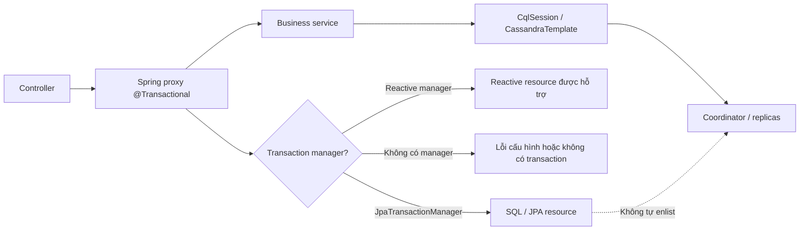
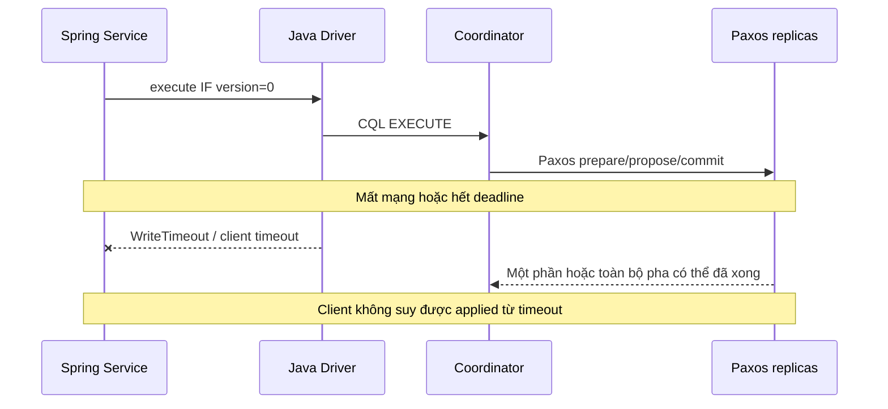
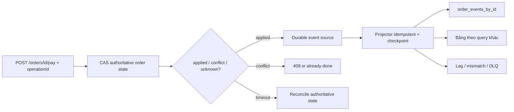

# Ranh giới @Transactional với bảo đảm CQL/LWT theo khả năng hỗ trợ

## 1. Vấn đề: thêm `@Transactional` có rollback được Cassandra không?

Giả sử Spring Boot nhận yêu cầu thanh toán một đơn hàng. Service chạy ba bước: đổi trạng thái order từ `CREATED` sang `PAID`, ghi sự kiện `PAYMENT_CONFIRMED` vào bảng timeline và gửi thông báo. Lập trình viên quen Spring Data JPA có thể đặt `@Transactional` lên method rồi nghĩ rằng nếu bước gửi thông báo thất bại, các lệnh CQL trước đó sẽ được rollback. Trên Apache Cassandra 4.1/5.x với Spring Data Cassandra/Java Driver 4.x theo cách cấu hình phổ biến, điều đó **không đúng**.

**Thông điệp trung tâm:** `@Transactional` yêu cầu một **Spring transaction manager** điều phối các tài nguyên mà manager **thực sự hỗ trợ**. Nó không biến nhiều câu CQL thành transaction SQL, không tạo rollback log cho Cassandra, và không tự enlist Cassandra vào transaction của JPA, PostgreSQL, Kafka hoặc HTTP.

Các cơ chế cần phân biệt:

- **CQL mutation thường:** UPDATE/INSERT/DELETE theo primary key, replication/consistency đã chọn.
- **CQL BATCH:** gom mutations với atomicity/isolation **tùy phạm vi partition**, không đồng nghĩa một JDBC transaction tổng quát.
- **LWT (Lightweight Transaction, `IF ...`):** compare-and-set dùng Paxos cho trạng thái của partition/row được hỗ trợ.
- **Spring Data `@Version`:** optimistic locking dựa trên LWT, **single-entity operations**, không mở rộng mặc định sang batch nhiều entity.
- **Event log/outbox và reconciliation:** cơ chế phục hồi từng bước khi workflow đi qua nhiều bảng, partition hoặc dịch vụ.
- **Accord ở nhánh Cassandra mới, khi được bật/hỗ trợ:** một lựa chọn transaction khác theo release, không phải lời hứa mặc định của `@Transactional`.

Bài thuộc chương **Spring Boot và Spring Data** trong mô-đun `DATABASE_ENGINE_WIDE_COLUMN_CASSANDRA`, gắn với kiến trúc phân tán/wide-column, partition key, thiết kế bảng theo truy vấn, CQL, replication/consistency đọc ghi, compaction/repair, xử lý lỗi và kết nối Java.

**Sau bài, người học sẽ:** xác định transaction manager và resource boundary, viết LWT/CQL và đọc `wasApplied()`, ứng dụng `@Version` đúng chỗ, phân loại timeout/unknown outcome, không nhầm LOGGED BATCH với isolation nhiều partition, biết dùng event ID/replay và đo correctness/latency trong kiểm thử lỗi.

> Phạm vi chính: Spring Boot 3.x, Spring Data Cassandra 4.x, Java Driver 4.x, Cassandra 4.1/5.x. Tính năng Accord trên Cassandra 6 chỉ đề cập như **nhánh có điều kiện** theo đúng release/configuration; không coi nó có trong Cassandra cũ hoặc tự động được điều phối bằng Spring annotation.

## 2. Bảng cam kết: chọn bảo đảm đúng tầng

| Cơ chế | Ranh giới | Bảo đảm chính | Điều **không** tự bảo đảm |
| --- | --- | --- | --- |
| Spring `@Transactional` với `JpaTransactionManager` | JDBC/JPA resource được manager quản lý | Commit/rollback theo SQL engine | Không rollback CQL từ `CqlSession` |
| Spring `@Transactional` khi không có manager phù hợp | Không có resource được enlist | Có thể lỗi khi interceptor yêu cầu manager | Không tạo Cassandra transaction |
| Cassandra mutation thường | Một câu CQL tới replicas theo RF/CL | Write/read theo semantics Cassandra | Không khóa các lệnh khác trong workflow |
| BATCH **cùng partition** | Mutations trong cùng partition theo CQL | Atomicity và isolation cùng partition | Không có read-before-write đa bước tổng quát |
| LOGGED BATCH **nhiều partition** | Batchlog và nhiều mutations | Bảo vệ **eventual completion** của batch được chấp nhận | Không bảo đảm snapshot/atomic visibility xuyên partition |
| UNLOGGED BATCH nhiều partition | Nhiều writes, không có batchlog | Nhóm request | Có thể partial writes khi lỗi |
| LWT `IF col=?`/`IF NOT EXISTS` | State trong phạm vi CAS hỗ trợ | Phát hiện điều kiện không còn đúng | Không transaction với Kafka/bảng khác |
| Spring Data `@Version` | Một entity | Optimistic locking dựa trên LWT | Không hỗ trợ batch optimistic locking mặc định |
| Outbox/event log/replay | Boundary do kiến trúc thiết kế | Phục hồi/retry idempotent, xử lý partial success | Không tự ACID nếu nguồn sự kiện cũng tách rời |
| Accord/CQL transaction, **nếu version hỗ trợ** | Protocol/transactional tables đã bật | Có thể atomic đa partition | Không có mặc định ở Cassandra 4.x/5.x hoặc qua `@Transactional` |

Trước khi chọn giải pháp, hãy diễn đạt rõ invariant: muốn ngăn **lost update một order**, bảo đảm **một batch trên cùng partition**, hay muốn dữ liệu **nhiều bảng/dịch vụ** luôn quan sát được một trạng thái nhất quán?

## 3. Spring `@Transactional`: proxy + transaction manager + resource

Khi một method được gọi **qua proxy đúng cấu hình**, Spring transaction interceptor tìm `PlatformTransactionManager` (imperative) hoặc `ReactiveTransactionManager` (reactive), thiết lập transaction context rồi commit/rollback những tài nguyên mà manager tích hợp.



**Ba câu kiểm tra bắt buộc:**

1. **Manager nào?** Auto-config `CqlSession`/`CassandraTemplate` không có nghĩa Spring đã đăng ký một transaction manager có rollback xuyên các câu CQL.
2. **Method có qua proxy?** `this.method()` self-invocation, cấu hình proxy sai hoặc reactive return type không phù hợp có thể khiến advice không chạy như dự định.
3. **Resource nào thực sự tham gia?** Nếu chọn `JpaTransactionManager`, SQL/JPA thuộc phạm vi, nhưng Cassandra Java Driver **không** tự được enlist.

| Thuộc tính Spring | Có nghĩa khi manager hỗ trợ | Không đồng nghĩa trong Cassandra |
| --- | --- | --- |
| `readOnly=true` | Hint/hạn chế tùy manager | Không ngăn CQL UPDATE nhờ Cassandra RBAC |
| `Isolation.SERIALIZABLE` | Isolation transaction của SQL manager | Không phải LWT `SERIAL` |
| `REQUIRES_NEW` | Transaction mới trên resource phù hợp | Không sinh Cassandra transaction mới |
| `timeout=5` | Transaction timeout manager | Không thay Java Driver request timeout |
| `rollbackFor=Exception.class` | Quy tắc rollback resource đang quản | Không gỡ CQL write đã ACK |

### Anti-pattern: JPA rollback, Cassandra vẫn được ghi

```java
import org.springframework.stereotype.Service;
import org.springframework.transaction.annotation.Transactional;
import com.datastax.oss.driver.api.core.CqlSession;
import java.util.UUID;

@Service
class WrongPaymentService {
    private final SqlPaymentRepository sqlRepo; // Interface JPA giả định.
    private final CqlSession cassandra;

    WrongPaymentService(SqlPaymentRepository sqlRepo, CqlSession cassandra) {
        this.sqlRepo = sqlRepo;
        this.cassandra = cassandra;
    }

    @Transactional(transactionManager = "jpaTransactionManager")
    public void confirm(UUID orderId) {
        sqlRepo.markPaid(orderId);
        // Chỉ để minh họa anti-pattern; production nên dùng prepared/bind.
        cassandra.execute(
            "UPDATE txn_lab_ks.orders_by_id SET status='PAID' " +
            "WHERE order_id=" + orderId);
        throw new IllegalStateException("simulated later failure");
    }
}
```

Nếu exception làm rollback SQL transaction, CQL UPDATE **có thể đã được áp dụng và vẫn tồn tại**. Đừng chạy ví dụ trên dữ liệu thật; dùng fixture lab để minh họa. Dù mã nằm trong một Java method, Cassandra không tham gia distributed two-phase commit với JPA.

## 4. Fixture CQL: authoritative row, timeline và operation guard

Các ví dụ sau chỉ thực hành ở **cluster lab** có DC tên `dc1` và đủ node cho RF3. Dữ liệu/ID đều giả. Khi topology không phù hợp, thay tên DC/RF; không cho ứng dụng thường tự tạo/drop schema production.

```sql
CREATE KEYSPACE txn_lab_ks
WITH replication = {'class': 'NetworkTopologyStrategy', 'dc1': 3}
AND durable_writes = true;

-- Tra cứu một order theo order_id:
CREATE TABLE txn_lab_ks.orders_by_id (
    order_id uuid PRIMARY KEY,
    customer_id text,
    status text,
    version bigint,
    total decimal,
    updated_at timestamp
);

-- Timeline là một bảng khác có primary key theo query:
CREATE TABLE txn_lab_ks.order_events_by_id (
    order_id uuid,
    event_ts timestamp,
    event_id uuid,
    event_type text,
    PRIMARY KEY ((order_id), event_ts, event_id)
) WITH CLUSTERING ORDER BY (event_ts DESC, event_id DESC);

-- Idempotency guard ở partition theo operation_id:
CREATE TABLE txn_lab_ks.operations_by_id (
    operation_id uuid PRIMARY KEY,
    order_id uuid,
    state text,
    updated_at timestamp
);

-- Dùng để thực hành BATCH trên cùng một partition của cùng table:
CREATE TABLE txn_lab_ks.order_properties_by_id (
    order_id uuid,
    property_name text,
    property_value text,
    PRIMARY KEY ((order_id), property_name)
);

INSERT INTO txn_lab_ks.orders_by_id
    (order_id, customer_id, status, version, total, updated_at)
VALUES (
    11111111-2222-4333-8444-555555555555,
    'synthetic-customer-1', 'CREATED', 0, 125.50,
    '2026-11-21T08:00:00+0000'
);

INSERT INTO txn_lab_ks.order_properties_by_id
    (order_id, property_name, property_value)
VALUES (
    11111111-2222-4333-8444-555555555555,
    'status', 'CREATED'
);
```

Hai bảng `orders_by_id` và `order_events_by_id` có cùng một business order nhưng **không phải một CQL partition duy nhất**, vì partition gắn với **table + partition key**. Cassandra không tự giữ chúng đồng bộ chỉ vì cùng giá trị `order_id`.

## 5. Mutation thường và lost update

```sql
CONSISTENCY LOCAL_QUORUM

UPDATE txn_lab_ks.orders_by_id
SET status = 'PAID', updated_at = '2026-11-21T08:10:00+0000'
WHERE order_id = 11111111-2222-4333-8444-555555555555;
```

Với RF3 ở DC `dc1`, `LOCAL_QUORUM` thường cần 2 phản hồi trong DC để coi request đạt CL. **CL là điều kiện xác nhận**, không phải isolation/row lock. Cassandra reconciliation theo write timestamp; cột `updated_at` là giá trị nghiệp vụ, **không** tự làm CAS.

```text
t0: App A đọc status=CREATED, version=0
t1: App B đọc status=CREATED, version=0
t2: App A ghi status=PAID bằng UPDATE thường
t3: App B ghi status=CANCELLED bằng UPDATE thường
t4: giá trị thắng theo writetime/reconciliation, không theo @Transactional
```

Nếu invariant là “PAID không bị một stale writer đổi thành CANCELLED”, cần đưa điều kiện vào phía Cassandra (LWT) hoặc một protocol serialization khác được hỗ trợ.

## 6. LWT `IF ...`: server kiểm tra điều kiện

```sql
UPDATE txn_lab_ks.orders_by_id
SET status = 'PAID',
    version = 1,
    updated_at = '2026-11-21T08:10:00+0000'
WHERE order_id = 11111111-2222-4333-8444-555555555555
IF status = 'CREATED' AND version = 0;
```

Response có field đặc biệt `[applied]`:

| Response | Đọc kết quả |
| --- | --- |
| `[applied]=true` | CAS điều kiện thắng và write đã được xác nhận theo semantics của request |
| `[applied]=false` | State/version không khớp; một cạnh tranh hoặc thay đổi khác đã xảy ra |
| Timeout/transport error | **Unknown outcome**, không biết CAS đã thắng chưa chỉ từ lỗi |

**LWT/Paxos** chống race cho state được bảo vệ nhưng **không** tạo atomicity với timeline ở table khác, SQL transaction hay Kafka. `[applied]=false` là **kết quả nghiệp vụ hợp lệ**, không mặc định lỗi hạ tầng; timeout thì cần recovery thay vì giả định `false`.

## 7. Java Driver 4.x: `wasApplied()` và hai consistency levels

Spring-managed `CqlSession` dùng chung, repository chuẩn bị query một lần:

```java
import java.time.Instant;
import java.util.UUID;
import com.datastax.oss.driver.api.core.CqlSession;
import com.datastax.oss.driver.api.core.DefaultConsistencyLevel;
import com.datastax.oss.driver.api.core.cql.*;
import org.springframework.stereotype.Repository;

@Repository
public class OrderCasRepository {
    private final CqlSession session;
    private final PreparedStatement transition;

    public OrderCasRepository(CqlSession session) {
        this.session = session;
        this.transition = session.prepare(
            "UPDATE txn_lab_ks.orders_by_id " +
            "SET status=?, version=?, updated_at=? " +
            "WHERE order_id=? IF status=? AND version=?");
    }

    public boolean markPaidIfCreated(UUID orderId, long observedVersion) {
        BoundStatement stmt = transition.bind(
            "PAID",
            observedVersion + 1,
            Instant.now(),
            orderId,
            "CREATED",
            observedVersion)
            .setConsistencyLevel(DefaultConsistencyLevel.LOCAL_QUORUM)
            .setSerialConsistencyLevel(DefaultConsistencyLevel.LOCAL_SERIAL)
            .setIdempotent(false);
        ResultSet result = session.execute(stmt);
        return result.wasApplied();
    }
}
```

`LOCAL_SERIAL` áp dụng **phần serial/Paxos**, `LOCAL_QUORUM` áp dụng consistency write/commit thông thường. `SERIAL` có phạm vi khác `LOCAL_SERIAL` trong multi-DC; chọn theo invariant/replication strategy và phải kiểm chứng với topology thật. Đừng đồng nhất `Isolation.SERIALIZABLE` của Spring transaction manager với CQL `SERIAL`.

`setIdempotent(false)` ở ví dụ là lựa chọn thận trọng vì đây là chuyển trạng thái có side effects nghiệp vụ. Không bật speculative/retry tùy tiện. Sau timeout có thể cần đọc state và xác định operation ID trước khi thử lại.

### Ánh xạ result lên HTTP/service

```java
import org.springframework.stereotype.Service;
import java.util.UUID;

@Service
class OrderTransitionService {
    private final OrderCasRepository repository;

    OrderTransitionService(OrderCasRepository repository) {
        this.repository = repository;
    }

    void markPaid(UUID id, long expectedVersion) {
        boolean applied = repository.markPaidIfCreated(id, expectedVersion);
        if (!applied) {
            throw new OrderConflictException("State/version changed");
        }
    }
}
```

`OrderConflictException` là loại exception domain ứng dụng tự định nghĩa. HTTP controller có thể map conflict sang 409, nhưng **không** map mọi timeout thành 409 hoặc 404. Sau write timeout, kết quả có thể đã commit và phải reconcile.

## 8. `IF NOT EXISTS`: idempotency key không tạo distributed transaction

```sql
INSERT INTO txn_lab_ks.operations_by_id
    (operation_id, order_id, state, updated_at)
VALUES (
    99999999-aaaa-4bbb-8ccc-dddddddddddd,
    11111111-2222-4333-8444-555555555555,
    'RECEIVED',
    '2026-11-21T08:15:00+0000'
) IF NOT EXISTS;
```

Cùng operation ID, CAS chỉ cho một create thắng ở primary key đó. Nhưng chuỗi **hai câu CQL**:

```text
(1) INSERT operations_by_id IF NOT EXISTS -> applied=true
(2) UPDATE orders_by_id ... -> timeout / process crash
```

có thể để lại trạng thái `RECEIVED` trong khi order chưa được chuyển. Vì `operations_by_id` partition theo `operation_id` và `orders_by_id` theo `order_id`, hai LWT riêng **không atomic với nhau**. Cần định nghĩa state machine `RECEIVED → APPLYING → APPLIED/FAILED`, retries/checkpoints, recovery trên timeout và cảnh báo work quá hạn.

## 9. Spring Data `@Version`: optimistic locking trên một entity

Spring Data Cassandra 4.5 hỗ trợ `org.springframework.data.annotation.Version`. Với một entity, Spring Data dùng **LWT** để chỉ update/delete nếu version vẫn khớp; conflict có thể ném `OptimisticLockingFailureException`. Bảng lab có cột `version bigint` phù hợp `Long`.

```java
import java.math.BigDecimal;
import java.util.UUID;
import org.springframework.data.annotation.Version;
import org.springframework.data.cassandra.core.mapping.PrimaryKey;
import org.springframework.data.cassandra.core.mapping.Table;
import org.springframework.data.cassandra.core.mapping.Column;

@Table("orders_by_id")
public class OrderEntity {
    @PrimaryKey("order_id")
    private UUID orderId;

    @Column("status")
    private String status;

    @Column("total")
    private BigDecimal total;

    @Version
    @Column("version")
    private Long version;

    // No-arg constructor, getters/setters theo mapping.
}
```

```java
import org.springframework.data.cassandra.core.CassandraTemplate;
import org.springframework.dao.OptimisticLockingFailureException;

OrderEntity copyA =
    template.selectOneById(orderId, OrderEntity.class);
OrderEntity copyB =
    template.selectOneById(orderId, OrderEntity.class);

copyA.setStatus("PAID");
template.save(copyA); // Bảo vệ version hiện tại, sau đó tăng version.

copyB.setStatus("CANCELLED");
try {
    template.save(copyB); // Bản copy có stale version.
    throw new AssertionError("Unexpected stale update success");
} catch (OptimisticLockingFailureException expected) {
    // Đọc state mới, áp business policy. Không retry stale object mù.
}
```

`template` là Spring-managed CassandraTemplate, ví dụ dùng **fixture riêng** chưa bị mutate bởi ví dụ LWT trước. Nếu entity chỉ map subset các cột, cân nhắc null handling của `save()` để tránh xóa nhầm giá trị khác. Phải kiểm tra method thực tế qua integration test thay vì coi code minh họa là một rollback transaction.

**Giới hạn được Spring Data ghi rõ:** optimistic locking bằng `@Version` chỉ hỗ trợ **single-entity operations**, **không áp dụng cho batch operations**. Không viết `@Version` trên entity rồi cho rằng nhiều repository calls cùng được rollback.

## 10. CQL BATCH cùng partition: atomicity trong phạm vi hẹp

```sql
BEGIN UNLOGGED BATCH
    UPDATE txn_lab_ks.order_properties_by_id
    SET property_value = 'PAID'
    WHERE order_id = 11111111-2222-4333-8444-555555555555
      AND property_name = 'status';

    UPDATE txn_lab_ks.order_properties_by_id
    SET property_value = 'updated-by-service'
    WHERE order_id = 11111111-2222-4333-8444-555555555555
      AND property_name = 'source';
APPLY BATCH;
```

Ở đây cả hai mutations thuộc **cùng partition của cùng bảng**, nên CQL batch có atomicity/isolation của batch single-partition theo tài liệu. Nó không tự mang transaction boundary sang `orders_by_id`, `order_events_by_id` hay SQL.

`UNLOGGED` phù hợp minh họa cùng partition vì không cần batchlog cross-partition; không được suy từ ví dụ này rằng **UNLOGGED BATCH nhiều partition** cũng bảo đảm all-or-none khi lỗi.

## 11. LOGGED BATCH đa partition: eventual completion khác isolation

```sql
BEGIN LOGGED BATCH
    UPDATE txn_lab_ks.orders_by_id
    SET status = 'PAID'
    WHERE order_id = 11111111-2222-4333-8444-555555555555;

    INSERT INTO txn_lab_ks.order_events_by_id
        (order_id, event_ts, event_id, event_type)
    VALUES (
        11111111-2222-4333-8444-555555555555,
        '2026-11-21T08:20:00+0000',
        22222222-3333-4444-8555-666666666666,
        'PAYMENT_CONFIRMED');
APPLY BATCH;
```

**LOGGED BATCH** dùng batchlog để bảo vệ **eventual completion** (các mutations trong batch được áp dụng cuối cùng theo cơ chế batch khi được chấp nhận), nhưng **không có isolation xuyên nhiều partition**. Reader có thể thấy state order mới trước khi event timeline xuất hiện trong một khoảng thời gian. Khi client timeout, không thể suy Cassandra rollback những mutations đã thực hiện; và Java exception sau batch không kích hoạt `ROLLBACK`.

**Không đồng nhất** eventual atomic completion theo CQL batch với snapshot atomic visibility hoặc toàn bộ ACID của RDBMS. BATCH không hỗ trợ general-purpose đọc state, chạy logic tùy ý, commit/rollback nhiều partition như JDBC transaction. Nó có thể tăng chi phí batchlog/coordinator và tạo overload khi gom nhiều partition chỉ để “tăng throughput”.

Khi dùng batch, tránh nhiều updates cùng cột/timestamp gây tie-breaking không theo thứ tự source, và không dùng batch khổng lồ thay cho backfill có checkpoints/rate limit.

## 12. Conditional batch: giới hạn ở nơi CAS thực sự bảo vệ

CQL hỗ trợ những conditional batches với `IF` trong phạm vi version/table/partition cho phép. Không được giả định chúng có thể áp business conditions chung cho **hai bảng khác partition**:

```sql
-- MINH HỌA SAI PHẠM VI, cố ý comment:
-- BEGIN BATCH
-- UPDATE txn_lab_ks.orders_by_id ... IF status='CREATED';
-- INSERT INTO txn_lab_ks.order_events_by_id ...;
-- APPLY BATCH;
```

Thay vào đó, định nghĩa invariant ở **một partition/table** khi có thể, dùng một `UPDATE ... IF version=?` hoặc `INSERT IF NOT EXISTS`, rồi đảm bảo bảng projection hội tụ qua event source/retry/reconciliation. Nếu cần transaction mạnh hơn trên nhiều partition, phải kiểm tra có **protocol/feature được hỗ trợ ở phiên bản đang chạy**, không tự lấy LWT để giả lập.

## 13. Consistency và LWT ở nhiều DC: hai tham số khác nhau

Cassandra phân biệt **regular consistency** dùng cho các request CQL và **serial consistency** cho Paxos của LWT. Với Driver 4.x:

```java
BoundStatement conditional = transition.bind(
        "PAID", 1L, Instant.now(),
        orderId, "CREATED", 0L)
    .setConsistencyLevel(DefaultConsistencyLevel.LOCAL_QUORUM)
    .setSerialConsistencyLevel(DefaultConsistencyLevel.LOCAL_SERIAL);
```

| Thiết lập | Câu hỏi được trả lời | Cảnh báo |
| --- | --- | --- |
| `LOCAL_QUORUM` | Cần bao nhiêu phản hồi ở local DC để đạt CL? | Phụ thuộc RF per DC/replica health |
| `SERIAL` | Serial/Paxos consistency với phạm vi phù hợp across DC | Có thể ảnh hưởng latency WAN và availability |
| `LOCAL_SERIAL` | Serial/Paxos consistency giới hạn local DC | Không tự suy ra quyết định global tuyến tính của mọi DC |
| Spring `Isolation.SERIALIZABLE` | Isolation của một transaction manager phù hợp | **Không** là bí danh cho CQL `SERIAL` |

Nếu nhiều writers ở nhiều DC cùng dùng LWT và nghiệp vụ yêu cầu global uniqueness/linearizability, phải chốt consistency strategy **theo phiên bản, topology và failover policy**. Không dùng `LOCAL_SERIAL` tại mọi DC rồi suy tất cả đã thống nhất một thứ tự global. Hãy test under partitions/failover theo runbook thực tế.

### Giá của Paxos

LWT có nhiều lượt giao tiếp và tranh chấp hơn write thông thường. Với hot partition, nhiều CAS có thể trả `[applied]=false` hoặc timeout. Đo **LWT applied rate, CAS p95/p99, contention, coordinator/replica CPU, pending tasks**; không dùng `@Version` vô hạn để tránh thiết kế state machine đúng.

## 14. Unknown write outcome: timeout không có nghĩa rollback



Một `WriteTimeoutException` hoặc timeout ở driver chỉ nói rằng **client không có xác nhận theo ngưỡng/thời gian mong đợi**. Mutation có thể chưa đến server, đang xử lý, hoặc đã được áp dụng nhưng response bị mất.

**Bốn hệ quả phải được xử lý:**

1. Không retry mù mutation không-idempotent như counter increment, list append hoặc một operation có side effect bên ngoài.
2. Với CAS chuyển `version=0 → 1`, retry lần hai có thể trả `[applied]=false` vì **lần đầu đã thắng**, không phải vì business action chưa xảy ra.
3. Có thể cần đọc lại state và **đối chiếu operation/event ID** để phân biệt “chính yêu cầu này đã thành công” với “một yêu cầu khác thay đổi row”.
4. Hủy HTTP request hoặc Reactor subscription **không đảm bảo** mutation đã gửi tới Cassandra bị rollback.

| Kết quả | Có biết trạng thái cuối? | Hướng xử lý |
| --- | --- | --- |
| LWT `[applied]=true` | Có xác nhận CAS thành công theo CL | Tiếp tục luồng đã định |
| LWT `[applied]=false` | Điều kiện không thỏa tại thời điểm CAS | Đọc/giải quyết conflict hoặc already-processed |
| `UnavailableException` | Không đạt điều kiện phục vụ request | Phân loại chi tiết lỗi/attempt, retry theo budget nếu an toàn |
| `WriteTimeoutException` | **Chưa rõ** mutation đã được áp dụng chưa | Reconcile theo khóa/operation ID; không retry mù |
| Driver client-side timeout/cancel | **Chưa rõ** server còn thực thi không | Giữ recovery độc lập với vòng đời HTTP |
| `UnauthorizedException`/invalid CQL | Thiếu quyền hoặc lỗi schema/query | Sửa permission/query; không giả là not-found |

### Không “chữa timeout” bằng cách hạ CL

Nếu contract yêu cầu `LOCAL_QUORUM`, đổi thành `ONE` để tăng success rate sẽ làm **thay đổi bảo đảm nhất quán**, không giải quyết nguyên nhân replica/băng thông/compaction. Với thao tác CAS, còn phải xem serial CL; không “tối ưu latency” bằng cách hạ điều kiện đồng thuận mà không có phê duyệt.

## 15. Spring Data reactive và Reactor: annotation cũng không tạo transaction CQL

Trong Spring WebFlux, những lệnh reactive thường chỉ thực hiện khi subscribe. Reactive `@Transactional`, nếu có manager tương thích, dùng `ReactiveTransactionManager` và Reactor Context để quản lý **resource hỗ trợ**, không tự làm Java Driver tham gia giao dịch.

```java
import java.util.UUID;
import reactor.core.publisher.Mono;
import org.springframework.stereotype.Service;

@Service
class ReactiveOrderService {
    private final ReactiveOrderRepository repository;

    ReactiveOrderService(ReactiveOrderRepository repository) {
        this.repository = repository;
    }

    Mono<Boolean> markPaid(UUID orderId) {
        return repository.casMarkPaid(orderId)
            .flatMap(applied -> {
                if (!applied) {
                    return Mono.error(
                        new OrderConflictException("Concurrent change"));
                }
                return Mono.just(true);
            });
    }
}
```

`ReactiveOrderRepository` là abstraction được ứng dụng tự xây, trả `Mono<Boolean>` đọc từ kết quả LWT; mã không giả định có một Cassandra transaction manager. Nếu method được đánh dấu `@Transactional` mà manager dùng cho R2DBC, nó chỉ điều phối **resource R2DBC**, không tự quản `CqlSession`.

### Chuỗi nhiều bước có thể partial success

```java
Mono<Void> workflow =
    repository.casMarkPaid(orderId)
        .flatMap(applied -> applied
            ? sendNotificationAsync(orderId)
            : Mono.error(new OrderConflictException("Not applied")))
        .then();
```

Nếu CAS thành công nhưng `sendNotificationAsync` thất bại, pipeline trả `onError` **không rollback CAS**. Dùng `retryWhen` trên cả pipeline có thể tái phát hành các bước đã thành công; cần retry **riêng từng bước**, idempotency key và checkpoint.

Reactive publisher của driver có ràng buộc cold/single subscription. Khi thực sự cần retry một CQL read, tạo publisher mới theo subscription (ví dụ `Flux.defer`). Với conditional writes, cần thêm chiến lược kiểm tra outcome và tránh side effects lặp.

## 16. Spring `@TransactionalEventListener`: AFTER_COMMIT vẫn có crash gap

Một kiến trúc thường gặp:

```text
BEGIN SQL transaction via JPA
    update SQL payment
COMMIT SQL transaction
    @TransactionalEventListener(AFTER_COMMIT)
        -> send Kafka / update Cassandra
```

Điểm tốt là listener không chạy trước SQL commit nếu cấu hình event listener phù hợp. Nhưng:

- Nếu process **crash sau SQL commit, trước listener**, event có thể bị mất.
- Nếu Cassandra update lỗi, SQL transaction **đã commit**, không tự rollback.
- Nếu listener chạy nhưng downstream ack lỗi, event có thể được phát lại.
- Listener phụ thuộc transaction manager **của SQL**, không tự biến Cassandra thành resource cùng commit.

**Khi SQL là source of truth:** ghi **outbox row trong cùng SQL transaction** với state thay đổi, rồi worker/CDC relay sang Cassandra/Kafka có checkpoint, event ID và retries idempotent. Nếu **Cassandra là source of truth**, cần thiết kế một nguồn sự kiện bền vững và recovery boundary phù hợp; không mặc định việc thêm bảng outbox ở một partition khác khiến Cassandra updates atomic.

## 17. Workflow nhiều bảng denormalized: chọn nguồn chân lý



**Sơ đồ mô tả kiến trúc đích**, không khẳng định CAS và event source ở hai partition đã được atomic. Khoảng crash **sau CAS nhưng trước event persist** phải được giải quyết bằng một protocol bền vững, ví dụ:

1. Tổ chức **state + event** trong một partition/table khi invariant, size và CQL conditional constraints cho phép.
2. Chọn một **authoritative event log** với commit boundary rõ ràng để derive các projections.
3. Định kỳ **reconcile** authoritative rows với event/projection, khôi phục event còn thiếu, quản lý DLQ/checkpoint.
4. Với tài nguyên ngoài Cassandra, dùng **saga/compensation** có trạng thái từng bước; compensation là một hành động nghiệp vụ, **không phải rollback vật lý** mọi side effect.

### Event ID ổn định làm gì?

Nếu retry một event với UUID mới, timeline có thể bị nhân đôi. Khi producer tạo **operation ID ổn định** từ ingress, projector có thể dedup/idempotent upsert trên khóa hợp lệ. Nhưng phải xét TTL, writetime, collection append/counters và các action bên ngoài: **gọi lại một câu INSERT cùng khóa không tự idempotent cho mọi nghiệp vụ**.

## 18. Ma trận lựa chọn thực tế

| Yêu cầu | Primitive/thiết kế | Lý do | Tránh |
| --- | --- | --- | --- |
| Một order ID chỉ được tạo một lần | `INSERT ... IF NOT EXISTS` | CAS theo khóa | Chỉ `@Transactional` |
| Không ghi đè entity stale | `@Version` hoặc `IF version=?` | Optimistic locking | UPDATE thường với `updated_at` |
| Hai rows cùng partition/table đổi cùng đơn vị | CQL single-partition batch | Atomicity/isolation hẹp | Hai UPDATE rời rồi giả ACID |
| Hai tables phải được đọc như một snapshot nhất quán | Thay data model hoặc transaction engine hỗ trợ | LOGGED BATCH thiếu multi-partition isolation | Annotation hoặc batch nhiều partition |
| SQL và Cassandra cần phối hợp đáng tin cậy | SQL outbox/saga/event log | Không có common transaction mặc định | Một method @Transactional gọi cả hai |
| State thay đổi rồi publish Kafka | Durable outbox, relay + idempotent consumer | Chặn crash gap | Fire-and-forget listener |
| Multi-partition read-modify-write mạnh ở version mới | Xác minh Accord support/feature flags | Cơ chế khác LWT/batch | Copy syntax preview vào 4.x |
| Retry có thể lặp event | Stable event ID + dedup/reconcile | Phân biệt retry với business event mới | Random event ID mỗi retry |

Nếu yêu cầu “**luôn cùng trạng thái nhìn thấy trên mọi bảng tại mọi thời điểm**” là cứng, không được chọn một giải pháp **eventual** mà không thay đổi contract hoặc công nghệ/boundary.

## 19. Cassandra 6/Accord: ngoại lệ có điều kiện, không phải @Transactional

Nhánh phát triển Cassandra 6 có tài liệu/mã nguồn về **Accord**, cho phép giao dịch mạnh hơn trên nhiều partition khi protocol, cluster, table và CQL hỗ trợ. Tuy vậy:

- Không có cú pháp CQL transaction đa partition tương tự làm mặc định cho Cassandra 4.1/5.x.
- Mức ổn định, `accord.enabled`, `transactional_mode`, consistency levels được phép và giới hạn cú pháp phải đối chiếu **đúng release/nhà cung cấp**; preview/alpha không mặc nhiên production-ready.
- Spring Boot/Spring Data Cassandra **không tự map `@Transactional` sang Accord** chỉ vì server có khả năng này. Phải dùng **CQL/Driver API tương ứng** và xác định transaction boundary thực sự.
- Không chạy `BEGIN TRANSACTION` từ tài liệu draft vào cluster không hỗ trợ, cũng không suy transaction mới có rollback đồng thời với JPA/Kafka.

Đây là một nhánh nâng cấp/tính năng **ngoài phạm vi thực hành chính**, cần test performance, failure modes, multi-DC semantics, capability của driver và operational rollback riêng.

## 20. Những triệu chứng thường gặp

| Triệu chứng | Nguyên nhân có thể | Kiểm tra |
| --- | --- | --- |
| Spring exception nhưng CQL đã ghi | JPA manager không enlist Cassandra | Xem bean manager, test lab rollback SQL vs Cassandra |
| Thiếu transaction manager lúc chạy | Có annotation nhưng context không có manager phù hợp | Xem conditions/bean graph, không viết manager giả |
| `@Transactional` không được áp dụng | Self-invocation/proxy không đi qua | Gọi qua Spring bean/proxy, test transaction scope |
| LWT `wasApplied=false` | Version/status đã thay đổi | Đọc authoritative state, đánh giá conflict/already done |
| LWT timeout nhưng row đã đổi | Phản hồi thất lạc hoặc deadline hết | Reconcile theo operation ID |
| LOGGED batch timeout, một bảng thấy trước | Không có visibility isolation nhiều partition | Quan sát recovery, đối soát cả hai bảng |
| UNLOGGED batch nhiều partition bị partial | Không có batchlog bảo vệ | Chuyển sang checkpoint/replay hoặc thiết kế khác |
| `@Version` conflict | Một writer đã cập nhật entity | OptimisticLockingFailureException, business conflict |
| `@Version` không bảo vệ batch | Chỉ single-entity optimistic locking | Test riêng, không giả global transaction |
| Timeline thiếu event dù status PAID | Projection/capture lỗi hoặc lag | Durable source, offsets, DLQ, reconciliation |
| p99 tăng sau LWT | Paxos contention/hot partitions/network | LWT latency, applied/false, CPU/network |
| Hai DC thấy state khác nhau | CL/serial CL/replication và đường đọc | RF per DC, coordinator traces và failover policy |
| Gửi event hai lần sau retry | Không giữ stable event ID | Dedup by operation ID, so side effects |
| Batch quá lớn làm cluster chậm | Batchlog/disk/CPU, nhiều partition | Giảm scope, throttle, không dùng batch để bulk import |

## 21. Kiểm thử phải xác nhận đúng tính chất được hứa

### 21.1. Hai writers cùng đọc version 0

Trong lab, tạo **order ID mới** status=CREATED/version=0; hai clients cùng đọc. A thử `IF version=0` chuyển PAID; B thử `IF version=0` chuyển CANCELLED. Khi cả hai nhận kết quả LWT hợp lệ, **chỉ một CAS thắng cho state được bảo vệ**. Đọc kết quả cuối, không chỉ assert không exception, và lặp test nhiều lần để quan sát contention.

### 21.2. False khác timeout

```java
boolean applied = repository.markPaidIfCreated(orderId, 0L);
if (!applied) {
    // Conflict: state/version đã khác.
}
```

Với lỗi timeout được inject, test **không trả `false` giả**. Phải đi vào nhánh “outcome chưa xác định” rồi verify state/event ID; retry policy không tự biến timeout thành conflict.

### 21.3. `@Version` với hai entity snapshots

Tạo fixture riêng, đọc hai copies, A update thành công, B update sau với version cũ. Assert optimistic locking exception hoặc result thất bại theo API thực. Đọc state cuối xác nhận chỉ thay đổi hợp lệ; không suy bất kỳ event trong table khác cũng đã rollback.

### 21.4. Manager boundary với SQL và Cassandra

Trong test DB cô lập, viết vào SQL rồi CQL, ném exception. Xác minh transaction manager SQL rollback, trong khi Cassandra mutation có thể đã được ACK và **không tự rollback**. Làm cleanup fixture kiểm soát; **không** test bằng production payment/order IDs.

### 21.5. Crash giữa các bước

Giả lập crash sau CAS nhưng trước khi ghi event; assert recovery/reconciliation phát lại event còn thiếu với **cùng operation ID**. Giả lập retry trùng và timeout sau commit: assert không nhân đôi notification hoặc thay đổi business state sai.

### 21.6. Testcontainers RF1 không chứng minh RF3/DC

Một Cassandra Testcontainer **single-node RF1** có thể test syntax CQL, LWT `wasApplied`, `@Version` mapping, nhưng không chứng minh quorum RF3, mất một node hoặc multi-DC serial semantics. Muốn đo các điều kiện đó phải dùng lab topology/cluster và fault injection được phép.

## 22. Quan sát và tiêu chí chấp nhận

| Mức | Metric | Vì sao |
| --- | --- | --- |
| Business | Success/failure, 409, unknown outcomes, event lag | Đo request nghiệp vụ, không chỉ CQL ACK |
| Driver/CQL | p95/p99, timeouts, retries, CL/serial CL | Phân biệt transport và CAS conflict |
| LWT | `applied=true/false`, CAS latency, contention | Đánh giá cost để giữ invariant |
| Batch | Loại LOGGED/UNLOGGED, size/partition count, errors | Tìm batch sai scope/quá lớn |
| Cassandra | CPU, disk await, GC, compaction/repair, node health | Bối cảnh replica/coord |
| Workflow | Event offsets, DLQ, replay count, duplicate/mismatch | Xác nhận dữ liệu denormalized hội tụ |
| Security | Unauthorized attempts, roles, audit | Không nhầm RBAC với isolation |

**Đo cùng workload:** nếu thay UPDATE thường bằng LWT, so **correctness, full-operation p99, conflicts, error và successful business throughput** dưới cùng RF/CL, partition distribution, offered load và retry policy. Tăng latency có thể là chi phí cần thiết để loại bỏ lost update.

```bash
# Các lệnh chỉ đọc trên node lab/cluster được phép:
nodetool status
nodetool describecluster
nodetool tpstats
nodetool proxyhistograms
nodetool tablestats txn_lab_ks.orders_by_id
nodetool compactionstats
```

Lệnh trên quan sát node được hỏi; khi đánh giá đa DC cần logs/metrics trên những coordinator và replicas liên quan. Không tắt repair, giảm CL hay bật tracing 100% production chỉ để benchmark “đẹp”.

## 23. Runbook thiết kế ranh giới transaction

### P0 — Viết invariant

Phân biệt “một order chỉ chuyển CREATED→PAID một lần”, “timeline **cuối cùng** có event”, và “hai bảng **luôn** có cùng trạng thái khi đọc”. Chốt mức mạnh/yếu, độ trễ được phép và chi phí lỗi.

### P1 — Liệt kê resources/boundaries

Vẽ SQL resource, Cassandra keyspace/table/partition keys, broker và HTTP providers. Kiểm tra Spring transaction manager được chọn, AOP proxy và local DC/RF/CL.

### P2 — Chọn primitive tối thiểu đủ mạnh

- Cạnh tranh một entity: LWT IF hoặc `@Version`.
- Các rows cùng partition/table: cân nhắc single-partition batch.
- Các tables/partitions denormalized: nguồn sự kiện + replay/reconciliation, hoặc transaction engine **thực sự hỗ trợ**.
- SQL/broker/HTTP: outbox/saga, idempotency, không suy global transaction từ annotation.

### P3 — Định nghĩa lỗi/retry

Rõ `wasApplied` true/false, optimistic conflict, timeout/unknown outcome, request/serial CL, driver retry + application retry budgets. Không hạ CL âm thầm.

### P4 — Lab kiểm thử race/failure

Tạo dữ liệu synthetic, hai competing writers, timeout trước/sau ACK, process crash giữa bước, duplicate delivery, lag projection; assert cả authoritative data và event recovery.

### P5 — Canary cùng tải

Giữ query mix, partition distribution, driver version, RF/CL, API SLO. Theo dõi LWT latency, p99/conflicts, outbox lag, retries và mismatches. Correctness fail thì dừng rollout dù p99 tốt.

### P6 — Hậu kiểm phục hồi

Chạy replay/checkpoint theo operation IDs, xử lý DLQ/timeout chưa rõ outcome, kiểm tra role permissions và lưu evidence phiên bản/server config. Rollback binary Spring không rollback những writes Cassandra đã ACK.

## 24. Bài tập tự kiểm tra

1. `@Transactional` liên hệ `PlatformTransactionManager` như thế nào? Ai sở hữu tài nguyên được rollback?
2. Khi có JPA và Cassandra trong cùng Spring method, vì sao JPA rollback không kéo Cassandra theo?
3. Nếu thiếu transaction manager phù hợp, Spring interceptor có thể phản ứng ra sao?
4. `this.doWork()` có thể bỏ qua transaction proxy thế nào, và điều đó có thay CQL semantics không?
5. `Isolation.SERIALIZABLE` của Spring khác `SERIAL/LOCAL_SERIAL` của Cassandra ở đâu?
6. Giải thích RF3/`LOCAL_QUORUM`. Tại sao nó không thay LWT?
7. Hai writers cùng đọc version=0, viết thường sẽ có rủi ro gì?
8. `[applied]=false` trong LWT khác `WriteTimeoutException` ra sao?
9. Vì sao retry sau timeout có thể trả false dù lần đầu đã thắng CAS?
10. Spring Data `@Version` hỗ trợ single-entity nhưng không batch có ý nghĩa gì?
11. Vì sao một single-partition UNLOGGED BATCH có properties khác UNLOGGED BATCH nhiều partition?
12. LOGGED BATCH nhiều partition bảo vệ điều gì và thiếu isolation nào?
13. Hai tables có cùng `order_id` có cùng một CQL partition không?
14. Tại sao guard `operations_by_id IF NOT EXISTS` không atomic với update `orders_by_id`?
15. `@TransactionalEventListener(AFTER_COMMIT)` có crash gap nào?
16. Vì sao `retryWhen` toàn reactive workflow có thể gửi side effect hai lần?
17. Khi nào phải dùng reconciliation thay vì chỉ dùng driver retry policy?
18. Nếu contract yêu cầu mọi bảng luôn nhất quán tức thời, giải pháp eventual projection có đáp ứng không?
19. Một Testcontainer RF1 có thể chứng minh CL multi-DC không? Cần test gì thêm?
20. Transaction feature mới như Accord cần kiểm tra thông tin gì trước khi dùng?
21. Saga compensation khác rollback vật lý thế nào?
22. Liệt kê các metrics cho CAS conflict, timeout, projection lag, error và p99.

### Bài tổng hợp: service thanh toán

Thiết kế `POST /orders/{orderId}/pay` có `operationId` ổn định:

- Authoritative order state trong `orders_by_id` theo partition key `order_id`.
- LWT `UPDATE ... IF status='CREATED' AND version=?` chống competing transitions; kiểm tra `wasApplied()`.
- `false` được ánh xạ riêng với timeout; timeout phải kiểm tra state và operation ID trước replay.
- Timeline ở `order_events_by_id` là table/partition khác: không giả định atomic cùng authoritative row; có durable source + replay + dedup.
- Nếu cũng có SQL transaction/payment provider, dùng outbox/saga/boundary rõ, không tự hứa global ACID.
- Test hai writers, crash gap, duplicate deliveries, timeout, permission và độ đúng/p99 cùng tải.
- Khi rollout, lưu release Cassandra/Spring Data/driver, RF/CL/serial CL, retry budget, event lag và giới hạn rollback.

**Tiêu chí hoàn thành:** người học biết xác định transaction manager Spring và resource của nó; phân biệt `@Transactional`, CQL batch, LWT và `@Version`; xử lý `wasApplied()`/unknown outcome đúng; thiết kế workflow đa bảng có khả năng phục hồi và không hứa atomicity/isolation vượt phạm vi hệ thống thực sự hỗ trợ.

## 25. Tài liệu tham khảo

- [Spring Framework — Declarative Transaction Management](https://docs.spring.io/spring-framework/reference/data-access/transaction/declarative.html): `@Transactional`, proxy, transaction manager và rollback rules.
- [Spring Framework — Transaction Strategies](https://docs.spring.io/spring-framework/reference/data-access/transaction/strategies.html): transaction abstraction, resource boundaries.
- [Spring Boot 3.5 — Cassandra](https://docs.spring.io/spring-boot/3.5/reference/data/nosql.html): auto-config `CqlSession` và Spring Data Cassandra.
- [Spring Data Cassandra 4.5 — Persisting Entities](https://docs.spring.io/spring-data/cassandra/reference/4.5/cassandra/template.html): `CassandraTemplate`, `@Version`, optimistic locking cho single-entity operations.
- [Spring Data Cassandra 4.5 — CQL Template](https://docs.spring.io/spring-data/cassandra/reference/4.5/cassandra/cql-template.html): template APIs, exception translation và batch.
- [Apache Cassandra 4.1 — CQL DML/BATCH](https://cassandra.apache.org/doc/4.1/cassandra/cql/dml.html): BATCH, logged/unlogged, timestamps, giới hạn isolation.
- [Apache Cassandra — CQL Reference](https://cassandra.apache.org/doc/latest/cassandra/developing/cql/cql_singlefile.html): `INSERT IF NOT EXISTS`, `UPDATE ... IF`, CAS và CQL BATCH.
- [Apache Cassandra Java Driver 4.x — Consistency](https://apache.github.io/cassandra-java-driver/4.18.1/core/consistency/): CL và serial CL trong LWT.
- [Apache Cassandra Java Driver 4.x — Idempotence](https://apache.github.io/cassandra-java-driver/4.18.1/core/idempotence/): retry/speculative execution và unknown outcome.
- [Apache Cassandra Jira CASSANDRA-20857](https://issues.apache.org/jira/browse/CASSANDRA-20857): mốc phát triển tính năng transaction nhánh Cassandra 6, cần kiểm chứng release.

**Kết luận:** **Spring `@Transactional` chỉ điều phối transaction của tài nguyên được transaction manager thực sự hỗ trợ; nó không tự rollback CQL.** Với Cassandra 4.1/5.x, dùng LWT/`@Version` khi cần bảo vệ cạnh tranh một entity, batch cùng partition khi hợp lý, hiểu giới hạn multi-partition visibility của LOGGED BATCH, và xây event ID/outbox/replay/reconciliation cho nhiều bảng hoặc nhiều hệ thống. Nếu phiên bản Cassandra mới hỗ trợ transaction mạnh hơn, hãy dùng theo **API, cấu hình và phạm vi đã kiểm chứng**, không suy bảo đảm chỉ từ annotation Java.
