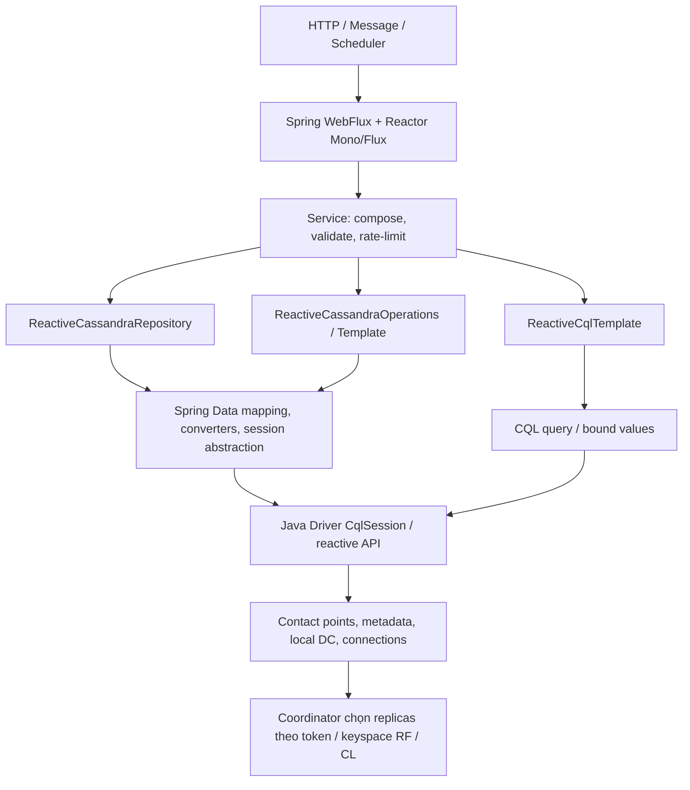
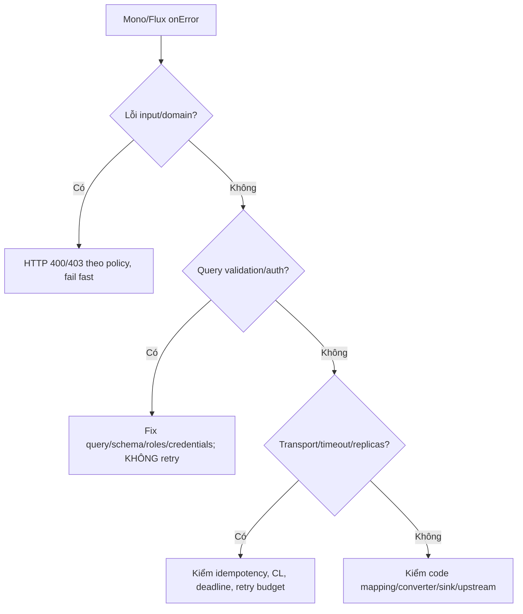

# ReactiveCassandraTemplate/repository và kiểm soát tải, lỗi, subscription

> **Chương:** Spring Boot và Spring Data  
> **Mô-đun:** `DATABASE_ENGINE_WIDE_COLUMN_CASSANDRA` — hiểu kiến trúc phân tán và mô hình wide-column của Apache Cassandra, đặc biệt partition key, thiết kế bảng theo truy vấn, consistency level, CQL, replication, compaction, repair, lỗi và ứng dụng Java.  
> **Trọng tâm:** Sử dụng **Spring Data Cassandra reactive** với `ReactiveCassandraTemplate`, `ReactiveCassandraOperations` và `ReactiveCassandraRepository`; hiểu chu kỳ **composition → subscription → execution → terminal signal**, quản lý backpressure/concurrency, phân trang, lỗi, timeout, cancellation, idempotency và vòng đời request trong Spring WebFlux.  
> **Ngữ cảnh phiên bản:** Nội dung minh họa Spring Boot 3.x/4.x, Spring Data Cassandra 4.x/5.x, Project Reactor 3.x và Java Driver 4.x. Kiểm tra đúng BOM, JDK, Cassandra server và API trước khi copy code.

Một ứng dụng WebFlux có thể trông hoàn toàn reactive nhưng **không thực hiện bất kỳ thao tác Cassandra nào**:

```java
public Mono<Void> wrongSave(Account account) {
    accountRepository.save(account); // Tạo Mono rồi bỏ đi.
    return Mono.empty();             // Không có subscription cho save.
}
```

Một phiên bản khác còn nguy hiểm hơn:

```java
public Mono<Void> wrongBatch(Flux<Account> accounts) {
    return accounts
        .doOnNext(account -> accountRepository.save(account))
        .then(); // onComplete của nguồn, KHÔNG chờ save() Mono.
}
```

Lý do: đối tượng `Mono`/`Flux` là **mô tả công việc bất đồng bộ**, không phải bằng chứng công việc đã chạy. Lệnh `doOnNext` ở đây tạo ra publisher con nhưng **không kết nối nó vào chuỗi subscription**. Khi HTTP trả thành công, database có thể chưa nhận một lệnh `INSERT` nào.

Cách đúng phải **compose** thao tác Cassandra với pipeline được framework subscribe:

```java
public Mono<Void> saveBatch(Flux<Account> accounts) {
    return accounts
        .concatMap(accountRepository::save) // Chờ từng save.
        .then();                            // Hoàn tất khi tất cả save hoàn tất.
}
```

Tuy nhiên, `concatMap` chỉ giải quyết việc **chờ và giữ thứ tự**, không tự bảo vệ khỏi mọi lỗi nghiệp vụ. Nếu input có thể vô hạn, endpoint vẫn cần validation, quota, capacity và deadlines. Nếu `save` bị timeout, mutation có thể đã được áp dụng ở một số replica dù client chưa có ACK. Nếu muốn tăng throughput bằng `flatMap(..., concurrency)`, phải đánh giá thứ tự, idempotency và tài nguyên.

**Thông điệp cốt lõi:** *Reactive* là mô hình điều phối non-blocking và truyền demand; **không thay thế** partition-aware data modeling, CQL consistency, kiểm soát tải, retry policy, bảo mật hay giám sát Cassandra.

## 1. Mục tiêu học tập

Sau bài này, bạn có thể:

1. Phân biệt `ReactiveCqlTemplate`, `ReactiveCassandraTemplate`, `ReactiveCassandraOperations`, `ReactiveCassandraRepository` và `CqlSession`.
2. Cài Spring Boot starter reactive Cassandra đúng phiên bản và dùng auto-configured beans.
3. Ánh xạ `@Table`, `@PrimaryKey` và composite primary key vào entity Java.
4. Trả `Mono<T>` cho một kết quả/ghi và `Flux<T>` cho luồng nhiều rows; hiểu empty, success và error.
5. Giải thích *cold publisher*: gọi repository method chỉ **compose**; subscription mới thực thi CQL.
6. Dùng Spring WebFlux để framework sở hữu subscription, tránh `subscribe()`/`block()` tùy tiện trong service/controller.
7. Nối nhiều thao tác bằng `flatMap`, `concatMap`, `then` và `switchIfEmpty` có mục đích.
8. Biết vì sao `doOnNext` không chờ asynchronous write và `Mono<Void>` có thể complete mà không ghi.
9. Giới hạn concurrent queries/in-flight writes và hiểu backpressure **không giảm** CPU/disk scan của một CQL query xấu.
10. Phân biệt first-page success với full result consumption và downstream commit.
11. Dùng `Query`/`Criteria`, CQL prepared parameters, page size và `LOCAL_QUORUM` đúng ngữ cảnh.
12. Phân loại query validation/authentication/authorization vs timeout/unavailable và quyết định retry an toàn.
13. Xử lý cancellation khi HTTP client disconnect, timeout và shutdown mà không báo job `COMPLETED` sai.
14. Viết unit tests `StepVerifier` và integration tests với Cassandra/Testcontainers.
15. Lập SLO, metrics, alerts và runbook cho pipeline reactive Cassandra tải cao.

## 2. Bản đồ công nghệ: bốn tầng không nên trộn

### 2.1. Các thành phần



| Thành phần | Vai trò | Loại kết quả thường gặp |
|---|---|---|
| `CqlSession` | Session/connection pools/metadata của Java Driver | `ResultSet`, `CompletionStage<AsyncResultSet>`, publisher phản ứng |
| `ReactiveCqlTemplate` | CQL thấp hơn, xử lý SQL/CQL text/rows và exception translation | `Mono`, `Flux` |
| `ReactiveCassandraTemplate` | Object mapping, `Query`/`Criteria`, insert/select/update/delete | `Mono<Entity>`, `Flux<Entity>`, kết quả khác theo API |
| `ReactiveCassandraOperations` | Interface ưu tiên inject để giảm coupling với implementation | `Mono`/`Flux` |
| `ReactiveCassandraRepository<T,ID>` | Repository interface Spring Data; CRUD và derived/@Query methods | `Mono<T>`, `Flux<T>` |
| Project Reactor | Compose publishers, demand, cancellation, timeout, scheduler | `Flux`/`Mono`/operators |
| Spring WebFlux | Subscribe cho publisher được controller trả về, serialize/stream HTTP | `Mono<Response>`/`Flux<Response>` |

`ReactiveCassandraTemplate` thread-safe sau khi cấu hình và có thể **dùng chung**, không tự new template/session theo HTTP request. Spring Data thực hiện exception translation sang hệ `org.springframework.dao`; exception bên dưới vẫn có thể là Java Driver cause. API reactive Spring Data sử dụng non-blocking support của Cassandra Driver, không biến Cassandra storage engine thành một event-driven transaction coordinator.

### 2.2. Mono và Flux không phải “kết quả đã chạy”

```text
Service gọi repository.save(account)
    ↓
Trả Mono<Account> đại diện thao tác cần làm
    ↓
Controller TRẢ Mono cho WebFlux
    ↓
WebFlux subscribe khi xử lý HTTP
    ↓
Driver gửi CQL theo demand
    ↓
Coordinator và replicas thực hiện theo CL
    ↓
Mono: onNext(account) / onComplete, hoặc onError
```

Với một method đọc:

```java
Mono<Account> result = repository.findById("user-001");
```

Khai báo `result` không chứng minh network request đã diễn ra. Đặc biệt, làm việc sau đây là sai nếu muốn lưu bản ghi:

```java
Mono<Account> ignored = repository.save(account);
return Mono.just("OK"); // Tạo reactive publisher nhưng không subscribe/save.
```

### 2.3. Reactive khác multi-threading vô hạn

Non-blocking nghĩa là thread không phải đợi socket response cho mỗi request theo kiểu blocking. Nó **không** cho phép:

- Đẩy 100.000 queries vào driver không có giới hạn.
- Chạy `SELECT *` trên bảng hàng tỷ rows rồi tin rằng ít RAM vì “Flux”.
- Trộn blocking JDBC/file I/O vào Reactor Netty event loop.
- Retry mọi write vô hạn khi mất ACK.
- Tự động gom các `save` thành transaction nguyên tử xuyên Cassandra partitions/tables.

Hãy coi reactive là **cách biểu diễn flow và backpressure**, còn giới hạn tài nguyên là một bài toán kiến trúc riêng.

## 3. Cài Spring Boot reactive Cassandra

### 3.1. Maven starter

Với Spring Boot BOM/parent đã cấu hình, ví dụ:

```xml
<dependencies>
    <dependency>
        <groupId>org.springframework.boot</groupId>
        <artifactId>spring-boot-starter-data-cassandra-reactive</artifactId>
    </dependency>
    <dependency>
        <groupId>org.springframework.boot</groupId>
        <artifactId>spring-boot-starter-webflux</artifactId>
    </dependency>
    <dependency>
        <groupId>org.springframework.boot</groupId>
        <artifactId>spring-boot-starter-actuator</artifactId>
    </dependency>
    <dependency>
        <groupId>io.projectreactor</groupId>
        <artifactId>reactor-test</artifactId>
        <scope>test</scope>
    </dependency>
</dependencies>
```

Spring Boot 4.2 cung cấp artifact `spring-boot-starter-data-cassandra-reactive`. Với dự án Boot 3.x, kiểm release BOM tương ứng. Không tự ghép một Java Driver version khác Spring Data đang quản lý nếu chưa kiểm tra compatibility.

Nếu dự án chỉ là background reactive worker, `spring-boot-starter-webflux` không bắt buộc; WebFlux được thêm ở đây để minh họa HTTP endpoints.

### 3.2. Gradle starter

```groovy
dependencies {
    implementation 'org.springframework.boot:spring-boot-starter-data-cassandra-reactive'
    implementation 'org.springframework.boot:spring-boot-starter-webflux'
    implementation 'org.springframework.boot:spring-boot-starter-actuator'
    testImplementation 'io.projectreactor:reactor-test'
}
```

Chỉ là snippet học tập, không yêu cầu chạy Gradle hay sửa build của mô-đun đang soạn bài.

### 3.3. Connection properties

```yaml
spring:
  cassandra:
    contact-points: "127.0.0.1:9042"
    local-datacenter: "dc1"
    keyspace-name: "lab_spring_reactive"
    schema-action: none
    request:
      consistency: LOCAL_QUORUM
      timeout: 3s
```

Với Spring Boot 3.x/4.x, dùng nhóm `spring.cassandra.*`; Spring Boot 2.7 dùng `spring.data.cassandra.*`. Tên local DC phải khớp metadata Cassandra thật, không đặt tùy ý. Contact points là **seed để khám phá cluster**, không phải toàn bộ replicas.

Cấu hình `schema-action: none` yêu cầu keyspace/table được tạo bởi CQL/migration riêng. `keyspace-name` không tự tạo namespace hoặc đặt replication factor.

### 3.4. Auto-configuration và ownership

Khi starter, profile và conditions phù hợp, Spring Boot có thể cung cấp `CqlSession`, reactive session/template infrastructure và repositories. Ưu tiên inject bean đã được quản lý:

```java
import org.springframework.data.cassandra.core.ReactiveCassandraOperations;
import org.springframework.stereotype.Service;

@Service
public final class AccountQueryService {
    private final ReactiveCassandraOperations operations;

    public AccountQueryService(ReactiveCassandraOperations operations) {
        this.operations = operations;
    }
}
```

Không gọi `CqlSession.builder().build()` trong mỗi request hoặc tạo `new ReactiveCassandraTemplate(...)` từ mỗi repository. Nếu có nhiều clusters hoặc credentials thật sự khác, thiết kế nhiều sessions có tên, lifecycle, converters và repository/template mapping rõ ràng.

### 3.5. Phân biệt reactive và imperative starter

`spring-boot-starter-data-cassandra` thường dùng repositories imperative, `CassandraTemplate` và blocking calls. `spring-boot-starter-data-cassandra-reactive` kích hoạt hệ reactive.

Không để service WebFlux trả `Mono.just(blockingRepository.findById(...))` rồi coi là non-blocking: biểu thức `blockingRepository.findById(...)` đã thực thi **trước** khi tạo Mono. Nếu phải tương thích blocking code tạm thời, đặt trên bounded executor và đo rõ chi phí; tốt nhất dùng reactive API nhất quán.

## 4. Data model quyết định an toàn tải hơn lựa chọn API

### 4.1. Hai bảng phục vụ hai truy vấn

Dùng một keyspace lab:

```sql
CREATE KEYSPACE IF NOT EXISTS lab_spring_reactive
WITH replication = {
    'class': 'NetworkTopologyStrategy',
    'dc1': 3
};

CREATE TABLE IF NOT EXISTS lab_spring_reactive.accounts_by_id (
    account_id text PRIMARY KEY,
    display_name text,
    account_state text,
    updated_at timestamp
);

CREATE TABLE IF NOT EXISTS lab_spring_reactive.events_by_tenant_day (
    tenant_id uuid,
    event_day date,
    event_time timestamp,
    event_id uuid,
    event_type text,
    payload text,
    PRIMARY KEY ((tenant_id, event_day), event_time, event_id)
) WITH CLUSTERING ORDER BY (
    event_time DESC, event_id DESC
);
```

Với cluster lab **một node**, đổi RF xuống 1. Không dùng RF=3 với một full replica rồi mặc định mọi `LOCAL_QUORUM` sẽ chạy được.

### 4.2. Truy vấn theo khóa phân vùng

```sql
-- Point lookup, tìm một account:
SELECT account_id, display_name, account_state
FROM lab_spring_reactive.accounts_by_id
WHERE account_id = 'user-001';

-- Đọc events trong MỘT partition tenant/ngày:
SELECT tenant_id, event_day, event_time, event_id, event_type
FROM lab_spring_reactive.events_by_tenant_day
WHERE tenant_id = 11111111-1111-1111-1111-111111111111
  AND event_day = '2026-11-21'
LIMIT 100;
```

Partition key của bảng events là `(tenant_id,event_day)`, không chỉ `tenant_id`. Với CL `LOCAL_QUORUM` tại DC có RF=3, server thường cần hai full replicas local đáp ứng. Reactive chỉ là cách client chờ kết quả, **không thay đổi** điều kiện này.

### 4.3. Lỗi query-first thường gặp

```sql
-- Không được coi là point lookup trên bảng accounts_by_id:
SELECT *
FROM lab_spring_reactive.accounts_by_id
WHERE account_state = 'ACTIVE';
```

Cột `account_state` là regular column và không có access path phù hợp trên bảng ví dụ. Spring Data repository có thể tạo một finder method tên `findByAccountState`, nhưng **method name hợp lý không đảm bảo câu CQL hợp lệ hoặc hiệu quả**. Tạo bảng `accounts_by_state`/index/search phù hợp sau khi đánh giá cardinality và hotspots, thay vì thêm `ALLOW FILTERING` mặc định.

### 4.4. Kiểm soát partition nóng

Nếu một tenant có hàng triệu events/ngày, partition `(tenant_id,event_day)` có thể quá lớn. Reactive paging giúp truyền data theo chunks nhưng:

- Không giảm SSTable/read amplification của partition hot.
- Không giảm tombstone scans do TTL/deletes.
- Không giúp wide partitions trở thành phân tán qua nhiều replicas theo từng clustering row.
- Không thay compaction/repair hoặc xử lý streaming.

Cân nhắc bucket giờ, thêm shard có kiểm soát hoặc bảng theo query khác. Thiết kế schema phải xuất phát từ read/write patterns và dung lượng.

### 4.5. Dữ liệu thực hành

```sql
CONSISTENCY LOCAL_QUORUM;

INSERT INTO lab_spring_reactive.accounts_by_id (
  account_id, display_name, account_state, updated_at
) VALUES (
  'user-001', 'Người học Reactive', 'ACTIVE',
  '2026-11-21 08:00:00+0000'
);

INSERT INTO lab_spring_reactive.events_by_tenant_day (
  tenant_id, event_day, event_time, event_id, event_type, payload
) VALUES (
  11111111-1111-1111-1111-111111111111,
  '2026-11-21', '2026-11-21 08:01:00+0000',
  22222222-2222-4222-8222-222222222222, 'LOGIN', 'payload-1'
);

INSERT INTO lab_spring_reactive.events_by_tenant_day (
  tenant_id, event_day, event_time, event_id, event_type, payload
) VALUES (
  11111111-1111-1111-1111-111111111111,
  '2026-11-21', '2026-11-21 08:02:00+0000',
  33333333-3333-4333-8333-333333333333, 'VIEW', 'payload-2'
);
```

`CONSISTENCY` ở đây là lệnh `cqlsh`, không phải CQL statement gửi qua `ReactiveCqlTemplate`. Không thực hành thao tác tạo/xóa schema trên production.

## 5. Mapping entity và composite primary key

### 5.1. Bảng accounts có khóa đơn

```java
import java.time.Instant;

import org.springframework.data.cassandra.core.mapping.Column;
import org.springframework.data.cassandra.core.mapping.PrimaryKey;
import org.springframework.data.cassandra.core.mapping.Table;

@Table("accounts_by_id")
public class Account {

    @PrimaryKey("account_id")
    private String accountId;

    @Column("display_name")
    private String displayName;

    @Column("account_state")
    private String accountState;

    @Column("updated_at")
    private Instant updatedAt;

    public Account() { }

    public Account(String accountId, String displayName,
                   String accountState, Instant updatedAt) {
        this.accountId = accountId;
        this.displayName = displayName;
        this.accountState = accountState;
        this.updatedAt = updatedAt;
    }

    public String getAccountId() { return accountId; }
    public void setAccountId(String value) { accountId = value; }

    public String getDisplayName() { return displayName; }
    public void setDisplayName(String value) { displayName = value; }

    public String getAccountState() { return accountState; }
    public void setAccountState(String value) { accountState = value; }

    public Instant getUpdatedAt() { return updatedAt; }
    public void setUpdatedAt(Instant value) { updatedAt = value; }
}
```

Entity mapping không tạo transaction và không tự validate domain state `ACTIVE/SUSPENDED`; đó là nhiệm vụ service layer. `save` có thể upsert theo cùng PK. Nếu muốn “insert một lần”, cần policy LWT/idempotency thích hợp.

### 5.2. Bảng events với composite partition/clustering keys

Có thể biểu diễn primary key bằng `@PrimaryKeyColumn` trực tiếp trên entity:

```java
import java.time.Instant;
import java.time.LocalDate;
import java.util.UUID;

import org.springframework.data.cassandra.core.cql.Ordering;
import org.springframework.data.cassandra.core.cql.PrimaryKeyType;
import org.springframework.data.cassandra.core.mapping.Column;
import org.springframework.data.cassandra.core.mapping.PrimaryKeyColumn;
import org.springframework.data.cassandra.core.mapping.Table;

@Table("events_by_tenant_day")
public class TenantEvent {

    @PrimaryKeyColumn(name = "tenant_id", ordinal = 0,
        type = PrimaryKeyType.PARTITIONED)
    private UUID tenantId;

    @PrimaryKeyColumn(name = "event_day", ordinal = 1,
        type = PrimaryKeyType.PARTITIONED)
    private LocalDate eventDay;

    @PrimaryKeyColumn(name = "event_time", ordinal = 2,
        type = PrimaryKeyType.CLUSTERED,
        ordering = Ordering.DESCENDING)
    private Instant eventTime;

    @PrimaryKeyColumn(name = "event_id", ordinal = 3,
        type = PrimaryKeyType.CLUSTERED,
        ordering = Ordering.DESCENDING)
    private UUID eventId;

    @Column("event_type")
    private String eventType;

    @Column("payload")
    private String payload;

    public TenantEvent() { }

    // Bổ sung constructor/getters/setters theo yêu cầu mapping
    // và Spring Data version đang dùng.
}
```

`ordinal` cùng `PrimaryKeyType.PARTITIONED` xác định hai thành phần partition key, hai trường tiếp là clustering key. `Ordering.DESCENDING` phản ánh `WITH CLUSTERING ORDER BY` của bảng lab. Nếu schema thật dùng thứ tự khác, phải đổi annotation tương ứng. Với ứng dụng chuyên sâu, có thể dùng `@PrimaryKeyClass` và `@PrimaryKey` để đóng gói composite key thành type riêng, dễ dùng làm repository ID.

**Đừng** khai báo `ReactiveCassandraRepository<TenantEvent, UUID>` khi PK là bốn thành phần; type ID phải phản ánh đúng mapping hoặc chọn custom query/template thay vì tùy tiện coi `event_id` là toàn bộ primary key.

### 5.3. Null và tombstones

Khi persist mapped entity, cách xử lý null/unset và generated CQL phụ thuộc operation/options của Spring Data:

- Null ở một column có thể liên quan tombstone semantics.
- TTL áp dụng cho cells và cần tính toán lại khi retry, nhất là migration/CDC.
- UDT/collections có codec và giới hạn kích thước.
- Mapping có thể tạo cập nhật khác nhau giữa `insert`, `update`, `save`.

Nên chạy integration tests với schema thật, nhất là khi dữ liệu có nhiều null/TTL. Reactive API không biến những writes đó thành idempotent.

## 6. ReactiveCassandraRepository: CRUD và truy vấn có ràng buộc

### 6.1. Interface cơ bản

```java
import org.springframework.data.cassandra.repository.ReactiveCassandraRepository;
import reactor.core.publisher.Flux;
import reactor.core.publisher.Mono;

public interface AccountRepository
        extends ReactiveCassandraRepository<Account, String> {

    // findById(String) -> Mono<Account> đã có từ base interface.
    // save(Account) -> Mono<Account> đã có từ base interface.
}
```

`ReactiveCassandraRepository` kế thừa `ReactiveCrudRepository`; tên method `save` không chứng minh một INSERT đã xảy ra trước khi publisher được subscribe. Bean repository dùng Spring Data mapping/driver session được Boot quản lý.

### 6.2. Method trả Mono, Flux, Mono<Void>

```java
Mono<Account> account = accountRepository.findById("user-001");
Mono<Boolean> exists = accountRepository.existsById("user-001");
Mono<Long> count = accountRepository.count();
Mono<Void> deleted = accountRepository.deleteById("user-001");
```

**Đừng dùng `count()` toàn bảng** làm health check hoặc dashboard metric khi table lớn. Trên Cassandra, COUNT toàn table thường cần quét rất nhiều dữ liệu dù chỉ trả một số. Tương tự, `findAll()` có thể quét dataset lớn và không phù hợp hot path OLTP.

### 6.3. Derived query không bảo đảm hiệu quả

Ví dụ:

```java
Flux<Account> findByAccountState(String state);
```

Tên method hợp lệ ở tầng Java **không** chứng minh server có index/partition key cho `WHERE account_state = ?`. Trên bảng `accounts_by_id` ví dụ, đó là query shape cần thiết kế data model riêng. Chỉ khai báo finder theo patterns được hỗ trợ bởi Cassandra schema.

### 6.4. @Query với partition restrictions

```java
import java.time.LocalDate;
import java.util.UUID;

import org.springframework.data.cassandra.core.mapping.MapId;
import org.springframework.data.cassandra.repository.Query;
import org.springframework.data.cassandra.repository.ReactiveCassandraRepository;
import reactor.core.publisher.Flux;

public interface TenantEventRepository
        extends ReactiveCassandraRepository<TenantEvent, MapId> {

    @Query(
        "SELECT tenant_id, event_day, event_time, event_id, " +
        "event_type, payload " +
        "FROM events_by_tenant_day " +
        "WHERE tenant_id = ?0 AND event_day = ?1"
    )
    Flux<TenantEvent> findByTenantDay(
        UUID tenantId, LocalDate eventDay);
}
```

Với entity dùng flat `@PrimaryKeyColumn` như phần 5.2, `MapId` là ID type phù hợp cho repository. Khi dùng `findById` hoặc `deleteById`, phải cung cấp **đủ cả bốn thành phần khóa**. Ví dụ:

```java
import org.springframework.data.cassandra.core.mapping.BasicMapId;
import org.springframework.data.cassandra.core.mapping.MapId;

MapId fullId = BasicMapId.id()
    .with("tenant_id", tenantId)
    .with("event_day", eventDay)
    .with("event_time", eventTime)
    .with("event_id", eventId);

Mono<TenantEvent> exact = eventRepository.findById(fullId);
```

`tenantId`, `eventDay`, `eventTime`, `eventId` và `eventRepository` là các biến đã có trong phương thức service gọi đoạn code này. Nếu muốn một ID type có kiểm tra cấu trúc chặt hơn, chuyển sang `@PrimaryKeyClass` và dùng `@PrimaryKey` trong entity; lúc đó thay `MapId` bằng chính lớp key ấy. Không dùng mỗi `UUID event_id` làm repository ID cho bảng có **composite primary key**.

### 6.5. Giữ tenant scope từ identity

`findByTenantDay(UUID tenantId, LocalDate day)` có bind values đúng CQL, nhưng vẫn có thể bị lạm dụng nếu HTTP caller tự chọn tenantId của người khác. Lấy tenant từ authenticated principal/authorization policy; không dùng bind marker như giải pháp đầy đủ cho security.

## 7. ReactiveCassandraTemplate và ReactiveCassandraOperations

### 7.1. Khi nào dùng Template?

Repository tốt cho CRUD/derived methods ít biến thể. Template phù hợp khi:

- Cần dựng `Query`/`Criteria` theo một số filter options đã thiết kế.
- Muốn kiểm soát projection/table/order, giới hạn page size và request options.
- Cần conversion row ↔ entity nhưng không muốn repository method nở rộng.
- Cần dùng `SimpleStatement`/prepared CQL cho query đặc thù mà vẫn mapping.
- Muốn thao tác insert/update/delete với options cụ thể.

Spring Data tài liệu khuyến nghị inject `ReactiveCassandraOperations` thay vì ràng buộc code với implementation `ReactiveCassandraTemplate` khi không cần method đặc thù của implementation.

### 7.2. SELECT theo primary key qua Query + Criteria

```java
import org.springframework.data.cassandra.core.ReactiveCassandraOperations;
import org.springframework.data.cassandra.core.query.Query;
import org.springframework.data.cassandra.core.query.Criteria;
import org.springframework.stereotype.Service;
import reactor.core.publisher.Mono;

@Service
public final class AccountTemplateService {

    private final ReactiveCassandraOperations cassandra;

    public AccountTemplateService(ReactiveCassandraOperations cassandra) {
        this.cassandra = cassandra;
    }

    public Mono<Account> findById(String id) {
        if (id == null || id.isBlank()) {
            return Mono.error(
                new IllegalArgumentException("Invalid account ID"));
        }

        Query query = Query.query(
            Criteria.where("account_id").is(id));

        return cassandra.selectOne(query, Account.class);
    }
}
```

`selectOne` phản ánh một query dự kiến trả tối đa một row; với bảng `PRIMARY KEY(account_id)`, giả định này phù hợp. Nếu query không ràng buộc full key mà có nhiều rows, `selectOne` không biến việc đọc thành transaction hoặc kiểm toàn bộ bảng; thiết kế rõ query semantics.

### 7.3. SELECT theo composite partition key

```java
import java.time.LocalDate;
import java.util.UUID;
import org.springframework.data.cassandra.core.query.Query;
import org.springframework.data.cassandra.core.query.Criteria;
import reactor.core.publisher.Flux;

public Flux<TenantEvent> findEvents(
        UUID tenant, LocalDate day) {

    Query query = Query.query(
        Criteria.where("tenant_id").is(tenant)
            .and("event_day").is(day)
    ).limit(100);

    return cassandra.select(query, TenantEvent.class);
}
```

Đoạn method này minh họa khi `cassandra` là field `ReactiveCassandraOperations`; cần đặt nó trong class service đầy đủ và có imports. `LIMIT 100` hạn chế **tổng rows** cho API, không thay page size và không bảo đảm một partition rất rộng không có amplification từ SSTables/tombstones.

### 7.4. selectById/insert/update/save

```java
Mono<Account> found =
    cassandra.selectOneById("user-001", Account.class);

Mono<Account> saved =
    cassandra.insert(new Account(
        "user-002", "Reactive", "ACTIVE", java.time.Instant.now()));
```

API `insert` nhận entity và trả `Mono<Account>`; chỉ tạo publisher ở đây. Để nó thực sự được ghi, phải compose publisher vào request/job và subscribe từ entrypoint. Với write timeout, không tự khẳng định mutation chưa được áp dụng.

### 7.5. CQL chuẩn bị và driver-level statement

Spring Data hỗ trợ việc chuẩn bị statements, bao gồm `ReactiveCassandraTemplate.setUsePreparedStatements(true)` khi cần custom configuration. Các method dựa trên query/bind values thường sử dụng prepared statements theo chính sách tương ứng; không ghép input HTTP vào CQL text. Nếu muốn CL riêng theo statement, có thể dùng `SimpleStatement` tương thích:

```java
import com.datastax.oss.driver.api.core.DefaultConsistencyLevel;
import com.datastax.oss.driver.api.core.cql.SimpleStatement;

SimpleStatement stmt = SimpleStatement.newInstance(
        "SELECT account_id, display_name, account_state, updated_at " +
        "FROM lab_spring_reactive.accounts_by_id " +
        "WHERE account_id = ?",
        "user-001")
    .setConsistencyLevel(
        DefaultConsistencyLevel.LOCAL_QUORUM);

Mono<Account> queryResult =
    cassandra.selectOne(stmt, Account.class);
```

**Chú ý:** API này minh họa `selectOne(Statement, Class)` của Spring Data Cassandra 5.x; kiểm compile và prepared statement policy ở phiên bản dự án. CQL raw string **cố định** chứa marker là hợp lý; không ghép tên bảng/cột/từng literal từ HTTP.

## 8. ReactiveCqlTemplate: khi cần kiểm soát CQL thấp hơn

### 8.1. Khác Template ánh xạ POJO

`ReactiveCqlTemplate` làm việc gần hơn với query CQL, row mapping, callbacks và thực thi query/updates. Khi không cần đầy đủ entity mapping hoặc muốn tận dụng function CQL đặc thù, đó là lựa chọn phù hợp.

Ví dụ:

```java
import org.springframework.data.cassandra.core.cql.ReactiveCqlTemplate;
import org.springframework.stereotype.Repository;
import reactor.core.publisher.Mono;

@Repository
public final class AccountStateQuery {
    private final ReactiveCqlTemplate cql;

    public AccountStateQuery(ReactiveCqlTemplate cql) {
        this.cql = cql;
    }

    public Mono<String> readState(String accountId) {
        return cql.queryForObject(
            "SELECT account_state FROM lab_spring_reactive.accounts_by_id " +
            "WHERE account_id = ?",
            String.class,
            accountId);
    }
}
```

`queryForObject` dùng bind argument để chuẩn bị parameterized query theo Spring Data API. Nếu không có hàng, giá trị Mono trống hay exception tùy method/phiên bản và mapping expectations, cần test đúng return contract; không bọc lỗi bằng `defaultIfEmpty("ACTIVE")` nếu nghiệp vụ không cho phép.

### 8.2. UPDATE qua CQL bind values

```java
import org.springframework.data.cassandra.core.cql.ReactiveCqlOperations;
import org.springframework.stereotype.Service;
import reactor.core.publisher.Mono;

@Service
public final class StateUpdater {

    private final ReactiveCqlOperations cql;

    public StateUpdater(ReactiveCqlOperations cql) {
        this.cql = cql;
    }

    public Mono<Boolean> updateState(String id, String state) {
        if (!"ACTIVE".equals(state) && !"SUSPENDED".equals(state)) {
            return Mono.error(
                new IllegalArgumentException("Unsupported state"));
        }

        return cql.execute(
            "UPDATE lab_spring_reactive.accounts_by_id " +
            "SET account_state = ? WHERE account_id = ?",
            state, id);
    }
}
```

Trong ReactiveCqlTemplate, `execute(String,Object...)` trả `Mono<Boolean>` theo API; cần hiểu giá trị kết quả theo CQL operation. Với regular write, “complete normally” thể hiện kết quả request theo CL, **không** là transaction commit xuyên mọi replica/DC. Với conditional write/LWT, kiểm semantics applied/condition trước khi báo nghiệp vụ thành công.

### 8.3. Khi nào đi xuống Java Driver trực tiếp?

Các tình huống:

- Tùy biến token-aware routing, request profile hoặc low-level execution information.
- Đọc paging state có kiểm soát cho một exporter.
- Sử dụng driver-specific schema/cluster metadata.
- Cần diagnostic exception chi tiết.
- Query DSL/operation chưa được Spring Data API expose.

Khi ấy inject `CqlSession` hoặc wrapper reactive session đúng version; không được kết luận cách gọi `session.executeAsync` chỉ cần một `thenApply` là đã “reactive full drain”.

### 8.4. Không bỏ qua exception translation

Spring Data thường map lỗi driver sang các `DataAccessException` của Spring. Nếu service chỉ:

```java
.onErrorResume(e -> {
    if (e instanceof com.datastax.oss.driver.api.core.DriverException) {
        ...
    }
    return Mono.empty();
})
```

thì một số lỗi đã được Spring translate có thể không match lớp driver gốc. Cần phân loại **Spring abstraction + cause chain có giới hạn** và giữ observability khi lỗi. Không dùng `Mono.empty()` như blanket error swallowing.

## 9. Composition → subscription → execution: quy tắc số một

### 9.1. Publisher lạnh và tính lười

```java
Mono<Account> planned = repository.findById("user-001");

// Đoạn code trên chỉ mô tả thao tác reactive.
// Khi controller trả planned cho WebFlux, framework sẽ subscribe.
return planned;
```

Spring Data Cassandra giải thích reactive usage gồm **composition** và **execution**, được kích hoạt khi subscriber đăng ký. Điều này cho phép biểu diễn pipeline rõ ràng mà không block application thread.

### 9.2. Gọi subscribe thủ công trong controller dễ sai

```java
// ANTI-PATTERN:
@PostMapping("/accounts")
public Mono<ResponseEntity<Void>> create(@RequestBody Account a) {
    repository.save(a).subscribe(); // Không gắn lifecycle/lỗi với HTTP.
    return Mono.just(ResponseEntity.accepted().build());
}
```

Khi framework xử lý HTTP, `repository.save(a)` đã được subscribe bên ngoài pipeline và response có thể hoàn tất **trước** write. Nếu save fail, controller có thể không biết; khi client hủy, subscription của save có thể vẫn chạy, phá cancel policy.

Đúng:

```java
@PostMapping("/accounts")
public Mono<ResponseEntity<Void>> create(@RequestBody Account a) {
    return repository.save(a)
        .thenReturn(ResponseEntity.noContent().build());
}
```

Ở đây response hoàn tất sau khi publisher `save` complete normally. Tuy nhiên yêu cầu HTTP 204 chỉ có ý nghĩa nếu semantics “ghi ở consistency level đang đặt được ACK”; không khẳng định mọi replica đã đồng bộ ngay.

### 9.3. Mono.empty() và Mono.error() khác nhau

```java
Mono<Account> notFound =
    repository.findById("does-not-exist");

Mono<Account> forbidden =
    Mono.error(new SecurityException("Access denied"));
```

Không tìm thấy một primary key có thể được biểu diễn bằng `Mono.empty()`, trong khi lỗi quyền/truy vấn phải được propagate bằng `onError`. Nếu dùng `onErrorResume(error -> Mono.empty())`, ứng dụng có thể trả 404 khi Cassandra bị Down hoặc role thiếu SELECT — đây là **lỗi API semantics và observability**.

### 9.4. defer khi cần tạo state mỗi subscription

```java
Mono<Account> source =
    Mono.defer(() -> repository.save(
        new Account(
            "user-002", "Reactive", "ACTIVE", java.time.Instant.now()
        )));
```

`Mono.defer` trì hoãn việc tạo entity và Mono cho đến mỗi subscription. Nó hữu ích khi có ID/timestamp cần được tạo riêng cho từng lần subscribe; đồng thời tạo rủi ro nếu retry và sinh timestamp/ID **mới** trên mỗi attempt. Với write phải idempotent, ID/timestamp thường cần được cố định tại business-command boundary, không sinh lại không kiểm soát trên mỗi retry.

### 9.5. Tránh double subscription

```java
Mono<Account> save = repository.save(account);
save.subscribe();
return save; // Framework subscribe lần nữa: có thể gửi 2 writes.
```

Một publisher lạnh có thể thực thi lại khi subscribe nhiều lần; tùy backend/caching, mỗi subscription có thể phát một CQL request. Không dùng double subscription để vừa “log ngay” vừa trả HTTP. Dùng `doOnSuccess`/`doOnError` bên trong **một pipeline**; nếu thật sự cần multicast/caching, phải thiết kế lifecycle/size/error behavior rõ.

## 10. Chuỗi thao tác bằng Reactor operators

### 10.1. flatMap chờ publisher phụ thuộc

```java
public Mono<Account> updateName(String id, String newName) {
    return repository.findById(id)
        .switchIfEmpty(Mono.error(
            new IllegalArgumentException("Unknown account")))
        .flatMap(existing -> {
            existing.setDisplayName(newName);
            return repository.save(existing);
        });
}
```

`flatMap` ghép bước save vào chain; khi return `Mono<Account>`, caller chờ result của save. Nhưng đây là **read-then-write không có CAS**: hai requests có thể đọc cùng state và ghi đè nhau. Nếu cần optimistic concurrency, dùng LWT/version thiết kế riêng.

### 10.2. thenReturn chỉ phát sau upstream complete

```java
Mono<String> saved =
    repository.save(account)
        .thenReturn("stored");
```

Không gửi `"stored"` nếu `save` phát `onError`. `thenReturn` không quan tâm entity được emit mà chỉ chờ normal completion của upstream. Với LWT `IF NOT EXISTS` cần kiểm applied flag thay vì coi normal terminal signal đồng nghĩa điều kiện thành công.

### 10.3. switchIfEmpty cho not found

```java
public Mono<Account> requireAccount(String id) {
    return repository.findById(id)
        .switchIfEmpty(Mono.error(
            new AccountNotFoundException(id)));
}
```

`AccountNotFoundException` là domain exception do ứng dụng định nghĩa; không phải Spring Data class. HTTP adapter có thể map nó thành 404. Quan trọng: **chỉ dùng khi upstream empty bình thường**; đừng biến mọi timeout thành empty.

### 10.4. doOnNext dành cho side effects đồng bộ nhỏ

```java
return repository.findById(id)
    .doOnNext(a -> metrics.incrementFound())
    .flatMap(this::validateAndTransformAsync);
```

`doOnNext` phù hợp log/metrics nhẹ, **không phù hợp để tạo một Mono rồi bỏ**. Nếu side effect bản thân bất đồng bộ, dùng `flatMap`/`concatMap` để chờ.

### 10.5. concatMap và flatMap khác nhau

```java
Flux<Account> ordered =
    sourceAccounts.concatMap(repository::save);

Flux<Account> concurrent =
    sourceAccounts.flatMap(
        repository::save,
        8 // Giới hạn tối đa 8 inner subscriptions.
    );
```

- `concatMap` subscribe từng inner publisher theo thứ tự, phù hợp khi writes cùng partition cần tránh tự xếp lại thứ tự.
- `flatMap(...,8)` có thể tăng throughput nhưng **không giữ emission order** khi writes hoàn tất khác thời điểm.
- `flatMapSequential` có thể giữ order phát downstream, **không đồng nghĩa server writes đã được thực hiện đúng thứ tự** vì upstream vẫn có concurrency.
- CQL last-write-wins theo timestamp, không theo thứ tự Mono hoàn tất.
- `flatMap` không tạo transaction hay đảm bảo exactly-once writes.

## 11. Spring WebFlux controller: một subscription có chủ

### 11.1. Endpoint GET một account

```java
import org.springframework.http.ResponseEntity;
import org.springframework.web.bind.annotation.GetMapping;
import org.springframework.web.bind.annotation.PathVariable;
import org.springframework.web.bind.annotation.RequestMapping;
import org.springframework.web.bind.annotation.RestController;

import reactor.core.publisher.Mono;

@RestController
@RequestMapping("/api/accounts")
public final class AccountController {

    private final AccountRepository repository;

    public AccountController(AccountRepository repository) {
        this.repository = repository;
    }

    @GetMapping("/{id}")
    public Mono<ResponseEntity<Account>> get(
            @PathVariable String id) {
        return repository.findById(id)
            .map(ResponseEntity::ok)
            .defaultIfEmpty(ResponseEntity.notFound().build());
    }
}
```

Ở đây WebFlux subscribe vào publisher được controller trả về. **Không gọi `block()` hoặc `subscribe()` trong controller**. `defaultIfEmpty` dành cho truy vấn thành công nhưng không tìm thấy account; exception driver/Spring Data phải được map riêng qua error handler.

### 11.2. Endpoint GET events có giới hạn

```java
@GetMapping("/tenants/{tenant}/events")
public Flux<TenantEvent> listEvents(
        @PathVariable UUID tenant,
        @RequestParam LocalDate day) {

    return eventService.findEvents(tenant, day);
}
```

Đoạn này là snippet cần đưa vào controller có `eventService` được inject và imports WebFlux. `findEvents` phải ràng buộc `tenant_id` từ identity/authorization và `event_day` hợp lệ, áp dụng `LIMIT`/page size. Không cho caller trực tiếp quét bất kỳ tenant nào vì có bind marker.

### 11.3. Trả Flux tới HTTP client không có nghĩa DB transaction đã commit

Khi response stream emits 100 events rồi client ngắt kết nối:

- Reactive subscription có thể bị cancel.
- Chỉ một phần dữ liệu đã phát về HTTP.
- Cassandra có thể đã thực thi các request/pages trước cancellation.
- Không đánh dấu full export DONE chỉ từ HTTP status ban đầu.
- Nếu đây là job độc lập, cần queue/job lifecycle riêng, không sở hữu job bằng HTTP subscriber ngắn hạn.

### 11.4. Không dùng controller làm batch scheduler

```java
// ANTI-PATTERN: gửi một triệu writes và chờ HTTP connection vô hạn.
@PostMapping("/import")
public Mono<String> importHuge(@RequestBody Flux<Account> accounts) {
    return accounts.flatMap(repository::save)
        .thenReturn("DONE");
}
```

Vấn đề: không giới hạn concurrency, request size/latency, retries, checkpoint hay backpressure của downstream. Với bulk import lớn, dùng job được ghi nhận (`202 Accepted` + jobId), worker có rate/concurrency budget, retry/idempotent sink, audit và trạng thái `RUNNING/FAILED/COMPLETED`.

## 12. Kiểm soát tải: giới hạn số CQL requests đồng thời

### 12.1. Reactive không phải phép màu capacity

Giả sử mỗi app pod nhận 1.000 msg/giây, 20 pods cùng chạy, mỗi message tạo ba CQL writes:

\[
Q_{\mathrm{planned}} = 1{,}000 \times 20 \times 3
= 60{,}000\ \text{CQL requests/s}.
\]

Nếu Cassandra cluster chỉ chịu được ~20.000 req/s ở SLO mục tiêu (giả định minh họa), việc chuyển sang WebFlux **không làm cluster tự chịu nổi gấp ba tải**. App có thể càng dễ tạo nhiều in-flight requests do không bị giới hạn bởi số blocked threads.

### 12.2. Giới hạn flatMap concurrency

```java
public Mono<Long> importAccounts(Flux<Account> input) {
    return input
        .flatMap(
            account -> repository.save(account),
            16, // Tối đa 16 writes đồng thời TRONG subscription này.
            1   // prefetch thấp; còn phụ thuộc upstream/driver buffers.
        )
        .count();
}
```

`count()` cho biết số `Account` được emit bởi save pipeline đến terminal completion. Nó không tự chứng minh mọi replica hoặc hệ downstream khác đã đồng bộ. Nếu upstream không bounded và cùng lúc có 200 HTTP clients, mỗi client dùng concurrency=16 thì **có thể tới 3.200 writes in-flight** chỉ ở một pod. Bắt buộc có **global concurrency budget**/queue/rate-limit ở cấp service, không chỉ một `flatMap(...,16)` per request.

### 12.3. Thứ tự writes trong một partition

Cassandra dùng timestamp last-write-wins (với quy tắc conflict resolution cụ thể). Nếu hai mutations tới cùng primary key được gửi song song, không thể suy kết quả cuối theo thứ tự `flatMap` emit.

Ví dụ:

```text
event A: UPDATE state='PENDING'
event B: UPDATE state='PAID'
A và B được gửi đồng thời, timestamps khác nhau
→ Không giả định last completed Java Mono là last-write-wins.
```

Nếu cần bảo đảm version monotonic, dùng explicit event version, conditional updates/LWT khi hợp lý, per-key serialization và idempotency. `concatMap` giữ thứ tự subscribe theo một stream nhưng vẫn không thay cơ chế distributed consistency của Cassandra.

### 12.4. Tách QoS cho hot path và background jobs

Một ứng dụng có:

- HTTP point lookup, SLO 50 ms.
- Event ingestion 20.000 rows/s.
- Export/backfill hàng triệu rows.

Nếu dùng chung concurrency budget/connection pools không có ưu tiên, export có thể đẩy p99 interactive lên cao. Giải pháp:

- Giới hạn in-flight theo workload.
- Driver execution profiles phù hợp nếu hỗ trợ.
- Separate worker deployment/quota khi cần.
- Rate limit/bulkhead ở app/API.
- Kiểm Cassandra read/write queues, tombstones, disk.
- Sử dụng query-first tables/token-range scans có budget, không dùng `findAll()` tự do.

### 12.5. Rate limit khác concurrent limit

Một semaphore giới hạn 100 in-flight requests **không bảo đảm** dưới 1.000 requests/s; nếu latency thấp, số request thực/s vẫn rất lớn. Một token bucket ở 1.000 requests/s **không giới hạn** số in-flight khi latency tăng. Trong production cần cân nhắc **cả hai giới hạn**.

## 13. Backpressure và paging: một subscriber không giới hạn server scan

### 13.1. Nhu cầu downstream

Project Reactor và Reactive Streams sử dụng `request(n)` để điều phối demand. Driver reactive API cung cấp rows qua các Cassandra pages; không phải server đọc từng row theo từng `request(1)`.

```text
Subscriber request(8)
    ↓
Reactor/Spring Data nhận rows từ driver publisher
    ↓
Driver có thể đã fetch page chứa nhiều rows
    ↓
Khi page cạn và còn demand: driver fetch page tiếp theo
    ↓
Downstream nhận tới 8 items
```

Backpressure điều tiết **độ nhanh downstream nhận/fetch trang tiếp**, không giảm read amplification/tombstone scanning của một query không có partition key.

### 13.2. Page size và LIMIT khác nhau

| Cơ chế | Ý nghĩa |
|---|---|
| CQL `LIMIT 100` | Query logic trả tối đa khoảng 100 rows theo semantics CQL |
| Driver/statement fetch size | Số rows mục tiêu cho một page response |
| Reactor `take(100)` | Subscriber dừng sau 100 emitted items, có thể cancel query sớm |
| `flatMap(...,8)` | Giới hạn inner publisher subscriptions đang chạy |
| Global rate limit | Giới hạn số requests/s hoặc bytes/s |
| Partition/clustering restrictions | Thu hẹp tập dữ liệu Cassandra cần đọc |

Nếu endpoint cần tối đa 100 rows, ưu tiên **CQL LIMIT + partition/clustering key** đúng, sau đó đặt fetch size phù hợp. `take(100)` trên một `findAll()` không biến query quét cluster thành point lookup. `LIMIT` cũng không bảo đảm scan rẻ nếu có `ALLOW FILTERING`/tombstones.

### 13.3. Spring Data Flux và pagination

Khi dùng `ReactiveCassandraTemplate.select(Query,Class)` trả `Flux<Entity>`, template/driver thực hiện pagination theo nhu cầu. Nếu bạn consume Flux đến terminal `onComplete`, các pages cần cho stream có thể được fetch trong quá trình đó. Nhưng:

- `Flux.take(n)` có thể kết thúc downstream trước khi nguồn đọc hết.
- `Flux.next()`/`Mono.from` chỉ lấy phần tử đầu và thường cancel upstream.
- Source lỗi ở page N được phát `onError` **nếu pipeline chưa nuốt lỗi**.
- `doOnNext(row -> persistAsync(row))` không await external persistence.
- Một `Flux` có thể replay CQL khi có subscription mới; không giả định cache.

Nếu cần **one page only**, dùng API `Slice`/`CassandraPageRequest` hoặc paging state đúng version, không giả định `Flux` luôn đúng một page.

### 13.4. Slice và keyset/paging state

Spring Data Cassandra repositories có hỗ trợ pagination kiểu `CassandraPageRequest`/`Slice`; khác các `Page`/OFFSET patterns của RDBMS. Ví dụ minh họa:

```java
import org.springframework.data.cassandra.core.query.CassandraPageRequest;
import org.springframework.data.domain.Slice;
import reactor.core.publisher.Mono;

// Với repository/operation hỗ trợ signature findAll(Pageable),
// cần xác minh query scope và tránh findAll toàn bảng ở production.
Mono<Slice<Account>> firstPage =
    repository.findAll(CassandraPageRequest.first(20));

Mono<Slice<Account>> nextPage =
    firstPage.flatMap(slice ->
        slice.hasNext()
            ? repository.findAll(slice.nextPageable())
            : Mono.empty());
```

`CassandraPageRequest` giữ paging state/tiến trình query, không phải server-side OFFSET. **Cảnh báo:** ví dụ `findAll` đọc bảng accounts, chỉ dành lab ít rows; production nên dùng **paged query có partition key** và API tùy biến rõ. Không tự cast `PageRequest.of(pageIndex, size)` thành Cassandra paging state bất kỳ.

### 13.5. First-page success khác full-drain success

Một `CompletionStage<AsyncResultSet>` của driver hoàn tất khi **trang đầu** đã sẵn sàng. Spring Data reactive `Flux` có thể ẩn paging và emit nhiều rows, nhưng nguyên tắc vẫn vậy:

```text
Cassandra page #1 success
      ≠ toàn bộ pages đã fetch
      ≠ downstream persist đã ACK
      ≠ job export đã commit/checkpoint xong
```

Một job chỉ được đánh dấu `COMPLETED` sau toàn chuỗi `fetch → process → sink ack → manifest commit` thành công. Không kết luận full data đã đọc chỉ từ HTTP 200 ban đầu hoặc first-paged result.

### 13.6. Paging không là snapshot isolation

Nếu có concurrent INSERT/DELETE/TTL giữa hai pages, một reactive traversal không tự tạo snapshot bất biến tại thời điểm đầu. `LOCAL_QUORUM` áp dụng semantics cho request/replica acknowledgments theo DC, **không biến nhiều pages thành ACID transaction**.

Đối với export/migration yêu cầu cut ổn định, cần write fence, immutable time buckets, CDC replay/reconciliation hoặc backup snapshot theo quy trình. Paging state là **opaque continuation**, không là commit log hay version timestamp.

## 14. Thread model: không block Reactor/driver event loops

### 14.1. Block trong pipeline là sai ở hot path

```java
@GetMapping("/{id}")
public Mono<Account> wrongGet(@PathVariable String id) {
    Account account = accountRepository.findById(id).block();
    return Mono.just(account);
}
```

Trong WebFlux Reactor Netty thread, `block()` có thể ném lỗi “blocking is not supported” hoặc gây starvation. Với `Mono.empty()` nó còn tạo `Mono.just(null)` không hợp lệ. Hãy trả chính publisher.

### 14.2. Blocking I/O trong map cũng sai

```java
return repository.findById(id)
    .map(account -> {
        legacyFileClient.writeBlocking(account); // Blocking.
        return account;
    });
```

`map` được thực thi trên thread phát tín hiệu; có thể là driver/Netty I/O thread. Blocking file/socket I/O làm nghẽn các requests khác và tăng p99.

### 14.3. Khi buộc phải dùng legacy blocking code

```java
import reactor.core.publisher.Mono;
import reactor.core.scheduler.Schedulers;

Mono<Account> data = repository.findById(id)
    .flatMap(account ->
        Mono.fromCallable(() -> {
            legacyFileClient.writeBlocking(account);
            return account;
        }).subscribeOn(Schedulers.boundedElastic()));
```

`boundedElastic` là scheduler dành cho các tác vụ blocking tương đối ngắn, có capacity/queue limit theo version. Không biến nó thành giải pháp vô hạn cho hàng triệu writes; tách worker/queue và đo memory, thread count, saturation.

Nếu code CPU-bound (serialization lớn, encryption), dùng executor CPU-appropriate với concurrency limit; không mặc định mọi processing nặng đều dùng boundedElastic.

### 14.4. subscribeOn vs publishOn

- `subscribeOn(scheduler)` tác động tới nơi subscription/source được khởi động; không tự bảo đảm mọi callback ở downstream chạy trên scheduler đó trong mọi tình huống asynchronous.
- `publishOn(scheduler)` chuyển execution context cho operators downstream, có queue/prefetch.
- Spring Data reactive Cassandra đã dùng driver non-blocking APIs; **không cần** `subscribeOn(boundedElastic)` bao quanh mọi repository call.
- Dùng scheduler khi có tác vụ blocking/CPU-bound thực tế cần offload và có budget.

### 14.5. Context propagation

Trong reactive streams, `ThreadLocal` của request không tự truyền qua mọi scheduler. Tenant ID, correlation ID và security principal phải lấy từ **Spring Security Reactor Context** hoặc truyền explicit trong method parameters. Nếu một repository method lấy tenantId từ `ThreadLocal` rồi subscribe ở thread khác, có thể chọn sai tenant hoặc mất kiểm tra authorization.

Không đính kèm user credentials nguyên văn vào log/event-context; chỉ truyền identity/scoped tenant label theo security policy.

## 15. Phân loại lỗi reactive: onError không phải một nhóm duy nhất

### 15.1. Phân biệt tầng phát hiện lỗi



Không suy rằng mọi `onError` là Cassandra unavailable. Nó có thể đến từ:

- Validation của API (`IllegalArgumentException`) trước khi query.
- Converter/mapping entity (`MappingException`, data type mismatch).
- Cassandra CQL authorization (`UnauthorizedException`), syntax (`SyntaxError`) hoặc query invalid (`InvalidQueryException`).
- Authentication/TLS khi driver khởi tạo connection.
- Coordinator timeout/unavailable (RF/CL/replica pressure).
- Driver request timeout khi client hết deadline.
- Reactor operator error trong `map`, `flatMap`, `doOnNext` hoặc sink.
- Cancellation/timeouts của HTTP caller khiến publisher bị dispose.

### 15.2. Spring Data exception translation

Spring Data `ReactiveCassandraTemplate`/repositories có cơ chế **exception translation** từ Java Driver thành hệ `org.springframework.dao.DataAccessException`. Vì thế code gọi repository không nên dựa hoàn toàn vào:

```java
.onErrorResume(
    com.datastax.oss.driver.api.core.servererrors.InvalidQueryException.class,
    e -> ... )
```

Một số lỗi có thể đã được Spring chuyển thành `DataAccessException` khác trước khi tới operator. Cần kiểm:

1. Class exception ở boundary của service.
2. Các nested `getCause()` theo giới hạn an toàn.
3. Phiên bản Spring Data/Driver và exception translator.
4. CQL operation name, schema version, CL, endpoint metadata.
5. Không log secrets/PII/bound values nguyên văn.

**Không** đoán “loại lỗi” từ một substring của `e.getMessage()`, vì nội dung message có thể đổi và chứa thông tin nhạy cảm.

### 15.3. Ma trận lỗi và phản ứng

| Nhóm | Dấu hiệu thường gặp | Retry? | Hành động đúng |
|---|---|---|---|
| Authentication/TLS | Session bootstrap hoặc new connection fail | Không retry CQL vô hạn | Sửa secret/CA/SAN/role LOGIN, canary connection mới |
| Unauthorized | Thiếu SELECT/MODIFY trên keyspace/table | **Không** | Kiểm CQL role/grants, cấp quyền tối thiểu |
| SyntaxError | Query sai ngữ pháp hoặc version | **Không** | Sửa CQL/QueryBuilder, deploy test |
| InvalidQuery | Thiếu PK, sai schema/cột, unsupported restriction | **Không** | Sửa data model/schema/query |
| Codec/mapping | Java type và CQL column không tương thích | Không | Sửa entity/converter/typed bind |
| Unavailable | Thiếu full replicas cho CL/RF | Tùy workload, không chữa bằng retries dài | Kiểm `nodetool status`, RF/local DC |
| ReadTimeout | Không đủ responses theo deadline ở coordinator | Có thể retry bounded **read idempotent** | Kiểm p99, replicas, disk/GC, budget |
| WriteTimeout | Mutation có thể đã áp dụng một phần hoặc đủ | Chỉ khi truly idempotent | Reconcile/command ID/timestamp |
| DriverTimeout | Client deadline hết | Outcome có thể không chắc | Phân biệt client timeout vs server state |
| Overloaded/Busy | Cluster/driver đang quá tải | Giảm tải trước; retry có jitter nếu an toàn | Rate/concurrency/bulkhead |
| Cancellation | Subscriber dispose/timeout/take | Không gọi là full success | Phân biệt CANCELLED và COMPLETED |

`QueryValidationException` của Java Driver bao gồm `UnauthorizedException`, `SyntaxError`, `InvalidQueryException`; các lỗi này thường được driver **rethrow trực tiếp**, không đi qua retry policy để thử lại trên node khác. Application-level `retryWhen` vẫn có thể gây lặp **nếu bạn cấu hình sai**.

### 15.4. Không biến lỗi database thành 404

Sai:

```java
return repository.findById(id)
    .onErrorResume(error -> Mono.empty());
```

Đoạn này che:

- Cassandra Down.
- CQL role bị thu hồi quyền.
- Schema không khớp.
- TLS certificate lỗi.
- Timeout.

Sau đó controller có thể trả HTTP 404 “không tìm thấy account”, trong khi nguyên nhân thật là hạ tầng. Đúng là chỉ biến `Mono.empty()` **đã thành công** thành 404, còn `onError` phân loại thành 500/503/504 theo error contract và ghi metric.

### 15.5. Xử lý domain error tách khỏi storage error

```java
public Mono<Account> getRequired(String accountId) {
    return repository.findById(accountId)
        .switchIfEmpty(Mono.error(
            new AccountNotFoundException(accountId)));
}
```

`AccountNotFoundException` cần được định nghĩa trong ứng dụng. Đừng dùng nó để bọc `Unavailable` vì điều đó biến lỗi cần cảnh báo thành business not-found.

## 16. RetryWhen: điều kiện an toàn và giới hạn

### 16.1. Retry ở Reactor và retry trong driver khác nhau

Driver có policy retry cho một số lỗi protocol/replica. Reactor `retryWhen` hoạt động **trên publisher**: khi lỗi phù hợp, nó thường **resubscribe** toàn chuỗi nguồn.

```text
HTTP request
  └── Mono<Account> = repository.save(account)
        ├── Driver retry (nếu retry policy cho phép)
        └── Reactor retryWhen -> subscribe lại operation từ đầu
```

Nếu cả hai tầng retry, tổng số attempts có thể lớn hơn dự kiến, đặc biệt khi HTTP gateway và message broker cũng retry. Phải có **retry budget chung**, correlation ID/command ID và metrics attempts.

### 16.2. Ví dụ read-only retry có điều kiện

```java
import java.time.Duration;

import org.springframework.dao.TransientDataAccessException;
import reactor.core.publisher.Mono;
import reactor.util.retry.Retry;

public Mono<Account> findWithBoundedRetry(String accountId) {
    return repository.findById(accountId)
        .retryWhen(
            Retry.backoff(2, Duration.ofMillis(100))
                .maxBackoff(Duration.ofMillis(500))
                .jitter(0.5)
                .filter(error ->
                    error instanceof TransientDataAccessException)
        );
}
```

**Cảnh báo quan trọng:** `TransientDataAccessException` chỉ là ví dụ lọc ban đầu cho **read-only**; Spring Data mapping cụ thể có thể dùng các classes khác, và không phải mọi exception được đánh dấu transient đều đáng retry. Production phải **whitelist nhóm lỗi đã kiểm tra**, deadline/request budget, cancellation semantics và số attempts của **cả stack**. Không dùng retry cho Unauthorized/Syntax/InvalidQuery.

### 16.3. Timeout không chứng minh write chưa xảy ra

Nếu một `save` phát `onError` vì timeout:

```text
App gửi INSERT account_id='user-010'
    → một số replicas đã áp dụng mutation
    → response ACK bị mất / coordinator timeout
    → Mono phát onError
    → retryWhen subscribe lại INSERT
```

Retry với **một ID/timestamp khác**, counter increment hoặc tác vụ có side effect ngoài Cassandra có thể tạo dữ liệu sai/trùng. Với idempotent upsert, cần PK, payload và write timestamp/version có semantics ổn định; với LWT, cần xử lý condition result và contention.

**Không** gắn `retryWhen(Retry.indefinitely())` vào `saveAll` rồi tin rằng mọi bản ghi sẽ “eventually exactly once”.

### 16.4. Retry lại Flux có thể phát lại cả các phần đã xử lý

```java
Flux<Account> processed =
    repository.findAll()
        .concatMap(sink::persist)
        .retryWhen(Retry.backoff(2, Duration.ofMillis(200)));
```

Nếu lỗi ở row #1001, retry có thể **đọc lại từ đầu** và persist lại rows #1–#1000. Ngoài việc `findAll` thường là query scan rộng, ví dụ này minh họa lý do retry stream từ đầu **không phải** “resume trang 1001”.

Dùng **idempotent sink, deterministic keys, checkpoint sau ACK, dedup/reconciliation** và truy vấn có phạm vi hữu hạn. Nếu cần multi-page export, xác định chiến lược chunk/partition-range, không chỉ dùng một operator retry.

### 16.5. Bảo vệ retry storm

Các biện pháp:

- Giới hạn attempts và tổng deadline.
- Backoff + jitter và circuit breaker/bulkhead phù hợp.
- Chỉ retry nhóm lỗi có thể phục hồi và operation idempotent.
- Giảm tốc/stop nhận traffic khi cluster overloaded.
- Theo dõi retry rate, replica p99, queue length và error budget.
- Không tự động hạ `LOCAL_QUORUM` xuống `ONE` nếu nghiệp vụ cần quorum.
- Không mở session mới trong mỗi retry.

## 17. Timeout và cancellation trong WebFlux

### 17.1. Reactor timeout là một deadline bên ngoài CQL

```java
return repository.findById(id)
    .timeout(java.time.Duration.ofSeconds(2));
```

`timeout` có thể phát lỗi và **cancel subscription** khi chưa nhận tín hiệu kịp. Nó **không** bảo đảm request Cassandra đã bị hủy ở server, không đảo ngược write đã được gửi, và không nói dữ liệu source đã bất biến.

Có thể có nhiều deadline:

| Deadline | Vị trí | Khi hết |
|---|---|---|
| Spring Gateway/ingress | HTTP edge | Client có thể nhận 504/connection closed |
| WebFlux/Reactor `timeout` | Reactive pipeline | Subscription bị cancel/fail |
| Java Driver request timeout | Client driver | Request thất bại theo client deadline |
| Coordinator read/write timeout | Cassandra server | Không đủ response replica trong thời gian yêu cầu |
| Job worker deadline | Background orchestration | Job được retry/pause/cancel tùy policy |

Các deadline phải được **phối hợp**, tránh app retry vẫn chạy sau khi HTTP deadline đã hết mà không ai theo dõi.

### 17.2. doFinally để quan sát terminal state

```java
import reactor.core.publisher.SignalType;

return repository.findById(id)
    .doFinally(signal -> {
        if (signal == SignalType.CANCEL) {
            metrics.increment("cassandra_subscription_cancelled");
        } else if (signal == SignalType.ON_ERROR) {
            metrics.increment("cassandra_subscription_failed");
        } else if (signal == SignalType.ON_COMPLETE) {
            metrics.increment("cassandra_subscription_completed");
        }
    });
```

`metrics.increment` là helper minh họa, không phải method Reactor/Driver. **Không** gọi một blocking database writer từ `doFinally` nếu có thể chạy trên event-loop. Nếu job completion cần persist trạng thái, compose một thao tác riêng vào workflow với ownership rõ.

### 17.3. Client ngắt HTTP stream

Với một WebFlux endpoint trả `Flux<TenantEvent>`, khi client disconnect:

- Subscription thường được cancel.
- Driver có thể đã fetch trang/rows trước thời điểm cancel.
- Một số response bytes có thể đã được gửi.
- Không được tự ghi `exportStatus=COMPLETED`.
- Nếu export phải chạy độc lập với HTTP client, chuyển sang durable job queue/worker và trả HTTP 202 + job ID.
- Phải có job resume/cancel policy riêng, không phụ thuộc request lifetime.

### 17.4. take(n) chỉ hoàn tất pipeline đã giới hạn

```java
Mono<Long> countTen =
    repository.findAll()
        .take(10)
        .count();
```

Có thể trả 10 thành công dù bảng có một triệu rows. `take(10)` có thể **cancel upstream**. Không dùng downstream `onComplete` của một stream đã bị `take` cắt để khẳng định đã đọc hết data source.

Cần CQL `LIMIT 10` cùng query có partition key nếu chỉ cần 10 kết quả. Không dùng `findAll().take(10)` trong hot path chỉ để tìm top-ten.

### 17.5. onErrorResume là recovery có hợp đồng, không là xoá lỗi

```java
// Thực sự được phép fallback khi hệ cache có dữ liệu phù hợp:
return repository.findById(id)
    .onErrorResume(knownRecoverableFailure -> {
        // Chỉ khi phân loại đúng lỗi, dữ liệu cache còn đáp ứng SLO
        // và security policy không cấm fallback.
        return safeReadOnlyCache.lookup(id);
    });
```

Đây là pseudocode, `safeReadOnlyCache` là abstraction. Không fallback trên Unauthorized/vi phạm tenant scope; không trả dữ liệu stale cho yêu cầu cần read-your-write nếu contract không cho phép.

## 18. Cassandra write semantics và tính idempotent

### 18.1. Reactive không tạo transaction đa bảng

```java
return accounts.save(account)
    .then(events.save(event));
```

Câu này nối **hai operations tuần tự** về subscription nhưng không tạo ACID transaction xuyên hai tables/partitions. Nếu write account thành công, write event lỗi, account có thể đã tồn tại; rollback tự động **không** xảy ra chỉ vì cùng reactive chain.

Spring `@Transactional` trên một method reactive Cassandra **không** tự biến Cassandra thành RDBMS hỗ trợ multi-statement ACID transactions. Cassandra có atomicity theo phạm vi mutation/batch và LWT khi phù hợp, nhưng phải hiểu giới hạn cụ thể của partition/CL.

### 18.2. Idempotent write theo deterministic primary key

Ví dụ event source có `eventId` ổn định:

```text
Source event id = 00000000-0000-4000-8000-000000000042
Cassandra PK = (tenant_id, event_day, event_time, event_id)

Retry cùng eventId + cùng version/timestamp/value
    → Có thể thiết kế để không tạo bản ghi logic mới.
Retry mỗi lần generate UUID.randomUUID()
    → Có thể tạo N events khác nhau cho cùng command.
```

Cần phân biệt CQL internal last-write-wins timestamp, TTL remaining, tombstones và application event identity. Nếu retry sau khi value/timestamp đổi, row kết quả có thể không idempotent như bạn nghĩ.

### 18.3. LWT và conditional writes

```sql
INSERT INTO lab_spring_reactive.accounts_by_id (
    account_id, display_name, account_state
) VALUES ('user-099', 'First', 'ACTIVE')
IF NOT EXISTS;
```

LWT có thể trả kết quả request thành công về network nhưng **condition not applied**. Nếu dùng `ReactiveCqlTemplate`, `ReactiveCassandraTemplate` hoặc driver, cần hiểu return type/result và kiểm applied flag đúng API/version, **không** dùng terminal `onComplete` một mình để khẳng định conditional insert đã tạo dữ liệu.

LWT/Paxos có chi phí coordination, latency cao hơn normal writes; không dùng cho mọi record chỉ để “cảm thấy giống transaction SQL”.

### 18.4. Counter increments phải cẩn thận

`UPDATE counters SET value=value+1 WHERE id=?` là thao tác không idempotent theo nghĩa thường. Khi timeout, client không chắc increment đã được áp dụng. Blanket retry có thể tăng hai lần.

Nếu business cần exactly-once counting, cân nhắc event ID dedup ledger, aggregation pipeline hoặc hệ chuyên dùng, không giao phó hoàn toàn cho Reactor retry.

### 18.5. TTL, delete và reactive retries

Nếu một event được ghi với `TTL 3600`, retry sau 10 phút với TTL mới **có thể kéo dài thời gian sống của dữ liệu**. Tombstone/delete cũng có semantics timestamp/compaction/repair. Với CDC/backfill, lưu source write time, deadline/remaining TTL và dấu xóa; không dùng `save` generic rồi mất delete/TTL semantics.

## 19. Phối hợp tải ingestion với hot partitions

### 19.1. Một batch lớn vào cùng partition không miễn phí

Nếu `Flux<Event>` chứa hàng triệu events của cùng `(tenant_id,event_day)`:

- Tất cả route tới nhóm replicas tương ứng token.
- Một partition có thể quá lớn và tạo read/tombstone pressure.
- Driver/Reactive flatMap concurrency chỉ là client scheduling.
- Tăng 64 concurrent writes vào cùng partition có thể tạo hotspot.
- Repair/compaction/streaming vẫn chịu tác động.

Ưu tiên phân vùng theo tenant/day/bucket hợp lý, capacity testing và giới hạn per-key concurrency khi cần.

### 19.2. Per-partition serialization

Khi cần xử lý đúng thứ tự cho từng account:

```java
// PSEUDOCODE – source đã bảo đảm group/order theo account.
Flux<Command> commands = sourceCommands();

Mono<Void> done = commands
    .groupBy(Command::accountId)
    .flatMap(
        group -> group.concatMap(this::applyCommand),
        8
    )
    .then();
```

`Command`, `sourceCommands` và `applyCommand` do ứng dụng định nghĩa. **Cảnh báo:** `groupBy` với số keys không giới hạn có thể giữ rất nhiều groups/buffers và kẹt demand. Production cần bounded key cardinality, partitioned queues/worker assignment, ordering and eviction; không dùng `groupBy` vô hạn cho triệu tenants.

### 19.3. Không dùng BATCH để giải quyết mọi throughput

Cassandra `BATCH` không phải bulk-loading API như nhiều RDBMS. Batch phân tán qua nhiều partitions có thể gây coordinator pressure và logged batch overhead. Nếu muốn ingest nhiều rows:

- Dùng prepared/bound statements.
- Giới hạn số writes đồng thời phù hợp.
- Gom cùng partition chỉ khi semantics và measurement cho phép.
- Tối ưu schema/partition distribution.
- Đo p99, dropped messages, disk/compactions.
- Dùng tool/import pathway riêng cho backfill quy mô lớn.

### 19.4. Nguồn Kafka hoặc message broker

Khi consumer nhận một message:

```text
Receive message
  → Validate / compute deterministic ID
  → Execute Cassandra write (reactive)
  → Wait for normal completion + business semantics
  → Commit broker offset/checkpoint
```

Nếu offset commit **trước** Cassandra ACK, crash có thể làm mất dữ liệu. Nếu Cassandra đã commit nhưng broker offset chưa commit, message có thể được đọc lại và write lại. Do đó handler phải **idempotent** hoặc dùng dedup/transaction/outbox strategy phù hợp. Reactor `then()` chỉ giúp chờ stage, không tạo atomic commit giữa Kafka và Cassandra.

### 19.5. Khi nào dùng separate worker?

Nếu ingest là job có thể kéo dài hàng giờ, đừng để một HTTP subscriber sở hữu toàn bộ state. Thiết kế durable job state, scheduler có leases, deterministic partitions, checkpoints, idempotent sink và retry budget. WebFlux chỉ là API orchestration.

## 20. Full export và kiểm chứng đã ghi hết

### 20.1. Một pipeline đúng cần hai luồng completion

Giả sử cần export events của một tenant/day sang sink:

```text
Reactive Cassandra Flux<TenantEvent>
      ↓ fetch/emit rows qua nhiều pages
      ↓ transform / validate
      ↓ sink.persist() Mono<Void>, chờ ACK
      ↓ next row/page
      ↓ source onComplete
      ↓ sink flush / verify
      ↓ commit manifest
      ↓ JOB_COMPLETED
```

Không đánh dấu `JOB_COMPLETED` tại lúc tạo `Flux`, lúc first page xong, hoặc lúc gọi `sink.persist` chưa chờ.

### 20.2. Mẫu compose cả source và sink

```java
// PSEUDOCODE – sink và manifest là abstraction ứng dụng.
public Mono<Void> exportDay(UUID tenant, LocalDate day, String jobId) {
    return eventService.findEventsForExport(tenant, day)
        .concatMap(event -> sink.persistIdempotently(event))
        .then(Mono.defer(() -> sink.flushAndVerify()))
        .then(Mono.defer(() -> manifest.markCompleted(jobId)));
}
```

Ở đây `findEventsForExport` phải có scope/fetch/query contract rõ: nếu method chỉ `LIMIT 100`, toàn job chỉ export **100 rows** chứ không phải toàn bộ partition. Cần chọn đúng query shape và runbook reconciliation. `sink.persistIdempotently` phải complete sau ACK thật; nếu method chỉ enqueue bất đồng bộ vào một queue rồi return `Mono.empty()`, “full persisted” vẫn là claim sai.

### 20.3. Checkpoint chỉ sau sink ACK

Nếu cần resume sau page N, lưu paging state/last key **sau** khi page N đã được persist/commit. Nếu save checkpoint trước, crash giữa page có thể bỏ hàng. Nếu sink commit trước checkpoint, restart có thể xử lý trùng page; vì vậy sink cần idempotent primary keys hoặc dedup.

Paging state là opaque, gắn với statement/values/schema; **không phải snapshot toàn bộ Cassandra tại thời điểm T0**. Nếu concurrent source writes/deletes/TTL, cần reconcile và cutoff/CDC plan riêng.

### 20.4. Nếu chỉ trả HTTP một page

Một API `GET /events?limit=100&continuation=...` có contract **một trang**. Trả sau trang đầu là đúng nếu response kèm continuation token và không hứa đã đọc hết lịch sử. Phân biệt:

- “HTTP page delivered” → không phải “export job completed”.
- “Flux onComplete do take(100)” → không phải “source drained”.
- “Sink Mono completed” → theo ACK contract của sink, chưa chắc mọi remote DC replica đã đồng bộ.
- “Manifest completed” → cần xét schema/source mutation consistency khi đối soát.

### 20.5. Reactive count() có thể là full scan

`repository.findAll().count()` có thể đọc toàn bảng và mất rất nhiều thời gian. Đừng dùng nó trong health, load balancer probing hay dashboard refresh. Cần precomputed counters/analytics/bounded query theo partition.

## 21. Bảo mật: reactive pipeline phải giữ tenant scope

### 21.1. Parameterization khác authorization

```java
@Query("SELECT * FROM events_by_tenant_day " +
       "WHERE tenant_id = ?0 AND event_day = ?1")
Flux<TenantEvent> findByTenantDay(UUID tenant, LocalDate day);
```

Bind markers phòng lỗi nối chuỗi CQL, **không chứng minh** caller có quyền đối với tenantId. Đừng truyền `tenant` lấy nguyên từ URL nếu application không kiểm authenticated principal scope.

### 21.2. Reactor Context thay ThreadLocal đơn giản

Trong WebFlux:

- Security principal có thể nằm trong Reactor context.
- Subscriber có thể chuyển thread/scheduler.
- `ThreadLocal` truyền thống có thể mất giá trị.
- Service methods nên nhận tenant ID đã được authorize rõ ràng hoặc lấy security context qua API hỗ trợ reactive.
- Audit log cần user ID logical label, không chứa tokens/secrets.

Một pipeline subscriber sai scope có thể gây horizontal privilege escalation ngay cả khi CQL role chỉ là một service account hợp lệ.

### 21.3. CQL role và Spring Security là hai lớp

Spring Security quyết định HTTP caller được làm gì; Cassandra authenticator/authorizer quyết định **service role** được phép thực hiện CQL nào.

Một `UnauthorizedException` từ database role thiếu `SELECT` thường là **backend configuration failure**, không tự động là HTTP 403 của end user. Trả lỗi an toàn, alert và kiểm permissions; không nâng quyền service account lên superuser để “fix”.

### 21.4. TLS, secret rotation và reactive startup

`CqlSession` thường được Boot tạo lúc application context startup. Nếu TLS certificate/secret sai, ứng dụng có thể fail **trước khi repository Mono được subscribe**. Không thể xử lý bootstrap bằng `repository.findById(...).retryWhen(...)` nếu bean session chưa được tạo thành công.

Đồng thời, connection mới sau secret rotation có thể fail dù connection cũ vẫn sống. Kiểm canary **new connections** và driver logs, không chỉ HTTP query đang chạy.

### 21.5. Không đưa CQL values vào metrics labels

Metrics labels nên gồm operation name cố định, error category, local DC label, consistency level. Không đưa raw accountId, tenant UUID, CQL string có bind literals, password, access token, certificate private material hoặc full stacktrace ra public response.

## 22. Observability và SLO của reactive Cassandra

### 22.1. Ba loại latency cần tách

| Thước đo | Bắt đầu → kết thúc | Đừng hiểu nhầm |
|---|---|---|
| `first_page_latency` | CQL request → page đầu có data | Không chứng minh full Flux đã drain |
| `full_stream_latency` | Subscribe → source `onComplete` | Chưa chắc sink async đã ACK nếu fire-and-forget |
| `job_commit_latency` | Start → sink ACK/checkpoint/manifest commit | Không phải chỉ một CQL response |
| `queue_wait_latency` | Job queued → worker bắt đầu | Có thể tăng dù Cassandra p99 thấp |
| `cancelled_subscription_total` | Subscription cancel | Không phải success của full-stream job |

### 22.2. Hệ metric gợi ý

```text
app_cassandra_operation_total{operation="FindAccountById",outcome="success"}
app_cassandra_operation_total{operation="FindAccountById",outcome="error"}
app_cassandra_operation_duration_seconds{operation="FindAccountById"}
app_cassandra_inflight_requests{workload="interactive"}
app_cassandra_retry_total{category="read_timeout"}
app_cassandra_subscription_cancel_total{workload="export"}
app_cassandra_rows_consumed_total{workload="export"}
app_cassandra_sink_ack_total{workload="export"}
app_cassandra_full_drain_duration_seconds{workload="export"}
app_cassandra_job_commit_duration_seconds{workload="export"}
```

Đây là **tên metric do ứng dụng tự định nghĩa**, không phải Spring Boot/Driver luôn cung cấp sẵn. Dùng Micrometer/Actuator/driver metrics theo dependency và cấu hình thực tế, tránh label cardinality cao.

### 22.3. Quan sát phía Cassandra

- Native transport client connections và in-flight requests.
- Read/write request p95/p99 và server-side timeouts.
- Dropped messages, thread pool queues và overloaded responses.
- SSTables-per-read, tombstone scans, compaction backlog.
- Node Up/Down/Joining, RF/CL/DC và rack placement.
- Repair/streaming/GC/disk, token imbalance và hot partitions.
- Authentication/authorization failures theo service identity.

Khi `Flux` chậm hoặc error, đừng mặc định Reactor scheduler là nguyên nhân; đọc song song metrics của driver/coordinator/replicas.

### 22.4. Liveness và readiness

Một `CqlSession` tồn tại không chứng minh query `LOCAL_QUORUM` trên keyspace nghiệp vụ chạy được. Một basic health check có thể đọc `system.local` thành công trong khi table app thiếu schema/permission/quorum.

Thiết kế readiness query **nhỏ, theo PK, có giới hạn** và không flood Cassandra khi hàng trăm pods cùng khởi động. Không dùng `COUNT(*)` toàn bảng làm health.

### 22.5. Phát hiện subscription bị bỏ quên

Dấu hiệu:

- HTTP nhận 200 ngay tức khắc nhưng không có writes.
- Logs cho thấy repository method đã được gọi nhưng driver request count không tăng.
- Test `StepVerifier` không subscribe vào pipeline được mong đợi.
- Code có `doOnNext(x -> repository.save(x))` hoặc `Mono.just(repository.save(...))`.
- `subscribe()` thủ công khiến traces/errors không liên kết với HTTP request.

Thêm tests chứng minh **đúng một subscription** và thao tác hoàn tất trước khi API báo thành công.

## 23. Unit tests bằng reactor-test StepVerifier

### 23.1. Test publisher không chạy trước subscribe

```java
import java.util.concurrent.atomic.AtomicInteger;
import reactor.core.publisher.Mono;
import reactor.test.StepVerifier;

AtomicInteger executions = new AtomicInteger();

Mono<String> cold = Mono.defer(() -> {
    executions.incrementAndGet();
    return Mono.just("ok");
});

assert executions.get() == 0;

StepVerifier.create(cold)
    .expectNext("ok")
    .verifyComplete();

assert executions.get() == 1;
```

Đây là unit test minh họa cho *lazy subscription*. Khi test thật, dùng JUnit AssertJ assertions thay vì Java `assert` nếu muốn luôn bật assertions bất kể JVM `-ea`.

### 23.2. Test completion của save

```java
import java.util.concurrent.atomic.AtomicInteger;
import reactor.core.publisher.Mono;
import reactor.test.StepVerifier;

AtomicInteger writes = new AtomicInteger();

Mono<Account> fakeRepositorySave =
    Mono.defer(() -> {
        writes.incrementAndGet();
        return Mono.just(account);
    });

Mono<Void> pipeline = fakeRepositorySave.then();

assert writes.get() == 0;

StepVerifier.create(pipeline)
    .verifyComplete();

assert writes.get() == 1;
```

`account` là entity đã khởi tạo cho test. Mục tiêu: thao tác được subscribe đúng một lần và pipeline chờ completion. Để test rằng save chưa hoàn tất thì response chưa hoàn tất, dùng `Sinks.Empty<Void>` hoặc `TestPublisher` và điều khiển terminal signal.

### 23.3. Test không nuốt lỗi

```java
import reactor.core.publisher.Mono;
import reactor.test.StepVerifier;

Mono<Account> failed =
    Mono.error(new IllegalStateException("database failed"));

StepVerifier.create(failed)
    .expectErrorMatches(error ->
        error instanceof IllegalStateException
        && error.getMessage().contains("database failed"))
    .verify();
```

Trong integration adapter, test các classes/cause translation của Spring Data và driver tương ứng. Không chỉ assert “có lỗi” mà bỏ phân loại “có retry không”.

### 23.4. Test giới hạn concurrency

```java
// PSEUDOCODE: fakeSave trả Mono dùng một gate delay,
// increment inflight lúc subscribe và decrement khi terminate.
Flux.range(1, 50)
    .flatMap(i -> fakeSave(i), 4)
    .then();

// Sau StepVerifier subscription:
// assert maxObservedInflight <= 4
// assert tất cả 50 operations được xử lý hoặc fail đúng contract.
```

Chỉ khởi tạo pipeline chưa chạy fakeSave; test phải subscribe qua `StepVerifier`. Nếu có cancellation hoặc lỗi, bảo đảm counter inflight được giảm bằng `doFinally` thay vì chỉ `doOnSuccess`.

### 23.5. Test cancellation

```java
import java.util.concurrent.atomic.AtomicBoolean;
import reactor.core.publisher.Flux;
import reactor.test.StepVerifier;

AtomicBoolean cancelled = new AtomicBoolean(false);

Flux<Long> stream = Flux.interval(
    java.time.Duration.ofMillis(10))
    .doOnCancel(() -> cancelled.set(true));

StepVerifier.create(stream)
    .expectNextCount(2)
    .thenCancel()
    .verify();

assert cancelled.get();
```

Bài test này **không truy cập Cassandra**; nó chứng minh terminal `cancel` khác `onComplete`. Test adapter Cassandra có thể mock một Flux phản hồi nhiều pages, cancel sau trang đầu và assert job không mark DONE.

### 23.6. Test retry không áp dụng cho query validation

Một fake service:

```java
AtomicInteger attempts = new AtomicInteger();

Mono<String> invalid = Mono.defer(() -> {
    attempts.incrementAndGet();
    return Mono.error(
        new IllegalArgumentException("invalid CQL shape"));
});

Mono<String> guarded = invalid.retryWhen(
    reactor.util.retry.Retry.max(2)
        .filter(e -> e instanceof
            org.springframework.dao.TransientDataAccessException));

StepVerifier.create(guarded)
    .expectError(IllegalArgumentException.class)
    .verify();

assert attempts.get() == 1;
```

Đây là **mô phỏng taxonomy**: trong production, cụ thể hóa danh sách nonretryable và xét Spring Data exception translation. Test timeout/unavailable và kiểm retry budget riêng; không thử bằng cách tắt node trên production.

## 24. Integration tests với Cassandra thật

### 24.1. Vì sao mock không đủ?

Unit tests chỉ chứng minh Reactor composition. Chúng không đảm bảo:

- Spring mapping `@Table/@PrimaryKeyColumn` đúng CQL schema.
- CQL bind values được codec chấp nhận.
- Query WHERE có full partition key và được server thực thi.
- `LOCAL_QUORUM` đạt RF/replica requirements.
- Paging/driver backpressure như expected.
- TTL/tombstone/LWT semantics phù hợp.
- CQL roles/TLS/secret config đúng môi trường.

Cần một nhóm integration tests với **Cassandra test cluster**/Testcontainers phù hợp version.

### 24.2. Kịch bản đề xuất

1. Dùng `@SpringBootTest` với profile `test` và Cassandra container/cluster riêng.
2. Đưa contact point, port, local DC, keyspace vào `@DynamicPropertySource` hoặc `@ServiceConnection` nếu phiên bản hỗ trợ.
3. Tạo `lab_spring_reactive` và hai bảng trong test setup/migration.
4. Inject `ReactiveCassandraOperations`/`AccountRepository` đã auto-config.
5. Insert/read `account_id` với `StepVerifier`, assert data.
6. Test `findByTenantDay` có đủ partition key, trả đúng rows.
7. Test nhiều trang bằng fetch size nhỏ, assert toàn bộ event IDs.
8. Test unauthorized role trên cluster có `CassandraAuthorizer`.
9. Test query invalid/syntax và phân loại exception/cause.
10. Test timeout/cancel với test publisher/fault injection **trên lab**.
11. Test shutdown/bean lifecycle để không leak sessions.
12. Đo p95/p99 khi tăng concurrency, bảo đảm không flood cluster.

### 24.3. Single-node lab khác RF=3 production

Nếu container Cassandra chỉ có một node, keyspace NTS `dc1:1` cho phép query. Không claim test đó chứng minh RF=3 quorum behavior, topology failover hoặc multi-rack durability.

Đối với quorum/repair/failover, cần test cluster có số nodes/racks/DC tương ứng, có monitoring/rollback và không chia sẻ dữ liệu production.

### 24.4. Test paging và completion

Tạo 20 events cùng partition, đặt fetch size mục tiêu nhỏ. Assert:

- Dòng logic/khóa duy nhất đếm đủ 20 khi consume toàn `Flux`.
- `take(5)` trả 5, nhưng đó là **kết quả giới hạn**, không full-drain.
- Lỗi giả ở page N làm toàn export `Mono<Void>` fail.
- Sink failure khiến job không mark `COMPLETED`.
- Sink success nhưng checkpoint lỗi được xử lý theo retry/idempotency.
- Cancellation đánh dấu `CANCELLED`/`INCOMPLETE`, không `DONE`.

Không giả định server luôn trả đúng N rows/page theo fetch size; đó là hint và cần quan sát thực tế.

## 25. Những tình huống lỗi trong production

### 25.1. HTTP báo 200 nhưng Cassandra không có dữ liệu

**Triệu chứng:** Controller `repository.save(a).subscribe(); return Mono.just(ok)` hoặc `doOnNext(a -> repository.save(a))`.

**Căn nguyên:** Publisher con không nằm trong pipeline mà framework chờ, hoặc được subscribe fire-and-forget.

**Sửa:** Trả `repository.save(a).thenReturn(response)` hoặc `concatMap/flatMap` compose mọi writes; test subscription và lỗi với `StepVerifier`.

### 25.2. Cassandra overloaded sau khi đổi sang WebFlux

**Triệu chứng:** CPU/connection/in-flight tăng nhanh, p99 tăng, timeout/retry storm.

**Căn nguyên:** Reactive cho phép tạo requests nhanh hơn blocking thread pool cũ, không có global budget.

**Sửa:** Limit số subscriptions/workload, rate limit, queue/bulkhead, giảm retry amplification; đánh giá Cassandra disk/compaction/hot partitions và scale/capacity theo đo.

### 25.3. Flux trả một phần dữ liệu rồi kết thúc

**Triệu chứng:** Export chỉ có 100 rows dù source nhiều hơn.

**Căn nguyên:** CQL `LIMIT 100`, `take(100)`, `next()`, `Mono.from(...)` hoặc cancellation.

**Sửa:** Kiểm contract: API một trang hay full export? Với full export, consume toàn scope, phối hợp sink/manifest; nếu source đang mutate, cần reconciliation.

### 25.4. Reactor timeout nhưng write vẫn xuất hiện

**Triệu chứng:** HTTP nhận timeout, client gửi lại, row đã tồn tại hoặc counter tăng đôi.

**Căn nguyên:** Client cancellation không hoàn tác mutation đã gửi tới coordinator.

**Sửa:** Dùng idempotency keys, fixed version/timestamp, conditional state machine/dedup; không retry mọi write vô hạn.

### 25.5. WebFlux event loop bị chặn

**Triệu chứng:** Reactor Netty cảnh báo blocking, p99 spike, request queue tăng.

**Căn nguyên:** `block()`, sync Cassandra query, filesystem/JDBC trong `map/doOnNext`.

**Sửa:** End-to-end non-blocking; legacy blocking I/O offload boundedElastic/executor có capacity; gắn BlockHound/test và metrics phù hợp.

### 25.6. Retry làm rows lặp trong sink

**Triệu chứng:** Export gặp lỗi ở page 7 rồi retry toàn `Flux`, sink có duplicate rows pages 1–6.

**Căn nguyên:** Reactor `retryWhen` resubscribe toàn source, không tự resume.

**Sửa:** Deterministic primary keys, idempotent persist, checkpoint sau ACK, dedup/reconciliation; không dùng `findAll()` unbounded export.

### 25.7. Unauthorized chỉ xảy ra khi một repository được gọi

**Triệu chứng:** Session xây dựng được, một query bị từ chối.

**Căn nguyên:** Service role có thể login nhưng thiếu `SELECT/MODIFY` đúng table/keyspace.

**Sửa:** Kiểm role/grants theo nguyên tắc tối thiểu, sửa permission deployment, không retry validation và không trả raw database error cho end-user.

### 25.8. Multi-tenant leak dù đã dùng bind marker

**Triệu chứng:** API nhận tenant UUID từ URL rồi trả events tenant khác.

**Căn nguyên:** Bind marker chỉ bảo vệ syntax, không xác định quyền của caller.

**Sửa:** Tenant scope từ authenticated principal/policy, authorization tests, CQL role restrictions và audit. Không chuyển sang String concatenation/QueryBuilder để “giải quyết” lỗi phân quyền.

## 26. Runbook vận hành reactive Cassandra

### Giai đoạn A — Phân loại nhanh

1. Xác định workload: HTTP read, write, batch import hay export.
2. Xác định **ai subscribe** và bao nhiêu lần.
3. Xác định expected terminal condition: một item, một trang, toàn stream hay sink committed.
4. Ghi operation name, query shape, keyspace/DC/CL và deployment version.
5. Xác định lỗi xuất hiện ở Spring mapping, driver, coordinator, replicas hay downstream sink.
6. Kiểm HTTP deadline, Driver timeout, Reactor timeout, retry attempts và cancellation.
7. Không tăng retry hoặc đổi CL trước khi biết nguyên nhân.

### Giai đoạn B — Kiểm query và data model

- [ ] Có đủ partition key cho read/write path.
- [ ] Clustering restriction hợp lệ và LIMIT phù hợp.
- [ ] Không có `ALLOW FILTERING`/COUNT toàn bảng trong hot path.
- [ ] Schema và entity mapping khớp đúng primary key/types.
- [ ] RF/CL/local DC/replica availability phù hợp.
- [ ] Hot partitions/tombstones/compaction được kiểm tra.

### Giai đoạn C — Kiểm reactive composition

- [ ] Controller trả publisher, không `subscribe()` ngoài ý muốn.
- [ ] Không `block()` trên event loop.
- [ ] Không có `doOnNext(x -> asyncSave(x))` bị bỏ future.
- [ ] Dùng `flatMap/concatMap` để compose dependent publishers.
- [ ] Không có `onErrorResume(e -> Mono.empty())` che lỗi.
- [ ] `take/next/timeout` có đúng business contract.
- [ ] Không subscribe đôi publisher cho một write.
- [ ] Nếu có sink/job, chờ ACK/manifest trước DONE.

### Giai đoạn D — Kiểm giới hạn tải

- [ ] Global/per-workload max-in-flight requests được đặt.
- [ ] Per-request `flatMap(..., concurrency)` không bị nhân quá lớn theo HTTP users.
- [ ] Rate limits và queues có dung lượng hữu hạn.
- [ ] Driver connection/in-flight/error metrics có cảnh báo.
- [ ] Reactor schedulers không bị block/starve.
- [ ] Retry budget không nhân storm qua nhiều lớp HTTP/broker/driver/Reactor.
- [ ] Background export được rate limit, không đè traffic interactive.

### Giai đoạn E — Kiểm lỗi và bảo mật

- [ ] Auth vs authz vs TLS tách rõ.
- [ ] Query validation lỗi thì fail fast, không retry.
- [ ] Unavailable/timeouts được đo theo CL, node/DC và workload.
- [ ] Writes có idempotent primary keys/version nếu có khả năng retry.
- [ ] Tenant scope lấy từ authenticated identity.
- [ ] Không log secrets/PII/raw bound values.
- [ ] Spring Data `DataAccessException` translation được kiểm thử.

### Giai đoạn F — Sau khắc phục

- [ ] p95/p99, timeouts, retries trở về baseline.
- [ ] In-flight/gateway queue/driver pools giảm tới ngưỡng.
- [ ] Query results đúng theo partition và CL.
- [ ] Không còn missing/duplicate records sau retry/cancel.
- [ ] Checkpoint/manifest/sink reconciliation đạt.
- [ ] Thêm regression tests cho lỗi vừa xảy ra.
- [ ] Chỉ khi business SLO và dữ liệu đúng mới đóng incident.

## 27. Các anti-pattern cần nhận diện

| Anti-pattern | Vì sao sai | Hướng thay thế |
|---|---|---|
| `repository.save(a); return Mono.empty();` | Không subscribe write | Trả/compose save Mono |
| `doOnNext(a -> repo.save(a))` | Bỏ inner publisher | `concatMap(repo::save)` |
| `repo.save(a).subscribe(); return ok` | Detached lifecycle và errors | WebFlux sở hữu một subscription |
| `repo.findById(id).block()` | Chặn event loop | Trả Mono |
| `Flux.fromIterable(all).flatMap(repo::save)` không limit | Nổ in-flight | Concurrency + global budget |
| `onErrorResume(e -> Mono.empty())` | Che outage bằng not-found | Phân loại và propagate |
| `retryWhen(Retry.indefinitely())` | Retry storm/duplicate | Whitelist, budget, idempotency |
| `findAll().take(10)` để tìm 10 rows | Vẫn có nguy cơ scan toàn table | Query-first schema + CQL LIMIT |
| `findAll().count()` làm health | Rất đắt | PK sentinel query |
| Dùng `subscribeOn(boundedElastic)` mọi nơi | Chỉ thêm scheduler overhead | Offload đúng blocking task |
| Dùng `Mono.cache()` trên dữ liệu nhạy cảm/stale | Stale result và memory/tenant leak | Cache có scope/lifetime rõ |
| `Flux.toIterable()`/`collectList()` cho dataset lớn | Bộ nhớ/threads phình | Streaming chunks/backpressure |
| `take(n).then()` rồi mark export DONE | Cancel upstream, thiếu rows | Full-drain scope đúng |
| `@Transactional` để tạo ACID multi-table Cassandra | Semantics không có | LWT/batch limitations + saga/outbox |
| Lấy tenant ID trực tiếp từ HTTP | IDOR dù bind CQL | Identity-based tenant scope |
| Retry write với UUID mới mỗi lần | Duplicate logical event | Deterministic IDs/idempotency |
| Nâng role DB lên superuser sau Unauthorized | Vi phạm least privilege | GRANT đúng bảng/operation |
| Session mới mỗi HTTP request | Connection churn/pool overhead | Shared Boot `CqlSession` |

## 28. Bài toán định lượng: concurrency budget

### 28.1. Đặt giả định

Một service có:

- 12 pods.
- Mỗi pod nhận 150 HTTP requests/giây.
- Mỗi HTTP request cần hai CQL reads.
- Latency trung bình một read 40 ms.
- `flatMap` cho phép 32 calls đồng thời **trên mỗi HTTP request**.

Tải CQL lý thuyết:

\[
Q = 12 \times 150 \times 2 = 3{,}600\ \text{requests/s}.
\]

Số in-flight tối thiểu ước lượng theo Little's Law khi steady state:

\[
L \approx \lambda W =
3{,}600 \times 0.040
= 144\ \text{CQL requests in-flight}.
\]

Đây là **ước lượng**, không bao gồm queuing, retries, jitter, burst traffic hoặc p99 tail. Concurrency limit 32 **trên mỗi HTTP request** không phải giới hạn global 32/pod; nếu 200 HTTP requests cùng hoạt động, cấu hình sai có thể chấp nhận rất nhiều inner requests.

### 28.2. Khi latency tăng gấp 10

Giả sử tải vẫn 3.600 req/s, latency tăng lên 400 ms:

\[
L \approx 3{,}600 \times 0.400
= 1{,}440.
\]

Nếu app/cluster không có capacity cho 1.440 in-flight, hàng đợi, request timeout và retries có thể khiến system **positive feedback**: chậm → thêm in-flight → chậm hơn → retry nhiều hơn.

Cần:

- Global max-in-flight và bounded queues.
- Per-workload budget và query deadlines.
- Retry throttling, backpressure với upstream broker/HTTP 429/503 theo contract.
- Load tests ở p99, không chỉ average 40 ms.
- Cassandra capacity/compaction/hot partition tuning.

### 28.3. Backpressure không hoàn toàn thay rate limiting

Nếu downstream yêu cầu `request(32)` rồi xử lý siêu nhanh, upstream có thể phát hàng nghìn items/s. Ngược lại, limit 1000/s không đủ nếu từng request giữ 5 giây (5.000 in-flight). Vì vậy cần **cả request-rate và in-flight budgets** khi hệ thống đạt ngưỡng tải.

## 29. Bài tập áp dụng

### Bài 1 — Publisher chưa subscribe

Service gọi `repository.save(account)` rồi return `Mono.empty()`. Cassandra có nhận write chắc chắn không? Hãy viết phiên bản đúng.

### Bài 2 — doOnNext

`Flux<Account>.doOnNext(a -> repository.save(a)).then()` có đợi saves không? Operator nào phù hợp?

### Bài 3 — WebFlux controller

Controller gọi `repository.findById(id).block()`. Tại sao không phù hợp event loop? API return type nên là gì?

### Bài 4 — ReactiveCassandraRepository

`ReactiveCassandraRepository<Account,String>` hỗ trợ `findById` và `save` kiểu gì? Tại sao không thể suy `save` đã chạy ngay khi trả Mono?

### Bài 5 — findAll

Một API muốn lọc tất cả accounts theo trạng thái ACTIVE trên bảng chỉ có PK account_id. Viết `findByAccountState` có đủ bảo đảm server truy vấn hiệu quả không?

### Bài 6 — QueryTemplate

`ReactiveCassandraOperations.select(Query.query(Criteria.where("account_id").is(id)),Account.class)` trả kiểu nào và ràng buộc gì trong schema lab?

### Bài 7 — Composite key

Bảng events có PK `((tenant_id,event_day),event_time,event_id)`. Có thể dùng `UUID event_id` làm repository ID duy nhất không? Hãy chọn `MapId` hoặc `@PrimaryKeyClass` đúng.

### Bài 8 — FlatMap vs concatMap

Một luồng cập nhật state theo thứ tự CREATED→PAID→SHIPPED cho **cùng account**. Có nên `flatMap(save,32)` và tin rằng thứ tự ứng dụng vẫn đúng không?

### Bài 9 — Global concurrency

Mỗi request giới hạn `flatMap(...,8)` nhưng server có 500 simultaneous HTTP requests. Có thể có bao nhiêu inner subscriptions? Giải pháp?

### Bài 10 — Backpressure

Subscriber `request(1)`. Điều đó có bảo đảm Cassandra chỉ đọc một row vật lý, kể cả tombstones/SSTables không?

### Bài 11 — Pagination

`Flux.take(100).then()` hoàn tất. Có chứng minh Cassandra result set có đúng 100 rows không? Khi nào `take(100)` phù hợp?

### Bài 12 — Timeout

Một `repository.save` bị `timeout(2s)`. Có thể khẳng định dữ liệu chưa được ghi không? Vì sao retry với UUID mới gây duplicate?

### Bài 13 — Error translation

Spring Data bọc lỗi driver thành `DataAccessException`. Tại sao chỉ catch `InvalidQueryException` có thể bỏ sót validation error?

### Bài 14 — RetryWhen

Có nên áp dụng `Retry.indefinitely()` cho cả `UnauthorizedException`, `InvalidQuery` và `WriteTimeout` không? Đề xuất filter/budget.

### Bài 15 — onErrorResume

`repository.findById(id).onErrorResume(e -> Mono.empty())` có thể biến outage thành response gì? Nêu cách xử lý đúng.

### Bài 16 — Downstream sink

Export dùng `doOnNext(row -> sink.persistAsync(row)).then()`. Có thể mark DONE chưa? Sửa thế nào?

### Bài 17 — Cancellation

HTTP client disconnect sau 50 events nhưng job cần 10.000 events. Scheduler nên lưu trạng thái gì? Cần làm gì nếu job phải tiếp tục?

### Bài 18 — LWT

`INSERT IF NOT EXISTS` trả reactive terminal success nhưng điều kiện không được áp dụng. Vì sao không mâu thuẫn và cần kiểm gì?

### Bài 19 — Tenant isolation

API nhận tenantId từ query param rồi dùng bind marker. Có đủ bảo vệ dữ liệu tenant khác không? Cần nguồn scope nào?

### Bài 20 — Metrics

Một dashboard đo `first_page_latency=25ms` nhưng job export mất 5 phút. Thông số nào cần bổ sung và vì sao?

### Bài 21 — Hot partitions

Một tenant phát 3 triệu events/ngày vào cùng partition. Tăng concurrency lên 200 có giải quyết hot partition không? Thiết kế lại ra sao?

### Bài 22 — Dual writes

Một pipeline `accounts.save(a).then(audit.save(e))`. Nếu audit fail, account có rollback tự động không? Cần invariant nào?

### Bài 23 — StepVerifier

Làm sao test Publisher không thực thi trước subscribe và chỉ thực thi một lần trong service pipeline? Dùng thành phần nào?

### Bài 24 — Broker checkpoint

Message broker offset được commit trước khi reactive Cassandra write ACK. Crash lúc này gây rủi ro gì? Nếu commit sau ACK thì có thể phát sinh hiện tượng gì?

### Bài 25 — Threading

`repository.findById(id).map(a -> legacyBlockingHttpClient.call(a))` có vấn đề gì? Khi nào dùng boundedElastic?

## 30. Gợi ý lời giải

1. Không. Phải return/compose `repository.save(account).then()` hoặc `Mono<Account>` để caller subscribe.
2. Không. `doOnNext` bỏ publisher con; dùng `concatMap(repository::save)` hoặc `flatMap` với concurrency budget.
3. Block I/O/event loop; trả `Mono<Account>`/`Mono<ResponseEntity<Account>>`.
4. `Mono<Account> findById(String)` và `Mono<Account> save(Account)`; publisher cold cần subscribe.
5. Không. Method naming không tạo partition index; query-first table/index phù hợp mới giải quyết.
6. `Flux<Account>`; phù hợp lookup theo `account_id` partition key nhưng nếu một row nên `selectOne` trả `Mono<Account>`.
7. Không. Full PK cần đủ thành phần; flat `@PrimaryKeyColumn` có thể dùng `MapId`, còn `@PrimaryKeyClass` làm ID type.
8. Không. `flatMap` có thể reorder execution; dùng per-key serialization/version/LWT nếu cần.
9. Có thể tới \(500\times 8=4{,}000\) subscriptions; cần global semaphore/bulkhead/rate budget.
10. Không. Driver/Reactive Streams điều tiết demand và page fetch, không per-row storage read.
11. Không. `take` cancel upstream sau 100; phù hợp endpoint top 100 khi query scope/`LIMIT` đúng.
12. Không. Response có thể bị mất sau mutation; UUID khác tạo bản ghi mới; dùng deterministic IDs/idempotency.
13. Vì Spring Data exception translation; kiểm lớp Spring Data và cause chain được giới hạn, không dựa message.
14. Không. Validation/auth fail fast; transient read-only có retry bounded/jitter, writes cần idempotency.
15. Có thể thành HTTP 404 dù DB down; giữ onError và map an toàn 500/503/504.
16. Chưa. Compose `concatMap(row -> sink.persistAsync(row))` và đợi flush/verify/manifest.
17. `CANCELLED/INCOMPLETE`; nếu job phải tiếp tục dùng queue/worker và checkpoint độc lập HTTP.
18. Normal request completion không chứng minh condition applied; kiểm applied flag/return semantics.
19. Không. Phải authorize theo identity/principal, không tin input client.
20. Full-drain latency, rows/pages processed, sink ACK, manifest commit, cancellation/errors.
21. Không. Cần bucket/shard theo workload, hạn chế per-key concurrency và kiểm RF/compaction.
22. Không. Hai writes là riêng biệt; cần saga/outbox/idempotency/compensation theo nghiệp vụ.
23. `Mono.defer` + `AtomicInteger` và `StepVerifier`, assert trước/ sau subscription.
24. Commit trước ACK có thể mất write; commit sau ACK có thể replay message → cần idempotent sink/dedup.
25. Blocking trong `map` có thể starve event loop; offload blocking task có capacity qua boundedElastic hoặc non-blocking client.

## 31. Tài liệu tham khảo chính thức

Dùng tài liệu theo **đúng phiên bản đã chọn**; một số Spring Data/Boot packages, return types, starter artifacts và constructor APIs thay đổi theo release:

- [Spring Data Cassandra — Reactive Infrastructure](https://docs.spring.io/spring-data/cassandra/reference/cassandra/reactive-cassandra.html): reactive composition/execution, `ReactiveCqlTemplate`, `ReactiveCassandraTemplate`, repositories.
- [Spring Data Cassandra — Mapping](https://docs.spring.io/spring-data/cassandra/reference/object-mapping.html): `@Table`, `@PrimaryKey`, `@PrimaryKeyColumn`, `@PrimaryKeyClass`, `MapId`.
- [Spring Data Cassandra — Reactive repositories](https://docs.spring.io/spring-data/cassandra/reference/cassandra/repositories/repositories.html): `ReactiveCassandraRepository`, `ReactiveCrudRepository` và paging.
- [Spring Data Cassandra — Cassandra-specific query methods](https://docs.spring.io/spring-data/cassandra/reference/cassandra/repositories/query-methods.html): `@Query`, `QueryOptions`, consistency.
- [Spring Data Cassandra — Template API](https://docs.spring.io/spring-data/cassandra/reference/cassandra/template.html): `ReactiveCassandraOperations`, object mapping, exception translation.
- [Spring Data Cassandra — CQL Template API](https://docs.spring.io/spring-data/cassandra/reference/cassandra/cql-template.html): `ReactiveCqlTemplate`, bound parameters, low-level CQL.
- [Spring Data Cassandra — Prepared Statements](https://docs.spring.io/spring-data/cassandra/reference/cassandra/prepared-statements.html): prepared query execution và defaults.
- [Spring Boot — NoSQL Cassandra](https://docs.spring.io/spring-boot/reference/data/nosql.html): auto-configuration, `spring.cassandra.*`, reactive starter.
- [Spring Boot — Dependency coordinates](https://docs.spring.io/spring-boot/appendix/dependency-versions/coordinates.html): reactive Cassandra starter và BOM versions.
- [Spring Boot — Actuator](https://docs.spring.io/spring-boot/reference/actuator/): health/metrics/security controls.
- [Project Reactor — Reference](https://projectreactor.io/docs/core/release/reference/): `Mono`/`Flux`, `flatMap`, `concatMap`, `retryWhen`, `timeout`, schedulers và demand.
- [Project Reactor — Reactor Test](https://projectreactor.io/docs/test/release/reference/): `StepVerifier`, `TestPublisher` và virtual time tests.
- [Apache Cassandra Java Driver 4.19 — Reactive](https://apache.github.io/cassandra-java-driver/4.19.0/core/reactive/): reactive driver publisher, subscription, backpressure, paging.
- [Apache Cassandra Java Driver 4.19 — Paging](https://apache.github.io/cassandra-java-driver/4.19.0/core/paging/): async pages, `hasMorePages`, paging state và limitations.
- [Apache Cassandra — CQL](https://cassandra.apache.org/doc/latest/cassandra/developing/cql/): data model, partition restrictions, consistency và schema.
- [Apache Cassandra — Operations](https://cassandra.apache.org/doc/latest/cassandra/managing/operating/): nodetool, metrics, repair, compaction và cluster troubleshooting.

## 32. Kết luận: ba trách nhiệm không được bỏ qua

**1. Subscription là biên thực thi.** `ReactiveCassandraRepository` và `ReactiveCassandraTemplate` tạo publisher để compose; **không có subscription thì không có cam kết truy vấn đã chạy**. Trả Mono/Flux cho WebFlux, không gọi `subscribe` tùy tiện và không bỏ các Mono được tạo trong `doOnNext`.

**2. Backpressure không thay thế giới hạn tải.** Dùng `flatMap` concurrency, global in-flight/rate budgets, bounded queues và query-first tables theo partition key. Page size/`take` không biến full scan thành point lookup. Đừng block driver/Netty event loops.

**3. Terminal signal phải khớp nghiệp vụ.** Một `Mono<Void>` completed chỉ chứng minh những bước **được compose vào pipeline đó** đã hoàn tất theo contract, không chứng minh side effects bị bỏ qua, remote replicas đã hội tụ, hay job export đã đối soát. Cancellation, timeout, retry và sink ACK phải được mô hình hóa rõ.

Khi ba trách nhiệm này đi cùng thiết kế Cassandra đúng — **partition key, replication factor, local DC, consistency level, TTL/tombstone, compaction, repair và retry idempotent** — Spring Data reactive mới thực sự giúp ứng dụng Java đạt throughput tốt mà vẫn kiểm soát được độ trễ, tải và tính đúng đắn.
