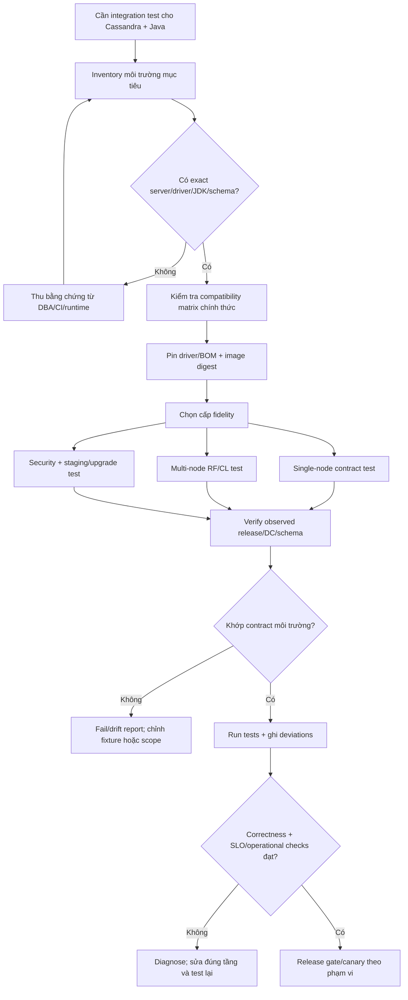

# Chọn phiên bản Cassandra, driver và cấu hình giống môi trường mục tiêu

> **Chương:** Kiểm thử tích hợp  
> **Phạm vi:** Apache Cassandra — cơ sở dữ liệu phân tán *wide-column* — và ứng dụng Java dùng **Cassandra Java Driver 4.x**, Spring Boot/Spring Data Cassandra khi phù hợp, CQL, replication, consistency level, compaction và repair.
>
> **Mục tiêu học tập:** Chọn phiên bản server, driver, JDK và thư viện tích hợp có bằng chứng tương thích; cố định Docker image/dependencies; cấu hình test gần production ở những điểm ảnh hưởng tính đúng đắn; phân biệt kiểm thử một node, nhiều node và staging; xây test bằng Testcontainers; ghi nhận phiên bản/protocol/schema đang chạy; và lập ma trận kiểm tra tránh tình trạng **“CI xanh nhưng production lỗi”**.

## 1. Vấn đề mở đầu: bài test chạy tốt trên một node nhưng ứng dụng lỗi ở production

Một nhóm phát triển dịch vụ Java lưu sự kiện trong Cassandra. Trên máy lập trình viên:

```text
Docker image:       cassandra:latest
Container nodes:    1
Keyspace RF:        1
Consistency:        LOCAL_ONE
Java Driver:        4.x tự lấy version từ dependency resolution
Authentication:     không bật
TLS:                không bật
Schema:             tự tạo khi test chạy
```

Production lại có:

```text
Cassandra:          release/patch được vận hành cố định
Datacenters:        dc1 + dc2
Keyspace RF:        3 ở mỗi DC
Consistency:        LOCAL_QUORUM
Java Driver/JDK:    bản đang được deploy theo BOM công ty
Authentication:     role riêng, có phân quyền
TLS:                bắt buộc; kiểm tra CA + hostname
Schema:             migration do vận hành kiểm soát
Tombstones/TTL:     dữ liệu thật có churn và compaction
```

Test có thể PASS nhưng bỏ sót hàng loạt vấn đề:

- Driver không tương thích với server/protocol của môi trường đích.
- Contact point đúng nhưng **local datacenter** cấu hình sai.
- `LOCAL_QUORUM` không thể thử đúng khi test chỉ có RF=1.
- Role ứng dụng thiếu `SELECT` hoặc `MODIFY` trên bảng thật.
- Truststore/CA/SAN không phù hợp với những node được driver khám phá.
- Test tự sinh bảng khác schema đã được triển khai.
- Truy vấn chạy nhanh trên vài row test nhưng chậm với **partition lớn, TTL và tombstone**.
- Một node không thể tái hiện quorum, bootstrap, repair, node loss hay độ trễ liên DC.

**Bài học chính:** kiểm thử tích hợp có giá trị khi **biết rõ mình đang mô phỏng điều gì** và có bằng chứng rằng những thứ quan trọng tương đồng với môi trường mục tiêu. Không nhất thiết mọi test đều cần một cluster production thu nhỏ, nhưng không được dùng test một node để tuyên bố đã kiểm chứng hành vi đa replica.

## 2. “Giống production” nghĩa là gì?

Không thể hoặc không nên sao chép mọi thuộc tính của production vào CI. Ta cần ưu tiên **các trục tương đồng ảnh hưởng kết luận test**.

| Trục tương đồng | Ví dụ | Khi lệch có thể xảy ra |
| --- | --- | --- |
| **Server release** | Cassandra major/minor/patch | Thay đổi CQL, metadata, driver compatibility, tính năng |
| **Java Driver artifact** | Group/artifact/version thực ở runtime | Khác protocol negotiation, retry/paging/codec |
| **JDK và framework** | Java 17, Spring Boot/Spring Data phù hợp | Startup/mapping/serializer không giống production |
| **CQL schema** | Keyspace, bảng, kiểu, PK, clustering | Truy vấn test chạy trên schema sai |
| **RF và datacenter** | `NetworkTopologyStrategy`, `dc1:3` | Không kiểm chứng quorum và topology |
| **Consistency level** | `LOCAL_QUORUM`, serial CL nếu LWT | Test bỏ sót lỗi thiếu replica hoặc semantics khác |
| **Security** | TLS, CA, hostname verification, role/RBAC | Kết nối test được nhưng production bị từ chối |
| **Timeout/retry/paging** | Driver execution profile | Test bỏ qua timeout, retry storm, extra attempts |
| **Storage behavior** | TTL, tombstone, compaction, disk | Test xanh nhưng p99/retention sai |
| **Topology/availability** | Nhiều node, rack, DC, failover | Không biết khi mất một replica điều gì xảy ra |
| **Data scale/distribution** | Partition sizes, skew, hot keys | Tuning không đại diện |
| **Vận hành/migrations** | Schema agreement, rolling upgrade | Khác môi trường thật lúc deploy |

**Mục tiêu không phải 100% giống production ở mọi test.** Mục tiêu là mô tả *fidelity* của từng cấp test, bảo đảm rằng **không có kết luận vượt phạm vi thử nghiệm**.

## 3. Phân tầng kiểm thử: đừng dùng một container để chứng minh mọi thứ

| Tầng | Môi trường | Phù hợp để kiểm chứng | Không nên tuyên bố |
| --- | --- | --- | --- |
| **Unit** | Mock/stub Java | Validation, mapping logic, idempotency key | Tương thích với Cassandra thật |
| **Single-node integration** | Một Cassandra container, schema cố định | CQL syntax, codec, table mapping, prepared/bind, basic TTL | Quorum/failover/replica repair đã được thử |
| **Multi-node integration** | Nhiều Cassandra nodes trong môi trường kiểm soát | RF, CL, node down, replica consistency, some failure modes | Hoàn toàn như nhiều DC/production traffic |
| **Security integration** | Test env bật TLS/auth/RBAC | Truststore, role permission, certificate validation | Đủ an toàn nếu bỏ qua SAN/rotation |
| **Upgrade compatibility** | Ma trận server/driver/versions | Khởi động, negotiate protocol, schema, query regression | Mọi bản nâng cấp đều không downtime |
| **Staging gần production** | Topology/config/data shape đại diện | Canary migration, rolling upgrade, tải, vận hành | Bằng chứng tuyệt đối cho mọi kịch bản production |
| **Production canary** | Traffic/role/schema thật, phạm vi hạn chế | Xác minh cuối trước rollout rộng | Thay thế unit/integration/security tests |

Có thể tổ chức test suites thành:

```text
pull request
  -> unit
  -> single-node Cassandra integration
  -> API/mapper contract

merge / nightly
  -> multi-node + consistency cases
  -> auth/TLS/RBAC cases
  -> upgrade compatibility matrix

release candidate
  -> staging có schema, RF/DC, CL tương đương
  -> migration/recovery/failover drills
  -> load test + canary + rollback
```

Tầng test càng nặng thì thường càng tốn thời gian và tài nguyên. Việc chạy mỗi PR một cluster nhiều DC có thể không cần thiết; nhưng các tính năng có liên quan RF/DC phải được thử ở cấp thích hợp **trước khi phát hành**.

## 4. Kiểm kê môi trường mục tiêu trước khi chọn container

Không bắt đầu bằng câu hỏi “lấy Docker tag nào cho nhanh?”. Hãy bắt đầu bằng **phiếu inventory** được xác nhận từ hệ thống đang chạy.

Ví dụ mẫu thông tin cần thu (giá trị **minh họa**, không mặc nhiên là topology của bạn):

```yaml
target:
  cassandra:
    distribution: apache-cassandra
    release: "<exact-major.minor.patch>"
    image-digest-or-package-build: "<immutable-reference>"
    cluster-name: "orders-prod"
    datacenters:
      dc1:
        rf: 3
      dc2:
        rf: 3
    keyspace: "orders"
    replication-strategy: "NetworkTopologyStrategy"
  application:
    jdk: "<exact-runtime-build>"
    spring-boot: "<resolved-version-or-none>"
    spring-data-cassandra: "<resolved-version-or-none>"
    java-driver: "<group:artifact:exact-version>"
    local-datacenter: "dc1"
    default-consistency: "LOCAL_QUORUM"
  security:
    native-tls-required: true
    server-hostname-verification-required: true
    authentication-mechanism: "<actual-authenticator>"
    authorization-mechanism: "<actual-authorizer>"
  migration:
    schema-revision: "<migration-id-or-hash>"
```

Đây là **mẫu manifest**, không phải định dạng cấu hình mặc định của Cassandra hay Spring Boot. Nhóm dự án có thể lưu cùng CI artefacts và release metadata để đối chiếu; không ghi secrets.

### Lấy thông tin từ đâu?

- SRE/DBA cung cấp topology, release inventory và chính sách nâng cấp đã được duyệt.
- Package manager/container registry cung cấp **build/image digest**.
- CI/build tool cung cấp **resolved dependency tree**.
- Ứng dụng chạy thật cung cấp JDK/runtime config.
- Cassandra `system.local`/`system.peers_v2`, `nodetool` và schema metadata cung cấp bằng chứng từ server.
- Configuration/secret management cung cấp **tên chính sách** bảo mật, không xuất mật khẩu/private keys vào report.

Cần ghi **ngày quan sát**, cluster, DC và ai phê duyệt vì môi trường mục tiêu có thể thay đổi giữa lúc viết test và lúc deploy.

## 5. Có nhiều loại “phiên bản Cassandra” cần phân biệt

Một câu “Cassandra version 4” chưa đủ.

| Thành phần | Ví dụ cách thể hiện | Ý nghĩa |
| --- | --- | --- |
| **Server release** | `4.1.x`, `5.x` | Mã server đang chạy, các tính năng/hành vi |
| **Distribution/build** | Apache tự quản, distribution tương thích | Có thể khác patch, option, support policy |
| **CQL version** | Metadata CQL protocol/language | Không đồng nghĩa server release |
| **Native protocol** | Protocol được server công bố và driver thương lượng | Ảnh hưởng wire compatibility và paging/feature support |
| **cqlsh version** | Phiên bản client `cqlsh` | Không phải Java Driver version |
| **Java Driver version** | `4.x.y` thuộc một artifact cụ thể | API/config, bug fixes và compatibility |
| **JDK runtime** | Java 17/21... theo bản phân phối | Ảnh hưởng TLS/codec/compatibility |
| **Spring Data/Boot version** | Version từ BOM | Mapping/repository/autoconfiguration |
| **Container image digest** | `sha256:...` | Xác định đúng bytes server image |

**Không suy luận:** `cqlsh --version` có kết quả X ⇒ Java Driver là X, hoặc `cql_version` là release server.

### Kiểm tra metadata server bằng CQL

Với quyền phù hợp, trên một kết nối đến node kiểm tra:

```cql
SELECT release_version,
       cql_version,
       native_protocol_version,
       data_center,
       cluster_name
FROM system.local;
```

Các cột tồn tại/được hỗ trợ có thể khác theo server release/distribution. Nếu một cột không tồn tại, kiểm tra schema `system.local` thực tế, không tự chèn giá trị “dự kiến” vào report.

Với Cassandra release có `system.peers_v2`:

```cql
SELECT peer, data_center, rack, release_version
FROM system.peers_v2;
```

Ở các phiên bản cũ hơn, metadata peer có thể nằm ở bảng khác. Không dùng cùng một query peer cho mọi release nếu không có kiểm chứng.

Dùng node tool để đối chiếu:

```bash
nodetool version
nodetool status
```

Một câu SELECT từ `system.local` chỉ nói về node phục vụ truy vấn đó; muốn khẳng định cả cluster đã lên version mới, cần **inventory từng node**, không chỉ thấy một dòng.

## 6. Tương thích server–driver: đừng đoán bằng major version

Một Java Driver version phải tương thích với ít nhất:

1. **Server Cassandra release**/distribution được vận hành.
2. **Native protocol** mà driver và server thương lượng.
3. **JDK runtime** mà project chạy.
4. **Framework/BOM** khi dùng Spring Boot/Spring Data.
5. CQL features mà service thật sự sử dụng: data types, UDT, LWT, paging, SAI, vector search, TLS/auth...
6. Cơ chế upgrade/mixed-version mà production có thể đi qua.

Không có quy tắc kiểu **server 5 ⇒ bắt buộc driver 5** hoặc **driver 4 ⇒ chỉ server 4**. Tương thích phải được xác nhận bằng **tài liệu hỗ trợ của artifact release cụ thể và bài test thực**.

### Ma trận ra quyết định

| Môi trường | Cassandra server | Driver/Framework | Điều cần chứng minh |
| --- | --- | --- | --- |
| Production hiện tại | `TARGET_CURRENT` | `APP_RUNTIME_CURRENT` | Baseline test PASS |
| Production sau nâng cấp | `TARGET_NEXT` | `APP_RUNTIME_CURRENT` | Driver cũ còn hỗ trợ? Feature/protocol có đổi? |
| Ứng dụng sau nâng driver | `TARGET_CURRENT` | `APP_RUNTIME_NEXT` | API, config, codec, TLS, retry behavior |
| Cả hai cùng đổi | `TARGET_NEXT` | `APP_RUNTIME_NEXT` | Dữ liệu + schema + mapping + migration |
| Mixed-version rolling window | Tập release được phép trộn | Driver phát hành | Kết nối/metadata/CL trong cửa sổ nâng cấp |
| Managed service | Version/compat level của provider | Driver theo provider | Endpoint/auth/bundle/TLS và CQL features |

**Không điền “PASS” chỉ vì tổ hợp biên dịch được.** Test phải kết nối thật, chuẩn bị/execute CQL, paging, auth, codec và kiểm tra ít nhất những operation phục vụ nghiệp vụ.

### Tương thích không có nghĩa là mọi feature đều dùng được

Một driver có thể kết nối được server cũ nhưng **một CQL feature mới** chưa có ở server đó, hoặc ngược lại driver/runtime chưa hỗ trợ data type mới. Test “SELECT 1 row” là smoke test; phải có **feature contract tests** tương ứng truy vấn thật.

## 7. Pin Java dependency theo phiên bản thật đang được triển khai

Ví dụ Maven dependency cho một dòng Cassandra Java Driver 4.x:

```xml
<!-- Phiên bản dùng giá trị do BOM hoặc dependencyManagement đã duyệt.
     Đừng dán version placeholder vào project để build ngay. -->
<dependency>
  <groupId>com.datastax.oss</groupId>
  <artifactId>java-driver-core</artifactId>
  <version>APPROVED_DRIVER_VERSION</version>
</dependency>
```

`APPROVED_DRIVER_VERSION` là ký hiệu văn bản, **không phải một Maven version hợp lệ đã xác minh**. Các distribution của driver 4.x có thể dùng group/artifact khác theo dòng phát hành. Dùng tọa độ do **project và hỗ trợ vendor** đã chọn, không tự đổi namespace để phù hợp một blog.

### Với Spring Boot

Nếu project dùng `spring-boot-starter-data-cassandra`, Spring Boot BOM thường quản lý những dependency liên quan:

```xml
<!-- Tọa độ starter phổ biến; version được điều phối bởi
     Spring Boot dependency management của dự án. -->
<dependency>
  <groupId>org.springframework.boot</groupId>
  <artifactId>spring-boot-starter-data-cassandra</artifactId>
</dependency>
```

Không tự kéo một driver patch bất kỳ mà bỏ qua compatibility của Spring Data Cassandra với driver đó. Nếu cần override vì security advisory/bug fix, phải **xác minh ma trận**, giải quyết dependency tree và chạy regression tests.

### Xem resolved dependencies, không chỉ file khai báo

```bash
mvn dependency:tree
```

Hoặc:

```bash
./gradlew dependencyInsight \
  --dependency java-driver-core \
  --configuration runtimeClasspath
```

Các lệnh minh họa kiểm tra project **khi làm việc thật**. Trong quy trình viết bài này không chạy build hoặc truy cập file dự án khác.

Ghi lại:

- Group/artifact/version thực của driver.
- Spring Data Cassandra/Boot runtime versions.
- JDK version và vendor/distribution.
- Có nhiều driver versions bị kéo trùng không?
- Test runtime và production runtime có dùng cùng dependency graph không?
- Container image ứng dụng có thực sự chứa artifact mới không?

Một `pom.xml` khai version X không chứng minh production đang chạy X nếu artifact/CI image cũ hoặc transitive resolution khác.

## 8. Pin Docker image: tag nổi không đủ

Không nên:

```yaml
# Không dùng để chứng minh reproducibility:
image: cassandra:latest
```

`latest` là một nhãn có thể thay đổi; một ngày khác build/pull có thể lấy server release khác, thay API/config và khiến lỗi khó tái hiện.

Ngay cả tag dạng:

```text
cassandra:4.1
```

cũng có thể trỏ tới patch/build khác theo thời gian. Muốn chốt đúng image cần **immutable digest** nếu registry và quy trình hỗ trợ:

```text
cassandra:4.1.x@sha256:<verified-immutable-digest>
```

Đây là **cú pháp minh họa**; `4.1.x` và digest placeholder không sử dụng trực tiếp. Giá trị thật phải lấy từ registry/build metadata đã được xác minh, không tự bịa.

### Những mục cần pin

- Server **major/minor/patch** cụ thể.
- Container **digest** được CI pull.
- Architecture/platform nếu có nhiều image variants.
- JDK build và driver runtime artifact.
- Testcontainers/Spring Boot/Spring Data versions.
- File init schema và migration revision.

**Pin không đồng nghĩa không cập nhật.** Cần quy trình nâng patch có chủ đích, cập nhật ma trận và chạy lại tests trước khi đổi lockfiles/digest.

## 9. Testcontainers là gì và nó xác nhận được điều gì?

Testcontainers giúp test Java khởi động Cassandra trong Docker một cách tự động, chờ dịch vụ sẵn sàng và map port vào môi trường test.

Một thử nghiệm container có lợi ích:

- Dùng **Cassandra server thật**, không phải mock CQL parser.
- Kiểm tra driver kết nối và native protocol negotiation.
- Kiểm tra schema, prepared statements, codecs và mapping.
- Chạy được trong CI nếu Docker/runtime phù hợp.
- Dễ cô lập dữ liệu test và tái tạo lỗi theo image digest.

Nhưng một `CassandraContainer` đơn lẻ **không phải một cluster ba replica**. Nó thường chỉ đủ cho mức *single-node integration*. Phải ghi rõ test này **không chứng minh**:

- RF=3/`LOCAL_QUORUM` khi một replica bị mất.
- Cross-DC replication và coordinator locality.
- Repair, bootstrap, decommission hoặc topology changes.
- Thông lượng và tail latency trên partition production.
- TLS/role giống production nếu container để mặc định không bảo mật.

## 10. Chuẩn bị dependency Testcontainers và JUnit

Ví dụ trong một dòng Testcontainers Java có module Cassandra và JUnit Jupiter; **tọa độ/package có thể thay đổi giữa major releases**, nên phần code sau nêu rõ theo **API Testcontainers 1.x**:

```xml
<!-- Các version được quản lý bằng Testcontainers BOM của dự án.
     Xác minh artifact và package với release thực tế. -->
<dependency>
  <groupId>org.testcontainers</groupId>
  <artifactId>cassandra</artifactId>
  <scope>test</scope>
</dependency>

<dependency>
  <groupId>org.testcontainers</groupId>
  <artifactId>junit-jupiter</artifactId>
  <scope>test</scope>
</dependency>
```

Với Testcontainers major mới, API package/module name có thể đổi. **Không copy code ví dụ 1.x vào bản khác rồi kết luận “Cassandra không tương thích” nếu compiler báo thiếu class**; đó có thể là khác biệt thư viện test.

Đừng đổi Java Driver production chỉ để khắc phục một thay đổi import của Testcontainers.

### Docker/CI là điều kiện riêng

CI runner phải có container runtime được phép sử dụng, đủ memory/disk, network policy hợp lệ và quota phù hợp. Cần phân biệt:

- Docker chưa chạy.
- Image pull bị chặn bởi registry/network.
- Container OOM/chưa sẵn sàng.
- Cassandra khởi động được nhưng native transport chưa ready.
- Test CQL thật sự thất bại.

Không gộp cả năm trường hợp thành “Testcontainers flake”.

## 11. Ví dụ CQL fixture: keyspace và bảng trong container

Tạo một script fixture trong test resources của **project mẫu** (không phải file cần viết trong bước worker này):

```text
src/test/resources/cql/it-schema.cql
```

Nội dung ví dụ:

```cql
-- Chỉ chạy ở test cluster một node, DC xác định trước là datacenter1.
CREATE KEYSPACE IF NOT EXISTS it_lab
WITH replication = {
  'class': 'NetworkTopologyStrategy',
  'datacenter1': 1
}
AND durable_writes = true;

CREATE TABLE IF NOT EXISTS it_lab.events_by_customer_day (
    tenant_id text,
    customer_id uuid,
    day_bucket date,
    event_time timestamp,
    event_id uuid,
    event_type text,
    payload text,
    PRIMARY KEY ((tenant_id, customer_id, day_bucket),
                 event_time, event_id)
) WITH CLUSTERING ORDER BY (
    event_time DESC, event_id ASC
);
```

Điểm đáng chú ý:

- `RF=1` đúng **chỉ cho fixture một node**; không suy ra production nên RF=1.
- `datacenter1` là **giả định cần kiểm tra từ container image thực**. Nếu DC khác, script và Java config phải cùng sửa; không tự đặt string mà không xác nhận.
- Bảng thiết kế theo truy vấn `tenant + customer + day`, không phải một bảng được tạo cho vừa ORM.
- `CREATE TABLE IF NOT EXISTS` có thể che việc schema tồn tại nhưng khác định nghĩa. Test cần **đối chiếu metadata thật** sau setup.
- Dùng schema/migration version được kiểm soát; fixture chỉ là một cách seed test, không phải cơ chế upgrade production.

## 12. Testcontainers 1.x: ví dụ Java tích hợp server thật

Ví dụ bên dưới dùng **Java 17**, JUnit 5, Testcontainers Cassandra module thuộc dòng **1.x** và Cassandra Java Driver 4.x theo artifact đang được project hỗ trợ.

**Trước khi chạy**, CI phải đặt system property `it.cassandra.image` bằng **image reference đã duyệt** (được pin version/digest). Không tự chọn `latest` trong code.

```java
import static org.junit.jupiter.api.Assertions.*;

import java.net.InetSocketAddress;
import java.time.Instant;
import java.time.LocalDate;
import java.util.UUID;

import org.junit.jupiter.api.AfterAll;
import org.junit.jupiter.api.BeforeAll;
import org.junit.jupiter.api.Test;
import org.testcontainers.containers.CassandraContainer;
import org.testcontainers.junit.jupiter.Container;
import org.testcontainers.junit.jupiter.Testcontainers;
import org.testcontainers.utility.DockerImageName;

import com.datastax.oss.driver.api.core.CqlIdentifier;
import com.datastax.oss.driver.api.core.CqlSession;
import com.datastax.oss.driver.api.core.DefaultConsistencyLevel;
import com.datastax.oss.driver.api.core.cql.PreparedStatement;
import com.datastax.oss.driver.api.core.cql.Row;

@Testcontainers
class CassandraDriverContractIT {

    private static final String IMAGE =
        System.getProperty("it.cassandra.image");

    @Container
    static final CassandraContainer<?> cassandra =
        new CassandraContainer<>(
            DockerImageName.parse(requireImage(IMAGE))
        ).withInitScript("cql/it-schema.cql");

    private static CqlSession session;

    private static String requireImage(String image) {
        if (image == null || image.isBlank()) {
            throw new IllegalStateException(
                "Set -Dit.cassandra.image to an approved, pinned image");
        }
        return image;
    }

    @BeforeAll
    static void connect() {
        // datacenter1 phải đúng với system.local của image thực.
        session = CqlSession.builder()
            .addContactPoint(new InetSocketAddress(
                cassandra.getHost(),
                cassandra.getMappedPort(9042)))
            .withLocalDatacenter("datacenter1")
            .withKeyspace(CqlIdentifier.fromCql("it_lab"))
            .build();
    }

    @AfterAll
    static void closeSession() {
        if (session != null) {
            session.close();
        }
    }

    @Test
    void readWriteUsingRealCqlAndDriver() {
        UUID customer = UUID.randomUUID();
        UUID event = UUID.randomUUID();
        LocalDate day = LocalDate.of(2026, 11, 21);
        Instant timestamp = Instant.parse(
            "2026-11-21T09:30:00Z");

        PreparedStatement insert = session.prepare(
            "INSERT INTO events_by_customer_day " +
            "(tenant_id, customer_id, day_bucket, " +
            "event_time, event_id, event_type, payload) " +
            "VALUES (?, ?, ?, ?, ?, ?, ?)"
        );

        session.execute(
            insert.bind(
                "tenant-test",
                customer,
                day,
                timestamp,
                event,
                "CREATED",
                "payload-v1"
            ).setConsistencyLevel(
                DefaultConsistencyLevel.LOCAL_ONE)
        );

        PreparedStatement select = session.prepare(
            "SELECT event_id, event_type, payload " +
            "FROM events_by_customer_day " +
            "WHERE tenant_id = ? " +
            "AND customer_id = ? AND day_bucket = ?"
        );

        Row row = session.execute(
            select.bind("tenant-test", customer, day)
                .setConsistencyLevel(
                    DefaultConsistencyLevel.LOCAL_ONE)
        ).one();

        assertNotNull(row);
        assertEquals(event, row.getUuid("event_id"));
        assertEquals("CREATED",
                     row.getString("event_type"));
        assertEquals("payload-v1",
                     row.getString("payload"));
    }
}
```

### Các giới hạn cần nêu rõ trước khi copy

1. `CassandraContainer`/`@Testcontainers` có API và import cụ thể của **Testcontainers 1.x**; major mới có thể khác.
2. Mã trên **không bật TLS/auth**. Nó chỉ xác nhận driver/schema/codec cơ bản của server image.
3. `LOCAL_ONE` được chọn vì fixture một node/RF=1; **không phải consistency level khuyến nghị cho production**.
4. Mặc định `datacenter1` phải được kiểm tra từ `system.local` của image đã pin.
5. Test chỉ dùng khóa ngẫu nhiên và một partition; không tái hiện tải nặng hoặc quorum.
6. `withInitScript` phụ thuộc khả năng init CQL của Testcontainers release được chọn.
7. Mã test tạo một session cho cả class và đóng khi hoàn tất; không tạo `CqlSession` cho mỗi statement.
8. Nên có bước xác nhận server release/image digest trong test report như phần sau.

**Không tuyên bố bài học đã chạy/compile snippet trên một project thực tế.** Khi tích hợp, team phải resolve dependencies đúng và chạy trong CI được cấu hình.

## 13. Kiểm tra phiên bản thực của container ngay trong test

Việc CI ghi “dùng image X” là tốt, nhưng **đọc lại server release** giúp phát hiện sai image hoặc thay đổi ngầm.

Ví dụ JUnit method:

```java
@Test
void serverVersionAndDcAreExpected() {
    Row local = session.execute(
        "SELECT release_version, data_center, " +
        "cluster_name FROM system.local"
    ).one();

    assertNotNull(local);

    String release = local.getString("release_version");
    String dc = local.getString("data_center");
    String cluster = local.getString("cluster_name");

    assertEquals("datacenter1", dc);
    assertNotNull(release);
    assertFalse(release.isBlank());
    assertNotNull(cluster);

    // CI nên còn so release với manifest được approve.
    // Ví dụ tránh hardcode một patch tự đoán ở bài học.
}
```

Đoạn trên được hiểu là **method chèn vào test class** trước đó, không phải chương trình độc lập. Test thực nên so `release` với **expected release từ CI manifest** và fail nếu khác, chứ không chỉ `assertNotNull`.

### Không chỉ check version string prefix

Một điều kiện `release.startsWith("4.")` có thể cho qua bản 4.0 thay vì 4.1, trong khi test đang nhắm đúng một patch. Nên khai báo expected major/minor/patch/build hoặc danh sách chấp nhận rõ ràng cho mỗi job.

Với môi trường multi-node, lặp inventory qua các node bằng kênh quản trị/được phép, không xem một `system.local` là bằng chứng toàn cluster.

## 14. Ghi runtime compatibility manifest vào test report

Một bản ghi tối thiểu, không chứa secret:

```json
{
  "suite": "cassandra-driver-contract",
  "serverRelease": "<observed-release>",
  "serverImageDigest": "<resolved-image-digest>",
  "javaRuntime": "<observed-jdk>",
  "javaDriverArtifact": "<resolved-driver-version>",
  "springDataCassandra": "<resolved-version-or-none>",
  "localDatacenter": "datacenter1",
  "keyspace": "it_lab",
  "rfInLocalDc": 1,
  "consistency": "LOCAL_ONE",
  "tlsEnabled": false,
  "authEnabled": false,
  "schemaRevision": "<fixture-hash>",
  "testProfile": "single-node-contract"
}
```

Tại sao phải ghi `tlsEnabled=false`? Vì kết quả PASS chỉ chứng minh kịch bản **không TLS**; không để người đọc hiểu nhầm rằng cơ chế bảo mật của production đã được kiểm tra.

### Hai lớp kiểm chứng phiên bản

- **Declarative:** CI manifest, lockfile, Docker digest và Gradle/Maven resolution.
- **Observed:** Server version từ `system.local`, JDK runtime thực, effective driver artifact và config khi test chạy.

Nếu khai báo và quan sát khác nhau, test phải **fail hoặc ít nhất bị đánh dấu drift**, không tiếp tục phát hành kết luận “đúng environment”.

## 15. Spring Boot: dùng dynamic properties thay vì hardcode port

Khi dùng Spring Boot/Spring Data Cassandra, test không nên giả định Docker container được map `9042:9042` vào host. Docker có thể map port ngẫu nhiên.

Ví dụ Spring Boot test với **Testcontainers 1.x**:

```java
import org.junit.jupiter.api.Test;
import org.springframework.boot.test.context.SpringBootTest;
import org.springframework.test.context.DynamicPropertyRegistry;
import org.springframework.test.context.DynamicPropertySource;
import org.testcontainers.containers.CassandraContainer;
import org.testcontainers.junit.jupiter.Container;
import org.testcontainers.junit.jupiter.Testcontainers;
import org.testcontainers.utility.DockerImageName;

@Testcontainers
@SpringBootTest
class SpringDataCassandraIT {

    @Container
    static final CassandraContainer<?> cassandra =
        new CassandraContainer<>(
            DockerImageName.parse(
                System.getProperty("it.cassandra.image")
            )
        ).withInitScript("cql/it-schema.cql");

    @DynamicPropertySource
    static void cassandraProperties(
            DynamicPropertyRegistry registry) {

        registry.add(
            "spring.cassandra.contact-points",
            cassandra::getHost);
        registry.add(
            "spring.cassandra.port",
            () -> cassandra.getMappedPort(9042));
        registry.add(
            "spring.cassandra.local-datacenter",
            () -> "datacenter1");
        registry.add(
            "spring.cassandra.keyspace-name",
            () -> "it_lab");
        registry.add(
            "spring.cassandra.schema-action",
            () -> "none");
    }

    @Test
    void springContextStartsAgainstRealContainer() {
        // Thêm repository round-trip/schema tests thật.
    }
}
```

Ví dụ dùng prefix **`spring.cassandra`** của một dòng Spring Boot mới; **release Spring Boot cũ có thể dùng prefix khác**. Kiểm tra metadata configuration và resolved Spring Data version của project. Không coi test khởi động context thành công là đủ: phải có repository CQL round-trip và mapping/schema assertions.

### Vì sao `schema-action: none` quan trọng?

Nếu test để Spring Data tự tạo bảng theo entity trong khi production dùng migration DDL riêng, một mapping sai vẫn có thể PASS vì test và app **đều tạo cùng schema sai**.

Nên ưu tiên:

- Schema fixture được version-control từ contract/migration.
- App chạy không sửa schema tự phát.
- Repository tests so với schema đã tồn tại.
- Tests xác nhận tên cột, primary key, datatype và query shape.

Với test chuyên về auto-schema feature, có thể bật schema action trong một suite riêng, nhưng không lấy nó để xác nhận migration production.

## 16. Một node không thể chứng minh `LOCAL_QUORUM` của RF=3

Cassandra consistency level phải được hiểu theo **replication factor và datacenter thực**.

Với `NetworkTopologyStrategy` RF=3 trong `dc1`:

```text
LOCAL_QUORUM = floor(3/2) + 1 = 2 replica local
```

Với RF=1:

```text
LOCAL_QUORUM = floor(1/2) + 1 = 1 replica local
```

Nhãn CQL `LOCAL_QUORUM` có thể giống nhau nhưng **số replica cần chờ khác hẳn**.

### Ma trận môi trường và kết luận

| Setup | RF local | CL | Kiểm tra được |
| --- | ---: | --- | --- |
| Một node | 1 | `LOCAL_ONE` | CQL/codec/basic read/write |
| Một node | 1 | `LOCAL_QUORUM` | CL hợp lệ nhưng chỉ một replica; **không kiểm chứng quorum 2/3** |
| Ba node cùng DC | 3 | `LOCAL_QUORUM` | Quorum 2/3, một số tình huống node down |
| Hai DC, mỗi DC ba node | 3 + 3 | `LOCAL_QUORUM` | Local coordinator/replication và hành vi mỗi DC |
| Hai DC | 3 + 3 | `EACH_QUORUM` cho write phù hợp | ACK quorum từng DC theo chính sách; chi phí WAN |

**Đừng đổi consistency level test về `LOCAL_ONE` rồi kết luận “code chạy như production”** nếu ứng dụng thật dùng `LOCAL_QUORUM`. Ghi rõ mức độ mô phỏng và bổ sung multi-node test.

### Thử failure mode có kiểm soát

Với ba node RF=3 và một node down, `LOCAL_QUORUM` có thể tiếp tục thành công nếu **hai replica local** đủ khả dụng và xử lý đúng, nhưng thực tế còn phụ thuộc topology, latency và loại request. Đây là kịch bản phù hợp cho multi-node integration hoặc staging, không phải test một container.

## 17. Local datacenter phải khớp với topology thực

Java Driver 4.x cần được cấu hình local datacenter đúng theo môi trường.

Ví dụ:

```java
CqlSession session = CqlSession.builder()
    .addContactPoint(new InetSocketAddress(
        "cassandra-1.internal", 9042))
    .withLocalDatacenter("dc1")
    .build();
```

Đây là ví dụ **ý tưởng cấu hình**. Production cần TLS/auth, keyspace, timeouts và contact points được duyệt.

Nếu test đặt `datacenter1` nhưng production dùng `dc1`, cần bảo đảm cấu hình theo environment không bị hardcode vào application artifact.

### Những kiểm chứng cần có

1. `system.local.data_center` trên node đang kết nối.
2. RF theo DC trong keyspace.
3. Driver effective local DC.
4. Coordinator được chọn trong execution info.
5. Endpoint DNS/IP có thể reach từ test app.
6. TLS certificate SAN tương ứng endpoint thật.
7. Multi-DC failure routing và consistency nếu đây là yêu cầu chức năng.

**Tên DC trong code không tự sửa keyspace replication.** `withLocalDatacenter("dc1")` là routing policy của driver, trong khi `'dc1': 3` trong keyspace là replica placement.

## 18. Giữ cấu hình CQL/query giống production

Một bài test có thể dùng đúng driver/server version mà vẫn lệch hành vi nếu **CQL khác production**.

Ví dụ production dùng:

```cql
SELECT event_time, event_id, event_type
FROM events_by_customer_day
WHERE tenant_id = ?
  AND customer_id = ?
  AND day_bucket = ?
LIMIT 50;
```

Nhưng test chỉ chạy:

```cql
SELECT * FROM events_by_customer_day;
```

Test này không xác nhận:

- Partition key được bind đầy đủ.
- Codec cho `date`, `timestamp` và `uuid`.
- Ordering và clustering condition.
- Page size và LIMIT behavior.
- Consistency policy của statement.
- Metadata projection và row mapper.

**Test đúng câu CQL thực, cùng bind markers/data types và query shape.** Nếu app có nhiều câu truy vấn phục vụ nhiều bảng denormalized, mỗi query contract quan trọng nên có regression test.

### Mỗi test case phải biết partition key

Cassandra không có join/foreign key tổng quát như RDBMS. Bảng thường được thiết kế theo truy vấn. Nếu test dùng dữ liệu quá nhỏ rồi cho `ALLOW FILTERING` chạy được, nó không chứng minh query sẽ scale trên partition lớn ở production.

## 19. Schema drift: bảng có cùng tên nhưng khác cột

Giả sử fixture test có:

```cql
CREATE TABLE it_lab.events_by_customer_day (
    tenant_id text,
    customer_id uuid,
    day_bucket date,
    event_time timestamp,
    event_id uuid,
    event_type text,
    payload text,
    PRIMARY KEY ((tenant_id, customer_id, day_bucket),
                 event_time, event_id)
);
```

Production lại có `payload blob` hoặc clustering key khác. Repository có thể PASS trong CI nhưng lỗi codec/query ở production.

Kiểm tra schema metadata:

```cql
SELECT column_name, kind, position, type
FROM system_schema.columns
WHERE keyspace_name = 'it_lab'
  AND table_name = 'events_by_customer_day';
```

Trong target thật, thay keyspace/table theo inventory được duyệt. Kết quả cần được so với **schema contract canonical**, không chỉ in ra log.

### Schema hash/migration ID

Có thể tính fingerprint cho:

- Keyspace replication/durable writes.
- Table definitions và PK/clustering ordering.
- Column names/types, UDT definitions.
- Index/SAI definitions nếu dùng.
- Compaction/compression/TTL/gc_grace options quan trọng.
- Migration IDs.

Chú ý chuẩn hóa thứ tự/cú pháp trước khi hash, vì string DDL tương đương về ngữ nghĩa có thể khác formatting. **Hash chỉ là detector**, không thay việc hiểu khác biệt schema có ảnh hưởng hay không.

## 20. Dữ liệu mẫu phải phản ánh phân bố khóa, không chỉ vài row đẹp

Một test round-trip với một row chứng minh driver có thể đọc/ghi một case. Nó không đại diện cho:

- Hot customer có hàng trăm nghìn events/ngày.
- Partition khác kích thước nhau hàng nghìn lần.
- Giá trị null, collection lớn, blob lớn.
- TTL chồng chéo và tombstone nhiều.
- Cạnh tranh ghi theo cùng partition key.
- Request theo tenant có lưu lượng rất lệch.

### Các tập dữ liệu test nên có

| Dataset | Mục tiêu |
| --- | --- |
| **Tiny/contract** | Một vài row, kiểu dữ liệu cơ bản, mapping |
| **Boundary** | Null/UNSET, empty collections, Unicode, timestamp/UUID đặc biệt |
| **Query-shape** | Nhiều clustering rows trong một partition, paging |
| **Skew/hot-key** | Một số partition có tải lớn |
| **TTL/delete** | Hết hạn, tombstone và retention |
| **Concurrency** | Ghi cạnh tranh, read-after-write, LWT nếu dùng |
| **Large-but-bounded** | Gần phân bố production nhưng giới hạn an toàn |
| **Sensitive-data-safe** | Dữ liệu tổng hợp, không copy PII production |

**Đừng sao chép nguyên dữ liệu khách hàng vào CI** để “giống production”. Dùng dữ liệu tổng hợp bảo toàn **distribution** và những trường hợp biên liên quan.

### Một row lớn không giống nhiều row

Cassandra phân biệt số partition, số row trong partition, kích thước cell/collection và tombstone density. Load test phải báo cấu trúc dữ liệu, không chỉ “đã chèn một triệu row”.

## 21. TTL, tombstone và thời gian hệ thống

Một ứng dụng sử dụng TTL cần test **logic hết hạn thực**, nhưng bài test dựa `Thread.sleep(1000)` rất dễ flaky vì:

- Timer/test scheduler và độ trễ CI không ổn định.
- Server clocks và thời điểm áp dụng mutation khác nhau.
- Clock skew, GC, compaction và read path.
- Thời điểm polling đúng sát ranh giới TTL.

Ví dụ CQL cho lab:

```cql
UPDATE it_lab.events_by_customer_day
USING TTL 30
SET payload = 'temporary'
WHERE tenant_id = 'tenant-test'
  AND customer_id = 11111111-1111-4111-8111-111111111111
  AND day_bucket = '2026-11-21'
  AND event_time = '2026-11-21T10:00:00Z'
  AND event_id = aaaaaaaa-aaaa-4aaa-8aaa-aaaaaaaaaaaa;
```

Đây là mẫu để hiểu **cell TTL**; record/clustering key phải tồn tại đúng schema và các cột khác có thể còn sống sau khi `payload` hết hạn.

### Test tốt hơn

- Dùng TTL đủ dài để giảm race giữa ghi/đọc.
- Poll với timeout/deadline rõ và interval hợp lý.
- Kiểm tra cả khi dữ liệu **còn sống** lẫn khi đã hết hạn.
- Không dùng `TTL(col)=null` một mình để kết luận “đã xóa”, vì giá trị sống không TTL cũng cho null.
- Không chạy `nodetool compact`/hạ `gc_grace_seconds` bừa bãi để test tombstone ở production.
- Đánh giá repair/compaction semantics ở môi trường multi-node tương ứng.

**Cassandra TTL là logic server-side**, không thay việc bảo vệ/loại dữ liệu ở backup hoặc external index theo retention policy.

## 22. Compaction, tombstone và repair cần test ở cấp phù hợp

Dù test một node dùng cùng release server, nó thường không tái tạo những điều kiện phát sinh lỗi trên production:

- Nhiều SSTable tích lũy qua thời gian.
- Write-heavy workload và compaction backlog.
- Tombstone scan chậm vì deletes/TTL.
- Replica bỏ lỡ delete và nguy cơ zombie data nếu repair không đầy đủ.
- Disk pressure và GC pauses.
- Hinted handoff, repair/streaming và network partitions.

### Phân cấp kiểm thử các cơ chế này

| Mục tiêu | Single-node | Multi-node | Staging/load |
| --- | --- | --- | --- |
| CQL TTL hết hạn | Có | Có | Có |
| DELETE đọc ra null | Có | Có | Có |
| Quan sát tombstone/read cost | Hạn chế | Tốt hơn | Tốt nhất khi tải đại diện |
| Repair hội tụ replica | Không đủ | Phù hợp | Phù hợp |
| Failure khi node down | Không kiểm chứng quorum thật | Phù hợp | Phù hợp |
| Compaction pressure/p99 | Ít đại diện | Trung bình | Phù hợp nếu workload thực tế |
| Cross-DC replica lag | Không | Cần nhiều DC | Phù hợp |

Đừng tạo một suite quá nặng rồi khiến CI chạy hàng giờ với mọi PR. Thay vào đó, **đặt các bài test đúng tầng**, và yêu cầu chúng chạy trước release quan trọng.

## 23. Security fidelity: TLS, authentication và authorization

Một container Cassandra mặc định không bảo mật có thể kiểm tra phần CQL, nhưng **không chứng minh ứng dụng production sẽ kết nối được**.

Môi trường đích có thể bật:

```yaml
# Trích đoạn khái niệm, tên option/định dạng tùy server release:
authenticator: PasswordAuthenticator
authorizer: CassandraAuthorizer

client_encryption_options:
  enabled: true
  optional: false
  require_client_auth: false
```

Không copy trực tiếp snippet này vào `cassandra.yaml` production. Các khóa, server certificate và trình tự rollout phụ thuộc release và security policy.

### Security integration suite cần có

- Valid credentials ⇒ login thành công.
- Wrong credentials ⇒ login bị từ chối.
- Role `reader` ⇒ SELECT đúng table thành công.
- Role `reader` ⇒ MODIFY bị từ chối.
- CA/truststore đúng ⇒ TLS handshake và server verification thành công.
- CA sai ⇒ bị từ chối.
- Hostname/SAN sai ⇒ **phải bị từ chối**, không chỉ “SSLContext được tạo”.
- Nếu mTLS, client certificate/key hợp lệ mới được kết nối.
- Certificate rotation có overlap/rollback phù hợp.
- Driver khám phá các peer mà endpoint certificate đều hợp lệ.

**Mẫu `CqlSession.withSslContext(...)` chưa tự là bằng chứng hostname verification hoạt động**: cần kiểm tra SSL engine factory và negative test theo driver release. Không dùng trust-all certificate để làm test xanh.

### Secret phải được kiểm soát

Dùng secret manager hoặc test credentials chỉ tồn tại trong environment được cô lập, không commit password/keystore private key vào repository. CI logs không được in secrets hoặc raw DSN chứa mật khẩu.

## 24. Config của Spring Boot/test phải tương đồng ở chỗ ảnh hưởng behavior

Một số cấu hình cần đối chiếu giữa test và target:

| Cấu hình | Tại sao quan trọng |
| --- | --- |
| Contact points | Kết nối đúng cluster và đủ endpoint khám phá |
| Local datacenter | Coordinator locality, latency/CL |
| Keyspace | Chọn đúng namespace và RF |
| Request timeout | Timeout semantics, giữ in-flight |
| Retry policy | Attempt budget, idempotency và overload |
| Speculative execution | Phát thêm attempts cho request chậm |
| Page size | Paging và memory/network |
| Authentication | Role/login behavior |
| TLS/hostname verification | Bảo mật kết nối |
| Connection pool | Backpressure/throughput |
| Consistency level | Độ nhất quán/availability |
| Serial CL cho LWT | Paxos semantics |
| Schema action | App có tự tạo/đổi schema hay không |
| Converters/codecs | Tương thích kiểu CQL/Java |
| Logging/tracing | Overhead và bảo vệ dữ liệu |

### Không nhất thiết copy giá trị production verbatim

Một timeout 5 giây ở production có thể làm test CI rất chậm khi node lỗi. Có thể dùng test timeout ngắn hơn cho smoke tests, **nhưng** phải có suite xác minh những behavior liên quan tới timeout/retry với đúng policy budget.

Nếu thay `LOCAL_QUORUM` thành `LOCAL_ONE` vì test single-node, đó là **một sai khác cần công khai**, không được ẩn dưới tên profile “prod-like”.

## 25. Phân biệt configuration override với configuration đã có hiệu lực

Ứng dụng có thể khai:

```yaml
spring:
  cassandra:
    keyspace-name: it_lab
    local-datacenter: datacenter1
```

Nhưng environment variable, profile `application-test.yml`, system properties hoặc bean tự tạo có thể override.

Cần kiểm tra:

1. **Profile Spring Boot nào** được bật khi test.
2. Config loader/HOCON của Java Driver có đang sử dụng không.
3. `CqlSession` có được tạo bởi auto-config hay custom bean.
4. Effective local datacenter, keyspace và host connectivity.
5. Credentials/TLS được nạp từ secret source nào.
6. Runtime dependency graph có trùng với production hay không.

Một lỗi hay gặp: Testcontainers khởi động đúng container, nhưng `CqlSession` dùng custom bean lại đọc host từ môi trường, kết nối tới một **cluster khác**.

**Test phải có bằng chứng rằng query thật đi đến container đích**, không chỉ container đã được start.

## 26. Đừng để integration test vô tình chạm production

Đây là yêu cầu an toàn quan trọng.

### Những guardrails cần thiết

- Test config chỉ nhận endpoint **container** hoặc **dedicated staging**, không chấp nhận host production.
- Nếu dùng external staging, cần explicit allowlist cluster identity.
- Trong CI, không mount secret production nếu không có lý do và phê duyệt.
- Test dùng keyspace/test accounts riêng với quyền tối thiểu.
- Fail fast khi missing `it.cassandra.image` hoặc local DC/schema không như kỳ vọng.
- Kiểm tra cluster name, endpoint, release và schema revision **trước mutation destructive**.
- Dùng key ngẫu nhiên/test-run ID; không `TRUNCATE` bảng production.
- Tách test destroy/chaos commands khỏi smoke tests và yêu cầu phê duyệt riêng.

### Code guard minh họa

```java
private static void assertSafeTestTarget(
        String clusterName, String keyspace) {

    if (!"it_lab".equals(keyspace)) {
        throw new IllegalStateException(
            "Refusing destructive test outside it_lab");
    }

    if (clusterName != null &&
        clusterName.toLowerCase().contains("prod")) {
        throw new IllegalStateException(
            "Refusing to operate on a production-like cluster");
    }
}
```

Đây **chỉ là minh họa guard cấp code**; tên cluster có thể không chứa chuỗi `prod` dù vẫn là production. Không coi substring check là bảo vệ đủ. Cần network isolation, credentials không có quyền trên production, CI policy và explicit allowlist của môi trường test.

**Một test integration có DELETE/TRUNCATE không được tự ý chạy vào shared production cluster.**

## 27. Kiểm thử migration phải dùng schema trước và sau thay đổi

Một test chỉ tạo schema **mới nhất** rồi chạy ứng dụng mới không đủ để chứng minh production có thể nâng cấp từ schema đang tồn tại.

### Kịch bản đúng

```text
Schema v1 (đúng production hiện hành)
    |
    +--> Seed dữ liệu v1
    |
    v
Chạy migration v1 -> v2
    |
    +--> Xác minh schema agreement
    +--> Đọc lại dữ liệu cũ bằng app/query mới
    +--> Nếu cần, test old app và new app cùng tồn tại
    |
    v
Kiểm tra v2 contract
    |
    +--> Rollback plan / compatibility window
```

### Những câu hỏi cần test

- Migration có idempotent khi chạy lại không?
- Trong rolling deploy, app cũ và app mới có cùng đọc/ghi được không?
- Thay đổi UDT/column/index ảnh hưởng prepared statements thế nào?
- Có cần backfill dữ liệu để query mới hoạt động không?
- Có thay đổi partition key không? Nếu có, thường cần bảng mới và data migration chứ không chỉ `ALTER` tùy tiện.
- Schema agreement cần bao lâu? Có node chưa nhận schema mới khi test bắt đầu không?
- Rollback code có tương thích schema đã đổi không?

**Không cho rằng `CREATE TABLE IF NOT EXISTS` tự chứng minh migration đã chạy đủ.** Nó có thể bỏ qua bảng tồn tại với định nghĩa sai.

## 28. Kiểm tra upgrade/mixed-version khi release Cassandra thay đổi

Trong nâng cấp Cassandra rolling, các node có thể chạy **mixed versions trong cửa sổ được hỗ trợ**. Bài test integration đơn giản chạy toàn bộ nodes trên một version mới sẽ không kiểm chứng thời gian chuyển tiếp.

Một ma trận ví dụ:

| Pha | Node versions | Driver | Phép kiểm |
| --- | --- | --- | --- |
| Trước nâng | Tất cả `CURRENT` | `DRIVER_CURRENT` | Baseline CRUD, schema, paging |
| Canary node | Một số `NEXT`, còn lại `CURRENT` | `DRIVER_CURRENT` | Driver discovery, queries, CL, metadata |
| Tiếp tục rolling | Tỷ lệ mixed thay đổi | `DRIVER_CURRENT` | Latency/errors, repair/streaming constraints |
| Nâng hoàn tất | Tất cả `NEXT` | `DRIVER_CURRENT` | Regression của toàn bộ operations |
| Nâng ứng dụng | Tất cả `NEXT` | `DRIVER_NEXT` | New driver config/codec/retry behavior |

Đây là **sơ đồ kế hoạch**, không xác nhận một cặp `CURRENT`/`NEXT` bất kỳ được Cassandra hỗ trợ. Phải kiểm tra đường nâng cấp chính thức, feature flags và các giới hạn rollback/version của release cụ thể.

### Tại sao native protocol cũng quan trọng?

Driver và server phải thương lượng wire protocol phù hợp. Một tổ hợp có thể khởi động connection nhưng một feature hoặc paging state từ phiên bản trước không thể dùng lại khi query/driver/schema đổi.

Test nên bao gồm:

- Session startup và node metadata.
- Prepared statements/row codecs.
- Paging state và continuation trong phạm vi hỗ trợ.
- Schema change/reprepare.
- LWT/serial consistency nếu ứng dụng dùng.
- Authentication/TLS handshake.
- Failure/reconnect trong rolling window.

Không cố chỉnh byte paging state hoặc “force protocol version” để làm test xanh mà chưa có hướng dẫn hỗ trợ.

## 29. Test consistency và LWT theo yêu cầu nghiệp vụ

Khi production cần đọc sau ghi với `LOCAL_QUORUM` và RF=3, test nên có một suite thật sự chạy cấu hình đó.

Ví dụ:

```cql
UPDATE orders.orders_by_id
SET status = 'PAID'
WHERE order_id = 11111111-1111-4111-8111-111111111111;
```

Đây chỉ là ví dụ thao tác CQL; table/keyspace phải tồn tại trong test thật. Đánh giá:

- Ghi với CL nào? Đọc với CL nào?
- Tập replica giao nhau không, coordinator có ở đúng DC?
- Write timeout có nghĩa mutation chưa áp dụng ở replica nào không? **Không.**
- Ứng dụng xử lý retries và idempotency ra sao?
- Nếu dùng LWT `IF ...`, có kiểm tra `[applied]` và contention không?

### Không chỉ test giá trị cuối

Một counter increment, list append hoặc payment-status workflow có thể cần chứng minh **không có duplicate side effects** khi timeout/retry. Nếu chỉ assert trạng thái cuối sau một request thành công, test có thể bỏ qua lỗi do retry khi mạng chập chờn.

Phân tách **CQL statement idempotency** và **business workflow idempotency**.

## 30. Test độ trễ và resource không được dùng kết quả từ tiny container làm production SLO

Single-node Cassandra trong CI có CPU, RAM, disk, cache và network hoàn toàn khác production. Latency của nó thường chịu ảnh hưởng bởi Docker, host load và image warmup.

Một phép đo:

```text
Container test: p99 = 25 ms
Production target SLO: p99 <= 100 ms
```

**Không thể suy ra production sẽ đạt SLO** từ hai con số đó. Nó chỉ nói test environment xử lý sample tại thời điểm thử.

### Khi benchmark, cần so các điều kiện

- Dataset/partition sizes, hot key distribution.
- QPS và số logical in-flight requests.
- Driver connection pools, retry/speculation policy.
- RF/DC, CL và coordinator placement.
- Page size, row size và read/write mix.
- Compaction/repair/background load.
- Node CPU, heap/GC, SSD/HDD, network.
- Admission control/backpressure của API.
- Thời gian warmup và phương pháp đo p95/p99.
- Offered QPS, completed QPS, rejected/timeout QPS.

**Giá trị chính của single-node CI là tính đúng đắn với server thực**, không phải dự báo công suất.

## 31. Tương đồng cấu hình compaction và retention khi có rủi ro

Một bảng ở production có thể dùng TWCS/STCS/LCS theo chiến lược được phép và retention policy cụ thể. Test fixture dùng strategy khác có thể bỏ sót hành vi:

- TTL churn và thời điểm thu hồi tombstone.
- SSTable count và read amplification.
- Mixed TTL data gây khó drop SSTables.
- Compaction backlog khi write rate cao.
- `gc_grace_seconds` và repair scheduling ảnh hưởng an toàn dữ liệu.

Nếu chức năng test là **TTL và delete semantics đơn giản**, một node có thể đủ để xác nhận giá trị hết hạn logic. Nếu chức năng test là **tombstone reclamation an toàn nhiều replica**, cần môi trường nhiều node, repair workflow và thời gian/test-data phù hợp.

### Không giảm `gc_grace_seconds` chỉ để test chạy nhanh

Giảm `gc_grace_seconds` mà không hiểu repair và replica outage có thể tăng rủi ro zombie data khi một replica lỡ delete. Việc nó giúp lab thu hồi dữ liệu nhanh **không có nghĩa production nên dùng giá trị thấp**.

Khi đo compaction, ghi rõ option bảng thực và test; không gộp kết luận của hai compaction strategies khác nhau.

## 32. Multi-DC testing: điều không thể mô phỏng bằng đổi tên `dc1`

Một container một node với `data_center='dc1'` **không tương đương cluster hai DC**.

Để kiểm tra multi-DC behavior có ý nghĩa, cần:

- Ít nhất những node/topology đủ để RF ở mỗi DC đúng theo kịch bản.
- Local DC routing thực của driver.
- Replication strategy đúng tên DC.
- Network latency/partition behavior giữa DC ở mức đại diện.
- Consistency level: `LOCAL_QUORUM`, `QUORUM`, `EACH_QUORUM` theo operation.
- Test cross-DC read/write lag và failover.
- TLS certificates/advertised addresses cho tất cả peers.
- Đường repair/streaming và bootstrap khi relevant.

**Test hai DC tốn chi phí**, thường phù hợp staging hoặc suite chuyên biệt. Một mô hình mô phỏng latency chỉ bằng sleep trên client không thay thế toàn bộ internode protocol.

## 33. Testcontainers, Spring Data và native Driver: chọn ranh giới hợp lý

Có ba cách phổ biến để kiểm tra cùng ứng dụng:

| Cách | Kiểm tra được | Những gì vẫn phải test riêng |
| --- | --- | --- |
| Raw `CqlSession` + container | Native connection, CQL, prepared/bind, codec | Spring mapping/Repositories |
| `CassandraRepository` + Spring Boot context | Entity mapping, repository methods, autoconfig | Complex raw driver configuration/async paths |
| Full API test + container | HTTP auth, validation, service, persistence path | Multi-node/production capacity và DC failures |

Nên kết hợp theo nhu cầu:

```text
Raw Driver Contract IT
  -> keyspace/table + CQL/codec/paging/LWT

Spring Data Mapping IT
  -> @Table/@Column/@PrimaryKey + repository read/write

API End-to-End IT
  -> auth/tenant + service DTO + Cassandra persisted result

Multi-node/Staging
  -> quorum, node down, TLS/RBAC, repair/migration
```

Không kiểm chứng đúng một query path rồi suy rằng mọi cách truy cập khác đều dùng cùng timeout, consistency, mapping hoặc execution profile.

## 34. Tái lập lỗi: giữ lại metadata, không giữ lại secrets

Khi test fail, artifacts hữu ích:

- Test run ID và commit SHA.
- Docker image name + digest thực đã pull.
- Cassandra release từ server.
- JDK/driver/Spring Data versions.
- Schema/migration revision.
- DC/RF/CL và keyspace.
- Driver config profile/hash đã chuẩn hóa, **không có password**.
- Query identifier hoặc **CQL template đã redacted**.
- Exception class, coordinator/DC và correlation ID.
- Container logs đã redacted ở mức cần thiết.
- Thời điểm, platform/architecture và CI runner loại máy.
- Số request, page size và tình trạng test data.

Không lưu:
- Raw passwords/tokens/private keys.
- Customer data thật.
- Raw paging state chứa metadata nội bộ.
- Heap dumps rộng mở khi có PII.
- CQL bind values nhạy cảm.

### Tại sao build reproducible lại quan trọng?

Một lỗi chỉ xảy ra trên patch driver mới, khi CI dùng image `latest`, sẽ khó tái lập nếu một tuần sau image tag thay đổi. **Exact versions + digest + schema revision + test input seed** là nền tảng để debug có bằng chứng.

## 35. Các nguồn flakiness thường gặp

| Triệu chứng | Nguyên nhân có thể | Cách xử lý |
| --- | --- | --- |
| Container khởi động chậm, test timeout | Cold image, CPU/memory CI, chưa ready native port | Wait strategy theo startup thực, tăng resource có căn cứ |
| Test thỉnh thoảng không thấy row vừa ghi | CL, replica lag, test dùng khác keyspace, race | Dùng CL phù hợp, xác nhận bound PK, quan sát coordinator |
| TTL test fail gần ranh giới | Clock/scheduling/rounding | Poll với deadline/interval, tăng TTL test |
| Schema undefined ở request đầu | Init script chưa xong/schema agreement | Chờ schema init/verification, không sleep mù |
| Test sau bị ảnh hưởng test trước | Shared data/ID, mutation concurrent | Test-run isolation và unique keys |
| Chỉ CI fail, local PASS | Image/JDK/dependency drift, Docker platform | Manifest + observed versions |
| Spring Boot bean không kết nối container | Custom `CqlSession` override dynamic props | Inspect effective config/connection endpoints |
| Không nhận được token paging cũ | Query/schema/driver/protocol changed | Version query contract, không tái dùng state vô hạn |
| Test RF3 trên 1 node báo timeout | RF/CL lệch topology | Đúng suite: RF1 single-node hoặc multi-node |
| TLS test pass dù hostname sai | Hostname verification chưa bật | Negative certificate/SAN test |
| Release test rất chậm | Too many heavyweight suites per PR | Phân tầng CI; vẫn giữ release gating |
| Cluster không thể stop sạch | Resource leaks/container teardown | Close CqlSession, container lifecycle, CI cleanup |

**Không chữa flaky test bằng cách nuốt mọi exception hoặc retry vô hạn**. Khi thêm retry test harness, phải giới hạn thời gian và xác định lỗi nào có thể hồi phục.

## 36. Test isolation: dữ liệu, keyspace và vòng đời container

Khi nhiều test chạy song song:

- Tạo UUID/test-run IDs khác nhau.
- Dùng tenant prefix riêng trong khóa hoặc keyspace riêng nếu cần schema isolation.
- Không chia sẻ state mutable giữa tests mà không có chiến lược.
- Khi cần dọn, xóa **đúng partition** thay vì TRUNCATE toàn bảng chung.
- Hạn chế chạy mutation schema song song trên một cluster.
- Session được reuse trong cùng test class/suite theo lifecycle.
- Container startup không lặp vô ích nếu framework cho phép reuse an toàn.
- Không bật container reuse xuyên những test suites cần isolation nghiêm ngặt mà thiếu cleanup.

### Một test ghi dữ liệu cần làm sạch thế nào?

Trong môi trường container ephemeral, có thể để container bị hủy cùng test job thay vì cố xóa từng row. Đây là cách hữu ích để tránh tombstone do cleanup DELETE và đơn giản hóa reproducibility.

Với shared staging, **không thể giả định môi trường sẽ bị xóa**. Dùng keyspace/test-run prefix và retention được duyệt, tránh tác động workloads khác.

## 37. Kiểm thử query paging và giới hạn tài nguyên

Java Driver có protocol paging; `setPageSize(25)` không giống `LIMIT 25`.

Một integration test paging nên chứng minh:

1. Query đúng partition key và clustering order.
2. Có đủ row (> pageSize) để phát ít nhất hai page.
3. `AsyncResultSet.currentPage()` chỉ trả current page.
4. `hasMorePages()`/`fetchNextPage()` hoạt động theo cách driver release hỗ trợ.
5. Trên API, raw paging state **không được trả công khai** nếu có yêu cầu bảo mật.
6. Đổi query/filter/bound values với cursor cũ được từ chối ở application layer.
7. TTL/delete giữa các trang không bị hiểu nhầm thành snapshot cố định.
8. Không gọi `ResultSet.all()` trên kết quả lớn để vô tình fetch hết dữ liệu.

### Chi phí một test paging

Một test cần vài chục row đủ cho contract. Test load/cursor abuse có thể cần nhiều row hơn, nhưng phải giới hạn volume và tránh biến PR CI thành benchmark kéo dài.

## 38. Kiểm thử backpressure và error handling cũng cần môi trường phù hợp

Một Java service dùng `executeAsync` có thể gửi hàng nghìn requests nhanh hơn Cassandra đáp ứng. Trên một container nhỏ, điều đó tạo timeout/OOM khác production, nhưng vẫn có thể kiểm tra **logic admission control** của app.

Ví dụ những điều cần test:

- Semaphore/limit được lấy **trước** `executeAsync`.
- Khi hết slot, request bị reject trước khi phát CQL.
- Permit được release khi `CompletionStage` hoàn tất thành công hoặc lỗi.
- Không dùng blocking `Semaphore.acquire()` trên event loop.
- Không tạo unbounded pending futures.
- Driver retry/speculative execution chỉ bật với statement idempotent được duyệt.
- Tổng request budget gồm application retries, HTTP retries và driver retries.

Với test concurrency ở mức thấp, có thể dùng **fake stages chưa hoàn tất** để kiểm chứng limiter thuần Java. Sau đó integration test trên Cassandra thật xác nhận connection/timeout behavior, và load test riêng xác nhận throughput/capacity.

**Không dùng một node Docker yếu để chọn maxInFlight production tuyệt đối.** Chọn cap từ benchmark đại diện và số application instances tối đa.

## 39. Ma trận kiểm thử tương thích theo mục tiêu

| Case | Thiết lập | Điều cần assert |
| --- | --- | --- |
| T1 | Server image được pin exact release/digest | Quan sát release khớp manifest |
| T2 | Java Driver resolved artifact | Version đúng baseline đã duyệt |
| T3 | JDK runtime trong CI | Tương thích và khớp test profile |
| T4 | Spring Boot/Spring Data BOM | Không có version conflict |
| T5 | Native protocol handshake | CqlSession mở thành công; feature cần dùng hoạt động |
| T6 | Schema fixture độc lập | Table/column/PK/UDT khớp contract |
| T7 | Raw CQL prepared INSERT/SELECT | Round-trip đúng type/value |
| T8 | Spring Repository mapping | @Table/@Column/@PrimaryKey khớp |
| T9 | Single-node RF=1/LOCAL_ONE | CRUD cơ bản PASS, giới hạn phạm vi được ghi |
| T10 | Multi-node RF=3/LOCAL_QUORUM | Quorum semantics và node failure được kiểm tra |
| T11 | Two DC replication | Local DC/CL và cross-DC behavior đúng |
| T12 | Credentials đúng | Auth pass |
| T13 | Credentials sai | Auth fail |
| T14 | Reader role ghi dữ liệu | Authorization từ chối |
| T15 | CA đúng/SAN đúng | TLS handshake/hostname verify pass |
| T16 | CA sai/SAN sai | TLS verification fail |
| T17 | Paging qua hai page | Không auto-fetch ngoài ý định |
| T18 | Null/UNSET | Mutation semantics và tombstone expectations |
| T19 | TTL hết hạn | Đọc sau expiry theo deadline |
| T20 | LWT/CAS nếu dùng | `[applied]` và concurrent semantics |
| T21 | Timeout/read failure | Error classification và retry budget |
| T22 | Non-idempotent mutation | Không speculate/retry mù |
| T23 | Hot partition dataset | Query/latency behavior được theo dõi |
| T24 | Migrations v1→v2 | Data/schema compatibility |
| T25 | App cũ + app mới | Rolling window hoạt động |
| T26 | Server CURRENT→NEXT | Compatibility được xác nhận bằng tài liệu/test |
| T27 | Container/CI restart | Không leak session/container |
| T28 | Wrong keyspace/DC | Fail fast, không kết nối nhầm prod |
| T29 | Multiple CI workers | Test data isolation, không đè nhau |
| T30 | Drift giữa manifest và observed metadata | Job fail và báo khác biệt |
| T31 | Query chỉ chạy với `ALLOW FILTERING` | Không coi là performance-ready |
| T32 | Production config khác test | Có danh sách deviations và suite bù |
| T33 | Connection certificate rotation | Reconnect/CA overlap được thử |
| T34 | Load test với compaction | SLO, CPU/disk/GC có bằng chứng |
| T35 | CI không có Docker | Lỗi hạ tầng được phân loại rõ |
| T36 | Rollback app/driver | Compatibility window và đường lùi rõ |

**Cần ghi test nào chạy ở tầng nào.** Chỉ vì T1–T9 PASS không có nghĩa T10–T36 đã được xác nhận.

## 40. Ví dụ “khác biệt được chấp nhận” và “khác biệt nguy hiểm”

| Khác biệt giữa test và production | Có thể chấp nhận trong PR CI? | Cần kiểm thử bù |
| --- | --- | --- |
| Một container RF=1 thay vì RF=3 | Có, với CQL contract test | Multi-node RF3/CL tests |
| Không TLS trong smoke test | Có, nếu được ghi rõ | Security suite TLS/CA/SAN/auth |
| Test dataset nhỏ | Có cho codec/mapping | Staging/load test dữ liệu đại diện |
| Server patch test khác production | **Không nên** nếu mục tiêu xác minh đúng patch | Pin image và compatibility matrix |
| Driver Test khác runtime deployed | **Không nên** | Align resolved dependencies |
| Schema test tự tạo khác migration | **Nguy hiểm** | DDL canonical + migration tests |
| Đổi local DC string mà không test | **Nguy hiểm** | Runtime DC assertions |
| Test `LOCAL_ONE` thay production `LOCAL_QUORUM` | Có cho smoke nhưng không cho consistency assurance | RF/CL đúng trong multi-node |
| Bỏ RBAC vì dễ test | Không đủ nếu feature liên quan quyền | Dedicated authorization suite |
| Bỏ TTL/tombstone case của API retention | Không đủ | TTL/delete/repair-specific tests |
| CI dùng Docker `latest` | **Không nên** | Pin exact version/digest |
| Managed provider dùng endpoint/bundle riêng | Self-managed container không đại diện đầy đủ | Provider-supported staging suite |

Tính trung thực của test report quan trọng không kém số lượng test. **Không gọi một suite “production equivalent” khi trong đó có những khác biệt chưa được bù đắp.**

## 41. Bảng quyết định chọn phiên bản và cấu hình



**Ý nghĩa:** chọn phiên bản không phải một bước “cài package” độc lập. Nó là quyết định về những **kết luận kiểm thử được phép đưa ra**.

## 42. Runbook: chuẩn bị một test suite đáng tin

### A. Trước khi viết test

1. Thu inventory Cassandra server release/distribution trên các node cần quan sát.
2. Xác minh Java Driver artifact/JDK/Spring Data/Boot compatibility.
3. Chốt target CQL features và schema/migration revision.
4. Chọn image pin digest và các dependency versions có thể tái lập.
5. Ghi rõ loại test: single-node contract, multi-node, security, upgrade hay staging.
6. Chọn DC/RF/CL cho từng suite, ghi rõ khác biệt với production.
7. Đặt guards để không kết nối nhầm production.
8. Chuẩn bị fixture CQL độc lập với entity auto-create.
9. Chốt test data seed, IDs, cleanup và quyền truy cập.
10. Thiết kế observability không làm lộ secrets.

### B. Khi chạy CI

11. Chứng minh Docker image thực/pull digest đúng manifest.
12. Đọc `system.local` để xác minh server release/DC.
13. So `system_schema` với schema contract.
14. Chạy driver CQL/codec/prepared/paging contract tests.
15. Chạy Spring Data mapping/repository integration tests nếu có.
16. Chạy negative tests cho input/schema/permission theo test suite.
17. Đo driver retry/timeout behavior, không tự động retry mọi lỗi.
18. Phân loại lỗi hạ tầng Docker và lỗi ứng dụng/CQL riêng.
19. Lưu versions, schema hash, test results và deviations đã redacted.

### C. Trước release/staging

20. Chạy multi-node quorum và failure tests với RF/CL mục tiêu.
21. Test TLS/auth/RBAC và certificate SAN bằng negative cases.
22. Thử migration từ schema đang chạy thật, không chỉ schema mới.
23. Chạy upgrade/mixed-version matrix nếu đang đổi Cassandra/driver.
24. Dùng dataset phân bố đại diện cho partition, TTL/tombstone, paging.
25. Đo API/CQL p95/p99, error rate, CPU/GC/disk/network và compaction.
26. Thử node down/reconnect/rollback trên môi trường được phép.
27. Kiểm tra canary kết nối đúng cluster/DC/keyspace và không lộ secret.
28. Phê duyệt go/no-go theo scope và những khác biệt còn tồn tại.

### D. Sau release

29. Ghi phiên bản quan sát và resolved dependency từ runtime thực.
30. Theo dõi driver/server errors, schema agreement, routing DC và SLO.
31. Cập nhật CI manifest khi production nâng patch hoặc thay config.
32. Rà soát lại suites sau thay đổi RF/CL, schema, driver, JDK, TLS hoặc compaction.
33. Lưu tài liệu rollback, owner và bằng chứng test theo quy định.

## 43. Các ngộ nhận phổ biến

**“Testcontainers chạy Cassandra thật thì đã giống production.”** Sai. Một container không có multi-node quorum, DC, repair và data scale.

**“Dùng `cassandra:latest` giúp luôn test version mới nhất nên an toàn hơn.”** Sai. Nó làm test không tái lập và có thể lệch production.

**“Pin `cassandra:4.1` là đủ để pin patch.”** Không chắc; tag có thể trỏ tới image build mới. Dùng exact digest theo quy trình.

**“Server version, native protocol và cqlsh version là một.”** Sai. Đây là các lớp phiên bản khác nhau.

**“Driver 4 chỉ kết nối Cassandra 4.”** Không phải quy tắc chung; kiểm tra matrix chính thức của artifact.

**“Java driver dependency ghi trong pom là runtime thực chắc chắn dùng.”** Không luôn; xem resolved graph và image đã deploy.

**“Spring Boot starter tự quyết định hoàn toàn Cassandra server version.”** Sai. Driver/framework và server deployment có vòng đời riêng.

**“Một node + `LOCAL_QUORUM` đã kiểm tra RF3 quorum.”** Sai. Với RF=1, local quorum vẫn chỉ cần một replica.

**“Đổi tên DC trong test là đủ mô phỏng multi-DC.”** Sai. Cần topology/replica placement thật.

**“Schema test auto-create PASS nghĩa là production migration đúng.”** Sai. Có thể app tạo schema khác contract thật.

**“Test dữ liệu 5 row chứng minh truy vấn scale.”** Sai. Partition size, tombstone, compaction và skew thay đổi chi phí.

**“Một SELECT từ system.local cho biết version mọi node.”** Sai. Nó mô tả node local trả lời.

**“Có TLS thì không cần test RBAC.”** Sai. Authentication, authorization và transport encryption là các lớp riêng.

**“Bật SSLContext tự chứng minh đã kiểm tra hostname/SAN.”** Không phải bằng chứng đủ; cần negative certificate test.

**“Một test pass sau upgrade nghĩa mọi rolling phase đều an toàn.”** Sai. Mixed versions và các giai đoạn migration cần kiểm thử riêng.

**“Thử `LOCAL_ONE` là đủ vì production có thể tự tăng lên QUORUM.”** Sai. Đó là consistency contract khác.

**“Test async gửi một triệu request thành công ở CI ⇒ production đủ capacity.”** Sai. Server capacity/topology, retry/speculation và load khác nhau.

**“TTL test `sleep(1s)` luôn ổn định.”** Sai. Cần margin và polling theo deadline.

**“Schema drift chỉ là tên bảng/cột.”** Sai. Kiểu dữ liệu, PK, options, UDT, index và replication đều quan trọng.

**“Test failure luôn là product bug.”** Sai. Image pull, Docker, runner resource và flaky fixture có thể là lỗi hạ tầng.

**“Một integration suite đủ thay mọi loại test.”** Sai. Chọn tầng phù hợp với giả thuyết cần chứng minh.

## 44. Bài tập và câu hỏi thảo luận

1. Hãy kể tám yếu tố cấu hình cần đối chiếu giữa Cassandra integration test và production.
2. Vì sao phiên bản Cassandra server khác phiên bản Java Driver?
3. `cqlsh --version` cho bạn biết điều gì và **không** cho biết điều gì?
4. Native protocol negotiation liên quan gì đến driver compatibility?
5. Vì sao cần ghi group/artifact/version thật của driver, không chỉ số major?
6. Một project dùng Spring Boot BOM. Khi nào override driver patch là rủi ro?
7. Vì sao `cassandra:latest` gây khó tái hiện bug?
8. Tag exact version và image digest khác nhau thế nào?
9. Tại sao cần lấy version **quan sát** từ server khi test chạy?
10. `system.local` có chứng minh cả cluster đã cùng release không? Vì sao?
11. Khi nào Testcontainers một node là đủ?
12. Khi nào bắt buộc phải có multi-node test?
13. Với RF=3 ở dc1, `LOCAL_QUORUM` cần bao nhiêu replica local?
14. Với RF=1, `LOCAL_QUORUM` đợi bao nhiêu? Tại sao khác production RF3?
15. Hãy giải thích sự khác biệt giữa `withLocalDatacenter` và replication RF theo DC.
16. Vì sao `@Table` của Spring Data không thể thay CQL migration tests?
17. Tại sao `schema-action: none` có thể có ích cho contract test?
18. Nếu test image có `datacenter1` còn production `dc1`, phải kiểm tra những gì?
19. Viết CQL đọc `release_version` và `data_center` từ `system.local`.
20. Viết CQL đọc `column_name`/`kind`/`type` từ `system_schema.columns`.
21. Vì sao test chỉ SELECT `*` không kiểm chứng prepared query thật của service?
22. Dữ liệu synthetic nào giúp mô phỏng hot partition mà không lộ PII?
23. Khi test một row rất lớn, điều gì vẫn chưa mô phỏng được về partition cardinality?
24. Vì sao TTL tests dễ flaky ở ranh giới thời gian?
25. `TTL(col)=null` có luôn nghĩa là cột đã hết hạn không?
26. Vì sao không được hạ `gc_grace_seconds` vô tội vạ để test tombstone?
27. Repair cần nhiều replica hay một node là đủ để kiểm chứng hội tụ?
28. Hãy thiết kế security test âm cho CA và hostname SAN.
29. Mô tả cách CI tránh vô tình truy cập production cluster.
30. Vì sao check cluster name chứa chuỗi `prod` không đủ bảo vệ?
31. Cách nào xác nhận Spring Boot test thực sự kết nối tới Testcontainers, không phải external service?
32. `@DynamicPropertySource` giải quyết vấn đề gì khi Docker map port ngẫu nhiên?
33. Một test migration chỉ chạy trên schema mới nhất sẽ bỏ sót điều gì?
34. Vì sao cần thử ứng dụng cũ và mới cùng tồn tại trong rolling deployment?
35. Mixed-version cluster có phải luôn được Cassandra hỗ trợ không?
36. Paging state có được lưu để dùng vô hạn qua schema/driver upgrades không?
37. Với workload có LWT, ngoài CRUD cơ bản còn phải test điều gì?
38. Vì sao write timeout không chứng minh mutation chưa được áp dụng?
39. Một test container p99=25ms có dự báo production p99=25ms không?
40. Khi benchmark, cần ghi offered/completed/rejected QPS khác nhau thế nào?
41. Đề xuất matrix test gồm target current/next server và current/next driver.
42. Nếu CI runner không có Docker, báo lỗi thuộc tầng nào?
43. Tại sao không retry vô hạn startup test khi native transport chưa ready?
44. Những metadata nào cần lưu để debug bug chỉ xảy ra một lần trên CI?
45. Khi production đổi RF, CL hoặc compaction strategy, suite nào cần chạy lại?
46. So sánh unit, single-node, multi-node, security, staging và production canary.
47. Một app gọi `executeAsync` không giới hạn. Test gì xác nhận backpressure?
48. Tại sao nhiều HTTP/Kafka retries có thể làm quá tải Cassandra dù driver vẫn đúng?
49. Viết checklist go/no-go khi nâng Cassandra server nhưng chưa nâng Java Driver.
50. Hãy giải thích vì sao “production-like” là **tuyên bố có phạm vi và bằng chứng**, không phải một tên profile.

## 45. Tổng kết: kiểm thử đúng phiên bản và đúng giả định

```text
          BẮT ĐẦU KIỂM THỬ TÍCH HỢP CASSANDRA
                            |
                            v
                INVENTORY MÔI TRƯỜNG ĐÍCH
          Server release + image digest + schema
          Driver + JDK + Spring versions + protocol
          DC/RF/CL + TLS/auth + timeout/retry
                            |
                            v
                 CHỌN CẤP ĐỘ FIDELITY
            /               |                \
       Single-node        Multi-node        Staging
       CQL/codec          RF/CL/failure     Security/load/
       mapping            replica behavior  migration/upgrade
            \               |                /
             +--------------+----------------+
                            |
                            v
                PIN VERSIONS VÀ TEST DATA
                            |
                            v
               VERIFY RUNTIME + SCHEMA THẬT
                            |
                            v
              RUN POSITIVE + NEGATIVE TESTS
                            |
                            v
              GHI DEVIATIONS, METRICS, SLO
                            |
                            v
                    GO / NO-GO / ROLLBACK
```

**Ghi nhớ:** Một bài **integration test Cassandra** chỉ đáng tin khi server release, Java Driver/JDK/Boot dependencies, CQL schema và những thiết lập ảnh hưởng kết luận test được **xác minh và ghi lại**. Hãy **pin image digest, khóa dependency, kiểm tra phiên bản server thực**, dùng Testcontainers một node cho CQL/codec/mapping contracts, và dùng **multi-node/security/staging suites** để kiểm tra RF/DC, `LOCAL_QUORUM`, TLS/RBAC, repair, migration và hiệu năng. **CI xanh không chứng minh production tương đương** nếu các khác biệt không được công khai và bù bằng kiểm thử phù hợp.
