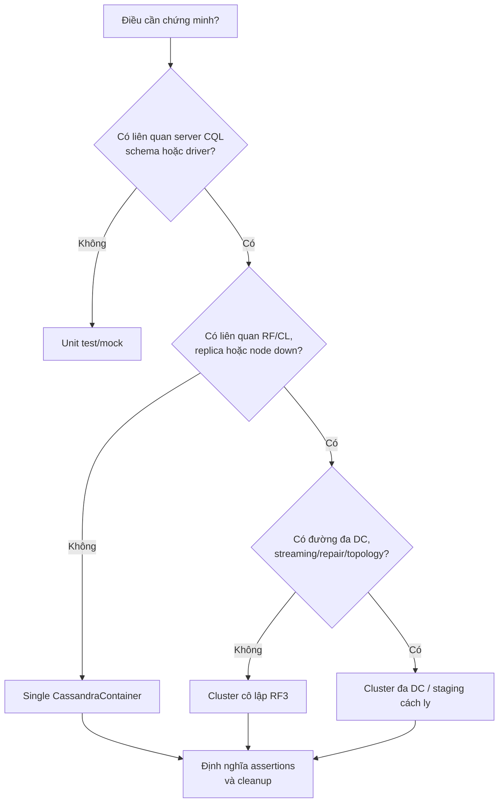
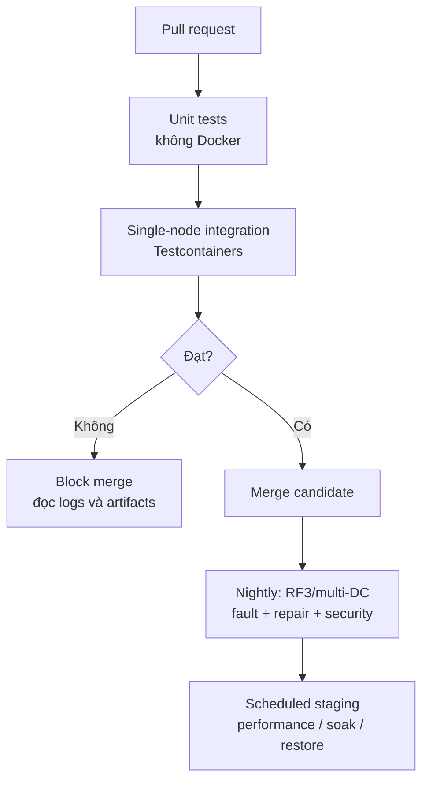

# Container/Testcontainers hoặc cụm thử cô lập

**Chương:** Kiểm thử tích hợp  
**Module:** `DATABASE_ENGINE_WIDE_COLUMN_CASSANDRA` — Apache Cassandra

Một unit test dùng mock `CqlSession` có thể chứng minh service gọi đúng method, nhưng **không chứng minh CQL được Cassandra chấp nhận**, annotation khóa ghép ánh xạ chính xác, paging hoạt động, `IF NOT EXISTS` có kết quả đúng, TTL tạo tombstone, hoặc yêu cầu `LOCAL_QUORUM` thực sự được đáp ứng bởi nhiều replica. Những hành vi ấy phải được kiểm tra **trên Cassandra thật**.

Có hai lựa chọn phổ biến: **chạy Cassandra bằng Docker/Testcontainers trong test Java**, hoặc **dùng một cụm Cassandra thử nghiệm được cô lập**. Testcontainers một node phù hợp cho phần lớn kiểm thử repository/CQL/Driver; cluster nhiều node phù hợp cho replication, consistency level, node failure, repair, streaming, đa DC và các tình huống phân tán. Chọn sai loại môi trường tạo ra cảm giác an toàn giả: `LOCAL_QUORUM` trên keyspace RF=1 vẫn chỉ cần **một** replica.

Bài hướng dẫn từ chiến lược chọn môi trường, cấu hình Testcontainers, viết JUnit 5/CQL/Java Driver, tích hợp Spring Boot/Spring Data, đến quản lý schema, tính độc lập của test, CI và các bài kiểm tra chỉ có ý nghĩa khi đủ replica. Mọi ví dụ giữ đúng tinh thần của module: mô hình wide-column, partition key, bảng theo truy vấn, replication, CL, compaction/repair, xử lý lỗi và kết nối từ Java.

> **Phạm vi và an toàn:** Ví dụ tập trung Cassandra 4.1/5.x, Java Driver 4.x, JUnit 5 và **Testcontainers Java 2.x**. Với Testcontainers 1.x, artifact và package khác; Spring Boot 3.x/4.x cũng có khác biệt ở test starter/auto-configuration. Phải chọn BOM và phiên bản tương thích với project. **Không chạy thử nghiệm dừng node, thay RF, scrub hay repair trên production**. Không có lệnh nào trong bài đã được chạy trên cluster thật; phần thực thi thuộc test environment và bước QA riêng.

## 1. Mục tiêu học tập

Sau bài này, bạn có thể:

1. Phân biệt **unit test**, **single-node integration test**, **multi-node integration test**, **performance/soak test** và **chaos/failure test**.
2. Chọn Testcontainers hay cluster cô lập theo **năng lực cần chứng minh**, không chỉ theo tốc độ dựng môi trường.
3. Thiết lập `CassandraContainer`, `CqlSession`, init CQL schema và vòng đời JUnit 5 mà không hardcode port `9042` trên host.
4. Nêu khác biệt Testcontainers Java **1.x** và **2.x** về dependency và package `CassandraContainer`.
5. Viết test CQL round-trip cho composite partition key, clustering order, prepared statements, idempotent event ID và paging.
6. Kiểm tra LWT `[applied]` và TTL bằng assertion có giới hạn thời gian, tránh `Thread.sleep` cố định dễ flaky.
7. Dùng `@ServiceConnection` hoặc `@DynamicPropertySource` trong Spring Boot test, biết khi nào dùng `@DataCassandraTest`/`@SpringBootTest`.
8. Đảm bảo mỗi test có dữ liệu riêng, không dùng `TRUNCATE` khi các test chạy song song trên một bảng chung.
9. Biết những gì **không thể chứng minh** trên một container RF1: failover, quorum intersection, replica divergence, hints và repair.
10. Thiết kế cluster thử ba node/đa DC với preflight/cleanup, fault injection có kiểm soát, metrics và báo cáo CI tái lập được.

## 2. Chọn đúng môi trường theo giả thuyết kiểm thử

### 2.1. Một tầng test không thay thế các tầng khác

| Môi trường | Điều chứng minh được | Điều không chứng minh đầy đủ | Chi phí điển hình |
| --- | --- | --- | --- |
| **Mock/unit** | Nhánh logic, validate DTO, lựa chọn query/CL theo code | CQL parsing, schema, driver handshake, replica behavior | Rất thấp |
| **CassandraContainer 1 node** | CQL thật, mapping, prepared/bound, TTL/LWT cơ bản, paging, errors, schema | Nhiều replica, quorum/repair/hints, DC failover | Vừa; startup Cassandra có thể lâu |
| **Cluster thử 3 node** | RF3, `LOCAL_QUORUM`, một node Down, replica convergence, topology/rack đơn DC | Multi-DC network behavior nếu chỉ một DC | Cao hơn; cần tài nguyên và điều phối |
| **Cluster thử đa DC** | NTS theo DC, `LOCAL_QUORUM`/`EACH_QUORUM`, đường mạng, local routing | Toàn bộ hiệu năng production nếu phần cứng khác | Cao |
| **Staging gần production** | Cấu hình bảo mật, backup/restore, operator, workload/capacity | Không tự là bằng chứng chịu tải đỉnh nếu test thiếu đại diện | Cao |
| **Fault/chaos lab** | Đường lỗi khi node/network/đĩa có sự cố | Hành vi xác định của mọi lỗi phân tán | Cao, phải có reset |

**Quy tắc:** Đặt tên test đúng với điều được kiểm chứng. `testLocalQuorumOnOneNode()` có thể kiểm tra syntax/driver CL, nhưng **không** nên được báo cáo là đã xác nhận quorum chịu lỗi một replica.

### 2.2. Sơ đồ chọn môi trường



Một bài test có thể phối hợp **unit test rất nhanh** với **integration test chạy thật**. Không cần dựng ba node để chứng minh `@PrimaryKeyClass` map đúng, nhưng không thể dùng một node để tuyên bố chịu lỗi khi mất một replica.

## 3. Những khác biệt phiên bản cần chốt trước khi viết code

### 3.1. Testcontainers Java 1.x và 2.x

Testcontainers 2.x chuyển các modules sang artifact có tiền tố `testcontainers-` và chuyển container classes vào packages theo module.

| Mục | Testcontainers 1.x | Testcontainers 2.x |
| --- | --- | --- |
| Cassandra dependency | `org.testcontainers:cassandra` | `org.testcontainers:testcontainers-cassandra` |
| JUnit Jupiter dependency | `org.testcontainers:junit-jupiter` | `org.testcontainers:testcontainers-junit-jupiter` |
| `CassandraContainer` import | `org.testcontainers.containers.CassandraContainer` | `org.testcontainers.cassandra.CassandraContainer` |
| `@Container` / `@Testcontainers` | `org.testcontainers.junit.jupiter.*` | `org.testcontainers.junit.jupiter.*` |
| Host/port mapping | `getContactPoint()`, `getLocalDatacenter()` | Tương tự trên module Cassandra |
| Spring Boot integration | Phải khớp Boot/Testcontainers BOM | Cũng phải khớp Boot/Testcontainers BOM; xác minh binary/API compatibility |

**Ví dụ dependency trong bài:** Testcontainers **2.0.5** là phiên bản của trang tài liệu module chính thức khi đối chiếu. Chọn **cùng một** Testcontainers version cho Cassandra, JUnit Jupiter và core; với Spring Boot, ưu tiên BOM tương thích đã được build kiểm thử. Không trộn hai line 1.x/2.x trong cùng classpath.

### 3.2. Ma trận phiên bản phải được ghi trong test run

```text
CASSANDRA_IMAGE_TAG:
CASSANDRA_SERVER_VERSION:
JAVA_JDK_VERSION:
SPRING_BOOT_VERSION:
SPRING_DATA_CASSANDRA_VERSION:
APACHE_JAVA_DRIVER_VERSION:
TESTCONTAINERS_VERSION:
JUNIT_JUPITER_VERSION:
DOCKER_OR_CONTAINER_RUNTIME:
TEST_ENVIRONMENT:
```

Cassandra 4.1 và 5.x có khác biệt tính năng, SSTable format và compatibility. Test dùng một image Cassandra cũ chưa chứng minh ứng dụng chạy đúng khi production upgrade lên 5.x; có thể cần chạy **ma trận image versions** trong CI.

**Pin image tag hoặc digest** trong test. Tag `cassandra:latest` làm cùng commit có thể chạy với server khác nhau ở hai thời điểm, khiến kết quả khó truy vết.

## 4. Chuẩn bị máy chạy Testcontainers

### 4.1. Yêu cầu tối thiểu

- JDK tương thích Spring Boot/Driver/Testcontainers đã chọn.
- Maven/Gradle và JUnit 5.
- Container runtime tương thích, đang hoạt động, đủ quyền truy cập.
- Đủ RAM/CPU/disk cho JVM Cassandra; Cassandra không phải container nhẹ như Redis.
- Có quyền pull image từ registry được tổ chức cho phép; giới hạn rate/egress cần cân nhắc trong CI.
- Không gắn test vào cổng Cassandra production hoặc một keyspace được dùng chung cho dữ liệu thật.
- Có network và trust configuration phù hợp khi CI chạy trong container/Docker remote host.

### 4.2. Phát hiện Docker, nhưng không đoán network endpoint

```bash
docker version
docker info
docker image inspect cassandra:4.1.3
```

Lệnh `docker image inspect` có thể báo image chưa tồn tại, **không** đồng nghĩa Testcontainers không thể pull. Nếu test không khởi động, phân biệt: Docker daemon unavailable, permission denied, image pull failed, container JVM không đủ memory và Cassandra chưa ready.

### 4.3. Host port là động

Testcontainers ánh xạ container port `9042` sang **host port được chọn lúc runtime**. Không hardcode `localhost:9042` trong test:

```java
// Đúng: endpoint trả về bởi container.
cassandra.getContactPoint();
cassandra.getLocalDatacenter();

// Dùng GenericContainer nếu cần tự lấy host/port:
cassandra.getHost();
cassandra.getMappedPort(9042);
```

`getHost()` không nhất thiết là `localhost` khi CI dùng remote Docker daemon. Chỉ gọi `getMappedPort` **sau khi container đã start**, bởi trước đó chưa có cổng ánh xạ.

### 4.4. Vì sao “container Running” chưa đủ?

Docker báo tiến trình sống không chứng minh native transport/CQL đã sẵn sàng. Module chuyên biệt `CassandraContainer` có wait strategy/readiness riêng; `withInitScript` chạy sau khi container đủ điều kiện init. Không thay bằng `Thread.sleep(20_000)` rồi giả định máy CI nào cũng start trong 20 giây.

## 5. Dependencies tối thiểu cho ví dụ Java/JUnit 5

### 5.1. Maven dùng Testcontainers 2.x

Giả sử application đã có Apache Java Driver 4.x qua Spring Boot starter/BOM. Phần test dependencies minh họa:

```xml
<dependency>
    <groupId>org.springframework.boot</groupId>
    <artifactId>spring-boot-starter-test</artifactId>
    <scope>test</scope>
</dependency>

<dependency>
    <groupId>org.testcontainers</groupId>
    <artifactId>testcontainers-cassandra</artifactId>
    <version>2.0.5</version>
    <scope>test</scope>
</dependency>

<dependency>
    <groupId>org.testcontainers</groupId>
    <artifactId>testcontainers-junit-jupiter</artifactId>
    <version>2.0.5</version>
    <scope>test</scope>
</dependency>
```

Nếu không dùng Spring Boot cho test Java Driver thuần, thay starter test bằng JUnit Jupiter dependencies phù hợp. Nếu dùng BOM Testcontainers 2.0.5, bỏ version riêng trên hai module; **không chọn đồng thời nhiều BOM gây lệch dependency tree**.

Ví dụ import BOM riêng (chỉ khi project quyết định dùng 2.x):

```xml
<dependencyManagement>
  <dependencies>
    <dependency>
      <groupId>org.testcontainers</groupId>
      <artifactId>testcontainers-bom</artifactId>
      <version>2.0.5</version>
      <type>pom</type>
      <scope>import</scope>
    </dependency>
  </dependencies>
</dependencyManagement>
```

Nếu Spring Boot BOM của project quản lý Testcontainers 1.x, **không copy nguyên các dependencies 2.x mà không kiểm tra tương thích**. Khi đó dùng artifact/import đúng 1.x hoặc nâng bộ dependency theo kế hoạch có test.

### 5.2. Gradle tương đương

```groovy
dependencies {
    testImplementation platform(
        "org.testcontainers:testcontainers-bom:2.0.5")
    testImplementation "org.testcontainers:testcontainers-cassandra"
    testImplementation "org.testcontainers:testcontainers-junit-jupiter"

    testImplementation "org.springframework.boot:spring-boot-starter-test"
}
```

Các dependencies được đặt trong `testImplementation`, **không** đưa container test vào runtime production. Project Spring Boot đang dùng plugin/BOM có thể không cần khai báo version của test starter.

### 5.3. Spring Boot service connections cần dependency khác

Khi dùng `@ServiceConnection`, thêm:

```xml
<dependency>
    <groupId>org.springframework.boot</groupId>
    <artifactId>spring-boot-testcontainers</artifactId>
    <scope>test</scope>
</dependency>
```

Với `@DynamicPropertySource`, cơ chế Spring TestContext có thể truyền các properties động mà không cần dùng service connection abstraction. Chọn **một cách chính** cho cấu hình kết nối của test để giảm khả năng cấu hình đè lẫn nhau.

## 6. Lab schema CQL được quản lý độc lập với Java

### 6.1. DDL dành cho một node RF=1

Trong container module Cassandra mặc định DC thường là `datacenter1`, nhưng phải kiểm tra `cassandra.getLocalDatacenter()` và `system.local`; nếu override DC, chỉnh script tương ứng.

Tạo một file classpath giả định `src/test/resources/cql/it-schema.cql` với nội dung **sau**:

```sql
CREATE KEYSPACE IF NOT EXISTS it_cassandra
WITH replication = {
    'class': 'NetworkTopologyStrategy',
    'datacenter1': 1
}
AND durable_writes = true;

CREATE TABLE IF NOT EXISTS it_cassandra.events_by_tenant_day (
    tenant_id text,
    bucket_day date,
    event_ts timestamp,
    event_id uuid,
    kind text,
    payload text,
    PRIMARY KEY ((tenant_id, bucket_day), event_ts, event_id)
) WITH CLUSTERING ORDER BY (event_ts DESC, event_id ASC);

CREATE TABLE IF NOT EXISTS it_cassandra.command_state_by_id (
    command_id uuid PRIMARY KEY,
    state text,
    version int
);

CREATE TABLE IF NOT EXISTS it_cassandra.ttl_by_id (
    item_id uuid PRIMARY KEY,
    ephemeral_value text
);
```

**Vì sao dùng hai lớp khóa?** `(tenant_id,bucket_day)` là composite partition key, còn `event_ts,event_id` là clustering keys. Test này không chỉ kiểm tra Java mapper; nó kiểm chứng **DDL và queries đi theo partition key**. `event_id` giúp hai events có cùng timestamp không đè nhau.

### 6.2. Không dựa vào schema auto-create của framework

`withInitScript("cql/it-schema.cql")` được thực hiện sau khi Cassandra sẵn sàng theo cơ chế container module; khi Spring context khởi động, keyspace/table đã tồn tại.

Với application quản lý schema bằng migration, nên dùng **cùng nguồn DDL versioned** trong test/staging, thay vì tạo test schema khác production. Nhưng nếu DDL production chứa RF3 hoặc DC names không có trong container RF1, phải tách **cấu hình replication theo environment**, giữ nguyên primary key/table options cần kiểm chứng.

**Không** bật `spring.cassandra.schema-action=recreate` cho môi trường chia sẻ hoặc staging để “dọn test”; nó có thể drop data. Giữ `schema-action=none` ở môi trường có schema do migration kiểm soát.

## 7. JUnit 5 + CassandraContainer: ví dụ Java Driver thuần

### 7.1. Vòng đời container và session

Ví dụ Testcontainers **2.x**, JUnit 5, Java Driver 4.x:

```java
import com.datastax.oss.driver.api.core.CqlSession;
import org.junit.jupiter.api.AfterAll;
import org.junit.jupiter.api.BeforeAll;
import org.junit.jupiter.api.Test;
import org.testcontainers.cassandra.CassandraContainer;
import org.testcontainers.junit.jupiter.Container;
import org.testcontainers.junit.jupiter.Testcontainers;

import static org.junit.jupiter.api.Assertions.*;

@Testcontainers
class CassandraNativeIT {

    @Container
    static final CassandraContainer CASSANDRA =
        new CassandraContainer("cassandra:4.1.3")
            .withInitScript("cql/it-schema.cql");

    private static CqlSession session;

    @BeforeAll
    static void openSession() {
        session = CqlSession.builder()
            .addContactPoint(CASSANDRA.getContactPoint())
            .withLocalDatacenter(CASSANDRA.getLocalDatacenter())
            .build();
    }

    @AfterAll
    static void closeSession() {
        if (session != null) {
            session.close();
        }
    }

    @Test
    void driverConnectsToRealCassandra() {
        var row = session.execute(
            "SELECT release_version, data_center FROM system.local"
        ).one();

        assertNotNull(row);
        assertNotNull(row.getString("release_version"));
        assertEquals(
            CASSANDRA.getLocalDatacenter(),
            row.getString("data_center"));
    }
}
```

Chỉ **một** `CqlSession` được dùng lại trong class; không tạo session mỗi test/request. Với `@Container static`, JUnit extension start một container trước các methods và stop sau khi class kết thúc. `@BeforeAll` chạy khi container đã được extension chuẩn bị. Nếu Testcontainers 1.x, đổi import `CassandraContainer` và dependency theo mục 3; các method chính về endpoint/DC vẫn tương tự.

**Lưu ý package/import:** Java code dùng `org.testcontainers.cassandra.CassandraContainer` cho 2.x. Không import `org.testcontainers.containers.CassandraContainer` từ ví dụ 1.x rồi sửa artifact thành 2.x mà không kiểm tra compatibility.

### 7.2. Container cleanup do Testcontainers quản lý

JUnit extension quản lý `start()/stop()` của field `@Container`. Không gọi `CASSANDRA.stop()` ở `@AfterEach`: các test còn lại cần container sống. `@AfterAll` đóng `CqlSession` để kết nối được giải phóng trước khi container ngừng.

Theo tài liệu Testcontainers, JUnit 5 extension đã được kiểm thử với **thực thi tuần tự**; chạy parallel cùng shared container có thể có tác dụng ngoài ý muốn. Chỉ cho phép parallel khi đã thiết kế dữ liệu/tài nguyên riêng và kiểm thử lifetime cụ thể.

### 7.3. Test round-trip trên composite key

Ví dụ đặt trong cùng class `CassandraNativeIT`:

```java
import com.datastax.oss.driver.api.core.DefaultConsistencyLevel;
import com.datastax.oss.driver.api.core.cql.PreparedStatement;
import com.datastax.oss.driver.api.core.cql.ResultSet;
import com.datastax.oss.driver.api.core.cql.Row;
import com.datastax.oss.driver.api.core.data.CqlDate;

import java.time.Instant;
import java.time.LocalDate;
import java.util.ArrayList;
import java.util.List;
import java.util.UUID;

import static org.junit.jupiter.api.Assertions.*;

@Test
void clusteringOrderIsCorrectInsideOnePartition() {
    String tenant = "tenant-" + UUID.randomUUID();
    LocalDate day = LocalDate.of(2026, 11, 21);
    CqlDate cqlDay = CqlDate.fromDaysSinceEpoch(
        (int) day.toEpochDay());

    PreparedStatement insert = session.prepare(
        "INSERT INTO it_cassandra.events_by_tenant_day " +
        "(tenant_id, bucket_day, event_ts, event_id, kind, payload) " +
        "VALUES (?, ?, ?, ?, ?, ?)"
    );

    Instant older = Instant.parse("2026-11-21T10:00:00Z");
    Instant newer = Instant.parse("2026-11-21T10:03:00Z");
    UUID id1 = UUID.randomUUID();
    UUID id2 = UUID.randomUUID();

    session.execute(
        insert.bind(tenant, cqlDay, older, id1, "OPEN", "first")
            .setConsistencyLevel(DefaultConsistencyLevel.ONE)
            .setIdempotent(true));

    session.execute(
        insert.bind(tenant, cqlDay, newer, id2, "CLICK", "second")
            .setConsistencyLevel(DefaultConsistencyLevel.ONE)
            .setIdempotent(true));

    PreparedStatement read = session.prepare(
        "SELECT event_ts, event_id, kind FROM " +
        "it_cassandra.events_by_tenant_day " +
        "WHERE tenant_id = ? AND bucket_day = ? LIMIT 20"
    );

    ResultSet result = session.execute(
        read.bind(tenant, cqlDay)
            .setConsistencyLevel(DefaultConsistencyLevel.ONE)
            .setIdempotent(true));

    List<Row> rows = new ArrayList<>();
    result.forEach(rows::add);

    assertEquals(2, rows.size());
    assertEquals(newer, rows.get(0).getInstant("event_ts"));
    assertEquals(id2, rows.get(0).getUuid("event_id"));
    assertEquals(older, rows.get(1).getInstant("event_ts"));
    assertEquals(id1, rows.get(1).getUuid("event_id"));
}
```

Trong test, `tenant` được tạo riêng cho method: không cần `TRUNCATE` table chung và không phụ thuộc thứ tự chạy của các test khác. Hai `event_ts` khác nhau nên thứ tự mong đợi rõ; test riêng **tie-breaker event_id** nếu đó là yêu cầu nghiệp vụ.

**Thực tế:** Các code snippets ở mục 7 là **những phần của cùng class** (mục 7.1 khai báo `session`; mục 7.3 thêm method/import tương ứng), không phải file độc lập có thể copy nhiều khối import vào trong class. Khi tạo test thật, hợp nhất imports theo Java syntax.

### 7.4. Tính lũy đẳng của ID cố định

Trong cùng `tenant/day/event_ts/event_id`, lặp một `INSERT` có payload xác định thường là upsert vào **cùng logical row**, không tạo row thứ hai. Nếu mỗi retry tạo `UUID.randomUUID()` mới, khóa khác và xuất hiện duplicate event. Test cần xác định **event ID sinh một lần từ nguồn** và truyền qua mọi attempts.

Với counter/list append, không được dùng test này để tuyên bố retry idempotent: mutation `+1` hay append **không** lũy đẳng. RF1 cũng không kiểm chứng behavior khi coordinator mất response trong môi trường phân tán.

## 8. Những assertion có giá trị cao trên một container

### 8.1. LWT `IF NOT EXISTS`

Ví dụ test với khóa riêng:

```java
import com.datastax.oss.driver.api.core.cql.PreparedStatement;
import com.datastax.oss.driver.api.core.cql.Row;
import java.util.UUID;

import static org.junit.jupiter.api.Assertions.*;

@Test
void lwtRejectsDuplicateCommandId() {
    UUID commandId = UUID.randomUUID();

    PreparedStatement insertOnce = session.prepare(
        "INSERT INTO it_cassandra.command_state_by_id " +
        "(command_id, state, version) VALUES (?, ?, ?) IF NOT EXISTS"
    );

    Row first = session.execute(
        insertOnce.bind(commandId, "CREATED", 1)
    ).one();
    assertNotNull(first);
    assertTrue(first.getBoolean("[applied]"));

    Row second = session.execute(
        insertOnce.bind(commandId, "CREATED", 1)
    ).one();
    assertNotNull(second);
    assertFalse(second.getBoolean("[applied]"));

    Row stored = session.execute(
        session.prepare(
            "SELECT state, version " +
            "FROM it_cassandra.command_state_by_id " +
            "WHERE command_id = ?"
        ).bind(commandId)
    ).one();

    assertNotNull(stored);
    assertEquals("CREATED", stored.getString("state"));
    assertEquals(1, stored.getInt("version"));
}
```

`[applied]=false` là kết quả điều kiện không thỏa, **không tự là network failure**. Test single-node chứng minh tính đúng CQL trên một coordinator; **không** chứng minh fault tolerance/Paxos protocol khi replica mất kết nối.

### 8.2. TTL cần kiểm thử theo thời gian linh hoạt

Không viết:

```java
// PHẢN VÍ DỤ DỄ FLAKY:
Thread.sleep(3000);
assertNull(readValue());
```

Trong CI, clock scheduling, driver latency và môi trường container có thể làm mốc chính xác 3 giây không đáng tin. Dùng **polling giới hạn trên** và chỉ assert eventual absence. Ví dụ có dependency test `org.awaitility:awaitility` phù hợp BOM:

```java
import java.time.Duration;
import java.util.UUID;

import static org.awaitility.Awaitility.await;
import static org.junit.jupiter.api.Assertions.*;

@Test
void ttlEventuallyExpires() {
    UUID id = UUID.randomUUID();

    var insert = session.prepare(
        "INSERT INTO it_cassandra.ttl_by_id " +
        "(item_id, ephemeral_value) VALUES (?, ?) USING TTL 5"
    );

    session.execute(insert.bind(id, "temporary"));

    var lookup = session.prepare(
        "SELECT ephemeral_value FROM it_cassandra.ttl_by_id " +
        "WHERE item_id = ?"
    );

    await()
        .pollInterval(Duration.ofMillis(300))
        .atMost(Duration.ofSeconds(30))
        .until(() -> session.execute(lookup.bind(id)).one() == null);
}
```

**Giới hạn:** Hàng **không còn hiển thị logic** sau TTL không chứng minh tombstone đã được compaction loại bỏ vật lý; `gc_grace_seconds`, repair/compaction và SSTable state là vấn đề khác. Không giảm `gc_grace_seconds` trong test để mong “dọn sạch” mà không hiểu rủi ro.

### 8.3. Paging không chỉ là `LIMIT`

Test nhiều rows trong **một** partition (với key riêng), đặt `pageSize=2` và đọc hết iterator; xác minh không mất/lặp row giữa các trang.

```java
import com.datastax.oss.driver.api.core.cql.SimpleStatement;
import com.datastax.oss.driver.api.core.cql.ResultSet;

// Giả định test đã INSERT 5 rows với cùng tenant/day,
// mỗi row có event_ts/event_id khác nhau.
SimpleStatement query = SimpleStatement.builder(
    "SELECT event_ts, event_id FROM it_cassandra.events_by_tenant_day " +
    "WHERE tenant_id = ? AND bucket_day = ?")
    .addPositionalValues(tenant, cqlDay)
    .setPageSize(2)
    .build();

ResultSet result = session.execute(query);
int count = 0;
for (var row : result) {
    count++;
}
assertEquals(5, count);
```

`ResultSet` đồng bộ có thể fetch thêm pages khi cần; test nên kiểm tra ít nhất **ranh giới trang** với dữ liệu đủ nhiều. Không assert một page có chính xác 2 rows ở mọi query shape chỉ vì `pageSize=2`, bởi page size là **hint**, còn truy vấn/filter/partition behavior có thể khác. Tránh scan `SELECT *` toàn keyspace.

### 8.4. Test lỗi CQL hợp lệ/hệ thống

| Phép thử | Kỳ vọng | Điểm cần nhớ |
| --- | --- | --- |
| Insert với primary key đầy đủ | ACK và đọc được row | CQL/mapper/schema khớp |
| SELECT theo partition key | Trả đúng partition | Query design đúng |
| SELECT theo thiếu partition column | Bị từ chối hoặc phải dùng filtering tốn kém | Không “sửa” bằng `ALLOW FILTERING` |
| LWT duplicate key | `[applied]=false` ở lần sau | Điều kiện nghiệp vụ, không phải exception |
| TTL hết hạn | Row logic biến mất theo bounded polling | Tombstone có thể còn |
| Paging pageSize nhỏ | Duyệt hết rows đúng thứ tự | Không mặc định paging tự tạo snapshot nhất quán |
| SELECT key chưa tồn tại | `Row == null` sau read thành công | Khác timeout/unavailable |
| Đăng nhập sai auth | Auth failure khi bật auth | Single container mặc định có thể **chưa bật** auth |

## 9. Spring Boot + Testcontainers: kết nối với service thật

### 9.1. `@DataCassandraTest` và `@SpringBootTest`

- **`@DataCassandraTest`:** test slice cho Cassandra components như `CassandraTemplate`, `@Table`, repositories; thường nhẹ hơn full application context.
- **`@SpringBootTest`:** toàn bộ Spring context, phù hợp service workflow có nhiều components/transaction boundaries/serialization.
- **Testcontainers** vẫn cần cho CQL thật; annotation test slice **không tự tạo database Cassandra**.

Với Spring Boot **3.x**, import `@DataCassandraTest` thường là `org.springframework.boot.test.autoconfigure.data.cassandra.DataCassandraTest`. Spring Boot **4.x** có thay đổi module/package testing; phải chọn import đúng BOM/version, không trộn code snippet khác major.

### 9.2. `@ServiceConnection`: connection details tự động

Spring Boot hỗ trợ `CassandraConnectionDetails` cho container `CassandraContainer`. Khi container được đánh dấu `@ServiceConnection` và có `spring-boot-testcontainers` trong test classpath, Boot có thể cung cấp connection details (endpoint/DC/auth...) từ container thay vì hardcode trong properties.

Ví dụ **minh họa Spring Boot + Testcontainers 2.x**:

```java
import org.junit.jupiter.api.Test;
import org.springframework.beans.factory.annotation.Autowired;
import org.springframework.boot.test.context.SpringBootTest;
import org.springframework.boot.testcontainers.service.connection.ServiceConnection;
import org.testcontainers.cassandra.CassandraContainer;
import org.testcontainers.junit.jupiter.Container;
import org.testcontainers.junit.jupiter.Testcontainers;

import com.datastax.oss.driver.api.core.CqlSession;

import static org.junit.jupiter.api.Assertions.*;

@SpringBootTest
@Testcontainers
class CassandraSpringContextIT {

    @Container
    @ServiceConnection
    static final CassandraContainer CASSANDRA =
        new CassandraContainer("cassandra:4.1.3")
            .withInitScript("cql/it-schema.cql");

    @Autowired
    CqlSession session;

    @Test
    void bootUsesRealCassandraContainer() {
        var row = session.execute(
            "SELECT release_version FROM system.local").one();

        assertNotNull(row);
        assertNotNull(row.getString("release_version"));
    }
}
```

Với test profile:

```yaml
spring:
  cassandra:
    keyspace-name: it_cassandra
    schema-action: none
```

**Không** kết luận `@ServiceConnection` tự tạo keyspace. Nó cung cấp connection details; schema được tạo qua init script/migration. Kiểm tra Boot version có nhận đúng `CassandraContainer` 2.x không (vì class package thay đổi), đồng thời không bật test auto-DDL khiến schema bị ghi đè.

### 9.3. `@DynamicPropertySource`: cách kiểm soát properties rõ ràng

Khi không dùng `@ServiceConnection` hoặc phiên bản đang dùng không hỗ trợ factory tương ứng, đăng ký properties động:

```java
import org.springframework.test.context.DynamicPropertyRegistry;
import org.springframework.test.context.DynamicPropertySource;
import org.testcontainers.cassandra.CassandraContainer;
import org.testcontainers.junit.jupiter.Container;
import org.testcontainers.junit.jupiter.Testcontainers;

@Testcontainers
class CassandraWithDynamicPropertiesIT {

    @Container
    static final CassandraContainer CASSANDRA =
        new CassandraContainer("cassandra:4.1.3")
            .withInitScript("cql/it-schema.cql");

    @DynamicPropertySource
    static void cassandraProperties(DynamicPropertyRegistry registry) {
        registry.add("spring.cassandra.contact-points",
            () -> CASSANDRA.getHost() + ":" +
                CASSANDRA.getMappedPort(9042));
        registry.add("spring.cassandra.local-datacenter",
            CASSANDRA::getLocalDatacenter);
        registry.add("spring.cassandra.keyspace-name",
            () -> "it_cassandra");
        registry.add("spring.cassandra.schema-action",
            () -> "none");
    }

    // Thêm @SpringBootTest hoặc @DataCassandraTest và test methods
    // theo version Boot của dự án.
}
```

Ở đây snippet dùng `@DynamicPropertySource`, nên **không đồng thời thêm `@ServiceConnection`** trên cùng container nếu không có lý do rõ ràng: Boot service connection details có precedence riêng và có thể che các endpoint properties vừa đăng ký.

**Lưu ý:** Phải dùng container **đã started** khi lấy mapped port. Spring/Testcontainers JUnit lifecycle giải quyết trong mẫu phù hợp; nếu tự quản lý container ở static initializer hoặc bean, hãy kiểm tra startup order.

### 9.4. Khi dùng Spring Data repository

Giả sử entity/repository của production map tới `it_cassandra.command_state_by_id`:

```java
import java.util.UUID;
import org.springframework.data.cassandra.core.mapping.PrimaryKey;
import org.springframework.data.cassandra.core.mapping.Table;

@Table("command_state_by_id")
public class CommandState {

    @PrimaryKey("command_id")
    private UUID commandId;
    private String state;
    private Integer version;

    public CommandState() { }

    public CommandState(UUID commandId, String state, Integer version) {
        this.commandId = commandId;
        this.state = state;
        this.version = version;
    }

    public UUID getCommandId() { return commandId; }
    public String getState() { return state; }
    public Integer getVersion() { return version; }
}
```

```java
import java.util.UUID;
import org.springframework.data.cassandra.repository.CassandraRepository;

public interface CommandStateRepository
        extends CassandraRepository<CommandState, UUID> {
}
```

Test:

```java
import java.util.UUID;
import org.junit.jupiter.api.Test;
import org.springframework.beans.factory.annotation.Autowired;

import static org.junit.jupiter.api.Assertions.*;

@Autowired
CommandStateRepository repository;

@Test
void repositoryUsesRealCqlSchema() {
    UUID id = UUID.randomUUID();

    CommandState saved = repository.save(
        new CommandState(id, "CREATED", 1));

    assertEquals(id, saved.getCommandId());

    CommandState loaded = repository.findById(id).orElseThrow();
    assertEquals("CREATED", loaded.getState());
    assertEquals(1, loaded.getVersion());
}
```

Đây là **các thành phần** của cùng một test Spring có repository bean; snippet test method không đứng độc lập bên ngoài class. Trong ứng dụng thật, dùng entity/repository production, chỉ thay connection/test schema. Không viết một “test entity” hoàn toàn khác với metadata production rồi tuyên bố mapping đã được kiểm chứng.

### 9.5. Lưu ý Spring context caching và @Container

Testcontainers JUnit extension stop static container **sau test class**. Spring TestContext có thể **cache ApplicationContext lâu hơn một test class**; nếu class khác dùng lại context chứa session trỏ vào container đã stop, sẽ gặp lỗi khó hiểu.

Đối với nhiều test classes dùng cùng app context:

- Ưu tiên phương án container được quản lý bằng Spring test configuration/`@ServiceConnection` bean có vòng đời gắn với context khi phù hợp version.
- Hoặc dùng test context riêng và `@DirtiesContext` có kiểm soát, chấp nhận chi phí khởi động lại.
- Hoặc áp dụng singleton container pattern **không gắn `@Container` extension**, với cleanup rõ, và giữ data isolation.
- Không tự `stop()` shared container ở `@AfterEach`.
- Không bật JUnit parallel bừa bãi trên cùng schema/row data.

**Không** trộn singleton pattern với extension lifecycle một cách vô thức; đó là nguyên nhân phổ biến của “test A pass, test B fail khi chạy cả suite”.

## 10. Chiến lược dữ liệu thử nghiệm độc lập

### 10.1. Isolation không chỉ là “mỗi test một bảng”

| Phương án | Ưu điểm | Giới hạn |
| --- | --- | --- |
| Khóa UUID/tenant riêng từng test | Nhanh, ít DDL, hỗ trợ test song song có kiểm soát | Dữ liệu còn trong keyspace đến khi container xóa |
| Keyspace riêng theo test class | Tách schema và dữ liệu mạnh hơn | Schema agreement/DDL tốn thời gian; tăng metadata |
| Container riêng per class | Cô lập process/data tốt | Startup chậm, CPU/RAM cao |
| Container riêng per method | Mức cô lập rất cao | Cassandra startup rất đắt |
| `TRUNCATE` tables chung | Dễ hiểu trong test tuần tự | Phá data của test khác, tác động tombstone/repair tùy use case |
| Cleanup bằng DELETE theo PK | Ít scope hơn TRUNCATE | Tạo tombstone; phải biết full primary key |

**Khuyến nghị mặc định cho một CassandraContainer:** static container per class, schema init một lần và **mỗi test dùng tenant/key ngẫu nhiên**. Khi cần test schema migration hoặc quyền truy cập tách biệt, chọn keyspace/container riêng phù hợp.

### 10.2. Test không được phụ thuộc thứ tự thực thi

Phản ví dụ:

```text
testA() tạo row id=1
testB() mong id=1 tồn tại và sửa nó
testC() TRUNCATE table

Khi chạy riêng testB -> fail;
khi chạy parallel -> race;
khi chạy ngược thứ tự -> không xác định.
```

Cách đúng:

```java
UUID id = UUID.randomUUID();  // tạo trong mỗi test
String tenant = "it-" + id;
```

Mỗi test tự tạo dữ liệu nó cần và xác minh logic ngay. Không dùng `LocalDate.now()` nếu boundary theo múi giờ có thể làm test chạy hôm nay/mai khác nhau; dùng `LocalDate.of(...)` cố định và tenant/UUID unique.

### 10.3. Khi nào cần cleanup?

Nếu container tự bị xóa ở cuối class/suite, dữ liệu disposable có thể không cần `DELETE` từng row. Với container sống lâu cho nhiều classes, phải có chiến lược cleanup theo scope. **Không dùng random `TRUNCATE` trong suite đang parallel**; nếu thử TRUNCATE như một tính năng thì chạy ở table riêng, có xác nhận không shared.

Không tắt guardrails Cassandra/GC/repair chỉ để tăng tốc teardown. Bản chất TTL/DELETE là tombstone; cleanup bằng hàng triệu DELETE có thể làm test performance sau bị nhiễu.

## 11. Single-node RF=1 không kiểm tra được quorum/failover

### 11.1. Quorum trên một node

Trong `NetworkTopologyStrategy` với DC `datacenter1: 1`:

| CL | Số replica cần | Khi node duy nhất Up | Khi node duy nhất Down |
| --- | ---: | --- | --- |
| `ONE` | 1 | Có thể thành công | Không đáp ứng |
| `LOCAL_ONE` | 1 local | Có thể thành công | Không đáp ứng |
| `LOCAL_QUORUM` | 1 local | Có thể thành công | Không đáp ứng |
| `QUORUM` | 1 | Có thể thành công | Không đáp ứng |
| `ALL` | 1 | Có thể thành công | Không đáp ứng |

`LOCAL_QUORUM` trên RF1 **không cần hai replica**. Nếu test chạy `CONSISTENCY LOCAL_QUORUM` với CassandraContainer một node và pass, bạn mới kiểm tra được cú pháp CL và đọc/ghi với **một** replica — **không** chứng minh availability khi mất một node hay read-after-write từ quorum khác nhau.

### 11.2. RF=3 ba replica

Trong DC một có RF3, `LOCAL_QUORUM = floor(3/2)+1 = 2`:

| Trạng thái | `ONE` | `LOCAL_QUORUM` | `ALL` |
| --- | --- | --- | --- |
| 3/3 replica khỏe | Có thể | Có thể | Có thể |
| 2/3 replica khỏe | Có thể | Có thể | Không |
| 1/3 replica khỏe | Có thể | Không | Không |
| 0/3 replica khỏe | Không | Không | Không |

Bảng nói về **đủ số replica đáp ứng** về nguyên tắc. Timeout, coordinator routing, network partition và các replica không đồng bộ có thể gây thất bại kể cả khi số node báo Up nhìn có vẻ đủ.

### 11.3. Câu test phải phản ánh hợp đồng

Không viết test tên `quorumSurvivesOneNodeDown` rồi dùng RF1. Một test có ý nghĩa cần **three nodes, RF3**, xác minh topology/CL, chủ động dừng một node trong cluster disposable, kiểm tra `LOCAL_QUORUM` còn phục vụ và `ALL` không đáp ứng. Sau đó khôi phục node và đánh giá backlog/hints/repair.

## 12. Khi nào nên dùng cụm thử cô lập nhiều node?

### 12.1. Danh mục hành vi cần cluster thật

- RF và `NetworkTopologyStrategy` replica placement.
- `LOCAL_QUORUM` khi một trong ba replicas Down.
- `QUORUM` toàn cluster so với local quorum trong multi-DC.
- `EACH_QUORUM` cho write với RF theo nhiều DC.
- Hinted handoff khi replica xuống và quay lại.
- Anti-entropy `nodetool repair`, streaming/bootstrap, rebuild, replace node.
- Thay đổi datacenter/rack/topology và schema agreement.
- Node/coordinator failover, client load balancing, prepared statement reprepare.
- Giao tiếp TLS internode, JMX/OS operational permissions.
- Độ nhạy read/write timeout, error budgets khi network/GC/disk có sự cố.
- Kiểm thử rolling upgrade mixed versions theo đúng supported path.

Một CassandraContainer đơn không có multi-node replication. **Ba `CassandraContainer` độc lập tạo ba cluster một node**, không tự động thành một cluster RF3; phải cấu hình chung cluster name, seed nodes, snitch, DC/rack, network và bootstrap.

### 12.2. Cách xây cluster cô lập

Có ba hướng phổ biến:

1. **Docker Compose/multiple Testcontainers GenericContainer:** cần network alias/seed nodes, cấu hình Cassandra phù hợp image và orchestration readiness từng node.
2. **Kubernetes namespace/operator thử nghiệm:** phù hợp nếu production dùng K8s, có thể kiểm thử StatefulSets, PVC, rolling operations và manifests.
3. **VM/cluster staging chuyên dụng:** khi kiểm thử disk/repair/streaming, security hoặc throughput cần hạ tầng gần thực.

Tất cả phải tách credentials, network, storage, cloud account, backup repository khỏi production; không chỉ đặt tên keyspace `test` trên cluster thật rồi gọi là isolated.

### 12.3. Blueprint ba node đơn DC

Ví dụ phác thảo cấu hình cho Cassandra official Docker image. **Đây là blueprint cần điều chỉnh và xác minh với tag image đã pin**, không phải file Compose đã kiểm thử sẵn trong môi trường người học:

```yaml
services:
  cassandra1:
    image: cassandra:4.1.3
    environment:
      CASSANDRA_CLUSTER_NAME: it-cluster
      CASSANDRA_SEEDS: cassandra1
      CASSANDRA_DC: dc1
      CASSANDRA_RACK: rack1
      CASSANDRA_ENDPOINT_SNITCH: GossipingPropertyFileSnitch
    ports:
      - "127.0.0.1:9042:9042"
    networks: [it-net]

  cassandra2:
    image: cassandra:4.1.3
    environment:
      CASSANDRA_CLUSTER_NAME: it-cluster
      CASSANDRA_SEEDS: cassandra1
      CASSANDRA_DC: dc1
      CASSANDRA_RACK: rack2
      CASSANDRA_ENDPOINT_SNITCH: GossipingPropertyFileSnitch
    networks: [it-net]

  cassandra3:
    image: cassandra:4.1.3
    environment:
      CASSANDRA_CLUSTER_NAME: it-cluster
      CASSANDRA_SEEDS: cassandra1
      CASSANDRA_DC: dc1
      CASSANDRA_RACK: rack3
      CASSANDRA_ENDPOINT_SNITCH: GossipingPropertyFileSnitch
    networks: [it-net]

networks:
  it-net:
```

Cần bổ sung readiness sequencing, resource limits/heap, logs, seed resolution, health checks và tùy chỉnh image/DC/snitch trước khi vận hành. `depends_on` đơn thuần không đảm bảo Cassandra CQL đã ready hoặc cluster đã đạt replica health. Bootstrapping node 2/3 có thể tốn thời gian; không đặt sleep cố định.

**Không tự động bật ba container** trong CI worker chỉ có vài GB RAM. Có thể chuyển multi-node suite sang máy CI lớn hơn hoặc nightly pipeline.

### 12.4. Xác minh cluster đã thật sự hình thành

```bash
docker compose ps
docker compose exec cassandra1 nodetool status
docker compose exec cassandra2 nodetool status
docker compose exec cassandra3 nodetool status
```

Trên mỗi node, xác minh:

- Cùng cluster name, đúng DC/rack và version.
- `nodetool status` có ba node `UN` với host IDs riêng.
- Không có node đang joining/leaving/moving.
- Schema agreement sau DDL.
- Đủ disk/CPU/RAM, không có backlog/GC bất thường.
- Client không vô tình kết nối cluster production vì contact points cũ.

Không chỉ xem `docker compose ps` trạng thái `Up` để khẳng định ring đã đạt quorum.

## 13. Lab RF3 với consistency level và một node Down

### 13.1. Tạo keyspace RF3

Chỉ chạy sau khi cluster `dc1` có ba node khỏe:

```sql
CREATE KEYSPACE IF NOT EXISTS it_cassandra_rf3
WITH replication = {
    'class': 'NetworkTopologyStrategy',
    'dc1': 3
}
AND durable_writes = true;

CREATE TABLE IF NOT EXISTS it_cassandra_rf3.state_by_id (
    id uuid PRIMARY KEY,
    state text,
    changed_at timestamp
);
```

Không dùng RF3 trên container đơn node rồi mong quorum hoạt động. Một keyspace đang có RF1 không tự được nhân bản đầy đủ khi `ALTER KEYSPACE` sang RF3; chuyển RF cần kế hoạch streaming/repair riêng.

### 13.2. Đặt baseline tại ALL khi ba node Up

```sql
CONSISTENCY ALL

INSERT INTO it_cassandra_rf3.state_by_id (id, state, changed_at)
VALUES (
    10000000-0000-4000-8000-000000000401,
    'CREATED',
    '2026-11-21T10:00:00Z'
);

SELECT id, state FROM it_cassandra_rf3.state_by_id
WHERE id = 10000000-0000-4000-8000-000000000401;
```

Chỉ tiếp tục nếu write `ALL` ACK thành công; nếu timeout, **kết quả ghi có thể chưa rõ**, không xem là baseline sạch. Với test tự động, dùng unique ID cho từng suite.

### 13.3. Dừng một node, kiểm tra local quorum

**Chỉ trên cluster Docker disposable** của blueprint, khi đã xác minh service đúng:

```bash
docker compose stop cassandra3

# Kiểm tra từ node còn chạy
docker compose exec cassandra1 nodetool status
```

Trong cqlsh kết nối node 1/2:

```sql
CONSISTENCY LOCAL_QUORUM

UPDATE it_cassandra_rf3.state_by_id
SET state = 'PAID',
    changed_at = '2026-11-21T10:05:00Z'
WHERE id = 10000000-0000-4000-8000-000000000401;

SELECT id, state FROM it_cassandra_rf3.state_by_id
WHERE id = 10000000-0000-4000-8000-000000000401;
```

RF3 local quorum=2, hai replica còn khỏe có thể đáp ứng. `CONSISTENCY ALL` khi node 3 Down **không** đạt CL; đó là semantics dự kiến, không tự chứng minh data corruption.

### 13.4. Khôi phục node và xác minh

```bash
docker compose start cassandra3
docker compose exec cassandra1 nodetool status
docker compose exec cassandra3 nodetool netstats
```

Sau khi node quay lại:

- Đợi node `UN` ổn định và client có thể kết nối.
- Kiểm tra dữ liệu ở CL được phê duyệt; không kết luận node 3 đã nhận tất cả mutation chỉ từ một SELECT `LOCAL_QUORUM`.
- Quan sát hints, logs, streaming, repair schedule.
- Nếu downtime đủ dài hoặc replica divergence không tự được bù, xem kế hoạch repair trong tài liệu version cụ thể.
- **Không** chạy `nodetool repair` bừa bãi trên production; trong cluster thử phải ghi phạm vi/ranges và đo chi phí.

### 13.5. Hai node Down: đâu là kết quả đúng?

Nếu chỉ một replica còn sống trong DC RF3:

- `ONE` có thể đọc/ghi, nhưng yếu hơn quorum.
- `LOCAL_QUORUM` cần 2 replica nên không đáp ứng.
- `ALL` càng không đáp ứng.
- Timeout/unavailable từ Driver phải được phân loại đúng, không tự hạ CL để test “xanh”.

Một test tốt assert **đúng failure mode theo hợp đồng**, không phải mọi request đều phải thành công. Ví dụ endpoint đòi read `LOCAL_QUORUM` phải trả lỗi khi không đủ replica, thay vì đọc `ONE` rồi báo dữ liệu chắc chắn mới.

## 14. Multi-DC và những giả định không thể giản lược

### 14.1. RF theo từng DC

Với:

```sql
WITH replication = {
    'class': 'NetworkTopologyStrategy',
    'dc1': 3,
    'dc2': 3
}
```

`LOCAL_QUORUM` ở dc1 cần 2 replica **trong dc1**. `QUORUM` trên tổng RF6 cần 4 replica đáp ứng, có thể liên quan đường giữa DC; write `EACH_QUORUM` cần quorum trong mỗi DC. Không suy hai DC được tạo chỉ bằng cách gắn tên container khác nhau: Cassandra topology phải có seed/bootstrap/racks và token placement hợp lệ.

### 14.2. Những test đáng làm trên cluster nhiều DC

- Client `withLocalDatacenter("dc1")` chọn coordinator đúng DC theo driver load balancing.
- Ẩn/gián đoạn một số replica ở dc2 mà write/read LOCAL_QUORUM dc1 còn phục vụ theo hợp đồng.
- Read từ dc1/dc2 sau write, hiểu eventual consistency và delay.
- Kiểm tra network/TLS/inter-DC latency, failover routing được phê duyệt.
- Kiểm tra trường hợp write `EACH_QUORUM` bị unavailable khi dc2 thiếu quorum.
- Kiểm tra schema propagation và auth metadata sau thay đổi/repair.

**Không** lấy một `LOCAL_QUORUM` ở RF1 trong mỗi DC rồi gắn nhãn đã test “quorum đa DC”. Cần RF thực tế và healthy replica count.

## 15. Failure injection: điều gì an toàn để mô phỏng?

### 15.1. Ma trận lỗi

| Lỗi thử | Môi trường | Điều cần assert | Không được suy |
| --- | --- | --- | --- |
| CQL sai schema | Một container | `InvalidQueryException` hoặc lỗi tương ứng | Dữ liệu bị mất |
| Duplicate `IF NOT EXISTS` | Một container | `[applied]=false` | Exactly-once toàn workflow |
| TTL hết hạn | Một container | Không còn row logic | SSTables đã compact sạch |
| Một node Down RF3 | Cụm ba node | LQ vẫn có thể phục vụ | Dữ liệu mọi replica đã đồng nhất |
| Hai node Down RF3 | Cụm ba node | LQ unavailable | LQ bị “lỗi Driver” |
| Coordinator restart | Cụm nhiều node | Client chuyển endpoint/reprepare nếu được hỗ trợ | Mutation timeout chắc chắn chưa chạy |
| Chặn internode network | Cụm fault lab | Timeout/unavailable/hints và phục hồi | Mọi kiểu network partition tương đương |
| Disk pressure | Staging disposable đủ tài nguyên | Alert/latency/failure handling | Có thể chạy an toàn trên dev laptop |
| Auth/TLS sai | Cụm đã cấu hình security | Kết nối bị từ chối | CQL RBAC hoạt động nếu auth chưa bật |
| Version skew được hỗ trợ | Staging theo release notes | Rolling upgrade gates | Mọi cặp Cassandra versions cho rolling upgrade |

### 15.2. Timeout là “unknown outcome” với write

Nếu test gây mất response sau một mutation, lỗi `WriteTimeoutException`/`DriverTimeoutException` **không chứng minh server chưa ghi**. Đặc biệt:

- `counter + 1` và list append **không lũy đẳng**.
- Một request write có thể đã đạt một số replica nhưng chưa đạt CL yêu cầu.
- Retry ở driver, application, gateway hoặc queue có thể thực thi mutation lần nữa.
- Test nên dùng **event/request ID ổn định**, kiểm chứng trạng thái và ghi nhận unknown outcome.
- Test không nên assert “thấy timeout → database không có row” một cách tổng quát.

`setIdempotent(true)` chỉ giúp retry policy biết operation có thể được phát lại theo những giả định nào. Nó không tạo exactly-once.

### 15.3. Không dùng sửa dữ liệu vật lý như “fault nhẹ”

Không xóa SSTable files, thay `system.local`, rename commit logs, phá volume hay chạy `nodetool scrub` để mô phỏng network failure. Các thao tác đó có thể phá metadata/định dạng dữ liệu; nếu mục tiêu là corruption recovery, cần **test plan riêng** với backup/restore và kiểm tra version.

## 16. Khi phải kiểm tra repair/compaction/backup

### 16.1. Kiểm tra query correctness không cần repair

Đa số repository integration tests chỉ cần bảng và dữ liệu mới. Chạy `nodetool repair` cho mọi test làm suite chậm và có thể che lỗi logic. Compaction/repair phục vụ trạng thái storage/replica chứ không phải công cụ reset schema.

### 16.2. Repair test cần nhiều replica

Một repair có ý nghĩa khi ít nhất hai replica có dữ liệu cần đối chiếu. Trong RF1, `nodetool repair` không chứng minh khả năng khôi phục từ replica khác.

Để tạo divergence có kiểm soát trong RF3:

1. Ghi baseline với ba node Up và ACK đúng CL.
2. Dừng node 3; ghi mutation ở LQ trên node 1/2.
3. Khởi động node 3 lại, đánh giá hints/convergence.
4. Nếu cần test repair, chỉ chạy theo kế hoạch và phạm vi được chỉ định trong môi trường disposable.
5. Đọc lại qua các coordinators/CL, thu logs/metrics/streaming.
6. Không dùng một read tại `ONE` làm bằng chứng mọi replica đã đồng nhất.

Không cố tình làm mất tombstone/hints chỉ để tạo “divergence dễ thấy”; quy trình anti-entropy có nhiều điều kiện về timestamp, `gc_grace_seconds` và lịch repair.

### 16.3. Compaction test khác TTL test

TTL hết hạn làm hàng không còn hiển thị logic, nhưng tombstone có thể vẫn tồn tại trong SSTable. Nếu muốn kiểm tra chi phí compaction hoặc tombstone scanned:

- Chuẩn bị workload có giới hạn và dữ liệu đủ đại diện.
- Theo dõi `nodetool tablestats`/`tablehistograms`/`compactionstats` và JMX metrics theo version.
- Đo read p95/p99, SSTables per read, tombstone scans.
- Không giả định compaction chạy ngay sau TTL hết.
- Không chạy major compaction trên cùng test suite đang cần thời gian phản hồi ổn định.

### 16.4. Backup/restore có suite riêng

Test backup phải thực hiện cả **restore** vào cluster disposable mới, không chỉ assert `nodetool snapshot` trả exit code 0. Một snapshot trên node có thể thiếu phạm vi replica, schema hoặc dữ liệu vừa ghi tùy RPO/CL. Kiểm tra manifest/checksum/version/retention.

**Câu “test CassandraContainer xanh” không chứng minh backup production khôi phục được.**

## 17. Cô lập cluster thử khỏi production

### 17.1. Ranh giới cần cô lập

- Network/VPC/namespace: không định tuyến đến Cassandra production.
- Authentication/authorization: service account test riêng, quyền tối thiểu.
- Secrets: không dùng password/key của production, không đưa token vào test logs.
- Data: dữ liệu tổng hợp/giả lập, không sao chép PII khách hàng khi chưa có quy trình cho phép.
- Storage: volumes/buckets riêng, không mount data directory production.
- Control plane: JMX, SSH, admin roles và operator dành cho cluster test.
- Cleanup: container/namespace/VM có owner, TTL/retention sau suite.
- Billing/capacity: quota tài nguyên cho CI và fault tests.

Dùng tên keyspace `it_cassandra` trên production **không biến nó thành môi trường cô lập**. Một `TRUNCATE`, `ALTER KEYSPACE` hoặc workload query sai có thể ảnh hưởng cluster thật.

### 17.2. Auth/TLS không bật sẵn là lỗ hổng của test coverage

Cassandra image test mặc định có thể cho CQL không cần username/password. Một test kết nối được không chứng minh cấu hình production TLS/RBAC đúng. Nếu security là yêu cầu:

- Dùng `withConfigurationOverride(...)` với cấu hình Cassandra kiểm soát.
- Dùng `withInitScript(...)` nếu cần tạo roles/keyspace trước test.
- Với client encryption, cấu hình `withSsl(...)`/certificates và driver trust chain theo tài liệu module.
- Kiểm tra authenticated/unauthorized paths và certificate verification.
- Không tắt TLS/`AllowAllAuthenticator` để biến test bảo mật đỏ thành xanh.

**Chú ý:** Override nguyên `cassandra.yaml` có thể gây lỗi startup nếu thiếu options/không đúng phiên bản; không copy cấu hình từ server khác mà không đối chiếu image.

## 18. CI: ổn định, tái lập và không quá tải

### 18.1. Phân lớp các suite trong pipeline



Không bắt buộc mọi PR khởi động cluster đa DC nặng; nhưng những thay đổi schema, driver/CL, topology/repair có thể cần **suite RF3 bắt buộc** theo loại change. Xác định test gating dựa trên rủi ro, không cắt bỏ test quan trọng chỉ để giảm thời gian CI.

### 18.2. Kế hoạch tài nguyên CI

Cassandra JVM khởi động và bootstrap có thể cần hàng chục giây hoặc hơn, tùy image/host I/O. Với ba node và nhiều jobs parallel, memory/CPU/disk có thể bị đẩy quá mức, tạo `OutOfMemoryError` hoặc startup timeout giả.

Nên:

1. Chạy một CassandraContainer per class/group phù hợp, không per test method trừ khi cần.
2. Cache/pull image từ registry tin cậy, nhưng vẫn pin tag/digest.
3. Giới hạn số Cassandra-heavy CI jobs chạy đồng thời theo tài nguyên.
4. Tăng startup timeout **có lý do** và lấy logs khi fail; không tăng request timeout vô hạn.
5. Thu container logs, JVM/GC, `nodetool status`/schema và CQL errors như test artifacts.
6. Đo p95/p99 CI duration, flakiness rate và số lần retry job.
7. Không dùng retry CI xanh bằng cách chạy test 5 lần rồi bỏ qua root cause.
8. Đảm bảo cleanup và quota disk/volumes/images.

### 18.3. Reusable containers không hợp CI theo mặc định

Testcontainers có tính năng **reusable containers** đang ở trạng thái **experimental**. Nó giữ containers chạy qua các lượt test, không auto-stop theo vòng đời thường và không được khuyến nghị cho CI. Nếu dùng trên máy dev cá nhân, phải biết dữ liệu test cũ còn tồn tại và cleanup thủ công.

Không bật `TESTCONTAINERS_REUSE_ENABLE=true` trên CI chỉ để tăng tốc nếu chưa chấp nhận rủi ro state leakage/isolation. Không tắt Resource Reaper/Ryuk bừa bãi để “sửa Docker permission”; cần điều tra runtime/firewall và chính sách CI.

### 18.4. Container runtime trong CI không luôn giống laptop

CI có thể dùng remote Docker daemon, rootless environment, Docker-in-Docker hoặc container runtime khác. `localhost:9042` có thể trỏ nhầm **CI runner** thay vì mapped port; dùng Testcontainers API `getContactPoint()` hoặc `getHost()/getMappedPort`.

Không bind mọi container Cassandra test ra `0.0.0.0:9042` nếu không cần; test runner chỉ cần endpoint được Testcontainers cấp. Network/certificates/port mapping phải được đánh giá theo hạ tầng thật.

## 19. Những lỗi thường gặp và cách chẩn đoán

### A. Testcontainers báo không tìm thấy Docker environment

Kiểm tra daemon, quyền socket, `DOCKER_HOST`/context, firewall, runtime constraints. Không biến test integration thành mock để “fix” mất Docker; ghi là infrastructure failure và xử lý runner.

### B. `Connection refused` tới localhost:9042

Container dùng **mapped port ngẫu nhiên**; test hardcode 9042 của host. Dùng `getContactPoint()`, `getHost()` và `getMappedPort(9042)` sau startup.

### C. `AllNodesFailedException`/driver init fail dù container process Up

Cassandra có thể chưa sẵn sàng CQL, local DC sai hoặc JDK/driver/server không tương thích. Với Java Driver 4.x, lỗi có thể xuất hiện qua `AllNodesFailedException` và các lỗi theo node bên trong. Xem container logs, `getLocalDatacenter()`, query `system.local` và wait strategy. Không thêm `sleep(60s)` vào mọi test một cách mù quáng.

### D. Có hai versions Testcontainers khác nhau trên classpath

Có thể do Spring Boot BOM và direct dependencies, hoặc trộn module 1.x và 2.x. Kiểm tra dependency tree và đồng bộ tất cả Testcontainers modules cùng line/version. Package `CassandraContainer` cũng thay từ `org.testcontainers.containers` sang `org.testcontainers.cassandra`.

### E. `@ServiceConnection` không tạo keyspace

Đúng: nó tạo **connection details**, không tạo schema nghiệp vụ. Dùng `withInitScript`/migration, đặt `spring.cassandra.keyspace-name` phù hợp. Kiểm tra không có default keyspace trái với DDL.

### F. Test A pass riêng, cả suite lại fail

Có thể Spring context cache còn giữ connection tới container static của class trước đã stop, hoặc test B dựa vào data A/`TRUNCATE`. Tách state, align container/context lifetime và xem JUnit parallel.

### G. Test dùng RF1 rồi khẳng định chịu được một replica Down

Quorum RF1 là một replica; dừng nó làm cluster không phục vụ. Chuyển sang cluster 3 node RF3 cho failover/quorum tests.

### H. Ba `CassandraContainer` được khởi động nhưng `nodetool status` mỗi node chỉ thấy mình

Chưa có **một cluster chung**: seed/network/cluster name/snitch/DC config chưa đúng hoặc startup/join chưa hoàn tất. Test phải assert cùng ring và đủ `UN` trước khi chạy fault injection.

### I. LWT lần hai trả `[applied]=false` nhưng test coi là lỗi

`false` có nghĩa điều kiện không thỏa; với cùng primary key đã được insert lần đầu, đó có thể là kết quả **đúng**. Phân biệt business rejection với server exception.

### J. TTL test đợi đúng 3 giây rồi đỏ ngẫu nhiên

TTL và scheduling không có mốc tuyệt đối trùng thời gian test. Dùng bounded polling, không đòi compaction hoàn thành ngay sau expiry.

### K. Test paging trả đúng số lượng nhưng thứ tự không ổn định

Thiếu clustering key/`CLUSTERING ORDER BY`, query có phạm vi không xác định hoặc dữ liệu ghi đồng thời. Xác định partition key, cột clustering, tính thứ tự và snapshot assumptions; không dựa vào thứ tự token toàn cluster.

### L. Test song song cùng dùng `TRUNCATE`

Một test xóa dữ liệu của test khác. Dùng unique keys/tenant names, hoặc container/keyspace riêng nếu muốn truncate.

### M. CI startup rất chậm khi chạy nhiều Cassandra containers

Cassandra khá nặng; giảm concurrency CI, dùng static per-class lifecycle, image caching và resource sizing; không tắt readiness checks để nhìn có vẻ nhanh.

### N. Timeout sau write được diễn giải “chắc chắn không có dữ liệu”

Trong hệ phân tán, write có thể đã được một số replica nhận. Log unknown outcome và reconcile; tránh blind retry counter/list append.

### O. Test muốn kiểm tra repair nhưng chỉ có một container

Không có replica thứ hai để đối chiếu. Cần cluster RF≥2 (thường RF3 khi học quorum); dừng node và tạo dữ liệu theo test plan, không tự chạy repair như một noop.

### P. Bật reusable containers trên CI

State cũ, port/network/resource leakage tạo flakiness; tính năng experimental không được khuyến nghị CI. Dùng ephemeral containers có cleanup hoặc hạ tầng CI stateful được quản lý riêng theo yêu cầu.

## 20. Runbook dựng và vận hành suite kiểm thử tích hợp

### P0 — Chốt yêu cầu cần chứng minh

Ghi query shapes, partition/clustering keys, RF/CL, Java Driver, version Cassandra, thuộc tính cần xác nhận (TTL, LWT, paging, failure/repair...). Chọn loại test phù hợp.

### P1 — Chọn image/dependencies

Pin Cassandra image và Testcontainers version, đảm bảo BOM thống nhất. Ghi container runtime/CI resources. Nếu dùng Spring Boot, kiểm tra starter, `@ServiceConnection` hoặc `@DynamicPropertySource`.

### P2 — Dựng schema có kiểm soát

Tạo keyspace/table bằng init script/migration và kiểm tra schema agreement trước khi chạy tests. Tránh schema auto-recreate trên cluster chia sẻ. DDL test phải giữ partition/clustering structure như production.

### P3 — Thiết kế data isolation

Mỗi test tạo IDs/tenant riêng, không phụ thuộc thứ tự. Nếu có tests thay schema/topology, tách cluster riêng hoặc giai đoạn sau. Không dọn table chung bằng TRUNCATE trong parallel suite.

### P4 — Kiểm thử đường đúng

Round-trip INSERT/SELECT, prepared/bound statements, clustering order, paging, LWT, TTL, các repository queries. Assert data và metadata, không chỉ “không throw”.

### P5 — Kiểm thử đường lỗi

Invalid CQL, missing PK, read/write timeout classification, authentication (khi bật auth), idempotence. Với retry, phân biệt known failure và unknown outcome.

### P6 — Cluster RF3 khi cần phân tán

Xác minh ring, RF, CL và health; sau đó mới test node Down, hints/repair, multi-DC locality. Lưu timeline và metrics, có kế hoạch khôi phục node.

### P7 — Chạy CI và xuất bằng chứng

Ghi image versions, tests count, logs, duration, artifacts và failure causes. Không dùng test retry vô hạn để che flakiness. Sau chạy, cleanup container, volume và network theo policy.

### P8 — Quyết định merge/deploy

Test xanh là **bằng chứng cho phạm vi test đã thực hiện**, không xác nhận đủ SLA/performance hoặc backup/restore của production. Các thay đổi nguy cơ cao cần staging/load/fault tests bổ sung.

### 20.1. Biên bản chạy test

```text
CHANGE_ID:
TEST_SUITE:
CASSANDRA_IMAGE_TAG_AND_DIGEST:
TESTCONTAINERS_VERSION:
JAVA_DRIVER_VERSION:
SPRING_BOOT_AND_DATA_VERSION:
JDK_VERSION:
CONTAINER_RUNTIME_AND_CI_RUNNER:
ENVIRONMENT_ISOLATED:
KEYSPACE_AND_TABLE_DDL_VERSION:
REPLICATION_STRATEGY_AND_RF:
DC_AND_RACKS:
CL_FOR_READS_AND_WRITES:
TEST_DATA_NAMESPACE:
CONTAINER_LIFECYCLE:
SCHEMA_INIT_RESULT:
RING_HEALTH_AND_SCHEMA_AGREEMENT:
TEST_CASES_EXECUTED:
ASSERTIONS_PASSED_FAILED:
TTL_TEST_POLLING_BOUND:
LWT_AND_PAGING_RESULTS:
NODE_FAILURE_AND_RECOVERY_RESULTS:
HINTS_REPAIR_STREAMING_OBSERVED:
CI_RAM_CPU_DISK:
CONTAINER_LOGS_LOCATION:
DRIVER_ERROR_CLASSES:
KNOWN_LIMITATIONS:
CLEANUP_RESULT:
REVIEWER_AND_NEXT_ACTION:
```

Không điền “PASS” khi chỉ mới dựng container. Với single-node test, ghi rõ `RF=1` và `REPLICA_FAILURE_NOT_TESTED`.

## 21. Bài tập thực hành

### Bài A — Chọn môi trường

Một service dùng `CassandraRepository` để lưu đơn hàng và `findById`. Có cần RF3 không? Những test nào Testcontainers một node đủ chứng minh, những test nào còn thiếu?

### Bài B — Thứ tự clustering

Bảng `PRIMARY KEY ((tenant_id,bucket_day), event_ts,event_id)` có `event_ts DESC`. Viết hai INSERT trong cùng partition và một SELECT khẳng định thứ tự; tránh đọc từ nhiều partitions rồi kỳ vọng global sort.

### Bài C — Local quorum

Một node CassandraContainer với `datacenter1:1` chạy read `LOCAL_QUORUM` và pass. Giải thích số replica cần ACK và vì sao chưa chứng minh failover. Đề xuất môi trường đúng.

### Bài D — Test bị nhiễu

Hai test chạy song song trên bảng chung. Test A `TRUNCATE`, test B INSERT và SELECT. Kết quả có thể ra sao? Thiết kế lại data isolation.

### Bài E — Docker port

Trên laptop container port 9042 ánh xạ host port 32791. Trên CI ánh xạ khác. Viết Java Driver `CqlSession.builder()` dùng Testcontainers API mà không hardcode host port.

### Bài F — LWT

Một request `INSERT ... IF NOT EXISTS` thành công; lần thứ hai cùng command ID trả `[applied]=false`. Hãy phân biệt expected business outcome và exception, rồi viết assertions.

### Bài G — TTL và tombstone

`TTL 5` khiến SELECT không còn row sau một khoảng. Điều gì **chưa** được chứng minh về tombstone, compaction và replication? Viết bounded-poll test.

### Bài H — Spring Boot context cache

Class A dùng static `@Container` và `@SpringBootTest`; class B tái sử dụng ApplicationContext nhưng container A đã stop. Nêu cách tổ chức lifecycle để tránh connection stale.

### Bài I — Multi-node fault test

Trong RF3, tắt một node, ghi `LOCAL_QUORUM`, bật lại. Test nào chứng minh availability? Test nào cần thêm để xem dữ liệu hội tụ? Tại sao một SELECT ở ONE là chưa đủ?

### Bài J — Image version drift

CI dùng `cassandra:latest`. Hôm nay xanh, tuần sau đỏ dù code không đổi. Liệt kê metadata/version cần lưu và cách pin image.

### Bài K — Backfill và migration

Bạn cần thay partition key từ `tenant_id` sang `(tenant_id,bucket_day)`. Tại sao sửa annotation Java trong unit test không đủ? Thiết kế test CQL/schema migration trên isolated cluster.

### Bài L — CI bị quá tải

Một runner 4 GB RAM khởi động ba node Cassandra cho mỗi test method. Vì sao flaky? Nêu phương án phân lớp suite, giới hạn parallel jobs và thu logs.

## 22. Câu hỏi tự kiểm tra

1. Mock `CqlSession` chứng minh được điều gì, và không chứng minh được điều gì về CQL?
2. Vì sao CassandraContainer một node vẫn là integration test thật?
3. Một container có chứng minh được replica divergence/hinted handoff không?
4. Testcontainers 2.x đổi artifact và package CassandraContainer thế nào so với 1.x?
5. Vì sao phải đồng bộ BOM/versions của Testcontainers modules?
6. `getContactPoint()` và `getLocalDatacenter()` giúp giải quyết vấn đề gì?
7. Vì sao không hardcode `localhost:9042` trong CI?
8. Có được gọi `getMappedPort(9042)` trước khi container start không?
9. `@Container static` khác instance `@Container` thế nào?
10. Vòng đời `CqlSession` nên gắn với toàn bộ class hay từng statement?
11. `withInitScript` được dùng để làm gì? Nó có tự tạo schema production không?
12. Vì sao `CREATE KEYSPACE ... RF=1` không phù hợp test quorum failure?
13. Hai thành phần của composite partition key trong bảng lab là gì?
14. `event_ts` và `event_id` có vai trò gì trong clustering?
15. Vì sao mỗi test nên dùng `tenant/UUID` riêng?
16. Tại sao `TRUNCATE` không phù hợp khi nhiều test dùng cùng table?
17. `@ServiceConnection` khác `@DynamicPropertySource` như thế nào?
18. `@ServiceConnection` có tự tạo keyspace và table không?
19. `@DataCassandraTest` và `@SpringBootTest` khác nhau về phạm vi?
20. Vì sao Spring context caching có thể làm test khác class bị lỗi khi container đã stop?
21. Khi nào nên dùng `MapId`/Spring Data repository thực thay vì chỉ Driver CQL?
22. `[applied]=false` trong LWT có nhất thiết là test failure không?
23. Vì sao TTL test nên dùng bounded polling?
24. TTL expiry có đồng nghĩa tombstone được compact khỏi SSTable chưa?
25. Test paging với page size nhỏ cần assert điều gì?
26. Một cluster RF3 cần bao nhiêu local replica để đáp ứng `LOCAL_QUORUM`?
27. Với RF3 và một node Down, `ALL` có còn đáp ứng không?
28. Vì sao ba container độc lập không tự tạo một cluster RF3?
29. Các bước cần xác minh sau khi một replica Down rồi quay lại là gì?
30. Test repair trên RF1 có chứng minh anti-entropy giữa các replica không?
31. Thử timeout sau một counter increment có thể gây rủi ro gì khi retry?
32. Khi nào nên chuyển test sang staging đa DC?
33. Docker/Testcontainers runtime trong CI có những yêu cầu an toàn nào?
34. Vì sao reusable containers không nên bật mặc định trên CI?
35. Báo cáo test cần ghi những version và giới hạn nào để có thể tái lập?

### Checklist hoàn thành bài lab

- [ ] Đã xác định scope test theo giả thuyết, không lấy một node thay cluster phân tán.
- [ ] Đã chọn Testcontainers 1.x/2.x và dùng đúng artifact/package.
- [ ] Docker/container runtime có sẵn, tài nguyên đủ, image được pin.
- [ ] Java Driver và Cassandra server versions tương thích.
- [ ] CqlSession lấy `getContactPoint()/getLocalDatacenter()` từ container.
- [ ] Không hardcode host port 9042 hoặc production contact points.
- [ ] Schema được khởi tạo trước tests và không auto-drop data ngoài ý muốn.
- [ ] Test CQL/mapper có cùng partition/clustering structure với production.
- [ ] Mỗi test tạo keys/data riêng, không phụ thuộc thứ tự test.
- [ ] Không chạy `TRUNCATE` trên shared table khi chạy song song.
- [ ] Có assertions về dữ liệu, ordering, LWT `[applied]`, TTL và paging.
- [ ] Không nhầm TTL logical expiry với physical tombstone cleanup.
- [ ] Với Spring Boot, đã chọn `@ServiceConnection` hoặc `@DynamicPropertySource` phù hợp.
- [ ] Container lifecycle và Spring context caching không xung đột.
- [ ] Không kết luận RF1/LOCAL_QUORUM đã kiểm chứng quorum chịu lỗi.
- [ ] Các test RF3/multi-DC có cluster thực sự chung ring và nodes `UN`.
- [ ] Fault tests chỉ chạy trên cluster disposable/staging cô lập.
- [ ] Có logs/metrics, recovery/cleanup và giới hạn tài nguyên cho CI.
- [ ] Không dùng blind retry cho mutation không lũy đẳng sau timeout.
- [ ] Có biên bản phạm vi kiểm thử, những gì đã pass và những gì chưa được kiểm chứng.

**Ghi nhớ:** **Testcontainers giúp bạn dùng Cassandra thật trong bài test Java, nhưng một CassandraContainer không thay thế cluster phân tán.** Hãy chạy test mapping/CQL/TTL/LWT/paging với container một node được khởi tạo sạch, pin image/versions, dùng endpoint động, schema và test data cô lập. Khi mục tiêu là **RF/CL, failover, hints, repair, streaming hoặc multi-DC**, chuyển sang cụm thử nhiều node đủ điều kiện và kiểm chứng ring thực tế. Test xanh chỉ có giá trị trong **phạm vi môi trường và assertions đã thực hiện**.

## Tài liệu kỹ thuật tham khảo

- [Testcontainers for Java — Cassandra module (dependencies, CqlSession, init script)](https://java.testcontainers.org/modules/databases/cassandra/).
- [Testcontainers for Java — JUnit 5 lifecycle và hạn chế parallel](https://java.testcontainers.org/test_framework_integration/junit_5/).
- [Testcontainers for Java — Networking, getHost/getMappedPort](https://java.testcontainers.org/features/networking/).
- [Testcontainers for Java — Manual lifecycle và singleton containers](https://java.testcontainers.org/test_framework_integration/manual_lifecycle_control/).
- [Testcontainers for Java — Reusable Containers (Experimental)](https://java.testcontainers.org/features/reuse/).
- [Testcontainers Java 2.0 migration/release notes](https://github.com/testcontainers/testcontainers-java/releases).
- [Spring Boot — Testcontainers và @ServiceConnection](https://docs.spring.io/spring-boot/reference/testing/testcontainers.html).
- [Spring Boot — Cassandra auto-configuration](https://docs.spring.io/spring-boot/reference/data/nosql.html).
- [Spring Boot 3.5 — @DataCassandraTest và test slices](https://docs.spring.io/spring-boot/3.5/reference/testing/spring-boot-applications.html).
- [Spring Framework — @DynamicPropertySource](https://docs.spring.io/spring-framework/reference/testing/testcontext-framework/ctx-management/dynamic-property-sources.html).
- [Apache Cassandra — Architecture, replication và consistency](https://cassandra.apache.org/doc/stable/cassandra/architecture/dynamo.html).
- [Apache Cassandra — CQL schema và primary keys](https://cassandra.apache.org/doc/stable/cassandra/developing/cql/ddl.html).

**Ghi chú:** Ví dụ sử dụng một số tên/đường dẫn mang tính minh họa như `src/test/resources/cql/it-schema.cql` và image `cassandra:4.1.3`. Khi triển khai thật, chọn các versions được tổ chức hỗ trợ và có CI runtime phù hợp. Bài học chưa phải kết quả chạy test hoặc kiểm toán học thuật STEP 6.

