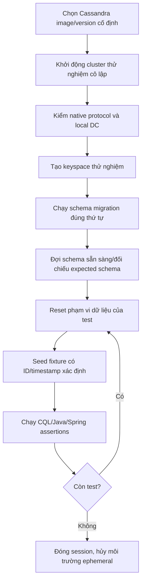

# Tạo/reset keyspace, schema và dữ liệu mẫu khi kiểm thử tích hợp Apache Cassandra

## 1. Vì sao kiểm thử tích hợp Cassandra cần một quy trình tạo và reset dữ liệu riêng?

Trong module **DATABASE_ENGINE_WIDE_COLUMN_CASSANDRA**, Apache Cassandra được học như một hệ quản trị **wide-column phân tán**: **partition key** quyết định nơi lưu partition, bảng được thiết kế theo truy vấn, dữ liệu được nhân bản với **replication factor (RF)** và ứng dụng Java truy vấn với consistency level phù hợp. Những đặc tính đó cũng xuất hiện trong kiểm thử tích hợp: schema sai, keyspace chưa có, replica không đủ hoặc dữ liệu còn sót từ test trước đều có thể làm bài test không đáng tin.

Ví dụ service Java có API:

```text
GET /orders/{orderId}
POST /orders/{orderId}/paid
GET /customers/{customerId}/orders
```

Một unit test dùng mock repository chỉ kiểm logic Java. Nó không phát hiện chắc chắn các vấn đề như:

- `@Table`/`@Column` của Spring Data không khớp CQL.
- `PRIMARY KEY` được định nghĩa sai, khiến truy vấn theo `customer_id` bị Cassandra từ chối.
- Java Driver dùng sai tên datacenter hoặc cấu hình CL không phù hợp với RF.
- Dữ liệu mẫu được tạo hai lần, thứ tự giữa các test khác nhau hoặc bị test khác xóa.
- CQL `CREATE TABLE IF NOT EXISTS` âm thầm giữ một schema cũ không đúng kỳ vọng.
- `TRUNCATE` bị chạy nhầm vào keyspace dùng chung.
- Một câu DDL vừa hoàn thành trên coordinator nhưng metadata chưa sẵn sàng ở các node khác.

**Kiểm thử tích hợp tốt phải có trạng thái đầu vào xác định, chạy lại được, có ranh giới phá hủy dữ liệu rõ và kiểm tra cả kết quả thực từ Cassandra.**

Bài này thuộc chương **Kiểm thử tích hợp** và tập trung vào chủ đề trực tiếp: **tạo/reset keyspace, schema và dữ liệu mẫu**. Các ví dụ dựa trên Cassandra CQL, Java Driver 4.x, JUnit 5, Testcontainers và Spring Boot/Spring Data Cassandra; đồng thời nêu giới hạn của cluster thử nghiệm một node.

### Mục tiêu học tập

Sau bài học, bạn có thể:

1. Thiết kế vòng đời test: **khởi động Cassandra → tạo keyspace → tạo schema → seed dữ liệu → chạy assertions → reset/teardown**.
2. Chọn mô hình isolation: container riêng, keyspace theo suite, bảng theo class hoặc dữ liệu theo test.
3. Dùng CQL để dựng schema có partition/clustering key và tạo fixture có UUID, timestamp, trạng thái ổn định.
4. Phân biệt `TRUNCATE`, `DELETE`, `DROP TABLE/KEYSPACE` và cách chọn reset phù hợp.
5. Viết integration test Java Driver/JUnit với Cassandra thật bằng Testcontainers.
6. Bố trí thứ tự khởi tạo schema **trước** khi Spring Boot tạo `CqlSession`/repositories cần keyspace.
7. Chặn nguy cơ xóa nhầm dữ liệu thật, tránh test cạnh tranh và ổn định hóa CI.
8. Xác định những điều một node RF=1 **không** kiểm chứng được về quorum, failover, repair và multi-DC.

## 2. Vòng đời chuẩn cho một bộ integration tests



**Nguyên tắc bất biến:** trong một test bình thường, dữ liệu lúc bắt đầu test phải được xác định bởi **schema version + fixture**, không bởi thứ tự các test khác đã chạy. Mọi thao tác xóa hoặc reset phải nhắm vào **môi trường test được cách ly**, không dùng cùng một keyspace với staging/production.

### Ba lớp trạng thái phải quản lý

| Lớp | Ví dụ | Tần suất tạo/reset gợi ý |
| --- | --- | --- |
| **Hạ tầng Cassandra** | Container, network, node, Cassandra version | Theo test class/suite hoặc test run |
| **Schema** | Keyspace, UDT, table, index, table options | Khi khởi tạo môi trường hoặc đổi migration |
| **Dữ liệu fixture** | Order IDs, customer IDs, status, timestamps | Trước mỗi test cần isolation hoặc theo một bộ test bất biến |

Đừng mặc định **DROP/CREATE toàn bộ keyspace trước mỗi test method**. Cassandra DDL có chi phí metadata/schema propagation; nếu tạo hàng trăm keyspace/table liên tục, test chậm, dễ flake và có thể đo overhead DDL thay vì behavior ứng dụng.

## 3. Keyspace thử nghiệm: chọn tên, RF và replication strategy

### 3.1. Một keyspace dành riêng cho integration test

Trong một môi trường Testcontainers **một node** với datacenter được kiểm chứng là `datacenter1`:

```sql
CREATE KEYSPACE IF NOT EXISTS commerce_it
WITH replication = {
    'class': 'NetworkTopologyStrategy',
    'datacenter1': 1
}
AND durable_writes = true;
```

Đây là cấu hình **chỉ dành cho lab một node**, không phải mẫu RF cho production. Khi Cassandra thực tế ở DC `dc1`, phải thay `datacenter1` thành `dc1`. Tên DC cần xác minh bằng:

```sql
SELECT data_center, release_version
FROM system.local;
```

`system.local` là thông tin của **node đang kết nối**, không phải bằng chứng rằng mọi node trong cluster có cùng version/metadata.

Với RF=1:

- Một câu lệnh `LOCAL_ONE` có thể phục vụ khi replica duy nhất khỏe.
- `LOCAL_QUORUM` theo RF=1 cũng cần một replica, **không thể mô phỏng** khả năng chịu mất một node của RF=3.
- Không thể chứng minh replication, coordinator failover, quorum giữa nhiều replica, repair nhiều node hoặc phân vùng mạng liên DC.
- Vẫn kiểm được cú pháp CQL, schema mapping, prepared statements, kiểu dữ liệu, TTL và nhiều logic ứng dụng.

**Kết luận:** Testcontainers một node phù hợp để kiểm **tính tích hợp Java–Cassandra**, nhưng không thay thế bài test topology/consistency ở cluster nhiều node.

### 3.2. Nên dùng `SimpleStrategy` hay `NetworkTopologyStrategy`?

| Trường hợp | Cân nhắc | Giới hạn |
| --- | --- | --- |
| Lab nhỏ, chỉ kiểm CQL | `SimpleStrategy` với RF=1 có thể đủ | Không phản ánh phân bố theo DC sản xuất |
| Testcontainers một DC và muốn giữ schema gần production | `NetworkTopologyStrategy` với đúng DC và RF=1 | Vẫn chỉ có một replica |
| Staging nhiều DC | `NetworkTopologyStrategy` với RF theo từng DC thật | Tốn tài nguyên nhưng kiểm được hành vi liên DC |
| Test failover/repair/quorum | Cluster nhiều node, RF ≥ 3 theo kế hoạch | Không thực hiện bằng mock hoặc một node RF=1 |

Nếu production dùng `NetworkTopologyStrategy`, nên ưu tiên test schema cùng strategy khi môi trường cho phép, **nhưng không copy RF=3 vào container một node** rồi cố làm mọi truy vấn với `LOCAL_QUORUM`.

### 3.3. Guard trước các lệnh phá hủy

Một tên keyspace `commerce_it` chỉ là **một biện pháp**, chưa phải bảo vệ đầy đủ. Môi trường test nên đồng thời có:

1. Cassandra instance/container **ephemeral**, không dùng endpoint thật của production.
2. Credential chỉ cấp cho môi trường thử nghiệm.
3. Danh sách endpoint/cluster ID được phép chạy reset.
4. Keyspace name được kiểm **prefix/allowlist** như `_it` hoặc `it_` theo quy ước.
5. Một cờ test-run explicit nếu runner có hỗ trợ thao tác `DROP`/`TRUNCATE`.
6. Audit log của mọi lệnh reset, đặc biệt trên CI.
7. Quyền Cassandra production **không cho phép** bộ test reset dữ liệu.

Không xây một helper `resetKeyspace(String name)` cho phép nhận chuỗi bất kỳ từ request hoặc environment variable rồi thực thi `DROP KEYSPACE`.

## 4. Thiết kế schema CQL cho fixture đơn hàng

Giả sử test cần kiểm hai mẫu truy vấn:

- Đọc đơn hàng theo `order_id`.
- Liệt kê đơn hàng của một khách theo `customer_id` và thứ tự thời gian.

Trong Cassandra, mỗi mẫu có thể cần một bảng riêng. Tạo schema:

```sql
CREATE TABLE IF NOT EXISTS commerce_it.orders_by_id (
    order_id uuid PRIMARY KEY,
    customer_id uuid,
    status text,
    total_minor bigint,
    created_at timestamp,
    updated_at timestamp
);

CREATE TABLE IF NOT EXISTS commerce_it.orders_by_customer (
    customer_id uuid,
    created_at timestamp,
    order_id uuid,
    status text,
    total_minor bigint,
    PRIMARY KEY ((customer_id), created_at, order_id)
) WITH CLUSTERING ORDER BY (created_at DESC, order_id ASC);
```

Với `orders_by_id`, partition key là `order_id`. Với `orders_by_customer`, partition key là `customer_id` và hai clustering columns là `created_at`, `order_id`. Dùng đầy đủ clustering keys tránh ghi đè bản ghi cùng thời điểm.

Ví dụ truy vấn hợp lệ:

```sql
SELECT order_id, status, total_minor
FROM commerce_it.orders_by_id
WHERE order_id = ?;

SELECT created_at, order_id, status
FROM commerce_it.orders_by_customer
WHERE customer_id = ?;
```

**Không** dùng `ALLOW FILTERING` để sửa bài test truy vấn sai khóa. Một bài test đáng tin nên xác nhận **CQL thực tế của repository/service phù hợp partition key** và kết quả đúng theo thứ tự clustering.

### 4.1. Mở rộng schema với UDT, collection và TTL khi test yêu cầu

Đừng tạo mọi kiểu dữ liệu có thể có trong một fixture duy nhất. Nếu chức năng cần kiểm **UDT**:

```sql
CREATE TYPE IF NOT EXISTS commerce_it.delivery_address (
    street text,
    city text,
    postal_code text
);

CREATE TABLE IF NOT EXISTS commerce_it.order_shipments_by_id (
    shipment_id uuid PRIMARY KEY,
    order_id uuid,
    address frozen<commerce_it.delivery_address>,
    labels set<text>,
    created_at timestamp
);
```

Nếu cần kiểm TTL, tạo bảng hoặc thao tác ghi có `USING TTL` rõ ràng. **Không thay đổi `default_time_to_live` của bảng dữ liệu chung** chỉ để một case test được hết hạn, vì có thể làm các case khác mất fixture.

### 4.2. Schema migration và seed dữ liệu là hai khâu khác nhau

- **Migration** mô tả DDL phải có trước khi chạy ứng dụng: keyspace, table, type, index, option.
- **Seed/fixture** tạo hàng thử với trạng thái kiểm chứng được.
- **Reset** làm sạch dữ liệu từ test trước nhưng không nhất thiết thay đổi schema.
- **Assertion** kiểm contract của CQL, mapper và nghiệp vụ.

Dữ liệu mẫu không nên chứa `CREATE TABLE` trong cùng một hàm ngẫu nhiên chạy giữa từng test. Giữ thứ tự khởi tạo tường minh và ghi lại migration version ứng với fixture.

## 5. Tạo dữ liệu mẫu xác định: UUID, timestamp và currency

Ví dụ các giá trị cố định cho test:

```sql
INSERT INTO commerce_it.orders_by_id (
    order_id, customer_id, status, total_minor, created_at, updated_at
) VALUES (
    11111111-1111-1111-1111-111111111111,
    22222222-2222-2222-2222-222222222222,
    'CREATED',
    120000,
    '2025-03-10T09:00:00Z',
    '2025-03-10T09:00:00Z'
);

INSERT INTO commerce_it.orders_by_customer (
    customer_id, created_at, order_id, status, total_minor
) VALUES (
    22222222-2222-2222-2222-222222222222,
    '2025-03-10T09:00:00Z',
    11111111-1111-1111-1111-111111111111,
    'CREATED',
    120000
);
```

**Vì sao dùng giá trị cố định?**

- Có thể assert chính xác `order_id`, `total_minor`, `status` và thời gian.
- Chạy test hai lần cho cùng kết quả đầu vào.
- Dễ log/đối chiếu khi CI thất bại.
- Không dùng `now()` tùy tiện trong case cần so sánh timestamp chính xác.
- Không dùng `double` cho số tiền; trong ví dụ là **minor units** (`bigint`), contract phải ghi rõ loại tiền và độ lớn.

**Lưu ý:** hai `INSERT` ở hai partition/table **không phải một transaction ACID đa bảng**. Test cần xác minh service có trách nhiệm duy trì denormalization hoặc dùng event/workflow để phục hồi sai lệch; reset dữ liệu cũng không được dựa vào giả định “hai bảng sẽ bị xóa nguyên tử”.

### 5.1. Idempotent seed khác với idempotent workflow

Chạy lại `INSERT` với **cùng primary key và giá trị cố định** có thể cho kết quả data cuối trông giống nhau, nhưng **không** nên suy rằng mọi thao tác retry đều an toàn:

- `list_column = list_column + ['x']` có thể thêm trùng.
- Counter update có thể cộng hai lần.
- Ghi dùng TTL tương đối có thể thay thời điểm hết hạn.
- Mutation đến trễ hoặc timestamp tranh chấp có thể thay giá trị ngoài ý muốn.

Khi seed fixture, ưu tiên **ghi giá trị cụ thể với key cố định** trên môi trường vừa reset, thay vì phụ thuộc vào “chạy thêm một lần sẽ không sao”.

### 5.2. Dùng builder Java thay vì ghép chuỗi CQL

```java
import java.time.Instant;
import java.util.UUID;

UUID orderId = UUID.fromString(
    "11111111-1111-1111-1111-111111111111");
UUID customerId = UUID.fromString(
    "22222222-2222-2222-2222-222222222222");
Instant createdAt = Instant.parse("2025-03-10T09:00:00Z");

PreparedStatement insertOrder = session.prepare(
    "INSERT INTO commerce_it.orders_by_id " +
    "(order_id, customer_id, status, total_minor, created_at, updated_at) " +
    "VALUES (?, ?, ?, ?, ?, ?)");

session.execute(insertOrder.bind(
    orderId, customerId, "CREATED", 120000L, createdAt, createdAt));
```

Đoạn này giả định đã có `session` và import `PreparedStatement` từ Java Driver 4.x. Với test Java nên **bind dữ liệu bằng prepared statement**, tránh tự ghép timestamp, UUID, dấu nháy hoặc input của người dùng vào CQL.

## 6. Chiến lược reset: TRUNCATE, DELETE hay DROP?

Không có một lệnh reset phù hợp cho mọi test. Chọn theo mức độ cô lập và concurrency.

| Chiến lược | Tác động | Khi phù hợp | Rủi ro |
| --- | --- | --- | --- |
| **Destroy/recreate container** | Tạo Cassandra sạch toàn bộ | Mỗi suite/job cần isolation mạnh | Tốn startup, RAM/CPU |
| **DROP/CREATE keyspace** | Xóa toàn bộ schema và data keyspace | Kiểm migration/schema bootstrap độc lập trên cluster test | DDL đắt, dễ flake, phá hủy rộng |
| **DROP/CREATE table** | Xóa một bảng và dựng lại | Test schema migration riêng | Schema agreement, prepared statement/metadata cũ |
| **TRUNCATE table** | Xóa tất cả dữ liệu trong bảng, giữ schema | Test tuần tự, bảng test độc quyền | Xóa data của test khác; lệnh phá hủy toàn bảng |
| **DELETE theo partition key** | Xóa một partition/hàng theo khóa đã biết | Test song song với namespace riêng | Tombstone, cần track keys, cleanup có thể thất bại |
| **Không xóa, dùng ID riêng** | Mỗi test ghi vào partition khác nhau | Test độc lập/song song, dataset vừa phải | Dữ liệu tích lũy, cần lifecycle tổng thể |

### 6.1. Khi nào dùng `TRUNCATE`?

```sql
TRUNCATE commerce_it.orders_by_id;
TRUNCATE commerce_it.orders_by_customer;
```

`TRUNCATE` xóa **toàn bộ row của bảng**, không có `WHERE`. Cassandra xử lý truncation khác với `DELETE` từng hàng; không dùng nó trên bảng được chia sẻ giữa những test đang chạy song song.

**Thứ tự reset ở ví dụ hai bảng:**

1. Dừng/đợi tất cả tác vụ của test trước thực sự hoàn tất.
2. `TRUNCATE` cả hai bảng thuộc **suite độc quyền**.
3. Seed lại dữ liệu mẫu.
4. Đợi/kiểm query trả đúng fixture.
5. Mở test kế tiếp.

Nếu đang có write bất đồng bộ từ test trước, `TRUNCATE` xong chưa chắc kết quả sẽ sạch vĩnh viễn: request cũ có thể **ghi đến sau** lệnh truncate. Test teardown phải chờ hoặc hủy có kiểm soát những tác vụ đã phát, tránh race.

### 6.2. `DELETE` theo key và tombstone

```sql
DELETE FROM commerce_it.orders_by_id
WHERE order_id = ?;
```

Nếu test chỉ sở hữu một `order_id` riêng, `DELETE` giữ nguyên dữ liệu test khác. Nhưng:

- Delete của Cassandra tạo **tombstone**, ảnh hưởng read path/compaction khi tích lũy.
- Với bảng clustering, cần xóa đúng partition hoặc clustering row mà test đã tạo.
- Nếu dùng rất nhiều fixture trong một partition chung, xóa từng phần tử có thể tạo tombstone debt lớn.
- Nếu một test cleanup thất bại, test sau không nên giả định môi trường vẫn sạch.

Với test song song, **unique partition keys** là biện pháp isolation chính; cleanup chỉ là lớp phụ và container teardown cuối suite vẫn cần thiết.

### 6.3. `DROP KEYSPACE` không phải rollback test

```sql
-- CHỈ MINH HỌA: thao tác phá hủy, dành cho instance test cô lập.
DROP KEYSPACE commerce_it;
```

Lệnh xóa cả schema và dữ liệu. Khác RDBMS thông thường, Cassandra **không cung cấp transaction rollback tự động** cho DDL/DML qua test framework. Spring `@Transactional` hoặc `@DirtiesContext` **không có nghĩa** mọi CQL write sẽ được rollback hay keyspace đã được reset.

Nên hủy container ephemeral thay vì gọi `DROP KEYSPACE` nhiều lần nếu mục đích chỉ là dọn môi trường sau suite.

## 7. Vì sao cần đợi schema agreement và kiểm schema đúng kỳ vọng?

Trong Cassandra, câu DDL có thể được coordinator tiếp nhận khi schema còn đang lan truyền. Driver cập nhật metadata bất đồng bộ; một câu `CREATE TABLE` thành công không tự đảm bảo tất cả node khả dụng đã thống nhất metadata.

Với Java Driver 4.x:

```java
session.execute(
    "CREATE TABLE IF NOT EXISTS commerce_it.test_marker (" +
    "id uuid PRIMARY KEY, label text)");

if (!session.checkSchemaAgreement()) {
    throw new IllegalStateException("Schema agreement chưa đạt");
}

session.refreshSchema();

boolean exists = session.getMetadata()
    .getKeyspace("commerce_it")
    .flatMap(ks -> ks.getTable("test_marker"))
    .isPresent();

if (!exists) {
    throw new IllegalStateException("Table chưa hiện trong driver metadata");
}
```

Đây là ví dụ **trình tự kiểm soát**, giả định session đã kết nối. Khi dùng keyspace/table khác trong bài, kiểm schema đó. Với một node schema agreement thường đơn giản hơn nhưng vẫn cần đảm bảo API/driver đã biết bảng trước khi prepare statement.

**Ba điều cần phân biệt:**

- **Schema agreement:** các node được kiểm tra có metadata thống nhất theo phiên bản/điều kiện của driver.
- **Expected schema:** bảng/cột/types/primary key có đúng cấu trúc test yêu cầu không?
- **Fixture readiness:** dữ liệu mẫu đã ghi/read-back được ở CL đã chọn chưa?

Một lần `checkSchemaAgreement() == true` **không** chứng minh schema đúng; một lần `getTable(...).isPresent()` **không** chứng minh fixture đúng.

### 7.1. `IF NOT EXISTS` không phải schema migration validation

Giả sử bảng `orders_by_id` đã tồn tại nhưng thiếu cột `total_minor`. Lệnh:

```sql
CREATE TABLE IF NOT EXISTS commerce_it.orders_by_id (...);
```

có thể không báo lỗi vì bảng đã tồn tại, dù schema **khác** DDL mong đợi. Vì vậy:

- Môi trường trống phải chạy migration theo thứ tự.
- Test migration phải xác minh **cấu trúc sau migration** hoặc chạy câu CQL đọc/ghi các cột cần thiết.
- Cần versioned DDL/checksum/ledger nếu kiểm chính luồng migration của dự án.
- Không ghi đè migration cũ đã áp dụng chỉ để test pass.
- Không gọi `ALTER TABLE` từ nhiều instance ứng dụng khi test chạy song song.

**Không dùng sleep cứng 5 giây** như một bảo đảm schema ready. Dùng API/condition có timeout và fail rõ; sleep chỉ có thể hỗ trợ khoảng backoff, không thay expected-state check.

## 8. Testcontainers: khởi động Cassandra thật bằng JUnit 5

**Testcontainers** chạy một image Cassandra trong Docker để integration test nói chuyện với native protocol thật. Đây là lựa chọn phù hợp để kiểm schema, mapping, prepared statements và behavior đơn node.

### 8.1. Dependency cho dự án Spring Boot/Maven

Ví dụ project đã cấu hình Spring Boot parent/BOM và JUnit 5; các dependency thử nghiệm:

```xml
<dependencies>
    <dependency>
        <groupId>org.springframework.boot</groupId>
        <artifactId>spring-boot-starter-data-cassandra</artifactId>
    </dependency>

    <dependency>
        <groupId>org.springframework.boot</groupId>
        <artifactId>spring-boot-starter-test</artifactId>
        <scope>test</scope>
    </dependency>

    <dependency>
        <groupId>org.testcontainers</groupId>
        <artifactId>cassandra</artifactId>
        <scope>test</scope>
    </dependency>

    <dependency>
        <groupId>org.testcontainers</groupId>
        <artifactId>junit-jupiter</artifactId>
        <scope>test</scope>
    </dependency>
</dependencies>
```

**Quan trọng về version:** mẫu Java bên dưới dùng **API Testcontainers 1.x** với `org.testcontainers.containers.CassandraContainer`. Các dòng Testcontainers mới có thể khác package/module API; dùng đúng tọa độ và tài liệu bản đang khóa. BOM của Spring Boot chỉ quản lý các version được nó hỗ trợ, **không đảm bảo tự động chọn đúng mọi tổ hợp Testcontainers/Cassandra/Driver/JDK**.

Chọn image **pinned tag hoặc digest đã xác minh**; ví dụ bài dùng `cassandra:4.1.6` chỉ làm mốc minh họa, **không khẳng định đây là bản mới nhất hay bản nên chạy production**. Cần thay bằng bản Cassandra tương thích với môi trường thực tế và chính sách bảo mật.

### 8.2. Một integration test hoàn chỉnh dùng driver 4.x

Ví dụ kiểm độc lập với Spring context để dễ thấy **khi nào keyspace/table/data được tạo và reset**:

```java
import static org.junit.jupiter.api.Assertions.*;

import java.net.InetSocketAddress;
import java.time.Instant;
import java.util.UUID;

import org.junit.jupiter.api.AfterAll;
import org.junit.jupiter.api.BeforeAll;
import org.junit.jupiter.api.BeforeEach;
import org.junit.jupiter.api.Test;
import org.testcontainers.containers.CassandraContainer;
import org.testcontainers.junit.jupiter.Container;
import org.testcontainers.junit.jupiter.Testcontainers;
import org.testcontainers.utility.DockerImageName;

import com.datastax.oss.driver.api.core.CqlSession;
import com.datastax.oss.driver.api.core.cql.PreparedStatement;
import com.datastax.oss.driver.api.core.cql.Row;

@Testcontainers
class CassandraOrdersIntegrationTest {

    private static final UUID ORDER_ID = UUID.fromString(
        "11111111-1111-1111-1111-111111111111");
    private static final UUID CUSTOMER_ID = UUID.fromString(
        "22222222-2222-2222-2222-222222222222");
    private static final Instant FIXED_TIME =
        Instant.parse("2025-03-10T09:00:00Z");

    @Container
    static CassandraContainer<?> cassandra =
        new CassandraContainer<>(
            DockerImageName.parse("cassandra:4.1.6"));

    private static CqlSession session;
    private static PreparedStatement insertOrder;
    private static PreparedStatement selectOrder;

    @BeforeAll
    static void createSchema() {
        session = CqlSession.builder()
            .addContactPoint(new InetSocketAddress(
                cassandra.getHost(), cassandra.getMappedPort(9042)))
            .withLocalDatacenter("datacenter1")
            .build();

        session.execute(
            "CREATE KEYSPACE IF NOT EXISTS commerce_it " +
            "WITH replication = {" +
            "'class':'NetworkTopologyStrategy','datacenter1':1}");

        session.execute(
            "CREATE TABLE IF NOT EXISTS commerce_it.orders_by_id (" +
            "order_id uuid PRIMARY KEY, " +
            "customer_id uuid, status text, " +
            "total_minor bigint, created_at timestamp)");

        if (!session.checkSchemaAgreement()) {
            throw new IllegalStateException("Schema not in agreement");
        }

        insertOrder = session.prepare(
            "INSERT INTO commerce_it.orders_by_id " +
            "(order_id, customer_id, status, total_minor, created_at) " +
            "VALUES (?, ?, ?, ?, ?)");

        selectOrder = session.prepare(
            "SELECT customer_id, status, total_minor, created_at " +
            "FROM commerce_it.orders_by_id WHERE order_id = ?");
    }

    @BeforeEach
    void resetAndSeed() {
        // Chỉ an toàn vì container và bảng này thuộc class test,
        // test methods không chạy song song.
        session.execute("TRUNCATE commerce_it.orders_by_id");

        session.execute(insertOrder.bind(
            ORDER_ID, CUSTOMER_ID, "CREATED",
            120000L, FIXED_TIME));
    }

    @Test
    void findsSeededOrderByPartitionKey() {
        Row row = session.execute(selectOrder.bind(ORDER_ID)).one();

        assertNotNull(row);
        assertEquals(CUSTOMER_ID, row.getUuid("customer_id"));
        assertEquals("CREATED", row.getString("status"));
        assertEquals(120000L, row.getLong("total_minor"));
        assertEquals(FIXED_TIME, row.getInstant("created_at"));
    }

    @Test
    void doesNotLeakDataFromPreviousTest() {
        UUID otherId = UUID.fromString(
            "33333333-3333-3333-3333-333333333333");

        Row row = session.execute(selectOrder.bind(otherId)).one();
        assertNull(row);
    }

    @AfterAll
    static void closeDriverSession() {
        if (session != null) {
            session.close();
        }
        // @Testcontainers dừng container sau lifecycle của class.
    }
}
```

**Điều kiện để chạy ví dụ:**

- Docker/compatible container runtime phải sẵn sàng.
- Image phải tồn tại và phiên bản Testcontainers, Java Driver, JUnit phải tương thích.
- `datacenter1` là tên DC ví dụ cần **kiểm lại theo image/cấu hình**; nếu container được cấu hình `dc1`, sửa cả replication map và `withLocalDatacenter`.
- Lệnh `TRUNCATE` chỉ chấp nhận được khi **class sở hữu độc quyền** bảng và JUnit không chạy method song song trên cùng instance.
- Ví dụ seed **một** bảng; nếu service dùng cả `orders_by_id` và `orders_by_customer`, phải tạo/reset/seed đầy đủ cả hai rồi kiểm đọc đúng.
- Nó đo CQL trực tiếp, **không** chứng minh Spring Data mapping/repository; cần bài test Spring Boot riêng.
- Dùng tag Cassandra phù hợp với server production; môi trường một node không kiểm được quorum RF=3.

### 8.3. Vì sao `@BeforeAll` và `@BeforeEach` có vai trò khác?

| Hook | Nhiệm vụ nên làm | Tránh |
| --- | --- | --- |
| `@BeforeAll` | Khởi tạo `CqlSession`, tạo schema một lần, prepare CQL | Tạo/drop keyspace sau mỗi test |
| `@BeforeEach` | Reset dữ liệu trong vùng test sở hữu và seed fixture xác định | Sửa schema trong lúc các test khác đang chạy |
| `@Test` | Thực hiện yêu cầu nghiệp vụ và assert dữ liệu thật | Ngầm phụ thuộc vào test chạy trước |
| `@AfterEach` | Dọn partition/side effect riêng nếu cần | Xóa bảng thuộc test đang song song |
| `@AfterAll` | Đóng session và tài nguyên ứng dụng | Đóng container trước khi task async đã kết thúc |
| Testcontainers extension | Quản lý container theo vòng đời class/suite | Dùng lại container đã bị dừng để chạy test tiếp |

Với suite rất nhiều test, khởi động Cassandra cho từng method thường làm tổng thời gian chậm và tăng nguy cơ timeout CI. Hãy chọn scope phù hợp thay vì “càng sạch càng tốt” mà không cân nhắc chi phí.

## 9. Spring Boot: phải tạo keyspace trước khi application context khởi động

Một điểm hay gặp với `@SpringBootTest`: Spring Boot tạo `CqlSession`, `CassandraTemplate`, repository và các bean phụ thuộc **trong quá trình refresh ApplicationContext**. Nếu property `spring.cassandra.keyspace-name=commerce_it` đã được set nhưng keyspace **chưa tồn tại**, context có thể lỗi trước khi `@BeforeAll` của test kịp chạy.

**Do đó, việc tạo keyspace phải hoàn thành trước khi Spring khởi tạo các bean phụ thuộc Cassandra.**

### 9.1. Hai phương án an toàn

**Phương án A — Init script của Testcontainers trước khi Spring context load**

- Container khởi động với một script CQL từ test resources **đúng API Testcontainers version**.
- Script tạo keyspace, UDT, bảng/fixtures nền theo thứ tự.
- `@DynamicPropertySource` cung cấp contact points, port, DC và keyspace.
- Khi Spring context được tạo, schema đã tồn tại.

Ví dụ ý tưởng với Testcontainers 1.x hỗ trợ `withInitScript`:

```java
@Container
static CassandraContainer<?> cassandra =
    new CassandraContainer<>(
        DockerImageName.parse("cassandra:4.1.6"))
        .withInitScript("cassandra/commerce-it-schema.cql");
```

Đường dẫn là **resource test trong dự án của người học**, không phải file được tạo bởi bài viết này. Nếu phiên bản Testcontainers cụ thể không hỗ trợ method/constructor tương ứng hoặc cần startup script mechanism khác, dùng API phù hợp tài liệu bản đó.

**Phương án B — Khởi tạo container + schema trong bootstrap chạy trước context**

Tạo một helper Java test-only:

```text
TestBootstrap.startContainer()
    -> connect CqlSession (không chọn keyspace chưa tồn tại)
    -> execute CREATE KEYSPACE
    -> execute versioned migrations
    -> verify agreement/expected schema
    -> publish mapped host/port to Spring
    -> start @SpringBootTest ApplicationContext
```

Trong trường hợp này **không** đợi `@BeforeAll` nếu Spring context cần keyspace khi startup. Cần quản lý singleton/container lifecycle và Spring context caching, tránh một context được cache tiếp tục trỏ vào container đã stop.

### 9.2. Dynamic properties cho Spring Boot hiện đại

Ví dụ trong một test class mà container/schema **đã được khởi tạo trước khi Spring context refresh**:

```java
import org.springframework.test.context.DynamicPropertyRegistry;
import org.springframework.test.context.DynamicPropertySource;

// cassandra là CassandraContainer đã start và có commerce_it schema.
@DynamicPropertySource
static void cassandraProperties(DynamicPropertyRegistry registry) {
    registry.add("spring.cassandra.contact-points", cassandra::getHost);
    registry.add(
        "spring.cassandra.port", () -> cassandra.getMappedPort(9042));
    registry.add("spring.cassandra.local-datacenter", () -> "datacenter1");
    registry.add("spring.cassandra.keyspace-name", () -> "commerce_it");
    registry.add("spring.cassandra.schema-action", () -> "NONE");
}
```

**Quan trọng:** snippet này **không tự khởi động container hay tạo schema**; nó chỉ xuất property cho Spring. Phải ghép với phương án A/B ở trên, đúng thứ tự lifecycle. Spring Boot version cũ có thể dùng prefix/property khác; kiểm documentation của bản dự án.

### 9.3. Kiểm thử repository thay vì chỉ kiểm driver

Ví dụ khi dự án đã có entity/repository:

```java
import static org.junit.jupiter.api.Assertions.*;

import java.util.UUID;
import org.junit.jupiter.api.Test;
import org.springframework.beans.factory.annotation.Autowired;
import org.springframework.boot.test.context.SpringBootTest;

@SpringBootTest
class OrderRepositoryIntegrationTest {

    @Autowired
    OrderRepository repository;

    @Test
    void canReadExpectedOrder() {
        UUID id = UUID.fromString(
            "11111111-1111-1111-1111-111111111111");

        OrderEntity actual = repository.findById(id).orElseThrow();

        assertEquals("CREATED", actual.getStatus());
    }
}
```

`OrderRepository`, `OrderEntity` và fixture được tạo trước test là thành phần **giả định của ứng dụng**. Snippet minh họa mục tiêu test **mapping Spring Data**; để chạy thật phải định nghĩa entity với `@Table/@PrimaryKey/@Column`, repository tương ứng và seed phù hợp. Không coi snippet tự thân là một test project đầy đủ.

**Không nhầm `@DirtiesContext` với reset dữ liệu Cassandra**: annotation đó đánh dấu Spring context cần hủy/tạo lại, **không rollback mutation** trên cluster.

## 10. Migration runner: nên test schema thật của sản phẩm

Nếu production quản lý DDL trong Git, integration test cần cố gắng áp dụng **chính các migration CQL đó**, thay vì một phiên bản schema chép tay và có nguy cơ sai lệch.

### 10.1. Trình tự versioned migrations

```text
V001__create_keyspace.cql
V002__create_orders_by_id.cql
V003__create_orders_by_customer.cql
V004__add_updated_at.cql
V005__add_delivery_address.cql
```

Đây là **quy ước đặt tên minh họa**, không phải công cụ Cassandra tự động nhận dạng file. Cần một runner có trách nhiệm:

1. Chỉ chạy trên cluster test đã cho phép.
2. Chọn đúng keyspace/source version.
3. Sắp xếp migration theo version đã được review.
4. Lưu version/checksum/histories theo cơ chế runner.
5. Không chạy trùng từ nhiều test threads/processes nếu cùng keyspace.
6. Đợi schema sẵn sàng, kiểm expected structure.
7. Fail rõ nếu checksum/schema khác, không dùng `IF NOT EXISTS` để bỏ qua drift.

Cassandra **không bảo đảm transaction DDL đa statement với rollback** như nhiều RDBMS. Nếu migration thứ ba lỗi, schema có thể đã chứa hai migration đầu. Với test ephemeral, có thể hủy và dựng lại môi trường; với production cần runbook forward-fix.

### 10.2. Không split CQL script bằng dấu chấm phẩy đơn giản

Một file CQL có thể chứa chuỗi, comment hoặc cấu trúc đặc biệt. `split(";")` có thể tạo câu lệnh sai. Dùng công cụ/parser phù hợp với CQL và version, hoặc biểu diễn mỗi câu lệnh riêng trong migration runner có kiểm soát.

### 10.3. Kiểm compatibility của schema, không chỉ “CREATE thành công”

Sau migration, xác minh:

- Tên keyspace và replication strategy/RF.
- Partition key/clustering key có đúng thứ tự.
- Các cột `uuid`, `bigint`, `timestamp`, `text` map đúng kiểu Java.
- UDT và table options nếu nghiệp vụ dùng.
- Câu SELECT/INSERT/UPDATE/LWT cụ thể chạy được với prepared statements.
- Quyền role ứng dụng đã đủ mà không cần superuser.
- Không còn schema disagreement ở các node cần kiểm.

**Một migration test chỉ khởi động được ứng dụng nhưng không chạy query nghiệp vụ** chưa đủ chứng minh schema tương thích.

## 11. Isolation giữa các tests: cùng container không có nghĩa cùng dữ liệu

### 11.1. Test tuần tự: reset bảng trước method

Với mỗi test sở hữu độc quyền bảng:

```java
@BeforeEach
void reset() {
    session.execute("TRUNCATE commerce_it.orders_by_id");
    session.execute("TRUNCATE commerce_it.orders_by_customer");
    seedOrders(session);
}
```

`seedOrders` là helper test do ứng dụng định nghĩa; seed đúng cả hai bảng. **Không** chạy pattern này nếu nhiều test method/class đang song song hoặc có worker đang dùng chung keyspace.

### 11.2. Test song song: partition key khác nhau

Một cách nhẹ hơn:

```java
UUID orderId = UUID.randomUUID();
UUID customerId = UUID.randomUUID();
```

Mỗi test dùng key riêng và lưu ID trong phạm vi test, không dùng một hằng ID chung như ví dụ tuần tự. Ưu tiên **scope dữ liệu bằng request/test ID**, bảo đảm không có `SELECT` toàn bảng hoặc query không lọc partition key.

Nếu muốn tái hiện lỗi, log seed/test ID ở mức an toàn hoặc dùng ID xác định từ test case + run ID. Random UUID giúp isolation nhưng bản thân nó không làm fixture deterministic nếu test logic phụ thuộc giá trị ID cụ thể.

### 11.3. Bảng reset sau test hay hủy container?

| Mục tiêu | Chiến lược thường phù hợp |
| --- | --- |
| Nhanh, test method tuần tự, dữ liệu nhỏ | Một container/class, `TRUNCATE` trước method |
| Nhiều test class chạy song song | Container/keyspace độc lập cho từng class hoặc ID độc lập |
| Test schema migration từ đầu | Container/keyspace mới cho từng migration scenario |
| Test dữ liệu cực lớn/tombstone pressure | Separate dataset/container, giới hạn reuse |
| Test retry/async write | Đợi completion và đối soát trước reset |
| Test restore/repair/topology | Môi trường phân tán chuyên dụng thay vì reset đơn bảng |

Không cần “mọi test dùng database hoàn toàn mới” nếu chi phí không phù hợp, nhưng phải **chứng minh isolation** bằng cách chạy lại test riêng lẻ, đổi thứ tự và chạy concurrent khi suite cho phép.

## 12. Fixture phức tạp: thời gian, TTL, LWT và dữ liệu không đồng bộ

### 12.1. Timestamp phải có độ chính xác phù hợp

CQL `timestamp` có độ chính xác **millisecond**. Nếu Java seed `Instant` có nanoseconds, round-trip có thể bị cắt:

```java
Instant seed = Instant.parse("2025-03-10T09:00:00.123Z");
// Dùng giá trị đã ở độ chính xác millisecond để assert equality.
```

Không phụ thuộc `System.currentTimeMillis()`/`Instant.now()` nếu test cần timestamp bằng một giá trị cụ thể, trừ khi assertion có tolerance và logic thời gian thực sự là phần được kiểm.

### 12.2. Test TTL và tính nhất quán theo thời gian

Ví dụ:

```sql
INSERT INTO commerce_it.expiring_orders_by_id (
    order_id, status
) VALUES (?, 'TEMPORARY')
USING TTL 3;
```

Đây là CQL minh họa **khi bảng `expiring_orders_by_id` đã được tạo**. TTL là số giây tương đối, không phải wall-clock freeze được tự động hỗ trợ bởi Testcontainers. Test có thể:

1. Ghi row với TTL hợp lý.
2. Xác nhận row thấy được ban đầu.
3. Dùng polling có deadline (ví dụ Awaitility) chờ đến khi không còn thấy row.
4. Giữ biên độ thời gian đủ cho scheduling/CI, không assert hết hạn chính xác tại một nanosecond.
5. Không dùng TTL ngắn để **dọn** fixture của mọi test khác.

Dùng `Thread.sleep(3000)` rồi assert có thể flake vì scheduling, GC, độ trễ mạng và thời gian thực của Cassandra không do clock mock trong Java điều khiển.

### 12.3. LWT và kết quả chưa xác định

Một test `INSERT ... IF NOT EXISTS` cần kiểm:

- Lần đầu `[applied]=true`.
- Lần sau cùng primary key `[applied]=false`.
- Payload cũ không bị ghi đè khi attempt mới có giá trị khác.
- Khi giả lập timeout, không khẳng định mutation chưa xảy ra; dùng read-back/reconciliation theo logical request ID.

Đây là phần liên kết với **retry/error handling** của Java Driver: reset dữ liệu giữa hai bước của một bài test LWT có thể làm mất chính hiện tượng mà test định kiểm.

### 12.4. Test async phải đợi request kết thúc

```java
CompletionStage<AsyncResultSet> stage =
    session.executeAsync(insertStatement);

// Chỉ minh họa: test cần chờ stage với deadline hợp lý,
// assert thành công/lỗi, sau đó mới reset fixture.
```

Nếu `@AfterEach` chạy `TRUNCATE` trong lúc async write chưa có completion, write có thể đến sau và làm bẩn test tiếp theo. Trong test, dùng timeout có giới hạn khi đợi completion; **không** block driver callback/event loop và không tự retry mutation khi kết quả chưa rõ.

## 13. Những điều một node Testcontainers không thể kiểm chứng

Cassandra một node rất hữu ích cho integration tests, nhưng những yêu cầu dưới đây cần mô hình khác:

| Tính năng cần kiểm | Một node RF=1 có đủ? | Môi trường cần thiết |
| --- | --- | --- |
| CQL parse, prepared statements, bind types | **Có** | Một node thật |
| Spring Data mapping/entity/UDT | **Có** | Một node thật, schema đúng |
| Partition key và primary key CQL | **Có**, về cú pháp/hành vi query | Một node thật |
| TTL, tombstone behavior cơ bản | Phần lớn có | Một node và timing kiểm soát |
| Quorum RF=3 | **Không** | Tối thiểu đủ replica, topology thực |
| Node down nhưng `LOCAL_QUORUM` vẫn phục vụ | **Không** | Multi-node với RF=3 |
| Consistency giữa nhiều DC | **Không** | Multi-DC |
| Hinted handoff/repair giữa replica | **Không** | Nhiều replica |
| Bootstrap/replace/decommission | **Không** | Cluster nhiều node |
| Phân vùng mạng/rolling upgrade | **Không** | Testbed/choreography phân tán |
| Hiệu năng production p99/compaction | **Không thể suy từ lab nhỏ** | Dữ liệu/tải/hardware đại diện |

**Không cố sửa bài test RF=3 bằng cách tăng RF trên một node rồi chờ quorum thành công.** Tăng RF trên một instance không tạo thêm replica thực.

Nếu hệ thống yêu cầu chứng minh correctness tại `LOCAL_QUORUM` RF=3 hoặc sự cố một node, có thể dùng môi trường staging riêng hay cluster multi-node container; điều phối lifecycle/địa chỉ/ports và tài nguyên phải được thiết kế riêng, không cố nhét hết vào một unit test.

## 14. CI/CD: ổn định startup, cô lập môi trường và báo lỗi rõ

### 14.1. Các nguyên nhân flake thường gặp

| Triệu chứng | Nguyên nhân có thể | Kiểm tra |
| --- | --- | --- |
| `Connection refused` sau container start | Cassandra chưa sẵn native protocol | Readiness/wait strategy của Testcontainers, container logs |
| `InvalidQuery: Keyspace does not exist` khi Spring context load | Bootstrap schema chạy sau context | Tạo keyspace trước refresh context |
| `Cannot find local DC` | DC trong driver không khớp `system.local` | Kiểm `data_center` và cấu hình |
| `Unavailable` trên container một node | RF/CL không phù hợp số replica thực | Kiểm NTS RF=1 và CL test |
| DDL ngẫu nhiên fail | Test chạy schema mutation song song | Tập trung migration/bootstrap, đợi agreement |
| Test A pass riêng, fail khi chạy cả suite | Shared fixture/reset xung đột | Unique keys hoặc keyspace/container riêng |
| Test pass local, timeout CI | Thiếu CPU/RAM/Docker, startup chậm, GC | CI resources, image cache, logs và time budgets |
| Test TTL flake | Sleep cố định và đồng hồ thực | Poll có deadline/tolerance |
| Test Spring Data pass nhưng dữ liệu raw sai | Mapping/converter hoặc schema lệch | Đọc raw CQL kiểm type/giá trị |
| Test chỉ pass lần đầu | Dữ liệu/DDL cũ tồn tại, seed không reset | Ephemeral run và schema drift check |
| `Too many tombstones` sau hàng nghìn tests | Repeated `DELETE` cùng table/partition | Đổi isolation/teardown, giảm tích lũy |
| Process kết thúc nhưng container vẫn chạy | Resource cleanup không được thực hiện | Testcontainers lifecycle/CI cleanup policy |

### 14.2. Tài nguyên và tốc độ

- Pin image/tag/digest theo policy; tránh `latest` thay đổi ngoài ý muốn.
- Cấp CPU/RAM/disk đủ cho Cassandra startup và compaction; không chạy hàng chục container cùng lúc trên máy CI nhỏ.
- Testcontainers có cơ chế wait/readiness; không dùng `Thread.sleep(10000)` làm thay thế cho việc xác định native protocol đã sẵn sàng.
- Ghi Cassandra logs và kết quả CQL/schema nếu test fail, nhưng không dump mật khẩu hoặc dữ liệu nhạy cảm.
- Phân tách **fast integration tests** (một node) và **distributed/system tests** (nhiều node/DC) trong pipeline.
- Gắn label/test environment và dọn container đúng lifecycle; không chia sẻ instance ephemeral giữa hai job độc lập nếu không có cơ chế cách ly.
- Với test chạy song song, điều chỉnh concurrency của test framework và giới hạn resource cùng lúc; không chỉ bật parallel=true rồi hy vọng Cassandra chịu được.

### 14.3. Không benchmark production bằng fixture nhỏ

Một container một node với vài trăm row chỉ xác nhận correctness cơ bản. Nó không đại diện cho:

- Partition chứa hàng triệu rows/tombstones.
- RF=3, multi-DC, network jitter và coordinator load.
- Compaction/repair và disk I/O dưới traffic thật.
- p99 latency, throughput, backpressure/retry storm của service Java.

Hiệu năng cần benchmark riêng với workload/dataset đại diện và tiêu chí stop condition; test tích hợp không nên fail ngẫu nhiên vì assert một số mili giây cố định trên máy CI chia sẻ.

## 15. Runbook tạo/reset fixture an toàn

### Pha A — Chuẩn bị

1. Chốt test scope: một node CQL/mapping hay multi-node consistency/replication.
2. Chọn Cassandra Server image/version và Java Driver/Spring Boot/Testcontainers tương thích.
3. Xác định cluster endpoint **được phép reset** và keyspace test, ví dụ `commerce_it`.
4. Quy định test chạy tuần tự hay song song, chọn container/keyspace/table isolation tương ứng.
5. Chọn schema CQL từ migration Git hoặc fixture version đã review.
6. Chuẩn bị IDs, timestamps, amounts và expected rows deterministic.
7. Định nghĩa chính sách reset, quyền test, không có endpoint production trong cấu hình.

### Pha B — Bootstrap

1. Start container/cluster thử nghiệm.
2. Đợi native protocol thực sự có thể kết nối.
3. Xác nhận local DC, Cassandra release version và topology.
4. Tạo keyspace RF hợp lệ.
5. Áp dụng UDT/table/index theo đúng thứ tự migration.
6. Kiểm schema agreement và expected tables/columns/keys.
7. Prepare statements **sau khi schema đã sẵn sàng**; tránh prepared metadata cũ.

### Pha C — Mỗi test

1. Không để request async của test trước còn đang ghi.
2. Reset theo strategy đã chọn: TRUNCATE khi bảng độc quyền; DELETE keys khi isolation theo partition; hoặc container mới.
3. Seed data với IDs/times cố định hoặc ID theo run/test, không dùng dữ liệu không được kiểm soát.
4. Kiểm seed read-back nếu case phụ thuộc precondition mạnh.
5. Chạy logic thật qua CqlSession/Spring repository.
6. Assert kết quả, errors và dữ liệu raw CQL; không chỉ verify một mock.
7. Cleanup/trả tài nguyên, ghi failure context nhưng không phá dữ liệu của test khác.

### Pha D — Kết thúc

- Đóng `CqlSession` và tác vụ còn in-flight.
- Đóng Spring test context/container theo lifecycle có kiểm soát.
- Thu logs/metrics đủ để điều tra nếu CI fail.
- Hủy môi trường test ephemeral; không chạy script reset lại trên production.
- Khi test fail vì schema drift, sửa migration/fixture contract thay vì thêm `IF NOT EXISTS` để bỏ qua.

## 16. Bài tập thực hành và đáp án gợi ý

### Bài 1 — Keyspace RF và consistency

Một test Cassandra có đúng một node tại DC `datacenter1`. Developer tạo `RF=3` rồi dùng `LOCAL_QUORUM` và nhận `Unavailable`.

1. Vì sao lỗi xảy ra?
2. Cần chỉnh gì để test CQL/mapping một node vẫn chạy?
3. Nếu muốn kiểm trường hợp một replica DOWN vẫn đọc được quorum RF=3, test cần môi trường nào?
4. Có được giữ RF=1 rồi tuyên bố đã chứng minh failover production không?

**Gợi ý:** một node chỉ có một replica thực, `LOCAL_QUORUM` của RF=3 cần hai replica. Dùng RF=1 để kiểm CQL cơ bản; multi-node RF=3 để kiểm fault tolerance.

### Bài 2 — Hai test cùng dùng TRUNCATE

Test A và Test B chạy song song trên `commerce_it.orders_by_id`. Mỗi test gọi `TRUNCATE` trong `@BeforeEach` rồi INSERT một hàng.

1. Vì sao test có thể fail ngẫu nhiên?
2. Cách isolation nào phù hợp nếu phải chạy song song?
3. Nếu vẫn cần TRUNCATE, phải thay đổi cách điều phối test thế nào?
4. Khi test A dùng `executeAsync` chưa hoàn tất mà B reset bảng, có thể xảy ra chuyện gì?

**Gợi ý:** TRUNCATE xóa mọi hàng của cả bảng, bao gồm fixture của test khác. Dùng partition key riêng/container hoặc keyspace riêng; hoặc chuyển test tuần tự. Async mutation có thể đến sau reset.

### Bài 3 — Schema drift bị che bởi `IF NOT EXISTS`

Schema dự kiến có cột `total_minor bigint`, nhưng cluster test cũ chứa bảng cùng tên thiếu cột này. Runner chạy lại `CREATE TABLE IF NOT EXISTS` và không báo lỗi.

1. Test setup đã đảm bảo schema đúng chưa?
2. Làm sao xác minh schema thực hoặc phát hiện migration checksum khác?
3. Tại sao test trên container mới có thể giúp tìm schema drift giữa code và DDL?
4. Nếu DDL migration thứ ba lỗi sau hai migration đã thành công, có thể `ROLLBACK` toàn bộ không?

**Gợi ý:** phải kiểm expected schema, câu CQL thực và versioned migrations; Cassandra DDL không transaction rollback đa bước. Có thể recreate môi trường test rồi sửa migration.

### Bài 4 — Dữ liệu mẫu deterministic

Một test tạo order bằng `UUID.randomUUID()` và `Instant.now()` rồi assert chính xác created_at của fixture đã lưu trong file ví dụ.

1. Vì sao test có thể không reproducible?
2. Khi nào random UUID là đúng cho isolation?
3. Tại sao CQL timestamp/Java Instant nên thống nhất precision?
4. Đưa ra fixture tốt cho `order_id`, `status`, `total_minor` và `created_at`.

**Gợi ý:** dùng hằng UUID/Instant khi assert dữ liệu cố định; random UUID khi test sở hữu partition riêng và kỳ vọng được tính từ ID đó; timestamp millisecond.

### Bài 5 — Spring Boot startup

`@SpringBootTest` đặt `spring.cassandra.keyspace-name=commerce_it`, nhưng chỉ tạo keyspace ở `@BeforeAll`. ApplicationContext lỗi “keyspace does not exist”.

1. Vì sao `@BeforeAll` có thể quá muộn?
2. Nêu hai cách tạo schema trước Spring context.
3. `@DynamicPropertySource` có tự tạo keyspace không?
4. `@DirtiesContext` có reset CQL rows không?

**Gợi ý:** Spring tạo bean trước khi test hooks tùy lifecycle; dùng init script của container hoặc bootstrap trước context; DynamicPropertySource chỉ đăng ký config; DirtiesContext không rollback Cassandra.

### Bài 6 — Reset dữ liệu mà không gây tombstone debt

Suite chạy 20.000 test, mỗi test tạo 50 orders rồi `DELETE` từng row trên bảng dùng chung. Sau đó test đọc bị chậm bất thường.

1. Những nguồn chi phí nào có thể tích lũy?
2. Khi nào nên dùng TRUNCATE/container mới thay cho từng DELETE?
3. Nếu muốn parallel tests, cần chọn isolation thế nào?
4. Vì sao không nên dùng một TTL ngắn cho mọi record để tránh viết cleanup?

**Gợi ý:** tombstones/compaction I/O, data size/GC; reset bằng TRUNCATE chỉ khi bảng độc quyền, container per suite khi cần; TTL làm mất fixture giữa test và không đảm bảo deletion ngay theo nhu cầu.

### Bài 7 — Hai bảng theo truy vấn

Service ghi `orders_by_id` thành công nhưng lỗi trước khi ghi `orders_by_customer`. Một integration test chỉ kiểm `orders_by_id` nên vẫn pass.

1. Vì sao test chưa đủ?
2. Những invariant nào nên kiểm?
3. Có thể dùng `@Transactional` Spring mặc định để rollback hai write Cassandra không?
4. Thiết kế reconciliation/denormalization test thế nào?

**Gợi ý:** kiểm cả hai bảng qua CQL theo partition key; Cassandra không transaction ACID đa bảng như JPA; cần event/workflow/backfill và kiểm thử lỗi/đối soát.

## 17. Checklist trước khi đưa test suite vào CI

- [ ] Test dùng Cassandra **thật** trong môi trường ephemeral hoặc cluster test được phê duyệt, không nhầm mock với integration test.
- [ ] Cassandra Server image/version, Java Driver, Spring Boot/Spring Data và Testcontainers được pin/kiểm tương thích.
- [ ] Keyspace có tên riêng, endpoint/credential thử nghiệm và guard chống `DROP/TRUNCATE` nhầm môi trường.
- [ ] RF và tên datacenter đúng với topology lab; không copy RF=3 vào cluster một node.
- [ ] Schema CQL theo partition key/mẫu truy vấn thật, có UDT/table/options đúng thứ tự nếu cần.
- [ ] Keyspace/schema được tạo **trước** khi Spring context cần kết nối vào keyspace.
- [ ] DDL migration được version control và test áp dụng chính migration của sản phẩm khi phù hợp.
- [ ] `IF NOT EXISTS` không được coi là xác nhận schema đúng; có expected-state check.
- [ ] Có schema agreement/metadata readiness gate, không dựa vào sleep cố định.
- [ ] Fixture có ID, amount, status, timestamp xác định và assertion độc lập.
- [ ] Reset strategy rõ: container/keyspace/table TRUNCATE hoặc per-key DELETE; không xóa dữ liệu test khác.
- [ ] Không dùng `TRUNCATE` trên bảng có parallel tests, không dùng `DROP KEYSPACE` vào endpoint chia sẻ.
- [ ] Async writes/futures đã hoàn tất hoặc được xử lý rõ trước khi reset.
- [ ] TTL/LWT/retry tests có deadline và outcome handling, không coi timeout là mutation chắc chắn chưa ghi.
- [ ] Đã thử `@SpringBootTest`/repository/CqlSession thật và kiểm raw CQL khi cần.
- [ ] Không giả định `@Transactional` hay `@DirtiesContext` rollback Cassandra.
- [ ] CI thu logs, failure context, đủ CPU/RAM/disk và có policy cleanup container.
- [ ] Suite chạy lại được độc lập, đảo thứ tự test không thay kết quả và không flaky vì clock/random IDs.
- [ ] Các test quorum, repair, failover, multi-DC được đặt vào **môi trường multi-node riêng**.
- [ ] Không dùng test fixture nhỏ để suy hiệu năng production; có benchmark/staging phù hợp khi cần.

## 18. Nguồn tài liệu cần tra cứu theo phiên bản

Các tài liệu chính thức liên quan đến thực hành; khi áp dụng hãy chọn **đúng version** của Java Driver, Spring Boot/Testcontainers và Cassandra Server:

- [Apache Cassandra — CQL: keyspace và bảng](https://cassandra.apache.org/doc/latest/cassandra/developing/cql/index.html): cú pháp CQL, replication, keyspace/table và các thao tác ghi/đọc.
- [Testcontainers Java — Cassandra](https://java.testcontainers.org/modules/databases/cassandra/): container/module Cassandra, khởi tạo và integration testing.
- [Testcontainers Java — JUnit 5](https://java.testcontainers.org/test_framework_integration/junit_5/): `@Testcontainers`, `@Container` và lifecycle.
- [Spring Framework — DynamicPropertySource](https://docs.spring.io/spring-framework/reference/testing/annotations/integration-spring/annotation-dynamicpropertysource.html): cung cấp property động trước khi tạo Spring context.
- [Spring Boot — Cassandra](https://docs.spring.io/spring-boot/reference/data/nosql.html): `spring.cassandra.*`, Java Driver, repository và template.
- [Apache Cassandra Java Driver — Metadata/Schema](https://apache.github.io/cassandra-java-driver/4.18.1/core/metadata/schema/): schema refresh và agreement.

**Kết luận:** Kiểm thử tích hợp Cassandra đáng tin khi **keyspace/schema được tạo theo thứ tự đúng**, fixture có dữ liệu **xác định và đúng khóa truy vấn**, việc reset không xóa dữ liệu của test khác và mọi kết quả được xác minh với Cassandra thật. `TRUNCATE`, `DELETE` và `DROP KEYSPACE` có tác động khác nhau và không phải rollback transaction. Testcontainers một node rất hữu ích cho mapping/CQL, nhưng phải **nói rõ giới hạn RF=1** và dùng cluster nhiều node nếu cần chứng minh consistency/quorum, failover hay repair. Khi tích hợp với Spring Boot, ưu tiên **bootstrap schema trước ApplicationContext**, duy trì migration versioned và có guard bảo vệ dữ liệu thật — đó là nền tảng cho một pipeline CI/CD có thể chạy lại an toàn.
