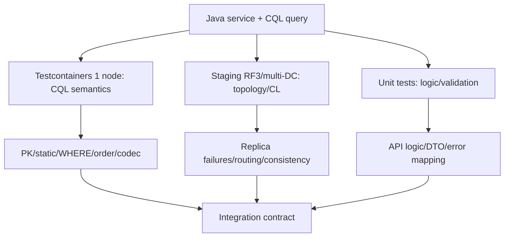

# Kiểm thử primary key, static column và điều kiện SELECT trong Cassandra từ Java

## 1. Mục tiêu: kiểm thử ngữ nghĩa CQL thật, không chỉ mock repository

Apache Cassandra là cơ sở dữ liệu **wide-column phân tán**: **partition key** quyết định phân vùng logic và cách chọn replica; **clustering columns** quyết định định danh/thứ tự hàng trong partition; **replication factor (RF)** và **consistency level (CL)** quyết định số replica cần phản hồi khi đọc/ghi. Thiết kế đúng bảng theo truy vấn là điều kiện cần, nhưng ứng dụng Java còn phải **kiểm thử tích hợp** để bảo đảm câu CQL thực sự hợp lệ và trả đúng hàng.

Ví dụ một bảng lưu sự kiện theo tenant/ngày có:

- Partition key tổng hợp `(tenant_id, event_day)`.
- Clustering key `(occurred_at, event_id)`.
- Cột `partition_note static` là metadata **chung của partition**, không riêng mỗi sự kiện.
- Cột `event_type` là regular column của từng hàng.

Một unit test mock `CassandraRepository` có thể cho qua cả những query sai như “lọc theo `event_type` không có index” hoặc “chỉ truyền nửa composite partition key”. Cassandra thật có thể từ chối khi prepare/execute. Ngược lại, test chỉ kiểm tra “không ném exception” có thể bỏ sót việc hai hàng cùng partition **chia sẻ static value** hoặc `INSERT` cùng full primary key thực chất là upsert.

**Đề bài:** xây bộ integration test có Cassandra thật (chẳng hạn Testcontainers), xác minh **khóa chính, static column, điều kiện `SELECT WHERE`, thứ tự kết quả, trường hợp bị từ chối**, và biết giới hạn của một cluster test một node đối với RF/CL của production.

### Sau bài học cần làm được

1. Đọc đúng `PRIMARY KEY ((a,b), c,d)` và phân biệt partition key với clustering key.
2. Kiểm thử tính duy nhất của **toàn bộ primary key**, phạm vi partition và thứ tự clustering.
3. Chứng minh static column có giá trị **theo partition**, kể cả partition chưa có regular row.
4. Viết positive/negative tests cho điều kiện `WHERE` và `ORDER BY` đúng quy tắc Cassandra.
5. Kết nối JUnit 5 + Testcontainers + Java Driver 4.x để chạy CQL thật.
6. Thiết kế các kiểm thử Spring Data mapping/repository mà không nhầm unit test với integration test.
7. Tránh kiểm thử giả: `ALLOW FILTERING` che schema sai, `COUNT(*)` trên bảng lớn, assert thứ tự ngẫu nhiên, sleep tùy ý và gắn RF3 trên một node.

> **Nguyên tắc:** *Khi kiểm thử CQL, hãy kiểm tra đồng thời kết quả đúng, truy vấn sai phải bị từ chối và ranh giới có thể bảo đảm trong môi trường test*. Một test “PASS” nhờ mock hoặc nhờ `ALLOW FILTERING` chưa chứng minh schema phù hợp production.

## 2. Unit test, integration test và topology test: ba tầng khác nhau

| Tầng | Chạy gì? | Kiểm được gì? | Không chứng minh được gì? |
| --- | --- | --- | --- |
| Unit test | Mock `CqlSession`/repository, không có Cassandra | Validation, mapping logic thuần Java, authorization ở service, cách chọn method | CQL parser, primary key restrictions, static semantics, RF/CL |
| Integration test một node | Cassandra thật trong Testcontainers, Java Driver thật | Schema, prepared/bound CQL, upsert, static column, `SELECT WHERE`, codec và row mapping | Rolling failure RF3, quorum 2/3, multi-DC, repair/streaming |
| Integration test nhiều node | Cluster test nhiều replica/DC/rack | Một số hành vi CL, topology, failover và driver routing | Tự động đại diện đầy đủ mạng/disk/tải production |
| End-to-end/staging | Spring Boot, auth/TLS, migrations, workload gần thực tế | Contract API, SLO, phân quyền, profile, rollout | Tính đúng ở mọi lịch biểu concurrency hoặc mọi failure |

**Một node Cassandra thật đã tốt hơn mock cho CQL**, nhưng không đủ kết luận `LOCAL_QUORUM` sẽ hoạt động khi một replica Down trong RF3. Nếu test đặt RF1, `LOCAL_QUORUM` cũng chỉ cần một replica tại DC đó; đây không phải bài kiểm tra chịu lỗi.

### Ma trận trách nhiệm kiểm thử



Phân công một loại test cho đúng một phạm vi giúp giảm flaky tests và tránh dùng hàng trăm container chỉ để kiểm tra phép biến đổi DTO.

## 3. Schema lab: composite partition key, clustering và static column

Ví dụ chính sẽ dùng một datacenter test tên `datacenter1`. Trong một container Cassandra, chọn **RF1** có chủ đích để test ngữ nghĩa CQL; production thường cần `NetworkTopologyStrategy` theo DC và RF phù hợp, ví dụ RF3. Tên DC thực tế phải đọc từ topology của container/bản phân phối.

```sql
CREATE KEYSPACE IF NOT EXISTS integration_lab
WITH replication = {
    'class': 'NetworkTopologyStrategy',
    'datacenter1': 1
}
AND durable_writes = true;

CREATE TABLE IF NOT EXISTS integration_lab.events_by_tenant_day (
    tenant_id text,
    event_day date,
    occurred_at timestamp,
    event_id uuid,
    partition_note text static,
    partition_owner text static,
    event_type text,
    payload text,
    PRIMARY KEY ((tenant_id, event_day), occurred_at, event_id)
) WITH CLUSTERING ORDER BY (
    occurred_at DESC,
    event_id ASC
);
```

**Phân tích khóa:**

| Thành phần | Vai trò | Điều cần test |
| --- | --- | --- |
| `tenant_id` | Thành phần 1 của composite partition key | Không đủ một mình để định vị partition trong query thông thường |
| `event_day` | Thành phần 2 của composite partition key | Cùng tenant nhưng khác ngày là **partition khác** |
| `occurred_at` | Clustering thứ nhất, `DESC` | Hàng mới theo thời gian xuất hiện trước, trong một partition |
| `event_id` | Clustering thứ hai, `ASC` | Phân biệt các sự kiện trùng timestamp |
| `partition_note` | Static column | Dùng chung trong một partition; không gắn riêng một clustering row |
| `partition_owner` | Static column | Thay đổi trong partition này không ảnh hưởng partition khác |
| `event_type` / `payload` | Regular columns | Giá trị từng hàng, không dùng tự do trong `WHERE` nếu không có đường truy cập phù hợp |

**Full primary key** là `(tenant_id, event_day, occurred_at, event_id)`. Không phải chỉ `event_id`, không phải chỉ `(tenant_id, event_day)`. Hai sự kiện có cùng partition key nhưng khác clustering key là **hai hàng logic khác nhau**.

### Cách hiểu bằng hai ví dụ

```text
Partition P1 = ("tenant-A", 2026-11-20)
  static: partition_note="Ngày khuyến mại"
  row 1: occurred_at=10:00, event_id=U1, event_type=OPEN
  row 2: occurred_at=09:00, event_id=U2, event_type=CLICK

Partition P2 = ("tenant-A", 2026-11-21)
  static: partition_note="Ngày thường"
  row 1: occurred_at=08:00, event_id=U3, event_type=CLOSE

P1 và P2 tách biệt dù cùng tenant-A.
Không có static value "trên toàn tenant" trừ khi schema được thiết kế như vậy.
```

Lưu ý: Cassandra không có kiểu “primary key tự động tăng” như một số RDBMS. Kiểu `uuid` cho `event_id` không tự sắp thời gian, nên thứ tự phụ thuộc `occurred_at` trước và `event_id` khi trùng timestamp.

## 4. Quy tắc primary key phải đưa vào integration tests

### 4.1. Composite partition key phải được ràng buộc đầy đủ

Truy vấn hợp lệ, xác định một partition:

```sql
SELECT occurred_at, event_id, event_type
FROM integration_lab.events_by_tenant_day
WHERE tenant_id = 'tenant-A'
  AND event_day = '2026-11-20';
```

Truy vấn không phù hợp trong schema này:

```sql
-- Thiếu event_day (thành phần của composite partition key).
SELECT event_id
FROM integration_lab.events_by_tenant_day
WHERE tenant_id = 'tenant-A';
```

Test phải chờ lỗi query phù hợp **trong điều kiện không có index/phương án scan được cho phép**, không tự thêm `ALLOW FILTERING` chỉ để cho test qua.

### 4.2. Clustering key là thứ tự từ trái sang phải

Khi đã có đầy đủ partition key, những điều kiện điển hình hợp lệ:

```sql
-- Lấy mọi hàng trong partition.
SELECT event_id FROM integration_lab.events_by_tenant_day
WHERE tenant_id = 'tenant-A' AND event_day = '2026-11-20';

-- Lấy một hàng theo FULL primary key.
SELECT event_type FROM integration_lab.events_by_tenant_day
WHERE tenant_id = 'tenant-A' AND event_day = '2026-11-20'
  AND occurred_at = '2026-11-20T10:00:00Z'
  AND event_id = 11111111-1111-4111-8111-111111111111;

-- Range trên clustering column đầu tiên.
SELECT event_id, occurred_at FROM integration_lab.events_by_tenant_day
WHERE tenant_id = 'tenant-A' AND event_day = '2026-11-20'
  AND occurred_at >= '2026-11-20T09:00:00Z';
```

Ngược lại, **không được bỏ qua tiền tố clustering** rồi mong tìm `event_id` tùy ý:

```sql
-- Cố ý sai trong schema không có index:
SELECT event_type FROM integration_lab.events_by_tenant_day
WHERE tenant_id = 'tenant-A' AND event_day = '2026-11-20'
  AND event_id = 11111111-1111-4111-8111-111111111111;
```

**Đừng nhầm “có đủ partition key” với “mọi predicate phía sau đều hợp lệ”.** Các điều kiện clustering có quy tắc về prefix, equality/range, `IN` và thứ tự, với chi tiết có thể khác theo phiên bản. Một index hoặc SAI có thể tạo access path khác, nhưng bài test này **cố ý không tạo index** để phát hiện thiết kế query dựa vào khóa.

### 4.3. Full primary key xác định cùng một logical row

Hai lệnh `INSERT` với **cùng đủ bốn thành phần khóa** không tạo hai row khác nhau:

```sql
INSERT INTO integration_lab.events_by_tenant_day (
    tenant_id, event_day, occurred_at, event_id, event_type
) VALUES (
    'tenant-A', '2026-11-20', '2026-11-20T10:00:00Z',
    11111111-1111-4111-8111-111111111111, 'OPEN'
);

INSERT INTO integration_lab.events_by_tenant_day (
    tenant_id, event_day, occurred_at, event_id, event_type
) VALUES (
    'tenant-A', '2026-11-20', '2026-11-20T10:00:00Z',
    11111111-1111-4111-8111-111111111111, 'CLOSED'
);
```

Khi mutation sau có write timestamp thắng theo quy tắc hòa giải của Cassandra, hàng logic đó có `event_type='CLOSED'`. Test nên kiểm chứng **số hàng logic là một**, đồng thời kiểm soát thứ tự/timestamp nếu muốn assert giá trị cuối. Viết hai mutation cùng microsecond từ nhiều coordinator rồi mặc định “lệnh thứ hai luôn thắng” là test không tốt.

### 4.4. Primary key không được coi là regular column

Các yêu cầu như “`UPDATE event_id = newId WHERE ...`” không phải cách di chuyển khóa. Để thay primary key, về mặt dữ liệu thường cần tạo row với khóa mới và xử lý row cũ theo nghiệp vụ, có rủi ro atomicity/ordering cần xét.

Trong test phải có trường hợp key missing/null và sai kiểu tham số. Không dùng `UNSET` cho thành phần primary key rồi kỳ vọng Cassandra tự suy ra nó.

## 5. Static column: điều cần khẳng định bằng dữ liệu

Trong Cassandra, `static` là **cột thuộc partition** chứ không thuộc một row clustering riêng. Một bảng muốn khai báo static columns thông thường phải có clustering column để phân biệt những regular rows trong partition đó.

### 5.1. Cập nhật static không cần full clustering key

```sql
UPDATE integration_lab.events_by_tenant_day
SET partition_note = 'Chốt đối soát cuối ngày',
    partition_owner = 'worker-A'
WHERE tenant_id = 'tenant-A'
  AND event_day = '2026-11-20';
```

Điều kiện `WHERE` cho thao tác **chỉ cập nhật static columns** cần partition key, không buộc có `occurred_at` và `event_id`. Đây **không** phải bằng chứng rằng regular column cũng được cập nhật không cần clustering key.

Sai nếu cập nhật regular value thiếu clustering columns:

```sql
-- Cố ý sai: regular column event_type cần row key đầy đủ.
UPDATE integration_lab.events_by_tenant_day
SET event_type = 'PAID'
WHERE tenant_id = 'tenant-A'
  AND event_day = '2026-11-20';
```

### 5.2. Một static value hiển thị cùng nhiều regular rows

Nếu partition có hai events, sau lệnh cập nhật `partition_note`, truy vấn:

```sql
SELECT occurred_at, event_id, event_type, partition_note
FROM integration_lab.events_by_tenant_day
WHERE tenant_id = 'tenant-A'
  AND event_day = '2026-11-20';
```

sẽ hiển thị giá trị static tương ứng trên các hàng trả về của partition. **Không nhầm với việc Cassandra đã sao chép một cell static vào từng clustering row**. Đó là mô hình lưu trữ và cách SELECT kết hợp dữ liệu static với regular rows.

### 5.3. Static-only partition

Một partition có thể tồn tại static data **ngay cả khi chưa có regular clustering row**:

```sql
UPDATE integration_lab.events_by_tenant_day
SET partition_note = 'Đã mở kỳ, chưa phát sinh sự kiện'
WHERE tenant_id = 'tenant-empty'
  AND event_day = '2026-11-20';

SELECT tenant_id, event_day, occurred_at,
       event_id, partition_note, event_type
FROM integration_lab.events_by_tenant_day
WHERE tenant_id = 'tenant-empty'
  AND event_day = '2026-11-20';
```

Khi static-only partition được đọc theo truy vấn phù hợp, Cassandra có thể trả một hàng đại diện với **clustering fields null** và static value có mặt. Điều cần test là **static data còn được truy cập, nhưng không suy ra đã tồn tại một business event**.

Nếu một mapper Java giả định `row.getInstant("occurred_at")` và `row.getUuid("event_id")` luôn non-null, static-only result có thể làm ứng dụng tạo một event “ảo”. Đó là lỗi mapping/nghiệp vụ, không phải lỗi Cassandra.

### 5.4. Static không phải “global config”

`partition_note` của (tenant-A, day-20) **không ảnh hưởng** (tenant-A, day-21) hay (tenant-B, day-20). Test hai partition tách biệt và chỉ update một partition để chứng minh ranh giới.

### 5.5. Delete/TTL và static columns

`DELETE partition_note ... WHERE partition key` chỉ tác động cell static được chỉ định theo semantics CQL, không đồng nghĩa xóa toàn bộ regular rows. Ngược lại, xóa **toàn partition** có thể ảnh hưởng cả static và regular data.

TTL có thể khiến static cells hết hạn ở thời điểm khác regular rows. Khi test expiration, tránh `Thread.sleep(1000)` rồi đòi kết quả luôn thay đổi đúng tại một mili-giây cố định; phải kiểm tra TTL granularity, clock và retry trong test environment. Những scenario TTL dài/phức tạp nên có suite riêng thay vì chen vào test primary-key cơ bản.

## 6. `SELECT DISTINCT` với static columns: vừa hữu ích vừa dễ hiểu sai

Trong các phiên bản Cassandra có hỗ trợ, `SELECT DISTINCT` được dùng để lấy **partition key và các static columns hợp lệ**, không phải dạng SQL “DISTINCT trên mọi biểu thức bất kỳ”.

Ví dụ với **một partition**:

```sql
SELECT DISTINCT tenant_id, event_day,
       partition_note, partition_owner
FROM integration_lab.events_by_tenant_day
WHERE tenant_id = 'tenant-A'
  AND event_day = '2026-11-20';
```

Kỳ vọng chỉ có một kết quả về metadata của partition, ngay cả khi partition có nhiều clustering rows.

Ngược lại, truy vấn `SELECT DISTINCT event_type` không phải cách thông thường để lấy “các loại sự kiện khác nhau” trong bảng này; regular column không có cùng semantics `DISTINCT` như static. Đừng dựa vào `DISTINCT` để biến Cassandra thành công cụ `GROUP BY`/analytics không có mô hình bảng phù hợp.

### Vì sao không dùng `SELECT DISTINCT` toàn bảng để đếm tenant?

Truy vấn không giới hạn partition có thể đi qua rất nhiều token ranges/replicas. `DISTINCT` làm giảm số hàng trả về nhưng **không miễn phí phần đọc/định tuyến**. Nếu API cần danh sách tenant hoặc ngày, hãy cân nhắc **bảng truy vấn riêng** thay vì scan rộng bảng events.

## 7. Các loại điều kiện `SELECT WHERE` nên đưa vào ma trận

| Trường hợp | CQL pattern | Kỳ vọng trong schema lab |
| --- | --- | --- |
| Đủ partition key | `tenant_id=? AND event_day=?` | Hợp lệ, trả các clustering rows của partition |
| Đủ full primary key | Đủ partition + `occurred_at=? AND event_id=?` | Hợp lệ, tối đa một logical row |
| Clustering prefix | Đủ partition + `occurred_at=?` | Hợp lệ, có thể nhiều rows nếu trùng timestamp |
| Clustering range | Đủ partition + `occurred_at>=?` | Hợp lệ theo thứ tự clustering; kết quả có thể nhiều rows |
| Chỉ nửa partition key | `tenant_id=?` | Không có access path hợp lệ trong schema không index này |
| Bỏ tiền tố clustering | Đủ partition + `event_id=?` | Bị từ chối/không hợp lệ theo quy tắc clustering |
| Lọc regular column | `event_type=?` không có index | Không phải query được phục vụ hiệu quả bằng primary key; cần mô hình khác |
| `ORDER BY` đúng | Đủ partition key, thứ tự clustering hợp lệ | Hợp lệ trong giới hạn CQL |
| `ORDER BY` trên regular column | `ORDER BY event_type` | Không hợp lệ trong bảng này |
| `ALLOW FILTERING` | Ép lọc ngoài key/index | Có thể cho chạy một số scan, nhưng **không** được xem là test thiết kế truy vấn tốt |
| `SELECT DISTINCT` partition/static | Chọn partition key, static columns | Hợp lệ theo cú pháp/version phù hợp |
| `SELECT DISTINCT` regular only | `DISTINCT event_type` | Không phải query hợp lệ như SQL DISTINCT thông thường |

**Không biến một ma trận thành khẳng định mọi bản Cassandra có cùng thông điệp lỗi hoặc mọi biến thể `IN`/index đều giống nhau.** Test cần gắn với phiên bản target, kiểm tra lỗi ở loại hợp lý thay vì so khớp nguyên văn error message.

### 7.1. Chỉ số “ít rows trả về” không chứng minh query rẻ

Ví dụ:

```sql
-- Ví dụ anti-pattern, không dùng trên bảng production lớn:
SELECT event_id FROM integration_lab.events_by_tenant_day
WHERE event_type = 'LOGIN' ALLOW FILTERING;
```

Nếu truy vấn trả một hàng, server vẫn có thể phải đọc nhiều partitions/cells trước khi lọc. Integration test nên **từ chối anti-pattern ở tầng ứng dụng/repository**, không thêm `ALLOW FILTERING` vào production chỉ để làm xanh test.

### 7.2. `SELECT IF` không phải CQL đọc điều kiện

Trong Cassandra, `IF` xuất hiện trên các **conditional mutations** như `INSERT ... IF NOT EXISTS` hoặc `UPDATE ... IF ...` (LWT), không phải cách nói “`SELECT ... IF status='PAID'`” của SQL. Điều kiện đọc chủ yếu đi qua `WHERE` theo access path hợp lệ. Test không nên nhầm kiểm thử `SELECT` với kiểm thử Paxos/LWT.

## 8. Thứ tự clustering, tie-breaker và tính ổn định của assertion

Bảng khai báo:

```sql
WITH CLUSTERING ORDER BY (
    occurred_at DESC,
    event_id ASC
)
```

Trong một partition, nếu hai hàng có timestamp khác nhau, hàng có timestamp lớn hơn thường xuất hiện trước. Nếu cùng timestamp, `event_id ASC` làm tie-breaker. Hai rows có cùng timestamp **và cùng event_id** thực ra có cùng full primary key, không phải hai events khác nhau.

### Test không được dựa vào UUID ngẫu nhiên để đoán thứ tự thời gian

`UUID.randomUUID()` thường tạo UUID v4, không có nghĩa UUID có giá trị nhỏ hơn được sinh trước. Nếu business query yêu cầu “newest first”, **cột `occurred_at DESC`** mới thể hiện thứ tự thời gian trong schema.

### `ORDER BY` và đảo ngược thứ tự

Trong những điều kiện truy vấn hợp lệ, Cassandra có thể đọc ngược thứ tự clustering đã khai báo. Với thứ tự hỗn hợp `DESC, ASC`, đảo ngược hợp lệ tương ứng là `ASC, DESC`, **không** phải đảo riêng một cột rồi giữ nguyên cột kia tùy ý:

```sql
SELECT occurred_at, event_id
FROM integration_lab.events_by_tenant_day
WHERE tenant_id = 'tenant-A'
  AND event_day = '2026-11-20'
ORDER BY occurred_at ASC, event_id DESC;
```

Chi tiết `ORDER BY`, điều kiện cột và hỗ trợ index tùy phiên bản; kiểm tra trên server mục tiêu. **Không kỳ vọng thứ tự toàn cục khi truy vấn nhiều partition hoặc khi app ghép các query song song.**

## 9. Vì sao nên dùng Testcontainers thay cho mock Cassandra?

Testcontainers khởi tạo Cassandra thật trong container riêng để JUnit thực thi CQL bằng driver. Ta kiểm tra được:

- Server phân tích DDL và tạo schema đúng.
- `PreparedStatement` và `BoundStatement` có kiểu tham số hợp lệ.
- Quy tắc primary key và clustering của `WHERE`.
- Việc static cell được chia sẻ trong cùng partition.
- `SELECT DISTINCT` trên partition/static.
- Validation error của câu CQL không hợp lệ.
- Codec Java như `Instant`, `LocalDate` và `UUID`.
- Tương tác của Spring Data mapper với CQL nếu nối thêm slice test.

### Yêu cầu môi trường

1. Docker/compatible container runtime sẵn sàng trên CI/local.
2. Testcontainers/JUnit Jupiter đúng phiên bản tương thích với JDK/Spring Boot.
3. Cassandra image được **pin theo phiên bản có chủ đích**; không dùng `latest`.
4. Đủ CPU/RAM/disk cho quá trình khởi động Cassandra.
5. Test không phụ thuộc Internet sau khi image đã có cache, nếu CI air-gapped.
6. Keyspace/schema được tạo **trước khi** repository thực thi hoặc context cần keyspace.
7. Mỗi test có dữ liệu/key riêng hoặc reset được kiểm soát, không dùng dữ liệu production.

**Không chạy integration tests chống lại cluster production**. Một test dùng `TRUNCATE` hoặc `DROP KEYSPACE` sai đích có thể phá dữ liệu thật; test phải tạo/lấy connection riêng từ môi trường test.

### Dependency gợi ý với Spring Boot BOM

Ví dụ Maven; dependency versions được quản lý bởi **BOM tương thích mà dự án chọn**:

```xml
<dependencies>
    <dependency>
        <groupId>org.springframework.boot</groupId>
        <artifactId>spring-boot-starter-data-cassandra</artifactId>
    </dependency>
    <dependency>
        <groupId>org.springframework.boot</groupId>
        <artifactId>spring-boot-starter-test</artifactId>
        <scope>test</scope>
    </dependency>
    <dependency>
        <groupId>org.testcontainers</groupId>
        <artifactId>cassandra</artifactId>
        <scope>test</scope>
    </dependency>
    <dependency>
        <groupId>org.testcontainers</groupId>
        <artifactId>junit-jupiter</artifactId>
        <scope>test</scope>
    </dependency>
</dependencies>
```

Tên module/artifact Testcontainers có thể đổi giữa major versions; trên một nhánh dùng Testcontainers 1.x, các artifact ở trên là kiểu thường gặp. Với 2.x hoặc BOM mới, tra đúng tọa độ module được bản đã pin cung cấp. **Không override driver và Netty ngẫu nhiên** chỉ để hết lỗi dependency.

## 10. Dữ liệu kiểm thử: độc lập, có định danh và dễ đối soát

Với một container dùng chung trong cùng test class, không nên làm:

```text
Test A INSERT tenant="test" vào partition day-20.
Test B cũng SELECT tenant="test" với giả định partition rỗng.
Kết quả phụ thuộc thứ tự test chạy.
```

Thay bằng một tenant **duy nhất cho mỗi test**:

```java
String tenant = "it-" + java.util.UUID.randomUUID();
java.time.LocalDate day = java.time.LocalDate.of(2026, 11, 20);
```

Khi cả hai keys tạo thành composite partition key, các tests được cách ly mà không cần `TRUNCATE` thường xuyên. Container có thể được hủy khi test class kết thúc; cleanup theo policy CI. Nếu test cần deterministic replay, có thể cấp cố định unique ID từ test name/run ID và vẫn tránh collision giữa parallel workers.

### Test dùng timestamp đã kiểm soát

Không dùng `Instant.now()` để đoán thứ tự của hai inserts cách nhau vài microsecond; Cassandra `timestamp` lưu độ chính xác **mili-giây**, nên hai lần lấy timestamp gần nhau có thể trùng sau chuẩn hóa. Dùng giá trị cố định:

```java
Instant newer = Instant.parse("2026-11-20T10:00:00.000Z");
Instant older = Instant.parse("2026-11-20T09:00:00.000Z");
```

Nếu test write conflicts cùng full primary key, dùng **mutation timestamp có kiểm soát** hoặc tuần tự hóa và hiểu LWW; không khẳng định một lời gọi sau luôn thắng nếu có concurrent writers và đồng hồ lệch.

## 11. Positive và negative assertions đều là hợp đồng

Một bộ integration test tốt không chỉ kiểm tra các case trả row đúng:

**Positive path:**

- Đầy đủ composite partition key trả đúng partition.
- Full primary key trả đúng một event.
- Range trên clustering prefix trả đúng tập và thứ tự.
- Static update hiển thị cùng giá trị trên nhiều clustering rows.
- Static-only partition vẫn đọc được static value.
- Hai partition không chia sẻ static value.
- `SELECT DISTINCT` hợp lệ chỉ trả metadata một partition.

**Negative path:**

- Thiếu `event_day` của composite partition key bị server từ chối khi schema không index.
- `WHERE event_id=?` mà bỏ qua `occurred_at` bị từ chối.
- `UPDATE` regular column không có full key bị từ chối.
- `ORDER BY event_type` không phải ORDER BY clustering hợp lệ.
- `DISTINCT` trên regular column không là cú pháp SELECT phù hợp.
- Null/missing primary key bị từ chối thay vì biến thành dữ liệu giả.
- Ứng dụng không bao giờ tự chèn `ALLOW FILTERING` để làm query sai “hoạt động”.

**Thông điệp lỗi CQL có thể đổi theo Cassandra version**. Assert theo exception category (ví dụ `InvalidQueryException`) hoặc một predicate ổn định, tránh khớp nguyên văn thông điệp tiếng Anh từng dòng; và xác định lỗi có thể được ném ngay lúc `prepare`, không đợi đến `execute`.

## 12. JUnit 5 + Testcontainers: khởi tạo Cassandra thật

Đoạn code dưới đây là **một test class** cho Java 17+, JUnit Jupiter, Testcontainers Cassandra module theo API 1.x và Java Driver 4.x. Nó sử dụng bản image Cassandra 4.1 để minh họa; dự án thật cần chọn bản patch đã pin/tương thích và kiểm thử target server của production.

Các test dùng keyspace `integration_lab` với RF1 tại DC tên `datacenter1`. Tên DC phải đúng với image/config; nếu Docker image hoặc distribution trả DC khác, sửa **cùng lúc** cấu hình container, driver local DC và `NetworkTopologyStrategy`.

```java
import static org.junit.jupiter.api.Assertions.*;

import java.net.InetSocketAddress;
import java.time.Instant;
import java.time.LocalDate;
import java.util.List;
import java.util.UUID;

import org.junit.jupiter.api.AfterAll;
import org.junit.jupiter.api.BeforeAll;
import org.junit.jupiter.api.Test;
import org.testcontainers.containers.CassandraContainer;
import org.testcontainers.junit.jupiter.Container;
import org.testcontainers.junit.jupiter.Testcontainers;
import org.testcontainers.utility.DockerImageName;

import com.datastax.oss.driver.api.core.CqlSession;
import com.datastax.oss.driver.api.core.cql.BoundStatement;
import com.datastax.oss.driver.api.core.cql.PreparedStatement;
import com.datastax.oss.driver.api.core.cql.Row;
import com.datastax.oss.driver.api.core.servererrors.InvalidQueryException;

@Testcontainers
public class PrimaryKeyAndStaticColumnIT {

    @Container
    static final CassandraContainer<?> CASSANDRA =
        new CassandraContainer<>(
            DockerImageName.parse("cassandra:4.1"))
            .withEnv("CASSANDRA_DC", "datacenter1");

    private static CqlSession session;
    private static PreparedStatement insertEvent;
    private static PreparedStatement selectPartition;
    private static PreparedStatement updateStatic;

    private static final LocalDate DAY =
        LocalDate.of(2026, 11, 20);

    private static final Instant T10 =
        Instant.parse("2026-11-20T10:00:00Z");
    private static final Instant T09 =
        Instant.parse("2026-11-20T09:00:00Z");

    @BeforeAll
    static void createSchema() {
        // Testcontainers đã start static @Container trước BeforeAll.
        session = CqlSession.builder()
            .addContactPoint(new InetSocketAddress(
                CASSANDRA.getHost(),
                CASSANDRA.getMappedPort(9042)))
            .withLocalDatacenter("datacenter1")
            .build();

        session.execute(
            "CREATE KEYSPACE IF NOT EXISTS integration_lab " +
            "WITH replication = {" +
            "'class':'NetworkTopologyStrategy'," +
            "'datacenter1':1}");

        session.execute(
            "CREATE TABLE IF NOT EXISTS " +
            "integration_lab.events_by_tenant_day (" +
            "tenant_id text, event_day date, " +
            "occurred_at timestamp, event_id uuid, " +
            "partition_note text static, " +
            "partition_owner text static, " +
            "event_type text, payload text, " +
            "PRIMARY KEY ((tenant_id, event_day)," +
            " occurred_at, event_id)) " +
            "WITH CLUSTERING ORDER BY " +
            "(occurred_at DESC, event_id ASC)");

        insertEvent = session.prepare(
            "INSERT INTO integration_lab.events_by_tenant_day " +
            "(tenant_id, event_day, occurred_at, event_id, " +
            "event_type, payload) VALUES (?, ?, ?, ?, ?, ?)");

        selectPartition = session.prepare(
            "SELECT tenant_id, event_day, occurred_at, " +
            "event_id, event_type, partition_note " +
            "FROM integration_lab.events_by_tenant_day " +
            "WHERE tenant_id = ? AND event_day = ?");

        updateStatic = session.prepare(
            "UPDATE integration_lab.events_by_tenant_day " +
            "SET partition_note = ? " +
            "WHERE tenant_id = ? AND event_day = ?");
    }

    @AfterAll
    static void closeSession() {
        if (session != null) {
            session.close();
        }
    }

    private static String newTenant() {
        return "it-" + UUID.randomUUID();
    }

    private static void put(
            String tenant, Instant when, UUID id, String type) {
        session.execute(insertEvent.bind(
            tenant, DAY, when, id, type, "test-payload"));
    }

    @Test
    void fullPrimaryKeyIdentifiesOneLogicalRow() {
        String tenant = newTenant();
        UUID eventId = UUID.randomUUID();
        put(tenant, T10, eventId, "OPEN");
        put(tenant, T10, eventId, "CLOSED");

        List<Row> rows = session.execute(
            selectPartition.bind(tenant, DAY)).all();

        // Upsert với cùng full PK không tạo row thứ hai.
        assertEquals(1, rows.size());
        assertEquals(eventId, rows.get(0).getUuid("event_id"));
    }

    @Test
    void staticValueIsSharedWithinOnePartition() {
        String tenant = newTenant();
        put(tenant, T10, UUID.randomUUID(), "OPEN");
        put(tenant, T09, UUID.randomUUID(), "CLICK");

        session.execute(updateStatic.bind(
            "metadata-for-one-partition", tenant, DAY));

        List<Row> rows = session.execute(
            selectPartition.bind(tenant, DAY)).all();
        assertEquals(2, rows.size());
        assertTrue(rows.stream().allMatch(row ->
            "metadata-for-one-partition".equals(
                row.getString("partition_note"))));
        assertEquals(T10, rows.get(0).getInstant("occurred_at"));
        assertEquals(T09, rows.get(1).getInstant("occurred_at"));
    }

    @Test
    void staticOnlyPartitionDoesNotCreateBusinessEvent() {
        String tenant = newTenant();
        session.execute(updateStatic.bind(
            "opened-without-events", tenant, DAY));

        List<Row> rows = session.execute(
            selectPartition.bind(tenant, DAY)).all();
        assertEquals(1, rows.size());
        assertEquals("opened-without-events",
            rows.get(0).getString("partition_note"));
        assertTrue(rows.get(0).isNull("event_id"));
        assertTrue(rows.get(0).isNull("occurred_at"));
    }

    @Test
    void staticDataDoesNotLeakToAnotherPartition() {
        String tenant = newTenant();
        LocalDate anotherDay = DAY.plusDays(1);
        session.execute(updateStatic.bind("day-20", tenant, DAY));
        session.execute(updateStatic.bind(
            "day-21", tenant, anotherDay));

        Row first = session.execute(
            selectPartition.bind(tenant, DAY)).one();
        Row second = session.execute(
            selectPartition.bind(tenant, anotherDay)).one();
        assertNotNull(first);
        assertNotNull(second);
        assertEquals("day-20",
            first.getString("partition_note"));
        assertEquals("day-21",
            second.getString("partition_note"));
    }

    @Test
    void rangePredicateKeepsClusteringOrder() {
        String tenant = newTenant();
        put(tenant, T10, UUID.randomUUID(), "OPEN");
        put(tenant, T09, UUID.randomUUID(), "CLICK");
        put(tenant, T09.minusSeconds(3600),
            UUID.randomUUID(), "CLOSE");

        PreparedStatement range = session.prepare(
            "SELECT occurred_at, event_id " +
            "FROM integration_lab.events_by_tenant_day " +
            "WHERE tenant_id=? AND event_day=? " +
            "AND occurred_at >= ?");

        List<Row> rows = session.execute(
            range.bind(tenant, DAY, T09)).all();
        assertEquals(2, rows.size());
        assertEquals(T10, rows.get(0).getInstant("occurred_at"));
        assertEquals(T09, rows.get(1).getInstant("occurred_at"));
    }

    @Test
    void distinctReadsPartitionMetadataNotEveryEvent() {
        String tenant = newTenant();
        put(tenant, T10, UUID.randomUUID(), "OPEN");
        put(tenant, T09, UUID.randomUUID(), "CLICK");
        session.execute(updateStatic.bind("metadata", tenant, DAY));

        PreparedStatement distinct = session.prepare(
            "SELECT DISTINCT tenant_id, event_day, partition_note " +
            "FROM integration_lab.events_by_tenant_day " +
            "WHERE tenant_id=? AND event_day=?");

        List<Row> rows = session.execute(
            distinct.bind(tenant, DAY)).all();
        assertEquals(1, rows.size());
        assertEquals("metadata",
            rows.get(0).getString("partition_note"));
    }

    @Test
    void reversedClusteringOrderWorksInsideOnePartition() {
        String tenant = newTenant();
        put(tenant, T10, UUID.randomUUID(), "OPEN");
        put(tenant, T09, UUID.randomUUID(), "CLICK");

        PreparedStatement reverse = session.prepare(
            "SELECT occurred_at, event_id " +
            "FROM integration_lab.events_by_tenant_day " +
            "WHERE tenant_id=? AND event_day=? " +
            "ORDER BY occurred_at ASC, event_id DESC");

        List<Row> rows = session.execute(
            reverse.bind(tenant, DAY)).all();
        assertEquals(2, rows.size());
        assertEquals(T09, rows.get(0).getInstant("occurred_at"));
        assertEquals(T10, rows.get(1).getInstant("occurred_at"));
    }

    @Test
    void invalidWhereClausesAreRejectedAtPrepareTime() {
        assertThrows(InvalidQueryException.class, () ->
            session.prepare(
                "SELECT event_id " +
                "FROM integration_lab.events_by_tenant_day " +
                "WHERE tenant_id=?"));

        assertThrows(InvalidQueryException.class, () ->
            session.prepare(
                "SELECT event_id " +
                "FROM integration_lab.events_by_tenant_day " +
                "WHERE tenant_id=? AND event_day=? " +
                "AND event_id=?"));
    }

    @Test
    void regularColumnCannotBeUpdatedWithoutClusteringKey() {
        assertThrows(InvalidQueryException.class, () ->
            session.prepare(
                "UPDATE integration_lab.events_by_tenant_day " +
                "SET event_type=? " +
                "WHERE tenant_id=? AND event_day=?"));
    }
}
```

### Đọc hiểu bộ test

- `@Container` khai báo một Cassandra instance thật được Testcontainers quản lý.
- `@BeforeAll` tạo schema và prepared statements **trước** các ca kiểm thử.
- `newTenant()` cho mỗi test **partition key riêng**, tránh phụ thuộc thứ tự chạy.
- `fullPrimaryKeyIdentifiesOneLogicalRow` kiểm tra số row, **không** assert writer nào thắng khi hai mutations có timestamp gần nhau.
- `staticValueIsSharedWithinOnePartition` tạo hai clustering rows rồi chỉ update static một lần.
- `staticOnlyPartitionDoesNotCreateBusinessEvent` bắt lỗi mapper coi virtual row là event thật.
- `rangePredicateKeepsClusteringOrder` kiểm tra phạm vi điều kiện và thứ tự, không chỉ số rows.
- `invalidWhereClausesAreRejectedAtPrepareTime` kiểm tra parser/planner của server thật, thứ mock không thể thay.

**Một phiên bản Testcontainers khác có thể dùng package/artifact khác cho `CassandraContainer`**. Code minh họa nhắm vào module API 1.x được ghi ở mục 9; chọn bản quản lý dependency tương thích trước khi compile. Không chạy Gradle/Python hoặc tạo file phụ để thử ngoài phạm vi worker assignment này.

### Giới hạn của bộ test

Nó chạy **một node với RF1**, không test quorum 2/3 hay khả năng node hỏng. Nó cũng không tự chứng minh một query sẽ nhanh trên partition vài triệu hàng: **correctness integration test ≠ load/performance test**. Những điều kiện đó cần staging/topology/benchmark riêng.

## 13. Java Driver: test điều kiện SELECT theo dữ liệu biên

Ngoài class cơ bản, cần kiểm thử các ranh giới làm phát sinh lỗi âm thầm khi bind:

| Biên | Input | Assertion nên có |
| --- | --- | --- |
| Ngày trong composite PK | `LocalDate.of(2026,11,20)` và ngày 21 | Không đọc trộn giữa hai partition |
| Timestamp đúng mili-giây | `2026-11-20T10:00:00.123Z` | Đọc lại bằng `Instant`, không lệch timezone |
| Timestamp khác nano nhưng cùng mili-giây | Hai `Instant` cách nhau 1 ns | Không tưởng chúng là hai clustering keys khác nhau sau chuyển xuống CQL timestamp |
| Hai UUID khác tại cùng timestamp | Cùng `occurred_at`, khác `event_id` | Hai logical rows, tie-breaker theo UUID |
| Full PK trùng | Ghi lại cùng cả bốn keys | Không tạo row thứ hai |
| Partition key null | `tenant_id=null` hoặc `event_day=null` | Mutation/query bị từ chối đúng cách |
| Không có static data | Chỉ insert regular row | `partition_note` có thể null |
| Static-only data | Chỉ update `partition_note` | Không tạo event business giả |
| Regular column null | Insert không có `payload` | Mapper không đổi null thành chuỗi rỗng vô ý |

### Timestamp trong clustering key phải được chuẩn hóa

CQL `timestamp` biểu diễn mốc mili-giây. Java `Instant` hỗ trợ nano-giây. Nếu ứng dụng tạo hai events:

```java
Instant a = Instant.parse("2026-11-20T10:00:00.123000001Z");
Instant b = Instant.parse("2026-11-20T10:00:00.123000002Z");
```

hai giá trị khác nhau ở Java nhưng khi bind vào CQL `timestamp`, phần dưới mili-giây không được lưu. Nếu `event_id` cũng giống nhau, **full PK có thể trùng**. Trong model này, `event_id` cần unique ổn định theo logical event; không dùng timestamp một mình làm khóa cho nhiều events trong cùng mili-giây.

### Kiểm thử điều kiện biên của range

Nếu `occurred_at >= T09`, test tối thiểu ba rows: **trước biên**, **đúng biên**, **sau biên**; kỳ vọng nhận hai rows trong trường hợp một row mỗi mốc. Nếu chỉ insert hai rows đều thỏa điều kiện, test không chứng minh comparator hoạt động.

Với `ORDER BY` ngược, test cả trường hợp nhiều hàng có cùng timestamp. Các phép so sánh giờ địa phương phải được đổi sang `Instant` đúng timezone, không so chuỗi ngày giờ theo mặc định JVM.

## 14. Spring Data Cassandra: test mapping và query, không chỉ tên repository

Spring Boot/Spring Data có thể dùng `@PrimaryKeyClass` và `@PrimaryKeyColumn` để biểu diễn composite partition/clustering key. Bên dưới là **phác thảo mapping** theo API phổ biến của Spring Data Cassandra:

```java
import java.io.Serializable;
import java.time.Instant;
import java.time.LocalDate;
import java.util.UUID;

import org.springframework.data.cassandra.core.cql.Ordering;
import org.springframework.data.cassandra.core.cql.PrimaryKeyType;
import org.springframework.data.cassandra.core.mapping.PrimaryKeyClass;
import org.springframework.data.cassandra.core.mapping.PrimaryKeyColumn;

@PrimaryKeyClass
public class EventKey implements Serializable {
    @PrimaryKeyColumn(
        name = "tenant_id", ordinal = 0,
        type = PrimaryKeyType.PARTITIONED)
    private String tenantId;

    @PrimaryKeyColumn(
        name = "event_day", ordinal = 1,
        type = PrimaryKeyType.PARTITIONED)
    private LocalDate eventDay;

    @PrimaryKeyColumn(
        name = "occurred_at", ordinal = 2,
        type = PrimaryKeyType.CLUSTERED,
        ordering = Ordering.DESCENDING)
    private Instant occurredAt;

    @PrimaryKeyColumn(
        name = "event_id", ordinal = 3,
        type = PrimaryKeyType.CLUSTERED,
        ordering = Ordering.ASCENDING)
    private UUID eventId;

    // Cần no-arg constructor, getters/setters,
    // equals/hashCode đúng cả bốn thành phần và
    // mapping strategy tương thích Spring Data version.
}
```

**Không dùng class phác thảo trên như entity đầy đủ chưa cần sửa:** nó bỏ qua constructors/accessors/`equals`/`hashCode` vì chỉ muốn giải thích thứ tự và phân loại khóa. Trong mã thật, khóa composite phải có hợp đồng equality và serialization/constructor phù hợp repository.

Entity có thể dùng:

```java
import org.springframework.data.cassandra.core.mapping.PrimaryKey;
import org.springframework.data.cassandra.core.mapping.Table;
import org.springframework.data.cassandra.core.mapping.Column;

@Table("events_by_tenant_day")
public class EventEntity {
    @PrimaryKey
    private EventKey key;

    @Column("event_type")
    private String eventType;

    @Column("payload")
    private String payload;

    // Constructors, getters và setters hoặc mapping
    // immutable được cấu hình theo Spring Data version.
}
```

Các lớp mapping này **không tự thay thế** integration test của CQL. Cần test:

1. Spring Data ghi/đọc `EventKey` đủ bốn trường không bị đảo.
2. `event_day` map sang `LocalDate`, `occurred_at` map sang `Instant`.
3. Repository query được sinh ra theo chính xác composite partition key.
4. Nếu cần static column trong entity, xác minh **annotation/mapping API đúng phiên bản** và tránh coi static thành thuộc tính riêng từng row.
5. Các entity chưa có required fields được reject hoặc map đúng null, không “thành công” bằng DTO sai.

### `@DataCassandraTest` cần schema trước khi Spring context dùng nó

Một slice test Spring Boot có thể dùng `@DataCassandraTest` để nạp thành phần repository/mapping. Nhưng hãy bảo đảm:

- Container đã start trước khi Spring ApplicationContext tạo session.
- **Keyspace mặc định đã tồn tại** trước khi Boot kết nối vào keyspace đó.
- `spring.cassandra.contact-points`, `local-datacenter`, keyspace và port là của test container.
- Schema init/migrations được chạy ở đúng giai đoạn, không đòi context sử dụng bảng chưa tồn tại.
- Test không lỡ mở hai sessions trỏ vào hai cluster khác nhau vì cấu hình mặc định.

Ví dụ cấu trúc, **pseudocode phụ thuộc Boot/version và bootstrap schema thực tế**:

```java
@DataCassandraTest
@Testcontainers
class SpringDataEventMappingIT {
    // @Container: Cassandra được tạo cho test này.
    // @DynamicPropertySource hoặc @ServiceConnection:
    // ánh xạ contact points/local DC vào Spring Boot.
    // Tạo keyspace bằng bootstrap connection TRƯỚC
    // khi Boot session yêu cầu keyspace-name.
    // Chạy schema CQL đã kiểm soát trước repository tests.

    // @Autowired EventRepository repository;
    // @Test void mapsCompositeKeyAndStaticSemantics() { ... }
}
```

Không đưa một vài dòng `@DynamicPropertySource` trống vào project rồi mặc định keyspace đã tồn tại. Đây là một **lifecycle dependency** cần test thật, đặc biệt khi context caching và parallel tests được bật.

### Nên kiểm tra query do Spring Data tạo ra

Một method tên `findByTenantIdAndEventDayAndEventType(...)` có vẻ hợp lý về mặt ngôn ngữ repository nhưng **không được coi là Cassandra access path hợp lệ** khi `event_type` là regular column chưa có index/bảng khác. Nếu Spring Data hỗ trợ suy query theo tên, server vẫn có thể reject hoặc cần filtering; test phải chạy câu query thật và xem query shape.

**Tách logic query theo partition khỏi code API:** nếu service cần tìm theo `event_type`, tạo bảng theo truy vấn hoặc index phù hợp workload, không tự thêm `@AllowFiltering` để qua bài test.

## 15. Kết nối, session, CL và độ chính xác bài test

### Một `CqlSession` dùng lại cho các test trong class

Tạo/đóng `CqlSession` theo vòng đời test, **không tạo một session mới cho mỗi SELECT** nếu không cần kiểm tra startup/connection behavior. Testcontainers cấp host + mapped port; Java Driver cần biết local datacenter chính xác.

### Đừng dùng CL sai để “test Cassandra thất bại”

Trong một container RF1, `LOCAL_QUORUM` có quorum size `floor(1/2)+1=1`. Nó **không chứng minh cơ chế RF3+LOCAL_QUORUM cần hai replica**. Vì vậy:

| Mục tiêu kiểm thử | Môi trường phù hợp |
| --- | --- |
| Parse CQL, khóa chính, static, WHERE, codec | Testcontainers một node RF1 |
| Hành vi khi một replica mất mà CL vẫn đáp ứng | Cluster ba replica RF3 với fault isolation |
| `LOCAL_QUORUM` trong hai DC | Multi-DC có RF theo DC, local coordinator/driver routing đúng |
| Driver retry/failover | Test topology có lỗi mạng/nút được kiểm soát |
| Hints/repair sau downtime | Cluster test chuyên biệt, không cùng bộ test mapping nhanh |

Nếu thay đổi RF từ 1 thành 3 trên đúng một container, một số query `LOCAL_QUORUM` có thể `Unavailable` vì không đủ replica. Điều này **không phải** bằng chứng query predicate sai.

### Không dùng `ONE` làm cách lách consistency

Các integration tests về syntax có thể dùng CL đơn giản trên RF1, nhưng contract của ứng dụng production phải được test **riêng** trên RF/CL mục tiêu. Không tự hạ `LOCAL_QUORUM` xuống `ONE` trong app chỉ để test pass khi cấu hình topology không phù hợp.

## 16. Kiểm thử lỗi, âm bản và contract giữa service với Cassandra

### Test lỗi không nên hard-code thông điệp nguyên văn

Ví dụ nên:

```java
assertThrows(InvalidQueryException.class, () ->
    session.prepare(
        "SELECT event_id " +
        "FROM integration_lab.events_by_tenant_day " +
        "WHERE tenant_id=?"));
```

Không nên:

```java
// Fragile: server versions có thể thay chữ/format lỗi.
assertEquals(
    "Some exact Cassandra English error text",
    capturedException.getMessage());
```

Điều này đặc biệt đúng khi driver bọc server error trong một exception ở tầng async, ví dụ exceptional completion. Khi test `executeAsync`, cần unwrap cause theo API Java Driver/CompletableFuture được dùng.

### Phân biệt lỗi CQL với lỗi topology

| Lỗi | Bản chất | Test xử lý thế nào? |
| --- | --- | --- |
| `InvalidQueryException` | Predicate/schema/type bị server từ chối | Assert âm bản cho query sai |
| `SyntaxError`/CQL parse failure | CQL syntax không hợp lệ | Sửa câu lệnh; không retry để “tình cờ qua” |
| `UnavailableException` | RF/CL không đủ replica | Kiểm tra test topology, không gán là lỗi primary key |
| `ReadTimeoutException` | Replica phản hồi trễ | Điều tra disk/GC/network/CL; không assert ngẫu nhiên |
| `AllNodesFailedException` | Driver không gửi/hoàn tất tới node nào | Kiểm tra container ready, DC, port, auth/TLS |
| Lỗi kết nối/không tìm được node khả dụng | Startup/driver routing | Kiểm tra bootstrap/lifecycle Testcontainers và root cause của driver |
| Null mapper exception | App giả định không có static-only row | Sửa contract mapping `row.isNull` và PK handling |

Một `SELECT` hợp lệ có thể fail vì network; một `SELECT` sai có thể bị từ chối **trước** network read thực sự. Đừng gom mọi exception thành assertion “database không hoạt động”.

### Không tạo quá nhiều negative tests có tính phá hoại

Để kiểm tra `DELETE`, `TRUNCATE`, TTL, conditional writes và schema migrations, dùng **fixtures riêng**. Bộ test primary key/static/SELECT nên ổn định, ít thao tác phá dữ liệu và dễ chạy parallel.

## 17. Test xử lý static-only result trong Java service

Giả sử một repository trả hàng theo partition và service chuyển trực tiếp mọi `Row` thành `EventDto`:

```java
public record EventDto(
    java.time.Instant occurredAt,
    java.util.UUID eventId,
    String eventType) {}

public static EventDto toEvent(Row row) {
    return new EventDto(
        row.getInstant("occurred_at"),
        row.getUuid("event_id"),
        row.getString("event_type"));
}
```

Nếu static-only partition trả một hàng với clustering fields null, `toEvent` sẽ tạo `EventDto(null,null,null)`. Với API muốn **chỉ regular events**, một chiến lược:

```java
public static java.util.Optional<EventDto> toBusinessEvent(Row row) {
    if (row.isNull("occurred_at") || row.isNull("event_id")) {
        // Partition có thể chỉ chứa static metadata.
        return java.util.Optional.empty();
    }
    return java.util.Optional.of(new EventDto(
        row.getInstant("occurred_at"),
        row.getUuid("event_id"),
        row.getString("event_type")));
}
```

**Test phải xác định rõ contract**: endpoint metadata có thể muốn trả static-only partition, nhưng endpoint `GET /events` nên tránh biến dữ liệu static thành event giả. Không “xử lý” bằng cách xóa static data để tránh null; đây là vấn đề mapping/semantics.

Nếu UI muốn **metadata của ngày và danh sách events**, có thể trả:

```json
{
  "tenantId": "tenant-A",
  "eventDay": "2026-11-20",
  "partitionNote": "Đã mở kỳ",
  "events": []
}
```

Khi query có nhiều clustering rows, đừng tạo một bản sao metadata cho mỗi item ở tầng business nếu chỉ cần một thuộc tính chung.

## 18. Kiểm thử concurrency: biết điều gì không được hứa

Cassandra dùng cơ chế reconciliation dựa trên write timestamps và quy tắc hòa giải, không áp dụng transaction snapshot như một RDBMS thông thường cho mọi mutation. Nếu hai writers cập nhật cùng full primary key:

```text
Writer A: event_type = OPEN, timestamp W_A
Writer B: event_type = CLOSED, timestamp W_B
Đọc sau đó: phụ thuộc mutation nào thắng theo quy tắc hòa giải.
```

Không thể viết test:

```text
Thread A start trước Thread B
→ Cassandra chắc chắn lưu giá trị Thread B
```

vì thứ tự start của Java threads không quyết định thứ tự write timestamp và replication. Nếu muốn kiểm tra deterministic LWW, dùng **write timestamps tường minh** với giá trị khác nhau, hiểu đơn vị microsecond của `USING TIMESTAMP` và tránh trùng với các writes khác của test. Không lạm dụng timestamp tường minh trong production mà không có concurrency policy.

### Static + regular update đồng thời

Static cell có lịch sử/timestamp riêng với regular cells; một write static từ writer A và regular row write từ writer B có thể có kết quả kết hợp. **Không coi việc nhìn thấy static note mới là bằng chứng mọi regular rows đã được ghi cùng lúc**.

Nếu nghiệp vụ yêu cầu metadata và events chuyển trạng thái nguyên tử trong một partition, phải kiểm tra chính xác giới hạn atomicity/batch/CAS của phiên bản và mô hình dữ liệu; không suy từ cụm từ “cùng partition” rằng toàn bộ workflow là một transaction SQL.

## 19. Kiểm thử pagination và điều kiện `SELECT` trên tập lớn

Khi partition có hơn một page, Java Driver 4.x có:

- `BoundStatement.setPageSize(N)`.
- `session.executeAsync(stmt)`.
- `AsyncResultSet.currentPage()`.
- `AsyncResultSet.hasMorePages()` và `fetchNextPage()`.
- `getSafePagingState()` cho resume theo contract driver.

Một test tích hợp hợp lý:

1. Seed 6–10 events với timestamp/UUID rõ ràng trong cùng partition.
2. Đặt page size nhỏ (ví dụ 2) và cùng CQL predicate.
3. Đọc page đầu, lưu state **nội bộ test**.
4. Tiếp tục bằng **đúng CQL + bound values**, không đổi partition/day/range.
5. Gom các IDs và kiểm tra không dư/thiếu trong dataset **không thay đổi**.
6. Test invalid state khi đổi tenant hoặc query; ứng dụng REST phải từ chối qua cursor envelope và authorization.

**Page size là mục tiêu**, không được assert mọi page luôn có chính xác N rows. Dùng `hasMorePages`, đặt max pages/time/rows để ngăn vòng lặp vô hạn; data deletion/TTL giữa các page khiến traversal **không phải snapshot**.

### `LIMIT` không phải `OFFSET`

`LIMIT 100` giới hạn tổng số hàng của một query logic; `setPageSize(20)` là kích thước fetch mục tiêu. Không đặt `LIMIT 80` trên lần resume trang hai chỉ vì đã đọc 20. Không thể dùng `PageRequest.of(50,20)` rồi mong Cassandra nhảy tới page 50 nếu chưa có cursor/keyset strategy.

### Count trong bài test nhỏ, không phải pattern production

`SELECT COUNT(*)` trên **một partition lab có 3 rows** có thể giúp minh họa số lượng, nhưng **đếm toàn bảng production** không phải cách rẻ để kiểm tra dữ liệu. Cassandra có thể phải đọc nhiều rows/tombstones/SSTables; Spring Data `Slice` hay cursor-based page thường phù hợp hơn `Page` cần tổng chính xác trên mọi request.

## 20. Quan sát, CI và xử lý flaky integration tests

| Vấn đề | Dấu hiệu | Hướng xử lý |
| --- | --- | --- |
| Docker/Cassandra start chậm | Container readiness timeout | Dùng wait strategy/runtime budget phù hợp; cache image |
| Local DC sai | Driver không chọn node hoặc startup fail | Đối chiếu DC của image, driver và RF config |
| RF3 trên một container | `LOCAL_QUORUM` unavailable | Dùng RF1 cho syntax tests; topology tests riêng |
| Test tranh dữ liệu | Chạy riêng pass, chạy song song fail | Unique partition keys, không chia state mutable |
| Test kỳ vọng LWW theo thời gian gọi | Giá trị cuối đôi lúc khác | Explicit write timestamp hoặc test invariant đúng |
| Test dựa vào `Instant.now()` | Rows “trùng” timestamp | Timestamp cố định, ID riêng, normalize ms |
| Test ngủ chờ TTL | Flaky theo clock/GC/load | Await condition với deadline, không assert mili-giây cứng |
| `prepare` lỗi nhưng test chờ `execute` | Assertion bắt sai vị trí | Assert lỗi tại `prepare` hoặc đúng API |
| Static-only row trở thành event | Null PK clustering trong DTO | Tách metadata/static với regular event |
| Container dùng lại ngoài dự kiến | Test dữ liệu cũ ảnh hưởng assertions | Unique keys, kiểm tra reuse flags và cleanup |
| Test luôn chạy `COUNT(*)` | CI chậm khi dataset lớn | Assert rows từ query theo partition nhỏ |
| Spring context cache sai | Test class khác dùng cluster/port khác | Quản lý `@DynamicPropertySource` và context lifecycle |

### Bộ số liệu nên ghi cho một build

- Server image/version, JDK, Java Driver, Spring Boot/Spring Data versions.
- Thời gian startup container và schema migration.
- Số test pass/fail/skip, retries ở test runner và test duration.
- Dạng error của invalid CQL, không log mật khẩu/token.
- Tên query template, partition size thử nghiệm, rows/assertions.
- Với topology suite: DC/rack/RF/CL, fault scenario, timeout và thời điểm recovery.

**Không che flaky tests bằng cách thêm retry JUnit không giới hạn.** Retry runner có thể làm mọi thứ “xanh” nhưng giấu race/clock/schema bug. Sửa test data/lifecycle/assumptions trước; nếu retry thật sự cần cho một external dependency, phải log rõ mọi attempt và budget.

### Git/CI và cách ly dữ liệu

Không chạy test với credentials production, không dùng contact points production làm fallback khi biến môi trường thiếu. Test có thể kiểm tra để fail fast nếu một endpoint không phải container/môi trường được phê duyệt. Bí mật auth/TLS dùng riêng môi trường test và được quản lý bằng secret store/CI, không ghi plaintext vào test report.

## 21. Các tình huống tự đánh giá

### Tình huống A — Hai events chỉ khác `event_id`

Hai rows có cùng tenant, ngày, timestamp nhưng khác `event_id`. Test kỳ vọng chỉ một row vì “cùng thời gian”. Đúng không?

**Đáp án:** Không. Full primary key bao gồm `event_id`; hai UUID khác nhau tạo hai clustering rows. Test phải kiểm tra tie-breaker khi timestamp bằng nhau.

### Tình huống B — Cùng full primary key, hai `INSERT`

Developer chạy hai `INSERT` cùng full key rồi thấy một row. Họ nói Cassandra mất dữ liệu.

**Đáp án:** Không. CQL `INSERT` là upsert trên cùng logical key; không tạo duplicate rows. Nếu cần lưu mọi event, phải cấp unique key theo logical event.

### Tình huống C — Cập nhật static rồi thấy hai rows đổi

Một `UPDATE partition_note` theo partition key làm cả hai hàng khi SELECT cùng hiển thị note mới. Có phải hai rows bị viết lại?

**Đáp án:** Không nhất thiết. Static cell thuộc partition và được trình bày cùng các clustering rows. Nó không phải regular cell trên từng row.

### Tình huống D — Static-only partition

Sau `UPDATE partition_note` không có regular event nào, query theo partition vẫn trả một hàng với `event_id=null`. Có nên tạo một `EventDto` rỗng?

**Đáp án:** Không nếu contract trả business events. Tách metadata và event rows, kiểm tra `row.isNull` trước khi mapping.

### Tình huống E — WHERE theo một phần composite key

Repository tìm bằng `tenant_id` nhưng không có `event_day`. Mock test pass, Cassandra thật từ chối.

**Đáp án:** Test integration đang phát hiện query sai access path. Thêm đủ partition key hoặc tạo bảng/index/query phù hợp, không dùng `ALLOW FILTERING` làm lối tắt.

### Tình huống F — Lọc `event_type`

Developer dùng `WHERE event_type='PAID'` trên bảng chỉ có key theo tenant/day/time/id. Có nên đặt `ALLOW FILTERING` cho production?

**Đáp án:** Không mặc định. Mô hình bảng theo query hoặc chọn index/SAI khi workload/phiên bản phù hợp và đã benchmark; bài test không được che việc query có thể scan nhiều partitions.

### Tình huống G — `SELECT DISTINCT` regular column

Đội ngũ dùng `SELECT DISTINCT event_type` để đếm các loại event. Tại sao không giống SQL?

**Đáp án:** Cassandra `DISTINCT` có giới hạn trên partition key/static columns, không phải công cụ aggregate cho regular column bất kỳ. Dùng projection/analytics hay bảng query thích hợp.

### Tình huống H — Test một node kết luận RF3 sẵn sàng

Cluster container có một node và RF1, test query `LOCAL_QUORUM` thành công. Team kết luận “RF3 vẫn chịu được mất một node”.

**Đáp án:** Không. RF1 local quorum cần một replica, không kiểm được RF3 quorum 2/3; phải có test topology ba replica.

### Tình huống I — `SELECT` trả đúng rows nhưng sai thứ tự

Test assert tập ID mà bỏ qua thứ tự; UI mới nhất trước đôi lúc đảo. Vì sao?

**Đáp án:** Test phải khẳng định `occurred_at DESC` và tie-breaker `event_id ASC` ở đúng partition. Không dùng sort client tùy ý để che lỗi query/schema.

### Tình huống J — Sau nâng phiên bản test so nguyên văn lỗi

`InvalidQueryException` vẫn được ném, nhưng message thay đổi một vài chữ; CI đỏ.

**Đáp án:** Assert theo category và đặc tính bền vững, không assert chuỗi lỗi server nguyên văn trừ khi đang kiểm tra chính contract thông điệp.

### Tình huống K — Test đếm toàn bảng 1 triệu rows

Một test chỉ cần xác minh hai inserts đã xuất hiện nhưng dùng `COUNT(*)` toàn bảng và thường timeout.

**Đáp án:** Test theo **partition/full primary key riêng**; dùng `SELECT` có giới hạn dữ liệu và assert tập rows đã seed. Count toàn bảng là benchmark/analytics khác, không phải assertion tối thiểu cho upsert.

### Tình huống L — Metadata static của ngày bị trộn

Test dùng một tenant và hai ngày; update `partition_owner` ngày 20 nhưng ngày 21 cũng đổi.

**Đáp án:** Đó là dấu hiệu query không thực sự bind đủ composite partition key hoặc mapper/test fixture dùng state sai. Cần assert hai partition độc lập và audit câu CQL/parameters.

## 22. Checklist cho bộ integration test Cassandra production-ready

**Môi trường**

- [ ] Có JDK, Java Driver, Testcontainers và Cassandra image pin theo tương thích.
- [ ] CI có Docker/container runtime, RAM/disk và startup timeout phù hợp.
- [ ] Lab keyspace/role tách hoàn toàn khỏi production; không có fallback host production.
- [ ] Dùng RF1 có chủ đích cho syntax/mapping tests; dùng topology RF3 riêng cho quorum/failover tests.
- [ ] Keyspace/schema/migration tồn tại trước lúc repository/context cần dùng.
- [ ] Mỗi test có partition key riêng; không dựa vào thứ tự tests hoặc `TRUNCATE` trên DB dùng chung.

**Primary key và clustering**

- [ ] Test đủ composite partition key, đầy đủ full primary key và hàng khác clustering trong cùng partition.
- [ ] Test hai partitions (cùng tenant, khác ngày) không trộn dữ liệu.
- [ ] Test `INSERT` cùng full PK không tạo duplicate logical row.
- [ ] Test range boundaries `>=`/`<` và tie-breaker khi timestamps trùng.
- [ ] Test `ORDER BY` hợp lệ theo clustering và thứ tự mặc định.
- [ ] Test khóa null/thiếu/sai kiểu bị từ chối đúng cách.

**Static columns**

- [ ] Test static update chỉ cần partition key.
- [ ] Test static cell hiển thị cùng nhiều regular rows trong một partition.
- [ ] Test static-only partition không trở thành business event giả.
- [ ] Test static values độc lập giữa hai partitions.
- [ ] Test `SELECT DISTINCT` hợp lệ cho partition/static columns.
- [ ] Test delete/TTL của static theo contract nếu tính năng được dùng.

**Điều kiện SELECT và Java**

- [ ] Positive tests cho query đủ partition key, full PK, clustering prefix và range.
- [ ] Negative tests cho thiếu composite partition key hoặc bỏ clustering prefix.
- [ ] Không dùng `ALLOW FILTERING` như cách làm test query sai pass.
- [ ] Error assertions kiểm tra exception type; nhớ lỗi có thể ném lúc `prepare`.
- [ ] Spring Data entity/`@PrimaryKeyClass` mapping được test với CQL thật, không chỉ mock.
- [ ] Kiểm tra null/static-only và codec `LocalDate`/`Instant`/`UUID`.
- [ ] Có paging test khi dataset lớn hơn một page, không coi page size là số hàng cố định.

**Tính đúng và vận hành**

- [ ] Không khẳng định một node Testcontainers chứng minh RF3/LOCAL_QUORUM hoặc multi-DC.
- [ ] Không coi `SELECT` xuyên nhiều request là snapshot isolation.
- [ ] Đo startup, query p95/p99, failure categories và tài nguyên CI.
- [ ] Không chạy `COUNT(*)` full scan để assert vài hàng dữ liệu.
- [ ] Không che flaky tests bằng sleep/retry vô hạn; sửa timing/schema/isolation.
- [ ] Có test riêng cho role/TLS/CL, schema migrations, repair/streaming nếu workload đòi hỏi.

**Ghi nhớ:** Integration test Cassandra phải bảo vệ **ngữ nghĩa dữ liệu**, không chỉ kiểm tra Java method chạy được. **Full primary key** quyết định duy nhất một row; **static column** thuộc partition và có thể tồn tại khi không có clustering row; **`SELECT WHERE`** bị giới hạn bởi partition/clustering key và access path thực tế. Dùng **JUnit 5 + Testcontainers + Java Driver 4.x** để kiểm chứng cả query hợp lệ lẫn query phải bị từ chối, đồng thời tách rõ syntax/mapping tests trên RF1 khỏi topology/consistency tests trên RF3/multi-DC.
