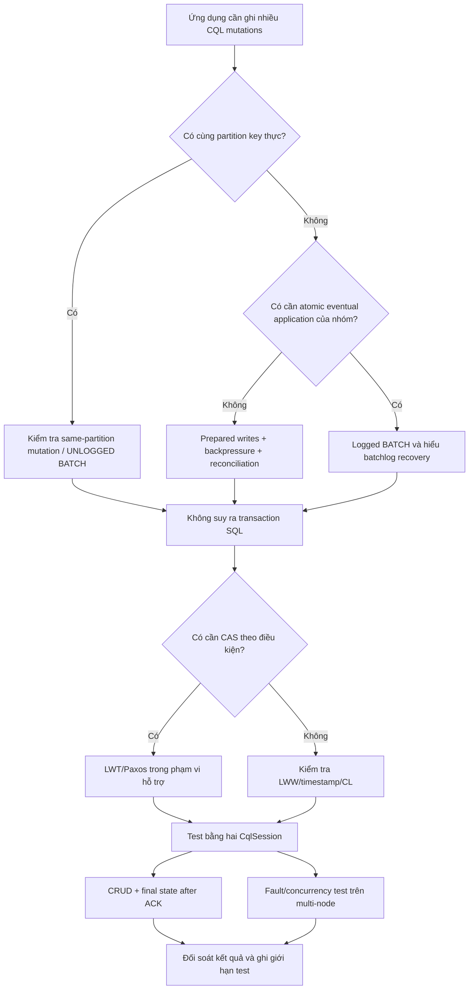

# Kiểm thử CRUD, BATCH và giới hạn nguyên tử bằng nhiều phiên

> **Chương:** Kiểm thử tích hợp  
> **Phạm vi:** Apache Cassandra — cơ sở dữ liệu phân tán *wide-column* — cùng CQL, partition key, replication, consistency level và ứng dụng Java dùng **Cassandra Java Driver 4.x**. Bài tập trung vào kiểm thử bằng **hai hoặc nhiều `CqlSession` độc lập**, thay vì suy diễn tính đúng đắn chỉ từ một client ghi rồi tự đọc.
>
> **Mục tiêu học tập:** Viết kiểm thử tạo/đọc/sửa/xóa trên Cassandra thật; hiểu `INSERT`/`UPDATE` là upsert và `DELETE` tạo tombstone; phân biệt batch cùng partition, batch nhiều partition, logged/unlogged/counter batch; phân biệt **atomicity, isolation, durability, consistency và serializability**; thử quan sát dữ liệu qua hai session, kiểm tra LWT khi có cạnh tranh; thiết kế fault-injection và xác định giới hạn của môi trường một node.

## 1. Vì sao cần nhiều phiên để kiểm thử?

Một bài test sơ khai thường chỉ làm:

```text
CqlSession A:
  INSERT một row
  SELECT chính row đó
  assert dữ liệu đúng
```

Test như vậy có ích cho CQL/codec, nhưng chưa trả lời được:

- Sau khi một client ghi thành công, **client khác** có nhìn thấy giá trị không?
- `UPDATE` có ghi đè cell mong muốn hay vô tình xóa cột vắng mặt?
- `DELETE` có tạo tình huống khác với “row chưa từng tồn tại” hay không?
- Hai statements trong `BATCH` có được áp dụng cùng partition như dự kiến?
- Một `BATCH` nhiều partition có bảo đảm client khác thấy tất cả cùng một thời điểm không?
- Khi write timeout, một session khác có quan sát được **một phần mutation** hoặc kết quả đã được áp dụng không?
- Hai client cùng `INSERT ... IF NOT EXISTS` thì **ai thắng**?

Dùng hai `CqlSession` giúp tách rõ **người ghi** và **người đọc/cạnh tranh**, mô phỏng hai instance ứng dụng. Tuy nhiên, **hai session không mặc nhiên là hai node**: nếu lab chỉ có một Cassandra container, cả hai vẫn kết nối cùng coordinator và replica.

**Mục tiêu:** mỗi test phải nói rõ nó chứng minh điều gì, tại consistency level, RF và topology nào — và điều gì vẫn chưa thể chứng minh.

## 2. Năm thuộc tính thường bị gộp thành “transaction”

| Thuộc tính | Câu hỏi | Điều cần nhớ trong Cassandra |
| --- | --- | --- |
| **Atomicity** | Một nhóm mutation được áp dụng đầy đủ hay có thể chỉ một phần? | Phụ thuộc phạm vi partition và loại batch/cơ chế recovery |
| **Isolation** | Reader đồng thời có thấy trạng thái trung gian không? | Không suy ra isolation xuyên nhiều partition từ `BATCH` |
| **Durability** | Sau ACK, dữ liệu được bảo vệ theo cơ chế ghi nào? | Commit log, replica, CL và cấu hình cluster |
| **Consistency level** | Bao nhiêu replica cần phản hồi? | `ONE`, `LOCAL_QUORUM`... không phải khóa giao dịch |
| **Serializability/CAS** | Hai thao tác có điều kiện cạnh tranh có được điều phối thứ tự? | Dùng LWT/Paxos cho các yêu cầu được hỗ trợ, không phải BATCH thường |

Một câu “`BATCH` là atomic” **không đủ để khẳng định có ACID transaction như RDBMS**. Phải nói rõ **cùng partition hay khác partition**, logged hay unlogged, và quan sát trong lúc hay sau khi coordinator trả ACK.

### Từ vựng trong bài

- **Logical operation:** thao tác nghiệp vụ, ví dụ tạo đơn hàng.
- **Mutation:** cập nhật dữ liệu Cassandra theo partition và timestamp.
- **Coordinator:** node nhận CQL request từ driver.
- **Replica:** node giữ bản sao theo partition key và replication strategy.
- **Session A/B:** hai client `CqlSession` độc lập, không phải hai transaction.
- **Completion/ACK:** thời điểm driver nhận phản hồi thành công; không có nghĩa “mọi reader ở mọi DC đều thấy ngay”.
- **Partial visibility:** người đọc có thể thấy một phần trạng thái của một thay đổi xuyên nhiều partition trong giai đoạn chuyển tiếp.

## 3. Bảng đối chiếu hành vi trước khi viết test

| CQL operation | Ý nghĩa thường gặp | Bẫy kiểm thử |
| --- | --- | --- |
| `INSERT` | Upsert theo primary key; không ép unique theo nghĩa RDBMS | `INSERT` lần hai có thể ghi đè |
| `SELECT` | Đọc theo partition/clustering key, CL và trạng thái replica | Không đọc đủ PK có thể dẫn tới query sai/mắc lỗi |
| `UPDATE` | Mutation/upsert, có thể tạo cell/row dù trước đó chưa có | Không mặc định đòi row phải tồn tại |
| `DELETE` | Ghi dấu xóa, không tức thời loại mọi SSTable cũ | `SELECT` trả không thấy row không có nghĩa đã thu hồi đĩa |
| `BEGIN UNLOGGED BATCH` cùng partition | Nhóm mutation cùng partition hiệu quả, có bảo đảm ở mức partition | Đừng suy thành transaction xuyên partition |
| `BEGIN BATCH` mặc định logged | Dùng batchlog cho atomicity cuối cùng xuyên các mutation nhiều partition theo cơ chế phục hồi | **Không** bảo đảm đọc thấy đồng thời mọi partition |
| `BEGIN UNLOGGED BATCH` nhiều partition | Gửi nhiều mutation không có batchlog recovery xuyên partition | **Không** suy có all-or-nothing |
| `BEGIN COUNTER BATCH` | Nhóm counter mutations theo luật riêng | Counter không idempotent; không trộn với batch thường |
| `INSERT ... IF NOT EXISTS` | LWT/CAS có điều kiện | Cần test kết quả `[applied]` và cạnh tranh |
| `UPDATE ... IF ...` | Conditional mutation/LWT | Đắt hơn ghi thường, phạm vi và giới hạn CQL riêng |

**Chú ý:** Cassandra có semantics theo release/server distribution. Khi kiểm thử vận hành, dùng tài liệu chính thức và CQL support của **bản đang chạy** để xác nhận điều kiện cụ thể, thay vì suy từ chữ “BATCH”.

## 4. Mô hình wide-column: partition quyết định phạm vi nguyên tử quan trọng

Tạo ba bảng thử nghiệm:

```cql
CREATE KEYSPACE IF NOT EXISTS it_lab
WITH replication = {
    'class': 'NetworkTopologyStrategy',
    'datacenter1': 1
};

CREATE TABLE IF NOT EXISTS it_lab.order_status_by_id (
    tenant_id text,
    order_id uuid,
    status text,
    note text,
    PRIMARY KEY ((tenant_id, order_id))
);

CREATE TABLE IF NOT EXISTS it_lab.order_lines_by_order (
    tenant_id text,
    order_id uuid,
    line_no int,
    sku text,
    quantity int,
    PRIMARY KEY ((tenant_id, order_id), line_no)
);

CREATE TABLE IF NOT EXISTS it_lab.order_status_by_customer (
    tenant_id text,
    customer_id uuid,
    order_id uuid,
    status text,
    PRIMARY KEY ((tenant_id, customer_id), order_id)
);
```

Đây là DDL **lab một node**, giả định tên datacenter thực là `datacenter1`, và RF=1. **Không copy RF=1 sang production** có nhiều node. Môi trường đích có thể dùng `dc1:3`/`dc2:3`.

### Nhận biết partition từ primary key

| Bảng | Partition key | Clustering key | Mẫu truy vấn |
| --- | --- | --- | --- |
| `order_status_by_id` | `(tenant_id, order_id)` | Không có | Trạng thái theo ID |
| `order_lines_by_order` | `(tenant_id, order_id)` | `line_no` | Tất cả dòng của một đơn |
| `order_status_by_customer` | `(tenant_id, customer_id)` | `order_id` | Đơn hàng theo khách |

Với hai row ở `order_lines_by_order` cùng `tenant_id` và `order_id`, chúng nằm trong **một partition**.

Với một row trong `order_status_by_id` và một row trong `order_status_by_customer`, dù cùng đơn hàng nghiệp vụ, partition key khác nhau; chúng là **hai partition CQL**. Cassandra không tự biết đó là một “transaction order” cần đọc đồng thời.

### Vì sao phải thiết kế bảng theo truy vấn?

Một bảng theo `(tenant_id, order_id)` tối ưu đọc đơn theo ID; bảng theo `(tenant_id, customer_id)` tối ưu liệt kê đơn của khách. Đây là cách denormalization phổ biến. Nhưng nhiều bản sao nghiệp vụ tạo nhu cầu **đồng bộ và đối soát**; BATCH không biến hai bảng đó thành một database transaction xuyên partition có isolation.

## 5. Hai `CqlSession`: độc lập ở đâu?

Trong Java Driver 4.x, mỗi `CqlSession` có context kết nối, driver metadata, host selection, preparation và pool riêng tùy cấu hình. Hai session có thể được dùng trong một integration test để đóng vai hai ứng dụng.

```text
Test runner
  |
  +-- CqlSession A --> driver connections --> coordinator
  |
  +-- CqlSession B --> driver connections --> coordinator
                                           |
                                    replica placement
```

Cả hai có thể trỏ tới cùng node khi lab chỉ có một Cassandra container. Trên cluster ba node, nếu muốn kiểm tra **coordinator khác nhau**, phải điều khiển/quan sát routing theo cấu hình thực, không tuyên bố “hai session = hai coordinator”.

### Hai session không tạo snapshot hay transaction

Nếu A mở session lúc 10:00 và B lúc 10:05, Cassandra **không giữ ảnh chụp dữ liệu tại thời điểm mở session**. Mỗi SELECT là một CQL request với consistency level, coordinator và thời điểm thực thi riêng.

Đừng dùng `CqlSession` như một JDBC `Connection` đã `BEGIN TRANSACTION` rồi mong có `COMMIT/ROLLBACK` kiểu SQL.

## 6. CRUD trong Cassandra: các kỳ vọng phải kiểm chứng

### C — CREATE bằng `INSERT`

```cql
INSERT INTO it_lab.order_status_by_id
    (tenant_id, order_id, status, note)
VALUES (
    'tenant-a',
    11111111-1111-4111-8111-111111111111,
    'CREATED',
    'Mới tạo'
);
```

Nó **không** tự bảo đảm “row chưa tồn tại”. Nếu cùng primary key đã có dữ liệu, Cassandra dùng upsert/timestamp reconciliation.

### R — READ theo đầy đủ partition key

```cql
SELECT status, note
FROM it_lab.order_status_by_id
WHERE tenant_id = 'tenant-a'
  AND order_id = 11111111-1111-4111-8111-111111111111;
```

Nếu `Row` null, không có row sống được trả. Nếu row tồn tại mà `note` null, cột đó không có giá trị sống; hai trạng thái không đồng nghĩa.

### U — UPDATE

```cql
UPDATE it_lab.order_status_by_id
SET status = 'PAID'
WHERE tenant_id = 'tenant-a'
  AND order_id = 11111111-1111-4111-8111-111111111111;
```

`UPDATE` có ngữ nghĩa upsert; không mặc định từ chối nếu row chưa từng tồn tại. Với client PATCH, phải phân biệt **CQL NULL** (xóa regular column/tombstone) và **UNSET** (không thay cột) khi dùng prepared binding được hỗ trợ.

### D — DELETE

```cql
DELETE FROM it_lab.order_status_by_id
WHERE tenant_id = 'tenant-a'
  AND order_id = 11111111-1111-4111-8111-111111111111;
```

Cassandra ghi tombstone để che dữ liệu cũ trên replica/SSTable. `SELECT` có thể không trả row, nhưng **không chứng minh SSTable chứa giá trị cũ đã được thu hồi**. Compaction, `gc_grace_seconds` và repair liên quan an toàn thu hồi ở cluster nhiều replica.

### Kiểm thử CRUD cần cả hai chiều

- A ghi, B đọc.
- B cập nhật, A đọc.
- A xóa, B không thấy row khi đáp ứng điều kiện nhất quán test.
- B thử update khóa chưa tồn tại, xác nhận upsert nếu domain cho phép.
- Client thiếu primary key bị từ chối.
- Null/UNSET và TTL có test riêng.

## 7. Tránh biến “A ghi rồi B đọc” thành khẳng định quá mức

Giả sử một node test với RF=1 và `LOCAL_ONE`:

```text
A INSERT -> nhận ACK
B SELECT -> thấy row
```

Kết quả chứng minh **hai Java sessions** tương tác được với **một Cassandra instance**, schema và codec đúng. Nó **chưa** chứng minh:

- RF=3 quorum giao nhau.
- Một replica mất kết nối vẫn đọc/ghi được.
- Cross-DC replication có độ trễ thấp.
- Batchlog replay sau coordinator chết.
- Consistency khi một replica có phiên bản dữ liệu cũ.

Với RF=3 ở local DC, `LOCAL_QUORUM` cần hai replica local; test tương ứng phải dùng nhiều node phù hợp. Test một node với `LOCAL_QUORUM` và RF=1 chỉ cần một phản hồi local — không tương đương tình huống production.

## 8. `BATCH` dùng để làm gì và không làm gì?

Một `BATCH` gom nhiều CQL mutation thành một request theo điều kiện server cho phép. Nó **không** phải một cơ chế SQL transaction chung.

### Ba loại cần phân biệt

| Loại | Cú pháp | Đặc điểm chính |
| --- | --- | --- |
| **Logged batch** | `BEGIN BATCH ... APPLY BATCH` | Mặc định dùng batchlog để hỗ trợ atomic eventual application nhiều partition |
| **Unlogged batch** | `BEGIN UNLOGGED BATCH ... APPLY BATCH` | Không dùng batchlog bảo vệ atomicity xuyên nhiều partition |
| **Counter batch** | `BEGIN COUNTER BATCH ... APPLY BATCH` | Dành cho counter operations theo luật riêng; không trộn với standard mutations |

**Mặc định `BEGIN BATCH` là logged batch.** Một số tài liệu gọi tắt là “logged batch”; không nhất thiết dùng literal `BEGIN LOGGED BATCH` trong code CQL.

### BATCH không phải lệnh bulk loading tối ưu

Gom 1.000 mutation tới 1.000 partition vào một logged batch có thể gây tải coordinator, batchlog và mạng cao hơn gửi các prepared writes có kiểm soát concurrency.

Nếu mục tiêu là **throughput ingestion**, nên:

- Sử dụng prepared statements.
- Đặt giới hạn in-flight và rate.
- Group theo partition khi có ý nghĩa.
- Chọn batch chỉ khi semantics nghiệp vụ cần và thiết kế được duyệt.
- Dùng công cụ bulk SSTable import phù hợp cho dữ liệu lớn nếu bài toán đúng loại.

**BATCH không biến một tập ghi rải trên nhiều partition thành một transaction SQL vừa nhanh vừa isolated.**

## 9. Atomicity của batch cùng partition

Ví dụ hai order lines trong cùng partition:

```cql
BEGIN UNLOGGED BATCH
    INSERT INTO it_lab.order_lines_by_order
        (tenant_id, order_id, line_no, sku, quantity)
    VALUES (
        'tenant-a',
        11111111-1111-4111-8111-111111111111,
        1, 'BOOK', 2
    );

    INSERT INTO it_lab.order_lines_by_order
        (tenant_id, order_id, line_no, sku, quantity)
    VALUES (
        'tenant-a',
        11111111-1111-4111-8111-111111111111,
        2, 'PEN', 3
    );
APPLY BATCH;
```

Hai mutation nhắm **cùng partition key**: `('tenant-a', order_id)`.

Cassandra cung cấp những bảo đảm per-partition cho mutation cùng partition (bao gồm tính nguyên tử/khả năng cô lập trong phạm vi thao tác được hỗ trợ). Một unlogged batch cùng partition thường hợp lý hơn logged batch rải nhiều partition nếu cần cập nhật nhiều clustering rows của cùng đơn.

**Phải tách hai ý:**

1. **Sau khi batch được ACK thành công** và không có concurrent mutation xung đột, đọc partition bằng CL phù hợp phải thấy hai order lines đã ghi.
2. **Trong lúc batch đang được xử lý**, việc kiểm chứng reader không nhìn thấy trạng thái nửa vời phải có setup concurrency/fault timing nghiêm ngặt. Không kết luận từ một test chỉ đọc **sau ACK** rằng đã thử được toàn bộ isolation under concurrency.

### Một partition không có nghĩa toàn nghiệp vụ là một partition

Bảng `order_status_by_id` và `order_lines_by_order` có thể có cùng *giá trị khóa nghiệp vụ* nhưng là **hai bảng** và hai không gian partition riêng. Không dựa vào việc cả hai đều chứa `tenant_id + order_id` mà cho rằng Cassandra áp nguyên tử xuyên hai bảng như một mutation duy nhất.

Muốn đặt nhiều field/rows cần quan sát nhất quán trong cùng partition, hãy thiết kế physical data model đúng phạm vi và kiểm chứng semantics với server release đang dùng.

## 10. Batch nhiều partition: atomicity cuối cùng khác isolation

Ví dụ một lần cập nhật hai projection:

```cql
BEGIN BATCH
    INSERT INTO it_lab.order_status_by_id
        (tenant_id, order_id, status)
    VALUES (
        'tenant-a',
        11111111-1111-4111-8111-111111111111,
        'PAID'
    );

    INSERT INTO it_lab.order_status_by_customer
        (tenant_id, customer_id, order_id, status)
    VALUES (
        'tenant-a',
        aaaaaaaa-aaaa-4aaa-8aaa-aaaaaaaaaaaa,
        11111111-1111-4111-8111-111111111111,
        'PAID'
    );
APPLY BATCH;
```

Hai mutation có **partition keys khác nhau**. Đây là **logged batch** vì không khai `UNLOGGED` hoặc `COUNTER`.

Cassandra dùng **batchlog** để bảo đảm những mutation của một logged batch có thể được phát/hoàn thành sau sự cố theo điều kiện phục hồi/availability của hệ thống.

Tuy nhiên, **client đọc hai partition liên tiếp không có snapshot isolation xuyên chúng**. Trong giai đoạn batch chưa được mọi replica xử lý, hoặc khi có timeout/failure/replication lag, một reader có thể quan sát projection A đã mới còn projection B chưa mới.

### Timeline của partial visibility

```text
Time ->
Session A: BEGIN BATCH (P1=status_by_id, P2=by_customer)
             |
             +---------> P1 được áp dụng/hiển thị
             |                       |
             |                       v
Session B:   |                  SELECT P1 -> PAID
             |                  SELECT P2 -> giá trị cũ
             |
             +---------------------> P2 được áp dụng/hiển thị
                                     |
                                     v
Session B:                       SELECT cả hai -> PAID
```

Đây là **kịch bản có thể xảy ra**, không phải lịch bắt buộc Cassandra luôn thực hiện P1 trước P2. Một test bình thường khó tái hiện đúng cửa sổ này vì nó thường rất ngắn; cần fault injection hoặc điều phối tải có kiểm soát.

### Logged batch không phải rollback transaction

Không có semantics chung kiểu:

```text
BEGIN TRANSACTION
UPDATE table_A;
UPDATE table_B;
ROLLBACK nếu một client gặp lỗi;
```

Với logged batch, cơ chế nhấn mạnh **thực hiện tất cả mutation cuối cùng theo bảo đảm của hệ thống**, không cung cấp **rollback các mutation đã thấy** khi ứng dụng đổi ý. Nếu app timeout, kết quả có thể **chưa xác định** tại thời điểm lỗi.

## 11. Unlogged batch nhiều partition có nguy cơ gì?

```cql
BEGIN UNLOGGED BATCH
    UPDATE it_lab.order_status_by_id
    SET status = 'SHIPPED'
    WHERE tenant_id = 'tenant-a'
      AND order_id = 11111111-1111-4111-8111-111111111111;

    UPDATE it_lab.order_status_by_customer
    SET status = 'SHIPPED'
    WHERE tenant_id = 'tenant-a'
      AND customer_id = aaaaaaaa-aaaa-4aaa-8aaa-aaaaaaaaaaaa
      AND order_id = 11111111-1111-4111-8111-111111111111;
APPLY BATCH;
```

Đây là **hai partition khác nhau và không có batchlog để recovery cả nhóm**. Nếu một phần thao tác đã áp dụng rồi xảy ra lỗi, không được giả định các projection khác sẽ tự được sửa để nhất quán cuối cùng nhờ batchlog.

Vì vậy test phải phân biệt:

- **Unlogged cùng partition:** có thể là cấu trúc hợp lý cho mutation cùng một partition.
- **Unlogged khác partition:** không tự có atomicity xuyên partition.
- **Logged khác partition:** có cơ chế batchlog, nhưng không snapshot isolation xuyên partition.

### Khi nào không nên chọn logged batch?

Nếu một ứng dụng chỉ muốn nhập rất nhiều independent events, logged batch nhiều partition có thể là lựa chọn sai về hiệu năng. Hãy dùng write pipeline có backpressure và checkpoint; không dùng batchlog như một hàng đợi nghiệp vụ bền vững.

## 12. Counter batch và tính không idempotent

Counter có ngữ nghĩa cộng dồn:

```cql
CREATE TABLE IF NOT EXISTS it_lab.page_views_by_id (
    page_id uuid PRIMARY KEY,
    views counter
);
```

```cql
BEGIN COUNTER BATCH
    UPDATE it_lab.page_views_by_id
    SET views = views + 1
    WHERE page_id = 11111111-1111-4111-8111-111111111111;
APPLY BATCH;
```

Nếu cùng thao tác bị gửi lại nhiều lần, counter có thể tăng nhiều lần. **Không gọi counter batch là transaction exactly once** và không trộn counter mutations với standard mutations.

Trong integration test, cần kiểm tra **idempotency/duplicate delivery** ở tầng nghiệp vụ. Với sự kiện “một lượt xem”, nếu retry là khả năng thực tế, có thể phải dùng event ID/deduplication hoặc mô hình ghi khác.

**Đừng bật speculative execution cho counter increment** chỉ vì API đang muốn giảm tail latency.

## 13. Vì sao không dùng `BATCH` để “tránh mọi race”?

Giả sử hai ứng dụng cùng sửa `status`:

```text
Session A: UPDATE status='PAID'
Session B: UPDATE status='CANCELLED'
```

Cassandra không tự hiểu quy tắc “PAID không được chuyển thành CANCELLED” chỉ từ batch. Các cell updates thường được hòa giải theo **write timestamp** và quy tắc tie-break của server.

Một batch gồm nhiều UPDATE bình thường **không bảo đảm optimistic concurrency control** cho domain invariant. Nếu cần **compare-and-set**, xem LWT.

### Một kiểm thử timestamp đúng trọng tâm

Dùng hai session ghi cùng khóa với **timestamp microsecond tường minh**, ví dụ:

```cql
UPDATE it_lab.order_status_by_id
USING TIMESTAMP 1800000000000000
SET status = 'PAID'
WHERE tenant_id = 'tenant-test'
  AND order_id = 11111111-1111-4111-8111-111111111111;

UPDATE it_lab.order_status_by_id
USING TIMESTAMP 1800000000000010
SET status = 'SHIPPED'
WHERE tenant_id = 'tenant-test'
  AND order_id = 11111111-1111-4111-8111-111111111111;
```

Nếu đây là **khóa test riêng chưa có write timestamp cao hơn**, kết quả sống sau khi cả hai mutation thành công sẽ theo timestamp cao hơn: `SHIPPED`. Thứ tự hai HTTP requests không nhất thiết là thứ tự reconciliation.

CQL timestamp có đơn vị **microsecond**, khác `Instant` milliseconds/nanoseconds API. Không tự lấy giá trị ví dụ trong bài làm production timestamp source.

## 14. Đoạn lab dùng Testcontainers: điều kiện chạy

Ví dụ tiếp theo dành cho:

- **JDK 17**.
- **JUnit Jupiter (JUnit 5)**.
- **Testcontainers dòng 1.x** với Cassandra module phù hợp.
- **Apache Cassandra server image đã được pin phiên bản/digest** bằng CI.
- **Cassandra Java Driver 4.x** từ artifact phù hợp với project.

Các API/package Testcontainers có thể thay đổi ở major release khác. Nếu project dùng Spring Boot, cần bảo đảm dependency graph của Spring Data Cassandra và driver cũng tương thích.

### Maven dependencies dạng khái niệm

```xml
<!-- Lấy phiên bản từ BOM/dependencyManagement đã được duyệt. -->
<dependency>
    <groupId>org.testcontainers</groupId>
    <artifactId>cassandra</artifactId>
    <scope>test</scope>
</dependency>
<dependency>
    <groupId>org.testcontainers</groupId>
    <artifactId>junit-jupiter</artifactId>
    <scope>test</scope>
</dependency>
<dependency>
    <groupId>org.junit.jupiter</groupId>
    <artifactId>junit-jupiter</artifactId>
    <scope>test</scope>
</dependency>
```

Không gán một driver patch hoặc Docker digest **tự đoán**. CI cần kiểm tra dependency resolution và server version quan sát được khi chạy.

### Pin image qua system property

Ví dụ chạy theo cấu hình dự án:

```bash
mvn test -Dit.cassandra.image='<approved-image-ref-with-verified-digest>'
```

Đây là placeholder, chưa phải image hợp lệ. Mục đích là test **fail fast nếu thiếu image đã duyệt**, thay vì ngầm lấy `cassandra:latest`.

**Giới hạn scope:** một container chỉ xác nhận CQL/codec/semantics cơ bản trên một node. Nó không kiểm tra phục hồi batchlog xuyên các replica khi một coordinator hoặc replica gặp sự cố.

## 15. Bài integration test hoàn chỉnh với hai session

Đoạn dưới xây schema trong container test riêng, mở hai `CqlSession`, chạy CRUD, batch cùng partition, logged batch nhiều partition và LWT cạnh tranh. Đây là **mẫu học tập**, cần resolve API/dependencies theo đúng release và CI trước khi dùng.

```java
import static org.junit.jupiter.api.Assertions.*;

import java.net.InetSocketAddress;
import java.util.HashMap;
import java.util.Map;
import java.util.UUID;
import java.util.concurrent.Callable;
import java.util.concurrent.CountDownLatch;
import java.util.concurrent.ExecutorService;
import java.util.concurrent.Executors;
import java.util.concurrent.Future;
import java.util.concurrent.TimeUnit;

import org.junit.jupiter.api.AfterAll;
import org.junit.jupiter.api.BeforeAll;
import org.junit.jupiter.api.Test;
import org.testcontainers.containers.CassandraContainer;
import org.testcontainers.junit.jupiter.Container;
import org.testcontainers.junit.jupiter.Testcontainers;
import org.testcontainers.utility.DockerImageName;

import com.datastax.oss.driver.api.core.CqlSession;
import com.datastax.oss.driver.api.core.DefaultConsistencyLevel;
import com.datastax.oss.driver.api.core.cql.BatchStatement;
import com.datastax.oss.driver.api.core.cql.BoundStatement;
import com.datastax.oss.driver.api.core.cql.DefaultBatchType;
import com.datastax.oss.driver.api.core.cql.PreparedStatement;
import com.datastax.oss.driver.api.core.cql.Row;

@Testcontainers
class CassandraCrudBatchMultipleSessionsIT {

    private static String approvedImage() {
        String ref = System.getProperty("it.cassandra.image");
        if (ref == null || ref.isBlank()) {
            throw new IllegalStateException(
                "Set -Dit.cassandra.image to an approved pinned image");
        }
        return ref;
    }

    @Container
    static final CassandraContainer<?> cassandra =
        new CassandraContainer<>(
            DockerImageName.parse(approvedImage()));

    private static CqlSession a;
    private static CqlSession b;

    private static CqlSession openSession() {
        return CqlSession.builder()
            .addContactPoint(new InetSocketAddress(
                cassandra.getHost(),
                cassandra.getMappedPort(9042)))
            .withLocalDatacenter("datacenter1")
            .build();
    }

    @BeforeAll
    static void setUp() {
        a = openSession();
        b = openSession();

        Row local = a.execute(
            "SELECT data_center FROM system.local"
        ).one();
        assertNotNull(local);
        assertEquals("datacenter1",
                     local.getString("data_center"));

        a.execute(
            "CREATE KEYSPACE IF NOT EXISTS it_lab " +
            "WITH replication = {'class': " +
            "'NetworkTopologyStrategy', 'datacenter1': 1}"
        );

        a.execute(
            "CREATE TABLE IF NOT EXISTS " +
            "it_lab.order_status_by_id (" +
            "tenant_id text, order_id uuid, " +
            "status text, note text, " +
            "PRIMARY KEY ((tenant_id, order_id)))"
        );

        a.execute(
            "CREATE TABLE IF NOT EXISTS " +
            "it_lab.order_lines_by_order (" +
            "tenant_id text, order_id uuid, line_no int, " +
            "sku text, quantity int, " +
            "PRIMARY KEY ((tenant_id, order_id), line_no))"
        );

        a.execute(
            "CREATE TABLE IF NOT EXISTS " +
            "it_lab.order_status_by_customer (" +
            "tenant_id text, customer_id uuid, " +
            "order_id uuid, status text, " +
            "PRIMARY KEY ((tenant_id, customer_id), order_id))"
        );

        a.execute(
            "CREATE TABLE IF NOT EXISTS it_lab.claims_by_id (" +
            "claim_id uuid PRIMARY KEY, winner text)"
        );
    }

    @AfterAll
    static void tearDown() {
        if (b != null) b.close();
        if (a != null) a.close();
    }

    @Test
    void crudVisibleAcrossIndependentSessions() {
        UUID order = UUID.randomUUID();

        PreparedStatement insert = a.prepare(
            "INSERT INTO it_lab.order_status_by_id " +
            "(tenant_id, order_id, status, note) " +
            "VALUES (?, ?, ?, ?)"
        );
        a.execute(insert.bind(
            "tenant-test", order, "CREATED", "initial"
        ).setConsistencyLevel(
            DefaultConsistencyLevel.LOCAL_ONE));

        PreparedStatement select = b.prepare(
            "SELECT status, note " +
            "FROM it_lab.order_status_by_id " +
            "WHERE tenant_id = ? AND order_id = ?"
        );
        Row created = b.execute(
            select.bind("tenant-test", order)
                .setConsistencyLevel(
                    DefaultConsistencyLevel.LOCAL_ONE)
        ).one();
        assertNotNull(created);
        assertEquals("CREATED", created.getString("status"));
        assertEquals("initial", created.getString("note"));

        PreparedStatement update = b.prepare(
            "UPDATE it_lab.order_status_by_id " +
            "SET status = ? " +
            "WHERE tenant_id = ? AND order_id = ?"
        );
        b.execute(update.bind(
            "PAID", "tenant-test", order
        ).setConsistencyLevel(
            DefaultConsistencyLevel.LOCAL_ONE));

        Row updated = a.execute(
            a.prepare(
                "SELECT status FROM it_lab.order_status_by_id " +
                "WHERE tenant_id = ? AND order_id = ?"
            ).bind("tenant-test", order)
             .setConsistencyLevel(
                DefaultConsistencyLevel.LOCAL_ONE)
        ).one();
        assertNotNull(updated);
        assertEquals("PAID", updated.getString("status"));

        PreparedStatement delete = a.prepare(
            "DELETE FROM it_lab.order_status_by_id " +
            "WHERE tenant_id = ? AND order_id = ?"
        );
        a.execute(delete.bind(
            "tenant-test", order
        ).setConsistencyLevel(
            DefaultConsistencyLevel.LOCAL_ONE));

        Row deleted = b.execute(
            select.bind("tenant-test", order)
                .setConsistencyLevel(
                    DefaultConsistencyLevel.LOCAL_ONE)
        ).one();
        assertNull(deleted);
    }

    @Test
    void unloggedBatchWithinOnePartition() {
        UUID order = UUID.randomUUID();

        PreparedStatement insertLine = a.prepare(
            "INSERT INTO it_lab.order_lines_by_order " +
            "(tenant_id, order_id, line_no, sku, quantity) " +
            "VALUES (?, ?, ?, ?, ?)"
        );

        BatchStatement batch =
            BatchStatement.builder(DefaultBatchType.UNLOGGED)
                .addStatement(insertLine.bind(
                    "tenant-test", order, 1, "BOOK", 2))
                .addStatement(insertLine.bind(
                    "tenant-test", order, 2, "PEN", 3))
                .build()
                .setConsistencyLevel(
                    DefaultConsistencyLevel.LOCAL_ONE);

        a.execute(batch);

        PreparedStatement select = b.prepare(
            "SELECT line_no, sku " +
            "FROM it_lab.order_lines_by_order " +
            "WHERE tenant_id = ? AND order_id = ?"
        );

        Map<Integer, String> lines = new HashMap<>();
        for (Row row : b.execute(
            select.bind("tenant-test", order)
                .setConsistencyLevel(
                    DefaultConsistencyLevel.LOCAL_ONE))) {
            lines.put(
                row.getInt("line_no"),
                row.getString("sku"));
        }

        assertEquals(2, lines.size());
        assertEquals("BOOK", lines.get(1));
        assertEquals("PEN", lines.get(2));
    }

    @Test
    void loggedBatchAcrossTwoDifferentPartitions() {
        UUID order = UUID.randomUUID();
        UUID customer = UUID.randomUUID();

        PreparedStatement byId = a.prepare(
            "INSERT INTO it_lab.order_status_by_id " +
            "(tenant_id, order_id, status) VALUES (?, ?, ?)"
        );
        PreparedStatement byCustomer = a.prepare(
            "INSERT INTO it_lab.order_status_by_customer " +
            "(tenant_id, customer_id, order_id, status) " +
            "VALUES (?, ?, ?, ?)"
        );

        BatchStatement logged =
            BatchStatement.builder(DefaultBatchType.LOGGED)
                .addStatement(byId.bind(
                    "tenant-test", order, "PAID"))
                .addStatement(byCustomer.bind(
                    "tenant-test", customer, order, "PAID"))
                .build()
                .setConsistencyLevel(
                    DefaultConsistencyLevel.LOCAL_ONE);

        a.execute(logged);

        Row left = b.execute(
            b.prepare(
                "SELECT status FROM it_lab.order_status_by_id " +
                "WHERE tenant_id = ? AND order_id = ?"
            ).bind("tenant-test", order)
             .setConsistencyLevel(
                DefaultConsistencyLevel.LOCAL_ONE)
        ).one();

        Row right = b.execute(
            b.prepare(
                "SELECT status " +
                "FROM it_lab.order_status_by_customer " +
                "WHERE tenant_id = ? AND customer_id = ? " +
                "AND order_id = ?"
            ).bind("tenant-test", customer, order)
             .setConsistencyLevel(
                DefaultConsistencyLevel.LOCAL_ONE)
        ).one();

        assertNotNull(left);
        assertNotNull(right);
        assertEquals("PAID", left.getString("status"));
        assertEquals("PAID", right.getString("status"));

        // Chỉ chứng minh final state sau ACK ở RF=1.
        // KHÔNG chứng minh isolation xuyên hai partition.
    }

    private static boolean tryClaim(
            CqlSession session,
            PreparedStatement prepared,
            UUID claimId,
            String actor,
            CountDownLatch ready,
            CountDownLatch start) throws Exception {

        ready.countDown();
        if (!start.await(10, TimeUnit.SECONDS)) {
            throw new IllegalStateException("Start barrier timed out");
        }

        BoundStatement statement = prepared
            .bind(claimId, actor)
            .setConsistencyLevel(
                DefaultConsistencyLevel.LOCAL_ONE)
            .setSerialConsistencyLevel(
                DefaultConsistencyLevel.LOCAL_SERIAL);

        Row result = session.execute(statement).one();
        assertNotNull(result);
        return result.getBoolean("[applied]");
    }

    @Test
    void concurrentLwtHasOneWinner() throws Exception {
        UUID claimId = UUID.randomUUID();
        String cql =
            "INSERT INTO it_lab.claims_by_id " +
            "(claim_id, winner) VALUES (?, ?) IF NOT EXISTS";

        PreparedStatement p1 = a.prepare(cql);
        PreparedStatement p2 = b.prepare(cql);

        CountDownLatch ready = new CountDownLatch(2);
        CountDownLatch start = new CountDownLatch(1);
        ExecutorService pool = Executors.newFixedThreadPool(2);

        try {
            Future<Boolean> f1 = pool.submit(() ->
                tryClaim(a, p1, claimId, "A", ready, start));
            Future<Boolean> f2 = pool.submit(() ->
                tryClaim(b, p2, claimId, "B", ready, start));

            assertTrue(ready.await(10, TimeUnit.SECONDS));
            start.countDown();

            boolean winA = f1.get(30, TimeUnit.SECONDS);
            boolean winB = f2.get(30, TimeUnit.SECONDS);
            assertEquals(1,
                (winA ? 1 : 0) + (winB ? 1 : 0));

            Row row = a.execute(
                a.prepare(
                    "SELECT winner FROM it_lab.claims_by_id " +
                    "WHERE claim_id = ?"
                ).bind(claimId)
                 .setConsistencyLevel(
                    DefaultConsistencyLevel.LOCAL_ONE)
            ).one();

            assertNotNull(row);
            assertEquals(winA ? "A" : "B",
                         row.getString("winner"));
        } finally {
            start.countDown();
            pool.shutdownNow();
        }
    }
}
```

### Những điều ví dụ chứng minh

- Hai Java sessions thật sự chạy CQL tới một container Cassandra.
- `INSERT`, `SELECT`, `UPDATE`, `DELETE` hoạt động qua hai sessions.
- Hai statements cùng partition trong một unlogged batch cho ra final state mong đợi.
- Một logged batch cập nhật hai partition có final state được kiểm tra sau ACK.
- LWT `IF NOT EXISTS` khi hai sessions cạnh tranh cùng khóa cho đúng một applied winner, nếu request hoàn tất bình thường.

### Những điều ví dụ **không** chứng minh

- Quorum RF=3 hoặc failover một replica.
- Batchlog replay sau coordinator crash.
- Không bao giờ thấy partial visibility khi đọc hai partition **trong lúc** logged batch đang chạy.
- Transaction snapshot toàn cluster.
- Đúng throughput/p99 của production.
- TLS/RBAC/CA/SAN, vì ví dụ dùng cấu hình lab mặc định.
- Exactly once cho business event nếu có retry xuyên HTTP/Kafka.

**Lưu ý phiên bản:** test code nhắm Java Driver 4.x và Testcontainers 1.x; class/package/API cụ thể phải được xác minh bằng compilation và integration CI của dự án. STEP viết bài này chưa chạy Gradle/Maven hay Content QA.

## 16. Vì sao phải dùng khóa dữ liệu test duy nhất?

Các test đều dùng `UUID.randomUUID()` cho `orderId`, `customerId` hoặc `claimId` để tránh đụng row do test trước tạo.

Nếu dùng khóa cố định và chạy lại test:

- Tombstone cũ có thể che dữ liệu mới theo timestamp.
- Timestamp logic của mutation có thể làm kết quả không như kỳ vọng.
- Nhiều worker CI cùng ghi một partition, tạo race.
- Batch test sau có thể thừa row từ test trước.
- LWT `IF NOT EXISTS` có thể trả `applied=false` ngay từ lần đầu vì dữ liệu đã tồn tại.

### Các lựa chọn isolation

| Môi trường | Cách cô lập phù hợp |
| --- | --- |
| Container ephemeral mỗi suite | Random keys; hủy container khi xong |
| Shared staging | Test-run ID/tenant prefix, quyền hạn và cleanup được duyệt |
| Multi-node test riêng | Namespace/keys và lịch test tránh chồng topology chaos |
| Performance test | Dataset có seed và distribution cố định, có reset/checkpoint |

Không chạy `TRUNCATE` bảng production/shared staging như một thao tác cleanup vô hại. Nó tác động rộng và không phải rollback SQL transaction.

## 17. Test thật phải khớp phiên bản Cassandra và driver

Trước khi chạy mẫu, xác minh:

```cql
SELECT release_version, cql_version,
       native_protocol_version, data_center
FROM system.local;
```

Và trong môi trường được cấp quyền:

```bash
nodetool version
nodetool status
```

Với các release cũ hoặc distribution khác, metadata names có thể thay đổi; xác minh schema thực tế trước khi coi câu query là portable tuyệt đối.

Kiểm tra cả:

- Cassandra server exact version/patch và image digest.
- Java Driver artifact, group, version thực.
- Testcontainers/JUnit/JDK versions.
- Keyspace NTS, RF theo DC và CL.
- Retry/speculative policy và default idempotence.
- BATCH size limits và server configuration có liên quan.
- Schema revision, TTL/gc_grace và compaction options nếu test đụng retention.

Một test xanh trên `cassandra:latest` không là bằng chứng vững cho production dùng release cố định.

## 18. Read-after-write qua hai session và consistency level

Với Cassandra production RF=3 ở dc1:

```text
R1, R2, R3 là ba replica cho partition P
LOCAL_QUORUM cần 2 phản hồi local
```

Nếu write `LOCAL_QUORUM` thành công rồi read `LOCAL_QUORUM` cùng DC, các tập quorum có giao nhau, cung cấp điều kiện mạnh hơn cho việc thấy mutation mới nhất **khi không có ghi cạnh tranh/timeout bất thường và theo ngữ nghĩa consistency của Cassandra**.

Nhưng:

- `LOCAL_ONE` có thể đọc một replica chưa nhận mutation.
- Hai `LOCAL_QUORUM` ở **hai DC khác nhau** không mặc nhiên có chung replica.
- Ghi đồng thời trên cùng khóa được hòa giải theo timestamp, không theo thứ tự HTTP nhận được.
- Với multi-partition, mỗi partition có một đường replica/quorum riêng.
- `LOCAL_QUORUM` không tạo một **snapshot transaction xuyên hai SELECT**.

### Test khác nhau theo topology

| Kịch bản | Thiết lập | Kỳ vọng |
| --- | --- | --- |
| Single node | RF=1, `LOCAL_ONE` | CRUD/codec/client khác |
| Ba node local | RF=3, `LOCAL_QUORUM` | Kiểm tra quorum 2/3 và read-after-write |
| Mất một replica | RF=3, `LOCAL_QUORUM` | Còn hai replica hợp lệ thì có thể tiếp tục |
| Mất hai replica | RF=3, `LOCAL_QUORUM` | Thường không đủ quorum; xử lý lỗi |
| Hai DC | RF=3 mỗi DC, CL local | Kiểm tra replica lag và local routing |
| LWT | RF phù hợp, `LOCAL_SERIAL`/`SERIAL` theo thiết kế | CAS contention và result semantics |

**Không hạ CL ở production để “làm test qua”** nếu domain cần quorum. Thay vào đó dùng suite multi-node tương ứng.

## 19. Snapshot isolation: không phải vì cùng một session mà tự có

Giả sử B đọc hai bảng sau khi A bắt đầu logged batch:

```text
B.SELECT order_status_by_id     -> 'PAID'
B.SELECT order_status_by_customer -> 'CREATED'
```

Đây có thể là trạng thái trung gian của **hai partition khác nhau**, hoặc do consistency/replication/ghi cạnh tranh. Nó không chứng minh batchlog “mất dữ liệu vĩnh viễn”.

Ngay cả khi cả hai SELECT dùng cùng một `CqlSession`, Cassandra không tạo transaction snapshot giữa chúng.

### Nếu nghiệp vụ cần “đọc cả hai hoặc không cái nào”

Hãy cân nhắc:

1. **Đặt bất biến cần đọc cùng nhau trong một partition phù hợp access pattern**, nếu cardinality và kích thước partition cho phép.
2. **Mô hình trạng thái/phiên bản nghiệp vụ**: một bản ghi canonical có version, projection chỉ được dùng khi version đã khớp.
3. **Event-driven reconciliation**: chấp nhận eventual consistency nhưng có kiểm tra, repair ứng dụng và SLO hội tụ.
4. **LWT/CAS** cho một điều kiện cụ thể trong phạm vi hỗ trợ, không diễn giải thành transaction bất kỳ nhiều partition.
5. **Dùng hệ thống lưu trữ/transaction khác** nếu thật sự cần ACID xuyên nhiều entity/phân vùng.

**Không chọn logged batch rồi bỏ qua thiết kế cách người đọc xử lý trạng thái tạm không đồng bộ.**

## 20. LWT: test đúng nghĩa “hai người tranh cùng một quyền”

Dùng bảng:

```cql
CREATE TABLE IF NOT EXISTS it_lab.claims_by_id (
    claim_id uuid PRIMARY KEY,
    winner text
);
```

Hai session gửi gần đồng thời:

```cql
INSERT INTO it_lab.claims_by_id (claim_id, winner)
VALUES (11111111-1111-4111-8111-111111111111, 'A')
IF NOT EXISTS;
```

và:

```cql
INSERT INTO it_lab.claims_by_id (claim_id, winner)
VALUES (11111111-1111-4111-8111-111111111111, 'B')
IF NOT EXISTS;
```

Kết quả `[applied]` là bằng chứng của **CAS condition** cho request tương ứng.

Sau khi hai operations hoàn tất thành công ở mức protocol:

- Một request `applied=true`.
- Request còn lại `applied=false`.
- Row cuối có `winner` tương ứng winner.
- Không được giả định session A luôn thắng vì tạo thread trước.

Test dùng `CountDownLatch` giúp hai worker **cùng bắt đầu**, không tạo ra bảo đảm scheduler/cassandra nhận request đúng một thời điểm. Nó kiểm chứng invariant, không kiểm chứng thứ tự cố định.

### Điều không đúng: “LWT là logged batch mạnh hơn”

LWT sử dụng consensus/Paxos cho conditional update theo các điều kiện hỗ trợ. Logged BATCH thông thường dựa trên batchlog cho nhóm mutation, nhưng **không** thực thi compare-and-set theo điều kiện domain.

Nếu cần CAS cho nhiều rows, phải hiểu giới hạn conditional batches của release, nhất là phạm vi partition; không giả định có thể xây một transaction SQL tổng quát xuyên hàng trăm partition.

## 21. Serial consistency level và normal consistency level

Một LWT có hai khái niệm consistency:

- **Serial consistency** cho pha điều kiện/Paxos, thường là `SERIAL` hoặc `LOCAL_SERIAL` tùy yêu cầu và topology.
- **Regular consistency** cho phần mutation/read theo quy định statement.

Ví dụ Java Driver 4.x:

```java
BoundStatement claim = prepared
    .bind(claimId, "A")
    .setSerialConsistencyLevel(
        DefaultConsistencyLevel.LOCAL_SERIAL)
    .setConsistencyLevel(
        DefaultConsistencyLevel.LOCAL_QUORUM);
```

Ví dụ này dành cho **cluster có RF/DC phù hợp**; bài JUnit một node dùng `LOCAL_ONE` để tránh ngụ ý đã kiểm chứng quorum RF3.

Cần kiểm tra:

- Serial CL được server/driver release hỗ trợ.
- RF/DC cho conditional update.
- Contention và timeout Paxos.
- Kết quả `[applied]` và các cột hiện tại được trả về khi condition fail.
- Retry policy/idempotency của toàn bộ workflow.

Không bật speculative execution tùy tiện trên LWT vì có thể làm tăng Paxos contention và gây nhập nhằng kết quả client.

## 22. Một batch gồm nhiều UPDATE không là CAS

Giả sử muốn chuyển đơn từ `PENDING` sang `PAID` và cập nhật projection:

```cql
BEGIN BATCH
    UPDATE it_lab.order_status_by_id
    SET status = 'PAID'
    WHERE tenant_id = 'tenant-a'
      AND order_id = 11111111-1111-4111-8111-111111111111;

    UPDATE it_lab.order_status_by_customer
    SET status = 'PAID'
    WHERE tenant_id = 'tenant-a'
      AND customer_id = aaaaaaaa-aaaa-4aaa-8aaa-aaaaaaaaaaaa
      AND order_id = 11111111-1111-4111-8111-111111111111;
APPLY BATCH;
```

Nếu một session khác đồng thời chuyển đơn sang `CANCELLED`, batch bình thường không ngăn việc ghi cạnh tranh. Kết quả cuối phụ thuộc timestamps/tie-break, và hai projection có thể tạm lệch nhau.

Cần business invariant? Có thể:

- Dùng một row canonical với LWT kiểm tra phiên bản/trạng thái.
- Sau CAS thành công, phát sự kiện/projection updates với idempotency key.
- Đối soát projection bằng event log và version.
- Làm rõ tính eventually consistent với người dùng và API.

**LWT của canonical row + projection eventual** vẫn không tạo atomic ACID xuyên tất cả projections; nó chỉ cho phép điều phối decision rồi đồng bộ các bản sao.

## 23. Timeout và unknown outcome: test phải tách lỗi với trạng thái thực

Một request write bị timeout có thể rơi vào:

```text
Client gửi mutation
    |
    +-- Coordinator/replica nhận và áp dụng
    |        |
    |        +-- ACK bị trễ/mất
    |
    +-- Client timeout -> nhận exception
```

Ứng dụng **không thể suy** từ exception rằng mutation chắc chắn chưa xảy ra.

Với logged batch nhiều partition:

- Một số mutation có thể đã áp dụng.
- Batchlog có thể còn cần replay để hoàn tất phần còn lại.
- Một đọc ngay sau timeout có thể thấy khác nhau giữa partitions/replicas.
- Nếu cluster không còn khả dụng, không có một thời hạn tuyệt đối bảo đảm ứng dụng sẽ nhìn thấy mọi mutation lập tức.
- Khi phục hồi, cần kiểm tra state và batchlog/replica health trước khi quyết định thao tác bù.

### Đừng viết integration test sai

```java
// SAI về lập luận:
assertThrows(DriverTimeoutException.class,
    () -> session.execute(write));

// Không thể vì timeout mà tự khẳng định:
assertNull(readFromAnotherSession());
```

Một test đúng phải chấp nhận rằng outcome của write timeout là **không chắc chắn**, sau đó:

1. Ghi correlation/request ID và mutation key.
2. Đọc đối soát bằng CL và topology thích hợp.
3. Chờ trong **bounded deadline** nếu cần eventual convergence.
4. Kiểm tra hai projections và event log/version nếu có.
5. Quyết định retry/bù trừ theo idempotency contract.

## 24. Logged batch và batchlog recovery: thử thế nào mới có giá trị?

Muốn chứng minh logged batch không mất một mutation khi coordinator gặp sự cố, **một container RF1 không đủ**. Cần một môi trường **multi-node có RF và batchlog cơ chế hoạt động thật**.

Một thử nghiệm fault-injection ở lab/staging có thể là:

1. Tạo keyspace/bảng có RF, DC và CL được duyệt.
2. Chuẩn bị hai partition ở những token ranges cần theo dõi.
3. Cho session A gửi logged batch cập nhật cả hai.
4. Trong một số lần chạy có kiểm soát, **gây lỗi đúng coordinator hoặc đường mạng** ở thời điểm được instrument, không chỉ sleep ngẫu nhiên.
5. Phân loại kết quả A: ACK thành công, timeout hoặc connection error.
6. Cho session B/C đọc từng partition theo CL rõ ràng ở nhiều mốc thời gian.
7. Quan sát batchlog replay, pending tasks và node recovery.
8. Đối soát cuối cùng khi cluster ổn định và điều kiện replay/replica đáp ứng.
9. Nếu không hội tụ như kỳ vọng, lưu evidence và xem log/metrics, không khẳng định do BATCH sai chỉ từ một lần SELECT.

**Lưu ý:** đây là **kế hoạch kiểm thử**, không phải chỉ dẫn gây sự cố trên production. Fault injection chỉ chạy trên cluster lab/staging được phê duyệt và có khả năng phục hồi.

### Có thể chứng minh gì bằng fault injection?

- Phát hiện partial visibility trong cửa sổ lỗi nếu điều kiện phù hợp.
- Kiểm tra unknown outcome và reconciliation của ứng dụng.
- Kiểm tra batchlog recovery và khả năng hội tụ trong phạm vi topology test.
- Kiểm tra latency/error budget và runbook.

Không thể từ một thử nghiệm pass chứng minh “mọi lỗi và mọi thời gian đều phục hồi không mất dữ liệu”.

## 25. Đừng dùng sleep để “chứng minh” isolation

Test kiểu:

```java
writer.executeAsync(loggedBatch);
Thread.sleep(10);
assertBothOrNeither(reader);
```

không có giá trị tin cậy để chứng minh cross-partition isolation. Thời điểm 10 ms phụ thuộc:

- CPU scheduler trên runner.
- Driver event loops và network.
- Cassandra coordinator scheduling.
- Cache/disk và số row.
- Replica messaging, GC, compaction.
- Độ trễ load balancer hoặc Docker.

Trên máy nhanh, cả batch có thể đã hoàn tất trước khi reader bắt đầu. Trên máy chậm, reader có thể gặp các trạng thái khác. Kết quả PASS liên tục **không chứng minh thuộc tính không được Cassandra bảo đảm**.

### Kỹ thuật kiểm thử tốt hơn

- Sử dụng barrier phía application cho **thời điểm gửi request**.
- Instrument coordinator/network trong lab để tạo cửa sổ có kiểm soát.
- Đọc lặp với bounded polling và lưu cả sự kiện/phản hồi, không chỉ assertion ngay tức thì.
- Không assert một thứ tự trung gian cụ thể mà Cassandra không cam kết.
- Kiểm tra final invariants sau hội tụ và cảnh báo nếu tạm lệch vượt SLO nghiệp vụ.
- Tách **deterministic unit tests** của logic bù trừ khỏi **chaos/integration tests** của hệ phân tán.

## 26. Timestamp và tie-break: phép đo concurrency cần tránh bị nhiễu

Cassandra sử dụng timestamp để hòa giải nhiều phiên bản cell. Nếu hai session gửi ghi cạnh tranh và timestamp do client/server tạo sát nhau, kết quả có thể biến đổi theo clock/scheduling.

Một test deterministic cho quy tắc phiên bản có thể dùng:

```cql
UPDATE it_lab.order_status_by_id
USING TIMESTAMP 1800000000000000
SET status = 'PAID'
WHERE tenant_id = 'tenant-test'
  AND order_id = 22222222-2222-4222-8222-222222222222;

UPDATE it_lab.order_status_by_id
USING TIMESTAMP 1800000000000010
SET status = 'SHIPPED'
WHERE tenant_id = 'tenant-test'
  AND order_id = 22222222-2222-4222-8222-222222222222;
```

Dùng **khóa mới hoàn toàn** cho test này để không có version cũ với timestamp cao hơn. Sau khi hai UPDATE thành công và không còn write cạnh tranh, SELECT theo PK sẽ thấy giá trị có timestamp cao hơn, ở điều kiện CL/replica phù hợp.

### Phân biệt kiểm thử deterministic và production timestamp

- Timestamp test phải có ý nghĩa và được kiểm soát.
- Production timestamp strategy cần được thống nhất giữa services, với clock skew được quản lý.
- Một ghi timestamp “tương lai” quá xa có thể che các ghi sau.
- DELETE/tombstone cũng có timestamp; một tombstone với timestamp cao có thể che value mới gửi sau theo wall clock.
- Tie-break của timestamp bằng nhau có semantics riêng; đừng chỉ test một case rồi khẳng định mọi phiên bản giống nhau.

**Không biến một lệnh gắn timestamp tường minh thành cơ chế “khóa ghi”**. Nó không thay LWT hay version control theo nghiệp vụ.

## 27. CRUD và `NULL`/`UNSET` qua hai phiên

Giả sử row có:

```text
status = "PAID"
note   = "Đã thu tiền"
```

Session A thực hiện:

```cql
UPDATE it_lab.order_status_by_id
SET note = null
WHERE tenant_id = 'tenant-test'
  AND order_id = 11111111-1111-4111-8111-111111111111;
```

B đọc lại có thể thấy `note = null` dù `status` vẫn sống. CQL null trong mutation regular column mang ngữ nghĩa **xóa cell**, có thể tạo tombstone; không phải “không cập nhật field”.

Với Java Driver 4.x:

```java
PreparedStatement p = a.prepare(
    "UPDATE it_lab.order_status_by_id " +
    "SET status = ?, note = ? " +
    "WHERE tenant_id = ? AND order_id = ?"
);

BoundStatement patchStatusOnly =
    p.boundStatementBuilder()
     .setString(0, "SHIPPED")
     .unset(1)                 // Không đụng note
     .setString(2, "tenant-test")
     .setUuid(3, orderId)
     .build();
```

**UNSET là cách bỏ qua một bind variable phù hợp**, không được lưu như một trạng thái để SELECT đọc ra. Một test PATCH đúng phải xác nhận:

- Khi chỉ sửa `status`, `note` cũ được giữ nguyên.
- Khi explicit clear `note = null`, B đọc thấy cột không có giá trị sống.
- Khi client không gửi `note`, mapper không vô tình biến vắng mặt thành CQL null.
- Primary key không được null/unset.
- Không suy ra lý do cột null chỉ bằng kết quả SELECT; TTL/delete/chưa từng ghi đều có thể cho null.

## 28. TTL và tombstone làm “row đã biến mất” không đơn giản

Test TTL:

```cql
UPDATE it_lab.order_status_by_id
USING TTL 30
SET note = 'temporary'
WHERE tenant_id = 'tenant-test'
  AND order_id = 11111111-1111-4111-8111-111111111111;
```

B đọc trước khi hết hạn có thể thấy note; sau TTL, note không còn giá trị sống, trong khi row vẫn có thể tồn tại vì `status`.

### Bốn điểm cần kiểm tra

1. **TTL là per-cell/mutation semantics**, không phải TTL của một transaction SQL.
2. `TTL(note)` trên cell không có TTL có thể null; `TTL(note)=null` không đủ để xác định cell chưa từng được ghi.
3. Tombstone tồn tại trong lưu trữ cho tới khi các điều kiện compaction/GC an toàn được đáp ứng.
4. Một replica bỏ lỡ delete/TTL và repair chưa đúng có thể khiến phục hồi phức tạp; không test repair bằng một node rồi kết luận cluster an toàn.

Không dùng `Thread.sleep(30_000)` làm assertion duy nhất sát ngưỡng. Test nên poll với deadline, margin đủ lớn và kiểm tra trạng thái cả trước/sau expiry.

## 29. BATCH + TTL/timestamp: tránh suy diễn cả nhóm có cùng vòng đời

Một batch có thể chứa mutations khác nhau về giá trị và TTL theo CQL rules của release.

Nếu nghiệp vụ yêu cầu **mọi cột thuộc nhóm có cùng retention**, phải thiết kế/test rõ:

- TTL của từng cell được ghi.
- Timestamp của các mutations.
- Hành vi khi một phần cột có TTL, phần khác không.
- Trạng thái sau khi TTL hết hạn.
- Compaction/tombstone và read amplification.
- Dữ liệu sao chép sang các bảng denormalized có retention đồng bộ hay không.

**Đừng suy rằng BATCH là một đơn vị hết hạn TTL** chỉ vì các câu lệnh được gửi cùng request. Trên Cassandra, cơ chế lưu trữ/phục hồi là per-partition/cell/SSTable, không có “transaction object” ACID duy trì mọi thuộc tính theo thời gian.

## 30. Idempotency: retry batch không tự an toàn

Một logged batch gồm hai `INSERT` với primary key và value cố định có thể có kết quả logic lặp tương tự trong một số điều kiện, nhưng vẫn cần xét:

- Timestamps mới/giá trị khác do retries.
- TTL được làm mới nếu ghi lặp.
- Ghi cạnh tranh từ session khác.
- Side effects của application, CDC/outbox.
- Counter/list operations không idempotent.
- Có tạo event ID mới mỗi lần retry không?

Nếu A bị timeout, rồi service retry cùng batch:

```text
Attempt 1: mutation P1 và P2 có thể đang được xử lý
Attempt 2: batch được gửi lại
Session B: đọc trạng thái theo thời điểm/CL
```

Không thể mặc định “chỉ có một lần thực thi”. **Cần bảo đảm idempotency ở cấp nghiệp vụ** như stable event ID, version, compare-and-set hoặc reconciliation.

### Không tự bật speculation cho logged batch

Hedged speculative execution của driver có thể phát thêm một request khi bản đầu còn chạy. Với mutation chưa chứng minh idempotent, điều này tăng rủi ro. Hãy xác nhận `setIdempotent(...)` theo statement và profile, không bật toàn ứng dụng chỉ để cải thiện p99.

## 31. Test failure: phân loại lỗi thay vì catch tất cả

Một integration suite phải phân biệt:

| Lỗi | Ý nghĩa | Cách phản ứng |
| --- | --- | --- |
| Invalid CQL/schema | Sai statement/type/table | Sửa code/schema, không retry mù |
| Missing primary key | Mutation invalid | Validation trước driver |
| Unauthorized | Role không có quyền | Kiểm tra RBAC, không dùng superuser chữa tạm |
| Driver-side timeout | Client hết deadline | Outcome có thể chưa chắc chắn |
| Server write timeout | Không đủ ACK theo CL | Không kết luận chưa replica nào ghi |
| Unavailable | Thiếu replica cho CL | Khôi phục topology/capacity |
| Overloaded/batch too large | Server từ chối/tải quá cao | Giảm batch size/rate, kiểm tra query design |
| Connection/TLS failure | Client không tới server an toàn | Kiểm tra CA/SAN/auth/route |
| LWT contention/timeouts | Paxos đang cạnh tranh hoặc lỗi | Dùng bounded retries, business decision |
| Partial projection visibility | Multi-partition không có isolation | Reconcile/projection version/SLO |

### Test negative đúng

Một test negative phải nói rõ:

1. Lỗi được mong đợi ở **tầng nào**: driver, server, app validation?
2. Có mutation nào được gửi/áp dụng không?
3. Nếu outcome chưa chắc chắn, test đối soát gì?
4. Có được phép retry không?
5. Lỗi có thể làm lộ PII, credential, endpoint nội bộ không?

Không bắt mọi exception rồi ghi `assertTrue(true)`. Một suite như vậy có thể “xanh” nhưng hoàn toàn không kiểm tra hành vi Cassandra.

## 32. CQL `BATCH` không phải khóa xuyên nhiều partition

Một hiểu nhầm phổ biến:

```text
Session A bắt đầu logged batch cập nhật P1, P2.
Session B đọc P1, P2.
"Vì logged batch atomic nên B bắt buộc thấy old/old hoặc new/new."
```

**Kết luận này sai về isolation xuyên partition.**

Logged batch giúp đảm bảo áp dụng mutations theo cơ chế batchlog eventual atomicity khi phục hồi; nó không biến hai SELECT ở session B thành một snapshot toàn cluster.

### Thiết kế một quan sát đúng

Ghi nhận hai khái niệm khác nhau:

- **Final convergence:** sau khi batch đã xử lý/recovery đúng, P1 và P2 đạt giá trị mong muốn.
- **Intermediate visibility:** B có thể thấy trạng thái tạm lệch vì hai partition không có isolation chung.

Cần **hai loại test**:

- Integration test deterministic cho final convergence sau ACK hoặc sau recovery deadline.
- Fault/concurrency test để xác nhận **ứng dụng xử lý được trạng thái tạm lệch**, không phải test để “bắt Cassandra luôn old/old hoặc new/new”.

## 33. Khi nghiệp vụ cần bất biến xuyên nhiều bảng

Giả sử `order_status_by_id` là bảng nguồn, còn `order_status_by_customer` là projection để liệt kê. Nếu projection có độ trễ, API phải có quy tắc.

Một mô hình có thể dùng:

```text
Canonical order:
  order_id
  status
  version

Projection:
  customer_id + order_id
  status
  source_version

Reader:
  nếu source_version khác expected_version
  -> hiển thị trạng thái syncing, retry bounded,
     hoặc đọc canonical theo nhu cầu
```

Đây là thiết kế nghiệp vụ, **không phải feature tự động của Cassandra**. Nếu cần chống reorder events, phải bảo đảm event ordering/version reconciliation; một `UPDATE` với timestamp thấp có thể không thắng phiên bản cao hơn.

### Khi nào chọn công nghệ transaction khác?

Nếu mọi reader bắt buộc thấy một trạng thái đồng bộ xuyên hàng trăm partition, không có cửa sổ eventual consistency và không thể dùng mô hình canonical partition, cần cân nhắc một kho dữ liệu/giao thức transaction có bảo đảm tương ứng. Không ép BATCH thành điều mà nó không cung cấp.

## 34. Đo p95/p99 và giá thành của logged batch

Một logged batch nhiều partition thường tạo thêm công việc so với một CQL write độc lập:

- Coordinator phân phối mutations đến nhiều token ranges.
- Batchlog được ghi/duy trì theo cơ chế server.
- Replica writes và confirmations theo CL.
- Batchlog cleanup/replay nếu cần.
- Network fan-out/compaction/GC/disk work.
- Retry/timeout khi tải cao.

Trong lab nên đo:

| Chỉ số | Vì sao cần |
| --- | --- |
| Batch size theo bytes/số statements | Nhận biết batch quá lớn |
| Số partition khác nhau mỗi batch | Chỉ ra cross-partition fan-out |
| Client request p50/p95/p99 | SLO của API |
| Write timeout/exception rate | Khả năng hoàn tất |
| Batchlog pending/replay nếu server expose | Điều tra recovery |
| Coordinator CPU/network | Chi phí phân phối batch |
| Replica pending/dropped và disk await | Ảnh hưởng đến tải cluster |
| Compaction backlog, SSTables, GC | Write amplification dài hạn |
| Application reconciliation lag | Mất bao lâu projections hội tụ |
| LWT applied/contended/timeouts | Chi phí/đúng đắn của CAS |

Tên metric và `nodetool` output thay đổi theo Cassandra release; không tự khẳng định tất cả metrics đều được xuất sẵn hoặc có cùng tên.

**Không dùng kết quả của một node Docker yếu** để ước tính throughput production RF3/multi-DC.

## 35. Kiểm thử nhiều session không có nghĩa “nhiều phiên trên một process” là đủ

Có ba mức:

1. **Hai `CqlSession` trong một JVM**: tách state/pools client ở mức test; hữu ích cho CRUD và LWT cạnh tranh.
2. **Hai ứng dụng/JVM độc lập**: mô phỏng deployment/config khác nhau, race giữa services, retry/API.
3. **Hai client qua coordinator/DC khác nhau**: cần cluster thật nhiều node/DC, host routing quan sát được và RF/CL thích hợp.

Nếu bug production liên quan:

- Cùng driver session cache?
- Hai application instances?
- Replica divergence?
- Cross-DC lag?
- Certificate/role khác nhau?
- Coordinator chết sau batchlog?

thì chọn **mức test đủ để tái hiện đúng tầng**.

### Đừng chỉ đếm session

Phải đo host/coordinator thực trong `ExecutionInfo`, local DC cấu hình và metadata cluster; hai session cùng target một node không thể chứng minh node failover. Khi muốn test two-coordinator behavior, xác nhận đường đi qua logs/tracing/driver metadata.

## 36. Kịch bản cụ thể: writer ACK và reader thấy dữ liệu cũ

Giả sử production RF3, writer dùng `LOCAL_ONE`, reader dùng `LOCAL_ONE`:

```text
Replica R1: status='PAID'
Replica R2: status='CREATED'
Replica R3: status='CREATED'

A write LOCAL_ONE -> ACK từ R1
B read LOCAL_ONE -> có thể nhận R2
```

Đây là tình huống minh họa về dữ liệu chưa hội tụ. Nó khác hẳn lỗi Java mapper.

Nếu business yêu cầu đọc sau ghi mạnh hơn, cần thiết kế write/read CL có quorum giao nhau và chọn coordinator/DC đúng. Đồng thời kiểm tra LWW timestamp và concurrent writes.

**Không thêm Thread.sleep hoặc retry vô hạn để giả vờ nhất quán.** Test phải định nghĩa deadline/SLO và log chính xác CL/replica topology.

## 37. Kịch bản cụ thể: projection lệch sau timeout

Một service ghi:

1. Canonical row ở `order_status_by_id`.
2. Projection ở `order_status_by_customer`.

Nếu dùng logged batch nhưng client nhận timeout, workflow có thể gặp:

```text
P1 = PAID, P2 = CREATED    (tạm)
P1 = PAID, P2 = PAID       (sau khi hội tụ)
hoặc cần điều tra nếu recovery/replica không lành mạnh
```

Các lựa chọn nghiệp vụ:

- Trả trạng thái `PROCESSING`/`PENDING_SYNC` và đối soát sau.
- Gắn stable request/event ID.
- Reconciliation job kiểm tra canonical vs projection theo version.
- Khi retry, chỉ gửi mutation có tính idempotent đã được đánh giá.
- Alert nếu sai lệch kéo dài vượt ngưỡng.
- Không phát event “thanh toán thành công” chỉ vì một request timeout/exception được bỏ qua.

**Batchlog không phải ledger giao dịch thanh toán.** Nó là một phần của cơ chế thực thi batch ở Cassandra.

## 38. Lỗi dùng BATCH như hàng đợi

Anti-pattern:

```cql
BEGIN BATCH
    INSERT INTO it_lab.order_status_by_id (...) VALUES (...);
    INSERT INTO it_lab.order_status_by_id (...) VALUES (...);
    -- hàng nghìn mutation cho hàng nghìn partition...
APPLY BATCH;
```

Dù nhiều statement có thể rút ngắn số round trips, nó có thể gây:

- Coordinator trở thành hotspot.
- Batch too large warnings/throttling.
- Batchlog/replica resource amplification.
- Timeout và unknown outcomes khó đối soát.
- Đẩy ẩn vấn đề backpressure từ producer vào DB.

Để nhập nhiều dòng độc lập, dùng prepared writes được giới hạn concurrency/rate, chia theo partition/nhiệm vụ, retry idempotent với checkpoint. Nếu cần bảo đảm exactly-once event effect, thiết kế deduplication ngoài batch.

## 39. Lỗi dùng `DELETE` như SQL rollback

Một test cố làm:

```text
A: logged batch ghi P1 và P2
A: gặp lỗi ở API tầng trên
A: gửi DELETE P1 và DELETE P2 để "ROLLBACK"
```

Trong Cassandra, hai DELETE là **hai mutations mới** với timestamps/tombstones và có thể có fail/timeout riêng. Một reader có thể thấy trạng thái trung gian, và các ghi đồng thời có thể bị che.

Đó là **compensation** ở tầng nghiệp vụ, không phải atomic rollback. Cần event/version/state machine và retry/reconciliation để đảm bảo đúng.

Không gọi “rollback thành công” chỉ vì hai DELETE đã được gửi.

## 40. Ma trận kiểm thử CRUD/BATCH theo nhiều phiên

| Case | Thao tác/điều kiện | Assertions quan trọng | Tầng phù hợp |
| --- | --- | --- | --- |
| T1 | A INSERT, B SELECT | B thấy row/columns | Single node |
| T2 | B UPDATE, A SELECT | A thấy giá trị mới sau ACK | Single node |
| T3 | A DELETE, B SELECT | Không còn row sống | Single node |
| T4 | UPDATE row chưa tồn tại | Đúng upsert behavior | Single node |
| T5 | INSERT lại cùng PK | Không sinh row duplicate kiểu SQL | Single node |
| T6 | Primary key NULL/UNSET | Bị từ chối | Single node |
| T7 | Regular column NULL | Xóa giá trị/tombstone semantics | Single node |
| T8 | Regular column UNSET | Giữ nguyên giá trị cũ | Single node |
| T9 | TTL của note hết hạn | Cột đọc null, row khác vẫn sống | Single node |
| T10 | Hai CqlSession dùng hai pools | Độc lập cấu hình, read/write đúng | Single node |
| T11 | Unlogged BATCH hai lines cùng partition | Hai lines có final state đúng | Single node |
| T12 | BATCH cùng partition trong lúc read | Không suy isolation từ test sau ACK | Multi-node/concurrency suite |
| T13 | Logged BATCH hai partitions | Final state sau ACK đúng | Single node smoke |
| T14 | Logged BATCH khi coordinator crash | Theo dõi recovery/convergence | Multi-node chaos |
| T15 | Reader giữa batch nhiều partition | Ứng dụng chịu được partial visibility | Fault-injection |
| T16 | Unlogged BATCH nhiều partition có lỗi | Không giả định all-or-nothing | Multi-node chaos |
| T17 | Counter batch gửi lại | Đánh giá duplicate increment | Dedicated counter suite |
| T18 | Hai sessions cùng IF NOT EXISTS | Một applied=true | Single node |
| T19 | LWT contention với RF3 | CAS và serial CL đúng | Multi-node |
| T20 | Plain UPDATE cạnh tranh | LWW timestamp rule đúng | Single node |
| T21 | Write timeout | Không suy chưa ghi, đối soát | Multi-node faults |
| T22 | Read/write CL=LOCAL_QUORUM RF3 | Quorum/availability | Multi-node |
| T23 | Hai DC, local CL | Replica lag/hội tụ theo mục tiêu | Multi-DC |
| T24 | Batch quá lớn | App/DB xử lý lỗi và giảm tải | Staging bounded |
| T25 | Retry cùng logged batch | Idempotency và projection version | App integration |
| T26 | Fault khi batchlog replay | Recovery + metrics | Chaos staging |
| T27 | Auth/RBAC khác nhau giữa A và B | Reader role không được ghi | Security IT |
| T28 | Driver/TLS lỗi một coordinator | Failover không bypass bảo mật | Multi-node security |
| T29 | Schema migration khi app cũ/mới chạy | Không ghi nhầm bảng/kiểu | Upgrade suite |
| T30 | Dữ liệu hot partition/compaction | SLO và amplification | Load/staging |
| T31 | A/B read cùng partition qua node khác | Routing/CL và phiên bản dữ liệu | Multi-node |
| T32 | App cancel request giữa batch | Unknown outcome/reconcile | Failure injection |
| T33 | LWT timeout rồi retry | Không nhân đôi business side effect | App/fault |
| T34 | Đọc sau xóa với replica bỏ lỡ delete | Repair/zombie risk được đánh giá | Multi-node chaos |
| T35 | Concurrency burst 1000 writes | Admission/backpressure bảo vệ cluster | Staging load |
| T36 | Hủy container sau test | Không rò tài nguyên/test data | CI |

**Một test case PASS ở tầng không phù hợp không nâng kết luận lên tầng cao hơn.** T11 single-node không thay T14/T15; T18 RF1 không thay T19 RF3.

## 41. Kiểm thử nhiều phiên bằng cách nào để không tạo flaky test?

### A. Dùng khóa riêng

Mỗi test có `orderId`/`claimId` riêng; không chia sẻ mutable rows nếu không cố tình test cạnh tranh.

### B. Gắn barriers cho concurrency

Với LWT, dùng `CountDownLatch` để khởi phát cạnh tranh. Không assert A nhất thiết thắng.

### C. Định nghĩa điều kiện hoàn tất

Phân biệt:

- Sau ACK thành công.
- Sau exception outcome-unknown.
- Sau bounded convergence window.
- Sau schema agreement/repair.

### D. Dùng polling đúng chỗ

Khi chờ eventual convergence, poll với **deadline**, thu lại trạng thái từng lần; không chỉ sleep cố định rồi assert.

### E. Không chạy chaos trên production

Fault injection, kill coordinator, network partition chỉ ở môi trường được phép và có khả năng khôi phục. Tránh hủy node shared staging khi team khác đang dùng.

### F. Ghi phiên bản/CL

Một lỗi chỉ xảy ra với RF3/LOCAL_ONE hoặc driver release cụ thể cần metadata để tái hiện. Không thu log PII, credentials hoặc raw paging state.

## 42. Bộ quan sát cần ghi trong test report

Một integration test báo cáo:

```json
{
  "suite": "crud-batch-multi-session",
  "serverRelease": "<observed>",
  "serverImageDigest": "<verified>",
  "driverArtifact": "<resolved>",
  "javaRuntime": "<observed>",
  "keyspace": "it_lab",
  "rfByDc": {"datacenter1": 1},
  "consistency": "LOCAL_ONE",
  "serialConsistency": "LOCAL_SERIAL",
  "sessionCount": 2,
  "coordinatorCountProven": 1,
  "schemaRevision": "<hash>",
  "testScope": "single-node-contract",
  "faultInjection": false,
  "tlsEnabled": false
}
```

`coordinatorCountProven=1` thể hiện một-node test **không** tuyên bố đã chạy nhiều coordinators. Ở multi-node suite cần quan sát rõ actual coordinator per attempt thay vì tự điền theo số session.

Các giá trị trong ngoặc nhọn là **placeholders**, không phải kết quả chạy thực hay cấu hình sản xuất.

## 43. Runbook: khi test logged batch có projection sai lệch

### Phát hiện

Session B thấy:

```text
canonical.status = 'PAID'
projection.status = 'CREATED'
```

### Xử lý tuần tự

1. Xác minh hai row thực sự là hai partition và batch loại gì.
2. Ghi thời điểm, RF/DC/CL, coordinator và kết quả request A.
3. Kiểm tra A nhận ACK thành công, timeout hay lỗi trước/sau gửi.
4. Kiểm tra write timestamps và concurrent writers.
5. Đối chiếu trạng thái ở nhiều thời điểm trong bounded convergence window.
6. Quan sát node health, pending tasks, batchlog/replay theo release.
7. Kiểm tra schema, quyền, không đọc nhầm tenant/customer.
8. Nếu vẫn lệch quá SLO, chạy reconciliation nghiệp vụ từ nguồn canonical.
9. Nếu nghi sự cố replica, điều tra repair/streaming theo runbook được duyệt.
10. Không tự chạy `nodetool repair` toàn cluster hoặc xóa thủ công dữ liệu khách hàng để “làm test xanh”.

### Kết luận chính xác

- **Lệch tạm thời:** có thể phù hợp đặc tính non-isolation xuyên partition; ứng dụng vẫn phải chịu được.
- **Lệch kéo dài:** có thể là lỗi writer, retry, timestamp, cluster health hoặc recovery; cần điều tra.
- **Lệch sau một test chỉ đọc sát lúc batch bắt đầu:** chưa đủ bằng chứng để quy lỗi Cassandra.

## 44. Runbook: batch timeout ở ứng dụng Java

1. Phân loại `DriverTimeoutException`, server write timeout, unavailable và connection errors.
2. Ghi correlation ID, logical operation ID, partition keys được phép lưu và CL.
3. Không mặc định retry **ngay** nếu statement/business workflow không idempotent.
4. Kiểm tra trạng thái canonical/projection bằng session độc lập và CL phù hợp.
5. Nếu logged batch, kiểm tra batchlog recovery/cluster health trong môi trường được phép.
6. Với hệ có event log, đối chiếu event/version để quyết định resend hoặc compensation.
7. Giới hạn retries/backoff/deadline để tránh retry storm.
8. Quan sát read/write p95/p99, pending requests, compaction/GC/disk.
9. Nếu cần mở incident, lưu đủ phiên bản Cassandra, driver, schema, RF/DC.
10. Chỉ đóng sự cố khi state nghiệp vụ và projection đã hội tụ theo chính sách, không phải chỉ khi API hết ném timeout.

**Không dùng BATCH như cơ chế exactly-once thanh toán hoặc audit event**.

## 45. Runbook: hai LWT đều báo không thành công hoặc timeout

Trong test lý tưởng hai `INSERT ... IF NOT EXISTS` cùng khóa chưa có, hai request hoàn tất bình thường sẽ có một `[applied]=true`.

Nếu không thấy kết quả này:

1. Xác minh test key mới và row chưa tồn tại trước khi hai requests bắt đầu.
2. Kiểm tra xem cả hai thực sự hoàn tất hay một/both timeout.
3. Kiểm tra status exception và per-host causes.
4. Xem serial consistency, RF/DC và Paxos contention.
5. Kiểm tra retry/speculative execution có làm số attempts khác dự kiến không.
6. Đọc final row và đối soát nếu outcome unknown.
7. Không assert “một true” khi một request đã timeout chưa biết kết quả.
8. Không tự biến cả hai lỗi thành `applied=false`.
9. Thử lại trong cluster/driver release được hỗ trợ sau khi sửa môi trường.
10. Nếu có side effect ngoài Cassandra, dùng event ID/deduplication thay vì retry cả workflow.

## 46. Các ngộ nhận thường gặp

**“Hai `CqlSession` nghĩa là hai Cassandra nodes.”** Sai. Chúng có thể kết nối cùng một node.

**“Session được mở là đã bắt đầu transaction.”** Sai. Cassandra `CqlSession` không tự mở SQL transaction.

**“`INSERT` trong Cassandra luôn từ chối primary key trùng.”** Sai. INSERT thường là upsert; dùng LWT `IF NOT EXISTS` khi cần CAS.

**“`UPDATE` chỉ sửa row đã tồn tại.”** Sai. UPDATE thường có upsert semantics.

**“`DELETE` xóa ngay mọi giá trị cũ khỏi SSTable.”** Sai. Tombstone và compaction/repair quan trọng.

**“`BATCH` làm mọi truy vấn nhanh hơn.”** Sai. Đặc biệt logged cross-partition batch có thể tốn thêm coordinator/batchlog work.

**“`BEGIN BATCH` có isolation toàn cluster.”** Sai. Logged multi-partition batch không tạo snapshot isolation.

**“Logged batch timeout nghĩa là tất cả mutations rollback.”** Sai. Outcome chưa chắc chắn, có thể có recovery/replay.

**“Unlogged cross-partition batch vẫn được batchlog sửa mọi phần thất bại.”** Sai. Nó không có logged batch guarantee xuyên partition.

**“Cùng `order_id` trong hai bảng tức là một Cassandra partition.”** Sai. Partition là theo primary key trong từng bảng.

**“RF1/LOCAL_QUORUM test tương đương RF3/LOCAL_QUORUM.”** Sai. Quorum size khác.

**“Hai SELECT liên tiếp trong cùng session nhìn cùng snapshot.”** Sai. Không có transaction snapshot tự động.

**“Mỗi retry gửi cùng CQL chỉ có một mutation hiệu lực.”** Không phải bảo đảm; xét idempotency/timestamp/side effect.

**“Counter increment an toàn khi retry.”** Sai. Có thể tăng nhiều lần.

**“BATCH đảm bảo exactly once cho Kafka event.”** Sai. Cần dedup/event ID và workflow semantics.

**“Muốn CAS chỉ cần đặt hai UPDATE trong batch.”** Sai. Dùng LWT/điều kiện phù hợp.

**“LWT và logged batch là hai tên của cùng cơ chế.”** Sai. LWT dùng consensus cho CAS; logged batch dùng batchlog cho batch recovery.

**“Một test đọc sau ACK chứng minh không bao giờ có partial visibility.”** Sai. Nó chỉ chứng minh final state của tình huống test.

**“Sleep 10 ms chứng minh isolation.”** Sai. Không có synchronization với server application point.

**“Đổi CL từ QUORUM xuống ONE chỉ làm test nhanh hơn.”** Sai. Thay đổi consistency contract.

**“Một test chạy được trên Docker container chứng minh recovery khi coordinator chết.”** Sai. Cần multi-node fault test phù hợp.

**“Chạy repair sẽ undo DELETE hoặc batch đã ghi nhầm.”** Sai. Repair hội tụ replica, không rollback nghiệp vụ.

## 47. Câu hỏi và bài tập thực hành

1. Vì sao phải dùng hai `CqlSession` trong CRUD integration test?
2. Hai session có đủ để tạo hai coordinator không? Làm sao kiểm chứng?
3. Định nghĩa atomicity, isolation, durability, CL và serial consistency trong Cassandra.
4. Tại sao `INSERT` được coi là upsert?
5. Viết test A INSERT, B SELECT, B UPDATE, A SELECT, A DELETE, B SELECT.
6. Phân biệt row không tồn tại với row tồn tại nhưng regular column null.
7. Vì sao `DELETE` tạo tombstone và chưa thu hồi ngay SSTable data?
8. Nêu hai mutation có cùng partition key trong `order_lines_by_order`.
9. Hai bảng cùng chứa `order_id` có phải một partition duy nhất không? Vì sao?
10. `BEGIN BATCH` mặc định là logged hay unlogged?
11. Khi nào `BEGIN UNLOGGED BATCH` phù hợp?
12. Logged batch nhiều partition bảo đảm điều gì, không bảo đảm điều gì?
13. Vì sao session B có thể thấy P1 mới còn P2 cũ trong lúc batch tiến hành?
14. Tại sao không gọi logged batch là SQL transaction?
15. Khi logged batch timeout, bạn có thể kết luận rollback chưa?
16. Unlogged batch nhiều partition bị fail có được batchlog replay toàn nhóm không?
17. Vì sao batch không phải công cụ bulk ingestion mặc định?
18. Counter batch có thể gây duplicate side effect khi nào?
19. Viết CQL `INSERT ... IF NOT EXISTS` và giải thích `[applied]`.
20. Nếu hai LWT từ A/B cạnh tranh, test nên assert điều gì?
21. Vì sao không assert A luôn thắng?
22. LWT có tự cho phép CAS xuyên nhiều partition bất kỳ không?
23. Serial consistency khác regular consistency thế nào?
24. Với RF3 trong dc1, `LOCAL_QUORUM` cần bao nhiêu replica?
25. RF1 trong container có kiểm chứng được quorum 2/3 không?
26. Thế nào là một outcome “unknown” sau write timeout?
27. Vì sao test `assertThrows(timeout)` rồi `assertNull(read)` là sai?
28. Làm sao thiết kế bounded reconciliation sau timeout?
29. Khi retry logged batch, những điều gì cần xét về idempotency?
30. `setIdempotent(true)` có tự tạo exactly-once không?
31. Tại sao nên tạo UUID riêng cho mỗi test case?
32. Tại sao CQL timestamp có đơn vị microsecond và cần test cẩn trọng?
33. Khi hai sessions ghi status khác nhau với timestamp khác nhau, dự đoán rule reconciliation.
34. `UNSET` và `NULL` khác nhau thế nào trong prepared UPDATE?
35. Vì sao TTL có thể khiến một projection tạm khác canonical?
36. Với schema cùng partition, test đọc sau ACK chứng minh được isolation đồng thời chưa?
37. Vì sao test dùng `Thread.sleep(10)` khó đáng tin?
38. Cần fault-injection như thế nào để nghiên cứu batchlog replay?
39. Những metrics nào hỗ trợ điều tra batch có latency cao?
40. Nếu một tenant có rất nhiều orders, batch ở đâu có thể gây hotspot?
41. Khi nào nên chia một business operation thành event + projection reconciliation?
42. Tại sao không được chạy `TRUNCATE` production khi dọn dữ liệu test?
43. Nếu app cũ và app mới dùng schema khác nhau, cần test migration thế nào?
44. Làm sao kiểm tra `CqlSession` không kết nối nhầm production cluster?
45. Tại sao CQL role/TLS cũng cần suite riêng?
46. Nêu ba điều single-node Testcontainers có thể chứng minh chính xác.
47. Nêu ba điều bắt buộc dùng multi-node hoặc staging.
48. Mô tả một runbook xử lý timeout logged batch nhưng hai projections chưa hội tụ.
49. Khi nào phải cân nhắc cơ sở dữ liệu transactional khác Cassandra?
50. Tại sao kết luận test phải ghi rõ RF/DC/CL/server/driver versions?

## 48. Runbook triển khai bộ test cho dự án thật

### Giai đoạn A — Chuẩn bị

1. Thu inventory Cassandra release/distribution, Java Driver/JDK và Testcontainers versions.
2. Chốt schema thật theo query-first access patterns và phiên bản migration.
3. Chọn tầng single-node, multi-node, security và chaos tương ứng từng mục tiêu.
4. Pin image digest/dependency graph, không dùng `latest`.
5. Tạo keyspace/bảng riêng, không dùng secret production.
6. Đặt RF/DC/CL phù hợp và ghi rõ sai khác test với production.
7. Xác định canonical source, projections và business invariants.
8. Tạo data/test-run IDs riêng cho các sessions/workers.
9. Viết test CRUD và same-partition batch trước.
10. Thêm cross-partition batch, LWT contention và unknown-outcome handling.
11. Xây fail-fast guard chống kết nối nhầm production trước destructive operations.

### Giai đoạn B — Chạy CI

12. Xác nhận server version/DC và schema metadata trước mutation.
13. Chạy positive/negative CRUD với hai `CqlSession`.
14. Kiểm tra hai batches: unlogged cùng partition, logged khác partition.
15. Chạy LWT concurrency với barriers và bounded deadlines.
16. Không assert transient state mà server không bảo đảm.
17. Đo exception classes, timeouts, retry counts và request p95/p99.
18. Đóng hai sessions và hủy container đúng lifecycle.
19. Lưu report redacted gồm version, RF/CL, schema hash và results.

### Giai đoạn C — Release/staging

20. Chạy RF3/`LOCAL_QUORUM` tests trên cluster nhiều node.
21. Thử node down/restart, recovery, batchlog và replica convergence có kiểm soát.
22. Kiểm thử TLS/RBAC, local DC routing và quyền từng session.
23. Kiểm thử dual-projection reconciliation dưới concurrent writes.
24. Thử deadline/timeout và ứng dụng xử lý unknown outcome.
25. Đo compaction/repair/tombstone cost với dữ liệu gần thực tế.
26. Chạy migration/upgrade regression khi đổi server/driver.
27. Đánh giá feature flags/rollback nếu batch gây tăng p99 hoặc pressure.
28. Chỉ tuyên bố bảo đảm trong phạm vi thực đã kiểm chứng.

## 49. Sơ đồ tổng kết



**Ghi nhớ:** **Cassandra `BATCH` không phải SQL transaction xuyên nhiều partition.** Một batch cùng partition có bảo đảm theo phạm vi partition; **logged batch** dùng batchlog để hỗ trợ thực hiện các mutation sau sự cố, nhưng **không có isolation/snapshot xuyên nhiều partition**; **unlogged batch nhiều partition** không có cơ chế recovery chung đó. Dùng **hai `CqlSession`** để kiểm thử CRUD, final states, các trường hợp ghi cạnh tranh và LWT `[applied]`; dùng **multi-node/fault-injection** để kiểm chứng quorum, batchlog recovery và partial visibility. Luôn phân biệt **ACK, timeout/unknown outcome, convergence, retry idempotency và business invariants**, đồng thời ghi rõ server/driver/RF/DC/CL để không biến một test PASS trên container một node thành lời hứa vượt phạm vi.
