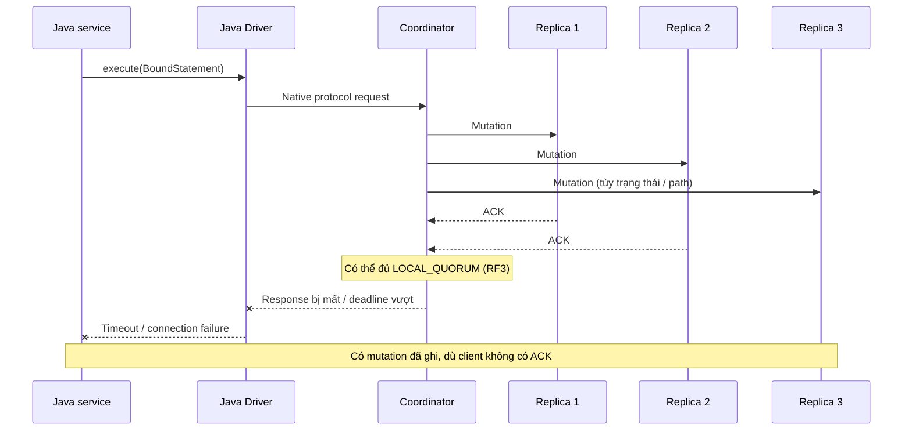
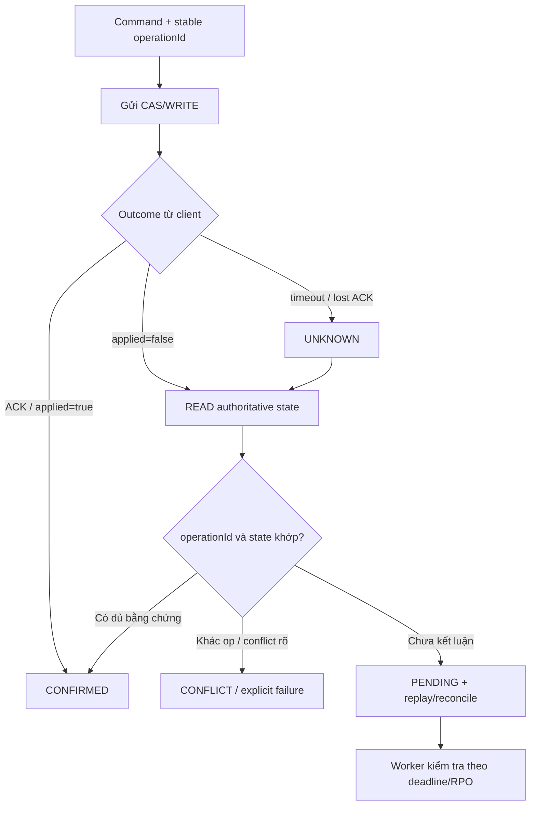
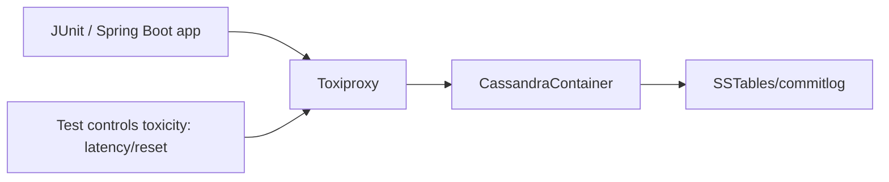
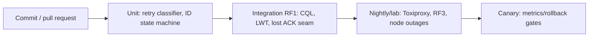

# Kiểm thử retry/idempotence và kết quả ghi chưa rõ

## 1. Vì sao test “gửi thành công” chưa đủ?

Một ứng dụng Java ghi trạng thái đơn hàng vào Apache Cassandra. Ở lần chạy bình thường, `session.execute(boundStatement)` trả kết quả thành công, test đọc lại đúng dữ liệu và mọi thứ đều xanh. Nhưng khi mạng đứt **sau lúc coordinator/replica đã ghi mà trước khi client nhận ACK**, ứng dụng có thể nhận `WriteTimeoutException` hoặc lỗi mất kết nối. Câu hỏi quan trọng không phải chỉ là “có lỗi không?”, mà là:

> **Cassandra đã áp dụng mutation chưa, và nếu ứng dụng gửi lại, kết quả nghiệp vụ có còn đúng không?**

Một thao tác `SET status='PAID'` với giá trị cố định có đặc tính lặp khác `counter = counter + 1`, `list = list + [event]` hoặc “tính tiền rồi gửi thông báo”. Một LWT `UPDATE ... IF status='CREATED'` có thể thắng lần đầu, nhưng khi retry nó trả `[applied]=false` vì điều kiện đã thay đổi. Test chỉ assert “lần hai không ném exception” sẽ không bảo vệ được nghiệp vụ.

Bài thuộc chương **Kiểm thử tích hợp** của mô-đun `DATABASE_ENGINE_WIDE_COLUMN_CASSANDRA`. Các tình huống được đặt trong bối cảnh Cassandra phân tán/wide-column: partition key, bảng theo truy vấn, token/replica, replication factor (RF), consistency level (CL), CQL, compaction/repair và kết nối từ Java.

### Kết quả cần đạt

Sau bài, người học có thể:

1. Phân biệt **retry an toàn ở tầng driver** với **phát lại một hành động nghiệp vụ**.
2. Giải thích **idempotence ở mức mutation, statement và workflow**, cùng các ngoại lệ timestamp/TTL/counter/list/LWT.
3. Tạo test **pre-send error**, **write applied nhưng ACK bị mất**, **write outcome chưa xác định**, **LWT false** và **retry amplification**.
4. Dùng Java Driver 4.x, Spring Boot/JUnit 5, Cassandra Testcontainers và fault injection có kiểm soát.
5. Viết assertion kiểm tra **DB state, operation ID, response contract, số attempts, CL và các side effects**, không chỉ test exception.
6. Thiết lập giới hạn retry, time budget, observability và tiêu chí chấp nhận/rollback trên cluster nhiều node.

> **Phạm vi thực hành:** ví dụ dùng Apache Cassandra 4.1/5.x, Java Driver 4.18.x, Java 17, Spring Boot 3.x, JUnit 5 và Testcontainers phiên bản tương thích. Toàn bộ DDL/CQL có thể ghi dữ liệu chỉ dành cho **lab/container**. Những lỗi “ACK bị mất sau commit” cần được mô phỏng **một cách xác định** ở tầng test seam; việc cắt mạng bằng proxy thường không chứng minh chắc chắn server đã commit.

## 2. Sơ đồ một lần ghi: có nhiều mốc, nhưng client chỉ thấy response



Sơ đồ mang tính **minh họa**, không cam kết coordinator phải gửi/nhận đúng các message theo thứ tự hiển thị. RF/CL, replica health, hints, commitlog và các hoạt động nền ảnh hưởng đường đi thực tế.

### Ba thời điểm khác nhau

| Mốc lỗi | Client biết chắc điều gì? | Cần làm gì? |
| --- | --- | --- |
| **Trước khi bất kỳ network write nào được thử** | Request chưa được gửi theo hiểu biết của driver | Driver có thể chọn node khác; retry nội bộ ở pre-send path thường an toàn |
| **Đã gửi nhưng chưa có response** | **Không biết** mutation đã tới/được áp dụng chưa | Xem là unknown outcome, cần idempotency/reconcile |
| **Đã nhận ACK đạt CL** | Request được xác nhận theo semantics/CL | Không suy mọi DC/replica hoặc external side effects cũng hoàn tất |

**Sự thật quan trọng:** `WriteTimeoutException` là server báo không nhận đủ ACK trong ngưỡng thời gian; `DriverTimeoutException` là phía driver không nhận được response kịp; connection reset có thể xảy ra trước hoặc sau server thực thi. **Tên exception một mình không đủ xác định mutation đã commit chưa**.

## 3. Retry là cơ chế; idempotence là thuộc tính của thao tác

### Idempotence theo trạng thái

Một phép biến đổi trạng thái `f` gọi là idempotent nếu áp dụng hai lần có cùng trạng thái cuối như một lần:

\[
f(f(s)) = f(s)
\]

Đây là định nghĩa **theo trạng thái đã chọn để quan sát**. Nếu ứng dụng còn phát thông báo, tạo lịch sử thanh toán, kéo dài TTL hoặc cập nhật timestamp mỗi lần retry, chỉ nhìn giá trị `status` có thể che việc side effects đã khác.

| CQL/hoạt động | Đánh giá sơ bộ | Tại sao |
| --- | --- | --- |
| `SELECT ... WHERE pk=?` | Thường idempotent | Đọc lại không mutation; giá trị đọc có thể thay đổi do concurrent writes |
| `UPDATE ... SET status='PAID'` | Có thể idempotent **ở trạng thái status** | Cần xét server write timestamp/TTL, conflict và audit |
| `INSERT ... cùng khóa/cùng giá trị cố định` | Có điều kiện | Cassandra upsert nhưng write time/TTL/CDC/side effect có thể khác |
| `UPDATE ... SET tags = ['x']` | Thường idempotent ở collection cuối | Ghi toàn bộ cùng giá trị, vẫn xét timestamp |
| `UPDATE ... SET tags = tags + ['x']` | **Không** | Retry có thể append hai phần tử |
| `UPDATE counters SET value=value+1` | **Không** | Retry có thể cộng hai lần |
| `INSERT ... USING TTL 60` | Phải phân tích | Retry muộn có thể làm kéo dài expiration |
| `UPDATE ... IF version=0` | LWT/CAS; **không tự coi cả workflow idempotent** | Retry có thể trả `[applied]=false` vì lần đầu đã thắng |
| “Charge card → insert event → send Kafka” | Không mặc định | Mỗi hệ thống có commit/ACK và retry riêng |

**Không đánh dấu `setIdempotent(true)` chỉ vì câu CQL trông giống UPSERT.** Phân tích cả những gì API công bố: có tạo một event duy nhất, một timestamp cố định, một audit record hay một hiệu ứng trên hệ thống ngoài không?

### Mutation idempotence khác business idempotency

Giả sử hai lần `UPDATE orders_by_id SET status='PAID'` đều để lại `status=PAID`. Nếu ứng dụng gọi payment provider **hai lần**, business operation vẫn không idempotent. Một **idempotency key/operation ID ổn định** dùng xuyên retry và checkpoint/ledger là một phần của giải pháp, không phải tác dụng của Driver `setIdempotent(true)`.

## 4. Java Driver 4.x: retry policy mặc định thực sự làm gì?

Theo tài liệu Apache Cassandra Java Driver 4.18:

- `basic.request.default-idempotence` mặc định **false**; set trên statement bằng `setIdempotent(true/false)`.
- `DefaultRetryPolicy` là policy mặc định; chỉ retry **có điều kiện**, thường tối đa một lần trong một số loại lỗi có cơ hội thành công.
- Các callbacks của retry policy phụ thuộc error type và **idempotence** của statement; driver có một số **hard-coded retry** khi biết request chưa được gửi, khi cần reprepare `UNPREPARED` hoặc các trường hợp trước execution khác.
- Khi mất kết nối **sau khi request có thể đã được gửi**, non-idempotent request không được retry một cách mù quáng.
- Với **write timeout thông thường** kiểu `SIMPLE`, default policy **không tự retry chỉ vì write bị timeout**. Một ngoại lệ được tài liệu nêu là write type `BATCH_LOG` trong điều kiện idempotent và giới hạn retry.
- `ConsistencyDowngradingRetryPolicy` có thể làm yếu CL và che lỗi như success; không dùng cho hệ thống yêu cầu giữ nguyên consistency contract.

### Ví dụ Driver 4.x

```java
PreparedStatement find = session.prepare(
    "SELECT status FROM retry_lab_ks.orders_by_id WHERE order_id=?");

BoundStatement read = find.bind(orderId)
    .setConsistencyLevel(DefaultConsistencyLevel.LOCAL_QUORUM)
    .setIdempotent(true);

PreparedStatement increment = session.prepare(
    "UPDATE retry_lab_ks.counter_by_key SET value=value+1 WHERE key=?");

BoundStatement counterWrite = increment.bind("payment-attempts")
    .setConsistencyLevel(DefaultConsistencyLevel.LOCAL_QUORUM)
    .setIdempotent(false);
```

**Không dùng `setIdempotent(false)` như lời hứa tuyệt đối “driver không bao giờ có nhiều network attempt”**: pre-send failures, reprepare, pool failover và các cơ chế an toàn vẫn có thể phát sinh hoạt động. Nó chủ yếu ngăn những lần thử lại **có nguy cơ thực hiện trùng mutation** theo rules của driver.

### Cấu hình minh họa

```hocon
datastax-java-driver {
  basic.request {
    timeout = 2 seconds
    default-idempotence = false
  }
  advanced.retry-policy.class = DefaultRetryPolicy
}
```

Java Driver 4.x đặt giới hạn request timeout trên **toàn request bao gồm retries/speculative executions** theo cấu hình tương ứng, không phải cứ thêm retry là tự có thêm một ngân sách thời gian vô hạn. Nhưng application-level retry (gọi lại `execute`) có thể tạo **một request hoàn toàn mới với timeout mới**; cần deadline tổng của HTTP/message handler.

### Driver retry và application retry dễ nhân tải

Nếu tầng service cho tối đa 3 lượt gọi application, mỗi lượt driver có tối đa 2 node attempts trong những lỗi đủ điều kiện, thì giới hạn lý thuyết theo tình huống có thể là:

\[
\text{Node attempts}_{max} \le 3 \times 2 = 6
\]

Đây là **minh họa budget**, không khẳng định DefaultRetryPolicy luôn thử hai lần hoặc tất cả failures đều retry. Thêm speculative execution còn làm nhiều attempts cùng lúc. Phải đo **logical operations, driver requests, node attempts** riêng, không suy từ số dòng CQL.

## 5. Dữ liệu lab: phân biệt status, counter, list và guard

Ví dụ dành cho cluster lab có một DC tên `dc1`; RF3 chỉ hợp lý nếu có đủ replicas. Nếu dùng CassandraContainer **một node**, đặt keyspace RF1 riêng (mục 15) thay vì kỳ vọng LOCAL_QUORUM RF3 chịu lỗi node.

```sql
CREATE KEYSPACE retry_lab_ks
WITH replication = {'class':'NetworkTopologyStrategy', 'dc1':3}
AND durable_writes = true;

CREATE TABLE retry_lab_ks.orders_by_id (
    order_id uuid PRIMARY KEY,
    status text,
    version bigint,
    last_operation_id uuid,
    updated_at timestamp
);

CREATE TABLE retry_lab_ks.operations_by_id (
    operation_id uuid PRIMARY KEY,
    order_id uuid,
    state text
);

CREATE TABLE retry_lab_ks.counter_by_key (
    key text PRIMARY KEY,
    value counter
);

CREATE TABLE retry_lab_ks.tags_by_key (
    key text PRIMARY KEY,
    tags list<text>
);

INSERT INTO retry_lab_ks.orders_by_id
    (order_id,status,version,updated_at)
VALUES (
    11111111-2222-4333-8444-555555555555,
    'CREATED',0,'2026-11-21T08:00:00+0000'
);
```

**Bốn tables phục vụ bốn loại assertions:**

1. `orders_by_id` có authoritative state và `last_operation_id` để đối chiếu một CAS sau timeout.
2. `operations_by_id` có key khác là `operation_id`; một `IF NOT EXISTS` trên đây **không atomic** với `orders_by_id`.
3. `counter_by_key` giúp thấy retry non-idempotent nhân đôi số đếm; counter table không trộn các cột non-key thường.
4. `tags_by_key` cho thấy list append có thể thêm bản sao; tránh dùng list như event ledger bền vững không giới hạn.

Trong mỗi test, sinh UUID/key **riêng**, tạo fixture trước, chờ đáp ứng CL được phê duyệt và xóa/expire test data theo teardown cô lập. Không dùng dữ liệu thật để chứng minh lỗi mạng.

## 6. Bốn loại test phải có trong một suite

| Loại | Lỗi được đưa vào | Bằng chứng cần có |
| --- | --- | --- |
| **Pre-send** | Node/pool không khả dụng **trước network send** | Driver/service thử node khác nếu đúng policy; DB không có side effect của lần chưa gửi |
| **Unknown outcome** | Server có thể đã xử lý nhưng ACK không tới client | API không khẳng định “chưa ghi”; sau recovery so trạng thái theo operation ID |
| **Post-commit lost ACK (mô phỏng xác định)** | CQL thật đã thành công rồi test seam **cố ý thay ACK bằng lỗi** | Đọc DB thấy mutation; service không retry non-idempotent mù |
| **CAS conflict** | Hai writers dùng cùng expected version | Một LWT thắng, một trả false/optimistic conflict; business result đúng |

**Không gộp các test này vào một “network timeout test”**. Một proxy ngắt mạng trước request không thể chứng minh logic khi request đã được apply. Trái lại, seam giả lập lost ACK sau commit **không phải** phép đo protocol packet loss; nó kiểm chứng **quyết định nghiệp vụ khi outcome mập mờ**.

## 7. Scenario A: đọc retry được nhưng phải giữ consistency và deadline

Đọc theo primary key thường idempotent ở tầng CQL; có thể retry những transient failures **khi policy cho phép**, không retry invalid query, unauthorized hoặc callback mapping bug.

```java
PreparedStatement lookup = session.prepare(
    "SELECT status, version, last_operation_id " +
    "FROM retry_lab_ks.orders_by_id WHERE order_id=?");

BoundStatement request = lookup.bind(orderId)
    .setConsistencyLevel(DefaultConsistencyLevel.LOCAL_QUORUM)
    .setTimeout(Duration.ofSeconds(2))
    .setIdempotent(true);

Row row = session.execute(request).one();
// row == null: không có order; khác hoàn toàn timeout/Unavailable.
```

**Assertions:**

- Với fixture bất biến, trả đúng status/version và không có side effect mới.
- Với transient read timeout có thể phục hồi: retry (nếu policy đúng) vẫn giữ `LOCAL_QUORUM` và query shape.
- Khi không đủ replicas: báo lỗi availability/deadline thay vì trả empty list/HTTP 404.
- Khi lỗi quyền/sai schema: **không retry vô hạn**.
- Theo dõi attempts và p99 end-to-end, vì retry có thể đúng về mặt dữ liệu nhưng vượt SLA.

### Gợi ý test-double cho policy quyết định

Sử dụng interface adapter của repository như `OrderReader.read(UUID)`, stub hai lượt: lượt đầu hoàn tất exceptionally với transient read error **được phân loại**, lượt sau trả trạng thái fixture. Dùng scheduler/fake clock để kiểm tra backoff và overall timeout. Một test riêng với `UnauthorizedException`/invalid query assert chỉ một lần gọi. Không tạo mã test cố định cho riêng class exception nếu constructor khác giữa versions: test với abstraction/domain classifier đã được mapping.

## 8. Scenario B: counter increment phải không được phát lại mù

Counter là ví dụ dễ thấy nhất: mỗi lần chạy mutation làm tăng giá trị.

```sql
UPDATE retry_lab_ks.counter_by_key
SET value = value + 1
WHERE key = 'operation-123';

SELECT value FROM retry_lab_ks.counter_by_key
WHERE key = 'operation-123';
```

Giả sử lần đầu đã tăng từ 0 lên 1 nhưng client bị mất ACK. Nếu service tự chạy lại cùng câu CQL, kết quả cuối **có thể là 2**, dù chỉ có **một business event**.

| Điều client thấy | DB state có thể là | Hành động đúng |
| --- | --- | --- |
| ACK thành công | 1 sau một increment trong fixture | Hoàn thành theo CL; vẫn kiểm tra event contract |
| Timeout/connection loss | 0 hoặc 1 hoặc đang hội tụ | Trạng thái unknown; không retry mù |
| Test giả lập ACK mất sau thành công | **1 đã ghi** | Không tăng thêm; cần dedup/event ledger hoặc thiết kế khác |
| Retry sai sau ACK mất | **2** | Test phải FAIL vì side effect trùng |

**Không dùng counter cho ledger tiền/hành động phải chính xác-một-lần** chỉ bằng cách đánh dấu driver `setIdempotent(false)`; điều đó ngăn một lớp retry nhưng không ngăn HTTP retry, Kafka redelivery hoặc cron chạy lại. Khi yêu cầu exactly-once effect, cần thiết kế operation IDs, authoritative source và reconciliation phù hợp.

## 9. Scenario C: list append cũng không idempotent

```sql
UPDATE retry_lab_ks.tags_by_key
SET tags = tags + ['E1']
WHERE key = 'demo-list';

-- Nếu chạy hai lần, có thể có ['E1','E1'].
SELECT tags FROM retry_lab_ks.tags_by_key
WHERE key = 'demo-list';
```

**Kiểm thử thực tế:** assert khi một request có outcome chưa rõ, service không tự phát lại append; một test “retry không trùng” chỉ pass nếu application layer chặn lại hoặc đã đổi thiết kế dữ liệu.

**Thiết kế thay thế:** tạo bảng `events_by_order` với primary key gồm order ID + **event ID ổn định** để một retry cùng event ghi cùng khóa, không nhân list entries. Tuy nhiên upsert cùng khóa **chưa đủ** để bảo đảm side effects ngoài DB không lặp; cần xem writetime/TTL/tombstone, downstream delivery và idempotency contract.

## 10. Scenario D: LWT lần đầu applied, lần hai false

Một LWT CAS trên authoritative order row, dùng `last_operation_id` lưu dấu một yêu cầu nghiệp vụ:

```sql
UPDATE retry_lab_ks.orders_by_id
SET status = 'PAID',
    version = 1,
    last_operation_id = 99999999-aaaa-4bbb-8ccc-dddddddddddd,
    updated_at = '2026-11-21T08:30:00+0000'
WHERE order_id = 11111111-2222-4333-8444-555555555555
IF status = 'CREATED' AND version = 0;
```

LWT trả cột đặc biệt `[applied]`. Nếu lần đầu thành công nhưng response bị mất, lần hai với cùng điều kiện `version=0` có thể trả `[applied]=false` do row đã ở version=1.

| Thời điểm | Client nhận | Authoritative row |
| --- | --- | --- |
| Trước CAS | — | CREATED, version=0 |
| Lần 1 | **ACK mất/timeout giả lập** | PAID, version=1, last_operation_id=op-1 |
| Lần 2 nếu gửi lại | `[applied]=false` | PAID, version=1 |
| Reconcile | Đọc row theo CL đúng | Nếu last_operation_id=op-1 và state hợp lệ, biết yêu cầu đã được áp dụng |

**Điều kiện của phép suy luận cuối:** phải có một policy ngăn ghi tiếp làm mất dấu `last_operation_id` trước khi đối chiếu, hoặc có durable audit/source với operation ID. Nếu row đã chuyển sang state khác, đọc một row hiện tại không luôn đủ tái dựng lịch sử.

### Java Driver 4.x

```java
PreparedStatement cas = session.prepare(
    "UPDATE retry_lab_ks.orders_by_id " +
    "SET status=?, version=?, last_operation_id=?, updated_at=? " +
    "WHERE order_id=? IF status=? AND version=?");

BoundStatement stmt = cas.bind(
    "PAID", 1L, operationId, Instant.parse("2026-11-21T08:30:00Z"),
    orderId, "CREATED", 0L)
    .setConsistencyLevel(DefaultConsistencyLevel.LOCAL_QUORUM)
    .setSerialConsistencyLevel(DefaultConsistencyLevel.LOCAL_SERIAL)
    .setIdempotent(false);

ResultSet result = session.execute(stmt);
boolean applied = result.wasApplied();
if (!applied) {
    // Conflict OR already processed: đọc lại state có operation ID.
}
```

**Không đồng nhất** serial CL `LOCAL_SERIAL` với regular CL `LOCAL_QUORUM` hoặc Spring `@Transactional(isolation=SERIALIZABLE)`. Cấu hình này phù hợp ví dụ một DC; multi-DC cần chọn serial CL theo invariant toàn cluster.

## 11. Cách biểu diễn kết quả nghiệp vụ: ba trạng thái, không phải boolean

Một API testable nên tách:

1. **APPLIED/CONFIRMED:** nhận response xác nhận theo CL và điều kiện.
2. **REJECTED/CONFLICT:** nhận kết quả xác thực `[applied]=false` hoặc business rule không thỏa.
3. **UNKNOWN/PENDING_RECONCILIATION:** mất ACK hoặc timeout sau khi request có thể đã gửi.



Đừng API trả **200 thành công** nếu chỉ có một `CompletableFuture` chưa hoàn tất; cũng không trả “thanh toán thất bại/chắc chắn chưa ghi” chỉ vì driver timeout. Có thể trả trạng thái pending với operation ID để client **tra cứu lại**, nhưng phụ thuộc hợp đồng API; không có mã HTTP nào tự giải quyết dedup phía database.

## 12. Test seam: phân biệt logic với mạng thật

Một **test seam** là ranh giới do kiến trúc cố ý cho phép thay implementation trong test, ví dụ:

```java
interface OrderMutationPort {
    WriteOutcome attemptMarkPaid(UUID orderId, UUID operationId);
}

enum WriteOutcome {
    APPLIED, CONFLICT
}
```

Ở implementation production, port thực thi prepared LWT, đọc `wasApplied()` và **để lỗi timeout đi qua** theo error taxonomy. Trong test, một adapter có thể **chạy write thật** rồi cố ý ném lỗi mô phỏng ACK bị mất:

```java
final class LostAckAfterCommitPort implements OrderMutationPort {
    private final OrderMutationPort delegate;
    private boolean first = true;

    LostAckAfterCommitPort(OrderMutationPort delegate) {
        this.delegate = delegate;
    }

    @Override
    public WriteOutcome attemptMarkPaid(UUID orderId, UUID operationId) {
        WriteOutcome realOutcome =
            delegate.attemptMarkPaid(orderId, operationId);
        if (first && realOutcome == WriteOutcome.APPLIED) {
            first = false;
            throw new SimulatedLostAckException();
        }
        return realOutcome;
    }
}
```

`SimulatedLostAckException` là loại test-only do suite định nghĩa. **Không** dùng adapter này trong production. Nó tạo trường hợp **chắc chắn DB đã ACK ở delegate**, sau đó cố tình làm caller **không nhận outcome**; đây là phép thử logic recovery, **không phải tái hiện packet-level ACK loss thật**.

### Oracle của test “applied nhưng ACK mất”

- Port thực tế được gọi **một lần**, và Cassandra đã ở `status=PAID`/`last_operation_id=op-1`.
- Caller nhận ambiguous error/pending, **không** tự động retry counter/payment side effect.
- Reconciliation đọc authoritative state với CL phù hợp, nhận ra chính operation ID đã áp dụng.
- Một client retry cùng operation ID nhận kết quả **already processed**, không tạo thêm event/charge.
- Test khác với operation ID khác phải trả conflict theo state machine, không giả “hai payment đều thành công”.

Nếu một test mock chỉ ném exception **trước khi gọi DB**, nó kiểm tra lỗi pre-send, không chứng minh đường mất ACK sau commit.

## 13. JUnit 5: assert số lần gọi và kết quả sau lỗi

Mẫu dưới đây minh họa một test **thuần Java** để cô lập thuật toán retry trước khi thêm Cassandra container. Dùng `AtomicInteger` và port test để chứng minh service **không gọi lại** khi exception báo outcome chưa rõ.

```java
import static org.junit.jupiter.api.Assertions.*;
import java.util.UUID;
import java.util.concurrent.atomic.AtomicInteger;
import org.junit.jupiter.api.Test;

final class RetryDecisionTest {
    @Test
    void unknownOutcomeIsNotBlindlyRetried() {
        AtomicInteger attempts = new AtomicInteger();
        UUID orderId = UUID.randomUUID();
        UUID operationId = UUID.randomUUID();

        OrderMutationPort fake = (id, op) -> {
            attempts.incrementAndGet();
            throw new SimulatedLostAckException();
        };

        // Đây là một policy nhỏ của service, KHÔNG phải Driver retry policy.
        OrderMutationPort servicePolicy = (id, op) -> fake.attemptMarkPaid(id, op);

        assertThrows(SimulatedLostAckException.class,
            () -> servicePolicy.attemptMarkPaid(orderId, operationId));
        assertEquals(1, attempts.get());
    }
}
```

**Giới hạn của unit test:** nó chỉ chứng minh code hiện tại **không tự retry** một lỗi giả, **không** chứng minh mutation thực được hay không. Bổ sung integration test với Cassandra thật và `LostAckAfterCommitPort` ở mục 12 để kiểm tra **DB state**.

### Kiểm tra “một lần giao hàng nghiệp vụ” thay vì một lần callback

Test service nên có những assertion độc lập:

- Số **application attempts** do service điều phối.
- Số **driver node attempts** chỉ khi đã bật tracker/metrics; chúng không nhất thiết bằng application attempts.
- Số **business event IDs duy nhất** trong ledger/projection.
- Số lần **external side effect** (payment, message publish) theo idempotency key.
- Trạng thái cuối được đọc theo đúng CL và cutoff của fixture.

Một assertion `verify(repository).save(...)` đúng một lần chỉ chứng minh tầng repository không bị gọi lặp trong **test mock**, không bao phủ driver retry bên dưới hoặc Kafka redelivery ở một process khác.

## 14. Integration test thực: Spring Boot 3.x + Testcontainers Cassandra

**Mục tiêu:** chạy CQL/Java Driver trên Cassandra thật, kiểm tra serialization, prepared statements, `LOCAL_QUORUM/ONE` theo RF của fixture, LWT `wasApplied()` và dữ liệu thực sau mutation.

### Dependencies test (Maven, minh họa)

```xml
<dependencies>
  <dependency>
    <groupId>org.springframework.boot</groupId>
    <artifactId>spring-boot-starter-data-cassandra</artifactId>
  </dependency>
  <dependency>
    <groupId>org.springframework.boot</groupId>
    <artifactId>spring-boot-starter-test</artifactId>
    <scope>test</scope>
  </dependency>
  <dependency>
    <groupId>org.springframework.boot</groupId>
    <artifactId>spring-boot-testcontainers</artifactId>
    <scope>test</scope>
  </dependency>
  <dependency>
    <groupId>org.testcontainers</groupId>
    <artifactId>junit-jupiter</artifactId>
    <scope>test</scope>
  </dependency>
  <dependency>
    <groupId>org.testcontainers</groupId>
    <artifactId>cassandra</artifactId>
    <scope>test</scope>
  </dependency>
</dependencies>
```

Quản lý versions bằng Spring Boot/Testcontainers BOM phù hợp. **Ví dụ code tiếp theo dùng Testcontainers 1.x với `org.testcontainers.containers.CassandraContainer`**; Testcontainers 2.x chuyển một số packages/modules. Không trộn imports 1.x với 2.x hoặc nhánh Spring Boot 4.x khi chưa đối chiếu API.

### Một container, RF1: test chức năng chứ không test availability RF3

```java
import java.util.UUID;
import com.datastax.oss.driver.api.core.CqlSession;
import com.datastax.oss.driver.api.core.cql.Row;
import org.junit.jupiter.api.BeforeAll;
import org.junit.jupiter.api.Test;
import org.junit.jupiter.api.TestInstance;
import org.springframework.beans.factory.annotation.Autowired;
import org.springframework.boot.test.context.SpringBootTest;
import org.springframework.boot.testcontainers.service.connection.ServiceConnection;
import org.testcontainers.containers.CassandraContainer;
import org.testcontainers.junit.jupiter.Container;
import org.testcontainers.junit.jupiter.Testcontainers;
import org.testcontainers.utility.DockerImageName;
import static org.junit.jupiter.api.Assertions.*;

@Testcontainers
@SpringBootTest(properties = "spring.cassandra.schema-action=none")
@TestInstance(TestInstance.Lifecycle.PER_CLASS)
class CassandraRetryIntegrationIT {
    @Container
    @ServiceConnection
    static CassandraContainer<?> cassandra =
        new CassandraContainer<>(DockerImageName.parse("cassandra:4.1"));

    @Autowired CqlSession session;

    @BeforeAll
    void schema() {
        session.execute(
            "CREATE KEYSPACE IF NOT EXISTS retry_it_ks " +
            "WITH replication = {'class':'SimpleStrategy'," +
            "'replication_factor':1}");
        session.execute(
            "CREATE TABLE IF NOT EXISTS retry_it_ks.orders_by_id (" +
            "order_id uuid PRIMARY KEY, status text, version bigint, " +
            "last_operation_id uuid)");
    }

    @Test
    void preparedWriteAndReadUseRealCassandra() {
        UUID id = UUID.randomUUID();
        session.execute(session.prepare(
            "INSERT INTO retry_it_ks.orders_by_id " +
            "(order_id,status,version) VALUES (?,?,?)")
            .bind(id, "CREATED", 0L));

        Row result = session.execute(session.prepare(
            "SELECT status, version FROM retry_it_ks.orders_by_id " +
            "WHERE order_id=?").bind(id)).one();

        assertNotNull(result);
        assertEquals("CREATED", result.getString("status"));
        assertEquals(0L, result.getLong("version"));
    }
}
```

**Điều kiện chạy:** Docker/container runtime hoạt động, dependency test đồng bộ, Cassandra image tải được, schema đã agreement và Spring Boot test context không có repository khác tự prepare bảng chưa tạo trong constructor. Khi khởi tạo repository thật, cần chạy **migration fixture trước khi bean đó prepare** hoặc dùng test configuration phù hợp.

**Giới hạn căn bản:** container đơn chỉ mô phỏng **RF1**, không kiểm chứng read/write `LOCAL_QUORUM` khi một node chết ở RF3, streaming/repair hay failover multi-DC. Để kiểm tra availability, tạo topology ít nhất ba nodes theo hướng dẫn lab và tránh làm hại production.

### Tại sao sử dụng `@ServiceConnection`?

Spring Boot 3.5 có factory cho `CassandraConnectionDetails` khi gặp `CassandraContainer`; connection details có thể override địa chỉ kết nối khai báo trong properties test. Nó giảm hard-coded host/port nhưng **không tự tạo các bảng CQL và test fixtures**. Không đưa `spring.cassandra.schema-action: recreate_drop_unused` vào production chỉ để test đỡ phải setup.

## 15. Integration test LWT: một CAS thắng, một CAS thua

Tạo fixture order mới trong `retry_it_ks`, hai statements cùng expected version=0. Các lời gọi có thể chạy tuần tự để kiểm tra correctness cơ bản, rồi thêm concurrent test hai writers.

```java
UUID orderId = UUID.randomUUID();
UUID operationA = UUID.randomUUID();
UUID operationB = UUID.randomUUID();

session.execute(session.prepare(
    "INSERT INTO retry_it_ks.orders_by_id " +
    "(order_id,status,version) VALUES (?,?,?)")
    .bind(orderId, "CREATED", 0L));

PreparedStatement cas = session.prepare(
    "UPDATE retry_it_ks.orders_by_id " +
    "SET status=?, version=?, last_operation_id=? " +
    "WHERE order_id=? IF status=? AND version=?");

BoundStatement first = cas.bind(
    "PAID", 1L, operationA, orderId, "CREATED", 0L)
    .setIdempotent(false);
BoundStatement second = cas.bind(
    "CANCELLED", 1L, operationB, orderId, "CREATED", 0L)
    .setIdempotent(false);

assertTrue(session.execute(first).wasApplied());
assertFalse(session.execute(second).wasApplied());

Row row = session.execute(session.prepare(
    "SELECT status,version,last_operation_id " +
    "FROM retry_it_ks.orders_by_id WHERE order_id=?")
    .bind(orderId)).one();
assertEquals("PAID", row.getString("status"));
assertEquals(1L, row.getLong("version"));
assertEquals(operationA, row.getUuid("last_operation_id"));
```

**Kiểm thử song song:** dùng `CountDownLatch` để hai threads phát CAS cùng lúc và đánh giá tổng `applied=true` bằng 1, sau đó xác minh row cuối. Không assert **thứ tự** thắng của A/B; thứ tự scheduling không xác định. Với `@Version` Spring Data, test tương tự dùng hai bản entity stale và bắt `OptimisticLockingFailureException` theo API.

**Tính toán test:** sau CAS thành công ở fixture RF1, đọc kết quả trên cùng node có thể pass; điều đó **không chứng minh** lựa chọn serial CL/multi-DC trên cluster production.

## 16. Test lost ACK *sau* commit: dựng kịch bản xác định

Thiết kế một test tích hợp hai lớp:

1. **Port thật** gọi `CqlSession.execute(cas)` và nhận `wasApplied=true`, tức dữ liệu đã được xác nhận trong test.
2. **Adapter test** ném `SimulatedLostAckException` **sau** khi port thật hoàn tất.
3. Service bắt ambiguous result, trả `UNKNOWN/PENDING` thay vì `CONFLICT`, hoặc giữ exception để orchestration xử lý.
4. Reconciliation đọc `orders_by_id` và so `last_operation_id` với ID đã yêu cầu.
5. Assert không có thêm increment/list append/external charge khi orchestration xử lý pending.

### Pseudocode của test oracle

```java
UUID id = newOrderFixture();
UUID op = UUID.randomUUID();

OrderMutationPort realPort = new CassandraCasPort(session);
OrderMutationPort lossPort = new LostAckAfterCommitPort(realPort);

assertThrows(SimulatedLostAckException.class,
    () -> lossPort.attemptMarkPaid(id, op));

Row stored = readOrderById(session, id);
assertEquals("PAID", stored.getString("status"));
assertEquals(op, stored.getUuid("last_operation_id"));

// Service recovery:
// assertEquals(CONFIRMED, reconciler.reconcile(id, op));
// assertEquals(1, uniqueBusinessEventCount(op));
```

`newOrderFixture`, `CassandraCasPort`, `readOrderById` và `reconciler` là helpers **do suite tự xây**, không phải APIs của Java Driver. Phần cuối dùng pseudo-assertion cho external event store. Mục đích là buộc người học thiết kế seam/test oracle trước, không nhận một snippet thiếu infrastructure như một integration test hoàn chỉnh.

**Nếu chỉ giả lập timeout bằng mock trước khi gọi `session.execute`, test này không hợp lệ**: nó không chứng minh code biết xử lý **write đã xảy ra** nhưng client báo lỗi.

## 17. Network fault injection: Testcontainers + Toxiproxy

Toxiproxy có thể tạo network conditions giữa client và Cassandra container, ví dụ tăng latency, ngắt upstream/downstream hoặc đóng connection. Điều này giúp kiểm tra resilience thực tế ở tầng transport.



**Thứ tự kiểm thử đề xuất:**

1. Tạo container Cassandra + Toxiproxy trong **Docker network test cô lập**.
2. Tạo proxy cho native CQL port 9042 và cấu hình Java Driver dùng proxy endpoint.
3. Xác minh traffic **thật sự đi qua proxy** bằng một fault không ảnh hưởng dữ liệu (ví dụ latency) trước khi khẳng định test network được.
4. Inject network cut/latency trong một cửa sổ có kiểm soát; ghi timestamp, CL, operation ID, driver timeout và callback outcome.
5. Khôi phục proxy; **đọc lại trạng thái thật**, kiểm tra idempotency/reconciliation.
6. Dọn toxins/containers chắc chắn ở teardown để test khác không bị nhiễm fault.

**Rất quan trọng với Cassandra:** driver bootstrap từ contact points nhưng có thể **discover địa chỉ advertised** của node khác từ topology metadata và kết nối thẳng, **bỏ qua proxy** nếu thiết lập không đúng. Muốn test network failure đáng tin cậy, phải cấu hình endpoint/routing của các kết nối liên quan sao cho không có đường bypass. Với nhiều nodes, tất cả đường đi mục tiêu phải được kiểm soát hoặc cô lập; đừng tưởng proxy một contact point là đã chặn mọi coordinator.

### Toxiproxy không thể khẳng định commit chỉ nhờ cắt mạng

Đặt toxic vào response/downstream không bảo đảm thời điểm đứt mạng **sau commit**. Lỗi có thể diễn ra trước request, giữa quá trình xử lý hoặc sau ACK. Vì vậy:

- Toxiproxy test → chứng minh timeout/recovery **với thời điểm không hoàn toàn xác định**, theo dõi xác suất và logs.
- Test seam sau commit → chứng minh service phản ứng **đúng với hậu điều kiện DB đã ghi** một cách xác định.
- Multi-node fault test → chứng minh RF/CL và failover trong một topology đã được cấu hình thật; không thay thế hai test trên.

Không dùng firewall/iptables để cắt traffic production cho một bài tập; test chỉ trong container/lab có phép và biết rõ ranh giới mạng.

## 18. Ma trận injection: cần cả thành công, thất bại và mơ hồ

| Test ID | Injection | Kết quả khách hàng có thể thấy | Bằng chứng bắt buộc |
| --- | --- | --- | --- |
| T01 | Không lỗi | ACK / correct rows | Giá trị, số rows, CL, 1 business op |
| T02 | Trước network send | Có thể failover hoặc lỗi nhanh | No write from failed attempt; attempts theo policy |
| T03 | Server trả unavailable | Lỗi không đủ replica hoặc retry có điều kiện | Giữ CL, không đổi consistency âm thầm |
| T04 | Read timeout, retry an toàn | Read success hoặc timeout cuối | Không side effect; số attempts/backoff/deadline |
| T05 | Write timeout ordinary mutation | Unknown outcome | Không tự coi DB “chắc chưa ghi” |
| T06 | ACK bị mất sau successful write (seam) | Unknown tại caller | DB đã ghi; không blind retry |
| T07 | Counter increment T06 rồi retry sai | Có thể tăng 2 | Test **phải bắt lỗi nhân đôi** |
| T08 | List append T06 rồi retry sai | List có duplicate element | Test **phải bắt lỗi nhân đôi** |
| T09 | LWT lần đầu applied, ACK mất | Retry trả false | Operation ID giúp suy outcome khi đủ điều kiện |
| T10 | Concurrent LWT writers | 1 thắng, 1 false | State cuối hợp lệ; không trả cả hai success |
| T11 | LWT false không có transport error | Business conflict/already processed | Không map thành 503/timeout |
| T12 | Application cancel/client disconnect | Write vẫn có thể chạy | Recovery độc lập HTTP lifecycle |
| T13 | Connection reset/latency qua Toxiproxy | Timeout/retry/failed request | Fault thật đi qua proxy; đọc DB lại |
| T14 | Invalid query/schema | Lỗi ngay | Không retry vô hạn, không success giả |
| T15 | Unauthorized | Permission error | Không hạ CL hoặc trả not-found |
| T16 | Hai lớp retry cùng bật | Attempts tăng | Có global budget, backoff, stop thresholds |
| T17 | Crash giữa order state và event projection | Partial business state | Replayer/ledger tạo event duy nhất sau recovery |
| T18 | Node outage ở RF3 | Có thể còn `LOCAL_QUORUM` tùy topology | Test riêng lab RF3, không suy từ RF1 |
| T19 | Page sau timeout | API full-result fail hoặc partial rõ hợp đồng | Không trả rows thiếu như success |
| T20 | Graceful shutdown giữa write | Unknown result/late callback | Không ack queue message trước khi CQL hoàn tất |

**Dùng tên test phản ánh giả thiết thật:** ví dụ `afterCommitLostAckDoesNotRepeatCharge` tốt hơn `timeoutTest`, vì thời điểm lỗi quyết định ý nghĩa của testcase.

## 19. Test nhiều nodes: RF/CL và coordinator failover

Với một DC RF3 và `LOCAL_QUORUM`, thường cần hai replica responses để đáp ứng yêu cầu địa phương. Tại lab nhiều node:

- Ghi baseline ở RF3, các nodes đều `UN`, CL ứng dụng đã thống nhất.
- Chỉ làm gián đoạn **một node** theo runbook, kiểm tra routing/coordinator và kết quả CQL.
- Ghi nhận các trường hợp còn quorum và trường hợp không đạt quorum mà không thay đổi CL.
- Thử một hot partition/replica chậm và đo p99, retry/speculative execution riêng.
- Sau khi phục hồi node, kiểm tra consistency/repair theo phương án lab; không xem “node lại UP” là toàn bộ dữ liệu chắc đã đối soát.

**Một node container RF1 không thể kiểm tra availability RF3.** Không cần tạo cluster đa DC chỉ để chạy unit test về retry policy, nhưng trước khi tuyên bố SLA/multi-DC correctness, phải có test topology tương ứng.

### Không dùng `ConsistencyDowngradingRetryPolicy` để “tăng tỉ lệ pass”

Policy này có thể làm giảm CL, hoặc trong một số write cases quyết định **ignore** error và trả empty result. Nếu test chỉ đếm HTTP 200, số pass có thể tăng trong khi **consistency guarantee bị làm yếu**. Hãy assert CL của statement, retry policy thực tế và hậu điều kiện được phép; không dùng ignore/downgrade như default production.

## 20. Retry ở tầng Spring Service/Reactor: mỗi lần retry là công việc mới

Một retry của driver **trong** `session.execute(stmt)` khác một retry ở Spring Service **gọi lại** `session.execute(stmt)`. Với Reactor, `retryWhen` thường resubscribe upstream, nên upstream phải là nguồn tạo **request mới khi subscribe**, không phải một `CompletableFuture` đã chạy từ trước.

### Ví dụ chỉ retry một SELECT idempotent

```java
import java.time.Duration;
import java.util.Optional;
import reactor.core.publisher.Mono;
import reactor.util.retry.Retry;

// orderRepository.readAsync(UUID) trả CompletionStage<Optional<Order>>.
Mono<Optional<Order>> result = Mono.defer(() ->
        Mono.fromCompletionStage(() -> orderRepository.readAsync(orderId)))
    .retryWhen(
        Retry.backoff(2, Duration.ofMillis(50))
            .maxBackoff(Duration.ofMillis(250))
            .jitter(0.5)
            .filter(error -> isRetryableTransientRead(unwrap(error))))
    .timeout(Duration.ofMillis(800));
```

`isRetryableTransientRead` và `unwrap` là **application helpers** phải được triển khai/test theo error taxonomy thật của driver; mã không tự retry mọi `RuntimeException`. `Retry.backoff(2,...)` cho tối đa **hai lần retry thêm** sau lần thử đầu; nếu `DriverTimeoutException` hoặc dependency timeout đã ăn hết deadline, một retry mới có thể chỉ làm quá tải thêm. Hãy giữ **ngân sách toàn API** và kiểm tra policy driver không nhân tải.

**Chỉ áp dụng cùng cách này cho write sau khi đã chứng minh business idempotency**. Không copy `retryWhen` sang luồng charge/counter/list-append và cho rằng marker `setIdempotent(false)` ở driver sẽ bảo vệ app-level retry.

### Timeout của Reactor không rollback mutation

`Mono.timeout(...)` phát lỗi timeout và có thể cancel subscription. Điều này **không xác nhận** server chưa nhận hay chưa áp dụng write. Nếu là lệnh ghi với unknown outcome, return status **PENDING/UNKNOWN** hoặc propagate theo API đã thiết kế và giao cho recovery worker, không trả `Mono.empty()` để che lỗi.

### Circuit breaker và bulkhead

Retry không chữa được một Cassandra cluster đang bão hòa. Bổ sung:

- **Bulkhead/concurrency limit:** tránh 10.000 requests cùng retry trên hot partition.
- **Circuit breaker:** dừng gọi liên tục khi lỗi vượt ngưỡng; cho phép phục hồi theo policy.
- **Exponential backoff + jitter:** tránh tất cả clients retry cùng lúc.
- **Overall deadline:** dừng khi ngân sách SLA không còn.
- **Read fallback có điều kiện:** chỉ dùng cached/stale data nếu contract cho phép và phải gắn cờ freshness; không dùng fallback cho quyết định tài chính cần consistency.

## 21. Kiểm thử timestamp, TTL và tombstone: idempotent “trông giống” chưa đủ

Trong Cassandra, mỗi cell có write timestamp và một số mutation có TTL. Cùng giá trị cuối khi đọc ngay **chưa chắc** chứng minh một mutation an toàn khi thực thi hai lần.

### 21.1. Server-assigned write timestamps

Hai lần gửi `UPDATE ... SET status='PAID'` có thể sử dụng timestamps khác nhau. Nếu một writer hợp lệ khác xen giữa, retry muộn có thể **ghi đè state mới** theo Cassandra conflict resolution. Không lấy phép so `status == 'PAID'` ở một thời điểm đơn lẻ làm bằng chứng business idempotency.

### 21.2. TTL và cửa sổ hết hạn

```sql
-- Lab: retry câu này ở thời điểm muộn có thể thay thời điểm expiry.
UPDATE retry_lab_ks.tags_by_key
USING TTL 60
SET tags = ['E1']
WHERE key = 'ttl-demo';
```

Nếu lần đầu xảy ra lúc 10:00:00 và retry thành công lúc 10:00:10, hai ghi cùng giá trị nhưng TTL có thể hết ở thời điểm khác so với một lần duy nhất. **Test phải chờ/đo expiration theo đồng hồ kiểm soát**, tránh test ngủ 60 giây với độ chính xác giả tạo; có thể dùng policy TTL ngắn trong lab và khoảng dung sai rõ ràng.

### 21.3. Tombstones, repair và đọc trên replica

Một `DELETE` hay ghi `NULL` có thể tạo tombstone. Nếu các replicas lệch, một read ở `ONE` không chứng minh “xóa đúng toàn cluster”. Trong bài test migration/repair:

- Xác nhận CL, RF, replica health và thời gian hội tụ.
- Không chạy một `nodetool repair` quy mô production chỉ để test.
- Dùng fixture có delete/TTL riêng và quan sát tombstone count/compaction tác động.
- Không dùng read trên coordinator duy nhất làm oracle tuyệt đối cho tất cả replicas.

### 21.4. Mutable collections và callback side effects

Ngay cả khi `INSERT` định danh theo một event ID ổn định, một callback Java **publish Kafka** có thể bị thực thi lại sau retry; test phải assert event/notification **được xử lý một lần theo ID** hoặc downstream có khả năng dedup. Không coi state Cassandra nhất quán đồng nghĩa toàn bộ workflow exactly once.

## 22. Quan sát retry thực tế bằng Java Driver

Để đếm, phải tách:

1. **Business operation:** một HTTP command hoặc một message đã hoàn tất hợp đồng.
2. **Application attempts:** số lần service gọi repository/`execute`.
3. **Driver request-level outcomes:** thành công/thất bại của từng request, bao gồm các page logic.
4. **Node-level attempts:** những coordinator được driver thử do initial routing/retry/speculative execution.
5. **Coordinator–replica traffic:** nội bộ Cassandra, không suy bằng phép nhân số application calls với RF.

### `ExecutionInfo`: thông tin để điều tra, không phải bộ đếm packet

```java
ResultSet rs = session.execute(stmt);
ExecutionInfo info = rs.getExecutionInfo();

int speculativeStarts = info.getSpeculativeExecutionCount();
int priorCoordinatorErrors = info.getErrors().size();
boolean coordinatorKnown = info.getCoordinator() != null;

System.out.printf(
    "specStarts=%d priorErrors=%d coordinatorKnown=%s%n",
    speculativeStarts, priorCoordinatorErrors, coordinatorKnown);
```

**Giới hạn:** lỗi trước khi nhận response có thể không có `ExecutionInfo`; `getErrors().size()` **không** tương đương tổng retry attempts, vì speculative attempts thành công/hủy và một số path không nằm ở errors list. Với paged SELECT, đọc `result.getExecutionInfos()` **sau khi duyệt hết rows** nếu muốn bao phủ các trang đã fetch.

### `RequestTracker`

Driver 4.x hỗ trợ `RequestTracker` với callbacks request-level `onSuccess/onError` và node-level `onNodeSuccess/onNodeError`. Tích hợp vào session test khi cần số attempts; counter phải thread-safe và dùng delta theo cửa sổ test.

```text
businessStarted = 1
applicationExecuteCalls = 1
driverRequestSuccess = 1
nodeSuccess = 1
nodeError = 1

Diễn giải: một business operation hoàn tất, một lần gọi execute ở app,
driver ghi nhận hai node-level outcomes theo tracker.
Đừng cộng driverRequestSuccess + nodeSuccess + nodeError thành 3 operations.
```

Khi test concurrent workloads, tracker ở scope session có thể đếm nhiều endpoints; dùng tag **query shape** hoặc dedicated session/test window nếu cần kiểm tra chính xác một flow. Không ghi raw bound values/PII vào RequestLogger. RequestTracker không có quyền biết chắc “mutation đã ghi xuống bao nhiêu replicas” chỉ từ event callback.

### Metrics quan trọng

| Lớp | Metrics | Phát hiện |
| --- | --- | --- |
| API/consumer | Success business ops/s, duplicate IDs, PENDING count, reconciliation lag | Business đã hoàn tất hay chưa |
| Driver session | Requests, timeouts, retry/speculative starts, latency p50/p95/p99 | Retry amplification |
| Driver node | Connections/in-flight, node request attempts, failures, bytes | Hot coordinator hoặc pool saturation |
| Cassandra coordinator | ClientRequest latency, timeouts, dropped messages | Server-side contention |
| Replica/table | SSTables per read, tombstones, write/read latency | Disk/compaction/repair bottleneck |
| Host/load generator | CPU/GC, disk await, network, thread pool queue | Tải test có làm client tự nghẽn không |
| Workflow | Outbox offsets, dedup events, DLQ, max pending age | Phục hồi partial success |

Không lấy trung bình các p99 của nodes để tính p99 toàn hệ thống; dùng histogram gộp đúng cách hoặc raw samples cùng cửa sổ đo.

## 23. Báo cáo kết quả test: so trạng thái trước/sau lỗi

Một test report chuẩn cần có:

| Trường | Ví dụ minh họa |
| --- | --- |
| Scenario | `T06: afterCommitLostAckDoesNotRepeatCharge` |
| Cassandra | 4.1 lab single node RF1; **không phải** RF3 |
| Java Driver / Spring Boot | Driver 4.18.x; Boot 3.x |
| Query shape | `UPDATE orders_by_id ... IF version=?` |
| Partition key/operation ID | UUID giả, ẩn trên shared dashboard |
| Regular / serial CL | `ONE/SERIAL` trong lab RF1; topology thực cần policy riêng |
| Idempotent flag | `false` ở LWT; driver policy default |
| Fault stage | **Sau delegate trả applied=true**, test seam ném lỗi |
| Expected client outcome | UNKNOWN/PENDING, sau đó reconcile |
| DB oracle | status=PAID, version=1, last_operation_id=op ID |
| Application retry count | 0 retry mù |
| Event/charge effects | 1 logical effect, không duplicate |
| Final result | PASS nếu cả state + API + attempts + event ID đúng |

**Không dùng dữ liệu giả ở bảng như kết quả đo production.** Cần lưu log/tool version/config, timestamp UTC, testcase ID, seed, duration, và sự khác biệt với fault thực (proxy vs seam).

### Mức độ tin cậy của test

| Cấp | Có thể kết luận | Không được kết luận |
| --- | --- | --- |
| Pure unit test/mock | Service mapping/error classification và retry budget | DB đã commit, CQL syntax hay replica consistency |
| Testcontainers Cassandra RF1 | CQL thật, driver bind, LWT behavior một node | RF3/local quorum chịu lỗi, multi-DC |
| Test seam post-commit | Logic business khi **đã ghi nhưng caller thấy lỗi** | Tái hiện chính xác packet-loss timing |
| Toxiproxy test | Driver/network failure handling thực ở topology test | Chắc chắn điểm commit nếu không có DB oracle |
| Multi-node lab RF3 | Quorum, routing, failover và repair trong topo ấy | Mọi production topology/version/workload |
| Canary production | Hành vi hệ thống thật trên phạm vi giới hạn | Không chứng minh tuyệt đối mọi failure mode |

## 24. CI pipeline và test isolation

Một hệ thống kiểm thử tốt chia thành ba lớp:



### Test isolation

- Tạo keyspace/test table riêng hoặc UUID partition mới cho mỗi case; không dùng row chung để tránh test order dependence.
- Có teardown theo namespace/container; tránh `TRUNCATE` trên production keyspace.
- Seed và clock được kiểm soát cho timeout/TTL tests; tránh phụ thuộc `Thread.sleep` bất định.
- Không trộn các retries của background migrations với counters test; warm up session, prepare cache và schema trước khi bắt đầu đo.
- Tách fault tests khỏi những test bình thường để không còn toxic/proxy state.
- Đặt CI timeout và limit concurrency; Cassandra container khởi động chậm hơn mock test.
- Khi có timeouts hoặc flakiness, lưu driver/Cassandra versions, CI resource pressure và fault timeline; không “sửa” bằng tăng mọi timeout vô hạn.

### Lưu ý script kiểm thử không nằm trong bài viết

Bài này cung cấp **mẫu code, CQL và test design**, không tự tạo/sửa dự án build hoặc chạy Gradle/Testcontainers. Khi đưa vào repo thật, cần chọn Testcontainers 1.x/2.x imports chính xác, bổ sung classes giả định, chạy migrations fixture và kiểm tra các phiên bản Spring Boot/Driver khớp nhau.

## 25. Runbook ứng phó khi retry/idempotence test FAIL

### Gate 0 — Xác định hợp đồng

Nêu business operation, primary/partition keys, RF/CL, query pattern, idempotent vs non-idempotent, operation ID và external effects. “Một increment đúng một lần” khác “status cuối là PAID”.

### Gate 1 — Kiểm tra driver thực tế

Đọc config và defaults: `default-idempotence`, statement overrides, retry policy, speculative execution, request timeout, local DC. Không suy tất cả writes sẽ được retry do có DefaultRetryPolicy.

### Gate 2 — Xác nhận môi trường

Schema/fixtures đã tạo, role đủ quyền, containers healthy, Testcontainers network không bypass proxy, tất cả app timeouts/fault delays được ghi. Nếu test RF3, phải có RF3 topology thật.

### Gate 3 — Chạy baseline không lỗi

Đọc lại expected state, CL, timestamps và operation ID; đảm bảo `SELECT` trả đúng rows, LWT true/false như dự kiến và counters/list ban đầu có trạng thái biết trước.

### Gate 4 — Inject một lỗi rõ nghĩa

Thử pre-send, server-side write timeout, ACK lost seam, Toxiproxy connection cut, CAS concurrent conflict **từng loại riêng**. Gắn timestamp và fault ID để phân biệt outcome thật với client exception.

### Gate 5 — Xác minh sau lỗi

Đọc authoritative row/operation ID, counter/list hoặc event ledger, CL, Cassandra traces mẫu nếu được phép; đối chiếu expected state. **Không gửi lại write trước khi đọc oracle** trong test hậu điều kiện, nếu không sẽ mất khả năng quy nguyên nhân.

### Gate 6 — Đo retry amplification và SLO

App calls, driver requests, node attempts, p99/error, pending reconciliation, CPU/disk/network. Tắt các retry lớp khác khi test riêng driver retry; bật lại cùng nhau để kiểm tra giới hạn tổng.

### Gate 7 — Phân loại và xử lý

- Dữ liệu bị nhân đôi → chặn retry mù, sửa idempotency design, chạy đối soát/dedup theo runbook.
- Timeout gây 200/empty giả → sửa error taxonomy, phát UNKNOWN/PENDING khi cần.
- Không đủ quorum → giữ CL, kiểm tra RF/node/replica; không hạ CL để test pass.
- Retry storm → backoff+jitter, bulkhead, circuit breaker, giới hạn attempts/deadline.
- Không kết luận được outcome → dùng operation ID/durable audit, bổ sung reconciliation path.

### Gate 8 — Đóng change có bằng chứng

Chỉ PASS nếu **business state**, **return contract**, **side-effect count**, **CL** và **retry budget** đều đạt. Lưu testcase/fault setup/versions, không chỉ screenshot “JUnit xanh”. Tắt tracing/RequestLogger chi tiết, thu hồi test credentials và dọn containers.

## 26. Bảng troubleshooting

| Hiện tượng | Sai lầm thường gặp | Sửa |
| --- | --- | --- |
| Counter tăng hai lần sau timeout | Retry mù `c=c+1` | Thiết kế event ID/ledger, không trực tiếp retry counter |
| List chứa duplicate event | `list=list+[event]` bị lặp | Chuyển event thành row khóa ổn định |
| LWT retry trả false | Lần đầu có thể đã applied | So `last_operation_id` và state |
| Test timeout PASS nhưng DB chưa ghi | Fault inject trước send | Tạo seam **sau commit** cho scenario riêng |
| Toxiproxy không làm query chậm | Driver bypass proxy qua discovered endpoints | Kiểm tra wiring/advertised addresses |
| Driver attempts tăng dù app calls giữ nguyên | Retry/speculative/paging | Ghi các tầng riêng qua tracker/ExecutionInfo |
| Client trả 404 khi Cassandra down | `catch/ onErrorResume -> empty` | Phân biệt not found, timeout và unavailable |
| “idempotent update” vẫn đè trạng thái mới | Server timestamps khác, concurrent writer | CAS/version hoặc state transition validation |
| TTL bị kéo dài sau retry | Relative expiration tính lại | Thiết kế fixed business expiry và test |
| Test chỉ pass ở CL ONE | Không đáp ứng yêu cầu quorum | Chạy đúng RF/CL, không đổi contract |
| Cassandra Testcontainer RF1 pass nhưng failover lỗi | Test environment thiếu replicas | Multi-node lab RF3 |
| Kafka event gửi hai lần | Không có stable event ID/dedup | Durable source + outbox/reconciliation |
| Ứng dụng dừng giữa write và ACK | Outcome unknown khi shutdown | Drain requests, idempotent recovery worker |
| App retry + driver retry gây quá tải | Hai lớp retry không chung budget | Overall deadline, backoff và max attempts |
| Tracing làm test chậm nhiều | Bật 100% tracing | Lấy mẫu, không benchmark trong lúc trace toàn bộ |
| Prepared query báo UNPREPARED | Node restart/eviction | Driver reprepare; kiểm tra schema change |
| Unit test chỉ verify mock count | Không thấy Cassandra state | Thêm integration + DB oracle |

## 27. Bài tập tự kiểm tra

1. Vì sao `WriteTimeoutException` không chứng minh mutation chưa đến replica?
2. Định nghĩa `f(f(s))=f(s)` và giải thích vì sao business operation còn có side effects.
3. `setIdempotent(false)` ngăn những retry nào và **không** là lời hứa gì?
4. `DefaultRetryPolicy` của Driver 4.x có retry mọi `SIMPLE WriteTimeout` không?
5. Tại sao lỗi trước network write khác mất response sau khi gửi?
6. Với RF3/`LOCAL_QUORUM`, ý nghĩa của ACK là gì? Có nghĩa tất cả replica đã nhận không?
7. Một GET trả empty result do not-found khác timeout/unavailable như thế nào?
8. Vì sao retry counter increment có thể tăng hai lần?
9. Tại sao list append khác thao tác set list bằng giá trị cố định?
10. Nếu TTL 60 giây được áp lại sau 10 giây, điều gì có thể thay đổi?
11. LWT lần đầu applied nhưng ACK mất, lần hai false: có thể kết luận conflict từ người khác không?
12. Tại sao `last_operation_id` cần được lưu cùng authoritative state hoặc có durable audit?
13. Guard trên `operations_by_id` có tự atomic với row `orders_by_id` không?
14. Tại sao unit mock ném timeout trước DB không kiểm tra “commit rồi mất ACK”?
15. Vì sao fault thật qua Toxiproxy không đảm bảo biết đúng mốc commit?
16. Cassandra Driver có thể bypass một proxy contact point trong tình huống nào?
17. Một Cassandra Testcontainer RF1 chứng minh được gì, và chưa chứng minh được gì về RF3?
18. Phân biệt application attempts, driver node attempts và coordinator–replica messages.
19. `ExecutionInfo.getErrors().size()` có là tổng attempts không?
20. Nếu app có 3 lần thử và driver tối đa 2 attempts ở mỗi lượt, nguy cơ retry amplification là gì?
21. Vì sao `ConsistencyDowngradingRetryPolicy` có thể làm báo cáo “success” sai nghĩa?
22. Kể ba assertion hậu điều kiện cho kịch bản lost ACK sau commit.
23. Với POST payment, idempotency key nên được tạo lúc nào và phải ổn định tới những tầng nào?
24. Test timeout ở trang thứ ba của SELECT trả partial result nên PASS hay FAIL nếu API cần toàn bộ?
25. Nêu hai lỗi test isolation khiến một bài test Cassandra chạy pass riêng nhưng fail khi chạy cả suite.
26. Thiết kế pipeline CI tách unit, Cassandra RF1 integration, Toxiproxy RF3 lab và canary.

### Bài tổng hợp: một payment command không gây tác dụng kép

Thiết kế `POST /orders/{orderId}/confirm-payment` với `operationId` bất biến:

- Authoritative row theo `order_id`, dùng CAS `IF status='CREATED' AND version=0`.
- Ghi `last_operation_id` vào chính row trong mutation được bảo vệ để phục vụ đối chiếu outcome.
- Không dùng counter làm source of truth cho số giao dịch thanh toán mà thiếu dedup.
- API trả các nhánh **CONFIRMED / CONFLICT / UNKNOWN**, với error mapping thích hợp.
- Unit test retry classifier và deadline; integration test Cassandra thật cho LWT, schema/bind và readback.
- Test seam **CQL success rồi ném lost ACK**; sau đó reconciliation phải nhận diện operation ID và không gửi charge lần hai.
- Test concurrency: hai operations khác ID cùng version chỉ một CAS được applied.
- Test network fault qua Toxiproxy cho transport resilience và xác nhận traffic thực đi qua proxy.
- Multi-node lab với RF3/CL đã cam kết cho quorum/failover, không suy từ RF1 Testcontainers.
- Báo cáo app calls, driver attempts, final row, event IDs, retry counts, p99/errors và những trường hợp chưa xác định.

**Tiêu chí hoàn thành:** người học giải thích được khác biệt giữa timeout, lost ACK và `[applied]=false`; xây được suite test đọc **trạng thái Cassandra thật** sau lỗi; chứng minh không nhân đôi non-idempotent effects; kiểm soát retry cả driver lẫn app, giữ consistency contract và biết giới hạn của mock, proxy và Testcontainers RF1.

## 28. Tài liệu tham khảo

- [Apache Cassandra Java Driver 4.18 — Retries](https://apache.github.io/cassandra-java-driver/4.18.1/core/retries/): `DefaultRetryPolicy`, error categories, hard-coded pre-send retry, write timeout.
- [Apache Cassandra Java Driver 4.18 — Idempotence](https://apache.github.io/cassandra-java-driver/4.18.1/core/idempotence/): default false, statement flags, speculative execution và retry.
- [Apache Cassandra Java Driver 4.18 — Request Tracker](https://apache.github.io/cassandra-java-driver/4.18.0/core/request_tracker/): request-level/node-level callback, giới hạn logging values.
- [Apache Cassandra Java Driver 4.18 — Request API](https://apache.github.io/cassandra-java-driver/4.18.1/api/com/datastax/oss/driver/api/core/session/Request.html): idempotence, timeout và execution options.
- [Apache Cassandra Java Driver 4.18 — Consistency](https://apache.github.io/cassandra-java-driver/4.18.1/core/consistency/): regular/serial CL.
- [Spring Boot 3.5 — Testcontainers Service Connections](https://docs.spring.io/spring-boot/3.5/reference/testing/testcontainers.html): `@ServiceConnection` và `CassandraConnectionDetails`.
- [Testcontainers for Java — Cassandra](https://java.testcontainers.org/modules/databases/cassandra/): CassandraContainer và integration test.
- [Testcontainers for Java — Toxiproxy](https://java.testcontainers.org/modules/toxiproxy/): network toxicity trong môi trường cô lập.
- [Project Reactor — Retry/Error Handling](https://projectreactor.io/docs/core/release/reference/coreFeatures/error-handling.html): `retryWhen`, backoff và subscriber errors.
- [Apache Cassandra — CQL DML](https://cassandra.apache.org/doc/stable/cassandra/developing/cql/dml.html): CQL UPDATE, TTL, LWT và batch.
- [Apache Cassandra — Consistency](https://cassandra.apache.org/doc/stable/cassandra/architecture/dynamo.html): replicated writes/reads và consistency semantics.

**Kết luận:** **Một write timeout không phải bằng chứng “chưa ghi”, và một retry thành công không tự chứng minh “chỉ xảy ra một lần”.** Muốn kiểm thử Cassandra đúng, phải tạo **fixture có primary key rõ, giữ RF/CL theo contract, tách lỗi trước gửi với lỗi sau ghi, phân biệt mutation idempotent và business idempotency, đọc DB sau fault và đối chiếu operation ID**. Testcontainers/JUnit giúp xác minh CQL thật, Test seam chứng minh xử lý ACK bị mất sau commit, Toxiproxy kiểm tra resilience mạng và multi-node lab kiểm tra quorum. Chỉ PASS khi **trạng thái cuối, side effects, return contract, retry budget, error rate và p99** đều đạt; không làm yếu consistency hoặc che UNKNOWN thành success để có bảng test xanh.
