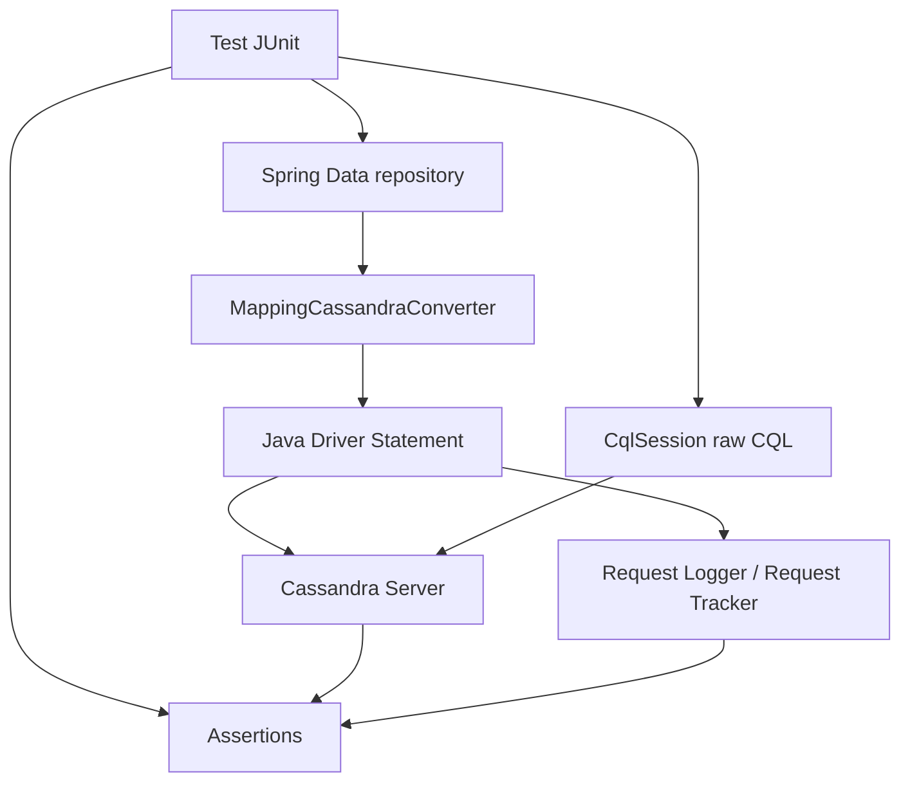

# Kiểm thử mapping/repository và CQL thực tế được phát sinh trong Spring Data Cassandra

## 1. Vì sao kiểm thử repository không thể chỉ dùng mock?

Trong module **DATABASE_ENGINE_WIDE_COLUMN_CASSANDRA**, Apache Cassandra là cơ sở dữ liệu **wide-column phân tán**: bảng được thiết kế theo truy vấn, **partition key** quyết định cách định tuyến và phân bố dữ liệu, **replication factor (RF)** và **consistency level (CL)** điều chỉnh điều kiện đọc/ghi. Ứng dụng Java thường sử dụng Java Driver trực tiếp hoặc Spring Boot và Spring Data Cassandra để thao tác với CQL.

Giả sử một service có method:

```java
OrderById result = repository.findById(orderId).orElseThrow();
```

Trong unit test dùng Mockito:

```java
when(repository.findById(orderId))
    .thenReturn(Optional.of(expectedOrder));
```

test này **không thực thi CQL**. Nó không xác nhận:

- `@Table("orders_by_id")` có đúng tên bảng thật không?
- `@PrimaryKey("order_id")` có khớp partition key CQL không?
- `@Column("total_minor")` có ánh xạ `Long` sang `bigint` không?
- Spring Data đã phát sinh `WHERE order_id = ?` hay vô tình truy vấn bằng cột khác?
- `save(...)` ghi đúng cột, giá trị và không xóa nhầm cột khác?
- Collection/UDT/enum converter có chạy thật trong `MappingCassandraConverter` không?
- Kết quả có đúng khi row được ghi từ một client không dùng Spring Data?
- Query derivation có tạo CQL hợp lệ theo Cassandra thay vì một truy vấn kiểu SQL/JPA?

Vì vậy, bài **Kiểm thử tích hợp** này tập trung vào **kiểm thử mapping, repository và CQL thực tế được phát sinh** với Cassandra thật, không chỉ kiểm phương thức Java đã được gọi.

### Mục tiêu học tập

Sau bài, bạn có thể:

1. Xây bộ test ba tầng: **mapping metadata**, **repository integration**, **CQL wire/driver observation**.
2. Dựng Cassandra container, keyspace và schema trước lúc Spring Boot tạo repository.
3. Kiểm hai chiều **repository ghi → CQL thô đọc** và **CQL thô ghi → repository đọc**.
4. Phát hiện sai tên bảng/cột, kiểu dữ liệu, partition/clustering key và mapping custom converter.
5. Quan sát **câu CQL thực sự được gửi** bằng logging/tracking của Java Driver và phân biệt nó với giả định về code generation.
6. Kiểm hành vi `save`, `findById`, `deleteById`, derived query, paging và lựa chọn CQL không hợp lệ.
7. Quản lý fixture deterministic, schema drift, consistency và parallel tests để CI chạy lại đáng tin.
8. Biết phạm vi mà một container RF=1 có thể kiểm và những hành vi cần cluster nhiều node.

## 2. Ba loại bằng chứng khác nhau

Một test tốt không phụ thuộc vào một phép xác minh duy nhất.

| Bằng chứng | Cách thu | Xác nhận được | Chưa đủ để kết luận |
| --- | --- | --- | --- |
| **Mapping metadata** | Đọc annotation/mapping context/entity property | Class, table và column mapping được cấu hình | Cassandra thật chấp nhận query |
| **Repository integration** | Gọi `save/findById/deleteById` và assert | Đường Spring Data → Driver → Cassandra hoạt động | CQL chính xác đã được phát ra theo mọi nhánh |
| **CQL độc lập** | Dùng `CqlSession`/`cqlsh` để ghi/đọc raw row | Wire values và schema thực khớp contract | Repository lúc khác không thể phát sinh CQL sai |
| **Driver request log/tracker** | Quan sát statement do Java Driver thực thi | Query shape thực, bảng và predicates được gửi | Dữ liệu trả về luôn đúng về nghiệp vụ |
| **Cluster/schema metadata** | `system_schema`, driver metadata, agreement | Keyspace/table/primary key hiện tại | Hết race, mọi mutation đã hội tụ |
| **Failure/negative test** | Query sai, timeout, null, invalid type | Có phát hiện lỗi thay vì silently success | Mọi trạng thái lỗi production đều được mô phỏng |

Đặc biệt, **kiểm đúng giá trị sau khi đọc lại bằng cùng mapper** đôi khi chưa đủ. Nếu mapper ghi và đọc cùng một sai lệch, round-trip Java có thể pass. Phải có **raw CQL kiểm chứng độc lập**.



## 3. Schema CQL theo truy vấn: nền tảng để test đúng

### 3.1. Bảng đọc đơn hàng bằng ID

Ví dụ trên một container Cassandra một node, tên datacenter được xác nhận là `datacenter1`:

```sql
CREATE KEYSPACE IF NOT EXISTS commerce_it
WITH replication = {
    'class': 'NetworkTopologyStrategy',
    'datacenter1': 1
};

CREATE TABLE IF NOT EXISTS commerce_it.orders_by_id (
    order_id uuid PRIMARY KEY,
    customer_id uuid,
    status text,
    total_minor bigint,
    created_at timestamp,
    updated_at timestamp
);
```

**Chọn RF=1 chỉ cho lab một node.** Với production RF=3, `LOCAL_QUORUM` yêu cầu hai replica; một node không tái hiện độ sẵn sàng/quorum của ba node. Tên DC thực phải được kiểm bằng:

```sql
SELECT data_center, release_version
FROM system.local;
```

Với `orders_by_id`, truy vấn đúng theo partition key:

```sql
SELECT order_id, customer_id, status, total_minor, created_at, updated_at
FROM commerce_it.orders_by_id
WHERE order_id = ?;
```

Ngược lại:

```sql
-- Cố tình không phù hợp khi không có index/bảng khác:
SELECT * FROM commerce_it.orders_by_id
WHERE customer_id = ?;
```

Cassandra có thể từ chối query này vì `customer_id` không thuộc khóa hoặc cấu trúc index được hỗ trợ. Việc repository có method tên `findByCustomerId` **không tự tạo index** hay tối ưu truy vấn.

### 3.2. Bảng riêng cho truy vấn theo khách hàng

Nếu ứng dụng cần liệt kê các đơn của một khách:

```sql
CREATE TABLE IF NOT EXISTS commerce_it.orders_by_customer (
    customer_id uuid,
    created_at timestamp,
    order_id uuid,
    status text,
    total_minor bigint,
    PRIMARY KEY ((customer_id), created_at, order_id)
) WITH CLUSTERING ORDER BY (created_at DESC, order_id ASC);
```

Truy vấn:

```sql
SELECT created_at, order_id, status, total_minor
FROM commerce_it.orders_by_customer
WHERE customer_id = ?;
```

Đây là bảng **theo mẫu truy vấn**. Test phải xác nhận CQL sinh ra hoặc CQL khai báo có predicate trên `customer_id`, không phải `ALLOW FILTERING` vô tình làm full scan.

### 3.3. DDL test và migration thực tế

Để đơn giản, code ví dụ có thể tạo schema bằng `CREATE TABLE`. Trong dự án production, test nên dùng **cùng versioned CQL migrations** với sản phẩm và phát hiện schema drift. `IF NOT EXISTS` chỉ ngăn lỗi trùng tên; nó **không xác nhận bảng đang tồn tại có đúng primary key, column types hoặc table options**.

Sau migration cần kiểm bảng/cột/keys theo metadata và thực hiện câu CQL thật. Schema agreement thành công **không** đồng nghĩa schema đúng kỳ vọng.

## 4. Entity Java: annotation là hợp đồng với CQL

Ví dụ một entity Spring Data Cassandra đơn giản:

```java
import java.time.Instant;
import java.util.UUID;

import org.springframework.data.cassandra.core.mapping.Column;
import org.springframework.data.cassandra.core.mapping.PrimaryKey;
import org.springframework.data.cassandra.core.mapping.Table;

@Table("orders_by_id")
public class OrderById {

    @PrimaryKey("order_id")
    private UUID orderId;

    @Column("customer_id")
    private UUID customerId;

    @Column("status")
    private String status;

    @Column("total_minor")
    private Long totalMinor;

    @Column("created_at")
    private Instant createdAt;

    @Column("updated_at")
    private Instant updatedAt;

    public OrderById() { }

    public OrderById(UUID orderId, UUID customerId,
            String status, Long totalMinor,
            Instant createdAt, Instant updatedAt) {
        this.orderId = orderId;
        this.customerId = customerId;
        this.status = status;
        this.totalMinor = totalMinor;
        this.createdAt = createdAt;
        this.updatedAt = updatedAt;
    }

    public UUID getOrderId() { return orderId; }
    public void setOrderId(UUID orderId) { this.orderId = orderId; }

    public UUID getCustomerId() { return customerId; }
    public void setCustomerId(UUID customerId) {
        this.customerId = customerId;
    }

    public String getStatus() { return status; }
    public void setStatus(String status) { this.status = status; }

    public Long getTotalMinor() { return totalMinor; }
    public void setTotalMinor(Long totalMinor) {
        this.totalMinor = totalMinor;
    }

    public Instant getCreatedAt() { return createdAt; }
    public void setCreatedAt(Instant createdAt) {
        this.createdAt = createdAt;
    }

    public Instant getUpdatedAt() { return updatedAt; }
    public void setUpdatedAt(Instant updatedAt) {
        this.updatedAt = updatedAt;
    }
}
```

Giải thích:

- `@Table("orders_by_id")`: tên bảng tương ứng khi Spring Data session chọn keyspace `commerce_it`.
- `@PrimaryKey("order_id")`: field Java `orderId` là partition key cho bảng này.
- `@Column("total_minor")`: Java `Long` cần map vào CQL `bigint`, không dùng `double` cho số tiền.
- `@Column("created_at")`: `Instant` biểu diễn thời điểm tuyệt đối; CQL `timestamp` có precision millisecond.
- Constructor và getter/setter được viết rõ để các test không dựa vào code generation/Lombok.

**Không suy ra thứ tự thao tác CQL từ vị trí field trong class.** Spring Data có thể tạo statement với thứ tự cột, quote identifier và bind markers khác nhau giữa các phiên bản. Test nên giữ ổn định **ngữ nghĩa** và quan sát CQL thật, không cố assert một câu lệnh string hoàn toàn giống từng dấu cách.

### 4.1. Repository chuẩn

```java
import java.util.UUID;
import org.springframework.data.cassandra.repository.CassandraRepository;

public interface OrderByIdRepository
        extends CassandraRepository<OrderById, UUID> {
}
```

Với interface này:

- `findById(orderId)` cần query theo primary key.
- `save(entity)` dùng mapping để ghi dữ liệu (ngữ nghĩa upsert/insert hoặc update tùy API).
- `deleteById(orderId)` tạo mutation xóa theo key.
- `existsById`/`count` có thể phát các truy vấn khác và chi phí khác; không suy chúng “miễn phí” như thao tác với Map Java.

### 4.2. Không biến repository thành JPA

Spring Data Cassandra không có đầy đủ mô hình transaction và persistence context như JPA:

- `save` không đồng nghĩa một `EntityManager.flush()` theo transaction RDBMS.
- Cassandra `INSERT`/`UPDATE` là mutation, không mặc định có kiểm tra “row đã tồn tại”.
- `@Transactional` của Spring **không tạo rollback ACID đa bảng** cho các thao tác Cassandra bình thường.
- `deleteById` viết tombstone theo ngữ nghĩa Cassandra; không nhất thiết mọi replica lập tức xóa dữ liệu vật lý.
- Repository query derivation **không tạo join** hoặc tự động phân vùng dữ liệu tốt hơn.

Đây là lý do phải kiểm **CQL được gửi** và **raw data sau tác động**, không dùng kỳ vọng từ Hibernate/JPA.

## 5. Dependency và môi trường kiểm thử

Với Spring Boot được quản lý dependency bằng BOM/parent tương ứng:

```xml
<dependencies>
    <dependency>
        <groupId>org.springframework.boot</groupId>
        <artifactId>spring-boot-starter-data-cassandra</artifactId>
    </dependency>

    <dependency>
        <groupId>org.springframework.boot</groupId>
        <artifactId>spring-boot-starter-test</artifactId>
        <scope>test</scope>
    </dependency>

    <dependency>
        <groupId>org.testcontainers</groupId>
        <artifactId>cassandra</artifactId>
        <scope>test</scope>
    </dependency>
</dependencies>
```

Bài dùng **API Testcontainers 1.x** minh họa và Java Driver 4.x trong stack Spring Data hiện đại. Cần khóa **version thật** của Spring Boot, Spring Data Cassandra, Java Driver, JDK, Testcontainers và Cassandra image từ ma trận hỗ trợ. Không trộn core driver của nhiều nhóm artifact rồi giả định Maven/Gradle tự xử lý đúng.

**Không dùng H2 hoặc database in-memory tương tự để tuyên bố đã test Cassandra**; CQL, token distribution, UDT và query restrictions là những đặc trưng Cassandra mà H2 không mô phỏng chính xác.

### 5.1. Chọn môi trường kiểm thử

| Môi trường | Có thể kiểm | Không thể kiểm đầy đủ |
| --- | --- | --- |
| Mockito repository | Service gọi đúng method, xử lý Optional | CQL, schema, converter, server errors |
| Cassandra một node Testcontainers | Mapping, repository, prepared CQL, UDT, TTL cơ bản | Failover RF=3, multi-DC, repair giữa replica |
| Multi-node test cluster | Quorum, node failure, replica behavior | Hiệu năng production nếu tài nguyên/dữ liệu không đại diện |
| Staging representative | End-to-end và tải tương tự production | Không tự thay thế test logic deterministic |

Khi chỉ cần phát hiện sai mapping và CQL phát sinh, **một node thật** là điểm bắt đầu tốt. Đừng làm bộ test mapping chậm hơn nhiều lần chỉ để chạy RF=3 nếu bài đang kiểm bảng/cột/chuyển đổi Java; thêm distributed tests riêng cho mức nhất quán.

## 6. Bootstrap schema trước Spring ApplicationContext

Đây là lỗi thường gặp: `@SpringBootTest` cần tạo `CqlSession`, repository và mapper **khi ApplicationContext được refresh**. Nếu keyspace cấu hình ở `spring.cassandra.keyspace-name` chưa tồn tại thì context có thể lỗi **trước** `@BeforeAll`.

Một cách an toàn để hiểu thứ tự là **tạo container và schema trong static bootstrap** của class test, rồi công bố dynamic properties cho Spring.

### 6.1. Cấu trúc ví dụ Testcontainers + Spring Boot

Đoạn sau là một lớp test tích hợp; cùng project phải có class `OrderById` và `OrderByIdRepository` đã định nghĩa ở mục 4. Docker cần sẵn sàng. Dùng một image Cassandra đã được kiểm tra compatibility: `cassandra:4.1.6` ở đây là **tag minh họa đã cố định**, không phải đề xuất phiên bản mới nhất.

```java
import static org.junit.jupiter.api.Assertions.*;

import java.net.InetSocketAddress;
import java.time.Instant;
import java.util.UUID;

import org.junit.jupiter.api.AfterAll;
import org.junit.jupiter.api.BeforeEach;
import org.junit.jupiter.api.Test;
import org.springframework.beans.factory.annotation.Autowired;
import org.springframework.boot.test.context.SpringBootTest;
import org.springframework.test.annotation.DirtiesContext;
import org.springframework.test.context.DynamicPropertyRegistry;
import org.springframework.test.context.DynamicPropertySource;
import org.testcontainers.containers.CassandraContainer;
import org.testcontainers.utility.DockerImageName;

import com.datastax.oss.driver.api.core.CqlSession;
import com.datastax.oss.driver.api.core.cql.PreparedStatement;
import com.datastax.oss.driver.api.core.cql.Row;

@SpringBootTest
@DirtiesContext(classMode = DirtiesContext.ClassMode.AFTER_CLASS)
class OrderByIdRepositoryIT {

    static final UUID ORDER_ID = UUID.fromString(
        "11111111-1111-1111-1111-111111111111");
    static final UUID CUSTOMER_ID = UUID.fromString(
        "22222222-2222-2222-2222-222222222222");
    static final Instant TIME =
        Instant.parse("2025-03-10T09:00:00Z");

    static final CassandraContainer<?> CASSANDRA =
        new CassandraContainer<>(
            DockerImageName.parse("cassandra:4.1.6"));

    // Phải chạy TRƯỚC khi Spring tạo CqlSession/repositories.
    static {
        CASSANDRA.start();

        try (CqlSession bootstrap = CqlSession.builder()
                .addContactPoint(new InetSocketAddress(
                    CASSANDRA.getHost(),
                    CASSANDRA.getMappedPort(9042)))
                .withLocalDatacenter("datacenter1")
                .build()) {

            bootstrap.execute(
                "CREATE KEYSPACE IF NOT EXISTS commerce_it " +
                "WITH replication = {" +
                "'class':'NetworkTopologyStrategy','datacenter1':1}");

            bootstrap.execute(
                "CREATE TABLE IF NOT EXISTS commerce_it.orders_by_id (" +
                "order_id uuid PRIMARY KEY, " +
                "customer_id uuid, status text, total_minor bigint, " +
                "created_at timestamp, updated_at timestamp)");

            if (!bootstrap.checkSchemaAgreement()) {
                throw new IllegalStateException(
                    "Test schema agreement chưa đạt");
            }
        }
    }

    @DynamicPropertySource
    static void springCassandra(DynamicPropertyRegistry registry) {
        registry.add(
            "spring.cassandra.contact-points", CASSANDRA::getHost);
        registry.add(
            "spring.cassandra.port",
            () -> CASSANDRA.getMappedPort(9042));
        registry.add(
            "spring.cassandra.local-datacenter",
            () -> "datacenter1");
        registry.add(
            "spring.cassandra.keyspace-name",
            () -> "commerce_it");
        registry.add(
            "spring.cassandra.schema-action",
            () -> "NONE");
    }

    @Autowired
    OrderByIdRepository repository;

    @Autowired
    CqlSession session;

    @BeforeEach
    void clearTable() {
        // Chỉ dùng vì bảng/container thuộc riêng class test này
        // và test methods không được chạy song song.
        session.execute("TRUNCATE commerce_it.orders_by_id");
    }

    @Test
    void repositoryWriteCanBeReadUsingRawCql() {
        OrderById entity = new OrderById(
            ORDER_ID, CUSTOMER_ID, "CREATED", 120000L, TIME, TIME);

        repository.save(entity);

        PreparedStatement query = session.prepare(
            "SELECT order_id, customer_id, status, total_minor, " +
            "created_at, updated_at FROM commerce_it.orders_by_id " +
            "WHERE order_id = ?");

        Row raw = session.execute(query.bind(ORDER_ID)).one();

        assertNotNull(raw);
        assertEquals(ORDER_ID, raw.getUuid("order_id"));
        assertEquals(CUSTOMER_ID, raw.getUuid("customer_id"));
        assertEquals("CREATED", raw.getString("status"));
        assertEquals(120000L, raw.getLong("total_minor"));
        assertEquals(TIME, raw.getInstant("created_at"));
    }

    @Test
    void rawCqlWriteCanBeReadUsingRepository() {
        PreparedStatement insert = session.prepare(
            "INSERT INTO commerce_it.orders_by_id " +
            "(order_id, customer_id, status, total_minor, " +
            "created_at, updated_at) VALUES (?, ?, ?, ?, ?, ?)");

        session.execute(insert.bind(
            ORDER_ID, CUSTOMER_ID, "PAID", 120000L, TIME, TIME));

        OrderById mapped = repository.findById(ORDER_ID)
            .orElseThrow();

        assertEquals(CUSTOMER_ID, mapped.getCustomerId());
        assertEquals("PAID", mapped.getStatus());
        assertEquals(Long.valueOf(120000L), mapped.getTotalMinor());
        assertEquals(TIME, mapped.getCreatedAt());
    }

    @Test
    void deleteByIdRemovesTargetRow() {
        repository.save(new OrderById(
            ORDER_ID, CUSTOMER_ID, "CREATED", 120000L, TIME, TIME));

        assertTrue(repository.findById(ORDER_ID).isPresent());
        repository.deleteById(ORDER_ID);
        assertTrue(repository.findById(ORDER_ID).isEmpty());
    }

    @AfterAll
    static void closeContainer() {
        CASSANDRA.stop();
    }
}
```

**Điều kiện thực thi và ranh giới của ví dụ:**

- `OrderByIdRepositoryIT`, `OrderById` và repository nằm trong project Spring Boot có package scanning đúng.
- `datacenter1` phải khớp giá trị `system.local.data_center` của image. Nếu image/test configuration khác, sửa **cả** `NetworkTopologyStrategy` và `local-datacenter`.
- `@DynamicPropertySource` **chỉ công bố cấu hình**; nó không tự tạo keyspace. Static bootstrap bảo đảm DDL đã chạy trước khi context được dựng.
- Container được quản lý thủ công bằng `start()/stop()`, **không** đồng thời dùng `@Container`/extension để quản lý lại trong ví dụ này.
- `@DirtiesContext(AFTER_CLASS)` giúp tránh tái sử dụng Spring context trỏ đến container đã dừng. Nó **không rollback Cassandra**.
- Phải bảo đảm **không chạy song song method/class dùng chung container/table** nếu dùng `TRUNCATE`.
- `TRUNCATE` xóa toàn bảng; chỉ thực hiện với instance test cô lập. Không trỏ test tới staging/production.
- Ví dụ kiểm ba đường quan trọng, nhưng chưa kiểm query derivation, converter/UDT, nhiều bảng và failure scenarios; bổ sung theo mục đích sản phẩm.
- Code sử dụng `Optional.isEmpty()` (Java 11+). Nếu dự án buộc JDK thấp hơn, dùng `!isPresent()`, đồng thời kiểm tương thích JDK/Driver/Spring.

### 6.2. Vì sao viết static bootstrap thay vì `@BeforeAll`?

Trong `@SpringBootTest`, Spring context thường được tạo trước các method lifecycle của JUnit. Khi bootstrapping muốn kiểm repo tồn tại, việc tạo keyspace ở `@BeforeAll` có thể **quá muộn**.

Các giải pháp tương đương theo phiên bản:

- Init script Testcontainers được chạy và hoàn tất **trước** Spring context.
- `ApplicationContextInitializer` khởi động container/schema và publish properties trước refresh.
- Một test environment/fixture runner ngoài process đã tạo schema trước khi chạy test.
- Cấu hình lifecycle integration của framework có hỗ trợ Cassandra service connection + schema init theo version.

Chọn **một cơ chế**, không vừa init script vừa schema writer khác chạy cạnh tranh trên cùng tables.

## 7. Kiểm một chiều chưa đủ: cần hai bài test “đối xứng”

### 7.1. Repository ghi → raw CQL đọc

Đường kiểm:

```text
Java entity
  -> Spring Data mapping
  -> CQL INSERT/UPDATE do framework tạo
  -> Cassandra columns
  -> CqlSession SELECT cố định
  -> Row.getUuid/getString/getLong/getInstant
```

Bắt được các lỗi:

- Java `totalMinor` map sang cột `totalMinor` (sai tên) thay vì `total_minor`.
- `Instant` bị serialize sai hoặc lệch precision.
- Entity không có trường cần ghi do annotation/constructor sai.
- Repository vô tình ghi giá trị mặc định/`null` không mong muốn.
- CQL được tạo nhưng Cassandra từ chối vì type mismatch hoặc schema drift.

### 7.2. Raw CQL ghi → repository đọc

Đường kiểm:

```text
Prepared INSERT bằng CqlSession
  -> Cassandra có row thật theo schema CQL
  -> repository.findById
  -> MappingCassandraConverter
  -> Java entity
```

Bắt được các lỗi:

- Reader Java dùng tên field khác schema hoặc không gắn `@Column`.
- Converter chỉ được đăng ký chiều ghi mà thiếu chiều đọc.
- Java enum không biết code cũ/mới trong database.
- UDT/collection không được map đúng kiểu.
- `null` hoặc kiểu dữ liệu không hợp lệ khiến entity constructor fail.

**Vì sao hai chiều quan trọng?** Nếu cả write và read đều cùng một converter sai nhưng đảo ngược được, `repository.save(entity)` rồi `repository.findById(...)` có thể pass. Raw CQL là một **điểm kiểm tra độc lập của wire contract**.

## 8. Quan sát CQL thực tế được Spring Data phát sinh

Đây là phần quan trọng nhất của chủ đề. Một method tên `findById` không chứng minh driver đã gửi đúng `WHERE order_id = ?`; muốn biết **CQL thực tế**, phải nhìn ở ranh giới statement hoặc request từ Java Driver.

### 8.1. Ba cách tiếp cận, từ dễ đến chính xác

| Cách | Ưu điểm | Giới hạn |
| --- | --- | --- |
| **Bật Spring Data Cassandra DEBUG/TRACE** trong test | Thấy hoạt động template, converter, repository query derivation | Mức log/chuỗi CQL cụ thể phụ thuộc version; không nhất thiết log đầy đủ bound statement |
| **Java Driver Request Logger/Request Tracker** | Quan sát request/statement thực đi qua driver, latency, success/error | Config và log format theo driver version; cần bảo vệ bind values |
| **Test seam thu statement trước khi gửi** | Có thể assert cấu trúc CQL không phụ thuộc stderr | Đòi cấu hình wrapper/tracker phù hợp, tránh mock làm mất đường truy vấn thật |

**Không nhầm SQL log của Hibernate/JPA với CQL log của Cassandra.** `spring.jpa.show-sql=true` không cho biết Spring Data Cassandra đã gửi gì.

### 8.2. Bật logging ứng dụng trong profile integration-test

Ví dụ `application-it.yml` của dự án thử nghiệm:

```yaml
logging:
  level:
    org.springframework.data.cassandra.core: DEBUG
    org.springframework.data.cassandra.repository: DEBUG
```

Tùy version Spring Data, các logger có thể in khác nhau. Đây là **gợi ý quan sát** để bắt đầu, không cam kết mọi request/bind value sẽ hiện trong log.

Với Java Driver 4.x, có cơ chế **RequestLogger/RequestTracker**. Một cấu hình HOCON minh họa để bật trong **profile kiểm thử**, cần kiểm cú pháp đúng của phiên bản driver:

```hocon
datastax-java-driver {
  advanced.request-tracker {
    classes = [RequestLogger]

    logs {
      success.enabled = true
      slow.enabled = true
      error.enabled = true
      show-values = false
    }
  }
}
```

`RequestLogger` dùng để quan sát statements; `show-values = false` nhằm tránh lộ dữ liệu CQL bind. Trong một số bản driver, cấu hình chi tiết của tracker/logging khác; kiểm reference config/Javadoc của bản đang khóa. **Không bật log mọi success request trong production** vì overhead và thông tin nhạy cảm.

Khi test gọi:

```java
repository.findById(ORDER_ID);
```

hãy thu log theo **test case/correlation ID**, kiểm xem request đã gửi đến `orders_by_id` với predicate theo `order_id`. Log có thể hiển thị câu lệnh dạng prepared statement với bind markers, không nhất thiết in giá trị UUID.

### 8.3. CQL shape mong đợi, không phải chuỗi bắt buộc giống từng byte

Một số query shape thường gặp, **chỉ là ví dụ**:

```sql
-- findById:
SELECT ... FROM orders_by_id WHERE order_id = ?;

-- save:
INSERT INTO orders_by_id
    (order_id, customer_id, status, total_minor, created_at, updated_at)
VALUES (?, ?, ?, ?, ?, ?);

-- deleteById:
DELETE FROM orders_by_id WHERE order_id = ?;
```

Spring Data/Driver có thể:

- Thêm keyspace qualification `commerce_it.orders_by_id`.
- Quote identifiers hoặc đổi thứ tự các cột được liệt kê.
- Dùng dạng `INSERT`/`UPDATE` khác nhau cho các đường save.
- Dùng prepared statement với `?` hoặc named markers tùy API.
- Phát thêm query metadata/prepare/query options trong vòng đời request.

Vì thế **không** assert rằng cả chuỗi phải bằng chính xác ví dụ này. Với một statement được capture, nên kiểm các bất biến:

1. Đúng bảng hoặc entity target.
2. `WHERE` chứa **partition key đúng**; không query theo cột không hỗ trợ.
3. Không có `ALLOW FILTERING` ngoài quy tắc đã review.
4. Với update/delete, điều kiện key không thiếu.
5. Những field CQL được ghi là field dự kiến.
6. Consistency level và timeout có đúng profile/statement không, nếu contract yêu cầu.
7. Query có được prepare/bind thay vì nối untrusted values không.

Nếu business yêu cầu **hình dạng câu CQL ổn định tuyệt đối**, hãy cân nhắc `@Query` explicit hoặc một repository adapter phát CQL được test như contract, thay vì phụ thuộc vào internal query-generation của framework qua nhiều bản nâng cấp.

### 8.4. Cách biến log thành assertion

Một phương án trong suite có Spring Boot + Logback:

1. Chỉ bật RequestLogger ở profile integration-test.
2. Trong test, gắn một **in-memory appender** vào logger mà driver version đang dùng.
3. Trước khi gọi repository, ghi lại vị trí đầu của log buffer hoặc correlation ID.
4. Thực hiện query trên Cassandra thật.
5. Lấy các sự kiện **mới phát sinh từ test này**, bỏ qua CQL bootstrap/health checks.
6. Kiểm query shape theo bất biến; **không** assert bind values nhạy cảm trong log.
7. Gỡ appender ở teardown, không giữ log events vô hạn gây tăng heap.

Mã kiểm ở mức pseudo-code để không phụ thuộc logger internal name/signature thay đổi theo version:

```java
// PSEUDOCODE — triển khai CqlCapture bằng RequestTracker hoặc Logback
// phù hợp đúng Java Driver version đang dùng.
// CqlCapture capture = installTestOnlyCapture(sessionConfiguration);
//
// capture.clear();
// OrderById result = repository.findById(orderId).orElseThrow();
//
// List<CapturedCql> statements = capture.newStatements();
// assertTrue(statements.stream()
//     .anyMatch(s -> s.targetsTable("orders_by_id")
//         && s.hasPartitionPredicate("order_id")
//         && !s.hasAllowFiltering()));
```

`CqlCapture`/`CapturedCql` ở trên **không phải class có sẵn** trong Spring Data hay driver. Chúng mô tả một test seam cần tự cài, dựa trên API tracker/logging cụ thể. Vì vậy, với môi trường chưa có capture adapter, hãy **xem log thực** và kiểm raw CQL/test outcomes trước; không trình bày đoạn pseudo-code này là chạy được nguyên trạng.

**Nếu muốn kiểm “CQL thực tế” bằng cách duy nhất mock `repository.findById`, bài test không đạt mục tiêu.** Mock chỉ chứng minh code gọi method Java, không chứng minh Cassandra đã nhận statement nào.

## 9. Derived query: tên method đẹp có thể tạo CQL sai

Một repository method:

```java
// CỐ TÌNH NGUY HIỂM nếu bảng orders_by_id chỉ có PK order_id:
List<OrderById> findByCustomerId(UUID customerId);
```

Spring Data có thể suy ra truy vấn dựa trên property `customerId`. Nhưng bảng `orders_by_id` không phân vùng theo `customer_id`, không có index phục vụ predicate này. Kết quả có thể là lỗi query từ Cassandra tại startup/lúc execute, hoặc một truy vấn cần filtering với chi phí cao nếu cố bật filtering.

**Đừng “sửa” bằng cách thêm `@AllowFiltering` hoặc `ALLOW FILTERING`** mà không có thiết kế truy vấn/dữ liệu rõ. Với Cassandra, cách chuẩn là tạo **bảng theo truy vấn** `orders_by_customer`, sau đó map repository vào đúng bảng đó.

### 9.1. Composite primary key đúng theo Cassandra

Với bảng `orders_by_customer` ở mục 3, class primary key có ba thành phần:

```java
import java.io.Serializable;
import java.time.Instant;
import java.util.Objects;
import java.util.UUID;

import org.springframework.data.cassandra.core.cql.PrimaryKeyType;
import org.springframework.data.cassandra.core.mapping.PrimaryKeyClass;
import org.springframework.data.cassandra.core.mapping.PrimaryKeyColumn;

@PrimaryKeyClass
public class OrderByCustomerKey implements Serializable {

    @PrimaryKeyColumn(
        name = "customer_id",
        ordinal = 0,
        type = PrimaryKeyType.PARTITIONED)
    private UUID customerId;

    @PrimaryKeyColumn(
        name = "created_at",
        ordinal = 1,
        type = PrimaryKeyType.CLUSTERED)
    private Instant createdAt;

    @PrimaryKeyColumn(
        name = "order_id",
        ordinal = 2,
        type = PrimaryKeyType.CLUSTERED)
    private UUID orderId;

    public OrderByCustomerKey() { }

    public OrderByCustomerKey(
            UUID customerId, Instant createdAt, UUID orderId) {
        this.customerId = customerId;
        this.createdAt = createdAt;
        this.orderId = orderId;
    }

    public UUID getCustomerId() { return customerId; }
    public Instant getCreatedAt() { return createdAt; }
    public UUID getOrderId() { return orderId; }

    public void setCustomerId(UUID value) { customerId = value; }
    public void setCreatedAt(Instant value) { createdAt = value; }
    public void setOrderId(UUID value) { orderId = value; }

    @Override
    public boolean equals(Object value) {
        if (this == value) return true;
        if (!(value instanceof OrderByCustomerKey)) return false;
        OrderByCustomerKey other = (OrderByCustomerKey) value;
        return Objects.equals(customerId, other.customerId)
            && Objects.equals(createdAt, other.createdAt)
            && Objects.equals(orderId, other.orderId);
    }

    @Override
    public int hashCode() {
        return Objects.hash(customerId, createdAt, orderId);
    }
}
```

Entity:

```java
import org.springframework.data.cassandra.core.mapping.Column;
import org.springframework.data.cassandra.core.mapping.PrimaryKey;
import org.springframework.data.cassandra.core.mapping.Table;

@Table("orders_by_customer")
public class OrderByCustomer {

    @PrimaryKey
    private OrderByCustomerKey key;

    @Column("status")
    private String status;

    @Column("total_minor")
    private Long totalMinor;

    // Constructor, getters/setters tương ứng cần được khai báo
    // trong source thực để Spring Data có thể map object đầy đủ.
}
```

**Phải kiểm** `@PrimaryKeyClass` và `@PrimaryKeyColumn` theo đúng Spring Data version: partitioned vs clustered components, `ordinal`, CQL column names, equality/hashCode và constructor binding.

### 9.2. Derived query theo nested key

Một ví dụ về method có thể được Spring Data suy ra theo property path:

```java
import java.util.List;
import java.util.UUID;

import org.springframework.data.cassandra.repository.CassandraRepository;

public interface OrderByCustomerRepository
        extends CassandraRepository<
            OrderByCustomer, OrderByCustomerKey> {

    List<OrderByCustomer> findByKeyCustomerId(UUID customerId);
}
```

Với derived query trên nested composite key, **kiểm cú pháp method và behavior ở đúng phiên bản Spring Data**; hỗ trợ property traversal và generated predicates có thể phụ thuộc phiên bản/cấu hình. Nếu không dùng được hoặc muốn CQL cố định, chọn `@Query` rõ ràng:

```java
import java.util.List;
import java.util.UUID;

import org.springframework.data.cassandra.repository.Query;

@Query("SELECT customer_id, created_at, order_id, status, " +
       "total_minor FROM orders_by_customer WHERE customer_id = ?0")
List<OrderByCustomer> findAllByCustomer(UUID customerId);
```

Đây là method cần đặt **bên trong repository interface**, không phải hàm Java tự do. `@Query` dùng CQL explicit, nên muốn kiểm **query derivation** thì phải kiểm riêng method không có `@Query`; muốn kiểm **mapping row** thì cả hai dạng đều hữu ích.

### 9.3. Test xác minh predicate và thứ tự clustering

Fixture:

```sql
INSERT INTO commerce_it.orders_by_customer (
    customer_id, created_at, order_id, status, total_minor
) VALUES (
    22222222-2222-2222-2222-222222222222,
    '2025-03-10T10:00:00Z',
    11111111-1111-1111-1111-111111111111,
    'PAID', 120000
);

INSERT INTO commerce_it.orders_by_customer (
    customer_id, created_at, order_id, status, total_minor
) VALUES (
    22222222-2222-2222-2222-222222222222,
    '2025-03-09T10:00:00Z',
    33333333-3333-3333-3333-333333333333,
    'CREATED', 60000
);
```

Assertion cần kiểm query chỉ trả rows thuộc đúng `customer_id` và thứ tự `created_at DESC` đúng theo schema. Thêm ít nhất một khách khác có row để phát hiện query thiếu `WHERE`. Đừng chỉ assert `result.size() == 2` vì một truy vấn sai có thể vô tình trả hai hàng từ các partition khác.

## 10. Kiểm `save`: upsert, null và nguy cơ ghi đè dữ liệu

Trong Cassandra, `INSERT` và `UPDATE` có ngữ nghĩa mutation/upsert. Một entity Java “có ID” không tự có ý nghĩa là update có điều kiện như JPA.

### 10.1. Test tạo mới

Kỳ vọng:

1. `repository.save(entity)` không ném lỗi.
2. Raw `SELECT ... WHERE order_id = ?` thấy đúng một row.
3. Các trường raw CQL chính xác: `UUID`, `Long`, `Instant`, `String`.
4. Các cột không được thiết lập không bị ghi giá trị sai bất ngờ.
5. Nếu dùng custom converter, raw CQL thấy **wire representation** được thiết kế.

### 10.2. Test cập nhật một field có thể phát sinh ghi cả entity

Giả sử có hai service cùng sửa row:

- Service A sửa `status`.
- Service B sửa `updatedAt`.
- Cả hai gọi `repository.save(entity)` trên các object được load ở thời điểm khác nhau.

Nếu framework sinh mutation ghi nhiều cột từ entity, service B **có thể ghi đè** status mới bằng giá trị cũ. Cần kiểm **generated CQL** hoặc bật logging/tracker để biết field nào đang được gửi, thay vì giả định `save` tự dirty-check như ORM.

Với cập nhật có chủ đích:

```sql
UPDATE commerce_it.orders_by_id
SET status = ?
WHERE order_id = ?;
```

Có thể dùng `CqlSession`, `CassandraTemplate` hoặc custom repository để bảo đảm chỉ sửa cột cần thiết. Nếu có tranh chấp theo version/business state, dùng LWT/CAS hoặc thiết kế idempotency.

### 10.3. `null` không đồng nghĩa “bỏ qua field”

Khi một DTO PATCH thiếu `totalMinor`, việc map nó sang entity có `totalMinor=null` rồi `save` có thể sinh write/delete hoặc null-handling khác theo mapping API/version. Test rõ:

- `null` có làm giá trị cũ biến mất hay bị bỏ qua?
- Collection rỗng có khác collection `null`?
- `updatedAt` có tự bị thay đổi khi không truyền?
- Một property read-only/derived có bị ghi không?

**Không mặc định** Cassandra/Spring Data tự phân biệt “không cung cấp field” và “cố ý xóa field”. Thiết kế PATCH adapter riêng và xác minh CQL thật.

## 11. Mapping collection, UDT, enum, thời gian: test raw wire values

### 11.1. Collection

Tạo schema ví dụ:

```sql
CREATE TABLE IF NOT EXISTS commerce_it.order_tags_by_id (
    order_id uuid PRIMARY KEY,
    tags set<text>,
    history list<text>,
    attrs map<text, text>
);
```

Entity:

```java
@Table("order_tags_by_id")
public class OrderTags {

    @PrimaryKey("order_id")
    private UUID orderId;

    @Column("tags")
    private Set<String> tags;

    @Column("history")
    private List<String> history;

    @Column("attrs")
    private Map<String, String> attrs;

    // Constructor, getters/setters cần được khai báo đầy đủ.
}
```

Integration assertions:

- `Set<String>` không có duplicate và không phụ thuộc iteration order.
- `List<String>` giữ thứ tự; test append riêng nếu app dùng CQL append.
- `Map<String,String>` có key/value raw chính xác.
- `null`, rỗng, xóa phần tử được kiểm riêng theo mapping/version.
- Không dùng collection như một bảng 1-n vô hạn; một test với hai tag không chứng minh mô hình phù hợp hàng triệu tag.
- Retry `list = list + [...]` sau timeout có thể tạo phần tử trùng, nên cần test idempotency riêng.

### 11.2. User-defined type

```sql
CREATE TYPE IF NOT EXISTS commerce_it.shipping_address (
    street text,
    city text,
    postal_code text
);

CREATE TABLE IF NOT EXISTS commerce_it.order_addresses_by_id (
    order_id uuid PRIMARY KEY,
    address frozen<commerce_it.shipping_address>
);
```

Với Java class `@UserDefinedType("shipping_address")` và entity field `@Frozen`, test:

1. Ghi object Java có street/city/postalCode.
2. Raw CQL đọc `UdtValue`, kiểm tên và giá trị field.
3. Ghi UDT bằng `CqlSession` rồi đọc qua repository.
4. Thử thêm UDT field nullable với schema mới; app cũ/mới có đọc được không?
5. Kiểm update frozen UDT **thay toàn object**, không suy có update từng field độc lập.

### 11.3. Enum stable code

Nếu enum `CustomerStatus.ACTIVE` phải lưu `'A'` thay vì tên enum:

- Unit test `@WritingConverter` và `@ReadingConverter` ở hai chiều.
- Integration test repository ghi enum rồi raw CQL đọc đúng `'A'`.
- Raw CQL ghi `'P'` rồi repository đọc thành `PAUSED`.
- Raw CQL ghi code không được hỗ trợ và assert error/quarantine theo policy.
- Xác minh converter đã được **đăng ký với `CassandraCustomConversions`**; converter class có trên classpath không đủ.
- Nếu code ghi trực tiếp bằng `CqlSession`, custom converter Spring Data **không mặc nhiên chạy**.

### 11.4. Thời gian

CQL `timestamp` có precision **millisecond**, còn Java `Instant` có thể biểu diễn nanoseconds. Sử dụng dữ liệu round-trip rõ:

```java
Instant original =
    Instant.parse("2025-03-10T09:00:00.123456789Z");
Instant expected =
    Instant.ofEpochMilli(original.toEpochMilli());
```

Nếu schema là `timestamp`, không assert nanosecond phần dư vẫn nguyên. Với `date` dùng `LocalDate`, `time` dùng `LocalTime`; nếu cần timezone của người dùng, lưu `ZoneId` hoặc code múi giờ riêng theo hợp đồng, không suy timezone từ timestamp.

Đừng dùng `Instant.now()` trong test đòi so sánh chính xác đến mili giây nếu không kiểm precision/clock. Fixture cố định giúp dễ tái hiện lỗi.

## 12. Test thực thi CQL sai có chủ đích

Một negative test giúp bảo đảm ứng dụng **không** bỏ qua các hạn chế của Cassandra.

Ví dụ dùng bảng `orders_by_id` không có index trên `customer_id`:

```java
import static org.junit.jupiter.api.Assertions.assertThrows;

import java.util.UUID;
import com.datastax.oss.driver.api.core.servererrors.InvalidQueryException;

UUID customerId = UUID.fromString(
    "22222222-2222-2222-2222-222222222222");

PreparedStatement bad = session.prepare(
    "SELECT * FROM commerce_it.orders_by_id " +
    "WHERE customer_id = ?");

assertThrows(InvalidQueryException.class,
    () -> session.execute(bad.bind(customerId)));
```

**Điểm tinh tế:** tùy Cassandra version và đường prepare/execute, lỗi có thể được ném **ngay tại `session.prepare(...)`**, không đợi `execute(...)`. Vì vậy một negative test đáng tin nên bao **toàn bộ prepare + execute** trong lambda:

```java
assertThrows(InvalidQueryException.class, () -> {
    PreparedStatement statement = session.prepare(
        "SELECT * FROM commerce_it.orders_by_id " +
        "WHERE customer_id = ?");
    session.execute(statement.bind(customerId));
});
```

Nếu framework tự tạo secondary index hoặc schema khác, query có thể hợp lệ; test cần **cố định schema** trước khi assert lỗi. Trong test chính, tốt hơn khẳng định **query đúng theo partition key thành công** và không có `ALLOW FILTERING`.

Các negative cases đáng có:

| Trường hợp | Hành vi mong đợi |
| --- | --- |
| Sai tên bảng/cột | Lỗi schema/query, không silently trả kết quả rỗng |
| Sai kiểu bind marker | Lỗi conversion/serialization rõ |
| Predicate thiếu partition key | Lỗi query hoặc thiết kế index được khai báo rõ |
| Khóa chính `null` | Mapping/driver reject trước hoặc khi thực thi |
| Enum code không hỗ trợ | Fail/quarantine theo business contract |
| UDT type chưa tạo | Migration/bootstrap fail thay vì bỏ qua |
| Consistency vượt số replica sống | `Unavailable`/lỗi theo đường xử lý, không tự hạ CL |
| Spring context trước khi keyspace tồn tại | Test phải fail rõ tại bootstrap, không tạo ngẫu nhiên |

**Không kiểm negative path bằng cách cố tình ghi vào database dùng chung.** Mọi trường hợp phá hủy/schema error nên chạy trong container/keyspace dành riêng.

## 13. Kiểm câu CQL phát sinh khi pagination và consistency

### 13.1. Paging không phải LIMIT

Một repository method trả `Iterable` hoặc `Slice`/`Page` có semantics khác nhau theo Spring Data version. Java Driver có `pageSize` riêng, còn CQL có `LIMIT`. Không nên suy rằng method repository tên `findTop50...` luôn cho HTTP pagination đúng yêu cầu.

Test cần kiểm:

- Query đúng partition key và clustering order.
- Giá trị limit/page size được áp dụng ở đúng tầng.
- Driver fetch nhiều pages có dừng khi consumer không cần nữa không.
- Paging state có gắn đúng query/values và không lộ ra như token chưa xác thực.
- Không dùng `ResultSet.all()` cho dataset chưa giới hạn trong endpoint production.
- Thay đổi dữ liệu giữa các pages có thể làm kết quả thay đổi; Cassandra paging không phải snapshot transaction.

### 13.2. Tính nhất quán từng statement

Giả sử production yêu cầu đọc/ghi `LOCAL_QUORUM` tại RF=3 trong một DC. Một integration test RF=1 với cùng tên CL **không** chứng minh semantics quorum RF=3.

Khi test Spring Data repository:

- Ghi rõ execution profile/default CL của `CqlSession`.
- Nếu method có API cho custom query options, kiểm CL/timeout trong statement hoặc driver request metadata.
- Không âm thầm dùng `LOCAL_ONE` trong test rồi kết luận production `LOCAL_QUORUM` chắc chắn tương đương.
- Dùng multi-node suite riêng khi muốn xác minh replica failure, repair, read/write consistency.
- Với LWT, kiểm thêm serial consistency và `[applied]`, không chỉ cuối cùng entity tồn tại.

### 13.3. Vì sao snapshot log không chứng minh end-to-end?

Log statement cho biết **ý định gửi CQL**. Nếu request timeout:

- Một write có thể đã áp dụng ở một số replica.
- Client có thể retry/speculative execute.
- CQL statement được log không đồng nghĩa kết quả đã đạt CL.
- Cần đối soát raw data, logical request ID và nghiệp vụ nếu mutation có side effect.

Kết hợp request log với **result/exception**, metrics và assertion trạng thái Cassandra thật.

## 14. Tránh false positive vì fixture, reset và song song

### 14.1. Một test phải chạy độc lập

Quy tắc cơ bản:

- Setup tạo schema một lần cho suite/migration scenario.
- Trước mỗi test, dữ liệu phải ở trạng thái đã biết.
- Không dựa vào `@TestMethodOrder` để test B dùng dữ liệu test A.
- Nếu test write async, chờ completion/đối soát trước reset.
- Cleanup chỉ đụng các partition/bảng do test sở hữu.
- Mọi UUID/timestamps cho expected results phải nhất quán với test context.

### 14.2. `TRUNCATE`, `DELETE` và container isolation

| Chiến lược | Khi dùng | Cảnh báo |
| --- | --- | --- |
| Container mới mỗi class/suite | Cần schema/data cô lập cao | Startup RAM/CPU/disk |
| `TRUNCATE` trước mỗi method | Class sở hữu độc quyền bảng, chạy tuần tự | Xóa toàn bảng, không an toàn khi parallel |
| `DELETE WHERE` theo ID | Test chia sẻ bảng nhưng sở hữu partition riêng | Tombstone và cleanup failure |
| Unique partition key per test | Parallel tests độc lập | Phải cleanup cuối suite/container; không scan toàn bảng |
| DROP/CREATE keyspace | Test migration từ đầu | DDL propagation, tuyệt đối không dùng trên instance chia sẻ |

**Cassandra không có transaction rollback tự động cho integration test** như Spring Data JPA. `@Transactional` hoặc `@DirtiesContext` không tự xóa những mutation đã commit lên cluster.

### 14.3. Fixture thừa có thể khiến truy vấn sai vẫn pass

Ví dụ test `findById` chỉ seed đúng một row trong bảng. Một query sai không có predicate vẫn có thể trả đúng row đó, khiến test pass nếu không kiểm CQL shape. Cách chống:

1. Seed **nhiều rows với IDs và customer IDs khác nhau**.
2. Assert chính xác ID/các cột, không chỉ `isPresent()`.
3. Kiểm query predicate bằng request logger/tracker.
4. Thêm negative test cho `order_id` không tồn tại.
5. Đổi thứ tự seed/test để phát hiện phụ thuộc ẩn.

Với query theo customer, seed ít nhất **hai khách khác nhau** và nhiều clustering rows để kiểm partition isolation + ordering.

## 15. CI/CD: điều kiện test đáng tin và artifacts cần giữ

### 15.1. Các nguồn flaky phổ biến

| Triệu chứng | Nguyên nhân | Cách xử lý |
| --- | --- | --- |
| Context fail “keyspace missing” | Schema bootstrap quá muộn | Tạo keyspace/table trước Spring context |
| `Cannot resolve local datacenter` | DC config sai | Query `system.local.data_center`, cấu hình đúng |
| `Unavailable` trong lab một node | RF=3 nhưng chỉ có một replica thật | RF=1 lab; quorum test multi-node |
| Query không tìm được cột mới | Schema drift/DDL agreement/metadata stale | Migration đúng thứ tự, agreement và expected-schema check |
| Test pass trên máy dev, fail CI | Image không ổn định, tài nguyên thiếu, readiness chậm | Pin version, đủ CPU/RAM, Testcontainers wait strategy |
| Test pass riêng, fail toàn suite | Truncate/fixture races, shared context | Isolate container/keyspace/partitions |
| Raw CQL đúng nhưng repository đọc sai | Java mapping/converter khác schema | @Column/constructor/conversion integration test |
| Repository round-trip pass nhưng wire format sai | Mapping ghi/đọc cùng sai format | Raw CQL cross-check hai chiều |
| Query logs chứa secret | Driver logging show-values đang bật | Tắt bind-value logging, redaction |
| Query log assertion đổi sau nâng version | Dạng CQL/quote/order thay đổi | Assert shape/invariants thay vì exact full string |
| Test dùng `sleep` cố định | Startup/TTL/metadata timing không ổn định | Poll condition có deadline |
| Kiểm performance bằng container nhỏ | Khác workload/hardware production | Benchmark/staging riêng |

### 15.2. Manifest tối thiểu của test run

```yaml
suite: spring-data-cassandra-mapping-cql-it
application:
  spring_boot: "<exact-version>"
  spring_data_cassandra: "<exact-version>"
  java_driver: "<exact-version>"
  jdk: "<exact-version>"
cassandra:
  image: "cassandra:<pinned-version>"
  datacenter: datacenter1
  keyspace: commerce_it
  replication_factor: 1
  native_protocol_port: "<mapped-test-port>"
schema:
  migration_version: "<reviewed-version>"
  expected_tables:
    - orders_by_id
    - orders_by_customer
tests:
  isolation: "container-per-test-class"
  method_parallel: false
  request_logging_values: false
```

Đây là biểu mẫu, **không phải config tự động chạy**. Ghi các thông tin này trong báo cáo CI giúp tái hiện sự cố sau khi framework/driver thay đổi.

### 15.3. Kết quả nên thu khi fail

- Tên test và logical fixture IDs, không dump dữ liệu nhạy cảm.
- Container logs Cassandra trong phạm vi cần thiết.
- Spring Data mapping errors và lỗi driver.
- Query shape đã capture (không chứa bind secrets).
- `system.local`, expected schema snapshot và migration version.
- Thời điểm start/ready, resource constraints và timeout.
- Thống kê retry/Unavailable/ReadTimeout/WriteTimeout nếu test có lỗi.
- Chẩn đoán mapping: class/property/column type mà không in PII.

Không để test **tự động drop keyspace production** khi CI environment variable bị nhầm. Dùng container ephemeral, quyền tối thiểu và guard/allowlist trước mọi `TRUNCATE`, `DROP`.

## 16. Runbook thêm một repository method mới

**Bối cảnh:** team thêm endpoint liệt kê đơn của khách, muốn viết `findByCustomerId`.

### Pha A — Thiết kế và review

1. Xác định predicate, số row trả, sort, pagination và CL.
2. Kiểm `PRIMARY KEY` của bảng hiện tại. Nếu `customer_id` không phải partition/index phù hợp, tạo bảng theo query.
3. Viết DDL migration cho `orders_by_customer` nếu cần.
4. Map `@PrimaryKeyClass`/`@PrimaryKeyColumn` và fields đúng CQL.
5. Quyết định dùng derived method hay `@Query` explicit theo yêu cầu ổn định/khả năng hỗ trợ.

### Pha B — Viết integration test trước

1. Khởi động Testcontainers/schema tương ứng.
2. Seed ít nhất hai khách, mỗi khách nhiều đơn, timestamp cố định.
3. Gọi repository method mới.
4. Assert đúng customer, số row và clustering order.
5. Capture actual query shape bằng request logger/tracker.
6. Assert predicate chứa `customer_id` và không có `ALLOW FILTERING`.
7. Raw CQL query độc lập để so expected rows.

### Pha C — Chạy failure/compatibility cases

- Truy vấn non-existing customer trả tập rỗng đúng, không phải timeout được coi thành rỗng.
- Bind value sai kiểu/`null` gây lỗi mong đợi.
- Mapping đúng khi schema có field mới nullable.
- Nếu rollback code cũ, wire format/schema có tương thích không?
- Với nhiều node, kiểm CL và replica behavior ở suite riêng.

### Pha D — Triển khai

- Chạy migration schema trước code nếu code cần bảng mới.
- Đợi agreement, xác minh expected schema và role permissions.
- Deploy canary, so actual CQL shape, p95/p99, timeout/error rate.
- Không đưa `ALLOW FILTERING` vào hot path để “chữa lỗi query” khi traffic tăng.
- Ghi lại regression test để lần sau nâng Spring Data/Driver vẫn phát hiện sai query.

## 17. Bài tập thực hành và đáp án gợi ý

### Bài 1 — Hai chiều mapping

Có entity `OrderById` với `@Column("totalMinor")` nhưng schema CQL dùng `total_minor bigint`.

1. Unit test mock repository có bắt được lỗi này không?
2. Test repository save rồi raw CQL read sẽ phát hiện như thế nào?
3. Test raw CQL insert rồi repository findById có thể báo lỗi gì?
4. Sửa ở đâu và cần giữ test nào để chống regression?

**Gợi ý:** mock không kiểm mapping. Sửa `@Column("total_minor")`, kiểm cả hai chiều và schema migration, không đổi tên CQL tùy ý trong production chỉ để test pass.

### Bài 2 — Derived query sai mô hình Cassandra

`OrderByIdRepository` thêm method `findByCustomerId`, bảng có partition key `order_id` và không có index.

1. Framework có thể sinh predicate nào?
2. Cassandra có thể phản hồi ra sao?
3. Vì sao `ALLOW FILTERING` không phải default fix?
4. Thiết kế bảng/repository đúng và test CQL shape ra sao?

**Gợi ý:** cần bảng `orders_by_customer` có partition key `customer_id`; test dữ liệu nhiều khách, quan sát query có `WHERE customer_id = ?` và không có filtering.

### Bài 3 — Test có kết quả đúng nhưng phát sai query

Test seed đúng một row; service cần tìm đơn theo ID nhưng lại gọi `repository.findAll()` và lấy phần tử đầu tiên. Test chỉ assert kết quả trả về nên vẫn pass. Sau khi bật RequestLogger, phát hiện query quét bảng mà không có `WHERE order_id`.

1. Vì sao test ban đầu là false positive?
2. Cần thêm fixture nào?
3. Assert nào kiểm được **CQL thực tế** mà không quá phụ thuộc thứ tự cột/whitespace?
4. Có nên assert cả bind value chứa PII trong logs không?

**Gợi ý:** seed nhiều partitions và kiểm query shape/partition predicate; tránh log PII và exact string brittle.

### Bài 4 — Save và null

Một request PATCH chỉ cập nhật `status`, DTO không có `totalMinor`. Service tạo entity mới với `totalMinor=null` rồi `save`.

1. Có thể có chuyện gì với cột `total_minor` cũ?
2. Test nào phát hiện behavior thực theo Spring Data version?
3. Khi chỉ muốn update `status`, giải pháp CQL/adapter nào rõ hơn?
4. Có thể suy từ JPA dirty checking để kết luận không?

**Gợi ý:** inspect generated mutation + raw read-back; dùng update statement chỉ sửa cột cần thiết, không dựa vào giả định JPA.

### Bài 5 — Composite key

Bảng `orders_by_customer` có `PRIMARY KEY ((customer_id), created_at, order_id)`. Java code gắn cả ba field làm partitioned key hoặc để sai `ordinal`.

1. Hậu quả đối với query/order/routing?
2. Mapping annotation nào cần sửa?
3. Nên test thứ tự clustering như thế nào?
4. Vì sao hai hàng cùng customer/time cần thêm `order_id` trong key?

**Gợi ý:** `customer_id` là partitioned, `created_at/order_id` là clustered theo thứ tự; test nhiều row có created_at bằng nhau/different, kiểm đúng partition và order.

### Bài 6 — Enum converter và dữ liệu thô

`CustomerStatus.ACTIVE` cần lưu mã `"A"` trong CQL text nhưng repository round-trip vẫn pass khi raw data chứa `"ACTIVE"`.

1. Vì sao chỉ test round-trip có thể chưa phát hiện wire contract sai?
2. Viết các assertions hai chiều.
3. Kiểm converter có thật sự được đăng ký ở đâu?
4. Khi code cũ đọc mã mới chưa được hỗ trợ thì rollout nên làm thế nào?

**Gợi ý:** raw CQL đọc mã `A`, raw CQL insert mã `P` rồi Java đọc PAUSED; đăng ký `CassandraCustomConversions` và rollout reader trước writer.

### Bài 7 — Bootstrap lifecycle

`@SpringBootTest` đặt `spring.cassandra.keyspace-name=commerce_it`; test định tạo keyspace trong `@BeforeAll`. Context fail khi chạy.

1. Nguyên nhân là gì?
2. Cách tạo schema trước context?
3. `@DynamicPropertySource` có tự tạo schema không?
4. `@DirtiesContext` có rollback CQL changes không?

**Gợi ý:** static bootstrap/initializer/init script đã hoàn tất trước Spring context; dynamic properties chỉ đăng ký giá trị; DirtiesContext không xóa dữ liệu Cassandra.

### Bài 8 — Kiểm giới hạn môi trường

Integration test trên một node RF=1, dùng `LOCAL_QUORUM` và tất cả CQL đều pass. Team kết luận production RF=3 chịu được một node DOWN.

1. Kết luận này có hợp lệ không?
2. Cần môi trường/test nào?
3. Những gì test một node đã chứng minh được?

**Gợi ý:** RF=1 quorum chỉ cần một replica. Muốn kiểm khi một replica DOWN ở RF=3 cần multi-node; một node vẫn có giá trị cho mapping/CQL/converter.

## 18. Checklist kiểm thử mapping/repository/CQL trước khi merge

- [ ] Đã dùng Cassandra thật trong môi trường test cô lập; mock repository chỉ là unit test.
- [ ] Schema CQL đến từ versioned migration hoặc fixture được review, không mặc định `IF NOT EXISTS` xác nhận schema đúng.
- [ ] Keyspace có RF/DC phù hợp test container; không dùng một node RF=1 để khẳng định khả năng failover RF=3.
- [ ] Bootstrap keyspace/table/UDT hoàn tất **trước** Spring context cần Cassandra.
- [ ] Entity có `@Table`, `@PrimaryKey`, `@Column` đúng tên bảng/cột/type.
- [ ] Nếu composite key, thứ tự `@PrimaryKeyColumn` và `PrimaryKeyType` khớp CQL.
- [ ] Có test **repository save → raw CQL read** và **raw CQL insert → repository read**.
- [ ] Raw CQL kiểm `UUID`, numeric, time precision, collection/UDT, enum stable code theo contract.
- [ ] Test `findById/save/deleteById` kiểm cả dữ liệu đúng và dữ liệu không mong đợi không xuất hiện.
- [ ] Derived query được xác minh với **partition key đúng**; không có `ALLOW FILTERING` thiếu kiểm soát.
- [ ] CQL thực tế được quan sát qua driver request logs/tracker hoặc test seam; không chỉ đoán từ tên repository method.
- [ ] Không assert exact CQL string quá brittle; kiểm table, predicate, field set, marker và query options.
- [ ] Logging test không lộ credential/bind values nhạy cảm và đã được tắt trong production.
- [ ] Có negative tests cho query sai key, column/type mismatch, unknown enum và bootstrap/schema errors.
- [ ] Có test cập nhật partial/null/whole entity để phát hiện overwrite ngoài ý muốn.
- [ ] Có fixture nhiều partition và clustering rows để tránh false positives.
- [ ] Reset bằng `TRUNCATE` chỉ trên bảng/container độc quyền, test tuần tự; song song cần isolation khác.
- [ ] Async write của test trước đã hoàn tất trước khi reset, không bị race.
- [ ] Không dựa vào `@Transactional` hoặc `@DirtiesContext` để rollback mutation Cassandra.
- [ ] Có test pagination/CL/timeout phù hợp khi repository method yêu cầu.
- [ ] CI pin version Spring Boot, Spring Data, Java Driver, Cassandra image, JDK và Testcontainers; giữ logs/errors có kiểm soát.
- [ ] Khi nâng version framework/driver, chạy lại tests và xem thay đổi query shape/converter behavior.
- [ ] Những yêu cầu RF/CL đa replica, repair và multi-DC được kiểm tại suite phân tán riêng.

## 19. Tài liệu tham khảo cần đối chiếu theo phiên bản

- [Spring Data Cassandra — Object Mapping](https://docs.spring.io/spring-data/cassandra/reference/object-mapping.html): `@Table`, `@PrimaryKey`, `@Column`, `@PrimaryKeyClass`, `@PrimaryKeyColumn`, mapping context.
- [Spring Data Cassandra — Cassandra Repositories](https://docs.spring.io/spring-data/cassandra/reference/cassandra/repositories.html): repository, query derivation và `@Query`.
- [Spring Data Cassandra — Custom Conversions](https://docs.spring.io/spring-data/cassandra/reference/cassandra/converters.html): `CassandraCustomConversions` và converter hai chiều.
- [Spring Boot — Cassandra and NoSQL](https://docs.spring.io/spring-boot/reference/data/nosql.html): cấu hình `spring.cassandra.*` và repository/template.
- [Testcontainers Java — Cassandra](https://java.testcontainers.org/modules/databases/cassandra/): CassandraContainer, image và lifecycle.
- [Testcontainers Java — JUnit 5](https://java.testcontainers.org/test_framework_integration/junit_5/): dùng extension khi chọn lifecycle do Testcontainers quản lý.
- [Apache Cassandra Java Driver — Request Tracking](https://apache.github.io/cassandra-java-driver/4.18.1/core/request_tracker/): request logging/tracking, metrics và cấu hình theo phiên bản.
- [Apache Cassandra — CQL](https://cassandra.apache.org/doc/latest/cassandra/developing/cql/index.html): schema, data types, partition key, CQL restrictions và consistency.

**Kết luận:** Kiểm thử mapping/repository Cassandra có giá trị khi chứng minh **ba điều cùng lúc**: (1) Java object được map đúng sang schema CQL; (2) repository thực sự ghi/đọc đúng dữ liệu ở Cassandra; và (3) **CQL thực tế do Spring Data/Java Driver phát ra** có table, partition predicate, columns và options đúng hợp đồng. Mock, vòng `save → findById` và log statement **mỗi thứ riêng lẻ đều chưa đủ**. Hãy ghép integration test hai chiều với raw CQL, quan sát driver request, fixture nhiều partition, schema bootstrap đúng lifecycle và isolation an toàn. Khi đó nâng cấp Spring Boot/Spring Data/Driver hay thêm repository method mới sẽ có hàng rào regression thực sự, thay vì chỉ có một bộ test “xanh” nhưng chưa từng kiểm câu CQL Cassandra đã thực thi.
