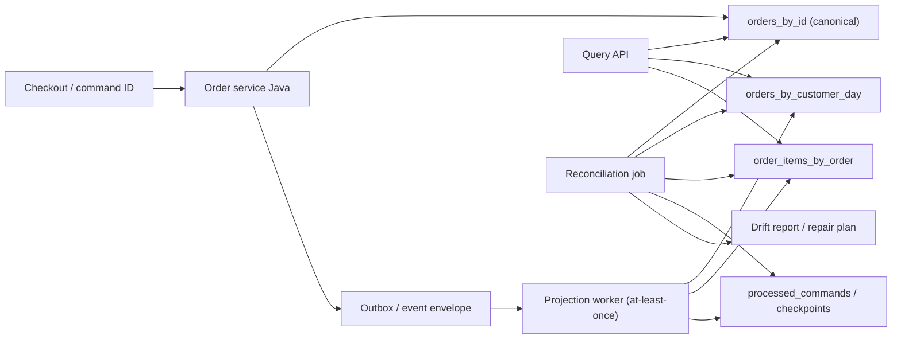
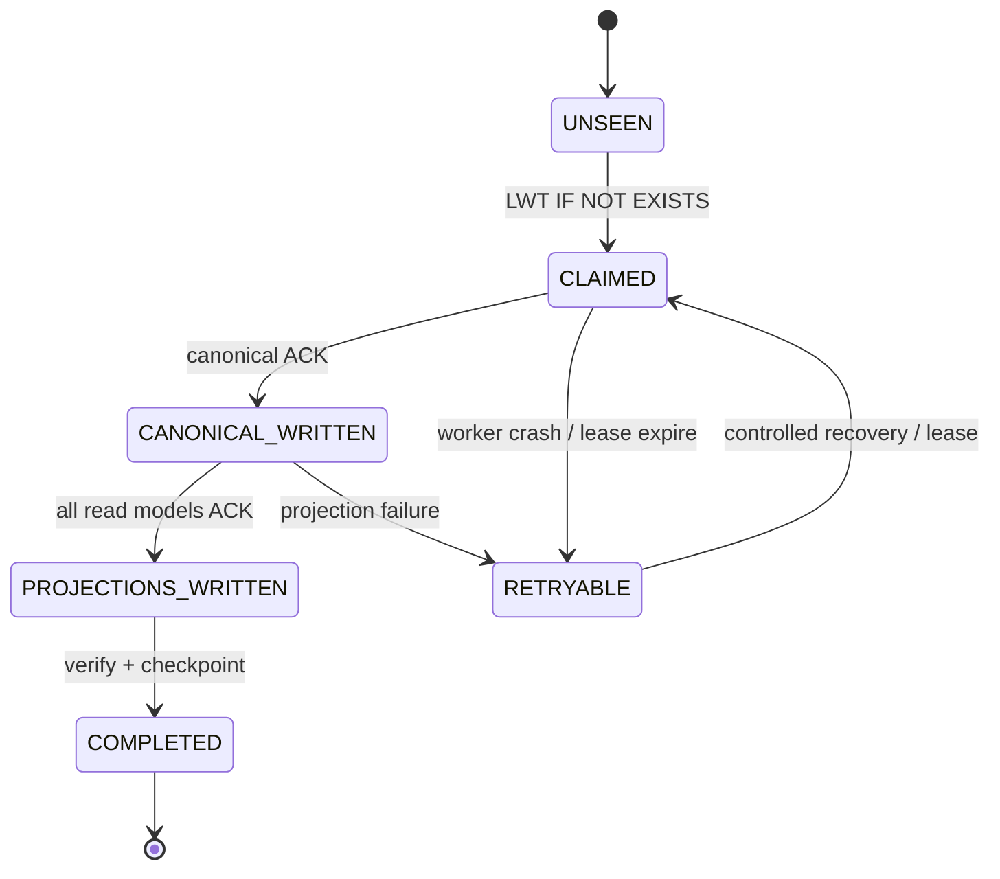
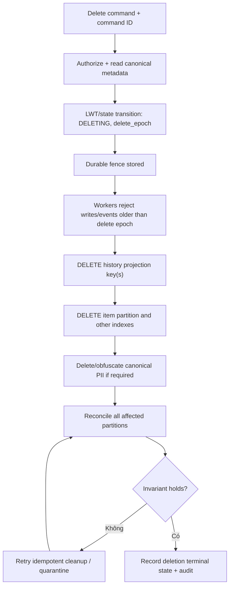

# Đối soát dữ liệu lặp, xóa phụ thuộc và các bất biến nghiệp vụ

> **Chương:** Kiểm thử tích hợp  
> **Mô-đun:** `DATABASE_ENGINE_WIDE_COLUMN_CASSANDRA` — hiểu kiến trúc phân tán và mô hình wide-column của Apache Cassandra, đặc biệt partition key, thiết kế bảng theo truy vấn, mức nhất quán đọc/ghi, CQL, replication, compaction, repair, xử lý lỗi và kết nối ứng dụng Java.  
> **Mục tiêu trực tiếp:** Thiết kế kiểm thử tích hợp phát hiện **dữ liệu lặp**, **bản ghi phụ thuộc chưa được xóa**, **read models không đồng bộ** và **bất biến nghiệp vụ bị phá vỡ** khi nhiều bảng Cassandra denormalized cùng phản ánh một thực thể.  
> **Bối cảnh minh họa:** Hệ thống xử lý đơn hàng Java/Spring với dữ liệu được ghi theo nhiều truy vấn, message broker có thể gửi lại sự kiện, retry sau timeout và yêu cầu xóa/ẩn dữ liệu trên mọi read model.  
> **Phiên bản:** Các ví dụ sử dụng CQL Cassandra 4.x/5.x, Java Driver 4.x, JUnit 5, Testcontainers và tùy chọn Spring Boot 3.x/4.x. Đối chiếu đúng bản server/driver/Testcontainers đang dùng trước khi chạy.

Một integration test có thể **xanh hoàn toàn** nhưng nghiệp vụ vẫn sai:

```java
// Chỉ chứng minh rằng một INSERT không ném exception.
// Chưa chứng minh không nhân bản đơn hàng ở bảng thứ hai.
session.execute(insertOrder);
assertThat(session.execute(
    "SELECT * FROM lab_reconcile.orders_by_id ..."
)).isNotNull();
```

Trong Cassandra, cùng một nghiệp vụ thường được lưu thành nhiều **bảng theo truy vấn**. Ví dụ đơn hàng `O-42` có thể đồng thời xuất hiện trong:

- `orders_by_id` — tìm theo mã đơn.
- `orders_by_customer_day` — lịch sử mua của một khách theo ngày.
- `order_items_by_order` — các dòng hàng phụ thuộc vào đơn.
- `processed_commands_by_id` — các command đã được tiếp nhận/xử lý để hỗ trợ idempotency.

Một lệnh ghi bản chính thành công **không** chứng minh bảng lịch sử đã được cập nhật. Một lệnh xóa ở `orders_by_id` **không tự lan sang** `orders_by_customer_day` hay `order_items_by_order`. Một event được message broker phát lại với ID mới có thể tạo **bản ghi logic trùng**, dù Cassandra không có hai rows cùng một primary key. Một retry write sau timeout có thể đã được server áp dụng lần đầu, và lần thử lại có thể thay đổi TTL/timestamp hoặc tạo side effects mới.

Bài học này xây dựng **bộ bất biến có thể kiểm thử**, **dữ liệu chuẩn để đối soát**, **quy trình xóa phụ thuộc** và **harness Java/JUnit chạy trên Cassandra thật**. Mục tiêu không phải “CQL trả thành công” mà là “mọi biểu diễn của cùng một nghiệp vụ đạt trạng thái mong muốn, kể cả sau retry, crash, DELETE và concurrent writers”.

**Nguyên tắc nền:** Cassandra không có foreign key/cascade delete/JOIN tùy ý hoặc transaction ACID xuyên các bảng theo cách RDBMS. Integrity xuyên các read models là một **hợp đồng của ứng dụng và quy trình vận hành**, phải được kiểm chứng và sửa sai chủ động.

## 1. Kết quả học tập

Hoàn thành bài, bạn có thể:

1. Phân biệt **duplicate message delivery**, **duplicate command execution**, **duplicate physical row**, **duplicate logical entity** và **stale/duplicate projection**.
2. Giải thích vì sao `INSERT` với cùng primary key là upsert, nhưng không đủ bảo đảm idempotency của toàn workflow.
3. Viết các bất biến bằng **logic điều kiện, scope keyspace/tenant, thời gian và phiên bản**, tránh assertion mơ hồ “eventually consistent”.
4. Thiết kế CQL tables theo truy vấn và nhận diện khóa cần biết để xóa mọi bản ghi phụ thuộc.
5. Sử dụng `IF NOT EXISTS`/LWT đúng phạm vi, hiểu **claim thành công khác business effects đã hoàn tất**.
6. Tách **canonical source**, denormalized views, ledger và delete fence; tránh nhầm repair Cassandra với application reconciliation.
7. Viết integration test cho delivery trùng, retry sau timeout, out-of-order event, payload thay đổi và concurrent updates.
8. Viết integration test xóa dependent rows theo primary key đầy đủ, chống “late write resurrecting”.
9. Hiểu tombstone, TTL, `gc_grace_seconds`, compaction, repair và rủi ro zombie khi replica bị tách biệt quá lâu.
10. Giải thích giới hạn `BATCH` logged/unlogged và LWT, không coi một batch nhiều partition là SQL transaction.
11. Dùng Java Driver `CqlSession`, `PreparedStatement`, `LOCAL_QUORUM`/`LOCAL_SERIAL` và JUnit 5.
12. Tổ chức Testcontainers, fixture isolation, deterministic fault injection và bounded eventual assertions.
13. Đối soát **tập khóa**, phiên bản, trạng thái, giá trị tiền, timestamp, tenant scope — không chỉ `COUNT(*)`.
14. Thiết kế idempotent repair/replay và quan sát các metric drift, orphan, stale projection, duplicate command.
15. Xây runbook khi dữ liệu logic không đồng nhất dù các node Cassandra đều báo `UN`.

## 2. Vì sao “dữ liệu lặp” cần định nghĩa rõ?

### 2.1. Bốn cách nhìn khác nhau

| Hiện tượng | Ví dụ | Cassandra tự ngăn? | Kiểm thử cần làm |
|---|---|---|---|
| **Message được gửi lại** | Broker redeliver event E42 vì ACK bị mất | Không | Hai lần xử lý E42 có cùng hiệu quả nghiệp vụ |
| **Write cùng primary key** | Hai `INSERT` vào cùng `(tenant,order_id)` | Cassandra lưu cùng một key logical row, nhưng có last-write-wins | Kiểm payload/version/TTL không bị ghi đè sai |
| **Duplicate logical order** | Hai UUID khác nhau cho cùng checkout command | Không | Business dedup key chỉ có một order hợp lệ |
| **Duplicate projection** | Event E42 tạo hai dòng history với clustering IDs khác | Không | History có đúng một biểu diễn cho order/version |
| **Overlapping old/new projection** | Sau thay customer, còn dòng ở history customer cũ | Không | Dòng cũ được xóa, dòng mới hiện đúng |
| **Duplicate side effect** | Send email/refund/counter tăng hai lần | Không | Có dedup/ledger/consumer idempotency ở hệ downstream |

Điểm mấu chốt: Cassandra bảo đảm **không có hai rows đồng thời mang đúng cùng một primary key trong cùng bảng**, nhưng điều đó **không tương đương** “mỗi nghiệp vụ chỉ xảy ra một lần”.

### 2.2. Một ví dụ rất cụ thể

```text
Checkout command C-17 → sinh order UUID A → ghi orders_by_id(A)
Message redelivered C-17 → sinh order UUID B → ghi orders_by_id(B)

Hai primary keys khác nhau: Cassandra không thể biết A và B
cùng xuất phát từ một yêu cầu checkout.
```

Sửa bằng cách thiết kế **business command ID ổn định** rồi ánh xạ quyết định `C-17 → order A` một cách idempotent. Nếu mỗi retry lại gọi `UUID.randomUUID()`, việc bật `PreparedStatement`/`LOCAL_QUORUM` không chữa lỗi logical dedup.

### 2.3. Không phải mọi bản sao là “trùng dữ liệu sai”

Cassandra thường chủ động denormalize:

```text
Order O42 ở orders_by_id          ← canonical lookup
Order O42 ở orders_by_customer_day ← read projection theo customer
Items O42 ở order_items_by_order   ← danh sách phụ thuộc
```

Đây là ba **biểu diễn có chủ đích**, không phải bug. Bug là một projection thiếu, dư, sai owner, sai state/version hoặc không được xóa khi domain operation yêu cầu. Kiểm thử cần biết **bảng nào bắt buộc có/không có bản ghi** theo trạng thái.

## 3. Mô hình kiến trúc cần đối soát

### 3.1. Ghi và đọc qua nhiều projections



Sơ đồ là **mẫu kiến trúc**, không ngụ ý Cassandra có outbox transaction đa bảng sẵn có. Nếu event envelope được phát trước khi canonical write ACK hoặc ngược lại, cần thiết kế durable delivery/compensation; integration tests phải đánh vào cả hai thứ tự lỗi.

### 3.2. Những thời điểm hệ thống có thể tạm lệch

```text
T0  Chưa có đơn.
T1  orders_by_id ghi xong.
T2  Event đang trên queue, projection history chưa có.
T3  orders_by_customer_day ghi xong.
T4  order_items_by_order ghi xong.
T5  Projection worker ACK message và ghi checkpoint.
T6  Reconciliation xác nhận tập rows đúng.
```

Ở T1, assertion “history phải tồn tại ngay lập tức” có thể sai nếu hợp đồng thật là **eventual convergence**. Ở T5/T6, nếu SLA yêu cầu projection hội tụ trong 10 giây, history vẫn thiếu là bug.

Cần viết **bất biến trạng thái có điều kiện**: trước T5 hệ thống có thể `PENDING`; sau một watermark `APPLIED`/completion xác thực, projections phải đúng. Không biến consistency cấp Cassandra thành lời hứa về workflow xuyên bảng.

## 4. Viết bất biến nghiệp vụ thành hợp đồng có thể kiểm thử

### 4.1. Danh sách bất biến mẫu

| ID | Bất biến | Scope | Thời điểm được assert |
|---|---|---|---|
| I-01 | Một checkout command đã chấp nhận ánh xạ tới **một order ID ổn định** | `tenant_id, command_id` | Sau xử lý command, kể cả retry |
| I-02 | Một active order có đúng một canonical row ở PK của nó | `tenant_id, order_id` | Khi creation ACK |
| I-03 | Active order có đúng một history projection với đúng customer/day/created_at | Order ID + projection key | Khi projection watermark ≥ event version |
| I-04 | Tập item IDs ở canonical event/payload đúng với `order_items_by_order` | Order ID, revision | Sau phiên bản projection đã được chốt |
| I-05 | Tổng tiền được tính/đối soát theo cùng một revision, đơn vị **integer cents** | Order ID, version | Khi order ở trạng thái finalized |
| I-06 | `DELETING/DELETED` không được hiện là active tại query API | Order lifecycle | Ngay sau fence được commit theo contract |
| I-07 | Sau delete workflow completed, mọi dependent projections nằm trong scope đều absent/tombstoned | Order ID + projections | Khi delete checkpoint terminal |
| I-08 | Event cũ/retry sau delete không thể làm order xuất hiện lại trong active read model | Order ID, revision/epoch | Sau delete fence; stress test |
| I-09 | Mọi read/query phải dùng tenant scope đã được authorize | Tenant + caller | Mọi request |
| I-10 | Một event ID không gây side effect nghiệp vụ hai lần | `tenant_id, event_id` | Sau duplicate-delivery tests |
| I-11 | Không có projection “mồ côi” sau reconciliation watermark/cutoff | Bounded tenant/day range | Theo batch reconciliation SLO |
| I-12 | Failed repair/retry có thể lặp an toàn, không thêm logic duplicates | Repair task ID + entity key | Sau injected failure/retry |

Không nhất thiết áp dụng nguyên xi cả 12 bất biến cho mọi sản phẩm. Việc quan trọng là **ghi rõ giá trị nguồn chuẩn, kỳ vọng, phạm vi và thời điểm**.

### 4.2. Công thức tập khóa đối soát

Gọi:

- \(E_v\): tập các khóa projection *đúng kỳ vọng* tính từ canonical commands ở revision hoặc watermark \(v\).
- \(A_v\): tập khóa projection *thực tế đọc được* khi tiến hành reconciliation ở phạm vi tương ứng.
- \(M = E_v \setminus A_v\): **missing** projections.
- \(O = A_v \setminus E_v\): **orphan/extra** projections.

Định nghĩa:

\[
\mathrm{Missing} = E_v \setminus A_v
\]

\[
\mathrm{Orphan} = A_v \setminus E_v
\]

\[
\mathrm{DriftRatio} =
\frac{|M| + |O|}{\max(1,|E_v|)}
\]

**Nhưng chưa đủ:** cùng khóa vẫn có thể mang wrong status/amount/version. Cần so thêm **payload signature**, ví dụ hash của canonical representation chuẩn hóa, chỉ sau khi đã cùng revision. Hash không thay kiểm schema, tenant authorization và data transformations.

### 4.3. Vì sao COUNT không đủ?

Giả sử:

```text
Expected keys: {O1, O2, O3}
Actual keys:   {O1, O2, O4}

COUNT expected = 3
COUNT actual   = 3
Nhưng missing O3 và orphan O4.
```

Một phép `COUNT(*)` còn có thể rất tốn tài nguyên trên Cassandra. Kiểm thử nên đọc **phạm vi nhỏ xác định theo partition key** rồi so sets, không scan toàn cluster trong assertion. Reconciliation production phải có segmentation/token-range/bucket được thiết kế riêng.

### 4.4. Bất biến theo version, không dựa vào thời gian ngủ

```text
Event revision 9 emitted
History revision 8 đọc được ngay lúc đó: có thể tạm chấp nhận
History revision 8 sau watermark "revisions <=9 processed": LỖI
History revision 10: cần kiểm out-of-order handling; không tự coi đúng
```

Tốt nhất projection lưu `revision` và consumer có watermark/checkpoint. `Thread.sleep(3000)` rồi assert “trong 3 giây chắc xong” dễ flaky và không giải thích được failure. Dùng bounded polling dựa trên trạng thái đã xác định.

## 5. Thiết kế bảng Cassandra cho lab

### 5.1. Phạm vi keyspace

Trong lab, giả sử Cassandra DC có tên thật `dc1` và ít nhất ba full replicas nếu dùng RF=3. Trên Testcontainers một node, thay RF thành `{'dc1':1}` hoặc tên DC container thực tế, và hiểu rằng test đó **không chứng minh quorum RF=3**.

```sql
CREATE KEYSPACE IF NOT EXISTS lab_reconcile
WITH replication = {
    'class': 'NetworkTopologyStrategy',
    'dc1': 3
};
```

### 5.2. Canonical lookup: orders_by_id

```sql
CREATE TABLE IF NOT EXISTS lab_reconcile.orders_by_id (
    tenant_id uuid,
    order_id uuid,
    command_id uuid,
    customer_id uuid,
    order_day date,
    created_at timestamp,
    status text,
    amount_cents bigint,
    revision bigint,
    PRIMARY KEY ((tenant_id, order_id))
);
```

Một order là **một partition nhỏ** theo `(tenant_id,order_id)`. Các metadata `customer_id`, `order_day`, `created_at` cũng được lưu ở đây để **xác định đầy đủ khóa projection khi cần xóa**. Nếu chỉ biết order_id mà không biết customer/day, ứng dụng không thể xóa dòng history theo query pattern hiệu quả nếu không có catalog/key lookup.

### 5.3. History projection theo customer/day

```sql
CREATE TABLE IF NOT EXISTS lab_reconcile.orders_by_customer_day (
    tenant_id uuid,
    customer_id uuid,
    order_day date,
    created_at timestamp,
    order_id uuid,
    status text,
    amount_cents bigint,
    revision bigint,
    PRIMARY KEY (
        (tenant_id, customer_id, order_day),
        created_at, order_id
    )
) WITH CLUSTERING ORDER BY (
    created_at DESC, order_id ASC
);
```

Một partition gồm lịch sử **của một customer trong một ngày**; thiết kế tránh dồn lịch sử vô hạn một customer vào một partition. Truy vấn:

```sql
SELECT created_at, order_id, status, amount_cents, revision
FROM lab_reconcile.orders_by_customer_day
WHERE tenant_id = ?
  AND customer_id = ?
  AND order_day = ?;
```

Cần đủ ba thành phần partition key. Không có SQL JOIN từ bảng history ngược sang canonical; Java đối soát bằng một tập khóa hữu hạn.

### 5.4. Dependent items theo order

```sql
CREATE TABLE IF NOT EXISTS lab_reconcile.order_items_by_order (
    tenant_id uuid,
    order_id uuid,
    item_id uuid,
    sku text,
    quantity int,
    unit_price_cents bigint,
    revision bigint,
    PRIMARY KEY ((tenant_id, order_id), item_id)
);
```

`(tenant_id,order_id)` là partition key; `item_id` là clustering key. Cassandra **không có foreign key** ràng buộc item phải có order canonical. Vì vậy **một item mồ côi hoàn toàn có thể tồn tại** nếu app không xóa hoặc có retry/event race.

### 5.5. Processing ledger theo command ID

```sql
CREATE TABLE IF NOT EXISTS lab_reconcile.processed_commands_by_id (
    tenant_id uuid,
    command_id uuid,
    order_id uuid,
    payload_hash text,
    processing_state text,
    updated_at timestamp,
    PRIMARY KEY ((tenant_id, command_id))
);
```

`INSERT ... IF NOT EXISTS` vào bảng này có thể dùng để **claim** một command, nhưng `processing_state='CLAIMED'` không đồng nghĩa các projections đã ghi thành công. Nếu worker chết sau claim, hệ thống cần state transition/lease/recovery thay vì vĩnh viễn bỏ qua command vì row đã tồn tại.

### 5.6. Durable deletion fence

```sql
CREATE TABLE IF NOT EXISTS lab_reconcile.order_delete_fences_by_id (
    tenant_id uuid,
    order_id uuid,
    delete_epoch bigint,
    deletion_state text,
    requested_at timestamp,
    PRIMARY KEY ((tenant_id, order_id))
);
```

Bảng fence lưu **minimum metadata cần thiết** để phân biệt order còn hợp lệ và order bị xóa. Nó không tự áp đặt rào chắn lên các tables khác: **writers/projectors phải kiểm fence/lifecycle trước khi ghi và được kiểm thử với race conditions**.

Nếu hệ thống có yêu cầu xóa PII, xác minh fence không chứa personal data và có retention policy phù hợp. Không giữ vô hạn dữ liệu nhận dạng chỉ vì gọi nó là “tombstone nghiệp vụ”.

### 5.7. Sơ đồ primary keys

```text
orders_by_id
    PK = (tenant_id, order_id)
    1 partition / order, chứa metadata để xóa projections.

orders_by_customer_day
    Partition = (tenant_id, customer_id, order_day)
    Clustering = created_at DESC, order_id ASC.

order_items_by_order
    Partition = (tenant_id, order_id)
    Clustering = item_id.

processed_commands_by_id
    PK = (tenant_id, command_id) — independent command ledger.

order_delete_fences_by_id
    PK = (tenant_id, order_id) — lifecycle deletion marker.
```

Không dựa vào cách Cassandra **internally** lưu SSTable để suy foreign-key cascade; không tồn tại cơ chế tự xóa history/items chỉ nhờ xóa canonical.

## 6. CQL fixtures: một order, hai items, một projection

### 6.1. Hằng số lab cố định

Các UUID dùng trong ví dụ:

```text
tenant_id   = 11111111-1111-4111-8111-111111111111
order_id    = 22222222-2222-4222-8222-222222222222
customer_id = 33333333-3333-4333-8333-333333333333
command_id  = 44444444-4444-4444-8444-444444444444
item_id_A   = aaaaaaaa-aaaa-4aaa-8aaa-aaaaaaaaaaaa
item_id_B   = bbbbbbbb-bbbb-4bbb-8bbb-bbbbbbbbbbbb
order_day   = 2026-11-21
created_at  = 2026-11-21 10:00:00+0000
```

Dữ liệu test cố định giúp mọi lần chạy so cùng một entity logic. Nếu test có thể chạy song song trên **cùng keyspace**, dùng namespace/tenant/IDs **riêng cho mỗi test** hoặc cô lập container/keyspace, tránh tests xóa fixtures của nhau.

### 6.2. Ghi bản chính

```sql
INSERT INTO lab_reconcile.orders_by_id (
    tenant_id, order_id, command_id, customer_id,
    order_day, created_at, status, amount_cents, revision
) VALUES (
    11111111-1111-4111-8111-111111111111,
    22222222-2222-4222-8222-222222222222,
    44444444-4444-4444-8444-444444444444,
    33333333-3333-4333-8333-333333333333,
    '2026-11-21', '2026-11-21 10:00:00+0000',
    'ACTIVE', 2500, 1
);
```

`2500` là **cents**, không dùng floating point cho tổng tiền. Hai items có tổng \(2\times 1000+1\times500=2500\).

### 6.3. Ghi history projection

```sql
INSERT INTO lab_reconcile.orders_by_customer_day (
    tenant_id, customer_id, order_day,
    created_at, order_id, status, amount_cents, revision
) VALUES (
    11111111-1111-4111-8111-111111111111,
    33333333-3333-4333-8333-333333333333,
    '2026-11-21', '2026-11-21 10:00:00+0000',
    22222222-2222-4222-8222-222222222222,
    'ACTIVE', 2500, 1
);
```

Nếu retry tạo **một created_at khác** (ví dụ now()) thay vì reuse event timestamp, history sẽ có thể có **hai dòng với khác clustering keys** cho cùng logical order. Đây là lý do phải lấy projection PK từ **event payload/metadata canonical ổn định**.

### 6.4. Ghi hai dependent items

```sql
INSERT INTO lab_reconcile.order_items_by_order (
    tenant_id, order_id, item_id,
    sku, quantity, unit_price_cents, revision
) VALUES (
    11111111-1111-4111-8111-111111111111,
    22222222-2222-4222-8222-222222222222,
    aaaaaaaa-aaaa-4aaa-8aaa-aaaaaaaaaaaa,
    'SKU-A', 2, 1000, 1
);

INSERT INTO lab_reconcile.order_items_by_order (
    tenant_id, order_id, item_id,
    sku, quantity, unit_price_cents, revision
) VALUES (
    11111111-1111-4111-8111-111111111111,
    22222222-2222-4222-8222-222222222222,
    bbbbbbbb-bbbb-4bbb-8bbb-bbbbbbbbbbbb,
    'SKU-B', 1, 500, 1
);
```

### 6.5. Kiểm dữ liệu sau ghi

```sql
SELECT order_id, status, amount_cents, revision,
       customer_id, order_day, created_at
FROM lab_reconcile.orders_by_id
WHERE tenant_id = 11111111-1111-4111-8111-111111111111
  AND order_id = 22222222-2222-4222-8222-222222222222;

SELECT created_at, order_id, amount_cents, revision
FROM lab_reconcile.orders_by_customer_day
WHERE tenant_id = 11111111-1111-4111-8111-111111111111
  AND customer_id = 33333333-3333-4333-8333-333333333333
  AND order_day = '2026-11-21';

SELECT item_id, sku, quantity, unit_price_cents, revision
FROM lab_reconcile.order_items_by_order
WHERE tenant_id = 11111111-1111-4111-8111-111111111111
  AND order_id = 22222222-2222-4222-8222-222222222222;
```

Kiểm **full keys, state, amount, revision** và tập item IDs. Đừng chỉ assert `SELECT` không ném lỗi hoặc một row bất kỳ tồn tại.

### 6.6. Không dùng COUNT(*) toàn bảng để test invariants

Đọc một partition lab nhỏ và kiểm:

```text
canonical order count for (tenant, order_id) = 1
history with order_id=O under expected (tenant,customer,day) = 1
itemId set = {A,B}
sum(quantity * unit_price_cents) = 2500
revision for all relevant rows = 1
```

Query theo partition để lấy rows rồi assert bằng Java. **Không** chạy `SELECT COUNT(*) FROM lab_reconcile.orders_by_customer_day` làm health/invariant ở production, vì scan toàn bảng có chi phí lớn.

## 7. INSERT cùng khóa: idempotent đến mức nào?

### 7.1. Cùng PK không tạo hàng vật lý mới

Chạy lại **cùng một** câu `INSERT` ở phần 6 với cùng values và primary key. CQL có upsert semantics; đọc lại key đó vẫn cho một logical row.

Nhưng thử:

```sql
INSERT INTO lab_reconcile.orders_by_id (
    tenant_id, order_id, status, amount_cents, revision
) VALUES (
    11111111-1111-4111-8111-111111111111,
    22222222-2222-4222-8222-222222222222,
    'ACTIVE', 9999, 1
);
```

Sau câu này, `amount_cents` có thể trở thành `9999` do last-write-wins timestamp, mặc dù **revision nghiệp vụ vẫn là 1**. Đây là phản ví dụ cho “cùng primary key thì mọi retry đều an toàn”.

### 7.2. Idempotency cần xác định command effect

Một phép xử lý event được coi idempotent theo nghiệp vụ nếu:

\[
f(f(S,e),e) \equiv f(S,e)
\]

với \(S\) là business state, \(e\) là cùng một event và phép so tương đương bao gồm **mọi read models, external effects và version semantics** được hợp đồng yêu cầu.

Nếu lần chạy thứ hai đổi timestamp, TTL, trạng thái, counter hoặc sinh thêm projection key, điều kiện có thể sai dù canonical row cùng PK.

### 7.3. Replay với khác event ID

```text
Event delivery 1:
    command C-17, order_id O-1, created_at 10:00:00
Event delivery 2:
    command C-17, order_id O-2, created_at 10:00:01

Cả hai row O-1 và O-2 tồn tại hợp lệ ở Cassandra.
Business invariant "1 command = 1 order" bị phá.
```

**Tạo order ID ổn định** theo command mapping và idempotent command handling; không gọi random UUID cho mỗi retry nếu mục đích là cùng logical order. Thử case này bằng việc gửi hai lần cùng command ID nhưng thay delivery ID/network attempt ID.

### 7.4. Test negative assertions phải có phạm vi

Đừng kiểm toàn bảng để nói “không có duplicate”; với test fixture nhỏ, biết cụ thể command C17, customer/day và order IDs đã phát sinh. Chỉ assert trên **các partitions chịu trách nhiệm chứa bản ghi**, hoặc dùng ledger command→order mapping được thiết kế cho tra cứu.

Nếu hệ cần phát hiện duplicates xuyên tenant/day toàn hệ thống, phải thiết kế **dedup index/materialized business key** hoặc batch reconciliation riêng; Cassandra không cung cấp SQL unique constraint tùy cột ngoài primary key.

## 8. IF NOT EXISTS và ledger: claim khác hoàn tất

### 8.1. Claim bằng LWT

```sql
INSERT INTO lab_reconcile.processed_commands_by_id (
    tenant_id, command_id, order_id,
    payload_hash, processing_state, updated_at
) VALUES (
    11111111-1111-4111-8111-111111111111,
    44444444-4444-4444-8444-444444444444,
    22222222-2222-4222-8222-222222222222,
    'sha256-demo-001', 'CLAIMED',
    '2026-11-21 10:00:00+0000'
)
IF NOT EXISTS;
```

Lần đầu thành công thường có `[applied] = true`; chạy lại cùng PK thường `[applied] = false`. Trong Java Driver 4.x, `ResultSet.wasApplied()` cho conditional statement có thể kiểm kết quả.

**Không** suy `applied=true` nghĩa history/items/notifications đã hoàn thành. Nó mới chứng minh một **row ledger claim** được tạo thành công.

### 8.2. Crash ngay sau claim

```text
Worker A  INSERT processed_commands IF NOT EXISTS  → applied=true
Worker A  ghi orders_by_id                         → success
Worker A  chết trước khi ghi history projection

Worker B  nhận lại event, INSERT IF NOT EXISTS     → applied=false
Worker B  "đã xử lý rồi" và ACK broker             → SAI!
```

Đây là **at-most-once effect** nguy hiểm: event bị loại vì claim tồn tại dù nghiệp vụ dở dang.

### 8.3. State machine ledger cần phân biệt các giai đoạn



Đây là **mô hình thiết kế**, không phải các chuyển trạng thái tự động của Cassandra. Nếu dùng lease, cần ownership token, expiration, conditional compare-and-set và fencing để hai workers không cùng finalize một command. `IF state='CLAIMED'`/LWT phù hợp khi scope là **một partition ledger**, nhưng phải đánh giá concurrency/latency và tình huống timeout ambiguous.

### 8.4. Payload hash phát hiện command-ID reuse sai

Nếu cùng `(tenant_id,command_id)` gửi lại payload **khác**:

```text
First:  command C42, amount=2500, hash=AAA
Second: command C42, amount=9999, hash=BBB
```

Không nên silently coi second là duplicate hợp lệ. Hãy trả conflict, alert hoặc đưa quarantine; test một command ID với hai payload hashes phải fail theo contract. Hash chuẩn hóa phải tính trên những fields có nghĩa và format ổn định; không hash JSON thô với thứ tự keys/whitespace bất định rồi tạo false conflicts.

### 8.5. LWT chỉ giải quyết một ràng buộc hẹp

`IF NOT EXISTS` dùng Paxos, đắt hơn normal writes và không tạo transaction ACID giữa ledger, canonical order, history và items. Test riêng:

1. Hai workers tranh cùng command ID trên **một ledger partition**.
2. Chỉ một claim được applied theo kỳ vọng khi dùng LWT nhất quán.
3. Worker thắng claim nhưng crash; worker khác phải có recovery.
4. Kết quả mỗi command cuối cùng `COMPLETED` đúng một lần **về business effect**.
5. Side effects bên ngoài Cassandra phải idempotent riêng.

Nếu hệ thống cần exactly-once end-to-end xuyên Kafka, Cassandra và email/payment, **không** tuyên bố đạt chỉ nhờ một LWT claim.

## 9. Xóa phụ thuộc: Cassandra không có ON DELETE CASCADE

### 9.1. Quan hệ nghiệp vụ không được CQL enforce

```text
orders_by_id(O42)                 ← đơn canonical
    │
    ├── orders_by_customer_day(C1,day,O42)
    │
    └── order_items_by_order(O42,item1,item2)
```

Nếu chạy:

```sql
DELETE FROM lab_reconcile.orders_by_id
WHERE tenant_id = 11111111-1111-4111-8111-111111111111
  AND order_id = 22222222-2222-4222-8222-222222222222;
```

thì Cassandra **chỉ xóa dữ liệu trong table được nêu**. History projection và items còn nguyên, vì không có foreign key/cascade trigger bảo đảm sự tồn tại phụ thuộc.

### 9.2. Thứ tự xóa naïve dễ mất khóa

Một sai lầm:

```text
1. DELETE orders_by_id
2. Query canonical để tìm customer_id/order_day/created_at
3. DELETE history theo customer/day/created_at
```

Bước 2 không còn metadata cần thiết. Nếu history dùng composite key, không có cách xóa đúng hiệu quả chỉ từ `order_id` khi không biết customer/day/created_at.

**Giải pháp:** đọc và giữ key metadata trước; hoặc duy trì một projection-key catalog theo order, có chính sách đối soát và tính đầy đủ. Nhưng catalog cũng là một bảng có thể lệch, không tự là ràng buộc dữ liệu.

### 9.3. Xóa theo các primary keys đầy đủ

```sql
-- 1. Xóa đúng history entry của order.
DELETE FROM lab_reconcile.orders_by_customer_day
WHERE tenant_id = 11111111-1111-4111-8111-111111111111
  AND customer_id = 33333333-3333-4333-8333-333333333333
  AND order_day = '2026-11-21'
  AND created_at = '2026-11-21 10:00:00+0000'
  AND order_id = 22222222-2222-4222-8222-222222222222;

-- 2. Xóa toàn partition items của order.
DELETE FROM lab_reconcile.order_items_by_order
WHERE tenant_id = 11111111-1111-4111-8111-111111111111
  AND order_id = 22222222-2222-4222-8222-222222222222;

-- 3. Nếu policy cho phép: cập nhật canonical lifecycle,
-- hoặc xóa canonical cuối cùng sau durable delete fence.
```

`DELETE` tạo **tombstones**, không xóa bytes vật lý tức thời khỏi mọi SSTable. Phải kiểm logical visibility và eventual replica/compaction/repair riêng.

### 9.4. Vì sao xóa partition items thường đơn giản?

`order_items_by_order` được partition theo đúng `(tenant_id,order_id)`. Một `DELETE FROM ... WHERE tenant_id=? AND order_id=?` xóa row range/partition theo CQL semantics, không cần biết từng `item_id`.

Tuy nhiên:

- Nếu dữ liệu được denormalize vào **nhiều partitions/tables**, một delete partition không chạm các partitions khác.
- Các writes đến **sau delete** với timestamp mới có thể tái tạo rows.
- Xóa partition rất rộng tạo tombstones có thể gây read/compaction pressure.
- Không tự suy RF replicas đều đã được repair chỉ vì driver trả ACK theo CL.

### 9.5. Xóa đúng bảng vẫn có thể sai nghiệp vụ

Nếu order đang `PAID` và policy cấm xóa khi refund chưa hoàn tất, một câu `DELETE` hợp lệ về CQL vẫn **vi phạm business invariant**. Cần state machine/authorization và kiểm external dependencies, không chỉ assert row absent.

## 10. Deletion workflow an toàn hơn: fence → cleanup → verify

### 10.1. Mô hình lifecycle



Đây là **đề xuất kiến trúc**, không phải protocol ACID tự có. Nếu hệ thống yêu cầu xóa dữ liệu vĩnh viễn theo privacy policy, xác định phạm vi backups/exports/search indexes/external systems với chủ sở hữu và retention kế hoạch. Marker fence phải tối thiểu thông tin và không được chứa lại PII đã yêu cầu xóa.

### 10.2. Mark trạng thái bằng LWT (minh họa)

```sql
UPDATE lab_reconcile.orders_by_id
SET status = 'DELETING', revision = 2
WHERE tenant_id = 11111111-1111-4111-8111-111111111111
  AND order_id = 22222222-2222-4222-8222-222222222222
IF status = 'ACTIVE';
```

Check `[applied]`. Nếu false, phải đọc trạng thái hiện tại và thực hiện idempotent state handling:

- Order đã `DELETING` → tiếp tục hoặc xác định worker khác sở hữu.
- Order đã `DELETED` → trả kết quả phù hợp “already deleted” và reconcile cleanup.
- Order không tồn tại → xác định orphan projections/fence còn không.
- Order `REFUND_PENDING` → có thể không cho delete theo policy.

### 10.3. Đánh dấu fence riêng để ngăn late events

```sql
INSERT INTO lab_reconcile.order_delete_fences_by_id (
    tenant_id, order_id, delete_epoch, deletion_state, requested_at
) VALUES (
    11111111-1111-4111-8111-111111111111,
    22222222-2222-4222-8222-222222222222,
    2, 'DELETING', '2026-11-21 11:00:00+0000'
)
IF NOT EXISTS;
```

Sau đó, consumer không được phát projection từ event revision `1` nếu order có fence epoch `2`. Nhưng **read-check-write** hai bước vẫn có race:

```text
Worker A đọc fence: chưa tồn tại
Worker B tạo delete fence epoch 2, xóa history
Worker A ghi history từ event epoch 1  ← row có thể tái xuất hiện
```

Không thể bảo đảm không xảy ra race chỉ bằng “kiểm fence trước khi ghi” trên **hai partitions khác nhau**. Cần thêm cơ chế phù hợp: serialize writes/deletes theo order trên cùng ordered channel, epoch/LWT gate trong cùng partition khi model cho phép, filter ở read path sau delete, hoặc cleanup/reconciliation vòng sau cùng với worker quiescence. Integration tests phải **cố tình tạo đúng interleaving này**.

### 10.4. Bất biến xóa chia hai mức

**Mức A — logical visibility ngay sau fence:** API không trả order cho end-user khi state ≥ DELETING, bằng cách dùng authoritative lifecycle/authorization check. Điều này có thể cần thêm read và chịu latency.

**Mức B — physical/logical projection cleanup sau deadline:** history/items/indexes không còn trả dữ liệu trong toàn scope ở CL kiểm tra; tombstones được duy trì/repair đúng. Không gộp hai mức vì có giai đoạn **ẩn khỏi API nhưng cleanup đang chạy**.

### 10.5. Retry xóa phải idempotent

Gửi lại `DELETE` cùng primary key thường được phép; nhưng hãy kiểm:

- Metadata projection key vẫn còn ở workflow state để xóa lại.
- Không sinh delete epoch mới tùy tiện mỗi retry.
- Cleanup không xóa nhầm order mới tái sử dụng ID.
- Audit/notification/refund không phát trùng.
- Checkpoint chỉ terminal sau readback/reconciliation.
- Khi retry gặp row vắng mặt, không coi mọi bảng đã sạch nếu chưa kiểm.

## 11. Tombstone, TTL, compaction và dữ liệu zombie

### 11.1. Cassandra DELETE không trực tiếp dọn bytes

Một câu `DELETE` ghi **tombstone** có timestamp, cho replicas biết giá trị cũ đã bị xóa. Tombstone lưu qua memtable/SSTable và được xử lý khi read/compaction. Ở mức CQL đọc đúng, row có thể không xuất hiện, nhưng **disk bytes vật lý vẫn có thể tồn tại** cho tới compaction và điều kiện safe purge.

```text
t0: replicas có row O42
t1: DELETE O42 → replicas nhận tombstone
t2: SELECT O42 ở CL phù hợp → absent logic
t3: repair truyền tombstone tới replica chưa nhận
t4: sau grace và compaction đủ điều kiện → bytes cũ/tombstone được dọn
```

### 11.2. TTL tạo xóa theo thời gian

Nếu một cell được ghi `USING TTL 3600`, khi TTL hết nó có semantics tombstone. Retry `INSERT` với TTL mới có thể **kéo dài thời gian sống** của dữ liệu, nên test idempotency cần xét TTL/remain TTL. TTL **không** tự xóa đồng thời các bảng projection khác nếu chúng có TTL khác hoặc không TTL.

### 11.3. gc_grace_seconds không phải thời hạn xóa nghiệp vụ

`gc_grace_seconds` của table điều khiển khoảng giữ tombstone để replicas có thời gian nhận thông tin xóa trước khi compaction purge. Mặc định thường 10 ngày (tùy table/version/config). Đây **không** phải lời hứa user data sẽ bị xóa vật lý chính xác sau 10 ngày; compaction conditions còn phải thỏa.

Không giảm `gc_grace_seconds` xuống vài giây trong production chỉ để test nhanh, vì có thể làm tăng rủi ro **zombie data** khi một replica vắng mặt lâu.

### 11.4. Zombie: data đã xóa có thể sống lại

```text
Node A, B: nhận tombstone cho O42
Node C: mất kết nối, vẫn giữ old live row O42

Tombstone ở A/B bị purge quá sớm
Node C trở lại / repair
Old row trên C có thể lan ngược → O42 xuất hiện lại (zombie).
```

Do đó test “DELETE xong SELECT absent một lần” là **quá yếu** để bảo đảm không hồi sinh. Với RF3 fault tests cần mô phỏng node Down qua delete, node recover và repair trong grace window; check theo các CL/replicas phù hợp. Đồng thời phải duy trì repair routine thực tế, không chỉ chạy integration test vào thứ Sáu.

### 11.5. Repair Cassandra không đồng nghĩa projection reconciliation

**Replica repair:** đồng bộ **các replicas của cùng table/token ranges** bằng anti-entropy. Nó có thể giúp một replica cập nhật tombstone bị bỏ lỡ.

**Application reconciliation:** so **orders_by_id** với **orders_by_customer_day/order_items_by_order/ledger** và quyết định thiếu/dư/sai business state.

Repair **không** tạo history projection đã bị thiếu do worker crash, cũng không tự dọn orphan item ở table khác. Ngược lại, application reconciliation không thay `nodetool repair` để bảo vệ khỏi zombie trên replicas.

### 11.6. Phạm vi kiểm thử an toàn

Trong integration test một node có thể kiểm:

- DELETE gây row absent logic.
- Replay INSERT sau DELETE với timestamp khác có thể tạo lại dữ liệu.
- TTL cell hết hạn theo clock của server.
- Same key/sequence CQL behavior.

Nó **không thể** chứng minh:

- RF3 replica missed tombstone.
- Repair qua racks/DC.
- Zombie tránh được sau outage > gc grace.
- Disk-level physical purge hoàn tất.
- Multi-DC quorum/consistency transitions.

Các case đó cần cluster lab nhiều nodes, fault injection có kiểm soát và xác minh version-specific operations.

## 12. Cassandra BATCH: dùng đúng nhưng không ảo tưởng ACID

### 12.1. BATCH hỗ trợ gì?

CQL `BEGIN BATCH ... APPLY BATCH` có thể gộp `INSERT`/`UPDATE`/`DELETE`. **Logged batch** đảm bảo các mutations cuối cùng được áp dụng toàn bộ hoặc không áp dụng theo atomicity contract của Cassandra, nhưng **isolation chỉ đảm bảo trong cùng partition**. Không có SQL-style isolation/rollback liên tục giữa nhiều partitions/tables như RDBMS.

```sql
BEGIN BATCH
    INSERT INTO lab_reconcile.orders_by_id (
        tenant_id, order_id, status, amount_cents, revision
    ) VALUES (
        11111111-1111-4111-8111-111111111111,
        22222222-2222-4222-8222-222222222222,
        'ACTIVE', 2500, 1
    );

    INSERT INTO lab_reconcile.orders_by_customer_day (
        tenant_id, customer_id, order_day,
        created_at, order_id, status, amount_cents, revision
    ) VALUES (
        11111111-1111-4111-8111-111111111111,
        33333333-3333-4333-8333-333333333333,
        '2026-11-21', '2026-11-21 10:00:00+0000',
        22222222-2222-4222-8222-222222222222,
        'ACTIVE', 2500, 1
    );
APPLY BATCH;
```

**Không khuyến nghị** batch nhiều partitions cho ingestion thường xuyên: coordinator/batchlog phải điều phối nhiều replicas và có thể làm tăng latency/load. Dùng khi cần **batch atomicity contract** cụ thể, có benchmark và hạn chế kích thước.

### 12.2. Logged batch không che khỏi read partial state

Một observer đọc từ hai partitions trong quá trình batch hoặc khi cluster có lỗi tạm thời **không được mặc định thấy một snapshot transaction toàn bộ**. Tính eventual all-or-none của batch khác với isolation/serializable transaction.

Integration test cần quan sát:

- Một request batch thành công và tất cả target rows có sau khi commit/CL thích hợp.
- Batch timeout chưa chứng minh không mutation nào đã áp dụng.
- Đọc hai partitions ngay cùng lúc không tự có snapshot chung.
- Nếu application gửi thêm side effects như Kafka/email ngoài batch, chúng không thuộc atomicity của CQL batch.

### 12.3. UNLOGGED batch có thể để lại partial effects

`BEGIN UNLOGGED BATCH` bỏ batch log; khi failed batch qua nhiều partitions, một phần mutations có thể thành công và phần khác không. Đừng dùng `UNLOGGED` để cập nhật canonical và history rồi viết test “đây là transaction nguyên tử”.

### 12.4. Conditional batch và giới hạn LWT

Có thể sử dụng conditional statements trong ngữ cảnh hỗ trợ, nhưng Paxos/LWT gắn với **partition và serial consistency semantics**. Không thiết kế một `IF NOT EXISTS` trên ledger partition khác rồi giả định nó atomically bảo vệ toàn bộ history/item partitions.

Nếu cần invariant xuyên bảng, dùng:

- Một canonical state transition có version/fence.
- Idempotent projectors.
- Durable event/checkpoint.
- Read masking và bounded reconciliation.
- Hoặc đổi mô hình dữ liệu/hệ lưu trữ nếu nghiệp vụ thật cần ACID multi-entity isolation.

## 13. Consistency level và thời điểm assertion

### 13.1. LOCAL_QUORUM ở RF3

Với `NetworkTopologyStrategy`, RF=3 full replicas trong DC local, `LOCAL_QUORUM` thường yêu cầu:

\[
Q_\mathrm{local}=\left\lfloor\frac{RF_\mathrm{local}}{2}\right\rfloor+1=2
\]

Nếu các writes/reads cùng local DC dùng `LOCAL_QUORUM`, test có strong(er) read-after-write behavior trong phạm vi định nghĩa của Cassandra. Nhưng **không** có nghĩa app workflow ghi nhiều tables sẽ atomically hội tụ cùng lúc.

### 13.2. LWT có serial phase riêng

`INSERT ... IF NOT EXISTS`/`UPDATE ... IF ...` sử dụng Paxos và có thể cấu hình `SERIAL`/`LOCAL_SERIAL` cho serial phase, bên cạnh regular CL cho phần commit/learn. Trong `cqlsh`:

```sql
CONSISTENCY LOCAL_QUORUM;
SERIAL CONSISTENCY LOCAL_SERIAL;
```

Hai lệnh trên thuộc **cqlsh**, không phải queries gửi qua Java `session.execute("CONSISTENCY ...")`. Java Driver dùng statement methods `setConsistencyLevel` và `setSerialConsistencyLevel` khi phù hợp.

### 13.3. Một node test không kiểm quorum availability

Testcontainers Cassandra một node thường dùng RF1, lúc ấy `LOCAL_QUORUM` bằng 1. Nếu test pass, không thể suy RF3 khi một replica Down sẽ pass hay cách cross-DC failover hoạt động. Dùng cluster test thực sự 3 nodes/racks khi muốn assert HA/CL.

### 13.4. Không retry query validation như transient

`UnauthorizedException`, `SyntaxError` và `InvalidQueryException` là lỗi quyền/cú pháp/truy vấn không hợp lệ; retry cùng input/schema/role không làm chúng thành công. `UnavailableException` và timeout có thể transient nhưng phải xét **idempotency và write outcome**. Retry LWT cũng phải xử lý ambiguous result và original command identity.

### 13.5. Test giới hạn consistency qua nhiều DC

`LOCAL_QUORUM` ở DC A không tự bảo đảm đã nhận ACK quorum ở DC B. Nếu invariant business yêu cầu có dữ liệu sau failover vùng, integration/fault test cần kiểm replication/CL/workload ở **cả DC**, không chỉ một `SELECT` tại A.

## 14. Ma trận các kiểm thử tích hợp cần có

| ID | Kịch bản | Injection / thao tác | Invariant cần assert |
|---|---|---|---|
| T01 | Insert chuẩn | Canonical + history + items | Các read models khớp PK, status, amount, revision |
| T02 | Gửi lại cùng command | Redeliver cùng ID và payload | Một logical order, không trùng history |
| T03 | Duplicate ID khác payload | Same command ID, hash khác | Conflict/quarantine, không ghi đè sai |
| T04 | Two workers cùng claim | Concurrent LWT | Chỉ một claim applied; recovery an toàn |
| T05 | Crash sau claim | Inject fail trước canonical | Ledger chưa COMPLETED; replay được |
| T06 | Crash sau canonical | Fail trước history | Reconciliation thiếu history, repair đúng |
| T07 | Crash sau history | Fail trước items | Detect missing items và repair |
| T08 | Projection key drift | Retry tạo created_at khác | Detect extra history, cleanup |
| T09 | Update customer | Old→new customer/day | Old projection absent, new projection correct |
| T10 | Item duplicate với ID khác | Replayed item event sinh UUID mới | Phát hiện duplicate business item/event |
| T11 | Amount invariant | Sai quantity/price | Sum != canonical amount → test fail |
| T12 | Delete canonical only | Giữ dependent rows | Phát hiện orphan history/items |
| T13 | Delete workflow | Fence + cleanup + verify | API hide ngay, projections absent sau terminal |
| T14 | Delete retry | Reissue same command | Không xóa nhầm/lặp side effects |
| T15 | Late update sau delete | Inject old event revision | Không resurrect active read model sau reconciliation |
| T16 | TTL expiry | Controlled TTL/clock | Logic expired, không nhầm với physical purge |
| T17 | Replica Down khi delete | RF3 test cluster | Repair/tombstone visibility sau recover |
| T18 | Write timeout | Drop response/partition network | Không sinh logical duplicates khi retry |
| T19 | Unlogged batch failure | Chặn một partition | Detect partial state, không assume atomic |
| T20 | Wrong tenant | Caller khác tenant | Không đọc/xóa dữ liệu tenant khác |
| T21 | Source mutations lúc đối soát | Concurrent writers | Watermark/cutoff rõ, không assert snapshot giả |
| T22 | Sửa drift nhiều lần | Same repair plan replay | Idempotent, convergence |
| T23 | CQL role thiếu quyền | Lab CassandraAuthorizer | Fail-fast, không tăng quyền toàn cục |
| T24 | Cancellation/shutdown | Stop worker giữa delete | Resume từ durable state, không mark DONE |
| T25 | Backpressure | Reconciliation 10k partitions | In-flight/rate budget, không overload |

**Phân tầng:** T01–T16/T20–T24 có thể được mô phỏng ở mức app + Cassandra test single node; T17/T18/T19/T25 cần cluster/fault tools hoặc test harness phù hợp, không giả vờ một container duy nhất đủ kiểm mọi vấn đề phân tán.

## 15. Chiến lược fixture isolation và deterministic test

### 15.1. Không tái sử dụng tenant ID giữa tests chạy parallel

Ví dụ cố định trong tài liệu giúp hiểu, nhưng một JUnit suite có thể chạy song song. Nếu tất cả tests dùng cùng `tenant_id/order_id`, test delete có thể làm test duplicate fail. Chọn một trong:

- Testcontainer/keyspace riêng cho test class (đắt nhưng cô lập).
- Unique tenant/order IDs tạo trong `@BeforeEach` và giữ trong context test.
- Prefix table/keyspace riêng khi test multi-instance.
- Serialize các tests cùng dataset nếu không tách được.
- Không chạy `DROP KEYSPACE` trong lúc một test khác vẫn sử dụng.

### 15.2. Clock và timestamp

Cassandra dùng write timestamps để resolve conflicts. Nếu hai tests ghi cùng PK và timestamp, ordering có thể không như bạn mong. Dùng unique identifiers cho từng test, deterministic event time, explicit revision business; chỉ dùng `USING TIMESTAMP` trong test chuyên về timestamp semantics.

**Không** phụ thuộc `Thread.sleep(10)` để ép thứ tự last-write-wins. Với LWT, dùng conditional transition và assert applied flag.

### 15.3. Fake broker/worker fault đúng điểm

Các điểm nên inject failure:

```text
after_claim_before_canonical
after_canonical_before_history
after_history_before_items
after_items_before_checkpoint
after_delete_fence_before_cleanup
after_delete_history_before_delete_items
after_sink_ack_before_checkpoint
after_check_fence_before_projection_write
```

Ở unit/integration service test, có thể dùng một `FaultInjector` interface test-only ném lỗi tại điểm rõ; production không nên có debug endpoint tự tạo lỗi tùy ý. Cassandra real container vẫn cần chạy để xác minh persisted partial state.

### 15.4. Phân biệt outcome và ACK

Với write timeout, một mutation **có thể đã được áp dụng**. Không viết test kỳ vọng “timeout → không có row” như bất biến. Thay bằng:

- Inject fail sau server đã xử lý nhưng trước client nhận ACK (nếu fault proxy cho phép).
- Chạy lại cùng command ID/version.
- Đối soát canonical + projections.
- Assert business effect có đúng **một logical outcome**, bất kể số attempts.
- Kiểm metrics retry và side effects không nhân đôi.

### 15.5. Eventual assertions có timeout hữu hạn

```java
// PSEUDOCODE: Awaitility + service method do dự án định nghĩa.
await()
    .atMost(Duration.ofSeconds(10))
    .pollInterval(Duration.ofMillis(100))
    .untilAsserted(() -> {
        assertThat(readProjectionIds(tenant, customer, day))
            .containsExactlyInAnyOrder(orderId);
    });
```

Dùng `atMost`, không chờ vô hạn. Khi timeout, log expected/actual keys, revision/checkpoint/error category (không PII), thay vì in hết rows. Với **negative assertion**, một lần absent có thể do replica lag; hãy xác định watermark/fence và kiểm ổn định trong cửa sổ phù hợp.

## 16. Java Driver và Testcontainers: lớp hạ tầng lab

### 16.1. Maven test dependencies (mẫu)

```xml
<!-- Với Java project có dependency management phù hợp. -->
<dependency>
  <groupId>org.testcontainers</groupId>
  <artifactId>cassandra</artifactId>
  <scope>test</scope>
</dependency>
<dependency>
  <groupId>org.testcontainers</groupId>
  <artifactId>junit-jupiter</artifactId>
  <scope>test</scope>
</dependency>
<dependency>
  <groupId>org.junit.jupiter</groupId>
  <artifactId>junit-jupiter</artifactId>
  <scope>test</scope>
</dependency>
<dependency>
  <groupId>org.assertj</groupId>
  <artifactId>assertj-core</artifactId>
  <scope>test</scope>
</dependency>
```

Java Driver phải đã được khai báo trong app dependency/BOM. Testcontainers **2.x thay đổi một số group/package** so với 1.x; ví dụ dưới đây dùng kiểu API Testcontainers **1.20.x**, không đảm bảo compile nguyên xi với 2.x. Kiểm Maven artifact coordinates/class names và image tag đúng version đang dùng.

### 16.2. Container lifecycle và local DC

```java
import java.net.InetSocketAddress;

import com.datastax.oss.driver.api.core.CqlSession;
import org.junit.jupiter.api.AfterAll;
import org.junit.jupiter.api.BeforeAll;
import org.junit.jupiter.api.Test;
import org.testcontainers.containers.CassandraContainer;
import org.testcontainers.junit.jupiter.Container;
import org.testcontainers.junit.jupiter.Testcontainers;

@Testcontainers
class CassandraReconciliationIT {

    @Container
    static final CassandraContainer<?> cassandra =
        new CassandraContainer<>("cassandra:4.1");

    static CqlSession session;

    @BeforeAll
    static void openSession() {
        // Kiểm datacenter thực tế của container qua system.local.
        // Testcontainers/Cassandra image thông dụng dùng "datacenter1".
        session = CqlSession.builder()
            .addContactPoint(
                new InetSocketAddress(
                    cassandra.getHost(),
                    cassandra.getMappedPort(9042)))
            .withLocalDatacenter("datacenter1")
            .build();

        createSchema();
    }

    @AfterAll
    static void closeSession() {
        if (session != null) session.close();
    }

    static void createSchema() {
        session.execute(
            "CREATE KEYSPACE IF NOT EXISTS lab_reconcile " +
            "WITH replication = {'class':'NetworkTopologyStrategy'," +
            "'datacenter1':1}");

        session.execute(
            "CREATE TABLE IF NOT EXISTS " +
            "lab_reconcile.orders_by_id (" +
            "tenant_id uuid, order_id uuid, command_id uuid, " +
            "customer_id uuid, order_day date, created_at timestamp," +
            "status text, amount_cents bigint, revision bigint," +
            "PRIMARY KEY ((tenant_id, order_id)))"
        );

        // createSchema() cần tạo các bảng projection/items/ledger/fence
        // theo CQL ở phần 5; bỏ qua ở đây để giữ snippet gọn.
    }
}
```

**Điểm quan trọng:**

- Chạy container trên Docker/CI có hỗ trợ Testcontainers.
- Không gọi test trên production Cassandra.
- Trong snippet class trên, `createSchema()` mới tạo **canonical table**, nên test nào dùng các bảng khác phải tạo chúng theo CQL phần 5 trước — đoạn này là **khung code minh họa**, chưa phải toàn bộ suite chạy đầy đủ.
- Tên DC `datacenter1` phải được xác nhận từ `system.local`/image; không hardcode `dc1` chỉ vì CQL lab ở phần 5 dùng dc1.
- Với Spring Boot 3.x/4.x có thể dùng `@ServiceConnection` hoặc `@DynamicPropertySource` để bơm contact points vào application context; Testcontainers 2.x có package thay đổi cần đối chiếu.
- RF1 test không kiểm replication/quorum RF3.

### 16.3. Helper bind theo full primary key

```java
import java.util.UUID;
import com.datastax.oss.driver.api.core.cql.PreparedStatement;

PreparedStatement selectOrder = session.prepare(
    "SELECT status, amount_cents, revision, customer_id, " +
    "order_day, created_at FROM lab_reconcile.orders_by_id " +
    "WHERE tenant_id = ? AND order_id = ?");

UUID tenant = UUID.fromString(
    "11111111-1111-4111-8111-111111111111");
UUID order = UUID.fromString(
    "22222222-2222-4222-8222-222222222222");

var rs = session.execute(selectOrder.bind(tenant, order));
var row = rs.one();
```

`var` yêu cầu Java 10+, tương thích nhiều Boot 3/4 projects; nếu project còn Java 8 hãy dùng explicit types. Bind markers tránh nối user input thành CQL. Trong production, reuse `PreparedStatement`, tạo `BoundStatement` mới cho từng request.

### 16.4. Kiểm CL ở statement level

```java
import com.datastax.oss.driver.api.core.DefaultConsistencyLevel;

var stmt = selectOrder.bind(tenant, order)
    .setConsistencyLevel(
        DefaultConsistencyLevel.LOCAL_QUORUM);

var current = session.execute(stmt).one();
```

Ở RF1 Testcontainers, `LOCAL_QUORUM` chỉ cần một replica. Với LWT:

```java
var conditional = session.prepare(
    "INSERT INTO lab_reconcile.processed_commands_by_id (" +
    "tenant_id, command_id, order_id, payload_hash, " +
    "processing_state, updated_at) " +
    "VALUES (?, ?, ?, ?, ?, ?) IF NOT EXISTS"
);

// BoundStatement#setSerialConsistencyLevel được dùng cho
// SERIAL/LOCAL_SERIAL khi statement có điều kiện.
```

Muốn chạy snippet LWT phải tạo bảng `processed_commands_by_id` theo phần 5 và bind đúng 6 values, không dùng `session.execute("SERIAL CONSISTENCY ...")`.

### 16.5. Cần một “kiểm tra schema” trước tests

Một Testcontainers image có thể startup nhưng schema chưa được tạo hoặc chưa visible. Trước tests, xác minh:

```sql
SELECT keyspace_name, replication
FROM system_schema.keyspaces
WHERE keyspace_name = 'lab_reconcile';
```

Sau đó prepare các queries trọng yếu. Tránh bật schema action kiểu drop/recreate trên shared dev/prod keyspace; chỉ dùng keyspace lab riêng.

## 17. JUnit: kiểm tra dedup và LWT thật

### 17.1. Một key canonical không nhân đôi do upsert

```java
@Test
void samePrimaryKeyIsOneLogicalRow() {
    UUID tenant = UUID.randomUUID();
    UUID order = UUID.randomUUID();
    UUID command = UUID.randomUUID();

    PreparedStatement insert = session.prepare(
        "INSERT INTO lab_reconcile.orders_by_id (" +
        "tenant_id, order_id, command_id, status, " +
        "amount_cents, revision) VALUES (?, ?, ?, ?, ?, ?)");

    for (int attempt = 0; attempt < 2; attempt++) {
        session.execute(insert.bind(
            tenant, order, command, "ACTIVE", 2500L, 1L));
    }

    PreparedStatement select = session.prepare(
        "SELECT order_id, amount_cents, revision " +
        "FROM lab_reconcile.orders_by_id " +
        "WHERE tenant_id=? AND order_id=?");

    var rows = session.execute(select.bind(tenant, order))
        .all();

    org.assertj.core.api.Assertions.assertThat(rows)
        .hasSize(1);

    org.assertj.core.api.Assertions.assertThat(
        rows.get(0).getLong("amount_cents")
    ).isEqualTo(2500L);
}
```

Test **chỉ** xác nhận upsert của cùng primary key. Nó **không** bảo đảm same command ID không dẫn tới **hai order IDs khác nhau** hay history bị nhân bản. Những kiểm tra đó cần command ledger và projections.

### 17.2. Cùng command ID chỉ được claim một lần

```java
@Test
void duplicateCommandClaimMustNotBeAppliedTwice() {
    UUID tenant = UUID.randomUUID();
    UUID command = UUID.randomUUID();
    UUID order = UUID.randomUUID();
    java.time.Instant time = java.time.Instant.parse(
        "2026-11-21T10:00:00Z");

    PreparedStatement claim = session.prepare(
        "INSERT INTO lab_reconcile.processed_commands_by_id (" +
        "tenant_id, command_id, order_id, payload_hash, " +
        "processing_state, updated_at) " +
        "VALUES (?, ?, ?, ?, ?, ?) IF NOT EXISTS");

    var first = claim.bind(
        tenant, command, order, "hash-AAA",
        "CLAIMED", time)
        .setConsistencyLevel(
            DefaultConsistencyLevel.LOCAL_QUORUM)
        .setSerialConsistencyLevel(
            DefaultConsistencyLevel.LOCAL_SERIAL);

    var second = claim.bind(
        tenant, command, order, "hash-AAA",
        "CLAIMED", time)
        .setConsistencyLevel(
            DefaultConsistencyLevel.LOCAL_QUORUM)
        .setSerialConsistencyLevel(
            DefaultConsistencyLevel.LOCAL_SERIAL);

    boolean firstApplied = session.execute(first).wasApplied();
    boolean secondApplied = session.execute(second).wasApplied();

    org.assertj.core.api.Assertions
        .assertThat(firstApplied).isTrue();
    org.assertj.core.api.Assertions
        .assertThat(secondApplied).isFalse();
}
```

**Tiền điều kiện:** bảng ledger từ phần 5 đã tồn tại. RF1/DC name phù hợp Testcontainers. Test này chỉ xác nhận **LWT claim**, không đủ kiểm toàn workflow. Đối soát `processing_state`, canonical và history phải là tests kế tiếp.

### 17.3. Hai concurrent claimers

Đối với stress/concurrency test:

1. Tạo hai workers có **cùng tenant/command ID**.
2. Dùng `CountDownLatch`/`CyclicBarrier` cho chúng start đồng thời.
3. Cả hai thực hiện `INSERT IF NOT EXISTS` với cùng payload hash.
4. Thu thập outcomes qua `CompletableFuture`/thread pool.
5. Nếu cả hai request đều trả bình thường, kỳ vọng **đúng một `wasApplied=true`**; nếu một timeout, outcome là **ambiguous**, phải đọc ledger và reconcile, không assert false bừa.
6. Nếu worker thắng claim rồi crash, test recovery path để đảm bảo projection hoàn tất.
7. Chạy lặp có bounded attempts trên lab, không flood production cluster.

**Không** xem một lần concurrent test trên RF1 như bằng chứng đã bảo vệ mọi failure scenario nhiều DC.

## 18. JUnit: chứng minh DELETE canonical không cascade

### 18.1. Test phải tạo đủ hai bảng phụ thuộc

Một test thực tế không chỉ kiểm `orders_by_id` absent; nó **cố tình chứng minh** nếu chỉ xóa canonical thì history/items vẫn còn. Điều này giúp team không hiểu nhầm Cassandra có cascade.

```java
// Khung JUnit; chạy bên trong CassandraReconciliationIT sau khi
// tạo đủ orders_by_id, orders_by_customer_day, order_items_by_order.
@Test
void deletingCanonicalDoesNotCascadeToProjections() {
    UUID tenant = UUID.randomUUID();
    UUID order = UUID.randomUUID();
    UUID customer = UUID.randomUUID();
    UUID item = UUID.randomUUID();
    java.time.LocalDate day =
        java.time.LocalDate.of(2026, 11, 21);
    java.time.Instant created =
        java.time.Instant.parse("2026-11-21T10:00:00Z");

    session.execute(session.prepare(
        "INSERT INTO lab_reconcile.orders_by_id " +
        "(tenant_id,order_id,customer_id,order_day,created_at," +
        "status,amount_cents,revision) VALUES (?,?,?,?,?,?,?,?)")
        .bind(tenant, order, customer, day, created,
              "ACTIVE", 2500L, 1L));

    session.execute(session.prepare(
        "INSERT INTO lab_reconcile.orders_by_customer_day " +
        "(tenant_id,customer_id,order_day,created_at,order_id," +
        "status,amount_cents,revision) " +
        "VALUES (?,?,?,?,?,?,?,?)")
        .bind(tenant, customer, day, created, order,
              "ACTIVE", 2500L, 1L));

    session.execute(session.prepare(
        "INSERT INTO lab_reconcile.order_items_by_order " +
        "(tenant_id,order_id,item_id,sku,quantity," +
        "unit_price_cents,revision) VALUES (?,?,?,?,?,?,?)")
        .bind(tenant, order, item, "SKU-A", 1, 2500L, 1L));

    session.execute(session.prepare(
        "DELETE FROM lab_reconcile.orders_by_id " +
        "WHERE tenant_id=? AND order_id=?")
        .bind(tenant, order));

    var canonical = session.execute(session.prepare(
        "SELECT order_id FROM lab_reconcile.orders_by_id " +
        "WHERE tenant_id=? AND order_id=?")
        .bind(tenant, order)).one();

    var history = session.execute(session.prepare(
        "SELECT order_id FROM lab_reconcile.orders_by_customer_day " +
        "WHERE tenant_id=? AND customer_id=? AND order_day=?")
        .bind(tenant, customer, day)).all();

    var items = session.execute(session.prepare(
        "SELECT item_id FROM lab_reconcile.order_items_by_order " +
        "WHERE tenant_id=? AND order_id=?")
        .bind(tenant, order)).all();

    org.assertj.core.api.Assertions.assertThat(canonical).isNull();
    org.assertj.core.api.Assertions.assertThat(history)
        .hasSize(1);
    org.assertj.core.api.Assertions.assertThat(items)
        .hasSize(1);
}
```

**Điều kiện chạy:** bảng phụ thuộc đã được tạo theo phần 5 và test dùng keyspace lab/test riêng. Test này chỉ chạy trên một node RF1; nó kiểm **absence của cascade** ở data model, không kiểm replica repair. Mỗi test sử dụng UUID mới để tránh cắt ngang tests khác.

### 18.2. Test xóa đầy đủ phụ thuộc

Sau khi có metadata `tenant/customer/day/created/order`, thực hiện:

```java
PreparedStatement deleteHistory = session.prepare(
    "DELETE FROM lab_reconcile.orders_by_customer_day " +
    "WHERE tenant_id=? AND customer_id=? AND order_day=? " +
    "AND created_at=? AND order_id=?");

PreparedStatement deleteItems = session.prepare(
    "DELETE FROM lab_reconcile.order_items_by_order " +
    "WHERE tenant_id=? AND order_id=?");

PreparedStatement deleteCanonical = session.prepare(
    "DELETE FROM lab_reconcile.orders_by_id " +
    "WHERE tenant_id=? AND order_id=?");

session.execute(deleteHistory.bind(
    tenant, customer, day, created, order));
session.execute(deleteItems.bind(tenant, order));
session.execute(deleteCanonical.bind(tenant, order));
```

Đây là **snippet phụ thuộc fixture trong test trước**, không phải một method tự chứa. Trong production phải có deletion fence và idempotent workflow trước khi cleanup, như phần 10. Assertion sau delete:

```java
assertThat(session.execute(selectCanonical.bind(
    tenant, order)).one()).isNull();

assertThat(session.execute(selectItems.bind(
    tenant, order)).all()).isEmpty();

assertThat(session.execute(selectHistory.bind(
    tenant, customer, day)).all()).isEmpty();
```

Các variables `selectCanonical`, `selectItems`, `selectHistory` là prepared statements tương ứng ba SELECT ở phần 6, và `assertThat` dùng AssertJ. Khi test dùng customer/day **riêng**, có thể kỳ vọng toàn partition history empty. Nếu một partition chứa nhiều orders, **không assert empty** vì xóa O42 không được xóa các đơn khác! Khi đó chỉ assert **không còn key O42** và mọi order còn lại được giữ nguyên.

### 18.3. Vì sao phải kiểm bản ghi khác không bị xóa?

Một đoạn code sai:

```sql
-- SAI nếu chỉ muốn xóa O42.
DELETE FROM lab_reconcile.orders_by_customer_day
WHERE tenant_id = ?
  AND customer_id = ?
  AND order_day = ?;
```

Câu này xóa **toàn partition lịch sử ngày của customer**, có thể gồm 300 đơn khác. Integration test phải tạo **ít nhất hai orders cùng customer/day**, xóa một và assert order còn lại vẫn tồn tại.

### 18.4. Test xóa lặp

Gửi cùng `DELETE` một lần nữa và đọc lại tất cả keys. Kỳ vọng logical rows vẫn absent, **không phát thêm hoàn tiền/email** và không phá fence/checkpoint. CQL `DELETE` lặp lại không tự bảo đảm toàn business delete workflow idempotent nếu có external side effects.

## 19. Đối soát projection bằng tập khóa trong Java

### 19.1. Không thực hiện JOIN trên Cassandra

Giả sử cần đối soát `orders_by_customer_day` của một customer/ngày. Không có CQL join kiểu:

```sql
-- Không phải CQL hợp lệ theo mô hình Cassandra:
SELECT *
FROM orders_by_id o
JOIN orders_by_customer_day h
  ON o.order_id = h.order_id;
```

Thay thế: lấy **tập expected orders** từ canonical event/change log/manifests ở phạm vi hữu hạn, rồi SELECT **một partition history** để lấy actual. So khóa trong Java.

### 19.2. Tập khóa phải gồm clustering attributes

Đối với `orders_by_customer_day`:

```java
import java.time.Instant;
import java.util.UUID;

record HistoryKey(
    Instant createdAt,
    UUID orderId
) {}
```

Nếu chỉ so `orderId`, bạn có thể bỏ sót **một bản ghi trùng orderId nhưng có createdAt khác**. Vì `created_at` nằm trong primary key, hai rows khác clustering timestamp là hai khóa distinct. Lỗi này đặc biệt hay xảy ra nếu projector dùng `Instant.now()` khi retry.

### 19.3. Hàm chụp actual keys của một history partition

```java
import java.time.LocalDate;
import java.time.Instant;
import java.util.HashSet;
import java.util.Set;
import java.util.UUID;

import com.datastax.oss.driver.api.core.CqlSession;
import com.datastax.oss.driver.api.core.cql.PreparedStatement;
import com.datastax.oss.driver.api.core.cql.Row;

public final class HistoryReader {

    private final CqlSession session;
    private final PreparedStatement select;

    public HistoryReader(CqlSession session) {
        this.session = session;
        this.select = session.prepare(
            "SELECT created_at, order_id " +
            "FROM lab_reconcile.orders_by_customer_day " +
            "WHERE tenant_id=? AND customer_id=? AND order_day=?");
    }

    public Set<HistoryKey> keys(
            UUID tenant, UUID customer, LocalDate day) {

        Set<HistoryKey> keys = new HashSet<>();
        for (Row row : session.execute(
                select.bind(tenant, customer, day))) {

            keys.add(new HistoryKey(
                row.getInstant("created_at"),
                row.getUuid("order_id")));
        }
        return keys;
    }
}
```

**Giới hạn:** Đây là helper cho **partition lab nhỏ/bounded**. `Set` giữ toàn bộ keys trong heap; partition production có thể quá rộng. Cần streaming/paging, cap rows/bytes, timeout và partition-bucketing hoặc incremental reconciliation cho dataset lớn.

### 19.4. Diff hai tập keys

```java
import java.util.HashSet;
import java.util.Set;

record ProjectionDiff<T>(
    Set<T> missing,
    Set<T> extra
) {
    boolean isClean() {
        return missing.isEmpty() && extra.isEmpty();
    }
}

static <T> ProjectionDiff<T> diff(
        Set<T> expected, Set<T> actual) {

    Set<T> missing = new HashSet<>(expected);
    missing.removeAll(actual);

    Set<T> extra = new HashSet<>(actual);
    extra.removeAll(expected);

    return new ProjectionDiff<>(
        Set.copyOf(missing),
        Set.copyOf(extra));
}
```

Sau đó:

```java
Set<HistoryKey> expected = Set.of(
    new HistoryKey(createdAt, orderId));

Set<HistoryKey> actual = historyReader.keys(
    tenantId, customerId, orderDay);

ProjectionDiff<HistoryKey> result = diff(expected, actual);

assertThat(result.missing()).isEmpty();
assertThat(result.extra()).isEmpty();
```

**Đừng** tính expected từ chính bảng history đang kiểm. Expected phải từ **authoritative source/canonical versions hoặc event manifest được tin cậy**; nếu expected và actual lấy cùng một bảng lỗi, test có thể báo sạch giả.

### 19.5. Kiểm payload, không chỉ primary key

Hai rows cùng `HistoryKey` có thể có:

```text
Expected: orderId=O42, status=PAID, amount=2500, revision=3
Actual:   orderId=O42, status=NEW,  amount=2500, revision=1
```

Set keys khớp nhưng projection stale. Sau khi so khóa, so tiếp field theo **cùng revision/watermark**:

- `status`.
- `amount_cents`.
- `revision`.
- `customer_id`/partition scope.
- `created_at` từ canonical.
- Domain-specific values như currency, settlement status.
- Source event hash hoặc normalized payload signature khi có.

Đừng dùng hash thay validation nếu dữ liệu bị biến đổi theo nghiệp vụ; định nghĩa canonical serialization/version trước.

### 19.6. Điểm bất đồng của canonical và projection

Một canonical row có `revision=3`, history đang `revision=2` có thể **tạm chấp nhận** trước khi projection worker xử lý event 3. Test phải chờ checkpoint/watermark xác nhận đã qua revision 3, rồi mới kết luận stale. Nếu watermark không có, test dùng bounded wait và ghi rõ tính chất eventually consistent; không giả định instant projection convergence.

## 20. Bất biến tổng tiền và danh sách items

### 20.1. So số nguyên cents, không dùng double

Với hai item:

\[
\mathrm{ExpectedAmountCents}
= \sum_{i=1}^{N} (\mathrm{quantity}_i \times
  \mathrm{unitPriceCents}_i)
\]

Ví dụ:

\[
2\times1000 + 1\times500 = 2500\ \text{cents}.
\]

Không dùng `double` để assert tổng tiền fiat do floating-point rounding. Dùng `long` với kiểm overflow hoặc `BigDecimal`/domain money type khi cần thuế/khuyến mãi.

### 20.2. Code so canonical với items theo cùng revision

```java
import java.util.List;

import com.datastax.oss.driver.api.core.cql.Row;

static long sumItemAmount(List<Row> rows) {
    long sum = 0L;
    for (Row item : rows) {
        int quantity = item.getInt("quantity");
        long price = item.getLong("unit_price_cents");

        long line = Math.multiplyExact(
            (long) quantity, price);
        sum = Math.addExact(sum, line);
    }
    return sum;
}
```

Nếu canonical `revision=4` và items vẫn `revision=3`, không so ngay rồi báo bug. Kiểm finalized watermark và chỉ đối soát **các rows thuộc đúng revision**. Nếu item list được thay toàn bộ từ v3 sang v4, cần cách phân biệt những item v3 không còn ở v4, bằng delete/purge/tombstone hoặc versioned projection key.

### 20.3. Test business invariants cần kiểm cả lỗi âm

Ví dụ testcase:

```text
Order O42 amount_cents=2500, revision=1
Items: A (2 x 1000), B (1 x 500), đều revision=1
→ PASS

Inject error: B.quantity = 2, B.revision = 1
Items sum=3000
→ FAIL I-05

Inject error: B bị xóa, không có item mới
Items sum=2000
→ FAIL I-04, I-05

Inject error: B được ghi lại revision=0 sau v1
→ FAIL version monotonic I-04
```

Không chỉ assert kết quả tính tổng; kiểm **đúng tập item IDs** để phát hiện một item thừa và một item thiếu có cùng giá trị tiền.

### 20.4. Sum invariant có thể phụ thuộc policy

Phí vận chuyển, tax, discount, refunds, currency conversion có thể khiến tổng item price không bằng `order.amount_cents`. Khi đó invariant phải mô hình hóa:

\[
\mathrm{Total} = \mathrm{Subtotal} + \mathrm{Tax}
  + \mathrm{Shipping} - \mathrm{Discount}
\]

và các amounts phải cùng currency/exchange rate snapshot/version. Không viết test cứng \(Total=\sum items\) cho hệ có charges mà nghiệp vụ không định nghĩa như vậy.

## 21. Update projection và event out-of-order

### 21.1. Hai events đến ngược thứ tự

```text
Event E9  order O42 revision=9, status=SHIPPED
Event E8  order O42 revision=8, status=PAID

Do retry/network partition:
  Worker nhận E9 trước
  Worker nhận E8 sau
```

Nếu projector dùng `INSERT`/`UPDATE` bình thường với write timestamp mới cho E8, history có thể bị **quay ngược** về `PAID` dù canonical `SHIPPED`. Cassandra last-write-wins **không hiểu thứ tự revision nghiệp vụ** nếu app không kiểm.

### 21.2. IF revision dùng cho một row có thể giúp

Ví dụ một history row đã có `revision=8` và muốn chuyển sang 9:

```sql
UPDATE lab_reconcile.orders_by_customer_day
SET status = 'SHIPPED', revision = 9
WHERE tenant_id = 11111111-1111-4111-8111-111111111111
  AND customer_id = 33333333-3333-4333-8333-333333333333
  AND order_day = '2026-11-21'
  AND created_at = '2026-11-21 10:00:00+0000'
  AND order_id = 22222222-2222-4222-8222-222222222222
IF revision = 8;
```

Nếu event revision 8 đến sau v9 và code yêu cầu `IF revision=7`, điều kiện sẽ không applied; worker phải hiểu là **stale event**, không retry vô hạn.

Cảnh báo: LWT chỉ bảo vệ row/partition theo semantics điều kiện, **không** tự đảm bảo canonical và tất cả projections chuyển cùng lúc. Cần kiểm version ở mọi destination và đối soát.

### 21.3. Thay customer làm đổi partition key

Nếu chuyển đơn từ customer C1 sang C2:

```text
Old history key = (tenant,C1,day,createdAt,O42)
New history key = (tenant,C2,day,createdAt,O42)
```

Chỉ `INSERT` new row và sửa canonical `customer_id` không xóa old row. Test phải:

1. Snapshot old full projection key.
2. Ghi new projection với customer C2/version mới.
3. Xóa old projection theo exact key.
4. Đối soát cả **old partition C1** và **new partition C2**.
5. Retry event và assert old row không tái xuất hiện.
6. Có race guard/fence nếu hai workers xử lý v2/v3 song song.

Cassandra không cho sửa primary key tại chỗ; thay partition/clustering keys nghĩa là **tạo row mới + xóa row cũ**.

### 21.4. Regression test cho late event

Cho projector xử lý E9 trước, E8 sau; assert:

```text
canonical revision == 9
history revision   == 9
history status     == SHIPPED
no stale duplicate projection row
consumer watermark >= 9
```

Nếu có downstream notifications, kiểm không phát “đã giao hàng” hai lần. Đây là test **business version invariant**, không chỉ test concurrency của Java Driver.

## 22. Delete fence và late writes: cách thử đúng race

### 22.1. Đặt điểm dừng sau khi worker kiểm fence

Dùng một `CountDownLatch`/test hook tại projector:

```text
Worker A:
  read order_delete_fences_by_id(O42) → absent
  SIGNAL "after fence read"
  WAIT on test latch

Worker B:
  write deletion fence epoch 2
  cleanup history/items
  signal "delete completed"

Test releases Worker A:
  Worker A writes old event epoch 1 into history

Reconcile:
  Detect stale history entry
  Remove it / prevent API exposure
```

Nếu test chỉ tuần tự “delete rồi cố replay”, bạn có thể bỏ sót race **check-before-delete, write-after-delete**. Cần trường hợp interleaving có chủ đích.

### 22.2. Bất biến nên có hai phần

- **No-visible-resurrection:** API/queries tôn trọng deletion fence và không trả dữ liệu đã bị xóa, ngay cả nếu physical projection reappears tạm thời.
- **Convergence:** Sau khi old writers đã được fenced/quiesced và reconciliation hoàn tất, không còn stale rows trong projections.

Không tự khẳng định một Cassandra LWT trên fence partition làm write history ở partition khác atomically fail. Với yêu cầu cực mạnh “không một ms nào có stale physical projection”, cân nhắc thiết kế lại mô hình dữ liệu hoặc ranh giới giao dịch, không giấu giới hạn của Cassandra.

### 22.3. Test retention của fence

Nếu business xóa fence sau một TTL ngắn nhưng một retry event cực cũ xuất hiện muộn hơn, projector có thể tái tạo order. Test với **max replay horizon** và recovery windows, để fence retention/dedup policy tương thích. Privacy requirement có thể cấm lưu một số identifiers quá lâu; giải pháp phải kết hợp dữ liệu tối thiểu, compact irreversible token/epoch policy và downstream purge — không tự giữ PII vô thời hạn.

### 22.4. Test xóa bị ngắt giữa chừng

```text
Delete state DELETING
  1. Fence written
  2. History deleted (success)
  3. Items deletion fails (injected)
  4. Worker crashes

Recovery worker:
  5. Reads durable state/fence
  6. Reissues idempotent delete for history and items
  7. Reconciles all affected keys
  8. Marks DELETED/COMPLETED only if clean
```

**Kỳ vọng:** Trong giai đoạn 3–7, UI không hiển thị order bị xóa theo contract. Nhưng test backend vẫn thấy items ở physical table để chứng minh cleanup chưa hoàn tất; không nhầm “masked” với “actually purged”.

### 22.5. Test xóa không được làm mất order khác

Tạo O42 và O43 có cùng `(tenant,customer,day)`, nhưng khác `created_at/order_id`. Xóa O42, assert O43 vẫn có đầy đủ canonical/history/items. Case này bắt lỗi xóa toàn partition history như phần 18.3.

## 23. Source data và watermark trong reconciliation production

### 23.1. Chọn authoritative source thật sự

Các khả năng:

- Canonical `orders_by_id` + source event log đủ tin cậy.
- Durable command/outbox log có event IDs/revisions.
- Snapshot/export manifest tại một cutoff đã xác định.
- CDC stream + checkpoint cho mọi mutations bao gồm deletes.
- Domain ledger với state transitions và operation IDs.

**Không** chọn một bảng projection làm expected rồi so với chính nó. Nếu ledger cũng có thể bỏ sót commands, phải xác định cách phát hiện và khôi phục nguồn chuẩn.

### 23.2. Điểm cắt nhất quán là vấn đề thiết kế

Cassandra không cung cấp một transactional snapshot xuyên tất cả tables như một câu SQL snapshot query. Nếu trong lúc reconciliation, new orders vẫn ghi:

```text
T0  Expected từ canonical snapshot: O1,O2,O3
T1  Worker insert history O4
T2  Actual history scan: O1,O2,O3,O4
T3  Detector báo "orphan O4" — FALSE POSITIVE nếu O4 hợp lệ
```

Để tránh:

- Dùng event watermark/cutoff chỉ gồm commands đã được finalized.
- Chỉ so projections đã xác nhận processed đến watermark.
- Có **stability window** hoặc pending-state allowance.
- Chạy lại diff sau khi các pipelines đã catch up.
- Không tự xóa “orphan” ngay chỉ từ một lần scan không cùng cutoff.

### 23.3. Dùng revision hoặc event sequence làm mốc

Một business event envelope có thể gồm:

```json
{
  "event_id": "55555555-5555-4555-8555-555555555555",
  "command_id": "44444444-4444-4444-8444-444444444444",
  "tenant_id": "11111111-1111-4111-8111-111111111111",
  "order_id": "22222222-2222-4222-8222-222222222222",
  "revision": 3,
  "event_type": "ORDER_SHIPPED",
  "occurred_at": "2026-11-21T11:30:00Z"
}
```

`event_id` phục vụ dedup delivery, `command_id` ánh xạ nghiệp vụ, `revision` phục vụ monotonic state. Chúng **không nhất thiết là một ID duy nhất**, và không nên tự thay thế nhau.

### 23.4. Reconcile incremental thay vì full scan thường xuyên

Ví dụ:

```text
Every 5 min:
  choose tenant/day buckets with completed event watermark
  list affected orderIds from change/event log
  point-read canonical keys
  select related history partition(s)
  compare expected vs actual in bounded chunks
  emit drift records for actionable repair
  enforce query/in-flight/bytes budgets
```

Với một table có hàng tỷ rows, quét hết `orders_by_id` bằng `SELECT *` không thể trở thành an toàn chỉ nhờ pageSize=500. Full token-range reconciliation cần kế hoạch riêng về concurrency, checkpoint, read CL, repair windows, network và disk.

### 23.5. Alert trên độ trễ đối soát

```text
reconciliation_watermark_lag_seconds
projection_missing_total
projection_orphan_total
projection_payload_mismatch_total
delete_cleanup_pending_total
delete_cleanup_age_seconds
repaired_drift_total
failed_repair_total
dedup_conflicts_total
```

Đây là **metric names do ứng dụng tự định nghĩa**, không phải Cassandra mặc định xuất ra. Không đưa UUID tenant/order, raw payload, email hay secrets vào Prometheus labels (cardinality + privacy risk).

## 24. Sửa sai (repair) theo hướng idempotent

### 24.1. Phân loại drift trước khi sửa

| Drift | Nguồn xác minh | Sửa dự kiến | Rủi ro |
|---|---|---|---|
| Missing history | Canonical active + watermark | Rebuild đúng projection key/value | Có thể resurrect nếu order vừa delete |
| Extra history | Canonical deleted/moved + confirmed watermark | Delete exact stale key | Có thể xóa dữ liệu mới nếu source snapshot cũ |
| Stale payload | Canonical version mới hơn | Update CAS/version-aware | Out-of-order, LWW |
| Missing item | Source item manifest + revision | Upsert deterministic item key | TTL/tombstone/version |
| Extra item | Item không còn trong authoritative set | Delete exact item | Concurrent update/reconciliation race |
| Duplicate command ID / wrong hash | Command ledger | Quarantine/conflict | Overwriting legitimate newer command |
| Orphan with missing canonical | Delete/cutover metadata | Verify fence then cleanup | Canonical may be temporarily unavailable |
| Ledger CLAIMED stale | Durable lease/checkpoint | Recover/replay | Two active workers, fencing token |

### 24.2. Repair không phải “blindly copy canonical”

Nếu `orders_by_id` có `revision=4`, history có `revision=5`, có thể:

- History nhận event mới hơn, canonical lag.
- Có bug out-of-order.
- Canonical đã bị rollback/sai timestamp.
- Hai writers không serialize đúng.

Không được mặc định overwrite history bằng v4. Trước tiên xác định authoritative event sequence/cutoff, rồi mới chọn source version. Repair cũng phải dùng business authorization và audit, không là script có superuser đọc/xóa toàn cluster.

### 24.3. Repair plan có ID riêng

```json
{
  "repair_task_id": "repair-20261121-0001",
  "scope": {
    "tenant_bucket": "demo-bucket-17",
    "order_id": "22222222-2222-4222-8222-222222222222"
  },
  "expected_revision": 3,
  "drift_type": "MISSING_HISTORY",
  "action": "UPSERT_EXPECTED_PROJECTION",
  "state": "PENDING"
}
```

Một repair task phải:

1. Re-read lifecycle/deletion fence trước khi thao tác.
2. Kiểm expected revision/owner.
3. Ghi với deterministic key/version.
4. Verify readback ở CL đã định.
5. Ghi outcome và mark completed.
6. Có thể chạy lại mà không tạo duplicate rows/emails.
7. Nếu state đã đổi, **abort/re-plan**, không blind retry.

### 24.4. Dry run trước production repair

Một dry run có thể chỉ xuất:

```text
candidate_missing = 120
candidate_extra = 8
candidate_payload_mismatch = 3
candidate_deleting = 4
proposed_mutations = 131
dry_run = true
```

Phải xác định filters/cutoff để tránh xóa nhầm pending projections. Có thể yêu cầu approval với destructive actions và rate limit khi thực thi. Không tự viết công cụ repair “lấy tất cả rows vào RAM rồi đối soát” nếu bảng lớn.

### 24.5. Verify sửa sai bằng bất biến, không chỉ exception-free

Sau một repair thành công, chạy lại **chính bộ invariant** đã phát hiện drift. Một `INSERT` không ném lỗi không chứng minh payload/version đúng; một `DELETE` không lỗi không chứng minh mọi read models/tenant scope đã sạch.

## 25. Thử fault injection cho timeout và partial writes

### 25.1. Phân biệt failed response với failed mutation

Một coordinator có thể đã nhận và ghi mutation ở số replicas đủ/thiếu trước khi response bị mất. Khi client ném timeout, test không thể khẳng định database state. Thiết kế retry/backfill sao cho **outcome không chắc** cũng an toàn.

### 25.2. Các failure points kiểm soát ở application

```java
// PSEUDOCODE: hook chỉ có trong test, KHÔNG public endpoint.
interface FaultPoint {
    void afterCanonicalWrite();
    void afterHistoryWrite();
    void afterDeleteFence();
    void afterHistoryDelete();
}

final class NoFault implements FaultPoint {
    public void afterCanonicalWrite() {}
    public void afterHistoryWrite() {}
    public void afterDeleteFence() {}
    public void afterHistoryDelete() {}
}
```

Một test injector có thể ném exception tại đúng điểm. Workflow code nên compose các operations theo thứ tự, ném lỗi làm state chưa COMPLETED và để recovery worker tiếp tục. Không chạy fault injection destructive vào production.

### 25.3. Network fault injection cần nhiều tầng

Để mô phỏng request timeout chính xác có thể dùng Toxiproxy/iptables/network policy trong **lab**, nhưng cần phân biệt:

- TCP connect failure.
- TLS/auth handshake failure.
- Request packet bị drop trước coordinator.
- Response packet bị drop **sau** coordinator đã xử lý.
- Replica A Down, B/C Up.
- Network partition giữa data centers.
- Delayed response và retry vượt deadline.

Nếu chỉ kill client socket, không có bảo đảm đã tạo đúng trường hợp “write applied but ACK lost”. Dùng logs, coordinator metrics và readback để xác nhận test setup.

### 25.4. Điều gì nên assert sau timeout?

Thay vì:

```text
assert database row absent  // Sai giả định khi write timeout
```

hãy:

```text
retry with same deterministic command/order IDs
read canonical + history + items at intended CL
assert exactly one logical order and projection key
assert business version/amount/status correct
assert external side effects deduplicated
assert no pending ledger state after recovery deadline
```

### 25.5. Cleanup lỗi giữa chừng

Cho `DELETE` history thành công, `DELETE` items fail; sau recovery assert:

- State chuyển terminal chỉ khi cả hai cleanup được verify.
- Retrying history delete không gây mất order khác.
- Items cuối cùng absent.
- No stale projection key ở customer cũ/mới nếu order từng move.
- Late events không làm active view xuất hiện sau fence.
- Repair/task metrics phản ánh retry và eventual resolution.

## 26. Spring Boot và Spring Data Cassandra trong integration tests

### 26.1. Tách repository method khỏi business workflow

Spring Data `CassandraRepository` hoặc `ReactiveCassandraRepository` giúp CRUD/mapping, nhưng **không biết** rằng việc xóa order cần xóa ba bảng.

Một service có thể:

```java
// PSEUDOCODE: interfaces/domain services do dự án định nghĩa.
public CompletionStage<Void> deleteOrder(DeleteCommand command) {
    return authorize(command)
        .thenCompose(ignored -> writeDeletionFence(command))
        .thenCompose(ignored -> cleanupHistory(command))
        .thenCompose(ignored -> cleanupItems(command))
        .thenCompose(ignored -> eraseCanonicalData(command))
        .thenCompose(ignored -> verifyAndCommit(command));
}
```

Đây là một **composition example**, không phải API Spring Data hoàn chỉnh. Nếu stage trong chain bị bỏ qua thì caller có thể thấy completion giả. Nếu service dùng Reactor, dùng `then/flatMap/concatMap` tương tự để chờ tất cả stages.

### 26.2. Testcontainers với Spring Boot

Spring Boot 3.x/4.x có thể cung cấp `@ServiceConnection` cho Cassandra container và tự tạo connection details tương ứng. Ví dụ bố cục:

```java
import org.junit.jupiter.api.Test;
import org.springframework.boot.test.context.SpringBootTest;
import org.springframework.boot.testcontainers.service.connection
    .ServiceConnection;
import org.testcontainers.containers.CassandraContainer;
import org.testcontainers.junit.jupiter.Container;
import org.testcontainers.junit.jupiter.Testcontainers;

@Testcontainers
@SpringBootTest
class OrderProjectionSpringIT {

    @Container
    @ServiceConnection
    static CassandraContainer<?> cassandra =
        new CassandraContainer<>("cassandra:4.1");

    @Test
    void projectionWorkflowUsesRealCassandra() {
        // @Autowired OrderService + repositories
        // Thiết lập test schema trước khi bean/repository cần sử dụng.
        // Assert business invariants sau service completion.
    }
}
```

Đây là skeleton theo **Testcontainers 1.x + Spring Boot hỗ trợ @ServiceConnection**, chưa include schema init script, keys, beans và assertions. Cần có dependency `spring-boot-testcontainers`. `@ServiceConnection` xử lý contact details, **không tự tạo keyspace/tables**. Nếu cấu hình `spring.cassandra.keyspace-name=lab_reconcile` nhưng keyspace chưa tồn tại trước context startup, session có thể fail. Chuẩn bị schema bằng container init script hoặc startup lifecycle đã kiểm soát.

### 26.3. Nếu dùng @DynamicPropertySource

Một cách khác là tự set:

```java
// PSEUDOCODE cho Spring Boot 3.x/4.x test.
@DynamicPropertySource
static void cassandraProps(DynamicPropertyRegistry registry) {
    registry.add(
        "spring.cassandra.contact-points",
        () -> cassandra.getHost() + ":" + cassandra.getMappedPort(9042));
    registry.add(
        "spring.cassandra.local-datacenter",
        () -> "datacenter1");
    registry.add(
        "spring.cassandra.keyspace-name",
        () -> "lab_reconcile");
}
```

Nếu đã dùng `@ServiceConnection` cho connection details, tránh khai báo cạnh tranh/overrides mà không hiểu precedence. Với Boot 2.x có property prefix `spring.data.cassandra.*` khác; code này phải được điều chỉnh theo version.

### 26.4. Reactive test phải subscribe

```java
// PSEUDOCODE: OrderService trả Mono<DeleteReceipt>.
Mono<DeleteReceipt> planned =
    orderService.deleteOrder(command);

StepVerifier.create(planned)
    .assertNext(receipt ->
        assertThat(receipt.isCompleted()).isTrue())
    .verifyComplete();
```

Nếu chỉ gọi `orderService.deleteOrder(command)` rồi không subscribe, các writes có thể **chưa chạy**. Nếu controller tự `subscribe()` bên trong rồi trả `Mono.just("OK")`, test response có thể xanh trước khi cleanup hoàn tất. Integration test cần **readback** sau terminal signal và kiểm các projections.

### 26.5. Không dựa vào @Transactional của RDBMS

Spring `@Transactional` không biến Cassandra thành SQL RDBMS multi-table transaction. Một workflow với ba `repository.deleteById` calls có thể fail ở bước thứ hai. Test partial-failure/recovery bắt buộc, không chỉ “transaction rolled back” vì annotation có mặt.

## 27. Property-based và metamorphic testing

### 27.1. Một tập transformations có thể kiểm invariants

Định nghĩa operations trên một order:

```text
CREATE(order)
APPLY_EVENT(event)
CHANGE_CUSTOMER(newCustomer, revision)
ADD_ITEM(itemId, quantity, price, revision)
REMOVE_ITEM(itemId, revision)
DELETE_ORDER(commandId, deleteEpoch)
RETRY_LAST_EVENT
CRASH_AND_RESTART_WORKER
```

Sinh một chuỗi có seed, chạy trên Cassandra lab và so kết quả với **reference state machine** trong memory. Reference model phải tuân thủ chính business semantics, không copy logic projector bằng cùng mã nguồn rồi lặp lại bug.

### 27.2. Các tính chất đáng thử

**Idempotency:**

\[
\operatorname{apply}(\operatorname{apply}(S,e),e)
\equiv \operatorname{apply}(S,e)
\]

**Out-of-order safety (khi có revision gate):**

\[
v_2 > v_1 \Rightarrow
\operatorname{state}(\operatorname{apply}(e_{v_2},e_{v_1}))
\text{ không giảm xuống } v_1.
\]

**Delete terminal behavior:**

\[
\operatorname{deleted}(S,O)
\land v(e) < \operatorname{deleteEpoch}(O)
\Rightarrow
\operatorname{visible}(\operatorname{apply}(S,e),O)=\text{false}
\]

**Projection exactness after watermark:**

\[
E_v = A_v
\quad\land\quad
\forall k \in E_v:\ \mathrm{payloadExpected}(k)
=\mathrm{payloadActual}(k).
\]

Các công thức là **mục tiêu của ứng dụng**; Cassandra không tự thực thi chúng.

### 27.3. Kiểm thử hoán vị độc lập

Hai orders khác partition và không chia sẻ business constraints có thể được xử lý ở thứ tự khác nhau; kết quả cuối theo từng order phải tương đương. Với hai events cùng order khác revision, thứ tự có thể rất quan trọng; test cả đúng thứ tự và ngược thứ tự theo policy. Không khai báo commutativity cho mọi mutations.

### 27.4. Seed để tái hiện lỗi

Khi property-based test fail ở một sequence gồm 2.000 events, lưu:

- Random seed.
- Event IDs/order IDs và revisions đã **ẩn dữ liệu nhạy cảm**.
- Cấu hình Cassandra/testcontainer version.
- Fault injection points.
- Có bao nhiêu attempts/retries/worker concurrent.
- First divergent invariant.
- Minimal/shrunk sequence nếu framework hỗ trợ.

Không lưu full production PII vào artifact test. Không dùng random seed không thể tái tạo làm bằng chứng có bug mà không có reproduction case.

## 28. Những sai lầm kiểm thử phổ biến

### 28.1. Test chỉ nhìn HTTP 200

HTTP 200 có thể chỉ chứng minh request đã được nhận và service đã tạo future. Kiểm tra **database readback + invariant**; nếu job async trả 202, đợi terminal job state/manifest.

### 28.2. Test count mà không test keys

Count bằng nhau có thể cùng thiếu O3 và thừa O4. So exact key sets, projection partition/clustering attributes, payload/revision.

### 28.3. Test DELETE một lần ở CL ONE

Có thể chưa kiểm replica khác hoặc tombstones/hints/repair. RF3 test cần kiểm CL và fault/repair tương ứng; ứng dụng vẫn phải có logic delete dependent tables riêng.

### 28.4. Test với một row per partition

Một row không phát hiện trường hợp `DELETE WHERE tenant/customer/day` làm mất **cả partition** lịch sử. Luôn tạo ít nhất hai orders cùng history partition để bắt over-delete.

### 28.5. Test retries nhưng mỗi retry dùng ID mới

Đó không phải test idempotency của cùng command. Cần **same command ID/event ID** và stable order/item IDs, trừ test cố ý chứng minh bug ID regeneration.

### 28.6. Test negative với Thread.sleep ngẫu nhiên

`Thread.sleep(1000)` rồi assert absent có thể pass khi consumer đang lag, sau đó late write resurrect. Dùng fence/watermark, bounded polling, stable window và fault interleaving.

### 28.7. Test phớt lờ TTL/timestamp

Cùng PK không bảo đảm cùng effective value nếu update timestamp khác, TTL reset, tombstone thắng/thua theo timestamp. Test cả write metadata khi semantics quan trọng.

### 28.8. Test mock hoàn toàn và gọi là integration

Mockito fake repository không xác minh CQL schema, codec, paging, tombstone, CL, LWT hay driver behavior. Dùng unit tests cho state machine và integration tests chạy **Cassandra thật** ở mức thích hợp.

### 28.9. Test RF1 và suy khả dụng RF3

RF1 với `LOCAL_QUORUM` chỉ cần một replica, không chứng minh failure tolerance hay cross-DC replication. Đặt nhãn test coverage rõ.

### 28.10. Test fix bằng cách bật ALLOW FILTERING

Nếu không query được history theo order ID, đừng thêm `ALLOW FILTERING` vào production test để scan mọi partition. Thiết kế projection-key catalog/source manifest hoặc query-first table theo cần truy cập.

## 29. Checklist review cho một workflow tạo/sửa/xóa

### 29.1. Khi tạo đơn

- [ ] Command/event ID ổn định qua retries.
- [ ] Primary key của canonical không chứa random value thay đổi mỗi attempt.
- [ ] Có cách kiểm cùng command ID với payload hash khác.
- [ ] Ledger claim không bị coi là business completion.
- [ ] Canonical state/revision được kiểm.
- [ ] History projection có **đúng một composite key**.
- [ ] Item IDs deterministic theo source event/line identity.
- [ ] Checkpoint chỉ sau projection ACK/verify.
- [ ] External effects/email/payment có dedup riêng.

### 29.2. Khi sửa đơn

- [ ] Revision monotonic/event order policy rõ.
- [ ] Out-of-order stale events không overwrite newest state.
- [ ] Nếu customer/day/created_at thay đổi, xóa old projection key.
- [ ] Mọi fields được kiểm trên cùng canonical revision.
- [ ] Total amount/items invariant đúng theo business formula.
- [ ] Concurrent writes và LWT contention được thử ở lab.
- [ ] Không hardcode timestamp mới trong projection retry.
- [ ] No unexpected resurrection của old projections.

### 29.3. Khi xóa đơn

- [ ] Có authorization và policy kiểm state (refund/settlement).
- [ ] Full projection keys được lưu trước khi xóa canonical PII.
- [ ] Delete fence/lifecycle marker có retention/security policy.
- [ ] Item partition và all read models được cleanup.
- [ ] Không xóa nhầm các orders khác cùng customer/day.
- [ ] Late events/worker race được xử lý bằng gate/reconciliation.
- [ ] Tombstone/TTL/gc grace/repair phù hợp outage horizon.
- [ ] API không hiển thị đơn sau fence theo contract.
- [ ] Job chỉ COMPLETED sau reconciliation, không sau first DELETE.
- [ ] Backups/exports/search indexes/other sinks có scope xóa riêng.

### 29.4. Khi chạy reconciliation

- [ ] Authoritative source, scope và watermark/cutoff xác định.
- [ ] Expected/actual sets độc lập.
- [ ] So keys và payload/version, không chỉ COUNT.
- [ ] Query theo partition/buckets, không scan rộng không kiểm soát.
- [ ] In-flight/row/byte/rate budgets có số cụ thể.
- [ ] Có dry-run/quarantine trước destructive repair.
- [ ] Repair idempotent và verify lại nguyên invariant.
- [ ] Metrics drift/age/retry/fail/quarantine có alerts.
- [ ] Repair Cassandra replicas và app projections được vận hành riêng.

## 30. Runbook: “Cassandra UP nhưng dữ liệu nghiệp vụ sai”

### Giai đoạn A — Khoanh vùng

1. Xác định tenant/order/command/event ID và revision liên quan.
2. Phân biệt thiếu canonical, thiếu projection, duplicate logical order, stale payload hay dependent rows chưa xóa.
3. Xác định app release, CDC/message watermark, keyspace, local DC và consistency level.
4. Kiểm có retry/timeout, consumer restart, schema migration, role change hoặc late event không.
5. Dừng **repair tự động destructive** nếu authoritative source chưa rõ.
6. Lưu expected/actual key sets và time range có kiểm soát PII.

### Giai đoạn B — Kiểm tra Cassandra và workflow

- [ ] `nodetool status` xác nhận nodes/DC.
- [ ] RF/CL đúng; không đọc qua DC khác ngoài kế hoạch.
- [ ] `nodetool repair` status/schedule phù hợp tombstone grace.
- [ ] Query point lookup theo PK, kiểm canonical `revision/status`.
- [ ] Query history theo customer/day PK, kiểm composite keys.
- [ ] Query items theo order PK, kiểm IDs/sum.
- [ ] Ledger state/command payload hash/processing watermark được kiểm.
- [ ] Delete fence và cleanup task status được kiểm.
- [ ] Consumer lag, dead-letter queues, retries, duplicate deliveries được kiểm.
- [ ] Không suy `nodetool repair` tự tạo projections.

### Giai đoạn C — Phân loại nguyên nhân

| Dấu hiệu | Khả năng cao | Bước ưu tiên |
|---|---|---|
| Hai order IDs cho một command ID | Event replay tạo ID mới | Khoanh command → order mapping, chặn duplicates |
| Một order ID có hai history rows | `created_at` khác khi retry/move | Xác định expected key từ canonical/event |
| History thiếu sau canonical ACK | Worker crash/lag/schema error | Kiểm projection checkpoint, replay idempotent |
| Item tồn tại nhưng canonical absent | Delete chỉ xóa canonical | Đọc fence/metadata, cleanup dependent |
| Hàng cũ tái xuất hiện sau DELETE | Late writer hoặc zombie replica | Phân biệt app replay với replica repair/tombstone |
| Amount sai nhưng keys khớp | Wrong item revision/payload | So cùng revision, công thức tiền |
| Stale state quay từ SHIPPED về PAID | Out-of-order LWW | Version gate/LWT, repair canonical |
| Drift chỉ trong 1 DC | Replication/CL/repair | Điều tra DC replicas, outage/grace |
| Replay thấy CLAIMED mãi | Ledger claim không có recovery | Lease/fencing/replay state machine |

### Giai đoạn D — Sửa có kiểm soát

1. Chọn source authoritative, cutoff/watermark được phê duyệt.
2. Lập diff missing/extra/mismatch theo bounded partitions.
3. Kiểm deletion fence/tenant authorization trước mutate.
4. Dry-run, review destructive deletes và retention.
5. Thực hiện idempotent repair với task ID riêng.
6. Verify full keys/status/version/amounts/absence sau mutate.
7. Chạy lại diff để xác nhận convergence.
8. Theo dõi metrics/alerts và external side effects.
9. Nếu có privacy/security incident, mở quy trình riêng và audit.

### Giai đoạn E — Ngăn tái phát

- [ ] Thêm integration test đúng interleaving dẫn tới sự cố.
- [ ] Bổ sung deterministic IDs, payload hash hoặc revision gate.
- [ ] Bổ sung delete fence/multi-stage cleanup và recovery.
- [ ] Cải tiến message ACK/checkpoint sau sink success.
- [ ] Tăng observability missing/orphan/stale/late-write.
- [ ] Xem lại partition design, tombstones và repair cadence.
- [ ] Đánh giá CL/failure budgets, không tự hạ CL để “tăng độ ổn định”.
- [ ] Tài liệu hóa owner cho từng read model và source of truth.

## 31. Bài tập tình huống

### Bài 1 — Hai rows cùng khóa hay hai logical orders?

Một checkout command C1 được xử lý hai lần. Lần đầu sinh order UUID O1, lần sau sinh O2. Cassandra lưu cả hai. Đây là loại duplicate nào và lỗi nằm ở đâu?

### Bài 2 — Retry cùng primary key

Một `INSERT` cùng PK được gửi lại nhưng `amount_cents` đổi từ 2500 sang 9999. Có được gọi là idempotent vì chỉ có một row không?

### Bài 3 — History không xóa sau canonical

Ứng dụng chỉ chạy `DELETE orders_by_id`, sau đó HTTP history vẫn trả order. Cassandra có bug foreign key không?

### Bài 4 — Thiếu khóa xóa

History PK là `((tenant,customer,day),created_at,order_id)`. Service chỉ giữ `order_id` và xóa canonical trước. Vì sao không thể xóa history đúng cách bằng efficient point lookup?

### Bài 5 — Xóa nhầm cả ngày

Code `DELETE history WHERE tenant=? AND customer=? AND day=?` với mục tiêu xóa một order. Tạo test nào để phát hiện over-delete?

### Bài 6 — Ledger claim rồi crash

Worker claim command bằng `IF NOT EXISTS`, ghi canonical, crash trước history. Retry thấy `applied=false` và ACK. Bất biến nào sai? Sửa state machine thế nào?

### Bài 7 — LWT concurrency

Hai workers cùng claim một command ID ở cùng ledger partition bằng IF NOT EXISTS. Cả hai trả normal result. Kỳ vọng về `wasApplied` là gì?

### Bài 8 — Event cùng ID, payload khác

Hai messages có cùng event/command ID nhưng khác amount. Nên silently discard hay quarantine/conflict? Kiểm bằng gì?

### Bài 9 — Duplicate history với timestamp khác

Replay một order đã tạo history ở 10:00, nhưng retry ghi `created_at=Instant.now()` = 10:01. Tại sao cùng orderId vẫn có hai rows?

### Bài 10 — COUNT che drift

Expected có O1,O2,O3, actual có O1,O2,O4. Vì sao COUNT=3 không đủ? Cần tính hai sets nào?

### Bài 11 — Amount và item IDs

Expected items A,B; actual items A,C có tổng tiền vẫn 2500. Bất biến nào phát hiện lỗi mà SUM không phát hiện?

### Bài 12 — Revision mismatch

Canonical v5, history v4. Nếu projection watermark mới ở v4, có nên lập tức báo data corruption không? Khi nào assert được?

### Bài 13 — Out-of-order status

E9=SHIPPED được xử lý trước E8=PAID. Nếu cả hai normal UPSERT, history có thể về PAID không? Sửa thế nào?

### Bài 14 — Change customer

Order chuyển C1→C2. C1 và C2 đều có history row. Sửa một query UPDATE trên C2 có xóa row ở C1 không?

### Bài 15 — Tombstone là xóa vật lý?

DELETE trả thành công, SELECT absent. Bytes trong SSTables và tombstones đã biến mất ngay chưa?

### Bài 16 — Zombie after outage

Node C bị Down quá lâu, A/B tombstone bị purge, rồi C quay lại với live row cũ. Hiện tượng gì? Làm sao hạn chế?

### Bài 17 — Repair khác reconciliation

`nodetool repair` chạy xong, history projection vẫn thiếu. Tại sao? Cần công việc gì ở tầng ứng dụng?

### Bài 18 — LWT có thay multi-table transaction?

Một LWT claim trên ledger `(tenant,command)` thành công. Có bảo đảm canonical/history/items cùng commit atomically không?

### Bài 19 — LOGGED BATCH

Một LOGGED BATCH gồm canonical và history (hai partitions). Có bảo đảm một reader trong lúc chạy luôn thấy hai bảng ở cùng trạng thái không?

### Bài 20 — UNLOGGED BATCH

Khi UNLOGGED batch qua hai partitions fail giữa chừng, có thể có partial mutations không? Test nên assert gì sau recovery?

### Bài 21 — Timeout và uncertain write

Java client gặp WriteTimeout. Có thể assert row chắc chắn absent không? Retry phải giữ những keys nào ổn định?

### Bài 22 — DELETE fence race

Worker A đọc fence absent, worker B tạo fence và xóa, A sau đó ghi old projection. Vì sao read-check-write trên hai tables không đủ bảo đảm? Chọn biện pháp bổ sung.

### Bài 23 — TTL và retry

Một cell có TTL 3600, bị retry sau 600 giây với TTL 3600 mới. Liệu thời điểm hết hạn có thể đổi không? Ý nghĩa với dedup?

### Bài 24 — Testcontainers RF1

Một integration test single-node RF1/LOCAL_QUORUM pass. Có chứng minh khi một node trong RF3 Down thì app vẫn read/write được không?

### Bài 25 — Watermark và false positives

Reconciler lấy expected tại T0, actual tại T2 sau khi order mới O4 được ghi. Nó báo O4 là orphan. Vì sao kết luận đó có thể sai và cần điều kiện nào?

## 32. Gợi ý lời giải

1. **Duplicate logical entity**: sinh order ID mới từ cùng command; cần stable command→order mapping/idempotent business operation.
2. Không. Cùng PK chỉ không tạo logical row thứ hai; payload có thể bị overwrite sai vì LWW.
3. Không. Cassandra không có foreign key/cascade; app phải xóa tất cả projections theo khóa đúng.
4. Thiếu customer/day/created_at để định vị partition/clustering key; cần lưu metadata/catalog/source event trước xóa.
5. Tạo O1,O2 cùng customer/day, xóa O1, assert O2 vẫn tồn tại ở history.
6. Ledger CLAIMED không có nghĩa COMPLETED; cần staged state, lease/recovery và retry idempotent.
7. Khi hai LWT đều trả bình thường, một applied=true, một applied=false; timeout cần đọc ledger/đối soát.
8. Conflict/quarantine theo policy, so normalized payload hash và ID ownership, không overwrite âm thầm.
9. `created_at` nằm trong clustering PK; timestamp mới là một row key mới.
10. So `E\A` missing và `A\E` extra cùng payload/version; counts bằng nhau vẫn có drift.
11. **Set item IDs** và item-level source manifest; đúng tổng tiền không chứng minh đúng danh sách.
12. Chưa. Sau watermark của projection ≥ v5 hoặc bounded convergence deadline mới khẳng định stale.
13. Có, do write timestamps không hiểu business revision. Dùng revision gate/LWT/serialized per-key events và repair.
14. Không. PK của C1 khác C2; cần DELETE old full key và kiểm cả hai partitions.
15. Chưa. Cassandra lưu tombstone qua SSTables, purge cần grace và compaction đủ điều kiện.
16. Zombie resurrection. Giữ gc grace/repair phù hợp, kiểm node outage, hạn chế stale writes/failover.
17. Repair đồng bộ replicas **cùng table**, không viết business projections bị thiếu; cần app reconciliation/replay.
18. Không. LWT bảo vệ conditional operation trong phạm vi partition/consistency phù hợp, không transaction xuyên tables.
19. Không có full SQL transaction isolation xuyên partitions; logged batch có atomicity eventual, không multi-partition isolation.
20. Có thể. Test phát hiện diff, replay/compensation idempotent và convergence.
21. Không. Mutation có thể đã áp dụng; giữ command/event/order/item IDs, versions và payload semantics ổn định.
22. Có race check-before-delete/write-after-delete; cần serial ordering/fence ở writer, read masking và reconciliation/cleanup.
23. Có thể reset TTL, kéo dài lifetime; idempotency cần xử lý remaining TTL/cutoff.
24. Không. RF1 không bao phủ replica failure/repair/multi-DC; cần lab RF3.
25. Expected/actual không cùng cutoff; cần watermark/source snapshot, pending window và recheck trước destructive repair.

## 33. Tài liệu tham khảo chính thức

Các tài liệu dưới đây cung cấp semantics CQL/Cassandra và công cụ Java; đối chiếu bản đang vận hành để tránh nhầm giữa Cassandra 4.x/5.x, Java Driver 4.x và Testcontainers 1.x/2.x.

- [Apache Cassandra — CQL Data Manipulation](https://cassandra.apache.org/doc/latest/cassandra/developing/cql/dml.html): `INSERT` upsert, `IF NOT EXISTS`, `DELETE`, `BATCH` logged/unlogged, timestamp và TTL.
- [Apache Cassandra — CQL Data Definition](https://cassandra.apache.org/doc/latest/cassandra/developing/cql/ddl.html): primary key, partition/clustering keys, `NetworkTopologyStrategy` và table schema.
- [Apache Cassandra — Tombstones](https://cassandra.apache.org/doc/latest/cassandra/managing/operating/compaction/tombstones.html): tombstone, TTL, grace, compaction và zombie data.
- [Apache Cassandra — Repair](https://cassandra.apache.org/doc/latest/cassandra/managing/operating/repair.html): anti-entropy, Merkle trees, incremental/full repair và repair scheduling.
- [Apache Cassandra — cqlsh Commands](https://cassandra.apache.org/doc/latest/cassandra/managing/tools/cqlsh.html): `CONSISTENCY` và `SERIAL CONSISTENCY` là lệnh `cqlsh`.
- [Apache Cassandra Java Driver 4.19 — Core](https://apache.github.io/cassandra-java-driver/4.19.0/core/): `CqlSession`, prepared statements, request execution.
- [Apache Cassandra Java Driver 4.19 — Idempotence](https://apache.github.io/cassandra-java-driver/4.19.0/core/idempotence/): statement idempotence và automatic retries.
- [Apache Cassandra Java Driver 4.19 — Retries](https://apache.github.io/cassandra-java-driver/4.19.0/core/retries/): retry behavior và hard-coded nonretryable server errors.
- [Apache Cassandra Java Driver 4.19 — Consistency](https://apache.github.io/cassandra-java-driver/4.19.0/core/consistency/): regular/serial consistency levels.
- [Apache Cassandra Java Driver 4.19 — Paging](https://apache.github.io/cassandra-java-driver/4.19.0/core/paging/): paging state, async paging và result traversal.
- [Testcontainers — Cassandra Module](https://java.testcontainers.org/modules/databases/cassandra/): Cassandra container, lifecycle và test execution.
- [Testcontainers — JUnit 5](https://java.testcontainers.org/test_framework_integration/junit_5/): `@Testcontainers`/`@Container` lifecycle.
- [Spring Boot — Testcontainers](https://docs.spring.io/spring-boot/reference/testing/testcontainers.html): `@ServiceConnection`, connection details, dynamic properties.
- [Spring Data Cassandra — Mapping](https://docs.spring.io/spring-data/cassandra/reference/object-mapping.html): `@Table`, `@PrimaryKey` và Spring Data Cassandra entity mapping.
- [Spring Data Cassandra — Repositories](https://docs.spring.io/spring-data/cassandra/reference/repositories.html): repositories, CQL constraints và Spring Data abstractions.
- [JUnit 5 — User Guide](https://junit.org/junit5/docs/current/user-guide/): lifecycle, assertions, parallel tests.
- [AssertJ — Core Assertions](https://assertj.github.io/doc/): collection/key-set assertions và failure diagnostics.

**Lưu ý kiến trúc:** Tài liệu Cassandra mô tả cơ chế CQL, replicas và SSTables. Các workflow **dedup ledger, delete fence, outbox, reconciliation và business invariants** trong bài là **thiết kế cấp ứng dụng** nhằm xử lý những bảo đảm mà Cassandra không cung cấp như foreign key/cascade/ACID xuyên bảng. Phải kiểm tính phù hợp với nghiệp vụ và version thực tế.

## 34. Kết luận

1. **Cùng Cassandra primary key không có nghĩa exactly-once business effect.** Cần phân biệt message redelivery, logical duplicates, repeated upserts và extra projection keys.
2. **Thiết kế bảng theo truy vấn tạo trách nhiệm đồng bộ nhiều biểu diễn.** Canonical, history, items và ledger phải có nguồn đúng, key metadata và reconciliation theo business state.
3. **DELETE một bảng không cascade sang bảng khác.** Biết full partition/clustering keys, dùng fence/lifecycle và cleanup các dependents một cách idempotent.
4. **Tombstone ≠ xóa vật lý tức thời.** TTL, `gc_grace_seconds`, compaction và repair quyết định an toàn replica; không rút ngắn grace tùy tiện.
5. **LWT claim ≠ workflow commit.** `IF NOT EXISTS` bảo vệ một quyết định có điều kiện ở partition phù hợp; crash sau claim phải có recovery và payload-hash conflict detection.
6. **BATCH không phải transaction SQL xuyên bảng.** Logged batches có atomicity contract nhưng không multi-partition isolation; unlogged có thể để lại partial effects.
7. **Business invariants cần được viết rõ theo scope, state, version, watermark và thời điểm.** Không chỉ kiểm exception-free hay `COUNT(*)`.
8. **Đối soát cần so exact key sets và payload revisions.** Missing, extra, wrong owner, stale amount và orphan items có thể xảy ra ngay cả khi node Cassandra hoàn toàn `UN`.
9. **Retry và timeout không chứng minh write chưa áp dụng.** Dùng deterministic keys, idempotent projectors, bounded retries, checkpoint sau ACK và repair có thể lặp.
10. **Late writes sau delete là một race cần kiểm.** Check fence rồi write sang partition khác không atomically chặn sự tái xuất hiện; cần ordering/epoch/read masking và reconciliation.
11. **Integration tests phải chạy Cassandra thật**, nhưng biết giới hạn: RF1 Testcontainers kiểm CQL/mapping/workflows, không thay RF3 multi-node/repair/failover tests.
12. **Công việc hoàn tất khi bất biến đạt**, không chỉ khi request hoặc batch được ACK. Hãy kiểm lại canonical/history/items/fence/ledger và downstream effects trước khi ghi `COMPLETED`.

Bằng cách kết hợp **CQL theo partition key, Java Driver, Testcontainers/JUnit, deterministic fault injection, repair vận hành và application reconciliation theo watermark**, nhóm phát triển có thể phát hiện sớm các lỗi khó thấy nhất: đơn hàng logic bị tạo hai lần, read model còn dữ liệu cũ, xóa phụ thuộc bị sót, dữ liệu bị hồi sinh sau retry và các bất biến nghiệp vụ bị phá vỡ trong điều kiện phân tán.

