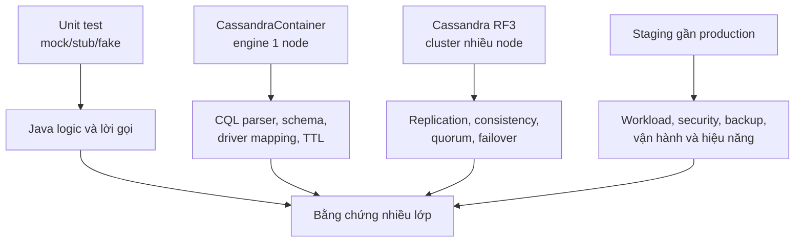
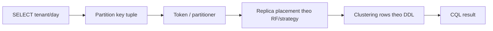
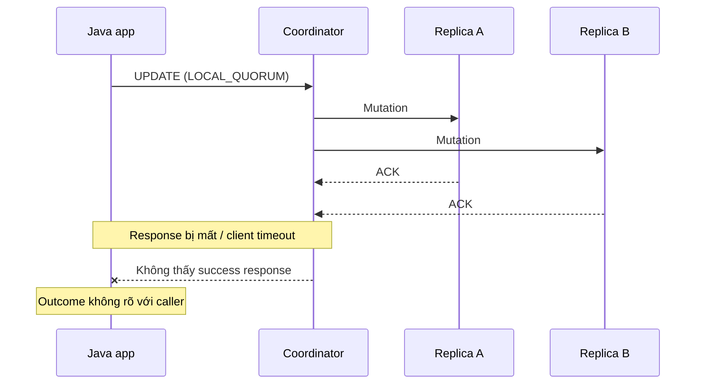
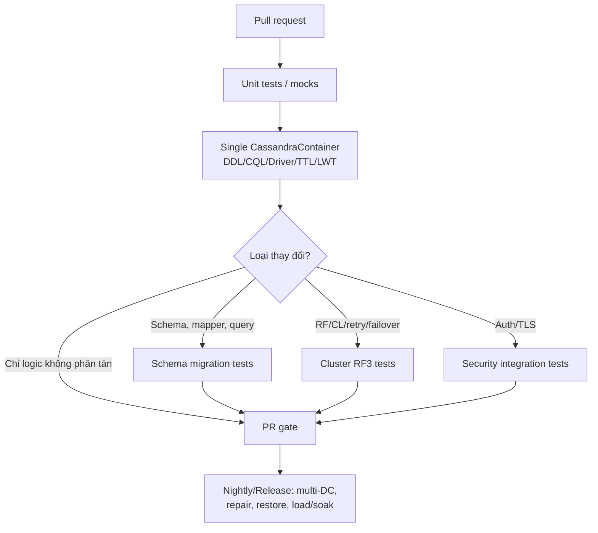

# Giới hạn mock/emulator và bằng chứng cần chạy trên engine thật

**Chương:** Kiểm thử tích hợp  
**Module:** `DATABASE_ENGINE_WIDE_COLUMN_CASSANDRA` — Apache Cassandra

Một unit test Java có thể cấu hình Mockito để trả về `OrderState.PAID` từ một repository. Test xanh chứng minh service **xử lý giá trị giả lập ấy đúng như kỳ vọng**, nhưng không chứng minh Cassandra có bảng tương ứng, CQL `WHERE` hợp lệ, primary key đã chọn phân vùng hợp lý, dữ liệu đã được replica xác nhận, hoặc một request timeout chưa ghi gì. Khi chuyển từ mock sang database thật, các giả định đó có thể vỡ.

**Bài học cốt lõi:** Trước mỗi khẳng định về Apache Cassandra, phải hỏi **“bằng chứng được tạo bởi thành phần nào?”**. Mock, fake, emulator, một CassandraContainer và một cluster Cassandra nhiều node cung cấp **các mức bằng chứng khác nhau**; không thể dùng sự tiện lợi của một mức để kết luận hành vi chỉ tồn tại ở mức khác.

Bài này xây một hợp đồng kiểm chứng từ quy tắc nghiệp vụ → CQL/mô hình wide-column → Java Driver/Spring Data → Cassandra thật → replication/consistency level, repair và vận hành. Các ví dụ dùng JUnit 5, Mockito, Testcontainers Java 2.x, Java Driver 4.x, CQL và một blueprint cụm thử cô lập.

> **Phạm vi và an toàn:** Ví dụ dựa trên Cassandra 4.1/5.x, Java Driver 4.x, JDK 17+, JUnit Jupiter, Testcontainers Java **2.x** và Spring Boot 3.x/4.x tương ứng. Package/artifact của Testcontainers **1.x khác 2.x**; API Spring Boot có thể khác theo major release. Không coi bài học là kết quả benchmark hay phép chứng nhận cluster đang chạy. Chỉ thử node failure, network partition, repair, backup/restore trong **môi trường cô lập được cấp phép**, không áp dụng với dữ liệu production.

## 1. Kết quả học tập

Sau bài này, bạn có thể:

1. Phân biệt **mock, stub, fake, in-memory emulator, CQL-compatible engine** và **Apache Cassandra thật**.
2. Viết một nhận định kiểm thử: **claim → giả định → môi trường → assertion → bằng chứng → giới hạn**.
3. Xác định trường hợp chỉ cần unit test và trường hợp bắt buộc engine Cassandra.
4. Giải thích vì sao mock không xác nhận CQL grammar, partition/clustering, TTL, tombstone, LWT, counter hay streaming.
5. Tạo CassandraContainer cho JUnit 5, kết nối bằng endpoint/DC động và chạy schema CQL xác định.
6. Viết integration tests cho query hợp lệ/không hợp lệ, primary key, clustering order, LWT, TTL và event ID ổn định.
7. Không nhầm **Cassandra thật một node RF=1** với bằng chứng cho `LOCAL_QUORUM` RF=3 hay phục hồi replica.
8. Thiết kế test matrix RF/CL, hinted handoff, anti-entropy repair, failover và multi-DC.
9. Kiểm chứng wiring Spring Boot/Spring Data bằng `@ServiceConnection` hoặc `@DynamicPropertySource`.
10. Tổ chức artifacts CI có version, DDL, topology, logs, assertions, failure conditions và traceability.
11. Nhận diện bằng chứng âm tính: truy vấn bị từ chối, sai CL phải fail closed, duplicate bị ngăn theo hợp đồng.
12. Đánh giá phần chưa có chứng cứ khi unit/container tests xanh nhưng production vẫn có lỗi dữ liệu và hiệu năng.

## 2. Từ test double đến engine thật

### 2.1. Định nghĩa và ranh giới

| Loại | Bản chất | Điều test tốt | Điều **không** tự chứng minh |
| --- | --- | --- | --- |
| **Stub** | Trả kết quả được viết sẵn | Branching logic với input xác định | Server có thực sự trả kết quả đó |
| **Mock** | Stub có kỳ vọng số/thứ tự lời gọi | Interaction contract | CQL, replica ACK, timeout semantics |
| **Fake repository** | Implementation nhẹ, ví dụ `Map<UUID,Row>` | Domain logic, test nhanh | Token, timestamps, TTL, paging, consistency |
| **CQL emulator** | Mô phỏng subset CQL/protocol | Chức năng được mô phỏng trong phạm vi công bố | Semantics Apache Cassandra toàn diện |
| **Engine CQL-compatible khác** | DB khác hỗ trợ một phần Cassandra API | Tương thích với engine ấy | Replication, repair, SSTable và lỗi đúng hệt Apache |
| **CassandraContainer 1 node** | Apache Cassandra thật trong container | CQL, codec, schema, TTL/LWT cơ bản, paging | Quorum đa replica, hints, repair giữa replicas |
| **Cluster thử ≥3 node** | Nhiều Cassandra nodes chung ring | RF3, CL, failover, replica convergence | Mọi điều kiện workload production |
| **Staging gần production** | Cassandra với topology/security/tải tương đồng | SLO, backup/restore, upgrade, vận hành | Không thể chứng minh mọi kịch bản tương lai |

**Không giả định có một “emulator Cassandra” bảo đảm đầy đủ semantics của Apache Cassandra.** Trước khi dùng, phải kiểm tra tài liệu của implementation: version, supported CQL/data types, exceptions, TTL/LWT/batch/consistency và những hạn chế đã biết. Thành công trên emulator chỉ là **bằng chứng về emulator đó**.

### 2.2. “Test xanh” là kết luận có điều kiện

```text
Claim: "Ứng dụng đọc được 20 events mới nhất trong ngày."

Mock:
  when(repository.latest20(...)).thenReturn(expectedList)
  -> Chỉ chứng minh method trả list được cung cấp.

Cassandra một node:
  INSERT events thật + SELECT đúng partition key
  -> Chứng minh DDL/order/query/driver phù hợp ở RF1.

Cassandra RF3:
  Mất một replica rồi đọc LOCAL_QUORUM
  -> Bổ sung bằng chứng về availability và CL ở topology ấy.

Production-like load:
  p99 dưới ngưỡng với 10k requests/s?
  -> Cần đo trên cấu hình, data và tải đại diện.
```

Các mức **bổ sung**, không thay thế nhau. Unit test vẫn cần để cô lập nhánh logic; engine test để xác minh server contract; cluster test để xác minh behavior phân tán.

### 2.3. Sơ đồ ranh giới bằng chứng



Một cluster RF3 test nhưng keyspace được thử vẫn dùng RF1 **không** kiểm tra được quorum RF3. Bằng chứng luôn phải gắn với **keyspace, RF/CL và thời điểm kiểm thử** cụ thể.

## 3. Điều mock làm tốt — và nên tiếp tục dùng

### 3.1. Trường hợp phù hợp với mock

- Không gọi repository nếu input thiếu tenant ID.
- Khi gateway từ chối quyền, không gửi database write.
- Service dùng event ID ổn định được truyền từ client tin cậy.
- Khi database layer báo `UnknownOutcome`, orchestration chuyển sự kiện sang trạng thái cần đối soát.
- Service chọn **không retry** cho counter/list append.
- Bộ phân loại lỗi chuyển overload/unavailable thành HTTP 503/429 đúng hợp đồng.
- Circuit breaker, backoff và admission controller thay đổi trạng thái đúng.

Những nhánh này thuộc **logic ứng dụng**, không cần CQL engine để chứng minh.

### 3.2. Ví dụ JUnit + Mockito

```java
import static org.junit.jupiter.api.Assertions.assertEquals;
import static org.mockito.Mockito.*;

import java.util.UUID;
import org.junit.jupiter.api.Test;

record EventCommand(UUID eventId, String tenantId, String state) {}

interface EventWriter {
    void persist(EventCommand command);
}

final class EventService {
    private final EventWriter writer;

    EventService(EventWriter writer) {
        this.writer = writer;
    }

    UUID accept(EventCommand command) {
        if (command.tenantId() == null ||
            command.tenantId().isBlank()) {
            throw new IllegalArgumentException("tenantId required");
        }
        // Giữ eventId, không tự sinh ID mới ở mỗi attempt.
        writer.persist(command);
        return command.eventId();
    }
}

class EventServiceUnitTest {
    @Test
    void preservesStableEventIdAndDelegatesOnce() {
        EventWriter writer = mock(EventWriter.class);
        EventService service = new EventService(writer);

        UUID id = UUID.fromString(
            "10000000-0000-4000-8000-000000000011");
        EventCommand command =
            new EventCommand(id, "tenant-a", "CREATED");

        assertEquals(id, service.accept(command));
        verify(writer, times(1)).persist(command);
        verifyNoMoreInteractions(writer);
    }
}
```

Test này chứng minh service **gọi writer một lần trong nhánh được chạy** và giữ event ID. Nó không chứng minh:

- `writer.persist` tạo CQL hợp lệ.
- Bảng tồn tại, primary key phù hợp.
- Cassandra đã ACK write ở `LOCAL_QUORUM`.
- Hai HTTP requests cùng event ID không gây side effect lặp.
- Crash sau write trước ACK không tạo duplicate khi retry.
- Driver retry/speculation không gửi nhiều execution.

Không báo cáo “event được lưu đúng một lần trong Cassandra” từ test này. Hãy báo “`persist` được gọi một lần cho một invocation”.

### 3.3. Fake Map có thể che sai access pattern

```java
// Fake thuận tiện nhưng không kiểm tra partition key:
Map<UUID, EventCommand> fakeDatabase = new HashMap<>();
fakeDatabase.put(command.eventId(), command);
EventCommand loaded = fakeDatabase.get(command.eventId());
```

Nếu bảng thật có `PRIMARY KEY ((tenant_id, bucket_day), event_ts, event_id)`, chỉ biết `event_id` **không đủ** để query trực tiếp theo primary key đó. Fake có thể trả đúng ngay, còn CQL tương ứng bị từ chối hoặc đòi lọc tốn kém. Đây là false positive do fake **ngầm có index** mà schema Cassandra không có.

## 4. Những hành vi mock không thể xác nhận

| Claim | Mock/fake có thể trả kết quả giả? | Bằng chứng tối thiểu đáng tin |
| --- | --- | --- |
| CQL đúng cú pháp/cột tồn tại | Có | Cassandra thật prepare/execute |
| Query đủ partition key | Fake lookup bất kỳ field | Cassandra thật accept/reject |
| Clustering order đúng DDL | Fake sort thủ công | Cassandra thật, một partition |
| Java codec `date`/`timestamp`/`uuid` | Có thể giả serialize | Java Driver + server |
| TTL làm row hết hạn logic | Fake clock tự cài | Cassandra thật + bounded polling |
| Tombstone được compact vật lý | Không có SSTable | Engine thật + storage metrics |
| LWT `IF NOT EXISTS`/`[applied]` | Mock trả boolean | Cassandra thật |
| Counter `+1` bị replay | Fake dễ mã hóa sai | Cassandra counter thật |
| List append tạo phần tử trùng | Fake có thể dùng Set | Cassandra collection thật |
| Paging/result page | Fake trả List toàn bộ | Driver + Cassandra thật |
| Batch/partial failure | Mock `saveAll` | Engine thật, cluster cho failure |
| `LOCAL_QUORUM` RF3 | Mock trả true | Cluster RF3 đã xác minh topology |
| Hints/repair/streaming | Fake không có replica | Cluster có nhiều replicas và fault plan |
| DC locality và `EACH_QUORUM` | Fake không có DC | Multi-DC cluster cô lập |
| TLS/RBAC | Mock bỏ network/auth | Cassandra thật bật auth/TLS |
| Upgrade compatibility | Fake không có SSTable/protocol thực | Engine thật theo ma trận versions |
| p99/throughput dưới tải | Mock quá nhanh | Staging/load test đại diện |
| Restore dữ liệu | Fake không có commit log/disk | Backup/restore trên engine thật |

**Trả cùng dữ liệu không có nghĩa cùng semantics.** Cassandra có timestamp reconciliation, partition token, RF/CL, LSM/SSTable, commit log, tombstone, repair — các cơ chế không được mô phỏng đáng tin cậy chỉ bằng một `Map`.

## 5. Bằng chứng phải được định nghĩa trước test

### 5.1. Claim–evidence contract

```text
CLAIM_ID:
BUSINESS_REQUIREMENT:
CQL_SCHEMA_AND_QUERY:
ASSUMPTIONS:
MINIMUM_ENVIRONMENT:
ASSERTION_OR_ORACLE:
ARTIFACTS_TO_SAVE:
KNOWN_LIMITATIONS:
FAILURE_MODE_UNDER_TEST:
OWNER:
```

Ví dụ:

```text
CLAIM_ID: CQL-ORDER-01
BUSINESS_REQUIREMENT: 20 events mới nhất của tenant/ngày
CQL_SCHEMA_AND_QUERY:
  PRIMARY KEY ((tenant_id,bucket_day),event_ts,event_id)
  CLUSTERING ORDER BY (event_ts DESC,event_id ASC)
ASSUMPTIONS: Chỉ một partition, không có writer cạnh tranh
MINIMUM_ENVIRONMENT: Cassandra engine thật, một node đủ
ASSERTION_OR_ORACLE:
  insert events có event_ts xác định
  SELECT với đủ partition key
  assert thứ tự và số rows theo timestamps
ARTIFACTS_TO_SAVE: DDL, CQL parameters, test report, server version
KNOWN_LIMITATIONS: Không chứng minh quorum/production p99
FAILURE_MODE_UNDER_TEST: Query thiếu partition bị từ chối
OWNER: data-access team
```

### 5.2. Oracle độc lập với code dưới test

*Test oracle* là nguồn xác định **kết quả đúng**:

- Không dùng `repository.findById` vừa để tạo expected vừa lấy actual.
- Mock tự trả expected không chứng minh server có expected.
- Với clustering, dùng `Instant` cố định và expected theo DDL; không sort actual trước assert.
- Với partition, cố ý test thiếu `bucket_day` để engine từ chối.
- Với LWT, assert `[applied]` và trạng thái row sau lần 2; không coi “không exception” là success điều kiện.
- Với RF3, đo đúng số replicas và keyspace replication metadata trước assert CL.

### 5.3. Test âm có giá trị

```text
Test dương:
  SELECT với tenant_id và bucket_day -> có row.

Test âm:
  SELECT với tenant_id nhưng thiếu bucket_day
  -> engine từ chối, không âm thầm ALLOW FILTERING.
```

Nếu âm tính trở thành success, điều tra schema/index/ALLOW FILTERING/query/version; không đổi expected chỉ để test xanh.

## 6. Vì sao H2, SQLite hoặc “CQL compatible” chưa đủ

### 6.1. Wide-column và cách đặt replica



Một SQL table với `PRIMARY KEY` và `ORDER BY` không mô phỏng network topology, SSTables, consistency, tombstone và repair của Cassandra.

### 6.2. Những false positives phổ biến

- Fake tra cứu bằng `event_id` dù query Cassandra thiếu partition key.
- Fake sort theo `payload`, trong khi bảng Cassandra không có clustering `payload`.
- Fake cho phép update PK tại chỗ như SQL.
- Fake tính TTL từ JVM clock thay vì server mutation semantics.
- Fake coi counter là integer có thể `SET hits=10`; Cassandra counter dùng delta.
- Fake coi batch như SQL transaction toàn cục rollback được.
- Fake bỏ timestamp reconciliation khi có writers cạnh tranh.
- Fake dùng Set thay cho list và làm mất duplicates.
- Fake không có tombstones/compaction/read amplification.
- Fake bỏ qua CL, trả success dù chỉ còn một replica.

Một engine **khác** hỗ trợ Cassandra native protocol có thể hữu ích cho test **engine đó**, nhưng không là chứng cứ cho internode protocol, storage formats hoặc repair của **Apache Cassandra**.

## 7. Chọn môi trường tối thiểu theo rủi ro

| Test | Unit/mock | Cassandra 1 node | Cluster RF3 | Staging gần prod |
| --- | :---: | :---: | :---: | :---: |
| Validate DTO và branch logic | ✓ | Không cần | Không cần | Không cần |
| CQL grammar/query restrictions | Không đủ | **✓** | Có thể | Có thể |
| Spring Data mapping/repository | Không đủ | **✓** | Có thể | Có thể |
| TTL logical expiry | Không đủ | **✓** | Có thể | Có thể |
| LWT điều kiện đơn giản | Không đủ | **✓** | Có thể | Có thể |
| Paging/codec/UDT | Không đủ | **✓** | Có thể | Có thể |
| RF3 quorum intersection | Không | Không | **✓** | **✓** |
| LWT khi replica lỗi | Không | Không | **✓** | Có thể |
| Hinted handoff/repair | Không | Không | **✓** | Có thể |
| `EACH_QUORUM`/DC locality | Không | Không | Chỉ multi-DC | **✓** nếu multi-DC |
| Compaction benchmark | Không | Không đủ | Chưa chắc | **✓** nếu đại diện |
| TLS/RBAC | Không | Có nếu bật | Có, cần internode | **✓** |
| Backup và restore | Không | Khói ban đầu | Tốt hơn | **✓** theo quy trình |
| Rolling upgrade | Không | Không đủ | **✓** với path được hỗ trợ | **✓** |

Dấu ✓ chỉ nói **môi trường có thể tạo bằng chứng**, không có nghĩa chỉ cần start container là đạt. Với SLO hiệu năng, cần workload và tài nguyên đủ đại diện; staging vẫn không phải bản sao hoàn hảo production.

**RF là thuộc tính keyspace**, không phải số container. Ba Cassandra processes có thể tạo ba cluster một node nếu seed/network/snitch không cấu hình chung. Ngay cả khi có ba nodes cùng ring, keyspace RF1 vẫn là một replica per partition. Trong RF1, `LOCAL_QUORUM` chỉ cần **một ACK**; trong RF3 một DC, `LOCAL_QUORUM` cần **hai ACK**.

## 8. Lab: schema là nguồn sự thật

### 8.1. Điều kiện và phạm vi

Dùng Cassandra **thật** ở một container, một DC giả định `datacenter1`, RF1. Bài thực hành này **chưa** chứng minh node failure/quorum. Nếu image có DC name khác, sửa script hoặc cấu hình container cho trùng tên; không giả định mọi image/bản phân phối đều đặt DC như nhau.

Yêu cầu: JDK 17+, Maven/Gradle, JUnit Jupiter, Java Driver 4.x, Docker/container runtime đủ tài nguyên, image được pin tag/digest và test data tổng hợp. Không kết nối keyspace production. Mỗi test dùng khóa riêng; tránh `TRUNCATE` khi parallel suite.

### 8.2. Nội dung file init CQL minh họa

Nếu triển khai thực tế, đặt đoạn sau trong **classpath `src/test/resources/cql/evidence-schema.cql`**. Bài học này chỉ ghi hướng dẫn Markdown, **không tự tạo file phụ**.

```sql
CREATE KEYSPACE IF NOT EXISTS it_evidence
WITH replication = {
    'class': 'NetworkTopologyStrategy',
    'datacenter1': 1
}
AND durable_writes = true;

CREATE TABLE IF NOT EXISTS it_evidence.events_by_tenant_day (
    tenant_id text,
    bucket_day date,
    event_ts timestamp,
    event_id uuid,
    kind text,
    payload text,
    PRIMARY KEY ((tenant_id, bucket_day), event_ts, event_id)
) WITH CLUSTERING ORDER BY (event_ts DESC, event_id ASC);

CREATE TABLE IF NOT EXISTS it_evidence.actions_by_id (
    action_id uuid PRIMARY KEY,
    state text,
    version int
);

CREATE TABLE IF NOT EXISTS it_evidence.expiry_by_id (
    item_id uuid PRIMARY KEY,
    ephemeral_value text
);

CREATE TABLE IF NOT EXISTS it_evidence.metrics_by_name (
    metric_name text PRIMARY KEY,
    hits counter
);

CREATE TABLE IF NOT EXISTS it_evidence.history_by_id (
    history_id uuid PRIMARY KEY,
    entries list<text>
);
```

Giải thích:

- `(tenant_id,bucket_day)` là **composite partition key**, băm để xác định token/replica set.
- `event_ts` và `event_id` là clustering columns; thứ tự mặc định trong partition là timestamp DESC, event ID ASC.
- `actions_by_id` phục vụ test LWT `IF NOT EXISTS`.
- `expiry_by_id` phục vụ TTL; không trộn TTL vào counter table.
- `metrics_by_name` là bảng chỉ chứa PK và `counter`; không có cột thường ngoài PK.
- `history_by_id` minh họa list append tạo duplicate khi replay; collection chỉ giữ rất nhỏ trong lab.

**Không biến một bảng thành universal storage**: nếu cần lookup chỉ `event_id`, thiết kế thêm bảng theo query đó thay vì quét/filter khắp các partitions.

### 8.3. Kiểm tra metadata schema server

```sql
SELECT column_name, kind, position, clustering_order, type
FROM system_schema.columns
WHERE keyspace_name = 'it_evidence'
  AND table_name = 'events_by_tenant_day';
```

Kỳ vọng nhóm `partition_key` có `tenant_id` và `bucket_day`; nhóm `clustering` có `event_ts` và `event_id` với ordering phù hợp. `position` có thể bắt đầu lại từ 0 theo nhóm, không mặc định tương ứng 1-1 với Java annotation `ordinal` toàn bộ key.

## 9. Testcontainers 2.x: dựng engine Cassandra thật

### 9.1. Dependencies và line versions

Tài liệu Testcontainers 2.0.x mô tả:

```xml
<!-- Ví dụ Maven, chỉ dùng khi cả project đã chọn Testcontainers 2.x. -->
<dependency>
    <groupId>org.testcontainers</groupId>
    <artifactId>testcontainers-cassandra</artifactId>
    <version>2.0.5</version>
    <scope>test</scope>
</dependency>

<dependency>
    <groupId>org.testcontainers</groupId>
    <artifactId>testcontainers-junit-jupiter</artifactId>
    <version>2.0.5</version>
    <scope>test</scope>
</dependency>
```

Trong Testcontainers **1.x**, artifacts là `org.testcontainers:cassandra` và `org.testcontainers:junit-jupiter`; `CassandraContainer` thường ở package `org.testcontainers.containers`. Trong **2.x**, import `org.testcontainers.cassandra.CassandraContainer`. Kiểm tra Spring Boot BOM và dependency tree; không trộn modules 1.x/2.x. JUnit, Mockito, Awaitility cần test dependencies phù hợp nếu project không dùng `spring-boot-starter-test`.

### 9.2. Một container, một session cho test class

```java
import com.datastax.oss.driver.api.core.CqlSession;
import org.junit.jupiter.api.AfterAll;
import org.junit.jupiter.api.BeforeAll;
import org.junit.jupiter.api.Test;
import org.testcontainers.cassandra.CassandraContainer;
import org.testcontainers.junit.jupiter.Container;
import org.testcontainers.junit.jupiter.Testcontainers;

import static org.junit.jupiter.api.Assertions.*;

@Testcontainers
class CassandraEvidenceIT {

    @Container
    static final CassandraContainer CASSANDRA =
        new CassandraContainer("cassandra:4.1.3")
            .withInitScript("cql/evidence-schema.cql");

    private static CqlSession session;

    @BeforeAll
    static void connect() {
        // Static @Container đã được extension khởi động.
        session = CqlSession.builder()
            .addContactPoint(CASSANDRA.getContactPoint())
            .withLocalDatacenter(CASSANDRA.getLocalDatacenter())
            .build();
    }

    @AfterAll
    static void disconnect() {
        if (session != null) {
            session.close();
        }
    }

    @Test
    void connectsToRealEngine() {
        var row = session.execute(
            "SELECT release_version, data_center, cluster_name " +
            "FROM system.local"
        ).one();

        assertNotNull(row);
        assertNotNull(row.getString("release_version"));
        assertEquals(CASSANDRA.getLocalDatacenter(),
            row.getString("data_center"));
    }
}
```

Đây là **class khung**; các test methods sau được thêm vào cùng class và hợp nhất imports theo Java syntax. `withInitScript` chỉ hoạt động khi `cql/evidence-schema.cql` có trên test classpath. `getContactPoint()`/`getLocalDatacenter()` tránh hardcode endpoint/DC. Container port `9042` được ánh xạ tới host port động; remote Docker host có thể khác `localhost`.

### 9.3. Readiness khác Docker Running

Cassandra cần bootstrap, schema agreement và mở CQL native transport. Docker process đang chạy chưa chắc server đã sẵn sàng. Cassandra module có wait/readiness logic; khi fail, lấy container logs và phân biệt Docker daemon unavailable, image pull fail, memory/CPU thấp, seed/DC không đúng và server thật sự chưa ready. Không đặt `Thread.sleep(60_000)` cố định để che tình trạng readiness.

### 9.4. Vòng đời với JUnit

`@Container static` được dùng chung giữa các methods trong **một class** rồi stop sau class. JUnit Testcontainers extension được kiểm thử cho tuần tự; parallel use có thể có side effects. Không gọi `CASSANDRA.stop()` trong `@AfterEach`; mở/đóng `CqlSession` theo lifetime container, không tạo session cho mỗi CQL statement.

## 10. Test thật: partition, clustering và query sai

### 10.1. Positive test với dữ liệu xác định

Đoạn `@Test` dưới đây đặt trong `CassandraEvidenceIT`:

```java
import com.datastax.oss.driver.api.core.DefaultConsistencyLevel;
import com.datastax.oss.driver.api.core.cql.PreparedStatement;
import com.datastax.oss.driver.api.core.cql.Row;
import com.datastax.oss.driver.api.core.data.CqlDate;

import java.time.Instant;
import java.time.LocalDate;
import java.util.ArrayList;
import java.util.List;
import java.util.UUID;

@Test
void readsEventsInClusteringOrder() {
    String tenant = "it-" + UUID.randomUUID();
    CqlDate day = CqlDate.fromDaysSinceEpoch(
        (int) LocalDate.of(2026, 11, 21).toEpochDay());

    Instant firstTs = Instant.parse("2026-11-21T10:00:00Z");
    Instant lastTs = Instant.parse("2026-11-21T10:05:00Z");
    UUID firstId = UUID.randomUUID();
    UUID lastId = UUID.randomUUID();

    PreparedStatement insert = session.prepare(
        "INSERT INTO it_evidence.events_by_tenant_day " +
        "(tenant_id,bucket_day,event_ts,event_id,kind,payload) " +
        "VALUES (?,?,?,?,?,?)"
    );

    session.execute(insert.bind(
        tenant, day, firstTs, firstId, "OPEN", "home"
    ).setConsistencyLevel(DefaultConsistencyLevel.ONE)
     .setIdempotent(true));

    session.execute(insert.bind(
        tenant, day, lastTs, lastId, "CLICK", "item"
    ).setConsistencyLevel(DefaultConsistencyLevel.ONE)
     .setIdempotent(true));

    PreparedStatement select = session.prepare(
        "SELECT event_ts,event_id,kind " +
        "FROM it_evidence.events_by_tenant_day " +
        "WHERE tenant_id=? AND bucket_day=? LIMIT 20"
    );

    List<Row> rows = new ArrayList<>();
    session.execute(select.bind(tenant, day)).forEach(rows::add);

    assertEquals(2, rows.size());
    assertEquals(lastTs, rows.get(0).getInstant("event_ts"));
    assertEquals(lastId, rows.get(0).getUuid("event_id"));
    assertEquals(firstTs, rows.get(1).getInstant("event_ts"));
    assertEquals(firstId, rows.get(1).getUuid("event_id"));
}
```

Expected order đến từ DDL `event_ts DESC` và timestamps đã định, **không** được sort actual trước khi assert. Tenant duy nhất giúp các tests độc lập. Bằng chứng chỉ áp dụng với query/partition/row size này ở RF1, chưa chứng minh p99 hay sort toàn cluster.

### 10.2. Negative test: thiếu composite partition key

```java
import com.datastax.oss.driver.api.core.servererrors.InvalidQueryException;

@Test
void rejectsQueryMissingCompositePartitionComponent() {
    assertThrows(InvalidQueryException.class, () -> {
        // Thiếu bucket_day; không có ALLOW FILTERING/index.
        session.execute(
            "SELECT event_id FROM it_evidence.events_by_tenant_day " +
            "WHERE tenant_id = 'tenant-a'");
    });
}
```

Fake thường trả danh sách theo `tenant_id` vì đã index sẵn trong memory. Engine thật cần **đầy đủ composite partition key** cho truy vấn định tuyến trực tiếp kiểu này. Đừng sửa bằng `ALLOW FILTERING` chỉ để unit test/integration test xanh.

Tên exception/message chính xác có thể thay theo client wrapper/version; khi test Spring Data, xem lỗi gốc và wrapper, không assert chuỗi tiếng Anh phụ thuộc release.

### 10.3. Stable event ID và duplicate row

```java
@Test
void replaySameEventKeepsOneLogicalRow() {
    String tenant = "dedupe-" + UUID.randomUUID();
    CqlDate day = CqlDate.fromDaysSinceEpoch(
        (int) LocalDate.of(2026, 11, 21).toEpochDay());
    Instant ts = Instant.parse("2026-11-21T08:00:00Z");
    UUID eventId = UUID.randomUUID(); // tạo đúng một lần

    var insert = session.prepare(
        "INSERT INTO it_evidence.events_by_tenant_day " +
        "(tenant_id,bucket_day,event_ts,event_id,kind,payload) " +
        "VALUES (?,?,?,?,?,?)"
    );
    var statement = insert.bind(
        tenant, day, ts, eventId, "CLICK", "item-7"
    ).setIdempotent(true);

    session.execute(statement);
    session.execute(statement); // replay có chủ đích CHỈ LAB

    var read = session.prepare(
        "SELECT event_id FROM it_evidence.events_by_tenant_day " +
        "WHERE tenant_id=? AND bucket_day=?"
    );

    int count = 0;
    for (var row : session.execute(read.bind(tenant, day))) {
        count++;
        assertEquals(eventId, row.getUuid("event_id"));
    }
    assertEquals(1, count);
}
```

Hai lần ghi **cùng full PK** và payload xác định để lại **một logical row**. Không suy từ đó rằng email/payment/Kafka event cũng exactly-once, hoặc replay với TTL/timestamp khác sẽ có semantics hoàn toàn giống. Nếu `UUID.randomUUID()` được gọi lại ở mỗi attempt, PK khác và có thể tạo duplicate hàng logic.

## 11. Test thật: LWT và kết quả điều kiện

### 11.1. `IF NOT EXISTS` trên engine Cassandra

```java
@Test
void conditionalInsertRejectsReusedActionId() {
    UUID actionId = UUID.randomUUID();

    var insert = session.prepare(
        "INSERT INTO it_evidence.actions_by_id " +
        "(action_id,state,version) VALUES (?,?,?) IF NOT EXISTS"
    );

    var first = session.execute(
        insert.bind(actionId, "CREATED", 1)).one();
    assertNotNull(first);
    assertTrue(first.getBoolean("[applied]"));

    var second = session.execute(
        insert.bind(actionId, "CREATED", 1)).one();
    assertNotNull(second);
    assertFalse(second.getBoolean("[applied]"));

    var read = session.prepare(
        "SELECT state,version FROM it_evidence.actions_by_id " +
        "WHERE action_id=?"
    );

    var stored = session.execute(read.bind(actionId)).one();
    assertNotNull(stored);
    assertEquals("CREATED", stored.getString("state"));
    assertEquals(1, stored.getInt("version"));
}
```

Đây là bằng chứng **Cassandra engine thật** cho `IF NOT EXISTS`, `[applied]` và một row trong lab bình thường.

### 11.2. Điều chưa được chứng minh

- LWT chịu được mất một trong ba replicas ở RF3 ra sao.
- Paxos/CAS khi nhiều writers thực sự cạnh tranh.
- Thời gian LWT dưới tải thật, ở consistency/serial CL phù hợp.
- LWT timeout có được áp dụng trước khi mất response hay không.
- Một LWT trên row này có atomic với payment/email hoặc bảng khác hay không.

Cho các claims ấy cần RF/CL topology thật, concurrent writers/failure injection và nguồn sự thật để đối soát.

## 12. Test thật: TTL và ranh giới logical/physical

### 12.1. Tránh sleep cố định

```java
// PHẢN VÍ DỤ dễ flaky:
Thread.sleep(3000);
assertNull(session.execute(read).one());
```

TTL được server áp dụng theo mutation, trong khi CI có scheduling/GC và độ trễ khác nhau. Nên dùng **bounded polling**. Nếu đã thêm test dependency Awaitility:

```java
import static org.awaitility.Awaitility.await;
import java.time.Duration;

@Test
void ttlEventuallyMakesValueInvisible() {
    UUID id = UUID.randomUUID();

    var insert = session.prepare(
        "INSERT INTO it_evidence.expiry_by_id " +
        "(item_id,ephemeral_value) VALUES (?,?) USING TTL 3"
    );
    session.execute(insert.bind(id, "temporary"));

    var read = session.prepare(
        "SELECT ephemeral_value FROM it_evidence.expiry_by_id " +
        "WHERE item_id=?"
    );

    await()
        .pollInterval(Duration.ofMillis(200))
        .atMost(Duration.ofSeconds(20))
        .until(() ->
            session.execute(read.bind(id)).one() == null);
}
```

Bằng chứng chỉ là **logical expiry khi đọc**. Không chứng minh tombstones đã bị xóa khỏi SSTable, disk reclaimed hay `gc_grace_seconds` có thể giảm. Muốn đánh giá compaction phải có bài test storage/metrics riêng.

### 12.2. TTL và retry

Replay một `INSERT/UPDATE USING TTL` có thể làm thay thời điểm hết hạn của cell. Hai lần ghi cùng giá trị hiện tại **không** tự tương đương nếu business contract quy định retention/freshness. Một fake tự cài clock có thể lỡ hoặc diễn giải sai semantics ấy.

## 13. Test thật: counter và list append

### 13.1. Counter không lũy đẳng

```sql
-- Thực hiện CHỈ LAB trên metric_name chưa dùng.
UPDATE it_evidence.metrics_by_name
SET hits = hits + 1
WHERE metric_name = 'it-run-unique-metric';

UPDATE it_evidence.metrics_by_name
SET hits = hits + 1
WHERE metric_name = 'it-run-unique-metric';

SELECT hits FROM it_evidence.metrics_by_name
WHERE metric_name = 'it-run-unique-metric';
```

Với một counter key mới và hai writes hoàn tất, giá trị có thể là 2. Trong test tự động phải tạo `metric_name` độc nhất cho từng run để không nhận state cũ. Không reset counter bằng DELETE rồi ghi lại cùng key để mong semantics giống integer bình thường.

### 13.2. List append tạo duplicate

```sql
INSERT INTO it_evidence.history_by_id (history_id, entries)
VALUES (
    10000000-0000-4000-8000-000000000021,
    ['created']
);

UPDATE it_evidence.history_by_id
SET entries = entries + ['paid']
WHERE history_id =
    10000000-0000-4000-8000-000000000021;

UPDATE it_evidence.history_by_id
SET entries = entries + ['paid']
WHERE history_id =
    10000000-0000-4000-8000-000000000021;

SELECT entries FROM it_evidence.history_by_id
WHERE history_id =
    10000000-0000-4000-8000-000000000021;
```

List có thể cho `['created','paid','paid']`. Một fake dùng `Set<String>` sẽ xóa duplicate và che sai lầm. Với event history tăng vô hạn, dùng bảng events theo PK ổn định, không nhồi tất cả vào một list collection.

### 13.3. Retry sau timeout không thể được chứng minh bằng một boolean mock

`WriteTimeoutException`/`DriverTimeoutException` có thể đến **sau khi mutation đã được một số/đủ replicas áp dụng**. Vì vậy:

- `counter + 1` hoặc append list không được blind retry.
- `setIdempotent(true)` không biến delta/append thành lũy đẳng.
- Cần event/request ID cố định qua attempts.
- Unknown outcome cần reconciliation/facts/source-of-truth nếu business đòi chính xác.
- Test gửi hai lần có chủ đích cho thấy non-idempotence, nhưng **không chứng minh mọi timeout timing** của cluster thật.

## 14. Paging, async và reactive cũng cần engine

### 14.1. Paging phải đi qua nhiều trang

Một mock trả `List<Row>` 50 phần tử không chạy thêm page fetch nào. Integration test nên insert nhiều rows **trong cùng partition**, đặt `pageSize=2`, duyệt hết pages, assert IDs/ordering/no duplicates.

```java
import com.datastax.oss.driver.api.core.cql.SimpleStatement;

// Giả định test đã insert 5 rows có PK khác nhau cho tenant/day:
var query = SimpleStatement.builder(
    "SELECT event_ts,event_id FROM it_evidence.events_by_tenant_day " +
    "WHERE tenant_id=? AND bucket_day=?")
    .addPositionalValues(tenant, day)
    .setPageSize(2)
    .build();

int count = 0;
for (var row : session.execute(query)) {
    count++;
}
assertEquals(5, count);
```

Đây là **fragment** cần `tenant`, `day` và năm INSERTs trong cùng test method. `pageSize` là hint, không cam kết mỗi page chính xác hai rows. Tránh query toàn keyspace không giới hạn để cố tạo paging.

### 14.2. Async/reactive boundaries

- **Unit test:** subscriber cancellation/timeout mapping, retry decision và backpressure ở pipeline application.
- **Engine một node:** `executeAsync` completion stages, `executeReactive` publisher/pages, codec và exception propagation thực.
- **Cluster nhiều node:** coordinator switching, retries, speculative execution, timeouts khi replica chậm/down.
- **Load/staging:** số in-flight, throttler queue, memory/GC và p99 với producer rate đại diện.

Cancellation một future/subscriber **không có nghĩa server rollback write đã gửi**. Đừng coi async/reactive làm thay đổi semantics CQL hay exactly-once.

## 15. Spring Boot và Spring Data: test wiring thật

### 15.1. Repository mock không kiểm tra mapping

Khi dùng `@MockBean` (ở một số Spring Boot 3.x) hoặc `@MockitoBean` (Spring Framework/Boot version hỗ trợ), test có thể thay repository thật bằng mock. Khi đó:

- `@PrimaryKey`, `@PrimaryKeyClass`, `@PrimaryKeyColumn` chưa chắc được mapper sử dụng.
- Keyspace/table/column có thể sai nhưng test vẫn xanh.
- Derived query method có thể không tạo được CQL đúng.
- `CassandraTemplate`/Driver không gửi request tới server.
- `@Query` sai partition predicate vẫn trả row do mock cấu hình.

Muốn xác minh mapping, cần **Spring repository/template thật** nối với **Cassandra engine thật** và một assertion đọc CQL độc lập. Không dùng repository để tạo cả expected lẫn actual.

### 15.2. Dùng `@ServiceConnection` trên Spring Boot hỗ trợ

Với dependency `spring-boot-testcontainers` và Spring Boot version hỗ trợ factory `CassandraConnectionDetails`:

```java
import org.junit.jupiter.api.Test;
import org.springframework.beans.factory.annotation.Autowired;
import org.springframework.boot.test.context.SpringBootTest;
import org.springframework.boot.testcontainers.service.connection.ServiceConnection;
import org.testcontainers.cassandra.CassandraContainer;
import org.testcontainers.junit.jupiter.Container;
import org.testcontainers.junit.jupiter.Testcontainers;
import com.datastax.oss.driver.api.core.CqlSession;

import static org.junit.jupiter.api.Assertions.*;

@SpringBootTest
@Testcontainers
class SpringCassandraEvidenceIT {

    @Container
    @ServiceConnection
    static final CassandraContainer CASSANDRA =
        new CassandraContainer("cassandra:4.1.3")
            .withInitScript("cql/evidence-schema.cql");

    @Autowired
    CqlSession session;

    @Test
    void bootConnectsToRealCassandra() {
        var row = session.execute(
            "SELECT release_version FROM system.local").one();
        assertNotNull(row);
    }
}
```

Test profile:

```yaml
spring:
  cassandra:
    keyspace-name: it_evidence
    schema-action: none
```

**`@ServiceConnection` cung cấp connection details**, không tự tạo CQL keyspace/table. `withInitScript` hoặc migration cung cấp schema. Với Testcontainers 2.x, kiểm tra Boot BOM đã nhận class package mới và driver tương thích. Không bật `schema-action: recreate` trên cluster chia sẻ.

### 15.3. `@DynamicPropertySource` là lựa chọn thay thế

Nếu không dùng service connection factory hoặc cần kiểm soát properties:

```java
import org.springframework.test.context.DynamicPropertyRegistry;
import org.springframework.test.context.DynamicPropertySource;

// Bên trong @SpringBootTest class có static container CASSANDRA:
@DynamicPropertySource
static void cassandraProps(DynamicPropertyRegistry registry) {
    registry.add("spring.cassandra.contact-points",
        () -> CASSANDRA.getHost() + ":" +
              CASSANDRA.getMappedPort(9042));
    registry.add("spring.cassandra.local-datacenter",
        CASSANDRA::getLocalDatacenter);
    registry.add("spring.cassandra.keyspace-name",
        () -> "it_evidence");
    registry.add("spring.cassandra.schema-action",
        () -> "none");
}
```

Đây là **fragment** thêm vào test class chứ không phải file Java độc lập. Không cấu hình cùng lúc `@ServiceConnection` và `@DynamicPropertySource` một cách vô thức: Boot connection details có precedence riêng, có thể override properties.

### 15.4. Những assertion mapping nên có

| Mapping claim | Bằng chứng |
| --- | --- |
| `@Table` trỏ đúng table | Save qua repository thật; read trực tiếp bằng CQL |
| Full composite PK đúng | So Java entity fields với `system_schema.columns` |
| Clustering order đúng | INSERT timestamps xác định; repository SELECT order |
| Java CQL codec đúng | `LocalDate`/`Instant`/`UUID` round-trip |
| `@PrimaryKeyClass` identity đúng | `findById` bằng full key class |
| `@Query` hợp lệ | Execute query với server và negative tests |
| LWT đúng điều kiện | Assert `[applied]`, không chỉ save không lỗi |
| Schema migration đúng | Dùng DDL version được quản lý, test trước/sau |
| Exception handling đúng | Error type gốc được phân loại rõ |

**Spring context caching:** Một `@SpringBootTest` context có thể sống lâu hơn static `@Container` của một test class. Nếu context được tái sử dụng nhưng container của class trước đã stop, `CqlSession` có thể trỏ endpoint chết. Gắn lifetime container với context hoặc dùng context isolation/lifecycle pattern được tài liệu Boot/Testcontainers hỗ trợ. Không tạo session mới trên mỗi HTTP request để “sửa”.

## 16. Bằng chứng thật về consistency cần nhiều replicas

### 16.1. RF1 không chứng minh quorum đa replica

Với keyspace `NetworkTopologyStrategy {'datacenter1': 1}`:

\[
LOCAL\_QUORUM = \left\lfloor \frac{1}{2}\right\rfloor+1 = 1
\]

Read/write `LOCAL_QUORUM` ở một CassandraContainer có thể pass dù chỉ một replica. Nó **không** chứng minh ứng dụng chịu mất một node hoặc đọc từ quorum có giao với quorum ghi của RF3.

Trong một DC RF3:

\[
LOCAL\_QUORUM = \left\lfloor \frac{3}{2}\right\rfloor+1 = 2
\]

Nếu write chờ W=2 và read chờ R=2 trên cùng replica set, thì:

\[
W+R=4>RF=3
\]

Hai tập phản hồi buộc giao nhau, hỗ trợ read-after-write theo những giả định của Cassandra về timestamps, read/write ordering và không có writer xung đột. **Không suy linearizability/ACID transaction tổng quát** chỉ từ công thức này.

### 16.2. Ma trận RF3

| Trạng thái các replicas | `ONE` | `LOCAL_QUORUM` | `ALL` |
| --- | --- | --- | --- |
| 3/3 healthy | Có thể thành công | Có thể | Có thể |
| 2/3 healthy | Có thể | Có thể | Không đủ |
| 1/3 healthy | Có thể | Không đủ | Không đủ |
| 0/3 healthy | Không | Không | Không |

“Có thể” không cam kết mọi query thành công khi node báo Up: coordinator routing, network partition, schema disagreement, disk/GC và timeout vẫn ảnh hưởng.

### 16.3. Chuẩn bị keyspace RF3 đúng cách

Chỉ trên **cluster disposable ba node cùng ring** trong DC `dc1`:

```sql
CREATE KEYSPACE IF NOT EXISTS it_evidence_rf3
WITH replication = {
    'class': 'NetworkTopologyStrategy',
    'dc1': 3
}
AND durable_writes = true;

CREATE TABLE IF NOT EXISTS it_evidence_rf3.state_by_id (
    id uuid PRIMARY KEY,
    state text,
    changed_at timestamp
);
```

Trên các node phù hợp:

```bash
nodetool status
nodetool describecluster
nodetool netstats
```

Preflight bắt buộc:

- Một cluster name và ba host IDs khác nhau.
- Các node ở đúng DC/rack như dự kiến, trạng thái `UN`.
- Token ownership/replica placement đúng, keyspace RF3 ở `dc1`.
- Schema agreement ổn định sau DDL.
- Disk/CPU/RAM/network đủ, không có repairing/bootstrap đang treo.
- Contact points Java không trỏ nhầm production.
- Baseline write ở CL yêu cầu đã ACK trước khi gây lỗi.

Ba `CassandraContainer` start độc lập **không tự động** thành cluster; cần cấu hình seed/gossip/network/snitch và đợi bootstrap.

### 16.4. Test mất một node

1. Ghi baseline bằng `CONSISTENCY ALL` khi ba replicas khỏe.
2. Dừng node C **trong cluster disposable** được cấp phép.
3. Đợi A/B thấy C Down, xác minh `nodetool status`.
4. Đọc/ghi `LOCAL_QUORUM` trên partition test mới; hai replicas sống có thể đáp ứng.
5. Thử `ALL`; phải không đạt khi thiếu replica cần thiết.
6. Khôi phục C, quan sát hints, logs, netstats/repair needs.
7. Kiểm tra tính nhất quán từ coordinators/CL thích hợp.
8. Dọn fault injection và lưu artifacts/topology/exception.

```text
EXPECTED:
  keyspace NTS dc1:3, 3 nodes healthy ban đầu
  node C Down
  LOCAL_QUORUM: có thể thành công qua A+B
  ALL: không đủ ba ACK
  node C Up: cần kiểm tra hội tụ

NOT PROVEN:
  ONE read luôn stale
  Write timeout chắc chắn không có side effect
  Node C đã nhận mọi mutation ngay khi báo UN
```

Không tạo data divergence bằng cách xóa SSTable/commit log hoặc phá `system.local`. Nếu cần test repair, có kế hoạch downtime/ranges/cleanup riêng.

### 16.5. Multi-DC cần topology thật

Với keyspace `NTS {'dc1':3,'dc2':3}`, tổng RF6. `LOCAL_QUORUM` tại dc1 cần 2 replicas local, `QUORUM` tổng thể cần 4, write `EACH_QUORUM` cần quorum ở từng DC. Một mock hoặc một node cho mỗi tên DC không chứng minh network locality/data residency, failover hay streaming.

Trong test đa DC, phải kiểm tra:

- Node thực ở DC/rack đúng.
- Driver `withLocalDatacenter("dc1")`/load balancing phù hợp.
- Read/write outcomes khi dc2 thiếu quorum.
- Routing và replication visibility sau khi mạng phục hồi.
- Security/internode connectivity, schema agreement, repair plan.
- Business contract có cho phép fallback sang DC khác hay không.

## 17. Negative evidence: điều hệ thống **phải từ chối**

### 17.1. Khi CL không đạt, không được ngụy tạo thành công

Phản ví dụ:

```text
try write LOCAL_QUORUM
if unavailable:
    retry write ONE
return HTTP 200 "committed"
```

Mock có thể được thiết lập cho nhánh retry thành công, nhưng không chứng minh write ACK ở quorum. Với nghiệp vụ bắt buộc durability/read-after-write, cluster test phải xác minh **không hạ CL ngầm** khi còn một replica.

Driver 4.x có retry policies khác nhau: `DefaultRetryPolicy` không tự động downgrade CL như một số policy tùy chọn riêng. Kiểm tra effective config, custom `RetryPolicy`, statement idempotence, gateway/job retries và metrics; không nhìn mỗi `setConsistencyLevel(LOCAL_QUORUM)` rồi suy success nhất định đạt CL ấy.

### 17.2. Không cho phép query vượt mô hình

Ví dụ negative CQL:

```sql
-- Dự kiến bị từ chối với schema không có index/filtering:
SELECT event_id
FROM it_evidence.events_by_tenant_day
WHERE event_id =
  10000000-0000-4000-8000-000000000041;
```

`event_id` là clustering column cuối; query thiếu partition key `tenant_id,bucket_day`. Mock thường cho phép lookup bằng UUID, làm che sai thiết kế bảng theo truy vấn.

### 17.3. Những negative tests khác

- `INSERT` thiếu cột PK → CQL server từ chối.
- CQL dùng sai tên cột → server trả invalid query.
- LWT `IF version=1` khi version đã khác → `[applied]=false`, **không** phải network error.
- Thiếu replica cho `ALL` → không được trả success đúng CL.
- Auth/certificate sai → client không được truy cập.
- Timeout mutation không lũy đẳng → service đánh dấu `UNKNOWN_OUTCOME`, không blind retry.
- Paging cuối cùng → không lặp row do fetch logic.
- Schema migration chưa chạy → app fail fast, không auto-recreate data của bảng khác.
- Tải vượt admission → 429/503 hoặc defer theo API contract, không retry vô hạn.

**Mock ném exception do developer tự đặt chỉ chứng minh error branch**, không bảo đảm Cassandra thực tế sẽ phát exception ấy ở cùng điều kiện.

## 18. Lỗi thực khác mock ném exception

### 18.1. Phân loại theo nguồn lỗi

```java
// Unit test — chỉ kiểm tra service xử lý nhánh lỗi:
when(repository.save(any()))
    .thenThrow(new RuntimeException("simulated timeout"));
```

Câu trên không tạo `WriteTimeoutException` ở coordinator hoặc `DriverTimeoutException` ở client theo logic Cassandra. Những lỗi chính:

| Lỗi | Nguồn/ý nghĩa | Bằng chứng cần |
| --- | --- | --- |
| `InvalidQueryException` | Server parse/validate CQL | Một CassandraContainer đủ |
| `UnavailableException` | Coordinator không đủ live replicas theo CL | Cluster RF/CL đúng |
| `ReadTimeoutException` | Server read không đủ response | Cluster/fault plan |
| `WriteTimeoutException` | Write thiếu ACK đúng thời gian | Cluster/fault plan, outcome không rõ |
| `DriverTimeoutException` | Client deadline, có thể gồm throttler wait | Driver/session/load/fault setup |
| `AllNodesFailedException` | Không có node đáp ứng qua query plan | Node/connection errors chi tiết |
| `RequestThrottlingException` | Driver throttler queue/admission đầy | Load test và driver metrics |
| `[applied]=false` | LWT business condition không thỏa | Engine thật, không phải exception |

Không nhất thiết tạo toàn bộ lỗi trên mọi PR; dùng fault suite riêng trong cluster disposable và ghi kịch bản/timing.

### 18.2. Timeout không chứng minh mutation chưa thực thi



Đây là **kịch bản khả dĩ**, không phải một timing guarantee. Nếu client retry counter `+1` sau timeout, lần sau có thể cộng thêm lần nữa. Kết hợp mock timeout để test branch với replay/cluster fault để test semantics, đồng thời ghi **chưa chứng minh gì** ở mỗi mức.

### 18.3. Review idempotence trong mọi test lỗi

Trước khi cho phép retry:

- PK và event/request ID có ổn định qua attempts không?
- CQL là assignment xác định, counter delta, list append hay LWT?
- TTL/timestamp có đổi theo lần gọi lại không?
- CL và serial CL có được giữ đúng business contract không?
- Outcome của lần đầu chắc chắn bị từ chối hay chưa rõ?
- Có side effects ngoài Cassandra (Kafka/payment/email) không?
- Có nguồn facts/reconciliation cho trường hợp không rõ không?

`setIdempotent(true)` chỉ là metadata cho driver retry/speculation; không làm non-idempotent mutations trở thành exactly-once.

## 19. Bằng chứng storage/repair/security/backup

### 19.1. TTL logic không bằng dọn SSTable

Một test SELECT sau TTL cho no row chỉ chứng minh **logical visibility**. Tombstones/expired cells vẫn có thể còn trong SSTables và ảnh hưởng đọc/compaction. Bằng chứng storage cần:

- Dữ liệu có volume, partition size, TTL và tombstone pattern đại diện.
- Metrics `nodetool tablestats`, `tablehistograms`, `compactionstats` cùng server JMX theo version.
- Đo read p95/p99, SSTables per read, tombstone scans.
- Ghi compaction strategy, time windows, table options, GC behavior.
- Không giả định disk freed ngay khi TTL hết.
- Không hạ `gc_grace_seconds` hay ép major compaction chỉ để test xanh.

### 19.2. Repair cần ít nhất hai replicas

Một `nodetool repair` trong RF1 không chứng minh anti-entropy giữa replicas. Với RF3:

1. Có baseline đã ACK ở CL dự kiến.
2. Cho replica vắng một khoảng, tiếp tục một số writes ở LQ có kiểm soát.
3. Khởi động lại replica, quan sát hints/streaming.
4. Chạy repair **theo phạm vi** và kế hoạch version cụ thể nếu test yêu cầu.
5. Đối chiếu data/ranges và metrics/logs, không chỉ exit code 0.
6. Thu thập duration, network/disk impact, reset cluster.

Hints/repair có thể khiến dữ liệu hội tụ trước khi tester đọc stale. **Không** đòi `ONE` luôn stale sau restart.

### 19.3. TLS/RBAC phải bật bảo mật trên Cassandra thật

Mock repository không thể chứng minh:

- Server từ chối certificate/CA/hostname sai.
- Role không có quyền `SELECT` thực sự bị từ chối.
- Credentials nằm trong secret manager/trust configuration đúng.
- TLS internode hoạt động giữa replicas.
- Audit events được ghi khi có hoạt động quyền nhạy cảm.

CassandraContainer mặc định **có thể không bật auth/TLS**; một query kết nối thành công không phải bằng chứng security pass. Cần cấu hình test riêng, negative tests cho quyền/cert sai, không tắt bảo mật để test xanh.

### 19.4. Backup pass phải bao gồm restore

`nodetool snapshot` exit code 0 chỉ chứng minh một bước backup. Để xác minh khả năng khôi phục:

- Restore vào **cluster cô lập mới** theo version/schema phù hợp.
- So partition keys/ranges, row counts và dữ liệu mẫu, timestamps/TTL/counters nếu có.
- Test reads/CL qua Driver/app, không chỉ kiểm file tồn tại.
- Đo RPO/RTO theo tiêu chí, lưu checksum/manifest/log.
- Kiểm tra window dữ liệu giữa snapshot và failure theo kiến trúc backup.
- Không thử restore trực tiếp vào cluster production.

### 19.5. Version/upgrade có rủi ro riêng

Test trên Cassandra 4.1 xanh không tự chứng minh app chạy đúng trên Cassandra 5.x. Với nâng cấp:

- Chạy suite trên **version nguồn và version đích**.
- Nếu rolling upgrade được hỗ trợ, kiểm tra mixed-version cluster theo release notes.
- Đánh giá schema/feature flags và native protocol/Driver compatibility.
- Không bật feature/SSTable upgrade làm rollback bất khả thi khi chưa qua gate.
- Ghi mô hình backup/restore và rollback version-specific.
- Không dùng emulator để chứng minh data format upgrade an toàn.

## 20. Performance đòi workload thật

### 20.1. Mock nhanh không đo được Cassandra p99

Mock không đi qua partition hashing, coordinator/replica network, memtable/SSTable, tombstone scans, commit log, flush/compaction, GC, disk I/O, retries, CL ACK hay hotspots. Benchmark fake database chủ yếu đo overhead Java/logic fake.

### 20.2. Một CassandraContainer cũng không phải production benchmark

CassandraContainer chạy CPU/RAM/disk trên laptop/CI runner, thường RF1 và data rất nhỏ. Nó xác minh correctness nhưng không chứng minh SLO p99 của RF3/multi-DC. Bằng chứng performance cần:

```text
WORKLOAD:
  read/write ratio
  partition-key distribution và hot keys
  rows/partition size, payload, TTL, tombstones
  request arrival rate và bursts
  read/write CL, retries/speculation
  app pod count, CqlSession/connection pooling

ENVIRONMENT:
  Cassandra version, RF, DC/rack
  CPU/RAM/disk/network/node count
  JVM/GC, compaction strategy, repair status
  TLS/security, dataset scale

EVIDENCE:
  app p50/p95/p99 và error rate
  driver timeouts, retries, throttling queues
  node read/write latency, CPU/GC, disk I/O
  dropped messages/pending tasks
  test duration/warm-up, sampling, confidence limits
```

Một synthetic load có giới hạn hữu ích để kiểm tra throttler/admission/backpressure, nhưng không chạy vô hạn, không ép disk full/OOM trên môi trường có data quan trọng.

## 21. Lưu bằng chứng trong CI để người khác có thể kiểm lại

### 21.1. Manifest cho mỗi integration run

```text
RUN_ID:
COMMIT_SHA:
TEST_SUITE_AND_TEST_CASES:
TEST_CLASSIFICATION: UNIT / ENGINE_1NODE / RF3 / MULTI_DC
START_TIME_UTC:
CASSANDRA_IMAGE_TAG_AND_DIGEST:
CASSANDRA_RELEASE_VERSION:
JAVA_DRIVER_VERSION:
TESTCONTAINERS_VERSION:
SPRING_BOOT_AND_SPRING_DATA_VERSION:
JDK_VERSION:
DOCKER_RUNTIME_AND_RUNNER:
KEYSPACE_SCHEMA_VERSION_AND_DDL_HASH:
REPLICATION_STRATEGY:
DATACENTER_NAMES:
REPLICATION_FACTOR_PER_DC:
READ_CONSISTENCY_LEVEL:
WRITE_CONSISTENCY_LEVEL:
SERIAL_CONSISTENCY_LEVEL_IF_LWT:
NUMBER_OF_LIVE_REPLICAS:
TEST_DATA_NAMESPACE:
TEST_SEED_AND_CLOCK_ASSUMPTIONS:
PASS_FAIL_AND_ASSERTIONS:
NEGATIVE_TEST_RESULTS:
FAULT_INJECTION_DESCRIPTION:
RECOVERY_ACTIONS_AND_RESULTS:
CONTAINER_AND_SERVER_LOGS:
DRIVER_ERROR_CLASSES:
METRICS_ARTIFACTS:
KNOWN_GAPS:
CLEANUP_RESULT:
OWNER_AND_APPROVAL:
```

Các trường chưa chạy phải ghi **NOT_TESTED/NOT_APPLICABLE**, không mặc định PASS. Không lưu password, access token, dữ liệu cá nhân hoặc dữ liệu giao dịch thật vào test artifact.

### 21.2. Bằng chứng tối thiểu cho CQL correctness

1. CQL DDL/schema version và Cassandra image tag/digest.
2. Output `SELECT release_version, data_center FROM system.local`.
3. Danh sách test cases, unique tenant/IDs có thể truy dấu không lộ PII.
4. Positive test cho query có đủ partition key.
5. Negative test cho query thiếu partition key/không có index.
6. Ordering/codec/identity assertions khi ứng dụng sử dụng chúng.
7. LWT/TTL/counter/collection/paging assertions theo use case.
8. Exception classes thực sự thu được từ Cassandra Driver.
9. Lưu stack trace, container logs khi fail và cleanup result.
10. Mô tả rõ **không** test RF3/failover/production SLO nếu chỉ một container.

### 21.3. Bằng chứng tối thiểu cho RF3/failover

1. `nodetool status` trước fault, ba nodes cùng ring/DC.
2. Replication metadata của keyspace xác nhận RF3.
3. Baseline writes ACK ở CL đã định.
4. Fault timeline: node nào down, khi nào, phục hồi khi nào.
5. Outcomes `LOCAL_QUORUM`/`ALL` và exception classes.
6. Driver retry/timeout configuration; unknown writes được đánh dấu.
7. Hints/streaming/repair observations và dữ liệu đối soát.
8. SLO/metrics nếu claim bao gồm availability/latency.
9. Cleanup hoàn tất, không để node Down khi rời test.
10. Những failure modes **chưa** được bao phủ.

### 21.4. Đặt nhãn chứng cứ đúng mức

| Nhãn | Ý nghĩa hợp lệ |
| --- | --- |
| `UNIT_PASS` | Những nhánh Java logic được thử với mock/fake |
| `CQL_ENGINE_1NODE_PASS` | CQL/schema/driver basic semantics pass trên Cassandra thật RF1 |
| `CL_RF3_PASS` | CL/failover tests pass trên cluster thật có RF3 |
| `MULTIDC_PASS` | Test chạy với topology nhiều DC và RF đúng |
| `PERF_STAGING_PASS` | Workload đã đo đạt ngưỡng cụ thể trên staging đại diện |
| `SECURITY_CONFIG_PASS` | Auth/TLS/RBAC thực được kiểm tra |
| `RESTORE_PASS` | Backup đã restore được và data được validate |
| `NOT_TESTED` | Chưa có bằng chứng, không suy PASS từ mức khác |

**Đừng gọi `CASSANDRA_INTEGRATION_PASS` khi CI chỉ chạy Mockito tests.** Nhãn cần khớp môi trường và điều kiện kiểm tra; một dashboard xanh sai nhãn gây rủi ro triển khai hơn là báo thiếu coverage một cách minh bạch.

## 22. Pipeline và quyền quyết định test gate

### 22.1. Chạy lớp test theo rủi ro



Không cần cluster RF3 cho mỗi DTO unit test. Nhưng thay đổi partition key, query CQL, driver retry, replication, CL, schema migration hoặc recovery path phải kích hoạt test gate phù hợp trước khi triển khai. Nếu thiếu môi trường, ghi **BLOCKED/NOT_TESTED** thay vì dùng mock để thay chứng cứ.

### 22.2. Tài nguyên và bảo mật CI

- Pin image Cassandra và Testcontainers/JDK/Driver versions bằng BOM.
- Docker/container runtime có quyền tối thiểu, đủ RAM/CPU/disk.
- Giới hạn số Cassandra-heavy jobs chạy song song.
- Không mở CQL `9042`/JMX ra internet công cộng.
- Dùng credentials/test secrets riêng khi bật auth/TLS.
- Readiness và init script rõ, lưu logs khi container fail startup.
- Dùng unique keys/tenant per test, không `TRUNCATE` shared table khi parallel.
- Tránh reusable containers trên CI thông thường để giảm state leakage.
- Cleanup containers, volumes, networks và cluster sau suite.
- Fault injection chỉ trên môi trường disposable được chủ sở hữu cho phép.
- Không dùng dữ liệu khách hàng thật làm test fixture nếu chưa có cơ chế cho phép/xử lý riêng.

### 22.3. Không chữa flaky test bằng cách giảm mức bằng chứng

**Không**:

- Thay toàn bộ Cassandra read bằng mock rồi đánh dấu integration pass.
- Retry test năm lần và chỉ lấy lần xanh.
- `Thread.sleep` lớn nhưng không kiểm readiness.
- Tăng mọi request timeout vô hạn.
- Tắt TLS/auth/repair để không còn exception.
- Dùng `ALLOW FILTERING` để qua lỗi query sai partition.
- Bật `schema-action: recreate` để “dọn” cluster đang được dùng chung.

**Nên**:

- Lưu logs, driver/server versions và test data namespace.
- Kiểm tra Docker host mapping, DC, token ring, schema agreement.
- Chẩn đoán CI resource pressure/GC/startup timing.
- Dùng bounded polling khi test TTL/availability eventually.
- Tách tests làm thay topology/schema khỏi tests đang cần cluster ổn định.
- Đặt test timeout/deadline rõ, ghi flakiness rate và nguyên nhân.
- Không đánh đổi business correctness để có báo cáo màu xanh.

## 23. Runbook quyết định: mock, emulator hay Cassandra thật?

### P0 — Phát biểu một claim cụ thể

Viết câu “Hệ thống phải…” gắn với outcome quan sát được. Ví dụ **“Trong partition tenant/ngày, SELECT trả `event_ts` mới đến cũ”** tốt hơn “Database hoạt động đúng”.

### P1 — Xác định boundary của claim

Nếu chỉ về validation, DTO, API error mapping, retry policy branches → dùng unit/mock. Nếu về CQL, storage state, schema, codec → Cassandra thật. Nếu về replica/CL → multi-node cluster thật.

### P2 — Chọn môi trường tối thiểu

Một container cho parser/schema/TTL/LWT/paging cơ bản. RF3 cluster cho quorum/node failure. Multi-DC và staging cho security/availability/restore/performance tương ứng.

### P3 — Viết oracle độc lập

Tạo expected từ DDL và input cố định (PK, timestamps, event IDs), không tạo từ chính method cần kiểm tra. Với LWT, assert `[applied]`; với lỗi, assert exception/HTTP outcome; với availability, assert đúng CL và replicas.

### P4 — Chuẩn bị sạch, tái lập

Pin image/tag, cấu hình RF/DC, init CQL đúng version, dùng endpoint động và keyspace/test data riêng. Không có contact point/credential production.

### P5 — Chạy positive và negative tests

Không chỉ “không exception”: xác minh dữ liệu, ordering, PK restrictions, TTL/LWT/paging/replay. Với phân tán, cố ý yêu cầu sai CL sau node failure và kỳ vọng fail closed khi đúng contract.

### P6 — Thu artifacts

Version, DDL, RF/CL/DC, nodetool trước/sau fault, logs, metrics, test results và cleanup. Với timeout, ghi **unknown outcome** chứ không đoán.

### P7 — Phân loại chứng cứ

Với từng claim, ghi **PROVEN_WITHIN_SCOPE**, **FAILED**, **NOT_TESTED** hoặc **BLOCKED**. Đừng suy RF3 pass từ RF1 pass, cũng đừng suy performance từ benchmark mock.

### P8 — Review và release

Tập hợp các gaps và rủi ro còn lại, đưa vào quyết định merge/release. Khi chạy thật, monitor business invariants, error rates, data divergence. Có owner và kế hoạch rollback cho thay đổi schema/CL/retry/version.

### 23.1. Phiếu kết luận cho một claim

```text
CLAIM:
TEST_LEVEL:
TEST_CLASS:
CASSANDRA_VERSION_AND_IMAGE:
RF_AND_DC:
READ_CL_AND_WRITE_CL:
SCHEMA_VERSION:
INPUTS_AND_DATA_NAMESPACE:
EXPECTED_OUTCOME:
ACTUAL_OUTCOME:
NEGATIVE_ASSERTIONS:
ARTIFACTS:
ASSUMPTIONS:
PROVEN_WITHIN_SCOPE:
NOT_TESTED:
RISKS:
REVIEWER:
GO_OR_NO_GO:
```

Đây là định dạng **biên bản**, không phải output mặc định của framework. Các field `PROVEN_WITHIN_SCOPE`/`NOT_TESTED` phải được điền theo kết quả thật, không suy từ việc build thành công.

## 24. Những hiểu lầm thường gặp

### A. “Mockito test repository xanh nên schema đúng”

Mock không prepare/execute CQL. Kiểm tra `system_schema.columns` và round-trip với CassandraContainer.

### B. “SQLite/H2 PRIMARY KEY tương đương Cassandra”

Partition token, clustering, query restrictions, TTL/tombstone và replication khác SQL. Không dùng H2 để chứng minh CQL.

### C. “Fake Map trả đúng là đủ”

Fake có thể ngầm có index mà Cassandra không có. Bắt buộc negative test thiếu partition key.

### D. “Emulator CQL nghĩa là Apache Cassandra”

API-compatible không đồng nghĩa implementation internode/repair/SSTable giống nhau. Ghi rõ giới hạn engine.

### E. “Một CassandraContainer có replication”

RF1 không có quorum đa replica. Dùng RF3 cluster thật.

### F. “Ba containers là ba replicas”

Có thể là ba clusters riêng. Kiểm tra ring/seed/DC/snitch và keyspace replication metadata.

### G. “LOCAL_QUORUM ở RF1 chứng minh chịu mất một node”

RF1 local quorum=1; node duy nhất Down thì không có replica. RF3 cần hai ACK.

### H. “LWT [applied] là exactly-once toàn workflow”

LWT điều kiện một row không tự atomic cùng payment/email/bảng khác. Cần event IDs/compensation/source-of-truth.

### I. “TTL hết hạn nghĩa disk sạch”

Logical visibility khác tombstone/compaction. Đo storage metrics riêng.

### J. “Timeout nghĩa server chưa ghi”

Outcome không rõ; không blind retry counter/list append.

### K. “Test list append với Set fake cũng được”

Set loại duplicate; list CQL cho phép trùng. Test collection thật.

### L. “Paging trên một trang là đủ”

Không trigger page fetch. Test dữ liệu vượt pageSize và kiểm tra full result.

### M. “Laptop nhanh thì CI sẽ nhanh”

Cassandra JVM startup/GC/disk phụ thuộc runner. Pin image, giới hạn parallel jobs, thu logs.

### N. “@ServiceConnection tự tạo schema”

Nó cung cấp connection details; cần init CQL/migration và keyspace đúng.

### O. “schema-action=recreate là cách khắc phục thiếu table”

Có thể drop data. Dùng migration/init rõ và `schema-action: none` trên môi trường có dữ liệu.

### P. “Repair exit 0 ở RF1 chứng minh hội tụ”

Không có replicas khác. Cần ít nhất hai replicas và data baseline/after-compare.

### Q. “Mock 10k/s nghĩa Cassandra chịu 10k/s”

Chỉ đo Java/fake. Phải đo engine dưới workload/topology đại diện.

### R. “ONE vừa trả bản mới nhất nên consistency không đáng lo”

ONE có thể trả bản mới, nhưng không bảo đảm quorum intersection với write RF3.

### S. “TRUNCATE trong test parallel giúp cô lập”

Có thể xóa dữ liệu test khác. Dùng unique keys hoặc container/keyspace riêng.

### T. “Spring context cache không liên quan container lifecycle”

Context có thể giữ session tới container đã stop. Cần align lifecycles hoặc context isolation.

## 25. Bài tập tình huống

### Bài A — Fake tìm bằng sai khóa

Fake có method `findByEventId(eventId)`, nhưng CQL table là `PRIMARY KEY ((tenant_id,bucket_day),event_ts,event_id)`. Viết một negative test trên Cassandra và đề xuất read-model riêng cho lookup chỉ bằng event ID.

### Bài B — LWT một node

Mock `[applied]=true`, CassandraContainer một node trả `true/false` đúng. Có thể tuyên bố LWT chịu mất một replica ở RF3 chưa? Cần test gì?

### Bài C — RF sai

Cluster ba node cùng DC, keyspace RF1; `LOCAL_QUORUM` pass. Giải thích vì sao chưa có bằng chứng quorum RF3 và cách sửa môi trường.

### Bài D — Counter và timeout

Một Kafka record tạo `counter +1`, worker crash sau gửi. Mockito chỉ verify mỗi invocation gọi writer một lần. Vì sao tổng vẫn có thể tăng hai lần sau redelivery? Thiết kế event IDs và reconciliation.

### Bài E — TTL flaky

`Thread.sleep(3000)` sau `USING TTL 3` đôi lúc đỏ. Viết lại với bounded polling và nói rõ phần chưa chứng minh về tombstone.

### Bài F — Sort khác DDL

Mock trả list đã sort `event_ts DESC`, nhưng table thật khai báo `ASC`. Viết test trên engine để bắt mismatch và tránh sort lại actual trước assert.

### Bài G — Spring context stale

Test class A stop static container sau class, class B dùng lại cached application context. Vì sao connection có thể hỏng? Đề xuất lifecycle fix không mở CqlSession mỗi test method.

### Bài H — Multi-DC quorum

Mock trả success ở `EACH_QUORUM`; staging chỉ một node. Production có `dc1:3,dc2:3` và dc2 mất hai replicas. Điều gì xảy ra? Môi trường nào đủ để chứng minh?

### Bài I — Backup restore

Unit test verify method `snapshot()` được gọi, integration test assert `nodetool snapshot` exit 0. Vì sao chưa bảo đảm khôi phục? Lập bài test restore trên cluster mới.

### Bài J — Engine khác hỗ trợ CQL

Nhóm muốn dùng DB CQL-compatible vì khởi động nhanh. Chấp nhận cho những test nào và không chấp nhận thay Cassandra thật cho claims nào?

### Bài K — Paging bị thiếu rows

Mock trả 12 rows, Cassandra thật có nhiều result pages. Thiết kế test tránh bỏ qua trang và bảo đảm thứ tự trong partition.

### Bài L — Dashboard bằng chứng sai

CI chỉ chạy mocks nhưng badge ghi `CASSANDRA_INTEGRATION_PASS`. Viết lại nhãn và liệt kê artifacts cần có để báo engine integration pass.

## 26. Câu hỏi tự kiểm tra

1. Mock khác stub và fake ở đâu?
2. Mock repository chứng minh CQL được server chấp nhận không?
3. Vì sao fake Map có thể cho phép một query Cassandra từ chối?
4. Partition key quyết định token/replica set như thế nào?
5. Clustering order có tạo global sort không?
6. Vì sao CQL-compatible engine không tự là Apache Cassandra?
7. CassandraContainer RF1 có kiểm tra được LWT đơn giản không?
8. RF1 `LOCAL_QUORUM` cần mấy replicas?
9. RF3 `LOCAL_QUORUM` cần mấy replicas?
10. `W+R>RF` nói gì và không nói gì về concurrent writes?
11. Ba containers độc lập có tự tạo một cluster RF3 không?
12. Vì sao `getContactPoint()` tốt hơn hardcode `localhost:9042`?
13. Testcontainers 1.x/2.x dùng package CassandraContainer nào?
14. `withInitScript` cần file nằm ở đâu?
15. `@Container static` có vòng đời thế nào?
16. Khi nào Spring context caching gây session stale?
17. `@ServiceConnection` có tự tạo keyspace không?
18. Vì sao negative test thiếu partition key có giá trị?
19. `IF NOT EXISTS` trả `[applied]=false` nghĩa là gì?
20. LWT RF1 chưa chứng minh failure mode nào?
21. TTL logical expiry khác SSTable/tombstone cleanup ra sao?
22. Counter increment có idempotent không?
23. Vì sao list append fake với Set là sai?
24. Event ID cố định bảo vệ trường hợp replay nào?
25. Hai `INSERT` cùng PK có chứng minh exactly-once toàn workflow không?
26. `setIdempotent(true)` có tạo transaction không?
27. Timeout write chứng minh mutation chưa tới server không?
28. Mockito ném timeout khác fault injection thật thế nào?
29. Test paging cần data/assertions gì?
30. Khi nào bắt buộc cluster đa DC?
31. Repair ở RF1 chứng minh được điều gì?
32. Snapshot thành công đã chứng minh restore được chưa?
33. Auth/TLS tests cần kích hoạt gì ở server?
34. Performance mock có dự đoán Cassandra p99 không?
35. Vì sao artifacts phải lưu image digest/server version/RF/DC?
36. Claim không được thử phải ghi trạng thái gì?
37. Khi nào RF3 fault suite nên chạy nightly thay vì mọi PR?
38. Tại sao không TRUNCATE shared tables trong parallel tests?
39. Thay partition key cần thêm những loại test nào?
40. Viết một claim–evidence contract cho “read-your-writes tại LOCAL_QUORUM trong RF3”.

### Checklist trước khi tuyên bố kiểm thử đạt

- [ ] Claim có thể kiểm chứng cụ thể, không chỉ “Cassandra hoạt động”.
- [ ] Đã phân biệt unit/mock, emulator, Cassandra một node và RF3/multi-DC.
- [ ] Mỗi claim có môi trường tối thiểu, oracle độc lập và known limitations.
- [ ] Mock chỉ xác minh logic/lời gọi, không thay proof của CQL engine.
- [ ] Emulator/engine khác được ghi rõ semantics không tương đương.
- [ ] Server image/JDK/Driver/Testcontainers versions được pin và lưu lại.
- [ ] CQL DDL có đúng partition/clustering key như ứng dụng.
- [ ] Không dùng `ALLOW FILTERING` làm “fix” cho query sai.
- [ ] Có positive/negative tests trên Apache Cassandra thật.
- [ ] Đã xác minh entity/repository mapping và Java type codecs nếu cần.
- [ ] Đã test LWT `[applied]`, TTL và paging khi workload sử dụng.
- [ ] Đã đánh giá counter/list append replay và unknown outcome.
- [ ] Không coi write timeout là bằng chứng mutation chưa áp dụng.
- [ ] Đã xác minh RF/DC/keyspace trước khi báo quorum pass.
- [ ] RF3/failover tests có same ring, nodes `UN`, schema agreement.
- [ ] Fault/repair/restore chỉ thử trong môi trường cô lập.
- [ ] Auth/TLS/RBAC được bật thật nếu claim liên quan bảo mật.
- [ ] SLO chỉ kết luận từ workload và hạ tầng đủ đại diện.
- [ ] Test keys độc lập; không TRUNCATE shared tables khi parallel.
- [ ] Spring context cache và container lifetime không xung đột.
- [ ] CI lưu version, DDL, logs, metrics, assertions và cleanup result.
- [ ] Claims chưa thử ghi `NOT_TESTED`, không tự suy PASS.
- [ ] Có owner phê duyệt và rollback plan cho thay đổi schema/CL/retry/upgrade.

**Ghi nhớ:** Mock và emulator **không sai** — chúng phù hợp để thử những phần thực sự mô phỏng. Sai lầm là lấy test xanh của chúng làm chứng cứ cho **CQL thật, partition/clustering, storage/TTL/tombstone, LWT, replication, quorum hoặc repair**. Với Apache Cassandra, **engine thật là mức tối thiểu cho semantics CQL**; **cluster thật với RF/CL đúng** mới chứng minh yêu cầu phân tán. Một bằng chứng tốt luôn ghi **đã thử gì, topology nào, assertion nào và chưa chứng minh điều gì**.

## Tài liệu kỹ thuật tham khảo

- [Apache Cassandra — Dynamo, replication và tunable consistency](https://cassandra.apache.org/doc/stable/cassandra/architecture/dynamo.html).
- [Apache Cassandra — CQL Data Definition và primary keys](https://cassandra.apache.org/doc/stable/cassandra/developing/cql/ddl.html).
- [Apache Cassandra — CQL Data Manipulation, TTL và LWT](https://cassandra.apache.org/doc/stable/cassandra/developing/cql/dml.html).
- [Apache Cassandra — Collection types](https://cassandra.apache.org/doc/stable/cassandra/developing/cql/collections/collection-create.html).
- [Testcontainers for Java — Cassandra module](https://java.testcontainers.org/modules/databases/cassandra/).
- [Testcontainers for Java — JUnit 5 extension và lifecycle](https://java.testcontainers.org/test_framework_integration/junit_5/).
- [Testcontainers for Java — Network/mapped port](https://java.testcontainers.org/features/networking/).
- [Testcontainers for Java — Reusable Containers limitations](https://java.testcontainers.org/features/reuse/).
- [Spring Boot — Testcontainers @ServiceConnection](https://docs.spring.io/spring-boot/reference/testing/testcontainers.html).
- [Spring Framework — @DynamicPropertySource](https://docs.spring.io/spring-framework/reference/testing/testcontext-framework/ctx-management/dynamic-property-sources.html).
- [Spring Data Cassandra — Object mapping](https://docs.spring.io/spring-data/cassandra/reference/object-mapping.html).
- [Apache Cassandra Java Driver 4.18.1 — Idempotence](https://apache.github.io/cassandra-java-driver/4.18.1/core/idempotence/).
- [Apache Cassandra Java Driver 4.18.1 — Retries](https://apache.github.io/cassandra-java-driver/4.18.1/core/retries/).

**Lưu ý:** Mọi lệnh CQL, Java, Docker/cluster và giá trị version là **hướng dẫn/bài lab**, không phải báo cáo đã chạy test. Khi triển khai cần chọn versions được hỗ trợ, rà soát quyền/chi phí/tài nguyên và thực thi kiểm chứng riêng. STEP 6 sẽ rà soát chuyên môn sau khi bài học cùng các thành phần đánh giá khác được tạo.
