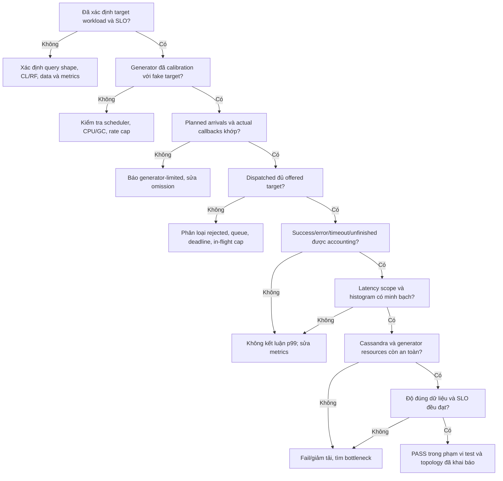

# Điều tiết số yêu cầu đồng thời và tránh sai lệch do bộ phát tải

> **Chương:** Đo tải và lỗi phân tán  
> **Ngữ cảnh:** Apache Cassandra với mô hình *wide-column*, partition key, replica, consistency level, compaction/repair và ứng dụng Java sử dụng **Cassandra Java Driver 4.x**. Bài hướng dẫn **điều khiển bộ phát tải (load generator)** để đánh giá Cassandra hoặc API có Cassandra ở phía sau mà không nhầm kết quả đẹp do chính bộ phát tải tạo ra.
>
> **Mục tiêu:** Phân biệt *target/offered/admitted/completed throughput* với số request đồng thời; hiểu mô hình **open-loop** và **closed-loop**, *coordinated omission*; thiết kế giới hạn **in-flight**, rate, queue và deadline; phát hiện máy phát tải bị CPU/network/GC chặn; viết bộ phát tải bất đồng bộ Java có accounting; so sánh số đo client/server trong test tăng tải và fault injection; lập tiêu chí go/no-go dựa trên cả **latency, lỗi, tỷ lệ từ chối, tài nguyên và độ đúng dữ liệu**.

## 1. Tình huống: “p99 chỉ 40 ms” nhưng ứng dụng thật đang timeout

Nhóm vận hành cần xác minh Cassandra chịu được **2.000 thao tác đọc/giây** của một bảng truy vấn theo partition key.

Một đoạn benchmark đơn giản thực hiện:

```java
// Anti-pattern: mỗi request xong mới gửi tiếp.
for (int i = 0; i < numberOfRequests; i++) {
    session.execute(prepared.bind(tenantId, orderIds[i]));
}
```

Báo cáo:

```text
Successful requests: 50.000
Observed p99:        40 ms
Errors:              0
Conclusion:          "Cluster xử lý 2.000 QPS ổn định"
```

Kết luận này không được chứng minh. Trong đoạn code, **mỗi thời điểm chỉ có một request đang chạy**. Nếu p99 thấp nhưng tốc độ thực chỉ 30 request/s, bài test không kiểm tra nổi mục tiêu 2.000 QPS.

Tệ hơn, nếu khi Cassandra chậm từ 30 ms lên 500 ms, vòng lặp phát request **chậm theo**. Bộ phát tải tự giảm áp lực đúng lúc cluster yếu; chỉ các request được gửi và hoàn thành mới xuất hiện trong histogram latency. Đây là một dạng cơ chế gây **coordinated omission**.

**Câu hỏi trọng tâm không phải “bộ phát tải chạy được bao nhiêu vòng lặp?” mà là “đã cung cấp bao nhiêu nhu cầu, Cassandra thật sự nhận bao nhiêu, hoàn tất bao nhiêu, với độ trễ và tỷ lệ lỗi nào?”**

## 2. Mô hình đường đi và điểm đo

```text
  Kế hoạch phát tải / arrival schedule
                 |
                 v
       LOAD GENERATOR CPU / GC
                 |
           admission gate
             /       \
           Reject    Accept
                       |
                       v
          Driver queue / pool / TLS
                       |
                       v
                 Coordinator
                       |
                 Internode RPC
                       |
                 Replica R1/R2/R3
                       |
                 Memtable / SSTable
                       |
                  Response
                       |
                 Driver decode
                       |
                 Application result
                       |
                  Metrics sink
```

Mỗi điểm có thể tích lũy thời gian, chiếm memory hoặc bỏ qua request. Nếu chỉ đo **thời gian từ khi driver thực sự gửi request tới lúc được trả lời**, ta có thể bỏ qua:

- Thời gian bộ phát tải **trễ lịch** do scheduler/CPU/GC.
- Thời gian chờ permit hoặc request queue phía client.
- Các request **không gửi được vì concurrency cap**.
- Các request bị timeout/cancel hoặc trả lỗi.
- Các lần retry/speculative execution phát sinh ở driver.
- Thời gian API/HTTP serialization khi test từ người dùng tới ứng dụng.

Để đo đúng, cần gắn metrics với **phạm vi rõ ràng**, không gộp mọi thứ thành một số `latency_ms`.

## 3. Bảng thuật ngữ cần thống nhất trước benchmark

| Thuật ngữ | Định nghĩa | Ví dụ |
| --- | --- | --- |
| **Target rate** | Tốc độ muốn tạo nhu cầu | 2.000 logical req/s |
| **Planned arrivals** | Số arrival slots theo lịch đã định | 120.000 trong 60 s |
| **Offered workload** | Nhu cầu người dùng/job dự định đưa vào hệ | Bao gồm cả nhu cầu không được phục vụ |
| **Dispatched/submitted** | Request đã thực sự bắt đầu ở client driver/API | 110.000 |
| **Locally rejected** | Bị load generator/admission từ chối trước khi gọi driver | 5.000 |
| **Scheduler missed** | Load generator không phát đúng lịch hoặc bỏ slot trễ | 5.000 |
| **Completed success** | Hoàn tất với kết quả hợp lệ | 105.000 |
| **Completed error** | Hoàn tất bằng lỗi/timeout/response không hợp lệ | 4.800 |
| **In-flight** | Đã gửi và chưa hoàn tất ở phạm vi đo | Ví dụ 200 |
| **Queue depth** | Đang chờ được nhận, **chưa** thực thi | Ví dụ 40 |
| **Response latency** | Từ lúc gửi đến khi có phản hồi ở client | 25–500 ms |
| **Scheduled-arrival latency** | Từ **lịch cần được phục vụ** đến khi có kết quả | Gồm scheduler lag/queue |
| **Server latency** | Khoảng thời gian đo theo coordinator/server | Không bao gồm mọi thời gian ở client |
| **Attempt amplification** | Số execution attempts / logical requests | 1,12 khi có retry/speculation |

Số liệu trong bảng là **minh họa**, không phải benchmark đo được.

### Quy tắc accounting

Với một khoảng đo đã đóng và tất cả request thực sự phát đã được drain:

\[
\text{Dispatched}=\text{Success}+\text{Error/Timeout}+\text{Unfinished}
\]

Nếu đã đợi xong toàn bộ request, `Unfinished = 0`. Trong khi thử nghiệm đang chạy, số `Unfinished` không thể tự bỏ qua.

Về lịch phát:

\[
\text{Planned Arrivals}
=\text{Dispatched}+\text{Locally Rejected}+\text{Missed/Not Emitted}
\]

Cần định nghĩa riêng cách tính **missed schedule**: một scheduler bị nghẽn có thể chưa chạy đủ callback tương ứng lịch dự định. Không được gọi `numberOfCallbacks` là toàn bộ planned arrivals nếu máy phát tải đã trễ lớn.

**Đếm cả những request không được phát mới biết nhu cầu thật có được kiểm tra hay không.**

## 4. QPS và concurrency là hai giới hạn khác nhau

**QPS (request/s)** là tốc độ. **Concurrency (in-flight requests)** là số công việc đang chờ xử lý ở một thời điểm.

Một service có thể giữ QPS gần cố định trong khi concurrency tăng rất mạnh do độ trễ Cassandra tăng.

Ví dụ trạng thái ổn định:

| Offered/completed QPS | Mean response time | In-flight trung bình |
| ---: | ---: | ---: |
| 200 req/s | 20 ms | 4 |
| 1.000 req/s | 20 ms | 20 |
| 1.000 req/s | 100 ms | 100 |
| 1.000 req/s | 400 ms | 400 |

Các giá trị dùng Little's Law, chưa tính biến động hoặc queue bị từ chối.

Một bộ phát tải **chỉ giới hạn QPS** có thể tích lũy hàng nghìn futures khi Cassandra chậm. Một bộ phát tải **chỉ giới hạn concurrency** có thể tự giảm tốc phát khi server chậm, khiến không còn mô phỏng đúng tải từ bên ngoài.

**Cần cả arrival schedule và giới hạn in-flight — và phải đo phần nhu cầu vượt giới hạn thay vì giấu nó.**

## 5. Little's Law: phép tính định hướng, không phải bộ chọn cap tự động

Trong hệ ổn định:

\[
L = \lambda W
\]

Trong đó:

- \(L\): số công việc trung bình ở phạm vi đang đo.
- \(\lambda\): tốc độ đến/hoàn tất trung bình khi hệ ở trạng thái ổn định.
- \(W\): thời gian trung bình trong phạm vi đó.

Ví dụ:

```text
Target: 1.500 requests/s
Mean DB response: 80 ms = 0,080 s

Expected mean in-flight ~ 1500 x 0,080 = 120
```

Nếu đặt `maxInFlight=100`, hệ có thể thường xuyên bị admission reject **ngay cả khi Cassandra không có lỗi** vì cap thấp hơn số công việc trung bình cần thiết ở mục tiêu.

Nếu Cassandra chậm lên 300 ms:

```text
1.500 x 0,300 = 450 in-flight trung bình
```

Khi đó tăng cap lên 450 có thể **làm cluster quá tải hơn** nếu nguyên nhân latency tăng là CPU/disk bão hòa.

**Little's Law giúp hiểu trạng thái, không bảo đảm rằng Cassandra đủ năng lực phục vụ lượng concurrency đó.**

### Khi công thức không đáng dùng trực tiếp

- Bài test mới chạy vài giây, chưa ổn định.
- Workload burst mạnh và latency phân bố lệch.
- Một số query quét nhiều SSTable/tombstone, một số rất nhẹ.
- Có retry/speculation làm số physical attempts khác logical arrivals.
- Có queue/rejection/cancellation chưa đưa vào phạm vi đo.
- Generator chưa đáp ứng target rate.
- Hệ quá tải, backlog tăng không giới hạn; không còn trạng thái ổn định.

## 6. Closed-loop: số request phụ thuộc phản hồi trước

Một hệ **closed-loop** thường có số virtual users/công việc đồng thời cố định: một user đợi request xong rồi mới bắt đầu request tiếp.

```text
Virtual user #1:  SEND A ---- wait ---- RESULT
                                |
                                +--> SEND B ---- wait ---- RESULT

Virtual user #2:  SEND C ---- wait ---- RESULT
                                |
                                +--> SEND D ...
```

Nếu Cassandra chậm, virtual users chờ lâu hơn; số request mới **giảm tự nhiên**.

### Ưu điểm

- Mô phỏng đúng một số workflow người dùng phải chờ bước trước.
- Dễ giới hạn number of virtual users.
- Ít tạo backlog ngoài kiểm soát.
- Hữu ích để đo throughput khi cố định concurrency.
- Có thể kiểm tra resource của hệ trong mô hình “người dùng chờ”.

### Giới hạn

- Không tự mô phỏng **arrival rate độc lập với latency**.
- Khi Cassandra bị lỗi, generator giảm tốc và có thể che overload.
- Latency histogram có thể bỏ qua **thời gian đáng lẽ request tiếp theo phải tới**.
- Một kết luận “chịu được X QPS” cần **đo QPS thực**, không suy từ số users.

**Closed-loop không sai. Nó chỉ trả lời một câu hỏi khác open-loop.**

## 7. Open-loop: tốc độ đến không phụ thuộc request trước

Trong **open-loop**, request được lên lịch theo thời gian hoặc một quá trình arrival độc lập với phản hồi từ Cassandra.

```text
Lịch gửi (ví dụ cứ 10 ms):
t=0      SEND A ------------ (A chậm)
t=10     SEND B ------- (B chậm)
t=20     SEND C --
t=30     SEND D ---
t=40     SEND E ---------------
...
```

Khi Cassandra chậm, load generator vẫn ghi nhận **nhu cầu mới đến**, cho thấy:

- Số in-flight tăng.
- Concurrency cap bị chạm.
- Queue chờ/rejected tăng.
- Deadline trôi qua dù request chưa được phục vụ.
- Latency tail và completed throughput xuống cấp.

### Nhưng open-loop không cho phép phát vô hạn

Nếu generator cứ tạo `CompletableFuture` mới ngay cả khi 20.000 request đang in-flight, ta đang test khả năng **làm đầy heap/driver queue**, không còn đo Cassandra sạch.

Một open-loop harness có kiểm soát phải:

1. Lên lịch **offered arrivals** độc lập với phản hồi.
2. Đặt **max in-flight** và optional bounded queue.
3. Khi quá cap, **ghi nhận rejection/miss** thay vì giữ hàng đợi vô hạn.
4. Ghi scheduler lag và generator health.
5. Báo đủ errors/timeouts và thời gian từ planned arrival.

Đây là điểm nối giữa **đúng mô hình thống kê** và **an toàn tài nguyên**.

## 8. Coordinated omission: sai lệch nguy hiểm nhất khi đo tail latency

*Coordinated omission* xảy ra khi cách sinh/ghi mẫu **bỏ qua những thời điểm hệ thống bị chậm**, thường do request sau chỉ được gửi khi request trước hoàn tất.

Ví dụ giả định:

```text
Target arrival: 100 req/s = 1 request mỗi 10 ms

t=0:    gửi A
t=10:   lẽ ra có B
t=20:   lẽ ra có C
...
t=980:  lẽ ra có request tiếp
t=1000: A mới trả lời
```

Trong closed-loop một user, nếu không có nhiều users hay compensation, chỉ A được phát trong 1 giây. Histogram có **một mẫu ~1.000 ms**, nhưng không có dữ liệu về gần 100 arrival slots vốn đã có nếu nhu cầu thật tiếp tục.

Một tool chỉ ghi duration của những request hoàn tất có thể báo p99 đẹp hơn rất nhiều so với trải nghiệm **nhu cầu phải xếp hàng để được phục vụ**.

### Vì sao cùng lỗi còn xảy ra ở “open-loop” giả?

Nếu code lập lịch:

```java
// Không thực sự open-loop nếu scheduler đợi request.
while (running) {
    session.execute(statement);
    Thread.sleep(10);
}
```

Khoảng cách giữa requests là **thời gian DB + 10 ms**, không phải cứ 10 ms theo đồng hồ.

Ngay cả khi dùng scheduler riêng, nếu generator bị stop-the-world GC 2 giây rồi âm thầm bỏ qua lịch, histogram của những request thực sự gửi vẫn **omitted** nhu cầu.

### Cách giảm sai lệch

- Mô tả workload bằng offered arrival schedule độc lập.
- Ghi **planned timestamp** cho mỗi intended arrival.
- Đo scheduler lag và queue wait.
- Khi bỏ arrival vì generator chậm hoặc quá cap, **đếm và báo**, không xóa khỏi denominator.
- Dùng histogram hỗ trợ corrected-latency nếu phù hợp, **phân biệt corrected với raw**.
- Đưa timeout, rejects và unfinished vào báo cáo, không xếp chung là latency bằng 0.

## 9. “Corrected histogram” có nghĩa gì và không có nghĩa gì?

Một số công cụ histogram benchmark hỗ trợ **coordinated-omission correction** dựa trên expected interval. Ý tưởng là không để một stall dài chỉ đóng góp một mẫu trong khi theo lịch đã có nhiều arrivals khác.

**Không được hiểu nhầm**:

- Correction **không tạo ra request thật đã chạy trên Cassandra**.
- Nó không cho biết chính xác server sẽ xử lý từng request bị bỏ như thế nào.
- Nó không biến 1.000 request/s **dự định** thành 1.000 request/s **thực gửi**.
- Nó không thay việc đo queue wait, rejection và generator lag.
- Kết quả corrected và raw phải **có nhãn riêng**, ghi phương pháp và expected interval.
- Không tự gán tất cả rejected requests một latency tùy ý rồi trộn vào histogram như thể đó là phản hồi thật.

**Tốt nhất:** tránh omission từ thiết kế generator; sau đó dùng correction minh bạch để bổ sung góc nhìn khi còn stall/scheduling gap.

## 10. Một timeline có thể làm benchmark “xanh giả”

Giả sử target 1.000 req/s và thời lượng 60 giây.

```text
Planned arrivals:       60.000
Generator thực dispatch: 18.000
Local rejections:        12.000
Missed schedule slots:   30.000

Completed success:      17.600
Completed errors:          400
In-flight sau drain:         0
```

Nếu báo cáo chỉ nhìn 17.600 thành công:

```text
"p99 successful read = 38 ms, error rate 2,2%"
```

và tuyên bố “1.000 QPS đạt” là sai.

Báo cáo phải chỉ ra:

- Target rate 1.000/s.
- Effective dispatch rate **300/s**.
- Successful rate khoảng **293/s**.
- **30.000** planned arrivals bị mất vì scheduler/nguồn phát.
- **12.000** requests bị gate từ chối.
- Hệ có thể **không hề được thử tại target load**.
- Error fraction cần công bố cả theo dispatched và theo offered, với tên metric rõ ràng.

### Hai mẫu số khác nhau

\[
\text{Dispatched Error Fraction}
= \frac{\text{Failed Completed}}{\text{Dispatched}}
\]

\[
\text{Offered Success Fraction}
= \frac{\text{Successful Completed}}{\text{Planned Arrivals}}
\]

Cả hai có ý nghĩa, nhưng chúng trả lời **hai câu hỏi khác nhau**. Không tráo mẫu số để tô đẹp hiệu năng.

## 11. Phân biệt delay của generator, driver và Cassandra

Một phép đo “latency” có thể được định nghĩa theo các đoạn:

```text
plannedAt
   |
   | scheduler lag
   v
dispatchAt
   |
   | driver queue/pool/TLS + network
   v
coordinator receives
   |
   | server processing + replica requests
   v
server replies
   |
   | network + driver decode
   v
clientCompleteAt
```

Đo:

\[
L_{\text{dispatch-to-completion}}
= t_{\text{complete}}-t_{\text{dispatch}}
\]

\[
L_{\text{scheduled-to-completion}}
= t_{\text{complete}}-t_{\text{planned}}
\]

\[
L_{\text{generator-lag}}
= t_{\text{dispatch}}-t_{\text{planned}}
\]

Trong test dùng queue:

\[
L_{\text{scheduled-to-completion}}
= L_{\text{scheduler-lag}}+L_{\text{queue-wait}}+L_{\text{execution}}
\]

theo các mốc được đo nhất quán.

**Không lấy thời điểm đồng hồ hệ thống trên hai máy khác nhau trừ trực tiếp** nếu chưa có đồng bộ clock/uncertainty phù hợp. Trong một Java process, `System.nanoTime()` thích hợp đo duration monotonic. Dùng wall-clock timestamp cho log/correlation, không dựa vào `Instant.now()` để đo latency rất ngắn.

## 12. Hai công cụ giới hạn khác nhau: rate limiter và semaphore

Một **rate limiter** đặt giới hạn lượng arrival/request trong đơn vị thời gian, thường kèm burst budget.

Một **semaphore/in-flight limiter** đặt giới hạn số request đã bắt đầu nhưng chưa hoàn tất.

| Cơ chế | Giải quyết | Không giải quyết |
| --- | --- | --- |
| Rate cap/arrival pacing | Không vượt tốc độ target | Không ngăn backlog khi latency tăng |
| In-flight cap | Không gửi quá N logical operations đồng thời | Có thể làm offered load bị reject |
| Bounded queue | Hấp thụ burst hữu hạn | Thêm queue latency, cần deadline |
| Deadline | Không giữ yêu cầu mãi | Không tự rollback server mutation |
| Upstream backpressure | Nguồn giảm phát theo năng lực | Làm thay đổi arrival model nếu đang đo open-loop |
| Retry budget | Tránh nhân tải khi lỗi | Không sửa partition hotspot hoặc disk bottleneck |

**Thiết kế tốt nhất thường dùng nhiều lớp**, nhưng báo cáo phải nói rõ mỗi lớp đã làm gì với từng request.

## 13. Chọn chính sách khi hết permit

Ba cách phổ biến:

### A. Fail fast

```text
Có slot -> gửi request
Hết slot -> locally_rejected++, không gọi driver
```

Phù hợp để đo điều gì xảy ra với một **arrival schedule cố định** mà không làm generator phình RAM.

### B. Bounded queue

```text
Có slot -> gửi
Hết slot, queue chưa đầy -> enqueue có deadline
Queue đầy/hết deadline -> reject/expire
```

Giúp đo **queue latency**, nhưng làm thời gian end-to-end cao hơn. Nếu chỉ báo cáo CQL duration sau lúc dequeue, sẽ bỏ qua phần thời gian người dùng đang chờ.

### C. Chặn thread đợi permit

```java
// Anti-pattern trên Netty/Reactor/event-loop và generator scheduler.
semaphore.acquire();
session.executeAsync(statement);
```

Có thể chặn luôn bộ phát arrival schedule. Khi Cassandra chậm, scheduler không gửi tiếp và **coordinated omission** xuất hiện.

**Trong open-loop harness, ưu tiên `tryAcquire()` không chặn hoặc bounded asynchronous queue**. Hết slot phải là sự kiện có metric, không làm scheduler biến mất.

## 14. Ngân sách in-flight ban đầu được chọn thế nào?

Giả sử:

```text
Target:                  1.200 logical reads/s
Healthy mean latency:       50 ms
Little's Law mean L:         60 in-flight

Canary caps cần so:         80 / 120 / 180
Giả định request deadline: 500 ms
```

Đây là ví dụ để thiết kế thử nghiệm, không phải công thức cho giới hạn tối ưu.

Cách chọn:

1. Có baseline latency khi chưa bão hòa.
2. Dự đoán mean in-flight từ QPS × mean latency.
3. Chọn một vài cap có **headroom có kiểm soát**, không bật vô hạn.
4. Chạy tăng tải và xem offered/dispatched/completed QPS.
5. Theo dõi Cassandra CPU, disk await, GC, pending/dropped messages.
6. Nếu cap chạm mà server còn khỏe, đánh giá nhu cầu tăng cap.
7. Nếu server đã bão hòa, **không tăng cap chỉ để giảm locally_rejected**.
8. Đánh giá lại khi retry/speculation policy, CL, RF/DC, app instances đổi.

**Cap tốt là ranh giới bảo vệ được thử nghiệm với workload, không phải số tùy tiện theo thread count.**

## 15. Java Driver 4.x: điều gì xảy ra khi gọi `executeAsync()`?

Với Java Driver 4.x:

```java
CompletionStage<AsyncResultSet> future =
    session.executeAsync(boundStatement);
```

Lệnh trả về một stage; điều này **không có nghĩa CQL đã hoàn tất**. Chi phí có thể tiếp tục ở:

- Driver request queue, connection pools, protocol.
- Coordinator và replicas.
- Response decoding và callback.
- Retry/speculation nếu statement/policy cho phép.
- Additional page fetches nếu query nhiều trang.

Vì thế đoạn này nguy hiểm:

```java
for (UUID id : aMillionIds) {
    session.executeAsync(select.bind("tenant-a", id));
}
```

Nó không có **global in-flight budget** và không thu thập exceptions/timeouts đầy đủ.

Cũng sai:

```java
semaphore.acquire();
try {
    return session.executeAsync(statement);
} finally {
    semaphore.release(); // Thả permit khi future vừa được tạo!
}
```

Permit chỉ nên được trả khi **asynchronous operation cần bảo vệ thật sự hoàn tất**, và đường xử lý exception đồng bộ cũng phải trả permit.

## 16. Bảng CQL minh họa cho bài đo tải

Bảng đọc theo đủ partition key:

```cql
CREATE KEYSPACE IF NOT EXISTS load_lab
WITH replication = {
    'class': 'NetworkTopologyStrategy',
    'datacenter1': 1
};

CREATE TABLE IF NOT EXISTS load_lab.orders_by_id (
    tenant_id text,
    order_id uuid,
    status text,
    total decimal,
    PRIMARY KEY ((tenant_id, order_id))
);
```

Ví dụ chỉ phù hợp **lab một node** có DC thật tên `datacenter1`. RF=1 và `LOCAL_ONE` không thay cho cấu hình production `RF=3/LOCAL_QUORUM`.

Nạp dữ liệu **trước warmup/đo chính**:

```cql
INSERT INTO load_lab.orders_by_id
    (tenant_id, order_id, status, total)
VALUES (
    'bench-tenant',
    11111111-1111-4111-8111-111111111111,
    'PAID',
    125.00
);
```

Query chuẩn:

```cql
SELECT status, total
FROM load_lab.orders_by_id
WHERE tenant_id = ?
  AND order_id = ?;
```

Nếu bảng được dùng để benchmark đọc, chuẩn bị **tập khóa tồn tại** với phân bố được kiểm soát. Không ngầm đổi sang random UUID chưa có row: đọc miss có thể rẻ/khác đọc hit và làm sai workload.

### Không viết benchmark chỉ có một hot key

Nếu mọi request hỏi cùng một partition, cache/hot partition behavior có thể hoàn toàn khác production. Test nên có các workload profile: uniform, hot-key skew và giới hạn active keyspace. Báo cáo phải nói rõ tỷ lệ hit/miss, kích thước row/partition và cỡ tập khóa.

## 17. Bộ phát tải open-loop có giới hạn bằng Java 17

Ví dụ sau thể hiện các bất biến quan trọng:

- **Schedule độc lập** với khi Cassandra trả lời.
- **Không chặn scheduler** khi hết slot.
- Request chỉ được tạo **sau khi** đã lấy permit.
- Phân biệt **missed schedule**, **locally rejected**, **dispatched**, **succeeded**, **failed**, **not-found**.
- Đo **planned-to-completion** và **dispatch-to-completion** bằng clock monotonic.
- Khi callback hoàn tất, **release permit đúng một lần**, kể cả exception.
- Không tự tạo một danh sách future vô hạn.

> Mã nhắm tới Java 17 và Cassandra Java Driver 4.x. `MetricsSink` là extension point đo histogram **thread-safe, không blocking**, cần được triển khai bằng công cụ đo thực tế. Code minh họa core logic, không phải load-test product đã có distributed coordination, HDR histogram, retry accounting hoặc hardening đầy đủ.

```java
import java.time.Duration;
import java.util.Objects;
import java.util.UUID;
import java.util.concurrent.CompletionStage;
import java.util.concurrent.Executors;
import java.util.concurrent.ScheduledExecutorService;
import java.util.concurrent.ScheduledFuture;
import java.util.concurrent.Semaphore;
import java.util.concurrent.TimeUnit;
import java.util.concurrent.atomic.AtomicLong;
import java.util.concurrent.atomic.LongAdder;

import com.datastax.oss.driver.api.core.CqlSession;
import com.datastax.oss.driver.api.core.DefaultConsistencyLevel;
import com.datastax.oss.driver.api.core.cql.AsyncResultSet;
import com.datastax.oss.driver.api.core.cql.BoundStatement;
import com.datastax.oss.driver.api.core.cql.PreparedStatement;

public final class BoundedOpenLoopLoad implements AutoCloseable {

    public interface MetricsSink {
        // Không block, không ném lỗi ra callback driver.
        // Implementation phải hỗ trợ nhiều threads.
        void recordNanos(String metric, long value);
    }

    public record Snapshot(
        long plannedCallbacks,
        long generatorMissed,
        long locallyRejected,
        long dispatched,
        long succeeded,
        long notFound,
        long failed,
        long observerFailures,
        int inFlight
    ) {}

    private final CqlSession session;
    private final PreparedStatement read;
    private final UUID[] knownKeys;
    private final MetricsSink metrics;
    private final Semaphore slots;
    private final int maxInFlight;
    private final long intervalNanos;
    private final long maxSchedulingLagNanos;

    private final ScheduledExecutorService scheduler =
        Executors.newSingleThreadScheduledExecutor();

    private final AtomicLong callbacks = new AtomicLong();
    private final LongAdder missed = new LongAdder();
    private final LongAdder rejected = new LongAdder();
    private final LongAdder dispatched = new LongAdder();
    private final LongAdder succeeded = new LongAdder();
    private final LongAdder notFound = new LongAdder();
    private final LongAdder failed = new LongAdder();
    private final LongAdder observerFailures = new LongAdder();

    private volatile ScheduledFuture<?> ticker;
    private volatile long startNanos;
    private volatile long stopNanos;

    public BoundedOpenLoopLoad(
        CqlSession session,
        UUID[] existingOrderIds,
        long targetQps,
        int maxInFlight,
        Duration maxSchedulingLag,
        MetricsSink metrics
    ) {
        this.session = Objects.requireNonNull(session);
        this.metrics = Objects.requireNonNull(metrics);
        this.knownKeys = Objects.requireNonNull(
            existingOrderIds).clone();

        if (knownKeys.length == 0) {
            throw new IllegalArgumentException("No known keys");
        }
        if (targetQps <= 0 || maxInFlight <= 0) {
            throw new IllegalArgumentException("Invalid load budget");
        }

        this.intervalNanos = 1_000_000_000L / targetQps;
        if (intervalNanos == 0) {
            throw new IllegalArgumentException(
                "QPS exceeds single-ticker resolution");
        }

        this.maxSchedulingLagNanos =
            maxSchedulingLag.toNanos();

        if (maxSchedulingLagNanos < 0) {
            throw new IllegalArgumentException("Negative lag");
        }

        this.maxInFlight = maxInFlight;
        this.slots = new Semaphore(maxInFlight);
        this.read = session.prepare(
            "SELECT status, total " +
            "FROM load_lab.orders_by_id " +
            "WHERE tenant_id = ? AND order_id = ?"
        );
    }

    public synchronized void start(Duration duration) {
        if (ticker != null || duration.isNegative()
            || duration.isZero()) {
            throw new IllegalStateException("Invalid start");
        }

        startNanos = System.nanoTime();
        stopNanos = startNanos + duration.toNanos();

        ticker = scheduler.scheduleAtFixedRate(
            this::tick, 0, intervalNanos, TimeUnit.NANOSECONDS
        );
    }

    private void tick() {
        final long now = System.nanoTime();

        // Khi quá cửa sổ đo, không phát request nữa.
        if (now >= stopNanos) {
            return;
        }

        final long index = callbacks.getAndIncrement();
        final long plannedAt =
            startNanos + index * intervalNanos;
        final long lag = Math.max(0L, now - plannedAt);

        record("generator_scheduler_lag_ns", lag);

        // Không cố đuổi bù mọi request đã quá trễ.
        if (lag > maxSchedulingLagNanos) {
            missed.increment();
            return;
        }

        // Admission trước khi gọi Java Driver.
        if (!slots.tryAcquire()) {
            rejected.increment();
            return;
        }

        final long dispatchAt = System.nanoTime();
        dispatched.increment();

        try {
            int keyIndex = (int) (index % knownKeys.length);

            BoundStatement statement = read
                .bind("bench-tenant", knownKeys[keyIndex])
                .setConsistencyLevel(
                    DefaultConsistencyLevel.LOCAL_ONE)
                .setIdempotent(true)
                .setPageSize(16);

            CompletionStage<AsyncResultSet> stage =
                session.executeAsync(statement);

            stage.whenComplete((result, error) -> {
                final long finishedAt = System.nanoTime();

                try {
                    record("dispatch_to_result_ns",
                        finishedAt - dispatchAt);
                    record("planned_to_result_ns",
                        finishedAt - plannedAt);

                    if (error != null) {
                        failed.increment();
                    } else if (result == null ||
                               result.one() == null) {
                        notFound.increment();
                    } else {
                        succeeded.increment();
                    }
                } catch (RuntimeException mappingError) {
                    failed.increment();
                } finally {
                    slots.release();
                }
            });

        } catch (RuntimeException sendError) {
            failed.increment();
            record("dispatch_to_result_ns",
                System.nanoTime() - dispatchAt);
            slots.release();
        }
    }

    private void record(String name, long elapsed) {
        try {
            metrics.recordNanos(name, Math.max(0L, elapsed));
        } catch (RuntimeException metricError) {
            // Metrics failure không làm permit bị leak.
            observerFailures.increment();
        }
    }

    public synchronized void stop() {
        if (ticker != null) {
            ticker.cancel(false);
        }
        scheduler.shutdown();
    }

    // Chỉ gọi ở test/control thread, KHÔNG gọi trong event loop.
    public boolean awaitDrain(Duration timeout)
        throws InterruptedException {

        long deadline = System.nanoTime() + timeout.toNanos();
        while (System.nanoTime() < deadline) {
            if (slots.availablePermits() == maxInFlight) {
                return true;
            }
            Thread.sleep(10);
        }
        return slots.availablePermits() == maxInFlight;
    }

    public Snapshot snapshot() {
        return new Snapshot(
            callbacks.get(),
            missed.sum(),
            rejected.sum(),
            dispatched.sum(),
            succeeded.sum(),
            notFound.sum(),
            failed.sum(),
            observerFailures.sum(),
            maxInFlight - slots.availablePermits()
        );
    }

    @Override
    public void close() {
        stop();
        // CqlSession do caller sở hữu, không close ở đây.
    }
}
```

### Ví dụ cách điều phối test

```java
// Chỉ là trích đoạn trong test runner / main đã tạo session.
// orderIds phải là các khóa có dữ liệu được nạp sẵn.
BoundedOpenLoopLoad.MetricsSink sink =
    (name, nanos) -> histogramRecorder.record(name, nanos);

try (BoundedOpenLoopLoad load =
         new BoundedOpenLoopLoad(
             session,
             orderIds,
             200,                         // Target 200 req/s
             50,                          // Max 50 in-flight
             Duration.ofMillis(30),       // Max scheduler lateness
             sink)) {

    load.start(Duration.ofSeconds(60));
    Thread.sleep(Duration.ofSeconds(60).toMillis());
    load.stop();

    boolean drained = load.awaitDrain(Duration.ofSeconds(10));
    System.out.println(load.snapshot());
    System.out.println("drained=" + drained);
}
```

`histogramRecorder` là đối tượng thu metrics do dự án cung cấp, không định nghĩa ở đoạn trích. Có thể dùng HdrHistogram Recorder hoặc một hệ thống metrics tương ứng, với **đúng đơn vị nanosecond** và thread safety.

### Đây là code minh họa, không phải load generator production-ready

Một số hạn chế có chủ ý:

1. `scheduleAtFixedRate` dùng một scheduler thread; ở QPS rất cao bản thân ticker có thể không chạy kịp.
2. `intervalNanos = floor(1e9/QPS)` có sai số lượng tử; với high QPS nên dùng nhiều workers hoặc bộ phát tải chuyên dụng và verify actual rate.
3. Nếu scheduler chạy chậm, số callbacks được gọi **có thể ít hơn arrival slots theo wall-clock**; phải so với `expectedArrivals = duration / interval` trong báo cáo.
4. Một callback quá trễ được đếm `generatorMissed`; không “catch up burst” để giả vờ đã phát đúng lịch.
5. Khi stop, các requests còn in-flight vẫn cần drain và thống kê; nếu hết drain deadline thì **phải báo unfinished**.
6. Test chỉ có một tenant và cách chọn khóa round-robin; muốn mô phỏng hot keys/Zipfian phải thay workload model có kiểm soát.
7. `MetricsSink` phải không block/không ném lỗi; nếu metrics sink chậm có thể làm scheduler/callback chậm và sai kết quả.
8. `result.one()` chỉ xác nhận row đầu, phù hợp query theo PK trả tối đa một row; không benchmark dữ liệu nhiều trang bằng cách này.
9. `LOCAL_ONE` trong code dành cho RF1 lab; production profile phải chọn CL đúng contract.
10. Lỗi khi `executeAsync` khởi phát đồng bộ và hoàn tất async phải được phân loại riêng khi xây report vận hành.
11. Không tạo `CqlSession` mới cho mỗi request; dùng một session với pool do driver quản lý cho mỗi load worker phù hợp.
12. Chưa có điều phối nhiều máy, negative tests về TLS và tự động đọc server metrics.
13. **Không dùng `sleep` trong scheduler hoặc callback**; đoạn `Thread.sleep` chỉ ở thread điều phối test.
14. Khi `stop()` và `awaitDrain`, không được đóng `CqlSession` sớm khiến requests đang chạy bị hủy không đúng mục tiêu.
15. Histogram chưa gồm rejected/missed dưới dạng latency; phải báo chúng như **outcome riêng**.

**Mục tiêu chính của ví dụ là tính sổ và kiểm soát tải, không phải tạo ra benchmark nhanh nhất.**

## 18. Một lỗi tinh vi: scheduled callbacks không bằng planned arrivals

Giả sử test 60 giây, target 1.000/s. Số slot theo lịch xấp xỉ:

\[
N_{\text{expected}} \approx 60 \times 1{,}000 = 60{,}000
\]

Nhưng `callbacks.get()` của ví dụ chỉ đạt 45.000 vì JVM scheduler bị GC/CPU contention.

Nếu trong 45.000 callback:

```text
missed = 5.000
rejected = 10.000
dispatched = 30.000
```

thì vẫn còn:

```text
expected - callbacks = 15.000 arrival slots
```

bị thiếu do scheduler **chưa tạo callback đúng lịch**.

Cần báo hai dạng miss:

- **Observed late callback skipped**: có callback nhưng đã quá trễ nên không gửi.
- **Unobserved intended slots**: lịch dự định có, nhưng callback không xảy ra trong cửa sổ đo.

Một báo cáo đầy đủ có thể tính:

\[
\text{Total Schedule Omission}
=\text{Late-Skipped}+\max(0,N_{\text{expected}}-N_{\text{callbacks}})
\]

Các công thức cần xử lý cẩn trọng trường hợp interval rounding, warmup và kết thúc giữa tick; chúng là **accounting test harness**, không phải metric Cassandra.

**Đừng gọi `plannedCallbacks` là số nhu cầu thật nếu scheduler chưa chạy đủ.**

## 19. Không dùng một triệu futures làm bộ phát tải

Anti-pattern:

```java
List<CompletionStage<AsyncResultSet>> all =
    new ArrayList<>();

for (UUID id : oneMillionIds) {
    all.add(session.executeAsync(
        prepared.bind("tenant-a", id)));
}
```

Vấn đề:

- Tạo request gần như đồng thời, không phải steady QPS.
- Heap chứa futures, callbacks, buffers lớn.
- Driver queue/connection pool có thể overflow.
- Server nhận burst phụ thuộc tốc độ vòng lặp.
- Không đo planned-arrival latency.
- Nếu `CompletableFuture.allOf` được gọi sau, nó **chỉ đợi**, không giới hạn concurrency.

**Thay thế:** admission trước `executeAsync`, max in-flight, rate scheduler có đo lag hoặc nguồn reactive có demand đúng scope.

Với data import, cần checkpoint và backpressure từ producer; với benchmark open-loop, cần đếm rejected/missed. Hai bài toán có mục tiêu khác nhau.

## 20. Phân biệt load test trực tiếp CQL và load test qua API

Có hai đối tượng đo hợp lý:

### A. CQL/native protocol benchmark

```text
Load generator (Java Driver) -> Cassandra cluster
```

Hữu ích khi cần:

- Đo riêng năng lực DB với một query shape.
- Thấy request latency/CL/partition placement.
- Tuning compaction, storage, coordinator/replica.
- Đánh giá driver retry/speculation hoặc paging.

**Không đo** đầy đủ HTTP auth, JSON parsing, business logic, service-to-service calls hoặc API queue.

### B. End-to-end API benchmark

```text
HTTP load generator -> API/gateway -> Java service
                    -> Cassandra -> response
```

Hữu ích khi cần:

- Đánh giá trải nghiệm thực tế và API SLO.
- Đo auth, rate limiter, queue, server thread pools.
- Xem 429/503/backpressure và retry policies xuyên tầng.
- Kiểm tra service scaling và tenant fairness.

**Không đồng nhất HTTP request count với CQL attempt count.** Một API request có thể phát nhiều CQL queries hoặc driver retries.

### Khi làm cả hai

Dùng CQL benchmark để tìm baseline phía DB và API benchmark để xác định overhead/tác động app. Nhưng phải báo **khác nhau về đường đi và workload**, không so p99 trực tiếp như hai biến thể của một phép thử tương đương.

## 21. Cassandra query-first: generator phải gửi truy vấn đại diện

Cassandra phân vùng dữ liệu bằng partition key/token. Với bảng:

```cql
PRIMARY KEY ((tenant_id, order_id))
```

SELECT theo đủ `tenant_id` và `order_id` là một query shape điển hình.

Anti-pattern:

```cql
-- Không dùng làm production baseline cho một bảng lớn:
SELECT * FROM load_lab.orders_by_id
WHERE status = 'PAID'
ALLOW FILTERING;
```

Query kiểu scan/filter rộng có thể có cost rất khác và không phù hợp ứng dụng thật.

Một workload profile cần định nghĩa:

- Tên bảng và CQL template.
- Partition key binding.
- Data distribution, số partitions và hot-key ratio.
- Cỡ row, cỡ partition, tombstone density.
- Paging/LIMIT và clustering order.
- Read vs write mix.
- Consistency level theo RF/DC.
- Retry/speculative policy.
- Node/coordinator locality.

**Nếu query shape khác production, biểu đồ đẹp không trả lời bài toán production.**

## 22. Uniform, hotspot và Zipfian: phải ghi phân bố khóa

Một Cassandra cluster có thể chịu 5.000 reads/s khi requests phân tán đều, nhưng giảm mạnh nếu 70% traffic đổ vào vài partitions.

### Các mô hình mẫu

| Workload | Cách chọn khóa | Ý nghĩa |
| --- | --- | --- |
| **Uniform** | Mỗi khóa gần như cùng xác suất | Baseline phân tán |
| **Hot-key** | Một nhóm nhỏ nhận phần lớn QPS | Phát hiện hot partition/replica |
| **Zipfian** | Một số khóa phổ biến hơn rất nhiều | Gần nhiều workload thực |
| **Sequential** | Đi qua key range theo thứ tự | Có thể làm cache/working set khác |
| **Random misses** | Khóa phần lớn chưa tồn tại | Đo miss path, không thay hit path |
| **Mixed** | Tỷ lệ hit/miss/TTL/delete đã định | Kiểm tra storage behavior |
| **Tenant skew** | Tenant A nhiều requests hơn B | Fairness/bulkhead |

### Ví dụ profile

```yaml
workload:
  table: load_lab.orders_by_id
  operations:
    read: 90
    write: 10
  key_distribution: hot-key
  hot_key_fraction: 0.01
  hot_request_fraction: 0.70
  expected_hit_ratio: 0.95
  row_size_bytes_p50: 512
  ttl_data_fraction: 0.20
  consistency_read: LOCAL_QUORUM
  consistency_write: LOCAL_QUORUM
```

Đây là **manifest mô tả benchmark**, không phải file cấu hình gốc của một tool cụ thể. Các con số phải dựa trên dữ liệu vận hành đã được tổng hợp/ẩn danh, không tự đoán.

**Một benchmark đọc miss 100% không thay thế benchmark đọc dữ liệu sống 95% hit.**

## 23. Paging: mỗi trang có thể là một request riêng

Ví dụ ứng dụng liệt kê 50 bản ghi/trang từ bảng `orders_by_customer_day`:

```cql
SELECT created_at, order_id, status
FROM load_lab.orders_by_customer_day
WHERE tenant_id = ?
  AND customer_id = ?
  AND day_bucket = ?
LIMIT 50;
```

Đây là **query template minh họa**; bảng tương ứng phải được tạo theo partition/clustering key trước khi chạy. `LIMIT 50` giới hạn tổng row trả, còn `setPageSize(20)` điều khiển cỡ trang protocol.

Trong Java Driver 4.x:

- `AsyncResultSet.currentPage()` chỉ cho kết quả trang hiện tại.
- `hasMorePages()` xác định còn trang.
- `fetchNextPage()` là thao tác có thể phát request tiếp theo.
- `ResultSet` đồng bộ có thể tự fetch trang kế khi iterator đi tiếp.

Nếu generator chỉ đếm **request `executeAsync` đầu tiên** nhưng application sau đó fetch thêm nhiều trang, số CQL requests vật lý và CPU/I/O bị báo thiếu.

### Chốt “logical operation”

Một benchmark có thể chọn:

1. **Một CQL page fetch = một logical request**; hoặc
2. **Một API query lấy toàn bộ N trang = một logical operation**.

Hai cách hợp lý nhưng **không thể so trực tiếp** nếu không công bố phạm vi.

Không gom tất cả rows vào `ResultSet.all()` trong một query lớn rồi đo “1 request” như thể đó là một trang nhẹ.

## 24. Consistency level, replication và topology làm thay đổi chi phí

Giả sử keyspace có `NetworkTopologyStrategy` và RF=3 trong `dc1`.

| CL | Đòi hỏi khái niệm | Hệ quả đo tải |
| --- | --- | --- |
| `LOCAL_ONE` | Một replica local phản hồi | Có thể nhanh hơn nhưng ít yêu cầu ACK hơn |
| `LOCAL_QUORUM` | Hai replica local khi RF=3 | Phụ thuộc latency/quorum, headroom replica |
| `QUORUM` | Quorum theo RF/replication | Có thể liên quan nhiều DC |
| `ALL` | Mọi replica theo yêu cầu của CL | Nhạy với node chậm/offline |
| `LOCAL_SERIAL` | Pha serial của LWT | Không thay regular CL cho mọi thao tác |

**Không hạ CL từ `LOCAL_QUORUM` xuống `LOCAL_ONE` để benchmark “đạt p99”** nếu ứng dụng thật yêu cầu quorum. Đó là thay đổi correctness contract.

### Single-node benchmark có giới hạn

Một container RF=1 có thể đọc/ghi để kiểm tra code và đo chi phí CQL cơ bản. Nó **không đo**:

- Inter-node request amplification ở RF3.
- Quorum 2/3.
- Compaction/repair ảnh hưởng nhiều replica.
- Node failure/replica unavailable.
- Cross-DC replication/routing.
- Tail latency trong sản xuất nhiều nodes.

Một benchmark kết luận về RF3 phải có cluster/khung thử tương ứng.

## 25. Data set và quá trình nạp dữ liệu phải tách khỏi đo chính

Nếu benchmark cần 10 triệu rows, **không đo read p99 trong lúc seed dataset trừ khi workload thật sự gồm cả ingest**.

Quy trình thường là:

```text
1. Tạo schema/replication theo test plan
2. Seed dữ liệu với partition-size distribution xác định
3. Xác minh row counts/key samples, schema/CL
4. Đợi cluster ổn định theo tiêu chí rõ
5. Warmup query caches/driver session
6. Bắt đầu measurement window
7. Steady-state reads/writes theo target
8. Cooldown + drain
9. Kiểm tra correctness/data reconciliation
10. Ghi resource metrics và kết luận
```

Không dùng `SELECT COUNT(*)` toàn bảng lớn để xác minh dataset nếu gây full scan; dùng manifest số keys/partitions đã nạp, sample queries và metadata/đối soát riêng.

### “Đợi cluster ổn” có bằng chứng gì?

- Pending compactions/repair theo test plan.
- CPU/GC/disk I/O trở về trạng thái baseline chấp nhận.
- Không còn quá nhiều requests in-flight từ seed.
- Schema agreement và RF/DC đúng.
- Các replica cần thiết sẵn sàng.
- Application session/connection pools đã warm.
- Không tự ý chạy compaction/repair để làm biểu đồ đẹp nếu production không vận hành tương tự.

## 26. Warmup, ramp-up, steady-state và cooldown

Một test 60 giây không nên coi mọi giây có ý nghĩa thống kê như nhau.

### Warmup

- Container/JVM/driver khởi động.
- Prepared statements, connections/TLS handshake.
- JIT compilation, caches và metadata refresh.
- Cassandra memtable/SSTable caches được làm nóng.

### Ramp-up

- Target QPS tăng dần để tránh một cú sốc không đại diện.
- Ghi biến động nhưng **không trộn ramp-up vào histogram steady-state** nếu mục tiêu đo công suất ổn định.

### Steady-state

- QPS offered giữ theo kế hoạch.
- Đủ thời gian quan sát p95/p99 và compaction windows.
- Resource và throughput được đo theo time buckets, không chỉ aggregate toàn bài.

### Cooldown/drain

- Ngừng phát arrivals mới.
- Chờ requests đang chạy trong bounded deadline.
- Report unfinished/cancelled nếu chưa drain.
- Chỉ đóng CqlSession sau khi capture kết quả cần thiết.

**Nếu test kết thúc trước khi backlog được drain**, một histogram chỉ gồm request thành công đã xong có thể bỏ qua những request chậm nhất. Đây là **right-censoring** cần được báo riêng, không coi tất cả còn lại là thành công.

## 27. Kiểm soát số load generators và hệ số scale

Một máy phát tải có thể bị nghẽn trước Cassandra. Có thể phải chạy nhiều generator workers/machines.

Ví dụ:

```text
Target toàn bài:       6.000 logical req/s
Số generator workers:  3
Target mỗi worker:     2.000 req/s

Máy A: offered thực 2.000
Máy B: offered thực 1.450 (CPU/GC saturation)
Máy C: offered thực 2.000

Tổng thực dispatch không phải 6.000.
```

Phải tổng hợp **trên từng worker**:

- Intended arrivals.
- Scheduler misses/late callbacks.
- Dispatched, locally rejected.
- In-flight, queue depth.
- CPU/heap/GC/event-loop saturation.
- NIC/TCP/TLS bandwidth.
- Error, timeout, coordinator selection.

Không lấy trung bình của các p99 worker để ra p99 toàn hệ. Muốn p99 toàn workload cần **merge histogram/samples đúng phương pháp**, giữ đơn vị và cùng time window.

### Đồng bộ test start

Các workers có thể dùng orchestrator/start barrier hoặc lịch start đã đồng bộ. Nhưng **đừng lấy timestamp từ các máy để tính duration chéo** mà không xác minh đồng bộ clock/offset.

Mỗi worker đo latency bằng clock monotonic nội bộ; chỉ dùng wall clock có đồng bộ để căn time series và fault events.

## 28. Kiểm tra bộ phát tải bằng một target giả rất nhanh

Trước khi đổ tải lên Cassandra, hãy **benchmark chính load generator**.

Một test có thể thay `session.executeAsync` bằng một fake asynchronous operation hoàn tất ngay hoặc sau delay được kiểm soát, nhằm đo:

- Scheduler có phát đủ intended arrivals không?
- Tỷ lệ callback late/missed ở QPS mục tiêu.
- Latency metrics overhead bao nhiêu?
- Semaphore/counters có race hoặc leak không?
- Độ chính xác rate ở 100/1.000/10.000 req/s.
- CPU/GC và heap footprint của generator.
- Chi phí tracing/histogram/logging của harness.

### Kết luận cần đạt

Nếu một bộ phát tải không giữ nổi 5.000 planned arrivals/s với target fake cực nhẹ, thì **không thể dùng nó để chứng minh Cassandra chỉ chịu được 4.000 QPS**.

Nếu target fake chạy ổn nhưng Cassandra thực không đạt, chuyển sang đo network/driver/coordinator/replica để tìm nguyên nhân.

**Một generator có “overhead rẻ” ở 100 req/s có thể trở thành bottleneck ở 20.000 req/s.**

## 29. CPU, GC, network, TLS và connection pools của generator

Những triệu chứng điển hình:

| Triệu chứng | Vấn đề có thể ở generator | Bằng chứng cần xem |
| --- | --- | --- |
| Scheduler lag tăng mạnh | CPU saturation hoặc GC pause | Process CPU, GC logs, scheduler hist |
| QPS dispatch thấp hơn target | Tick không kịp hoặc bị gate reject | Planned/actual accounting |
| p99 tăng nhưng Cassandra nodes rảnh | Client queues/TLS/network | Driver metrics, socket stats, thread dump |
| Memory tăng liên tục | Futures/queues không bounded | Heap usage, GC, in-flight/queue |
| Một core CPU 100% | Single generator scheduler bottleneck | Thread-level CPU profile |
| TLS handshake nhiều | Tạo session/connection quá thường xuyên | Connection metrics, session lifecycle |
| Errors tập trung một host | Driver routing/pool/host health | Per-host causes, coordinator DC |
| Packet retransmits | NIC/network path vấn đề | TCP statistics, interface usage |
| Metrics exporter chậm | Instrumentation blocking | Collector queue/drop, callback timing |
| Log ghi mỗi request | Logging overhead và disk I/O | Logger throughput, disk usage |

### Không mở một `CqlSession` trên mỗi request

Session là client connection abstraction nặng, có connection pools/metadata. Benchmark tạo session liên tục sẽ đo **connection establishment** thay vì steady read/write latency, trừ khi mục tiêu chính là test connection churn.

Tách riêng **connection startup benchmark** khỏi **steady-state CQL benchmark**.

## 30. Driver retry và speculative execution làm nhân tải

Một logical read từ generator có thể được driver gửi nhiều execution attempts.

```text
Planned logical read
    |
    +--> Attempt A tới Coordinator N1
    |
    +--> Attempt B (speculation nếu A chậm)
    |
    +--> Retry attempt (nếu policy/lỗi cho phép)
    |
    v
Replica reads (có thể chồng lấn)
```

Giả sử 1.000 logical reads/s, 10% có một speculative attempt và 5% có thêm một retry (giả định không trùng nhiều lần):

```text
~1.000 primary CQL attempts/s
~  100 speculative attempts/s
~   50 retry attempts/s

Tổng ~1.150 coordinator attempts/s
Amplification ~1,15
```

Đây là số **minh họa**, không phải công thức tổng quát khi retries/speculation xen kẽ.

### Phải tách metric

- Logical operations ở API/load generator.
- Driver execution attempts.
- Retry decisions và reasons.
- Speculative attempts/wins.
- Server-side speculative replica reads nếu có.
- Internode replica messages.
- Final error/timeout count.

**Driver speculation và server speculative retry là hai tầng khác nhau**, có thể cộng dồn tải. Không dùng 1.000 logical requests/s làm bằng chứng chỉ có 1.000 replica RPC/s.

### Idempotency khi benchmark ghi

Không bật retry/speculation trên counter increment, list append, LWT/business writes nếu chưa chứng minh lặp an toàn. Một write timeout không khẳng định mutation chưa được áp dụng. Với benchmark ghi, dùng stable event IDs, tách ingest correctness khỏi throughput, và có reconciliation.

## 31. Một số phép tính cần có trước khi chạy

Giả sử:

```text
Target rate:                 2.000 logical requests/s
Test steady-state:           180 seconds
Max in-flight per worker:    150
Workers:                     4
Expected total arrivals:     360.000

Nhưng nếu mỗi worker đặt 2.000 QPS:
  Target toàn hệ sẽ là 8.000 QPS, KHÔNG phải 2.000.
```

Nếu chia đều:

```text
Target mỗi worker = 2.000 / 4 = 500 QPS
Expected mỗi worker = 90.000 arrivals trong 180 s
```

Số max in-flight toàn hệ nếu mỗi worker cap 150 là **tối đa 600 logical in-flight**. Điều này **không** đồng nghĩa Cassandra chỉ có 600 physical RPC vì retry, paging và replica fan-out.

### Công thức

\[
\text{Total Target QPS}
=\sum_{i=1}^{N}\text{Worker Target QPS}_{i}
\]

\[
\text{App/Generator Logical In-Flight Limit}
\le \sum_{i=1}^{N}\text{Worker Max In-Flight}_{i}
\]

Giới hạn theo máy chỉ đúng nếu mỗi worker có một limiter và không có đường gửi request nào bỏ qua gate.

## 32. Tăng tải theo bậc để tìm điểm gãy

Một bài load test nên tăng arrival rate có kiểm soát, ví dụ:

| Giai đoạn | Offered target | Thời gian minh họa | Mục tiêu |
| --- | ---: | ---: | --- |
| Baseline | 200/s | 5 phút | Kiểm tra generator/DB khỏe |
| Step 1 | 500/s | 5 phút | Đo headroom |
| Step 2 | 800/s | 5 phút | Đo p95/p99 và reject |
| Step 3 | 1.200/s | 5 phút | Gần target SLO |
| Step 4 | 1.600/s | 5 phút | Thăm dò saturation |
| Recovery | 200/s | 5 phút | Xem backlog/disk/GC phục hồi |

Các con số chỉ minh họa; không phải tải khuyến nghị cho cluster bất kỳ.

### Điểm gãy xuất hiện thế nào?

- Offered rate tăng nhưng **completed throughput ngừng tăng**.
- p95/p99 và deadline timeouts tăng dốc.
- In-flight bám cap.
- Queue wait/rejections tăng.
- CPU/GC/disk await hoặc replica pending/dropped tăng.
- Client scheduler lag cũng có thể tăng — cần xác định đó là **generator bottleneck** hay downstream pressure.

**Không đo “max throughput” bằng cách vô hạn concurrency cho đến khi OOM.** Điều đó có thể gây suy giảm nghiêm trọng và cho số đo không thể tái lập.

## 33. Chỉ đọc p99 thành công là sai khi timeout tăng

Giả sử cùng một thời điểm:

```text
Target offered:     1.000 req/s
Completed success:    700 req/s
Timeout/error:        200 req/s
Rejected/missed:      100 req/s

p99 của SUCCESSFUL requests: 65 ms
```

Không thể kết luận SLO 100 ms đạt vì:

- Có 20% request timeout/error.
- 10% không được phục vụ đúng lịch.
- 700 successes/s thấp hơn target 1.000/s.
- Các request chậm nhất có thể bị loại khỏi latency sample do timeout.

### Báo cáo đủ ít nhất bốn trục

1. **Demand:** offered/planned arrivals.
2. **Delivery:** admitted/dispatched, completed successes.
3. **Failure:** errors/timeouts/rejected/missed/unfinished.
4. **Latency:** p50/p95/p99, queue wait, scheduled-to-completion, và percentile window/method.

Nếu chỉ có latency histogram của success, **không có bằng chứng đủ để tuyên bố SLO đạt**.

## 34. Cách tính percentile và những bẫy thống kê

Percentile `p99` nghĩa là khoảng 99% mẫu trong tập mẫu có latency không vượt mức đó (theo cách tính percentile đã chọn).

### Những điều phải khai báo

- Mẫu nào được đưa vào histogram? Success only hay cả error responses có latency?
- Timeout được biểu diễn thành một outcome hay một giá trị giả?
- Đo `dispatch-to-completion` hay `planned-to-completion`?
- Time window là 10 s, 1 phút hay toàn steady-state?
- Histogram có corrected omission hay không?
- Precision và đơn vị ms/µs/ns?
- Có merge histogram của nhiều workers đúng không?
- Có bỏ warmup/ramp/cooldown không?
- Có enough samples cho tail percentile không?

### Không lấy trung bình các p99

Sai:

```text
Worker A p99 = 40 ms
Worker B p99 = 180 ms
Overall p99 = (40 + 180) / 2 = 110 ms  <-- Không đúng
```

Nếu workers có lượng requests khác nhau, kết quả còn sai lệch nặng. Cần merge distribution/histogram hoặc thu tập samples theo cơ chế có kiểm soát.

### Không lấy p99 từ vài chục requests

Với số mẫu ít, tail percentile dao động mạnh. Cần chọn duration/arrival rate đủ để quan sát có ý nghĩa và báo confidence/variance khi phù hợp. Không xóa các outliers chỉ vì làm biểu đồ xấu.

## 35. Kiểm tra time window để tránh che spike

Một report toàn 60 phút có thể có p99 tổng hợp tương đối tốt, trong khi 5 phút sự cố có tỷ lệ lỗi rất cao.

Nên xuất:

- **Time series theo 1–10 s hoặc 1 phút** tùy traffic.
- Offered/dispatch/completion QPS từng bucket.
- p95/p99 latency từng bucket, cùng denominator.
- Scheduler lag/rejected/timeouts từng bucket.
- Cassandra CPU/GC/disk/network từng bucket.
- Fault events có timestamp và độ lệch clock được biết.

Không trộn hết mọi pha rồi tuyên bố “steady-state p99=...”.

**Lúc fault injection, so sánh baseline → fault onset → degraded period → recovery**, không chỉ trung bình 5 phút trước và sau.

## 36. Bộ phát tải có thể tự tạo “retry storm”

Nếu generator có application-level retries, Java Driver cũng retry, và gateway HTTP cũng retry:

```text
1 offered logical request
   |
   +--> HTTP attempt 1
   |      +--> Driver attempt A
   |      +--> Driver speculative B
   |
   +--> HTTP retry 2
          +--> Driver attempt C
          +--> Driver retry D
```

Một logical request có thể gây nhiều work phía coordinator/replica, nhất là khi Cassandra đang chậm.

### Cấu hình benchmark cần khai báo

- Retry của load generator: bật/tắt, max attempts, backoff/jitter.
- Retry của HTTP client/gateway.
- Retry policy của Java Driver.
- Speculative execution policy và idempotence.
- Request timeout/deadline từng tầng.
- Điều kiện circuit breaker/rate limiter.
- Tỷ lệ thành công theo **logical operation**, không đếm retries thành người dùng mới.

Trong test xác định năng lực tối đa của Cassandra, có thể **tắt retry/speculation để có baseline rõ**, sau đó chạy lại đúng chính sách production như một scenario riêng. Cách này giúp phân biệt giới hạn server và amplification do resilience policy.

## 37. Fault injection: node lỗi mà offered rate phải giữ được đo

Một bài test lỗi phân tán có thể mô phỏng:

- Coordinator restart trong lab.
- Một replica network chậm.
- Disk I/O bị giới hạn trên một node.
- Pause/GC dài.
- Network partition trong phạm vi cluster test.
- Mất một node khi RF3/LOCAL_QUORUM.
- Repair/compaction/streaming tranh tài nguyên.

### Phép đo quan trọng

Trước lỗi:

```text
Offered:    800 req/s
Success:    795 req/s
p99:         60 ms
```

Trong lỗi, **không để closed-loop tự giảm offered xuống 100/s mà không báo**. Một open-loop controlled harness có thể cho thấy:

```text
Target offered:     800 req/s
Dispatched:         500 req/s
Success:            350 req/s
Timeout/errors:     150 req/s
Rejected/missed:    300 req/s
```

Đây là dữ liệu minh họa. Nó mô tả khả năng phục vụ dưới lỗi rõ hơn một histogram success-only.

### Tại sao không tăng in-flight vô hạn khi node down?

Nếu RF/CL không còn đủ replica, extra requests/retries chỉ làm tăng queue và timeout. Bài test nên có **safety limits** và fail/abort conditions, không cố “giữ target bằng mọi giá” trên server đã bão hòa.

**Fault injection chỉ ở lab/staging được phê duyệt, không tự tắt node production để kiểm chứng lý thuyết.**

## 38. RF, CL và availability khi xảy ra lỗi

Ví dụ RF=3 ở `dc1`, read/write `LOCAL_QUORUM` cần hai replica local.

| Tình huống | Điều cần kiểm tra |
| --- | --- |
| Cả ba replicas khỏe | Baseline QPS/latency |
| Một replica tạm mất | Hai replica còn lại có phục vụ CL đúng không? |
| Hai replicas mất | Có `Unavailable`/timeouts thay vì success giả không? |
| Coordinator bị restart | Driver chọn host khác; retry budget hợp lý |
| Một replica chậm | Read p99, speculative replica read và queue |
| Cross-DC link chậm | Local CL routing và replication lag |
| Repair chạy | Resource headroom, compaction/streaming impact |

Không coi một node RF1 với `LOCAL_QUORUM` là mô phỏng quorum 2/3; ở RF1, local quorum chỉ cần một replica.

### Khi client timeout, server có thể còn xử lý

Trong test write, timeout không có nghĩa mutation chưa được áp dụng. Nếu generator retry non-idempotent writes, kết quả dữ liệu có thể sai dù throughput nhìn cao.

Cần kiểm tra **số logical events được ghi thực**, dedup/version/counter semantics và reconciliation, không chỉ count ACK success.

## 39. Đo server để phân biệt generator bottleneck và Cassandra bottleneck

Một bài test cần **hai chiều telemetry**:

### Client/load generator

- Planned, scheduled-callback, dispatched, completed, rejected, missed, unfinished.
- Scheduler lag, queue wait, latency histogram.
- CPU/GC/heap/network/TLS của máy phát.
- Driver timeout/retry/speculation/connection metrics.
- Per-host coordinator selection, local DC.
- Result correctness/miss rate.

### Cassandra cluster

- Read/write request rate và p95/p99 theo node/coordinator nếu đo được.
- CPU, heap/off-heap, GC.
- Disk utilization/await, SSTable read/write amplification.
- Thread pools/stages pending/dropped; `nodetool tpstats` tùy release.
- Compaction pending/throughput, repair/streaming.
- Internode messaging/network drops.
- Tombstone/partition read patterns.
- Availability theo RF/DC và CL errors.

### Diễn giải thường gặp

| Generator | Cassandra | Giả thuyết ban đầu |
| --- | --- | --- |
| CPU 100%, missed cao | CPU/disk server thấp | Generator là bottleneck |
| Rejected tăng, server còn khỏe | CPU/disk server thấp | Concurrency cap quá chặt hoặc misconfigured |
| Dispatch đạt target, p99 cao | Disk await và pending cao | Cassandra I/O/read-path bottleneck |
| Retry/speculation tăng | Replica/coordinator load tăng | Amplification do resilience policy |
| Một node overloaded | Node khác khỏe | Partition skew hoặc coordinator routing |
| HTTP p99 xấu, CQL p99 tốt | DB khỏe | Gateway/app queue, CPU hoặc serialization |
| CQL success p99 tốt, timeout cao | Có errors | Success-only histogram che lỗi |
| QPS thấp trong fault | Server chưa chắc bị đẩy tải | Closed-loop hoặc scheduler omission |

Đây là **triệu chứng cần điều tra**, không phải kết luận chắc chắn chỉ từ một metric.

## 40. Bản đồ tài nguyên và network của generator

Nếu generator chạy gần Cassandra, benchmark có thể **giảm latency mạng** so với ứng dụng production. Nếu đặt xa hơn, có thể đo WAN chứ không phải disk/CPU.

Ghi:

- Vùng/availability zone/DC của generator.
- Network path, RTT cơ sở và bandwidth.
- Tường lửa, NAT, proxy, load balancer.
- Host CPU architecture và số cores.
- JDK, GC, container CPU/memory limits.
- Driver session/pool config.
- TLS/mTLS theo production.
- Số generator pods/workers.
- OS socket/file descriptor limits.
- DNS resolution/certificate SAN.

**Không tự thêm artificial network delay rồi gọi đó là production topology** nếu chưa có bằng chứng mạng thật. Fault injection có thể dùng network emulation, nhưng kết quả phải ghi rõ profile, giới hạn và độ chính xác của công cụ mô phỏng.

## 41. Độ đúng dữ liệu cũng là SLO của load test

Một Cassandra benchmark có thể đạt 20.000 writes/s nhưng dữ liệu cuối không đúng vì:

- Retry counter increment hai lần.
- Duplicate events do client timeout rồi replay.
- Partition key phân phối sai tenant.
- LWW timestamp làm write muộn bị che.
- TTL khiến dữ liệu hết hạn sớm.
- Multi-table projections chưa hội tụ.
- Query đọc nhầm CL/DC hoặc stale replica.
- Client bỏ qua exception rồi đếm là success.

### Kiểm thử định lượng

Với write workload cần có:

1. **Unique logical operation ID** hoặc stable event ID.
2. Expected keys/values manifest và write timestamps khi phù hợp.
3. Sau cooldown, đọc đối soát bằng CL đúng.
4. Phân biệt ACK, timeout/unknown outcome và actual state.
5. Kiểm tra idempotency/reconciliation khi có retries.
6. Không dùng full table `COUNT(*)` trên dataset production lớn như một assertion nhẹ.
7. Không khẳng định exactly-once chỉ vì batch/logged batch hoàn tất.

**Số requests/s chỉ có ý nghĩa nếu các kết quả nghiệp vụ được giữ đúng.**

## 42. Sự cố A: máy phát 100% CPU, Cassandra chỉ 20% CPU

### Dấu hiệu

- Target QPS rất cao.
- `generator_scheduler_lag` tăng liên tục.
- Planned arrivals chênh xa callbacks.
- Cassandra CPU/disk thấp, request rate không đạt.
- P99 success có thể vẫn đẹp.

### Hành động

1. Đo CPU/thread profiler ở load generator.
2. Xem time spent trong JSON/codec/logging/metrics.
3. Tắt per-request console logging.
4. Giảm overhead collector hoặc dùng histogram thread-safe tối ưu.
5. Chia target ra nhiều workers nếu phù hợp.
6. Kiểm tra NIC/TLS/pool contention.
7. Test fake endpoint để chứng minh generator đủ năng lực.
8. Chạy lại benchmark; không báo Cassandra bị giới hạn ở rate máy phát không đạt.

## 43. Sự cố B: concurrency cap nhỏ khiến benchmark “không chịu tải”

### Dấu hiệu

- Target 2.000 req/s.
- Cap in-flight chỉ 20.
- Healthy mean latency 40 ms.
- Little's Law cần ~80 in-flight cho 2.000 req/s.
- Generator liên tục locally reject.

### Hành động

1. Phân biệt locally rejected với server errors.
2. Đo CPU/disk/GC của server: còn khỏe hay đã bão hòa?
3. Thử cap cao hơn **có kiểm soát** trong staging.
4. Giữ deadline và max concurrency hard limit.
5. Báo offered/dispatched/rejected QPS ở mỗi cap.
6. Không diễn giải success p99 thấp dưới cap 20 thành “đạt target”.

## 44. Sự cố C: cap lớn làm driver queue phình

### Dấu hiệu

- Concurrency tăng từ 100 lên 10.000.
- QPS completed không tăng tương xứng.
- Client heap/GC và driver requests pending tăng.
- Server disk await/replica queue tăng, timeout nhiều.

### Hành động

1. Giảm max in-flight hoặc offered rate.
2. Đảm bảo admission trước `executeAsync`.
3. Bỏ danh sách futures vô hạn và bounded-queue fallback.
4. Xem query shape, hot keys và compaction.
5. Kiểm tra retry/speculation amplification.
6. Đo recovery sau khi hạ tải.
7. Chỉ tăng cap khi throughput và SLO cải thiện có bằng chứng.

## 45. Sự cố D: p99 thấp sau khi loại hết timeouts

### Dấu hiệu

```text
Success-only p99:    50 ms
Timeout ratio:       30%
Rejected ratio:      10%
```

### Hành động

1. Không công bố p99 success-only như SLO tổng.
2. Báo error/timeout/rejected/unfinished với mẫu số rõ.
3. Đo planned-to-completion và schedule lag.
4. Kiểm tra một số request bị right-censored ở cuối window.
5. Xem raw/corrected histogram và tách methods.
6. Đặt ngưỡng go/no-go cần cả success rate và latency.
7. Nếu không đạt offered target, công bố test **inconclusive** cho mục tiêu công suất.

## 46. Sự cố E: khi node chết, generator cũng giảm tốc

### Dấu hiệu

- Trước lỗi 1.000 req/s.
- Sau lỗi 120 req/s.
- P99 thay đổi ít.
- Vòng lặp gửi request sau khi request cũ xong.

### Hành động

1. Xác định workload đang chạy closed-loop hay open-loop.
2. Nếu mục tiêu là fixed offered rate trong fault, dùng open-loop schedule.
3. Bật max in-flight và fail-fast recorded rejection.
4. So target arrivals với callbacks/dispatched.
5. Báo time series cả lúc lỗi và phục hồi.
6. Không bật unbounded retry để “bù” 880 req/s bị thiếu.

## 47. Sự cố F: benchmark nóng cache không giống production

### Dấu hiệu

- Chỉ truy vấn vài keys lặp lại.
- Latency đọc rất thấp sau warmup.
- Production có hàng triệu partition, random/hot-key mix.
- Disk I/O production cao hơn.

### Hành động

1. Định nghĩa working set size và hit/miss ratio.
2. Dùng dữ liệu tổng hợp có phân bố tương tự production.
3. Tách cache-hot vs cold/read-from-SSTable scenarios.
4. Giữ page size, LIMIT, CL và row size tương đồng.
5. Đo tombstone count/compaction effect.
6. Không dùng một benchmark cache-hot làm bằng chứng capacity tổng.

## 48. Sự cố G: nhiều generator pods nhưng p99 tổng bị tính sai

### Dấu hiệu

- Dashboard lấy trung bình p99 của pods.
- Pod A chỉ có 1.000 mẫu, pod B có 100.000 mẫu.
- Percentile tổng không phản ánh distribution thực.

### Hành động

1. Merge histograms đúng cùng đơn vị/precision.
2. Ghi số samples và time windows.
3. Kiểm tra clock skew cho event alignment.
4. Không lấy mean của p99 values làm p99 toàn workload.
5. Báo per-pod scheduler lag và missed arrivals.
6. Kiểm tra target QPS được chia đều hay không.

## 49. Ma trận kiểm thử load generator và Cassandra

| Case | Setup | Tiêu chí kiểm chứng |
| --- | --- | --- |
| T1 | Fake target, 100 req/s | Scheduler gần target, không miss đáng kể |
| T2 | Fake target, 1.000 req/s | CPU/GC generator còn headroom |
| T3 | Fake target, 10.000 req/s | Xác định trần generator, không đổ lỗi cho DB |
| T4 | One worker, maxInFlight=1 | Không có 2 request đang active đồng thời |
| T5 | maxInFlight=N, mọi stages pending | Request thứ N+1 bị locally reject |
| T6 | Stage complete success | Permit được trả đúng một lần |
| T7 | Stage complete exceptionally | Permit vẫn được trả |
| T8 | executeAsync ném lỗi sync | Không leak permit |
| T9 | Scheduler pause/stall | Missed callbacks/slots được báo |
| T10 | Callback bị trễ quá ngưỡng | Không tạo catch-up burst âm thầm |
| T11 | Hết measurement window | Stop phát mới, drain bounded |
| T12 | Drain timeout | Report unfinished, không đếm success |
| T13 | QPS target chia nhiều workers | Tổng offered đúng theo cấu hình |
| T14 | Worker không giữ nổi QPS | Test bị đánh dấu generator-limited |
| T15 | Closed-loop same request count | Thấy throughput tự giảm khi latency tăng |
| T16 | Open-loop stable target | Offered không phụ thuộc response time |
| T17 | Success-only vs all outcomes | Error/rejection không bị giấu |
| T18 | Raw vs corrected latency | Ghi method và denominators |
| T19 | Histogram nhiều pods | Merge distribution, không average p99 |
| T20 | One Cassandra node RF1 | Chỉ claim CQL/performance local |
| T21 | Three nodes RF3 | Quorum/replica request budget |
| T22 | CL LOCAL_ONE vs LOCAL_QUORUM | Không so như cùng correctness |
| T23 | Uniform keys | Baseline phân tán |
| T24 | Hot 1% keys, 70% requests | Hot-partition impact |
| T25 | 95% hits, 5% misses | Kết quả đúng workload shape |
| T26 | TTL/tombstones | Read-path và compaction cost |
| T27 | Paging >1 page | Count requests/pages đúng |
| T28 | Retry/speculation bật | Attempts amplification rõ |
| T29 | Counter write retries | Duplicate-effect safeguard |
| T30 | API HTTP 429/503 | Rejections được đưa vào offered outcome |
| T31 | Một replica chậm | Latency và server resource spikes |
| T32 | Một node down RF3 | CL/timeout/availability behavior |
| T33 | Repair/compaction chạy | Headroom/p99 đúng workload |
| T34 | Generator network bottleneck | TCP/NIC và per-worker metrics |
| T35 | TLS bật | Chi phí thực, CA/SAN đúng |
| T36 | Write workload | Readback/reconciliation sau cooldown |
| T37 | Đổi driver version | Retry/page/codec behavior hồi quy |
| T38 | Đổi RF/DC | Đo lại cap và coordinator locality |
| T39 | Kết thúc test có in-flight | Report unfinished và drain state |
| T40 | Autoscale generator | Cassandra vẫn trong safety budget |

### Tiêu chí test harness PASS

Ít nhất phải xác minh:

- Không phát vượt `maxInFlight` ở đúng scope.
- Không tích tụ futures/queue vô hạn.
- `planned = callbacks + unobserved slots` trong sai số lịch/rounding được mô tả.
- `callbacks = dispatched + locallyRejected + lateSkipped` theo accounting của implementation.
- `dispatched = completedSuccess + completedError + outstanding` ở snapshot nhất quán.
- Metrics sink không block scheduler hoặc driver callbacks.
- Target QPS được phát đúng trong khoảng steady-state trước khi kết luận DB capacity.

**Nếu accounting không khép kín, không nên tin percentile benchmark.**

## 50. Thiết kế dashboard gồm sáu phần

### 1. Workload demand

```text
target_qps
expected_arrivals
scheduled_callbacks
generator_missed_schedule
locally_rejected
```

### 2. Delivery

```text
dispatched_qps
completed_success_qps
completed_error_qps
in_flight
queue_depth
unfinished_at_stop
```

### 3. Latency

```text
generator_schedule_lag_p95_p99
queue_wait_p95_p99
dispatch_to_result_p50_p95_p99
planned_to_result_p50_p95_p99
client_timeout_rate
```

### 4. Generator health

```text
generator_process_cpu
generator_gc_pause
generator_heap_used
generator_network_bytes
generator_tcp_retransmits
histogram_recorder_drops
```

### 5. Cassandra health

```text
coordinator_read_write_rate
server_read_write_latency
replica_pending_dropped
node_cpu_gc
disk_await_utilization
compaction_repair_streaming
```

### 6. Consistency/correctness

```text
read_hit_ratio
unexpected_not_found
write_readback_mismatch
logical_duplicate_events
retry_speculation_amplification
projection_convergence_lag
```

Tên metric trong các khối chỉ là **đề xuất semantics để thiết kế dashboard**, không khẳng định có sẵn trong mọi Java Driver/Cassandra exporter. Khi triển khai với Micrometer/Prometheus/OTel, cần chọn tên/nhãn thống nhất, giới hạn cardinality và không log PII/bind values.

## 51. Cách báo cáo một kết quả benchmark có thể kiểm tra lại

Mẫu báo cáo tối thiểu:

```yaml
benchmark:
  name: orders-by-id-read-open-loop
  goal: "1,000 logical reads/s, p99<150ms, failures<0.1%"
  environment:
    cassandra_release: "<observed>"
    driver_release: "<resolved>"
    rf_by_dc: {"dc1": 3}
    consistency: LOCAL_QUORUM
    generator_workers: 3
    network_region: "<documented>"
    schema_revision: "<hash>"
  workload:
    query_shape: "SELECT by full partition key"
    hit_ratio: 0.95
    distribution: "Zipfian/weighted hot keys"
    page_size: 50
    retry_policy: "<exact>"
    speculation_policy: "<exact>"
  schedule:
    model: open-loop
    duration_seconds: 180
    target_arrivals: 180000
    actual_callbacks: "<observed>"
    dispatched: "<observed>"
    rejected: "<observed>"
    missed: "<observed>"
    completed_success: "<observed>"
    completed_error: "<observed>"
    unfinished_at_stop: "<observed>"
  results:
    latency_scope: planned_to_result
    p50_ms: "<observed>"
    p95_ms: "<observed>"
    p99_ms: "<observed>"
    server_cpu_p95: "<observed>"
    disk_await_p95: "<observed>"
    generator_cpu_p95: "<observed>"
    conclusion: "<PASS/FAIL/INCONCLUSIVE>"
```

Đây là **manifest báo cáo**, không phải file cấu hình của tool benchmark. Những trường placeholder phải được điền bằng số đo thực, không tự chọn để làm báo cáo PASS.

### Khi nào kết luận `INCONCLUSIVE`?

- Generator không phát đủ offered arrivals.
- Histogram mất samples, hoặc metrics sink block.
- Node/topology/CL khác môi trường mục tiêu mà không được ghi rõ.
- Không có số errors/timeouts/rejections.
- Có workload data shape sai hoặc seed thất bại.
- Test kéo dài quá ngắn, không quan sát resource saturation có ý nghĩa.
- Fault injection không diễn ra theo kịch bản dự kiến.

**INCONCLUSIVE là kết luận kỹ thuật hợp lệ**, tốt hơn một PASS sai.

## 52. Checklist trước khi bật load trên staging

1. Mục tiêu test/SLO được duyệt; không tự quyết định phá tải production.
2. Môi trường được cấp phép, không chứa dữ liệu nhạy cảm không cần thiết.
3. Cassandra server/driver/JDK versions đã inventory.
4. RF/DC/CL đúng mức kiểm chứng.
5. Schema/query-first partition model được review.
6. Dataset có đủ keys/rows và phân bố xác định.
7. Cache/hot-key/TTL/tombstone profile được ghi.
8. Generator chạy calibration với fake target.
9. Worker target QPS được chia đúng, không nhân nhầm.
10. Max in-flight/queue/deadline được thiết lập.
11. Backoff/retry/speculation policies được khai.
12. Histogram, arrival accounting và server metrics đã kiểm chứng.
13. Có threshold dừng nếu CPU/disk/timeouts vượt safety budget.
14. Có owner/on-call và rollback/reset plan.
15. Không chạy nhiều load jobs tranh nhau mà không được tính tổng.
16. Có cách dừng generator và drain in-flight.
17. Có giới hạn tốc độ ghi để không tăng disk/compaction không kiểm soát.
18. Có bảo đảm không gọi `TRUNCATE` hay destructive chaos vào production.
19. Có quyền đọc metrics/logs nhưng không cần superuser vô hạn.
20. Có phương pháp lưu bản báo cáo reproducible.

## 53. Quy trình khi đang đo và khi có fault

### Trước fault

- Chạy steady baseline đủ thời gian.
- Ghi offered/dispatched/completed, p99, errors và resource.
- Kiểm tra generator lag không phải nút thắt.
- Xác định coordinator/DC/replica topology thật.

### Trong fault

- Ghi chính xác loại fault và mốc thời gian.
- Giữ arrival model theo mục tiêu nếu còn trong safety budget.
- Đếm local rejections, timeouts và missed schedules.
- Không thêm retries không giới hạn.
- Quan sát Cassandra stage queues, CPU/disk, CL availability.
- Ghi rõ nếu generator hoặc network bị ảnh hưởng bởi fault.

### Khi phục hồi

- Dừng fault, nhưng giữ quan sát đủ thời gian.
- Đo backlog/in-flight giảm và successful throughput phục hồi.
- Đối soát ghi dữ liệu nếu test có mutation.
- Kiểm tra repair/compaction/streaming còn tranh tài nguyên không.
- Không xóa requests unfinished khỏi report vì làm p99 đẹp hơn.
- Lưu incident notes và raw/corrected measurement definitions.

**Một cluster “phục hồi” không chỉ là p99 xuống thấp; phải phục hồi cả throughput, error rate và tính đúng dữ liệu.**

## 54. Những ngộ nhận thường gặp

**“Đã đặt target 10.000 QPS tức là đã gửi 10.000 QPS.”** Sai. Cần đếm actual dispatched và missed.

**“Đặt 1.000 threads sẽ tạo đúng 1.000 QPS.”** Sai. Thread/concurrency khác rate.

**“Có 100 virtual users là hệ chịu được 100 req/s.”** Sai. Phụ thuộc thời gian response và hành vi user.

**“Closed-loop benchmark luôn sai.”** Sai. Nó đúng cho workload phụ thuộc completion; sai nếu dùng để tuyên bố fixed open-loop arrival.

**“Open-loop phải gửi request vô hạn kể cả OOM.”** Sai. Cần cap/reject/accounting.

**“`Semaphore.acquire()` trên scheduler an toàn vì DB async.”** Sai. Nó có thể block arrival generation.

**“`tryAcquire()` thất bại thì cứ bỏ qua, không cần đo.”** Sai. Locally rejected là outcome quan trọng.

**“CompletableFuture.allOf giới hạn concurrency.”** Sai. Nó chỉ chờ futures đã được khởi phát.

**“Java Driver tự có backpressure vô hạn.”** Sai. Driver pools/queues/limits không thay admission workload.

**“p99 của success là SLO tổng dù 30% timeout.”** Sai. Timeouts/rejects phải báo riêng.

**“Nếu p99 đẹp, máy phát tải không thể là bottleneck.”** Sai. Generator có thể thiếu lịch phát.

**“Scheduler được gọi 30.000 lần chứng minh planned arrivals chỉ 30.000.”** Sai nếu target dự kiến 60.000.

**“Lấy trung bình p99 các worker ra p99 hệ thống.”** Sai. Percentiles không cộng/trung bình đơn giản.

**“Histogram corrected đồng nghĩa DB thật đã chạy các request bị miss.”** Sai. Correction chỉ giúp phân tích sai lệch thống kê.

**“Bật retry cải thiện độ bền nên không ảnh hưởng đo tải.”** Sai. Retry nhân physical attempts.

**“Speculative execution không tốn gì nếu một attempt thắng.”** Sai. Attempt còn lại có thể đã làm việc.

**“Một node RF1 dùng LOCAL_QUORUM giống RF3.”** Sai. Replica count khác.

**“Đặt LOCAL_ONE để tăng QPS không ảnh hưởng dữ liệu.”** Sai. Thay consistency contract.

**“Một hot partition đại diện mọi workload.”** Sai. Phân bố khóa quyết định load trên replica.

**“Đọc khóa không tồn tại 100% đo đúng workload có hit ratio 95%.”** Sai. Miss path khác.

**“Query `LIMIT 20` luôn nhẹ dù partition có hàng triệu tombstone.”** Sai. Read path có thể scan nhiều cell/tombstone.

**“Driver timeout bảo đảm server ngừng xử lý.”** Sai. Server có thể còn làm việc.

**“Tăng maxInFlight làm tăng completed QPS mãi.”** Sai. Hệ có điểm bão hòa.

**“Test xong thì các request in-flight tự coi như thành công.”** Sai. Phải drain/report.

**“API load test và native CQL load test có cùng latency phạm vi.”** Sai. API thêm nhiều tầng.

**“Chỉ cần quan sát Cassandra CPU, không cần generator CPU.”** Sai. Hai phía đều có bottleneck.

**“Cassandra thấp CPU tức là mọi node khỏe.”** Không chắc. Có thể một node hot, disk/network bị nghẽn hoặc traffic chưa tới.

**“Tất cả metrics có sẵn từ driver/server mà không cần instrument.”** Không chắc. Tên và khả năng xuất tùy release/exporter.

**“Load test càng gây nhiều lỗi càng tốt.”** Không đúng. Fault/overload test phải có safety budget và mục tiêu.

**“Báo cáo không có errors vì đã filter exception.”** Không phải bằng chứng chất lượng; đó có thể là lỗi đo.

**“Một lần benchmark PASS chứng minh mọi workload đều PASS.”** Sai. Cần query mix, data distribution và fault conditions đại diện.

## 55. Bài tập và câu hỏi thảo luận

1. Phân biệt offered QPS, dispatched QPS và completed success QPS.
2. Vì sao target rate không đủ để chứng minh đã tạo đủ tải?
3. Một test có 60.000 planned arrivals nhưng chỉ 30.000 dispatched. Kết luận nào là không hợp lệ?
4. Phân biệt in-flight count và queue depth.
5. Với 800 req/s và mean latency 50 ms, Little's Law dự đoán in-flight bao nhiêu?
6. Với cùng QPS, nếu latency tăng gấp bốn, in-flight thay đổi ra sao ở trạng thái ổn định?
7. Vì sao Little's Law không là công thức tự động chọn max in-flight?
8. Closed-loop khác open-loop ở điểm nào?
9. Khi một coordinator chậm 2 giây, closed-loop generator có thể giảm workload thế nào?
10. Coordinated omission là gì? Cho một timeline ngắn.
11. Vì sao một histogram p99 success-only có thể che overload?
12. Open-loop có cần cap concurrency không? Vì sao?
13. Fail-fast admission khác bounded queue ở đâu?
14. Vì sao `Semaphore.acquire()` trên scheduler tạo sai lệch lịch?
15. Giải thích vì sao `CompletableFuture.allOf` không giới hạn request count.
16. Khi nào phải đo scheduled-to-completion thay vì dispatch-to-completion?
17. Tại sao dùng `System.nanoTime()` để đo duration?
18. Khi gộp timestamp nhiều máy phát, cần lưu ý clock skew gì?
19. Trong ví dụ Java, permit được lấy trước hay sau `executeAsync`?
20. Vì sao permit chỉ được thả trong completion callback?
21. Nếu `executeAsync` ném exception đồng bộ, cần làm gì với permit?
22. Một scheduler dự kiến 60.000 ticks nhưng callback chỉ chạy 45.000 lần. 15.000 slots ấy đi đâu?
23. Phân biệt late-skipped callbacks với unobserved intended slots.
24. Khi generator bị GC pause 2 giây, vì sao không gửi một burst “catch up” không giới hạn?
25. Histogram corrected giúp gì và không giúp gì?
26. Vì sao không thể coi rejected request có latency bằng 0 ms?
27. Nếu 20% request timeout nhưng p99 success là 40 ms, service có đạt SLO không?
28. Vì sao phải báo `unfinished_at_stop`?
29. Rate limiter khác in-flight semaphore ra sao?
30. Khi load generators tăng từ 3 lên 10, cần tính lại ngân sách nào?
31. Tại sao không lấy trung bình p99 các máy phát?
32. Tại sao phải kiểm tra CPU/GC/network của load generator?
33. Làm sao kiểm chứng load generator đạt target trước khi kết nối Cassandra?
34. Vì sao benchmark tạo một CqlSession mỗi request không đại diện steady-state?
35. Khi test Cassandra trực tiếp khác test API ở những tầng nào?
36. Một API request có thể tạo nhiều CQL attempts vì đâu?
37. Driver retries và server speculative reads có thể làm tăng read amplification thế nào?
38. Với RF3 trong local DC, `LOCAL_QUORUM` cần bao nhiêu phản hồi?
39. Vì sao thay CL trong benchmark có thể thay đổi correctness?
40. Hot-key workload cần mô tả những tham số nào?
41. Read miss 100% có thay thế read hit 95% được không?
42. Paging nhiều trang ảnh hưởng việc đếm logical requests thế nào?
43. Khi dữ liệu nhiều tombstone, tại sao `LIMIT 20` không bảo đảm query rẻ?
44. Khi một node chết, offered load cần được báo khác với completed QPS ra sao?
45. Kể tên năm metrics phía Cassandra để xác định bottleneck.
46. Một test có Cassandra CPU thấp nhưng generator lag cao: giả thuyết hợp lý là gì?
47. Khi thêm retry policy, vì sao cần đo logical attempts amplification?
48. Timeout write có chứng minh mutation không được ghi không?
49. Làm sao đối soát dữ liệu sau load test ghi có retries?
50. Nên dừng load test vào những ngưỡng an toàn nào?
51. Thiết kế 4 giai đoạn warmup, ramp-up, steady-state và cooldown.
52. Khi nào coi benchmark `INCONCLUSIVE` thay vì `PASS`?
53. Mô tả báo cáo benchmark tối thiểu gồm denominator của lỗi và latency.
54. Vì sao không chạy fault injection trực tiếp trên production nếu chưa được phê duyệt?
55. Xây một kịch bản kiểm thử worker CPU bottleneck và phân biệt với Cassandra I/O bottleneck.

## 56. Runbook triển khai đo tải đáng tin cậy

### Giai đoạn A — Xác định điều gì cần chứng minh

1. Chốt query/API shape, partition keys và tỷ lệ read/write.
2. Chốt Cassandra server release/driver/JDK, RF/DC/CL và cluster topology.
3. Định nghĩa SLO: offered target, success fraction, timeout/reject budget, p95/p99.
4. Xác định test là CQL-native, API end-to-end, closed-loop hay open-loop.
5. Chốt data distribution: hit/miss, hot keys, partition size, TTL/tombstone.
6. Chọn measurement window và phương pháp histogram.
7. Khai retries, speculation, timeouts, page size và target coordinator DC.

### Giai đoạn B — Kiểm tra load generator

8. Pin tool versions và kiểm tra resources của generator.
9. Test generator với fake/fast target để xác minh schedule ở target rate.
10. Đặt max in-flight, bounded queue hoặc fail-fast policy.
11. Đảm bảo không block scheduler/callback driver.
12. Implement counters planned/callbacks/dispatched/rejected/missed/completed.
13. Đo scheduler lag, CPU/GC/heap/network và histogram recorder overhead.
14. Nếu generator không giữ rate, tăng workers hoặc sửa harness trước khi đo Cassandra.

### Giai đoạn C — Đo baseline và saturation

15. Seed đúng dữ liệu, xác minh schema và RF/DC.
16. Warmup và đợi cluster ổn theo tiêu chí có bằng chứng.
17. Tăng offered rate theo bậc, không tạo burst vô tình.
18. Thu p50/p95/p99 theo time bucket và scope đo đã định.
19. Thu errors/timeouts/rejected/missed/unfinished riêng.
20. Thu Cassandra CPU/GC/disk/compaction/repair/replica queues.
21. Giữ safety stop khi SLO hoặc resource budget vượt ngưỡng.
22. Xác định mức offered rate **đạt cả throughput, latency, error và correctness**.

### Giai đoạn D — Fault injection và phục hồi

23. Chỉ chạy ở cluster được phê duyệt với phương án khôi phục.
24. Ghi mốc lỗi, node/replica và expected RF/CL behavior.
25. Không thay open-loop target một cách âm thầm khi fault bắt đầu.
26. Nếu cap/rejections tăng, ghi và báo thay vì tăng retries vô hạn.
27. Đo node health, coordinator routing và amplification.
28. Sau khi hết fault, chờ drain và đo hồi phục.
29. Đối soát dữ liệu đã ghi, đặc biệt unknown-outcome/retry.
30. Ghi những giới hạn bài test chưa tái hiện được.

### Giai đoạn E — Báo cáo và quyết định

31. Chốt offered vs actual throughput ở từng phase.
32. Báo latency raw/corrected với phạm vi, sample count và time window.
33. Báo errors, rejects, schedule misses, unfinished và unknown outcomes.
34. Báo load-generator utilization **cùng** Cassandra resource utilization.
35. Nếu generator-limited hoặc thiếu dữ liệu, đánh dấu **INCONCLUSIVE**.
36. Nếu SLO/độ đúng không đạt, đánh dấu FAIL và giữ evidence.
37. Nếu PASS, ghi exact config/artifacts/dataset để tái lập.
38. Lưu runbook/stop conditions và người chịu trách nhiệm khi đổi workload.

## 57. Sơ đồ quyết định: có tin được kết quả load test không?



## 58. Kết luận

**Điều tiết concurrency là điều kiện bảo vệ hệ thống; kiểm soát arrival schedule là điều kiện đo đúng tải.** Hai mục tiêu không thể thay thế nhau.

- **Closed-loop** phù hợp khi nhu cầu tiếp theo thật sự phụ thuộc request trước; nếu lấy nó để chứng minh một **fixed arrival rate**, có thể che quá tải vì coordinated omission.
- **Open-loop** mô phỏng nhu cầu độc lập, nhưng phải có **max in-flight, queue/deadline và cơ chế ghi nhận rejected/missed**, không gửi futures vô hạn.
- **Latency p99 của requests thành công không đủ** nếu errors, timeouts, unfinished hoặc planned arrivals bị mất.
- **Máy phát tải cũng là một hệ thống** có CPU, GC, network, scheduler và connection pools; cần calibration và metrics riêng.
- Với Cassandra, kết quả còn phụ thuộc **partition key, phân bố khóa, cỡ partition, tombstones, RF/DC, CL, paging, retries/speculation, compaction và repair**.
- Khi fault xảy ra, đo **offered → dispatched → completed → recovered**, đồng thời bảo vệ cluster bằng giới hạn tài nguyên.
- Kết luận **PASS** chỉ hợp lệ trong phạm vi đã xác minh. Khi generator không đáp ứng lịch hoặc không có đủ accounting, kết quả đúng là **INCONCLUSIVE**, không phải “Cassandra nhanh”.

**Ghi nhớ:** Một benchmark đáng tin phải chứng minh **đã tạo đúng tải, đã đếm đúng mọi outcome và đã đo đúng phạm vi** trước khi diễn giải năng lực Apache Cassandra.
