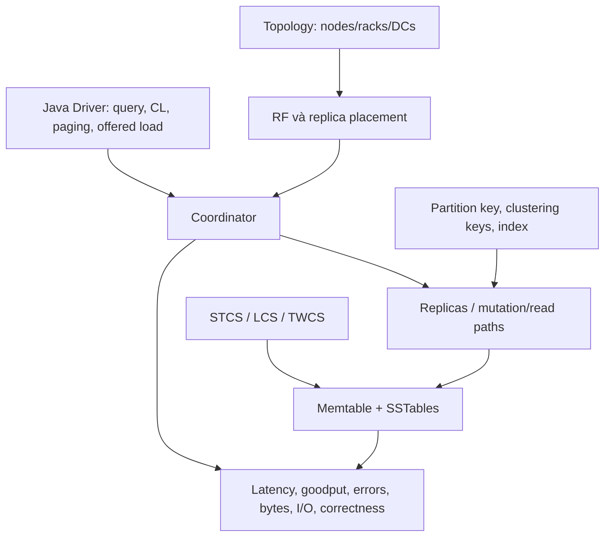
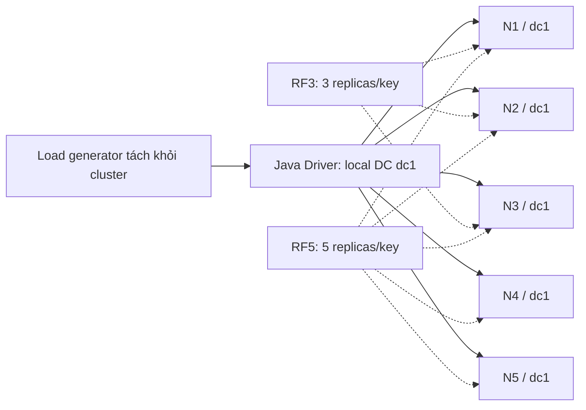

# So sánh CL, RF, chỉ mục và compaction trên cùng điều kiện

## 1. Bài toán: điều gì thực sự làm Cassandra nhanh, chậm hoặc sẵn sàng hơn?

Một nhóm vận hành thấy truy vấn Java ở `LOCAL_QUORUM` có p99 khoảng 80 ms trong khi `LOCAL_ONE` chỉ khoảng 35 ms. Họ cũng thấy hệ thống sau khi tăng replication factor (RF) từ 3 lên 5 có tỉ lệ timeout khác, bảng có secondary index chậm hơn bảng đọc theo partition key, còn một bảng dùng Leveled Compaction Strategy (LCS) đọc ít SSTable hơn Size-Tiered Compaction Strategy (STCS). **Có thể kết luận cấu hình nào tốt hơn không?**

Chưa thể. Nếu hai phép đo dùng số node, dữ liệu, độ lớn partition, lượng tombstone, workload, thời điểm compaction hoặc consistency khác nhau, **sự khác biệt quan sát được không chỉ do biến cần so**. Ví dụ: chạy RF3 trên ba node rồi chạy RF5 trên năm node đồng thời thay tổng công suất CPU/đĩa; lúc đó không thể quy việc tăng throughput chỉ cho RF. Hoặc đánh giá LCS ngay khi bảng đang chuyển chiến lược compaction sẽ đo chi phí chuyển đổi, chứ không phải trạng thái ổn định.

**Đích của bài:** xây một **thí nghiệm có đối chứng**, trong đó cùng một hợp đồng đọc/ghi được đánh giá theo RF, CL, cách truy xuất bằng chỉ mục so với bảng theo truy vấn và chiến lược compaction. Kết quả phải bao gồm **tính đúng đắn, độ trễ, thông lượng thành công, khả năng chịu lỗi và chi phí tài nguyên**, không chỉ QPS lớn nhất.

Bài thuộc chương **Đo tải và lỗi phân tán** của mô-đun `DATABASE_ENGINE_WIDE_COLUMN_CASSANDRA`: kiến trúc phân tán và wide-column, partition key, thiết kế bảng theo truy vấn, consistency đọc/ghi, CQL, replication, compaction, repair, xử lý lỗi và Java Driver.

### Sau bài, người học có thể

1. Đặt giả thuyết và chọn **biến độc lập/biến cố định/biến quan sát** cho RF, CL, secondary index và compaction.
2. Thiết kế topology và fixture để so **RF3 với RF5 trên cùng lớp phần cứng**, không trộn scale-out với thay RF.
3. Giải thích trade-off `ONE`, `LOCAL_QUORUM`, `ALL` theo RF, tình trạng replicas và lỗi một node.
4. So sánh truy vấn bằng **partition key**, 2i/Storage-Attached Index (SAI) và **bảng denormalized theo truy vấn**, có cùng oracle kết quả.
5. Đo STCS/LCS/TWCS theo đúng hình thái ghi, TTL, độ tuổi dữ liệu và trạng thái sau compaction.
6. Dùng CQL, Java Driver 4.x, metrics/nodetool và fault injection trong lab để dựng báo cáo trước–sau có khả năng tái lập.

> **Phạm vi an toàn:** các lệnh DDL, tạo chỉ mục, thay RF, thay compaction và gây lỗi chỉ dành cho **cluster lab cô lập có quyền kiểm soát**. Không thay `RF`, chạy `nodetool repair` hàng loạt, DROP index hay gây node failure trên production để “làm benchmark”. Những con số trong bài là **số giả định để luyện cách phân tích**, không phải số đo thực tế của Cassandra ở một cấu hình cụ thể.

## 2. Bốn nhóm biến không nằm trên cùng một tầng



| Biến cần so | Tầng tác động | Có thể đổi tức thời cho từng request? | Yếu tố dễ gây nhiễu |
| --- | --- | --- | --- |
| **CL**: ONE, LOCAL_QUORUM, ALL | Ngưỡng xác nhận read/write; request options | **Có** khi driver/API hỗ trợ | Trạng thái replicas, RF, coordinator, retries |
| **RF**: 3, 5 | Số bản sao và replica placement trong keyspace/DC | **Không**: thay schema và đồng bộ dữ liệu | Số node, streaming/repair, disk used, cluster health |
| **Index**: không index, 2i, SAI | Query plan và cấu trúc index lưu ở node | **Không**: build và duy trì index | Dữ liệu chưa index xong, selectivity, write amplification |
| **Compaction**: STCS, LCS, TWCS | Sắp xếp/ghép SSTables, read/write/space amplification | **Không**: chi phí nền và chuyển đổi | Backlog, tombstones, TTL, disk headroom, cache |

**Không thay đồng thời bốn biến rồi tự nhận đã tìm được nguyên nhân.** So một biến trong mỗi tập thí nghiệm (one-factor-at-a-time) để có kết luận đơn giản; sau đó kiểm tra **tương tác** bằng ma trận có kiểm soát (ví dụ RF × CL, index × compaction).

## 3. “Cùng điều kiện” nghĩa là gì?

### 3.1. Các biến phải giữ cố định hoặc ghi đầy đủ

| Nhóm | Điều cần cố định | Vì sao |
| --- | --- | --- |
| **Phần cứng** | Số node, CPU, RAM/heap, loại đĩa, network, rack/DC topology | Khác số node sẽ làm khác tổng khả năng phục vụ |
| **Phiên bản** | Cassandra, Java Driver, Java, OS/kernel, JVM options | Engine/driver có thay đổi read/compaction behavior |
| **Schema logic** | Primary key, clustering, types, TTL, GC grace, compression | Đổi row shape cũng làm đổi workload |
| **Dữ liệu** | Tổng rows/partitions, rows/partition, payload bytes, độ lệch hot key, tombstones | Dữ liệu nhỏ/cached không đại diện dữ liệu lớn |
| **Truy vấn** | Hợp đồng key/fields, LIMIT/paging, truy vấn hot/cold, độ chọn lọc | Một phép thử trả thiếu hàng thường nhanh hơn |
| **Tải** | Offered operations/s, concurrency, read/write ratio, seed, arrival pattern | Closed-loop tự hạ tải khi server chậm |
| **Client** | Connections, retry/speculative policy, CL đối chứng, page size, pool sizing | Có thể làm tăng attempts/QPS nhưng không tăng goodput |
| **Tình trạng cluster** | Hints, repair, compaction, streaming, snapshots, GC, backup jobs | Background I/O có thể tạo ra p99 ảo |
| **Cửa sổ đo** | Warmup, thời điểm đo, run duration, số lặp, time sync | Khó so histogram và lỗi nếu lệch cửa sổ |

Mỗi phép đo nên có **manifest**: source revision, phiên bản, tên cấu hình, schema, data seed, run ID, UTC start/end, cluster state, node count, RF/CL, query shape, workload seed, driver retry và fault schedule. Khi thay đổi CL, chỉ đổi **CL**; khi thay RF, dùng **topology và tổng công suất cố định** trước/sau.

### 3.2. Quan sát và kiểm soát là hai điều khác nhau

Một bảng dùng LCS có thể có mức disk amplification khác STCS ngay cả khi cùng dữ liệu; đó có thể là **hệ quả thật của biến compaction**, không phải thứ cần ép bằng nhau. Tuy nhiên nếu LCS được đo khi còn pending compactions lớn, còn STCS đã ổn định, đó là **nhiễu trạng thái quá độ**. Cần công bố rõ: đang đo **steady state** hay **migration/rebuild cost**.

## 4. Đặt giả thuyết trước khi bắt đầu

Ví dụ giả thuyết có thể kiểm chứng:

| Mã | Giả thuyết | Primary metric | Guardrail |
| --- | --- | --- | --- |
| H1 | `LOCAL_ONE` có read latency thấp hơn `LOCAL_QUORUM` khi mọi replica khỏe | p99 full-result read | Kết quả đúng, stale-read risk theo contract |
| H2 | RF5 tốn dung lượng/traffic ghi hơn RF3 trên 5 node | Disk bytes, node write bytes, goodput | Cùng data set và write CL đã quy định |
| H3 | RF5 chịu một số lỗi replica khác RF3 khi giữ nguyên CL | Availability/error rate under fault | Không thay số node và failure domain |
| H4 | Bảng truy vấn đúng partition key ổn định hơn full-cluster index query với selectivity thấp | p99, rows examined/bytes | Phải trả cùng tập business IDs |
| H5 | SAI (nếu version hỗ trợ) tốt hơn legacy 2i cho một query filter cụ thể | p99, successful QPS, index bytes | Index build hoàn tất, dataset bất biến |
| H6 | LCS giảm SSTables/read cho read-heavy workload ở một số phân bố | SSTables per read, read p99 | Write amplification và disk headroom |
| H7 | TWCS phù hợp dữ liệu time-series TTL ghi theo thời gian hơn random upsert | Compaction bytes, space reclaimed | Dữ liệu/vòng TTL tương đương |

Không mặc định H1–H7 luôn đúng. Ví dụ `ALL` có thể quá đắt về availability; SAI có thể rất nhanh khi selectivity tốt nhưng có overhead khi filter trả quá nhiều rows; TWCS có thể kém nếu cập nhật bản ghi cũ liên tục.

## 5. Cụm lab chuẩn cho so RF3/RF5

Để không trộn RF với scale-out, dùng **một DC có 5 node**, chia vào các rack theo topology lab được cấu hình, cùng loại CPU/RAM/SSD. So **RF3 và RF5 trên cùng năm node**, không so “RF3 ba node” với “RF5 năm node”.



**Chú ý:** trong RF3, ba replica thực tế của từng token/partition do replication strategy, tokens và rack topology quyết định, **không cố định là N1–N3 cho mọi partition**. Sơ đồ chỉ trực quan hóa lượng bản sao trên năm node, không thay thế `nodetool getendpoints` hoặc thông tin token placement thực.

### 5.1. Hai phương án làm sạch môi trường

**Phương án A — dựng lại lab từ ảnh/automation giống nhau:** chạy RF3, lưu metrics; tái khởi tạo **cùng 5 node**, nạp lại cùng seed ở RF5, đợi ổn định rồi đo. Đây là cách dễ quy nguyên nhân nhưng tốn thời gian setup.

**Phương án B — thay RF trên cluster lab:** giữ nguyên topology, chuyển replication strategy RF3→RF5 qua `ALTER KEYSPACE`, thực hiện quy trình đồng bộ replicas/repair thích hợp, đợi streaming/repair/compaction lắng xuống rồi mới đo. Cần một chu kỳ đối chứng/hồi phục để tránh cache, repair và lượng SSTables lịch sử làm sai so sánh; **RF giảm ngược lại cũng không tự xóa ngay mọi bản sao cũ**.

Với cả hai, ghi **tổng dung lượng hữu ích và dung lượng đĩa thực**. Không thể ép RF3 và RF5 dùng chính xác cùng disk bytes: sự chênh lệch là một phần **chi phí RF** mà phép đo phải báo cáo.

### 5.2. RF/CL là hai tham số trực giao, không phải bốn chế độ tùy ý

| Một DC, NTS | RF | `LOCAL_ONE` cần | `LOCAL_QUORUM` cần | `ALL` cần |
| --- | ---: | ---: | ---: | ---: |
| Cấu hình A | 3 | 1 replica | 2 replicas | 3 replicas |
| Cấu hình B | 5 | 1 replica | 3 replicas | 5 replicas |

**Quorum = floor(RF/2)+1** trong phạm vi DC đang xét. Ngưỡng `LOCAL_QUORUM` của RF3 khác RF5, và RF5/`ALL` phụ thuộc cả năm replicas khỏe để trả thành công. Với RF3 trên 5-node cluster, mất **một node bất kỳ** không có nghĩa mọi partition mất một replica; cần kiểm tra replica placement cụ thể và test nhiều khóa.

### 5.3. Đọc/ghi CL và điều kiện W+R

Trong môi trường ổn định, quy tắc lý thuyết `W + R > RF` cho phép **tập replicas ACK ghi và tập replicas trả đọc có giao nhau**; ví dụ RF3, `W=LOCAL_QUORUM=2` và `R=LOCAL_QUORUM=2` cho tổng 4 > 3. Đây là **điều kiện overlap**, **không phải lời hứa linearizability của mọi CQL read-modify-write**:

- Cassandra giải quyết concurrent writes theo timestamps/conflict resolution, không khóa row giống RDBMS.
- TTL/tombstone, replica lệch, repair và client timeout ảnh hưởng khả năng đọc dữ liệu hợp đồng.
- Nếu các thao tác chạy ở **nhiều DC** với `LOCAL_*`, cần phân tích từng DC; không áp dụng máy móc công thức local cho global.
- Muốn compare-and-set tránh hai writers cùng thắng, dùng LWT/serial consistency trong phạm vi được hỗ trợ.

## 6. Tạo dữ liệu và schema thử nghiệm

Mọi ID, tenant và payload là synthetic. Bảng dưới dùng partition key `job_id` cho point lookup; các bảng theo query khác dùng chính cùng nghiệp vụ “tìm job theo trạng thái” để so chỉ mục và thiết kế denormalized.

```sql
CREATE KEYSPACE load_lab_ks
WITH replication = {'class': 'NetworkTopologyStrategy', 'dc1': 3}
AND durable_writes = true;

CREATE TABLE load_lab_ks.jobs_by_id (
    job_id uuid PRIMARY KEY,
    tenant_id text,
    bucket_day date,
    status text,
    payload text,
    updated_at timestamp
) WITH compaction = {
    'class': 'SizeTieredCompactionStrategy'
};

-- Query table minh họa. Với thực tế cần bucket và giới hạn partition size.
CREATE TABLE load_lab_ks.jobs_by_status_day (
    status text,
    bucket_day date,
    job_id uuid,
    tenant_id text,
    payload text,
    updated_at timestamp,
    PRIMARY KEY ((status, bucket_day), job_id)
);

INSERT INTO load_lab_ks.jobs_by_id
    (job_id, tenant_id, bucket_day, status, payload, updated_at)
VALUES (
    11111111-2222-4333-8444-555555555555,
    'tenant-lab-001', '2026-11-21', 'READY', 'synthetic-a',
    '2026-11-21T08:00:00+0000'
);

INSERT INTO load_lab_ks.jobs_by_status_day
    (status, bucket_day, job_id, tenant_id, payload, updated_at)
VALUES (
    'READY', '2026-11-21',
    11111111-2222-4333-8444-555555555555,
    'tenant-lab-001', 'synthetic-a',
    '2026-11-21T08:00:00+0000'
);
```

**Không chỉ dùng một row cho benchmark**. Fixture lớn cần được sinh theo một seed cố định, nạp đủ dữ liệu để vượt cache thuận lợi và có kích thước partition tương đương giữa runs. Ví dụ thiết kế dữ liệu, **không phải thông số chuẩn bắt buộc**:

| Thuộc tính | Giá trị mẫu | Quy tắc |
| --- | --- | --- |
| Seed | 20261121 | Cùng seed cho mọi cấu hình |
| Tổng jobs | 1.000.000 | Đếm lại thật sau load |
| Distinct tenant IDs | 10.000 | Tenant distribution cố định |
| Phân bố status | READY 40%, RUNNING 35%, DONE 20%, FAILED 5% | Index selectivity có chủ ý |
| Bucket ngày | 20 ngày | Biến thể thời gian cố định |
| Payload | 256 B và 2 KiB theo tỉ lệ đã công bố | Không thay giữa A/B |
| Hot keys | 5% keys nhận 50% traffic trong pha hot | Cùng workload trace/seed |
| TTL | Không TTL cho baseline; một pha TTL riêng | Không lẫn expiry vào test đọc cơ bản |
| Tombstones | Không có ở baseline; có pha delete/tombstone riêng | Không lẫn compaction history ngẫu nhiên |

Một `job_id` có thể được sinh xác định từ số thứ tự/seed và mapping sang UUID hợp lệ để những lần nạp là **cùng logical dataset**. Ghi cả **thứ tự nạp, số rows và hash của manifest**; nếu dùng random không cố định, một vài hot partitions có thể làm đảo kết luận.

## 7. Hợp đồng query: phải so cùng câu hỏi nghiệp vụ

### 7.1. Point lookup dùng đúng partition key

```sql
SELECT job_id, tenant_id, status, bucket_day, updated_at
FROM load_lab_ks.jobs_by_id
WHERE job_id = 11111111-2222-4333-8444-555555555555;
```

Đây là query chuẩn để so **CL/RF/compaction** vì partition key có đủ, không cần index. Cần kiểm tra kết quả đúng job ID, mọi field, `null` semantics và consistency. Đừng thay câu query thành `SELECT *` ở lần RF5 trong khi lần RF3 chỉ đọc năm cột.

### 7.2. Tìm theo status: ba hướng thiết kế

1. **Secondary index** trên `jobs_by_id.status` cho query `WHERE status=?`. Index ở Cassandra lưu theo node, tính chọn lọc và phân bố partition quyết định chi phí.
2. **SAI** trên cùng cột, **nếu phiên bản phân phối hỗ trợ**; so với 2i bằng cách nạp các **bảng clone giống nhau** rồi query cùng projection/status.
3. **Bảng theo truy vấn** `jobs_by_status_day` với partition key `(status,bucket_day)`; cần biết bucket_day từ hợp đồng API, và có thể đọc nhiều buckets nếu API cần “tất cả ngày”.

Không so điểm “index trả toàn bộ READY của 20 ngày” với “bảng theo query chỉ đọc READY một ngày” rồi gọi bảng thứ hai nhanh hơn. Muốn so tương đương, phải **cùng business set**, chẳng hạn API `listReadyJobs(day)`, lọc đúng bucket day ở index hoặc dùng một điều kiện lọc khác được index hỗ trợ; nếu một phương án phải đọc rộng hơn để lọc client, chính chi phí đó phải được tính.

### 7.3. Oracle bắt buộc cho từng query

- **Set job IDs** chính xác; kiểm tra đủ mọi page, không chỉ trang đầu.
- **Payload/fields**, null và phiên bản dữ liệu phải khớp.
- **Thứ tự:** một secondary index query xuyên partitions không mặc định có global ordering; nếu API yêu cầu sort, phải tính chi phí sort/pagination cả ở client hoặc đổi bảng thiết kế.
- **LIMIT và paging:** `LIMIT` giới hạn số rows tối đa, page size là gợi ý server; so số rows thực và full-operation latency.
- **Concurrently mutating dataset:** tạm dừng writes cho correctness oracle hoặc dùng cutoff/event version rõ; Cassandra không tự cung cấp snapshot giữa hai bảng denormalized qua nhiều SELECTs.

Nếu index query không phục vụ chính xác hợp đồng mà không cần scan/filter lại lượng lớn, hãy ghi là **không phù hợp workload** thay vì dùng `ALLOW FILTERING` production để gượng ép so sánh.

## 8. Thử CL: đổi đúng một biến ở Java Driver

Với bảng `jobs_by_id` và RF3 đã chuẩn bị, tạo các lần chạy riêng:

| Mã | Write CL | Read CL | Workload | Câu hỏi |
| --- | --- | --- | --- | --- |
| C1 | `LOCAL_ONE` | `LOCAL_ONE` | Điểm đọc/ghi, tất cả replicas khỏe | Chi phí xác nhận tối thiểu trong local DC |
| C2 | `LOCAL_QUORUM` | `LOCAL_QUORUM` | Cùng tỉ lệ và key set | Chi phí quorum read/write |
| C3 | `ALL` | `ALL` | Cùng offered load, ngưỡng an toàn | Chi phí và độ nhạy replica chậm |
| C4 | `LOCAL_QUORUM` | `LOCAL_ONE` | Read-after-write đã định nghĩa | Read performance vs freshness risk |
| C5 | `LOCAL_ONE` | `LOCAL_QUORUM` | Đọc sau write với kiểm tra cụ thể | Có thể quan sát bản ghi cũ/tình trạng replicas nào? |

Không gộp C4/C5 thành “quorum theo công thức luôn đúng” trong mọi failure/concurrent-write scenario. Với Cassandra thường, CL không biến các thao tác đọc–sửa–ghi nhiều bước thành transaction linearizable.

### CQL kiểm tra thủ công

```sql
CONSISTENCY LOCAL_ONE
SELECT status, updated_at
FROM load_lab_ks.jobs_by_id
WHERE job_id = 11111111-2222-4333-8444-555555555555;

CONSISTENCY LOCAL_QUORUM
SELECT status, updated_at
FROM load_lab_ks.jobs_by_id
WHERE job_id = 11111111-2222-4333-8444-555555555555;

CONSISTENCY ALL
SELECT status, updated_at
FROM load_lab_ks.jobs_by_id
WHERE job_id = 11111111-2222-4333-8444-555555555555;
```

CQL `CONSISTENCY` chỉ tác động tới các statements được gửi từ phiên `cqlsh` đó. Trong ứng dụng Java, CL đặt trên `BoundStatement` hoặc execution profile. Với multi-DC, `ALL` đòi tất cả replicas của partition theo phạm vi CL, còn `LOCAL_ONE/LOCAL_QUORUM` giới hạn local DC theo cách chọn coordinator/replication.

### Không cố định một điều “CL cao luôn chậm hơn”

Ở một cluster healthy, `ALL` thường phụ thuộc replica chậm nhất, dễ bị p99 tăng khi một node GC/compaction. Nhưng thực tế còn có read path optimization, hints, scheduling và data locality; cần đo **phân phối p50/p95/p99**, **timeouts** và **successful ops/s**, không kết luận chỉ từ một phép bấm giờ. Dưới lỗi node, `ALL` có thể có goodput gần bằng 0 cho những partitions liên quan; p99 **của riêng requests thành công** khi đó không đại diện khả dụng của toàn ứng dụng.

## 9. Thử RF: đổi replication trước, đo sau khi dữ liệu hội tụ

Trong **lab** đã có cùng năm node:

```sql
-- Cấu hình A ban đầu (RF3):
ALTER KEYSPACE load_lab_ks
WITH replication = {'class':'NetworkTopologyStrategy','dc1':3};

-- Chỉ khi đã có kế hoạch/khả năng chứa dữ liệu và đúng 5 node:
ALTER KEYSPACE load_lab_ks
WITH replication = {'class':'NetworkTopologyStrategy','dc1':5};
```

**Đây là thao tác thay schema, không phải cách “tăng consistency tức thì”.** Trước khi đo RF5 cần:

1. Xác minh năm node, DC/rack placement, cluster version và disk headroom.
2. Thay keyspace replication bằng CQL trên cluster lab, kiểm tra schema agreement.
3. Thực hiện quy trình **đồng bộ dữ liệu tới replicas mới** phù hợp version/topology, thường bao gồm full repair/repair operations theo runbook của bản Cassandra đang chạy; đừng giả `ALTER KEYSPACE` tự copy đủ tất cả SSTables đến replicas mới.
4. Chờ streaming/repair hoàn tất, xác minh replica placement cho một tập khóa mẫu; ghi network/disk/compaction backlog.
5. Chờ cluster về trạng thái ổn định và cache/warmup tương đương trước khi bắt đầu cửa sổ đo.
6. Đếm dữ liệu nguồn và kiểm tra read-after-write/query oracle theo CL mục tiêu.

### Các lệnh giám sát chỉ đọc

```bash
nodetool status
nodetool describecluster
nodetool netstats
nodetool compactionstats
nodetool tpstats
nodetool tablestats load_lab_ks.jobs_by_id
```

Những lệnh trên không tự chứng minh **mọi partition** đã đúng RF và replicas nhất quán. Với RF change, phải có thủ tục kiểm chứng/repair và kiểm tra dữ liệu theo sample, metrics lỗi và logs. Không chạy ngay `nodetool cleanup` hoặc `repair -full` trên production không có runbook/disk/băng thông dự trù; cách gọi flags thay đổi theo phiên bản và tình huống.

### Lưu ý khi giảm RF

Giảm RF có thể để lại dữ liệu vật lý trên những node không còn là replica cho token trong một thời gian. Vì vậy “disk bytes giảm ngay sau `ALTER KEYSPACE`” là kỳ vọng sai; cần đo **chi phí chính thức sau quy trình cleanup an toàn** và phân biệt với giai đoạn chuyển đổi. Snapshot/backup/rollback plan phải tồn tại trước khi đổi RF.

## 10. Ma trận RF × CL và lỗi replica

Dưới đây là **khả năng đạt ngưỡng CL trên một partition** trong tình huống lý tưởng các replicas còn sống trả lời; chưa xét network partition, timeout, coordinator failure, phi chức năng, repair hay dữ liệu stale:

| RF | Replicas sống cho partition | ONE/LOCAL_ONE | QUORUM/LOCAL_QUORUM | ALL |
| ---: | ---: | --- | --- | --- |
| 3 | 3 | Đạt | Đạt (2/3) | Đạt |
| 3 | 2 | Đạt | Đạt (2/3) | **Không đạt** |
| 3 | 1 | Đạt | **Không đạt** | **Không đạt** |
| 5 | 5 | Đạt | Đạt (3/5) | Đạt |
| 5 | 4 | Đạt | Đạt (3/5) | **Không đạt** |
| 5 | 3 | Đạt | Đạt (3/5) | **Không đạt** |
| 5 | 2 | Đạt | **Không đạt** | **Không đạt** |

Với **một DC** trong ví dụ, `LOCAL_QUORUM` giống yêu cầu quorum của DC đó. Với **nhiều DC**, phải dùng RF **theo từng DC** và phân biệt local vs global CL. Tính còn sống thực của **một partition** phụ thuộc token/replicas của partition ấy; khi cluster có nhiều racks, failure domain và placement phải được đưa vào kịch bản.

### Mô phỏng node failure đúng cách

- Chạy baseline với replicas khỏe, load ổn định.
- Xác nhận node nào thực sự chứa replicas của các partitions test (theo token/placement).
- Gây tắt node hoặc cô lập network **trong lab** theo một kế hoạch rõ.
- Đo tỉ lệ request success/failure, timeout, p99, coordinator failover, retries và queue.
- Khôi phục node, theo dõi hints/streaming/repair khi cần, kiểm tra row set và consistency.

**Không lấy “một node chết” làm kết luận tất cả requests đều fail hoặc đều survive:** token-aware routing có thể chọn coordinator khác và từng partition có replica sets khác.

## 11. So sánh legacy 2i, SAI và bảng theo truy vấn

### 11.1. Secondary index không làm mất mô hình phân tán

Legacy secondary indexes (thường gọi **2i**) lưu thông tin index cục bộ ở replicas; truy vấn lọc không có partition key có thể làm coordinator gửi đến nhiều nodes/partitions. Với cột ít chọn lọc như `status='READY'` chiếm 40% rows, chỉ mục có thể phải xử lý rất nhiều matches. **SAI (Storage-Attached Index)** cải thiện cách tích hợp index vào storage và nhiều truy vấn filter, nhưng vẫn có chi phí index maintenance/read và không biến Cassandra thành search engine hay relational query planner tổng quát.

**Tính năng theo phiên bản:** Apache Cassandra OSS **5.0** có SAI; Cassandra 4.1 OSS không nên được giả định có SAI. Một số distribution có backport/biến thể khác; phải xác nhận version/index implementation trước khi so. Không dùng index syntax được một vendor hỗ trợ rồi khẳng định mọi cluster Cassandra đều nhận.

### 11.2. Tạo các bản sao schema để so trên cùng data set

Trong lab, tạo các tables có **cùng cột, cùng primary key, cùng compaction, cùng RF/keyspace** nhưng tách tên:

```sql
CREATE TABLE load_lab_ks.jobs_by_id_2i (
    job_id uuid PRIMARY KEY,
    tenant_id text,
    bucket_day date,
    status text,
    payload text,
    updated_at timestamp
) WITH compaction = {'class':'SizeTieredCompactionStrategy'};

CREATE TABLE load_lab_ks.jobs_by_id_sai (
    job_id uuid PRIMARY KEY,
    tenant_id text,
    bucket_day date,
    status text,
    payload text,
    updated_at timestamp
) WITH compaction = {'class':'SizeTieredCompactionStrategy'};

-- Legacy 2i, lab cần xác nhận loại index được tạo trên release:
CREATE INDEX jobs_status_2i
ON load_lab_ks.jobs_by_id_2i (status);

-- Với Apache Cassandra OSS 5.0 hỗ trợ SAI:
CREATE CUSTOM INDEX jobs_status_sai
ON load_lab_ks.jobs_by_id_sai (status)
USING 'StorageAttachedIndex';
```

**Chỉ thực thi lệnh SAI sau khi kiểm tra cú pháp/type index trên phiên bản thực.** Tên index implementation và cách khai báo có thể khác giữa release/distribution. Bảng SAI phải được **nạp đầy đủ cùng rows** và chờ index build/backfill hoàn tất trước khi benchmark; nếu trong một hệ thống index build lỗi/chưa xong, ghi đó là **availability/operational failure**, không gộp vào steady-state p99 một cách âm thầm.

### 11.3. Hai bài toán cần đo riêng

**Bài A: same index-query semantics**

```sql
SELECT job_id, tenant_id, status, bucket_day, updated_at
FROM load_lab_ks.jobs_by_id_2i
WHERE status = 'FAILED';

SELECT job_id, tenant_id, status, bucket_day, updated_at
FROM load_lab_ks.jobs_by_id_sai
WHERE status = 'FAILED';
```

Đọc **hết mọi trang** trên một fixture bất biến, tạo set/histogram cùng key set, không phụ thuộc row order. Sau đó chạy workload với status selectivity có chủ ý (ví dụ FAILED 5%, READY 40%) và xem p99, throughput, response bytes, CPU/index size và writes overhead. Nếu một query không hợp lệ hoặc không thực thi được do index limitations, ghi **unsupported** chứ không ép `ALLOW FILTERING` vào kế hoạch chính.

**Bài B: index vs query-table data model**

```sql
SELECT job_id, tenant_id, payload, updated_at
FROM load_lab_ks.jobs_by_status_day
WHERE status='READY' AND bucket_day='2026-11-21';
```

Bảng này có partition key `(status,bucket_day)` nên query có thể token-aware; phải bảo đảm partition size hợp lý và query API **đã có bucket_day**. Một câu index `WHERE status='READY'` trên 20 ngày **không cùng contract** với query trên một ngày. Nếu index muốn phục vụ cùng ngày, cần index/access path hỗ trợ bộ lọc đó, hoặc tính thêm rows/bytes lọc ở client và ghi rõ phương pháp.

### 11.4. Tác động lên ghi

Chỉ mục tăng công việc khi INSERT/UPDATE/DELETE, thêm disk bytes và compaction/index maintenance. So workload **đọc chọn lọc** lẫn **ghi/mixed**, không chỉ SELECT nhanh nhất. Bảng denormalized có thể cho đọc nhanh hơn nhưng một event nghiệp vụ phải ghi nhiều bảng; đây cũng là write amplification và cần **replay/reconciliation** nếu một bảng thành công còn bảng kia thất bại.

### 11.5. Không giả định mọi filter đều thích hợp SAI

| Tính chất workload | Index có thể phù hợp khi | Khi nào nên xem lại data model |
| --- | --- | --- |
| Filter có độ chọn lọc cao | Ít kết quả, predicates được version hỗ trợ | Query thường xuyên, SLA p99 cực thấp theo một partition |
| Filter ít chọn lọc | Giới hạn tập key và số rows phù hợp | Hàng triệu matches / cluster scatter-gather |
| Exact key lookup | Không cần index | Luôn chọn partition key trực tiếp |
| Nhiều điều kiện AND | Có SAI/index support rõ trên version | Query planner không hỗ trợ, fan-out lớn |
| SORT global theo thời gian | Không thể dựa vào index mặc định | Thiết kế bảng theo clustering trong bucket |
| Nhiều cập nhật status | Quan sát index maintenance cost | Status transitions nhiều và index index write amplification |

**Kết luận index benchmark** phải có hai biểu đồ hoặc bảng: read latency/goodput theo selectivity và write latency/throughput/resource consumption khi duy trì index. Nếu chỉ lấy 5% FAILED, không thể dùng kết quả đó ngoại suy cho 40% READY.

## 12. Compaction: không có chiến lược thắng mọi workload

Cassandra ghi dữ liệu vào memtable rồi flush ra immutable SSTables. **Compaction** ghép SSTables, loại bỏ phiên bản cũ/tombstones khi an toàn và thay đổi số SSTables tham gia đọc. Chiến lược compaction ảnh hưởng read amplification, write amplification và disk space amplification.

| Chiến lược | Hướng tối ưu thường gặp | Workload nên thử | Trade-off |
| --- | --- | --- | --- |
| **STCS — SizeTieredCompactionStrategy** | Nhóm SSTables cùng cỡ, phù hợp write-heavy | Nạp và upsert liên tục, ít read khắt khe | Nhiều SSTables/read hơn trong vài trạng thái; cần disk headroom khi compaction |
| **LCS — LeveledCompactionStrategy** | Giới hạn SSTable overlap và thường tối ưu reads | Đọc point/range nhiều, SLA p99 | Write amplification và I/O nền cao hơn ở một số workload |
| **TWCS — TimeWindowCompactionStrategy** | Gom SSTables theo cửa sổ thời gian cho time-series/TTL | Append-only theo thời gian, TTL tương đồng | Out-of-order writes/updates vào dữ liệu cũ gây overlap và ảnh hưởng expiry/tombstone |

**Có thể có chiến lược mới theo Cassandra version**, ví dụ Unified Compaction Strategy (UCS) trên những release hỗ trợ. Không đánh đồng chúng với STCS/LCS/TWCS trong cùng “family” khi benchmark; phải kiểm tra driver/server version và config thực.

### 12.1. So compaction phải có ít nhất hai pha

**Pha nạp/bulk load:** đo successful writes/s, p99 write, disk bytes, compaction bytes, pending compactions, time-to-settle; không chỉ đo thời gian INSERT cuối cùng.

**Pha steady-state:** sau khi workload và compaction đã đạt trạng thái ổn định, đo point/range read p99, SSTables/read, tombstones, write amp và disk headroom. Nếu workload là liên tục 24/7, định nghĩa “steady state” theo một cửa sổ lặp lại đáng tin, không cần toàn bộ pending compactions bằng 0 trong mọi giây.

### 12.2. Chạy trên những tables clone

```sql
CREATE TABLE load_lab_ks.jobs_stcs (
    job_id uuid PRIMARY KEY, status text,
    payload text, updated_at timestamp
) WITH compaction = {
    'class': 'SizeTieredCompactionStrategy'
};

CREATE TABLE load_lab_ks.jobs_lcs (
    job_id uuid PRIMARY KEY, status text,
    payload text, updated_at timestamp
) WITH compaction = {
    'class': 'LeveledCompactionStrategy',
    'sstable_size_in_mb': '160'
};

CREATE TABLE load_lab_ks.jobs_twcs (
    job_id uuid PRIMARY KEY, status text,
    payload text, updated_at timestamp
) WITH compaction = {
    'class': 'TimeWindowCompactionStrategy',
    'compaction_window_unit': 'DAYS',
    'compaction_window_size': '1'
};
```

Ở bảng TWCS, những rows có `updated_at` là cột CQL **không tự quyết định cửa sổ compaction**; TWCS phân cửa sổ theo **write timestamps của SSTable/cells**. Đừng gắn ngày vào cột `updated_at` rồi giả các writes vào dữ liệu lịch sử có thể được TWCS tổ chức lý tưởng; phải xem timestamp/CQL USING TIMESTAMP, TTL và out-of-order writes thực.

### 12.3. Hai workload để tránh kết luận thiếu công bằng

- **Workload A: write-heavy + random upsert** trong những partitions cũ, không TTL. STCS/LCS có thể là ứng viên tự nhiên; TWCS không được kỳ vọng thắng.
- **Workload B: append/time-bucketed writes + TTL tương đồng**, có tỉ lệ old-row update rất nhỏ và các cửa sổ ngày. TWCS mới được kiểm tra ở điều kiện mà thiết kế của nó nhắm tới.

Kết luận đúng có thể là “LCS tốt nhất cho p99 read của workload A, nhưng write I/O cao hơn STCS” và “TWCS hợp workload B theo mục tiêu reclaim expiry”. Không ép một winner duy nhất cho hai workload khác bản chất.

### 12.4. Chuyển strategy giữa chừng là một thí nghiệm khác

```sql
-- CHỈ LAB; đây là migration config, KHÔNG phải benchmark ổn định:
ALTER TABLE load_lab_ks.jobs_by_id
WITH compaction = {
    'class': 'LeveledCompactionStrategy'
};
```

Sau `ALTER TABLE`, SSTables cũ chưa lập tức được viết lại đúng hình thái chiến lược mới. Có thể xuất hiện backlog/rewrite, I/O contention và mức dùng đĩa tạm cao. **Đo chi phí chuyển đổi và steady-state trong hai báo cáo tách biệt**, không lấy p99 lúc đang chuyển làm đại diện dài hạn.

**Không** bắt buộc chạy major compaction để “cho công bằng” nếu điều đó thay đổi lịch sử SSTables và gây I/O khổng lồ; major compaction có rủi ro headroom/tombstone, chỉ thực hiện khi có lý do và runbook lab phù hợp.

## 13. Thiết kế workload: cùng offered load, không chỉ cùng concurrency

Một chương trình benchmark closed-loop gửi request mới **sau khi** response cũ tới; khi Cassandra chậm, tốc độ phát tự giảm và dễ che backlog, gọi là **coordinated omission**. Với kiểm thử capacity/SLO, nên có pha **open-loop** phát theo rate đã định, nhưng phải giới hạn in-flight và báo rõ **drop/reject** khi load generator không theo kịp.

| Pha | Offered load | Mục tiêu | Quan sát |
| --- | --- | --- | --- |
| Warmup | Thấp → mục tiêu | Connection/prepared cache/JIT, ổn định cache hợp lý | Không tính vào kết luận |
| Read-only | 200, 400, 800 ops/s ví dụ | p99, hit/miss, CL/index | Successful ops/s, errors, bytes |
| Write-only | Các mức rate tương ứng | CL/RF/compaction/index write cost | Disk/network, compaction debt |
| Mixed | 80% read, 20% write | Workload sản phẩm | Phân phối hot keys, retries |
| Hot partition | 5% keys nhận phần lớn load | Tìm contention/skew | Token/replica hot spots |
| Soak | Rate mục tiêu trong khoảng đủ dài | Compaction/GC/disk debt bền vững | p99 drift, pending tasks |
| Fault | Giữ offered rate, inject node/network failure | Availability, retry amplification, recovery | Error rate, recovery time, correctness |

Những tốc độ trên chỉ là **ví dụ để điền vào kế hoạch**: chọn mức phù hợp tài nguyên lab, không áp 800 ops/s cho mọi cluster. Mỗi pha cần thời lượng, số lặp và tiêu chí dừng rõ ràng.

### 13.1. Thông lượng cần đo

\[
\text{Goodput} = \frac{\text{Số business operations thành công và đúng}}{\text{Thời gian quan sát}}
\]

\[
\text{Error rate} = \frac{\text{Operations không đáp ứng hợp đồng}}{\text{Tổng operations phát ra}}
\]

**Offered QPS** là số attempts/commands được load generator lên lịch, **achieved QPS** là requests thực gửi/được xử lý, **successful goodput** chỉ tính đúng kết quả. Nếu lỗi nhiều hoặc load generator queue dài, đạt 10.000 “request attempts/s” không có nghĩa hệ thống phục vụ được 10.000 nghiệp vụ/s.

### 13.2. Giữ workload đúng khi thay index/query table

Với index query trả nhiều rows và point lookup trả một row, không so **p99 mỗi CQL request** rồi tuyên bố API nào nhanh hơn. So **p99 full business operation**, bao gồm mọi page, mapping, optional sorting, retry, extra writes cho projection, và **same set of jobs**. Nếu hợp đồng cho phép top-K nhưng không định nghĩa order, benchmark phải ghi rõ vì việc tăng LIMIT có thể thay set trả về.

## 14. Java Driver 4.x: một probe có tính thời gian và kiểm tra dữ liệu

Ví dụ Java 17, dùng bean `CqlSession` đã được tạo và warmup ngoài cửa sổ đo; không tạo `CqlSession` mới trên mỗi request. `PreparedStatement` dùng lại cho một CQL shape, mỗi request bind ID/CL riêng.

```java
import java.util.UUID;
import java.util.concurrent.CompletionStage;
import com.datastax.oss.driver.api.core.CqlSession;
import com.datastax.oss.driver.api.core.DefaultConsistencyLevel;
import com.datastax.oss.driver.api.core.cql.*;

public final class JobReadProbe {
    private final CqlSession session;
    private final PreparedStatement prepared;

    public record Probe(
        boolean correct, long durationNanos,
        String errorClass, int speculativeStarts
    ) {}

    public JobReadProbe(CqlSession session) {
        this.session = session;
        this.prepared = session.prepare(
            "SELECT job_id, status, updated_at " +
            "FROM load_lab_ks.jobs_by_id WHERE job_id=?");
    }

    public CompletionStage<Probe> read(
            UUID id, DefaultConsistencyLevel cl) {

        BoundStatement stmt = prepared.bind(id)
            .setConsistencyLevel(cl)
            .setIdempotent(true);

        long startedNanos = System.nanoTime();

        return session.executeAsync(stmt).handle((page, failure) -> {
            long elapsed = System.nanoTime() - startedNanos;
            if (failure != null) {
                return new Probe(false, elapsed,
                    failure.getClass().getSimpleName(), 0);
            }
            Row row = page.one();
            boolean correct = row != null
                && id.equals(row.getUuid("job_id"));
            int specs = page.getExecutionInfo()
                .getSpeculativeExecutionCount();
            return new Probe(correct, elapsed, "", specs);
        });
    }
}
```

**Cách đọc code:**

- `startedNanos` đặt ngay trước `executeAsync`, nên đo từ lúc submit đến khi nhận trang đầu và map record. Với **point lookup trả tối đa một hàng**, điều đó phù hợp latency của truy vấn này; với query có nhiều trang, phải fetch **hết** mới đo **full-result latency**.
- `correct` kiểm tra đúng UUID nhưng **chưa đủ cho kiểm thử giá trị status/timestamp**; suite chính cần oracle đầy đủ theo fixture.
- `failure` được chuyển thành `Probe` có lỗi thay vì để mất future; thống kê lỗi phải phân biệt timeout, unavailable, unauthorized, driver mapping exceptions.
- `getSpeculativeExecutionCount()` đếm speculative starts của request này, **không** phải số coordinator→replica messages.
- Đừng gắn response size, coordinator IP, bound tenant ID hoặc payload thật vào metric labels.

### 14.1. Giới hạn concurrency trong một phép thử

Đoạn sau mô tả **closed-loop concurrency-limited** runner, phù hợp smoke/capacity thăm dò; **không phải** bộ tạo offered-rate open-loop chuẩn.

```java
import java.util.*;
import java.util.concurrent.*;
import com.datastax.oss.driver.api.core.DefaultConsistencyLevel;

JobReadProbe probe = new JobReadProbe(session);
Semaphore capacity = new Semaphore(32);
List<CompletableFuture<JobReadProbe.Probe>> results = new ArrayList<>();

// ids là một list fixture có giới hạn kích thước, seed cố định.
for (UUID id : ids) {
    capacity.acquire(); // Chạy ở load-generator thread, KHÔNG trong driver I/O callback.
    CompletableFuture<JobReadProbe.Probe> f =
        probe.read(id, DefaultConsistencyLevel.LOCAL_QUORUM)
            .toCompletableFuture();
    f.whenComplete((value, error) -> capacity.release());
    results.add(f);
}

CompletableFuture.allOf(
    results.toArray(new CompletableFuture<?>[0])).join();

long success = results.stream()
    .map(CompletableFuture::join)
    .filter(JobReadProbe.Probe::correct)
    .count();
System.out.println("correct=" + success + "/" + ids.size());
```

**Không chạy trực tiếp với hàng triệu IDs** vì `results` giữ mọi futures trong RAM; đây là snippet lab giới hạn vài nghìn IDs. Với bench dài, dùng bounded aggregation/histogram và dọn completed futures. Nếu cần open-loop, dùng scheduler/tốc độ phát độc lập với thời gian phản hồi, có hàng đợi/dropping policy **được công bố**; không biến event-loop/driver thread thành nguồn phát blocking.

### 14.2. Kiểm tra CQL result đầy đủ

Trong fixture bất biến, một point lookup trả đúng một job hoặc none. Test correctness cần biết **expected row** theo UUID (status, tenant, bucket day, updated_at), không chỉ `row != null`. Với bảng index có nhiều rows, hãy chuyển kết quả thành set các UUID đã nhận qua **tất cả pages**, so set với oracle, so payload khi cần, và ghi rõ cost của client-side sorting nếu API yêu cầu.

## 15. Phân trang, retries và “số round trips”

Java Driver có thể gửi thêm requests để lấy page sau hoặc retry/speculate khi node chậm. Tầng đo:

| Tầng | Ví dụ | Thước đo |
| --- | --- | --- |
| Business operation | “Tìm READY jobs của ngày X” | Operations/s thành công, đúng tập IDs |
| Logical CQL requests | Một query shape + từng page | `ResultSet.getExecutionInfos()` hoặc execution info theo async page |
| Node attempts | Initial, retry, speculation | Driver `RequestTracker`/metrics |
| Coordinator–replica messages | Read/data/digest/mutation theo RF/CL | Cassandra tracing có chọn lọc và metrics node |
| TCP frames/bytes | TLS/network implementation | Network counters, transport metrics |

**Không** lấy 3 pages nhân RF5 rồi tuyên bố 15 TCP packets. Coordinator có thể gửi thông điệp khác nhau tùy read path và CL; TCP/TLS gộp/chia dữ liệu, và một page retry có thể thêm node attempts.

### Driver Retry/Speculative Execution phải công bố

`setIdempotent(true)` chỉ dùng cho những query có thể lặp an toàn; retry/speculation có thể làm goodput không đổi nhưng traffic tăng. Khi benchmark CL/compaction, để **cùng retry policy/speculative policy** giữa runs. Nếu muốn so chính policy, đó là **biến độc lập khác** cần thí nghiệm riêng. Không dùng consistency-downgrading retry để biến timeout thành “success” trái contract.

## 16. Thu thập metric theo ba góc nhìn

### 16.1. Application/Driver

| Chỉ số | Câu hỏi |
| --- | --- |
| Offered business ops/s | Load generator muốn tạo bao nhiêu work? |
| Goodput ops/s | Bao nhiêu operations **đúng dữ liệu** và thành công? |
| Errors/timeout/unavailable | Bao nhiêu requests không đạt hợp đồng? |
| Latency p50/p95/p99 | Người dùng chịu tail latency nào? |
| First-page vs full-operation | Có đang đếm thiếu các trang không? |
| Retry/speculative/node attempts | Driver có nhân traffic dưới lỗi không? |
| In-flight/queue/dropped load | Client có tự bão hòa và bỏ việc không? |
| Request/response bytes | Hiệu ứng projection, paging và index |
| Prepared statement cache/UNPREPARED | Có nhiễu startup/reprepare không? |

Chỉ tính p99 của **successes** có thể đánh lừa khi phần lớn requests fail nhanh; cần xem **latency cả request kết thúc lỗi**, error budget và goodput. Khi timeout được chặn tại 2 giây, histogram thành công không chứa tất cả những requests rất chậm đã timeout.

### 16.2. Cassandra coordinator/replica

| Metric/quan sát | Tìm vấn đề nào? |
| --- | --- |
| ClientRequest.Read/Write latency, timeout | Node nào làm coordinator chậm hoặc unavailable |
| SSTables per read | Read amplification ảnh hưởng bởi compaction |
| Bloom filter false positives | Đọc không tìm thấy partition gây I/O |
| Tombstones scanned | TTL/delete workload gây read latency |
| Pending compactions / bytes compacted | Compaction debt và write amplification |
| Memtable flush / commitlog / disk await | Write path đang nghẽn tài nguyên nào |
| Network bytes / dropped messages | RF và retries làm tải mạng tăng |
| GC pauses / CPU utilization | Tail latency do heap/processor |
| Active repair/streaming/hints | Nhiễu nền hoặc tác động của failure/recovery |
| Index disk bytes/index query metrics, nếu có | Đánh giá 2i/SAI build/read/maintenance |

Metric names và MBeans thay theo Cassandra/driver release. Dùng công cụ metrics được chuẩn hóa theo version (JMX/Prometheus/driver metrics) và lưu **metric definitions** trong báo cáo, không sao chép tên từ blog cũ rồi cho rằng luôn tồn tại.

### 16.3. Lệnh vận hành chỉ đọc

```bash
nodetool status
nodetool describecluster
nodetool tpstats
nodetool compactionstats
nodetool netstats
nodetool proxyhistograms
nodetool tablestats load_lab_ks.jobs_by_id
nodetool tablehistograms load_lab_ks jobs_by_id
```

Đây là **góc nhìn node được gọi** và đôi khi có dữ liệu aggregate theo node, không phải thống kê đầy đủ mọi replica. Thu từ nhiều nodes với UTC đồng bộ; lưu dashboards CPU/disk/network cùng cửa sổ với driver p99.

**Không benchmark khi đang bật tracing toàn lưu lượng**: tracing và đọc `system_traces` tạo overhead và requests phụ. Chỉ lấy mẫu trace khi cần giải thích coordinator→replica path; dữ liệu trace có thể chứa key/bind values nhạy cảm.

## 17. Quy trình đo có thể tái lập: baseline → steady state → fault

```mermaid
flowchart LR
    Inventory["Inventory/version/topology"] --> Schema["Schema & deterministic fixture"]
    Schema --> Warm["Warmup / verify all rows"]
    Warm --> Quiet["Wait for streaming/index/compaction settle"]
    Quiet --> Measure["Measure at fixed offered rates"]
    Measure --> Fault["Inject one controlled failure"]
    Fault --> Recover["Restore + repair/reconcile if required"]
    Recover --> Verify["Verify data + collect metrics"]
    Verify --> Report["Paired analysis / guardrails"]
```



### Một lần chạy chuẩn gồm

1. **Preflight topology:** các nodes chuẩn bị, DC/rack, RF, schema agreement, disk space/CPU và tool versions.
2. **Nạp dữ liệu:** seed, count, payload distribution, TTL/tombstone và thứ tự insert giống nhau; không có dữ liệu sản xuất.
3. **Kiểm chứng dữ liệu:** sample keys, tổng rows, digest/canonicalization theo cùng snapshot/điều kiện.
4. **Warmup:** driver sessions/prepare, JIT, caches và pools; không tính warmup vào benchmark.
5. **Quiescence gate:** index build/streaming/repair xong; compaction ở tình trạng chấp nhận được theo kịch bản.
6. **Load schedule:** giữ offered rates + query mix/seed và đo nhiều lần; thay thứ tự thí nghiệm hoặc dùng matched runs để tránh drift.
7. **Fault gate:** gây một failure rõ, giữ workload, đo thời gian phát hiện/lỗi/goodput/recovery; không cùng lúc thay RF hoặc rebuild index.
8. **Readback correctness:** cùng key set/field values và business invariant, kiểm tra hậu quả của retries/timeout.
9. **Report:** cấu hình, latencies/error/goodput/resource costs, observations, giới hạn và quyết định.

### Một kịch bản công bằng không nhất thiết chạy đồng thời

Với index strategy hoặc compaction, hai tables có thể dùng chung disks và cache; nếu benchmark A và B cùng lúc, chúng **tranh tài nguyên**. Chạy **tuần tự**, có warmup/cooldown, hoán đổi thứ tự A/B/B/A trong các lượt độc lập và ghi lại background work. Với RF3/RF5, topology/data reset và repair khiến việc hoán đổi khó hơn; nếu chỉ chạy mỗi cấu hình một lượt, phải công bố **nguy cơ drift**.

## 18. Fault injection: giữ một biến lỗi tại mỗi lần

| Kịch bản | Biến inject | Cần đo | Điều không được kết luận |
| --- | --- | --- | --- |
| F0 | Cluster healthy | Baseline p99/goodput | Không đại diện failure behavior |
| F1 | Một replica của key target chậm | Tail latency theo CL, speculation | Không suy mọi partition đều có cùng replica |
| F2 | Một replica mất | Success/error theo RF/CL, coordinator failover | Không suy ALL vẫn sẵn sàng |
| F3 | Coordinator reset khi request đang chạy | Driver retry, unknown write outcome | Timeout không xác nhận chưa ghi |
| F4 | Cắt mạng giữa racks trong lab | Latency/availability, replica placement | Không suy thành network partition ở mọi DC |
| F5 | Compaction/GC pressure mô phỏng | p99, CPU/disk, pending tasks | Không gộp với RF/CL steady-state |
| F6 | Index build chưa xong | Read errors/latency, build progress | Không so như index đã ổn định |
| F7 | Ghi TTL/delete trong khi read | Tombstone scan và correctness | Không coi dữ liệu thay đổi là lỗi query |
| F8 | Bulk repair/streaming sau failure | Recovery time và service SLO | Không gộp vào steady-state p99 ban đầu |

**Không gây lỗi khi có tenant thật hoặc không có rollback plan.** Tắt một node không chứng minh “fault tolerance RF5” nếu partition đã đặt replicas sai hoặc vẫn còn streaming; phải xác minh placement và trạng thái phục hồi trước/sau.

### 18.1. Fault schedule minh họa

| Pha | Thời lượng mẫu | Hành động |
| --- | --- | --- |
| Healthy baseline | 10 phút | Run ổn định, ghi goodput/p99 |
| Fault injection | 1 phút | Dừng một node **trong lab** hoặc throttle network |
| Fault sustained | 5 phút | Giữ offered load, thống kê errors/goodput |
| Recovery | Tới khi đạt điều kiện đã định | Khôi phục node, theo dõi queues/replicas |
| Post-recovery | 10 phút | So với baseline, đo lingering compaction/backlog |

Thời lượng là **ví dụ**, chọn theo khả năng cluster có đủ samples cho p99 và chi phí phục hồi thực tế. Không gọi recovery complete chỉ vì node báo `UN`: cần kiểm tra request success, p99, data correctness và background work.

## 19. Phân tích bảng số liệu: ví dụ giả định

Giả sử cùng topology 5 node, dữ liệu cố định, workload 90% point reads và 10% writes, offered 500 business ops/s, all nodes healthy. **Đây là con số giả định cho bài tập**, không phải đo Cassandra:

| Run | RF | CL đọc/ghi | Goodput (ops/s) | p99 thành công (ms) | Lỗi (%) | Disk logical overhead |
| --- | ---: | --- | ---: | ---: | ---: | --- |
| A1 | 3 | LOCAL_ONE / LOCAL_ONE | 499 | 18 | 0,2 | Tham chiếu RF3 |
| A2 | 3 | LOCAL_QUORUM / LOCAL_QUORUM | 498 | 31 | 0,4 | Cùng dữ liệu RF3 |
| A3 | 3 | ALL / ALL | 492 | 60 | 1,6 | Cùng dữ liệu RF3 |
| B1 | 5 | LOCAL_ONE / LOCAL_ONE | 497 | 22 | 0,6 | Nhiều replica hơn |
| B2 | 5 | LOCAL_QUORUM / LOCAL_QUORUM | 494 | 42 | 1,2 | Nhiều replica hơn |
| B3 | 5 | ALL / ALL | 480 | 83 | 4,0 | Nhiều replica hơn |

**Đọc bảng đúng cách:**

- Chỉ được kết luận rằng **trong giả định này**, p99 thành công của `ALL` cao hơn; không ngoại suy mọi workload/phiên bản.
- Lỗi của B3 cao hơn có thể do ngưỡng ALL đòi mọi replicas; cần xem traces/metrics và node latencies, không quy tất cả cho RF tự thân.
- Goodput không vượt offered 500. Sai lệch ở tỉ lệ lỗi phải được đối chiếu với **số hoàn tất/thất bại/dropped** và cửa sổ đo.
- RF5 có thêm disk/network cost dù bảng chỉ ghi định tính. Báo cáo thật phải đưa **GiB, IOPS, MiB/s và chi phí/node**, không chỉ nhãn “nhiều replica hơn”.
- p99 thành công **không bao phủ timeout** đã bị loại khỏi mẫu latency thành công; cần thêm percentiles cho failures hoặc deadline exceedance.

### 19.1. Bảng fault riêng, không gộp với healthy

| Cấu hình | Node failure liên quan partition | Khả năng đạt CL (lý thuyết) | Điều phải đo |
| --- | --- | --- | --- |
| RF3, LOCAL_ONE | Mất 1/3 replicas | Còn 2, thường vẫn đạt | Routing/retry/p99 và stale-data risk |
| RF3, LOCAL_QUORUM | Mất 1/3 | Còn 2, đủ quorum | p99, error rate nếu replica còn lại chậm |
| RF3, ALL | Mất 1/3 | Không đạt ALL | Goodput/error, không chỉ latency của ít success |
| RF5, LOCAL_QUORUM | Mất 2/5 | Còn 3, đủ quorum | Fault domains và hot key distribution |
| RF5, ALL | Mất 1/5 | Không đạt ALL | Tỉ lệ failure theo partitions/cutoff |

**Không diễn đạt “RF5 chịu được hai node chết” khi không nói CL**: với `ALL`, một replica mất đã đủ làm request không đạt CL. Khả năng chịu lỗi còn phụ thuộc rack/DC placement, tải còn lại và actual liveness.

### 19.2. So index (ví dụ giả định riêng, cùng selectivity)

| Đường đọc `WHERE status='FAILED'` | Selectivity | p99 full-result (ms) | Goodput API/s | Chi phí cần cộng |
| --- | ---: | ---: | ---: | --- |
| Legacy 2i | 5% | 180 | 45 | Scatter-gather, index maintenance |
| SAI, version hỗ trợ | 5% | 100 | 70 | Index storage/build, write maintenance |
| Query-table theo status+day | Không tương đương nếu chỉ đọc 1 ngày | Không so trực tiếp | Không so trực tiếp | Thay đổi API/data model |

Bảng này **không chứng minh** SAI luôn thắng. Với `READY=40%`, kiểm thử riêng; với query-table, định nghĩa cùng day/filter và cùng tập kết quả rồi mới thêm vào một phép so có căn cứ.

### 19.3. So compaction: hãy trình bày đường đánh đổi

| Phương án | Read p99 | Write p99 | SSTables/read | Disk bytes / compacted bytes |
| --- | --- | --- | --- | --- |
| STCS | Cần đo | Cần đo | Cần đo | Cần đo |
| LCS | Cần đo | Cần đo | Cần đo | Cần đo |
| TWCS theo dữ liệu time-series TTL | Cần đo | Cần đo | Cần đo | Cần đo |

Điền **số đo thật** theo workload A/B; không suy số từ cấu hình. Nếu TWCS có tombstones giữ lâu do out-of-order writes, đó là finding quan trọng dù point-read p99 có lúc tốt.

## 20. Chi phí vận hành: hiệu năng tốt chưa chắc tổng chi phí tốt

### RF

Số bản sao lý thuyết tăng từ 3→5 làm tăng nhu cầu lưu trữ và traffic replication cho cùng logical data. Disk thực còn chịu SSTable metadata, index, compaction, repair và compression, không đơn giản luôn đúng `5/3`. RF cao có thể tăng khả năng chịu failure cho **quorum CL** nhưng cũng tăng write work và chi phí duy trì.

### CL

CL cao thường yêu cầu đợi nhiều replicas hơn và có thể tăng tail latency/failures khi node chậm. CL thấp có thể giảm latency nhưng làm thay đổi consistency contract; không được “tối ưu” bằng cách hạ CL cho thao tác quyết định tiền/trạng thái mà không được phê duyệt.

### Index

Secondary index tiết kiệm công sức dựng một bảng mới cho một số truy vấn, nhưng tạo index reads/writes/storage và độ phức tạp schema/rebuild. Query-table có thể tối ưu đường đọc nhưng nhân writes, cần backfill/CDC/reconciliation khi ứng dụng cập nhật nhiều views.

### Compaction

LCS có thể đổi write I/O lấy read predictability. STCS giảm overhead ở một số write-heavy path nhưng có read amplification khác. TWCS phù hợp khi dữ liệu/TTL bám theo thời gian, **không** hợp mọi random-update workload. Đánh giá cả **headroom đĩa khi compaction**, không chỉ tổng bytes cuối.

**Một kết luận tốt** sẽ giống: “Với SLA point read p99 dưới 50 ms ở offered 500 ops/s, RF3/LOCAL_QUORUM/LCS đạt correctness và goodput, disk headroom ≥ ngưỡng, khi một replica chết vẫn có tỉ lệ thành công theo mục tiêu. RF5 chỉ tăng availability cho scenario đã định, nhưng chi phí ghi/đĩa X% và latency Y%.” Các chữ X/Y phải lấy từ phép đo, không điền phỏng đoán.

## 21. Troubleshooting khi số đo “đảo chiều” bất thường

| Triệu chứng | Giả thuyết | Cách xác minh |
| --- | --- | --- |
| RF5 nhanh hơn RF3 đột biến | Đã tăng số node hay data cache nóng hơn | So node count/CPU/RAM, data seed, load order |
| RF5 chậm bất thường ngay sau `ALTER KEYSPACE` | Streaming/repair/compaction chưa xong | `netstats`, `compactionstats`, repair logs |
| `LOCAL_ONE` fail còn `LOCAL_QUORUM` pass với vài key | Replica được chọn stale/mất, retry/routing lệch | Token placement, read traces và driver errors |
| `ALL` có p99 đẹp nhưng goodput thấp | Chỉ còn vài requests success, lỗi phần lớn bị loại | Success/errors histograms, deadline và total attempts |
| Index query rất chậm với `READY` | Predicate selectivity thấp, quá nhiều matches | Key set, results/page, bytes, coordinator fan-out |
| SAI “nhanh” nhưng rows thiếu | Chưa index xong hoặc test không đọc đủ pages | Index build state, full-result oracle |
| 2i “nhanh hơn” SAI khi số rows rất ít | Cache/warmup, index implementation khác version | Repeated randomized runs và profiler |
| Query-table nhanh bất thường | Chỉ trả một bucket, không cùng business set | So all IDs/fields và contract |
| LCS write throughput giảm | Compaction write amplification/I/O saturation | Bytes compacted, disk await, CPU |
| TWCS disk bytes không giảm dù TTL hết | Ghi out-of-order/overlap, tombstone/TTL và gc conditions | SSTable timestamps, window layout, repair status |
| Compaction run A có p99 cao | Background compaction/backlog còn lớn | Pending tasks, disk metrics theo thời gian |
| Một node down làm mọi requests timeout | Hot partition concentrated, coordinator/replicas phụ thuộc node | Traces theo keys, RF/CL, driver topology |
| Node lên lại nhưng p99 vẫn xấu | Hints, cache cold, streaming/repair, compaction debt | Recovery timeline và load replay |
| Achieved QPS cao nhưng goodput thấp | Retries/timeout/errors hoặc data incorrect | Business success counters và oracle |
| Offered QPS không đạt | Load generator CPU/GC/queue saturation | Client CPU, async queue, emitted vs scheduled |
| p99 không lặp lại giữa runs | Clock/load interference, GC, background repair | UTC windows, seed, warmup, run order |
| Trace không thấy index path | Query được tối ưu khác hoặc instrument thiếu | CQL shape, version-specific trace events |
| Java prepare mất nhiều thời gian | Session khởi tạo, UNPREPARED/reprepare hoặc schema agreement | Warmup, driver logs, coordinator changes |

**Nguyên tắc điều tra:** trước khi đổi compaction/index/CL vì một biểu đồ xấu, hãy xác minh **dữ liệu trả đúng, cấu hình thực được áp dụng và môi trường đo thực sự tương đương**.

## 22. Đối chứng và phân tích thống kê

### 22.1. Lặp run và kiểm tra biến động

Một run chỉ cho một quan sát. Để đưa ra kết luận vững hơn:

1. Có tối thiểu vài lần lặp độc lập cho mỗi cấu hình với cùng data/query/workload definition.
2. Hoán đổi thứ tự A/B/B/A khi khả thi để phát hiện drift do cache/cluster nhiệt.
3. Ghi **khoảng biến thiên** giữa runs, không chỉ một median được lựa chọn đẹp nhất.
4. Giữ seed cố định cho paired comparisons; sau đó chạy seed bổ sung để kiểm chứng kết quả không chỉ đúng cho một phân bố khóa.
5. Tách nhóm warm/cold cache và nhóm healthy/fault; không gộp các phân phối với nhau.
6. Chỉ kết luận “thắng” khi **khác biệt lớn hơn biến thiên tự nhiên và không vi phạm guardrail correctness/SLO**.

### 22.2. Dữ liệu thống kê cần giữ

```text
run_id: RF3-LQ-STCS-read-20261121T0900Z
cassandra_version: <actual version from cluster>
java_driver_version: <actual dependency version>
nodes: 5
local_dc: dc1
replication: {dc1: 3}
read_cl: LOCAL_QUORUM
write_cl: LOCAL_QUORUM
table: load_lab_ks.jobs_by_id
index: none
compaction: STCS
workload_seed: 20261121
offered_ops_per_second: 500
query_mix: {read: 0.9, write: 0.1}
warmup_seconds: <measured plan>
measurement_seconds: <measured plan>
successful_ops: <actual>
failed_ops: <actual>
timeout_ops: <actual>
goodput_ops_per_second: <actual>
latency_p50_ms: <actual>
latency_p95_ms: <actual>
latency_p99_ms: <actual>
disk_used_bytes: <actual>
network_bytes_per_second: <actual>
pending_compactions: <actual>
fault: none
correctness_oracle: PASS/FAIL
```

Đây là **mẫu báo cáo**, không phải một file thực được tạo trong bài. Điền giá trị từ dữ liệu đo thật. Trường `query_mix` ghi tỷ lệ **business operations**, không phải tỷ lệ native protocol attempts sau retry.

### 22.3. Không lấy trung bình p99 của các node

Giả sử p99 tại node A là 20 ms và node B 100 ms; `(20+100)/2=60 ms` **không** phải p99 đúng của toàn bộ requests. Cần histogram có khả năng merge hợp lệ hoặc raw latency samples theo cùng sampling/cửa sổ; không trộn p99 read và write khi contract khác nhau. Quan trọng hơn, khi phân bố latency thay đổi dưới lỗi, tính goodput/error song song.

## 23. Checklist an toàn trước khi tạo tải/lỗi

| Gate | Câu hỏi phải trả lời | Nếu chưa đạt |
| --- | --- | --- |
| Quyền | Đây có phải cluster lab được phê duyệt? | **Không chạy** |
| Cách cô lập | Test data/role/network tách hoàn toàn production? | Tạo môi trường riêng |
| Dữ liệu | Không có PII hoặc customer credentials? | Dùng synthetic fixture |
| Capacity | SSD còn headroom cho RF5, index build và compaction? | Giảm scope, tăng capacity |
| Backups | Có rollback/reset/restore plan cho thay schema? | Chưa đổi RF/index/compaction |
| Time budget | Có timeout và giới hạn tổng run, max QPS/in-flight? | Thêm kill switch |
| Routing | Driver local DC/racks/contact points đúng? | Sửa config trước fault |
| Correctness | Có oracle dữ liệu và full-page readback? | Chưa benchmark |
| Repair | Biết quy trình sau thay RF/node failure? | Không gây lỗi |
| Observability | Driver/App/node metrics đồng bộ UTC? | Thiết lập trước |
| Incident policy | Ai dừng test nếu disk/network/CPU vượt ngưỡng? | Đặt owner/gate |
| Cleanup | Có cách dừng load, khôi phục nodes, dọn test artifacts? | Viết teardown |

**Kill switch mẫu:** dừng phát tải nếu error rate vượt ngưỡng đã định, disk free dưới headroom tối thiểu, coordinator queues tăng không phục hồi, node rời cluster không theo kế hoạch hoặc có dấu hiệu traffic đi nhầm môi trường. Ngưỡng số học phải do chủ sở hữu lab chọn theo capacity, không chép một con số tùy tiện cho mọi cụm.

## 24. Runbook so sánh CL, RF, index và compaction

### P0 — Chốt hợp đồng nghiệp vụ và SLO

Mô tả một point lookup đúng partition key, một query theo status/day, một write/update và một workload TTL nếu cần. Chốt fields, số rows, freshness, consistency, p99 target, error budget, successful throughput và disk/network budget.

### P1 — Khóa môi trường

Ghi Cassandra/driver versions, node count/topology/hardware, network, JVM heap/GC, storage type, auth/TLS, disk headroom và time sync. Đảm bảo không có backup/repair/streaming bất thường không được lên lịch.

### P2 — Chuẩn bị dữ liệu/khóa

Dùng data generator có seed, số rows/partitions và hot-key distribution cố định. Đếm lại dữ liệu, lưu expected IDs/values, không nhầm dataset khác nhau giữa các phương án.

### P3 — CL ở RF cố định

Giữ RF3, STCS và query theo partition key, đo riêng `LOCAL_ONE`, `LOCAL_QUORUM`, `ALL` tại cùng offered rate. Kiểm tra correctness/timeout trước khi nhận kết quả. Ghi regular CL và serial CL nếu workload có LWT.

### P4 — RF trên cùng topology

Dùng 5-node lab cho RF3 và RF5. Chỉ thay RF, thực hiện đồng bộ/repair phù hợp, đợi hết streaming và ổn định rồi chạy lại **cùng CL/workload**. Ghi cost/storage/availability theo partitions.

### P5 — Index trên các bản sao cùng schema

Nạp dữ liệu y hệt vào tables 2i/SAI; chỉ dùng SAI khi version hỗ trợ và build hoàn tất. Chạy predicate selectivity thấp/cao, so full-result correctness, p99, index storage và write overhead. Nếu so bảng theo truy vấn, buộc API contract tương đương.

### P6 — Compaction cho từng hình thái ghi

Tạo STCS/LCS/TWCS tables clone, đo một workload random upsert và một workload time-window/TTL riêng. Ghi build/load cost và steady-state cost; không lẫn phiên `ALTER TABLE compaction` đang rewrite SSTables.

### P7 — Fault injection có kiểm soát

Trong lab, gây node chậm/mất/coordinator failure ở từng cấu hình. Đo goodput/error/deadline, CL achievement, recovery, repair và checksum/row oracle. Không khẳng định một node down có cùng tác động tới mọi partition.

### P8 — Phân tích tính đúng, chi phí và độ tin cậy

Tổng hợp paired runs; yêu cầu correctness PASS, p99 và error budget đạt, successful throughput đủ, tài nguyên còn headroom, recovery time chấp nhận được. Với số liệu chưa đủ, ghi **inconclusive**, không chọn cấu hình thắng bằng cảm tính.

### P9 — Bàn giao

Lưu manifest, CQL shape, configs, versions, metrics, chart snapshots, fault timeline, assumptions và giới hạn. Khôi phục lab về trạng thái sạch, tắt debug/tracing, thu hồi credentials, không để node cố tình failed.

## 25. Những suy luận sai thường gặp

| Nhận định sai | Sửa đúng |
| --- | --- |
| “Tăng RF từ 3→5 là tăng số node từ 3→5.” | RF là replica count; số node là biến capacity khác, phải giữ độc lập. |
| “RF5/ALL chịu được hai nodes hỏng.” | `ALL` không đạt nếu thiếu dù một replica liên quan. |
| “Quorum nghĩa là luôn linearizable.” | Quorum overlap không thay Paxos/LWT cho concurrent CAS. |
| “LOCAL_QUORUM luôn cần 2 ACK.” | Với RF5 trong DC, quorum là **3**. |
| “RF5 tự có dữ liệu sau ALTER.” | Thay replication cần đồng bộ replicas/repair phù hợp. |
| “Index không thay cách dữ liệu lưu.” | Index có cấu trúc/maintenance riêng và giới hạn query/version. |
| “Có SAI là mọi WHERE và ORDER BY đều nhanh.” | Predicate support, selectivity, partition design và sorting vẫn quyết định. |
| “So index query 20 ngày với query-table 1 ngày là công bằng.” | Khác tập kết quả và bytes. |
| “Bảng theo query không có write overhead.” | Denormalization nhân writes và yêu cầu consistency/reconciliation. |
| “Page size 100 là 100 rows/page chắc chắn.” | Page size là hint; phải kiểm tra đủ rows/pages. |
| “Đo query latency chỉ bằng thời gian trang đầu.” | API full-result cần full-operation latency. |
| “LCS bao giờ cũng tốt hơn STCS.” | Đổi read amp lấy write amp và tài nguyên, tùy workload. |
| “TWCS dùng cột updated_at để quyết định cửa sổ.” | Nó phụ thuộc timestamps của SSTables/cells và cách ghi. |
| “ALTER TABLE compaction xong là steady-state.” | SSTables/backlog có thể đang chuyển đổi. |
| “Compaction backlog thấp thì tombstones đã hết sạch.” | Retention/GC/replica repair quyết định tombstone purge an toàn. |
| “Nút lên UP là test recovery PASS.” | Cần kiểm tra goodput/p99/row data và background work. |
| “Đạt 500 execute calls/s là 500 business ops/s.” | Retry/errors/partial results có thể làm goodput thấp hơn. |
| “p99 thấp nhưng lỗi 30% vẫn tốt.” | Phải đánh giá correctness, goodput và error budget cùng nhau. |
| “Trung bình p99 của mỗi node là p99 toàn cụm.” | Không đúng về thống kê; gộp raw samples/histograms hợp lệ. |
| “Có thể tối ưu benchmark bằng giảm CL trong lúc fault.” | Làm đổi consistency contract, không giải quyết failure. |

## 26. Câu hỏi và bài tập thực hành

1. Vì sao RF3 trên ba node và RF5 trên năm node không cô lập được ảnh hưởng của RF?
2. Giải thích sự khác nhau giữa replication factor, consistency level và số node.
3. Với RF3 và RF5 trong một DC, tính số ACK cần cho `LOCAL_QUORUM`.
4. Một replica trong RF3 chết: điều gì xảy ra với `ONE`, `LOCAL_QUORUM` và `ALL`?
5. Với RF5 chỉ còn ba replicas sống, mức `LOCAL_QUORUM` có đạt được không? Nếu có, điều kiện bổ sung nào ảnh hưởng thực tế?
6. Vì sao `W+R>RF` không tự bảo đảm hai concurrent writers thực hiện CAS đúng nghiệp vụ?
7. Sau `ALTER KEYSPACE` tăng RF, cần xác minh gì trước khi đo?
8. Vì sao phải so disk bytes sau khi dữ liệu và compaction ổn định, không ngay khi sửa schema?
9. Thế nào là offered QPS, achieved QPS và successful business goodput? Cho ví dụ số liệu khác nhau.
10. Nếu p99 thành công giảm nhưng error rate tăng từ 0,1% lên 20%, kết luận nào là không hợp lệ?
11. Tại sao một secondary index query không có partition key có thể làm nhiều nodes tham gia?
12. Nêu một predicate status có selectivity thấp và một predicate có selectivity cao trong fixture.
13. Khi nào SAI không khả dụng và vì sao phải kiểm tra Cassandra version/distribution?
14. Đọc READY một ngày từ query-table và READY mọi ngày từ index có cùng hợp đồng không?
15. Nếu index query trả đúng IDs nhưng thứ tự khác, đó có phải lỗi khi API không cam kết thứ tự? Khi API có cam kết thì sao?
16. Vì sao cần tính chi phí ghi nhiều bảng denormalized khi so với index?
17. STCS, LCS và TWCS ưu tiên điều gì? Nêu một workload không thích hợp cho TWCS.
18. Cột `updated_at` có tự quyết định cửa sổ TWCS không? Tại sao?
19. Vì sao không đo LCS steady-state ngay lúc vừa chuyển `ALTER TABLE`?
20. Tại sao cần chạy một pha TTL/tombstone riêng thay vì đưa nhiều deletes vào baseline?
21. Giải thích coordinated omission khi benchmark closed-loop.
22. Một load generator có concurrency 32 có bảo đảm offered QPS cố định không?
23. `ExecutionInfo.getSpeculativeExecutionCount()` đo gì, và không đo gì?
24. Vì sao không nhân page count với RF để tính TCP packets?
25. Một node bị dừng nhưng chỉ một số partitions timeout. Hãy giải thích theo replica placement.
26. Nêu các bước phải thực hiện trước khi tuyên bố một cluster đã recovery sau fault.
27. Vì sao không được trung bình các p99 của nhiều nodes?
28. So sánh kết quả hai runs có cùng dữ liệu nhưng khác seed truy vấn có thể sai ra sao?
29. Lập bảng A/B/B/A và cách phân tích biến động giữa runs.
30. Thiết kế một kill switch dựa trên disk headroom, errors và in-flight backlog.

### Bài tổng hợp A — CL × RF trên cùng năm node

Thiết kế một báo cáo có ít nhất sáu runs: RF3/RF5 × `LOCAL_ONE`/`LOCAL_QUORUM`/`ALL`. Với mỗi run:

- Cùng năm node/DC/racks và loại phần cứng; cùng schema và dữ liệu synthetic có seed.
- Dùng đúng query theo partition key, cùng read/write ratio, payload, offered load và driver settings.
- Đợi RF synchronization/repair và background work ổn định trước khi đo.
- Thu goodput, p50/p95/p99, error/timeout, disk bytes, network, coordinator latency.
- Fault injection một replica đang chứa target partition; theo dõi mất quorum khi CL thay.
- Sau fault, kiểm tra dữ liệu, recovery time và remaining compaction/repair work.
- Kết luận có căn cứ về SLA và chi phí; không chọn winner chỉ bằng p99.

### Bài tổng hợp B — 2i/SAI/query-table × compaction

Với predicate `status='FAILED'` có selectivity 5% và `status='READY'` 40%:

- Xác minh SAI được hỗ trợ, tạo index trên clone table và đợi build xong.
- So cùng projection, key set, pagination và CL giữa 2i/SAI.
- Đặt query-table trong một **contract tương đương về bucket day và kết quả**, có tính chi phí writes để duy trì projection.
- Test STCS/LCS cho random upserts, TWCS cho time-bucketed TTL; tách loading và steady state.
- Có read p99, write p99, successful throughput, SSTables/read, disk/network và error rate.
- Giải thích vì sao một phương án tốt hơn cho read có thể làm write/disk tệ đi.

**Tiêu chí hoàn thành:** người học thiết kế được thí nghiệm mà **thay CL không lẫn RF, thay RF không lẫn node count, thay index không đổi business result và thay compaction không trộn trạng thái chuyển đổi với steady state**. Báo cáo phải tách **correctness, latency, goodput, errors, resource cost và failure recovery**, có đủ dữ liệu để người khác chạy lại.

## 27. Tài liệu tham khảo

- [Apache Cassandra — Configuring replication](https://cassandra.apache.org/doc/stable/cassandra/developing/cql/ddl.html): keyspace, NetworkTopologyStrategy, RF và schema.
- [Apache Cassandra — Data Modeling](https://cassandra.apache.org/doc/stable/cassandra/data_modeling/): partition key, clustering key và mô hình theo truy vấn.
- [Apache Cassandra — Tunable Consistency](https://cassandra.apache.org/doc/stable/cassandra/architecture/dynamo.html): replica placement, quorum và read/write behavior.
- [Apache Cassandra — Storage Engine](https://cassandra.apache.org/doc/stable/cassandra/architecture/storage-engine.html): commitlog, memtables, SSTables và compaction.
- [Apache Cassandra — Compaction](https://cassandra.apache.org/doc/stable/cassandra/managing/operating/compaction/index.html): STCS/LCS/TWCS và các thao tác vận hành.
- [Apache Cassandra — Storage-Attached Indexing (SAI)](https://cassandra.apache.org/doc/stable/cassandra/developing/cql/indexing/sai/sai-overview.html): hỗ trợ SAI theo release và index query trade-offs.
- [Apache Cassandra — Secondary Indexes](https://cassandra.apache.org/doc/stable/cassandra/developing/cql/indexing/2i/2i-overview.html): legacy 2i và giới hạn truy vấn.
- [Apache Cassandra — Nodetool](https://cassandra.apache.org/doc/stable/cassandra/managing/tools/nodetool/nodetool.html): status, netstats, compactionstats, tablestats và repair workflow theo phiên bản.
- [Apache Cassandra — Monitoring and Metrics](https://cassandra.apache.org/doc/stable/cassandra/managing/operating/metrics.html): coordinator/table/compaction JMX metrics.
- [Apache Cassandra Java Driver 4.18 — Consistency](https://apache.github.io/cassandra-java-driver/4.18.1/core/consistency/): regular/serial consistency levels.
- [Apache Cassandra Java Driver 4.18 — Paging](https://apache.github.io/cassandra-java-driver/4.18.1/core/paging/): cách đếm full-result requests, page-size hints.
- [Apache Cassandra Java Driver 4.18 — Retries](https://apache.github.io/cassandra-java-driver/4.18.1/core/retries/): retry policy và node attempts.
- [Apache Cassandra Java Driver 4.18 — Metrics](https://apache.github.io/cassandra-java-driver/4.18.1/core/metrics/): driver session/node metrics và telemetry.
- [Apache Cassandra — Cassandra Stress](https://cassandra.apache.org/doc/stable/cassandra/managing/tools/cassandra_stress.html): công cụ phát tải và profile tùy chỉnh, dùng khi có workload definition tương đương.

**Kết luận:** So sánh **CL, RF, chỉ mục và compaction** không phải đặt bốn cấu hình rồi chọn p99 nhỏ nhất. CL đổi **ngưỡng xác nhận**, RF đổi **placement và tài nguyên replica**, index đổi **access path và chi phí bảo trì**, còn compaction đổi **read/write/space amplification theo thời gian**. Một thí nghiệm đáng tin phải giữ **topology, dataset, query contract, offered load, driver settings và giai đoạn quan sát** tương đương; đọc **đủ kết quả**, kiểm tra RF/CL thực, đợi index build/repair/compaction hội tụ, đồng thời đo **goodput, errors, p99, disk/network và failure recovery**. Chỉ gọi một phương án tốt hơn khi nó **đáp ứng tính đúng, consistency contract và giới hạn tài nguyên**, có thể lặp lại trên cùng điều kiện và công bố rõ những giới hạn chưa kiểm chứng.
