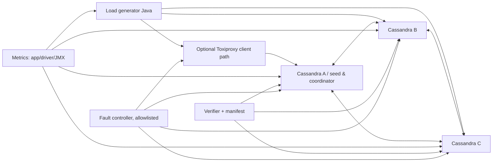
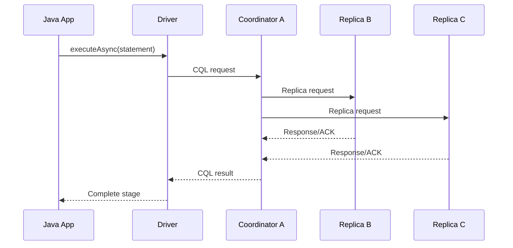
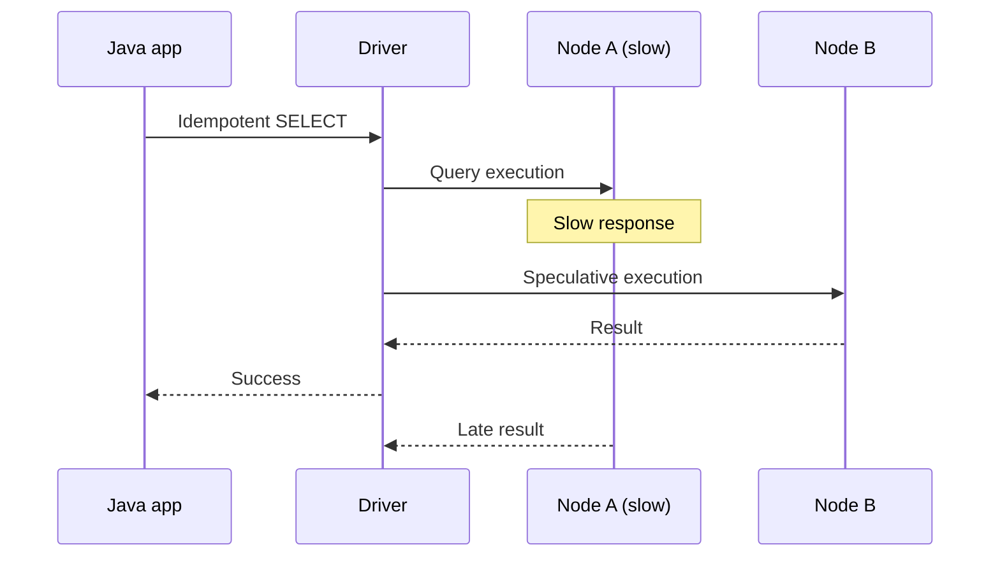

# Dừng nút, mất mạng một phần và yêu cầu bị phản hồi chậm

> **Chương:** Đo tải và lỗi phân tán  
> **Mô-đun:** `DATABASE_ENGINE_WIDE_COLUMN_CASSANDRA` — hiểu kiến trúc phân tán và mô hình wide-column của Apache Cassandra, đặc biệt khóa phân vùng, thiết kế bảng theo truy vấn và consistency level; thực hành CQL, replication, compaction, repair, xử lý lỗi và kết nối ứng dụng Java.  
> **Trọng tâm:** Thiết kế, thực hiện và diễn giải **thử nghiệm lỗi có kiểm soát** khi một Cassandra node dừng, đường mạng chỉ hỏng một phần, coordinator/replica phản hồi chậm hoặc response bị mất; đo availability, latency, retry, correctness và recovery.  
> **Phạm vi phiên bản:** Cassandra 4.1/5.x, Java Driver 4.19, JUnit 5, Testcontainers/Toxiproxy theo bản đang dùng. Snippets có ghi rõ **PSEUDOCODE** khi cần hạ tầng multi-node, proxy hoặc harness do người học tự triển khai.

## 1. Bài toán: dịch vụ vẫn chạy nhưng một request có thể không có kết quả rõ ràng

Giả sử một ứng dụng Java ghi sự kiện thanh toán vào Cassandra:

```sql
INSERT INTO payments_by_id (
    tenant_id, payment_id, state, amount_cents, revision
) VALUES (?, ?, ?, ?, ?);
```

Ứng dụng đặt consistency level `LOCAL_QUORUM`, cluster có ba full replicas trong DC gần nhất. Tại thời điểm ghi, một node bị dừng, một liên kết mạng bị trễ và request đầu tiên mất phản hồi. Điều gì có thể xảy ra?

- **Request vẫn thành công:** nếu coordinator nhận đủ hai phản hồi replica trong DC local và gửi ACK đúng hạn.
- **`UnavailableException`:** coordinator xác định không có đủ replicas **đang được coi là sống** để đạt CL ngay khi điều phối.
- **`WriteTimeoutException`:** coordinator đã gửi write nhưng không nhận đủ ACK trước server-side deadline.
- **`DriverTimeoutException`:** driver không nhận phản hồi hoàn chỉnh từ coordinator trước **client request timeout**, nên không biết chính xác write đã áp dụng hay chưa.
- **Lỗi kết nối/`AllNodesFailedException`:** driver không tìm được node/connection thích hợp, hoặc bị thất bại trên các node được thử.
- **Response tới muộn:** server đã xử lý xong nhưng kết quả chỉ quay về sau khi client hết deadline; request có thể được coi failed ở app dù mutation đã được áp dụng.
- **Hồi phục không tức thì:** node lên lại, driver reconnect và gossip hội tụ không đồng nghĩa replica đã nhận đầy đủ mọi mutation bị lỡ; hinted handoff/repair còn phải chạy.

Một bài load/fault test tốt không hỏi mỗi câu **“có ném exception không?”**. Nó kiểm đồng thời:

1. **Availability:** tỷ lệ yêu cầu đạt contract trong thời gian cho phép.
2. **Latency:** p50/p95/p99 và tail degradation khi có lỗi.
3. **Correctness:** những write đã được ACK và những write timeout không bị làm sai dữ liệu nghiệp vụ do retry.
4. **Blast radius:** bao nhiêu partition, node, DC và user bị ảnh hưởng.
5. **Recovery:** sau khi bỏ fault, hệ thống trở lại SLO và replicas/hints/repair được kiểm chứng như thế nào.
6. **Safety:** test không gây tác động tới môi trường ngoài lab, có giới hạn tải và rollback rõ.

**Thành công của “chịu lỗi” là một hợp đồng định lượng, không phải kết luận chung rằng Cassandra luôn chịu được một node Down.**

## 2. Mục tiêu học tập

Sau bài này, bạn có thể:

- Giải thích vai trò của coordinator, replicas, token ring, driver load balancing và local DC trong hành vi chịu lỗi.
- Dự đoán kết quả CQL với RF=3 và các CL `ONE`, `LOCAL_QUORUM`, `ALL` khi một/hai replicas Down.
- Phân biệt **tắt node có kiểm soát**, crash đột ngột, cắt native CQL port và mất mạng internode.
- Mô tả partial partition: `client→A` lỗi nhưng `A↔B` tốt, hoặc `A↔B` lỗi nhưng app vẫn tới A.
- Phân biệt đường truyền request (upstream) và response (downstream) bị chậm/mất.
- Phân biệt `UnavailableException`, `ReadTimeoutException`, `WriteTimeoutException`, `ReadFailureException`, `WriteFailureException`, `DriverTimeoutException` và connection errors.
- Hiểu vì sao timeout của client **không chứng minh write chưa thực hiện**.
- Hiểu giới hạn của hinted handoff và yêu cầu repair sau node outage.
- Dùng statement idempotence, retry policy, speculative execution một cách có kiểm soát.
- Thiết kế fault matrix với **hypothesis**, expected error envelope, duration và invariant.
- Dùng CQL/Java Driver để tạo dữ liệu, đo request latency, đếm errors và xác minh kết quả.
- Dùng Testcontainers/Toxiproxy hoặc mạng container lab để mô phỏng độ trễ/cắt kết nối đúng phạm vi.
- Xây các phép thử với áp lực read/write hỗn hợp, open-loop/closed-loop và bounded concurrency.
- Không nhầm “rẻ hơn vì request rơi/không được tính vào p99” với hệ thống nhanh hơn.
- Ghi lại cách hoàn nguyên fault và các bằng chứng phục hồi, bao gồm dữ liệu tại replicas.
- Lập runbook để chẩn đoán “node Up nhưng p99 tăng”, “gossip chưa thấy Down” và “retry storm”.

## 3. An toàn thử nghiệm: phải có vùng cách ly và quyền dừng

Các thao tác như dừng container, cắt mạng, `nodetool drain`/`disablebinary`, hay cố tình tạo timeout có thể **ngắt dịch vụ và gây chậm hàng loạt**. Chúng chỉ được thực hiện trong **cluster lab cô lập** hoặc môi trường chaos engineering được chủ sở hữu phê duyệt với blast radius, rollback và giám sát trước. Bài này trình bày **các câu lệnh mẫu để người học hiểu và tự thực hiện có kiểm soát**; không chạy lên Cassandra production.

### 3.1. Guardrails bắt buộc

- Tên cluster, keyspace và contact points phải là **lab/test**.
- Không dùng production credentials hay shared production VPC.
- Có node/cluster owner, cửa sổ test, giới hạn duration và nút rollback.
- Fault chỉ tác động **một endpoint/liên kết** tại một thời điểm trong các bước cơ bản.
- Có backup/snapshot test data khi bài toán cần kiểm recovery.
- Không giảm `gc_grace_seconds` hay xóa hint data để tăng tốc test mà không hiểu hậu quả.
- Không cấu hình retry vô hạn hoặc speculative execution không giới hạn.
- Không đặt cao `ALL` hay thay RF ở cluster đang phục vụ traffic thật để “kích hoạt lỗi”.
- Có alert cho CPU, heap/GC, disk, thread pools, network, queue, p99 và retry.
- Có cách xác minh test đã **thực sự gây fault như dự định**, không chỉ bật flag trong code.
- Dừng test nếu không còn đủ RF/CL safety margin, nếu xuất hiện mất dữ liệu hoặc ảnh hưởng ngoài scope.

### 3.2. Kiến trúc test khuyến nghị



**Cảnh báo quan trọng:** Khi Java Driver 4.x dùng topology discovery, đặt **một Toxiproxy trước contact point duy nhất không nhất thiết proxy tất cả traffic**. Driver khám phá peer addresses và có thể kết nối thẳng các node, **bỏ qua proxy**. Muốn test thực sự một đường, cần dựng network/address translation/endpoint policy để đường test được đi qua proxy, hoặc inject fault tại network namespace/server link đúng phạm vi.

### 3.3. Các lớp test không thay thế nhau

| Lớp | Kiểm được | Không thể chứng minh |
|---|---|---|
| Unit test fake `CqlSession` | Retry decision, business idempotency | Gossip, replica CL, networking thực |
| Single-node Testcontainers | CQL/codec/timeout một node, response drop qua proxy | RF3 quorum, internode split, hints đủ replicas |
| Three-node Cassandra cluster lab | Một replica Down, CL, gossip, hints, restart | Multi-DC WAN nếu chỉ một DC |
| Two-DC topology lab | `LOCAL_QUORUM`/`EACH_QUORUM`, cross-DC link | SLA production/capacity nếu quá nhỏ |
| Load test staging giống production | p99/capacity và recovery gần thật | Production tuyệt đối nếu topology/workload khác |
| Chaos engineering production được phê duyệt | Hành vi thực tại quy mô hệ thống | Không phù hợp để “thử bừa” không guardrails |

## 4. Nhắc lại cơ chế Cassandra quyết định kết quả fault

### 4.1. Token và replica placement

Khi client gửi query, driver chọn một **coordinator**. Coordinator xác định replicas cho partition từ token của **partition key** và strategy của keyspace, sau đó gửi yêu cầu tới các replicas phù hợp.

```text
Client
  │
  ▼
Coordinator B  ── hash(tenant_id,event_day) ──► token
  │                                           │
  └────► Replica A     Replica B    Replica C◄┘
          RF=3 full replicas trong local DC
```

Contact point không nhất thiết là coordinator mỗi request, và coordinator không bắt buộc thuộc replica set của partition. Node Down trong cluster nhiều nodes có thể gây ảnh hưởng khác nhau tùy replica set của **từng token range**; không suy tất cả partitions bị ảnh hưởng ngang nhau nếu RF nhỏ hơn số nodes/DC.

### 4.2. RF, quorum và số ACK

Với `NetworkTopologyStrategy` và ba full replicas ở một DC:

\[
Q_{\mathrm{local}} =
\left\lfloor \frac{RF_{\mathrm{local}}}{2}\right\rfloor+1
=2
\]

Ví dụ đối với request ở local DC:

| Replica đang khả dụng | `ONE` | `LOCAL_QUORUM` (2/3) | `ALL` (3/3 nếu keyspace chỉ DC này) |
|---|---|---|---|
| A, B, C | Có thể thành công | Có thể thành công | Có thể thành công |
| A, B | Có thể thành công | Có thể thành công | Thường unavailable/timeout |
| Chỉ A | Có thể thành công | Không đủ | Không đủ |
| Không có | Không đủ | Không đủ | Không đủ |

“Có thể” thay vì “luôn” vì replica còn sống có thể **phản hồi chậm**, network bị chia cắt, coordinator Down hoặc client request timeout. `ALL` trong keyspace nhiều DC yêu cầu tất cả replicas theo phạm vi của CL đó, không chỉ ba local; bảng trên giả định **chỉ một DC**.

### 4.3. Một node Down không đồng nghĩa một replica bất kỳ Down

Trong **cluster ba node RF3** ở một DC, mỗi partition thường có replicas trên cả ba nodes. Trong **cluster 12 node RF3**, một node Down chỉ là một trong ba replicas với **những token ranges nó sở hữu**, và các partitions khác có thể không chịu mất replica. Để test xác định, dùng `nodetool getendpoints` cho partition key hoặc Java Driver token map metadata của schema/keyspace. Đừng suy “node C là replica của mọi partition” khi topology lớn.

### 4.4. Local DC trong đa DC

Ví dụ:

```sql
CREATE KEYSPACE lab_fault
WITH replication = {
    'class': 'NetworkTopologyStrategy',
    'dc-east': 3,
    'dc-west': 3
};
```

App East dùng `local-datacenter=dc-east` và `LOCAL_QUORUM`: thường cần 2/3 full replicas ở East. Nó **không** chứng minh West đã ACK 2/3. `EACH_QUORUM` cho writes nhiều DC yêu cầu majority ở mỗi DC, nên đứt liên DC có thể làm mất availability dù local quorum vẫn đạt. Không dùng `EACH_QUORUM` cho mọi hot path vì muốn “an toàn hơn” nếu latency/WAN và business contract không cho phép.

### 4.5. CL không giảm khối lượng write fan-out

Với RF3, coordinator thường gửi write tới cả ba replicas (khi khả dụng) và **đợi số phản hồi đủ CL**; `ONE` không có nghĩa chỉ một replica được nhận mutation. Một replica bị Down có thể được phục vụ qua **hint** và/hoặc repair về sau. Tối ưu latency bằng CL thấp hơn có đánh đổi về read visibility/reliability theo workload.

### 4.6. Read quorum và write quorum intersection

Trong trường hợp không có concurrent writes xung đột/TTL đặc biệt và với local RF3, nếu read và write dùng local quorum:

\[
R=2,\quad W=2,\quad RF=3,\quad R+W>RF
\]

Hai tập replica có ít nhất một giao điểm, giúp read thấy write đã ACK theo model consistency của Cassandra. **Nhưng** điều này không tạo transaction snapshot xuyên partitions/tables, không bảo đảm remote DC đã đồng nhất hay ngăn last-write-wins theo timestamp nếu nhiều writers cạnh tranh.

## 5. Ba loại lỗi chính khác nhau ở đâu?

### 5.1. Dừng nút

Một Cassandra process hoặc toàn máy/container dừng; socket có thể đóng ngay hoặc mất sau timeout, gossip/failure detector dần đánh dấu Down. Cluster vẫn tồn tại nhưng mất một số coordinator candidates và replica copies tạm thời.

### 5.2. Mất mạng một phần

Không nhất thiết node Down hoàn toàn. Ví dụ:

- Client App1 không tới node A, App2 vẫn tới.
- A thấy B nhưng C không thấy B.
- App gửi request tới A, nhưng A không nói chuyện được với một số replicas.
- TCP request đi qua nhưng response bị chặn.
- Cross-DC WAN Down nhưng internode local DC vẫn tốt.

Đây là lỗi **không đối xứng theo góc nhìn**; `nodetool status` đọc từ hai nodes có thể khác tạm thời trong thời gian failure detection/gossip hội tụ.

### 5.3. Phản hồi chậm

Node không chết, vẫn Up/gossip, nhưng CQL response vượt SLO vì:

- GC pause hoặc CPU saturated.
- Compaction/flush/repair gây disk I/O contention.
- SSTable/tombstone read amplification.
- Overloaded coordinator queues, thread pool.
- Network jitter/packet loss/limited bandwidth.
- Chậm trên đường **client→coordinator** hoặc **coordinator→replica**.
- TLS/auth/connection churn nếu lỗi chỉ ở new connections.
- Client backpressure, driver stream IDs/pool saturation.

**Node Up không đồng nghĩa query đúng hạn.** Fault test phải đo request-level deadlines và correctness, không chỉ ping hay gossip.

## 6. Node stop: planned shutdown, crash và native transport off

### 6.1. Dừng có kế hoạch

`nodetool drain` dùng để ngừng nhận writes mới và flush tables trước khi tắt node; đây **không phải** câu lệnh “xóa node khỏi token ring”. Sau drain, quy trình shutdown/restart phụ thuộc distribution/orchestration và phải được thực hiện theo runbook.

```bash
# Chỉ minh họa trong lab, không tự chạy production.
nodetool drain
# Sau đó dừng Cassandra service/container theo công cụ lab.
```

Mục tiêu test planned maintenance:

- Node đã drain/flushed đúng.
- Khả năng đáp ứng request khi nó rời vai coordinator/replica.
- Không có application errors vượt ngân sách.
- Node có thể join lại bình thường.
- Hints/repair được theo dõi sau restart.

### 6.2. Crash đột ngột

Ví dụ ở **một container riêng trong cluster lab ba node**:

```bash
# CHỈ dùng nếu cassandra-b là container của lab cô lập.
docker kill cassandra-b
# Khi cần phục hồi:
docker start cassandra-b
```

`docker kill` khác `docker stop` ở tín hiệu và hành vi grace period. Không giả định tên container luôn là `cassandra-b`; phải xác minh danh tính trước thao tác, và tuyệt đối không dùng wildcard chọn nhầm containers khác.

Phải kiểm khi container bị kill:

- Driver có thể vẫn giữ connection lỗi tới node trước khi phát hiện.
- Gossip/failure detector có thời gian trễ, không phải Down tức thì.
- Một số requests in-flight có outcome không chắc chắn.
- Load tăng trên nodes còn sống.
- Node restart không tự chứng minh hints đã replay xong.

### 6.3. Chỉ ngừng cổng CQL native transport

`nodetool disablebinary` tắt native transport ở node, có option `--force` có thể ngắt requests đang chạy tùy Cassandra version; `nodetool enablebinary` bật lại. Cách này mô phỏng node **không còn phục vụ CQL client trực tiếp** nhưng không tương đương node Down trong gossip hoặc replication.

```bash
# Lab node A, sau khi đã xác minh JMX target đúng.
nodetool disablebinary
# Phục hồi:
nodetool enablebinary
```

Nếu coordinator A không nhận client CQL nhưng A vẫn là replica cho một partition, coordinator B vẫn có thể gửi internode messages tới A. Do đó test `disablebinary` **không chứng minh** behavior của một replica hoàn toàn Down.

### 6.4. Phân biệt decommission/replace với stop

`nodetool decommission` hoặc replacement/bootstrap là **thay đổi topology/token ownership** có streaming và các tiền điều kiện riêng. Đừng dùng những thao tác này để “giả lập node Down trong 30 giây”. Fault test node tạm thời nên có khả năng **khôi phục cùng node identity/data**.

### 6.5. Các bước đo trước–trong–sau

```text
Baseline 5–10 phút theo workload hữu hạn
→ Kiểm RF/CL và node candidates
→ Inject stop node B ở t0
→ Quan sát detection/availability/p99/errors
→ Giữ fault trong cửa sổ hữu hạn
→ Restore node B ở t1
→ Quan sát reconnection/gossip/hints/repair
→ Reconcile dữ liệu và xác định recovery complete
```

Cửa sổ 5–10 phút là minh họa cho test workload; production-like workloads có thể yêu cầu dài hơn. Không coi “node đã Up lại” là cùng mốc với “cụm đã hoàn toàn phục hồi”.

## 7. Mất mạng một phần: phải ghi rõ ai nhìn thấy ai

### 7.1. Một bảng kết nối trước fault

Trong lab giả sử ba nodes A/B/C và một app X. Có hai nhóm traffic:

1. Native CQL: app X → A/B/C, thường port 9042.
2. Internode: A↔B↔C, gossip/replication/streaming trên port(s) nội bộ đúng cấu hình.

```text
Baseline:
 X → A = OK   X → B = OK   X → C = OK
 A ↔ B = OK   B ↔ C = OK   A ↔ C = OK
```

### 7.2. Case P1: X không thể tới A

```text
Fault P1:
 X -X→ A       X → B = OK   X → C = OK
 A ↔ B = OK    B ↔ C = OK   A ↔ C = OK
```

Kỳ vọng:

- Nếu driver biết B/C và chúng là coordinator candidates, requests có thể chuyển sang B/C.
- Nếu app startup **chỉ có contact point A** đang unreachable và chưa từng bootstrap, session có thể fail dù B/C khỏe.
- A vẫn có thể phục vụ replica traffic từ B/C.
- Query availability có thể tốt hơn trường hợp A thực sự Down.

Không gọi đây là “mất một replica” chỉ vì app không tới native port của A.

### 7.3. Case P2: internode A↔B bị chặn, app vẫn tới cả A/B

```text
Fault P2:
 X → A/B/C = OK
 A -X→ B, B -X→ A
 A ↔ C = OK, B ↔ C = OK
```

Góc nhìn node A, B về membership/failure detection có thể **khác nhau trong một khoảng**. Một query do A làm coordinator có thể không nhận đủ phản hồi replica theo CL; query do C làm coordinator có thể đi qua đường khác. `Unavailable` và timeout distribution có thể phụ thuộc node được chọn và trạng thái gossip.

**Đừng** giả định “một link A–B đứt thì cluster chia ngay thành hai nhóm cố định”; với topology còn đường qua C, gossip/messages không nhất thiết được proxy qua C, và nhiều điều kiện cần thử riêng.

### 7.4. Case P3: chia cluster 1–2

```text
Partition:
  Island I = {A}       Island II = {B,C}
  Không có internode links giữa I và II.
  Client X có thể vẫn tới A/B/C qua đường riêng.
```

Với RF3 single DC:

- Coordinator ở **island B,C** có thể đạt `LOCAL_QUORUM` (2/3).
- Coordinator ở **island A** không thể đạt `LOCAL_QUORUM` nếu không nói chuyện với B/C; có thể báo `Unavailable` hoặc `Read/WriteTimeout` tùy failure detector/gossip.
- `ONE` có thể chấp nhận thao tác ở cả phía có ít nhất một reachable replica, làm tăng nguy cơ các reads/writes quan sát khác nhau giữa islands.
- `ALL` thường không đạt cho writes/reads phân tách.
- Driver chọn coordinator và timing có thể làm error rate khác nhau giữa app X/Y.

**Quan trọng:** Nếu dùng `ONE` ở cả hai islands với concurrent writes trên cùng key, Cassandra last-write-wins theo timestamps khi hội tụ; đây không phải consensus/linearizable state machine. Kiểm invariants của business domain.

### 7.5. Case P4: kết nối không đối xứng

```text
A → B blocked
B → A allowed
A → C allowed
C → A allowed
```

TCP là bidirectional trên một connection, nhưng packet filters, NAT, asymmetric routes và directional toxics có thể tạo tình trạng **requests đi nhưng responses không quay lại**. Không dùng một bảng “ping OK” từ một node để chứng minh cả hai chiều đáp ứng CQL/replica messages.

Thử nghiệm phải ghi rõ:

- Packet direction, network interface, port, protocol.
- Established connections vs new connections.
- Existing TLS sockets có bị ảnh hưởng không.
- Node nào là coordinator, node nào là replica.
- Lỗi xảy ra ở CQL client path hay internode path.
- Tên DC/rack và RF của partition được thử.

### 7.6. Nối lại link không tự hoàn tất repair

Sau khi bỏ partition:

- Gossip/failure detection phải hội tụ.
- Connections/driver pools phải reconnect.
- Mutations bị lỡ có thể được nhận qua hints nếu còn; **hints là best effort**.
- Repair theo token ranges cần được thực hiện đúng quy trình để đồng bộ replicas.
- Tombstones/TTL và `gc_grace_seconds` cần được bảo vệ khỏi zombie.
- App denormalized projections cần **application reconciliation** riêng nếu workflow giữa các bảng bị fail.

## 8. Chậm ở đâu? Phân loại request path và response path

### 8.1. Lược đồ thực thi



Độ trễ tổng gần đúng:

\[
T_{\mathrm{observed}}
\approx T_{\mathrm{clientQueue}}+
T_{\mathrm{driverSend}}+
T_{\mathrm{coordinator}}+
T_{\mathrm{replicaWait}}+
T_{\mathrm{returnPath}}+
T_{\mathrm{decode/callback}}
\]

Không mặc định cộng tuyến tính mọi thành phần: replica requests có thể chạy song song, có overlap và retry/speculation tạo nhiều paths. Công thức dùng để **phân tách chẩn đoán**, không là performance model chính xác.

### 8.2. Slow coordinator

A vẫn Up nhưng xử lý chậm vì GC/CPU/compaction. B/C healthy; nếu chọn C làm coordinator, request có thể nhanh hơn. Driver speculative execution (nếu bật và query idempotent) có thể giúp tail latency bằng cách gửi thêm execution tới node khác. Nhưng nó **tăng traffic** và không sửa disk load/hot partition gốc.

### 8.3. Slow replica

A làm coordinator và phải đợi B hoặc C đáp ứng quorum. Nếu B chậm nhưng C nhanh và A đủ phản hồi theo CL, request vẫn thành công. Nếu A nhận ít hơn required ACK trước server timeout, phát `ReadTimeout`/`WriteTimeout`. Trường hợp read chỉ nhận digest nhưng chưa có data cũng có semantics timeout riêng.

### 8.4. Slow return path

A đã xử lý write, B/C đã ACK, nhưng packet CQL response `A→Driver` bị chặn. Driver chờ đến `basic.request.timeout` và phát **client timeout**. Lúc này:

- **Có thể** write đã thành công theo CL.
- App **không thể** coi `DriverTimeout` là “chắc chắn chưa ghi”.
- Retry một counter/non-idempotent mutation có thể gây double effect.
- Thử nghiệm cần readback bằng key deterministic từ đường độc lập để biết outcome, nhưng readback cũng có giới hạn CL/timestamp/concurrent changes.

### 8.5. Chậm do queuing ở client

Tăng concurrency quá mức làm `pool.in-flight` cao, stream IDs cạn hoặc request throttler queue dài. p99 có thể tăng **trước khi CQL packet được gửi**. Đừng đổ lỗi cho Cassandra disk nếu CPU coordinator bình thường nhưng app queue và connection pools đã saturated.

### 8.6. Phân biệt error ở lần fetch trang N

`executeAsync` có thể thành công với **trang đầu** của một query nhiều rows; `fetchNextPage()` mới lỗi vì node/network thay đổi. Load test “SELECT thành công” phải **đọc đủ mọi trang theo contract**. Một async stage đầu complete không chứng minh full export đã thành công.

## 9. Error taxonomy và dấu hiệu chẩn đoán

| Exception / hiện tượng | Nguồn thường gặp | Có biết mutation đã áp dụng? | Kiểm thêm |
|---|---|---|---|
| `UnavailableException` | Coordinator xác định không đủ live replicas cho CL | Request có thể chưa được gửi tới đủ replicas; không suy chung cho mọi logic | Required/alive, node/DC, gossip |
| `ReadTimeoutException` | Coordinator đã chờ replica response quá hạn | Read không thay đổi dữ liệu, nhưng result chưa đủ | Received vs required, dataPresent, slow replicas |
| `WriteTimeoutException` | Coordinator chờ write ACK quá hạn | **Không chắc chắn**, một số replicas có thể đã ghi | WriteType, received/blockFor, idempotency |
| `ReadFailureException` | Replica/coordinator báo failure trong read | Không có kết quả read hợp lệ theo contract | Failure reasons, disk/codec/exception logs |
| `WriteFailureException` | Write path báo failure | Không được coi write chưa áp dụng | Replica failures, hinted/commitlog path |
| `DriverTimeoutException` | Client không có response hoàn chỉnh trước driver deadline | **Không chắc chắn**, kể cả khi server đã thành công | Client/coordinator queues, network return path |
| `ClosedConnectionException` | Connection bị đóng trước response | Không chắc nếu request đã gửi | TCP reset, node restart, heartbeat |
| `AllNodesFailedException` | Không có query path/connection thành công | Cần xét **per-node causes**; có thể có attempts | `getAllErrors()`, contact points, local DC |
| `NoNodeAvailableException` | Driver không có node phù hợp | Thường không gửi được query vào node | Driver metadata/load balancing |
| `OverloadedException` | Server báo quá tải | Outcome theo request cụ thể | Server queues, load generator |
| `UnauthorizedException`/`InvalidQueryException` | Quyền hoặc CQL schema/query sai | Không phải transient network fault | Role, table, PK, CQL |
| Response tới muộn, request client đã fail | Network/jitter/timeout/GC | Có thể đã xử lý toàn bộ | Trace server, readback + command ID |

**Không** dùng “có exception” như một loại metric duy nhất. Phân biệt **coordinator reply lỗi** với **driver không có reply**; đó là hai điểm khác nhau trong đường đi và trong quyết định retry.

### 9.1. Khi nào Unavailable có thể chuyển thành Timeout?

Trong network partition, coordinator có thể **chưa biết** replica đã Down vì gossip/failure detector chưa hội tụ, nên ban đầu gửi request rồi timeout. Sau khi đánh dấu replica Down, nó có thể trả `Unavailable` sớm. Phân bố error theo thời gian cung cấp thông tin về **detection delay**, không chỉ CL.

### 9.2. AllNodesFailedException không có một nguyên nhân duy nhất

Nếu A đóng native port, B bị TLS certificate invalid và C không route được, `AllNodesFailedException` có thể chứa **ba loại lỗi** trên các nodes. Trong Java Driver, dùng `getAllErrors()`/trace để phân loại, không chỉ log wrapper string. Không ghi full credentials/hostname nội bộ ra public HTTP response.

### 9.3. Timeout ở server và client khác đồng hồ

Ví dụ minh họa:

```text
Cassandra server write_request_timeout = 2s
Java Driver basic.request.timeout = 1s

0ms   driver gửi request
900ms coordinator vẫn chờ replica
1000ms driver hết deadline → DriverTimeout
1400ms server có thể đủ ACK và hoàn thành mutation
```

Không thể từ kết quả phía app suy server đã chấm dứt thực thi khi client timeout. Java Driver 4.x request timeout bao trùm retries/speculative executions theo tài liệu; không cộng thời gian riêng cho từng retry mà quên total deadline.

## 10. Hinted handoff, repair và hậu quả khi node Down lâu

### 10.1. Khi A Down nhưng B/C phục vụ QUORUM

Coordinator ở B/C có thể ghi các hints để khi A lên sẽ chuyển những mutations A bỏ lỡ. Apache Cassandra docs mô tả hints là **best effort**, không bảo đảm 100% missing mutations được bù.

```text
A Down (RF3)
B,C nhận write W1 → LOCAL_QUORUM ACK
B hoặc C lưu hint cho A (khi chính sách/khả năng cho phép)
A Up
Hint delivery chạy, A có thể nhận W1
Anti-entropy repair cần đảm bảo convergence dài hạn
```

### 10.2. max_hint_window và outage horizon

Trong Cassandra 5.x tài liệu `max_hint_window` mặc định **3 giờ** (theo cấu hình/version cụ thể). Sau khi node Down vượt cửa sổ, không được kỳ vọng mọi mutations được giữ lại thành hints vô hạn. Hints còn phụ thuộc disk capacity/config/throttle và chính sách DC. Test chỉ đợi node Up không đủ; cần đo hint delivery và repair.

### 10.3. Hints không thay anti-entropy repair

`nodetool repair` so sánh dữ liệu replicas cùng token range, dùng Merkle trees và streaming missing differences. Cassandra không tự chạy full repair vì chi phí I/O/network. Recovery test cần xác định:

- Hints đang tạo/chờ replay bao nhiêu?
- Node A đã nhận đủ missed mutations chưa?
- Có failed/dropped hinted handoff không?
- Repair cần chạy phạm vi nào và theo runbook?
- Tombstones có được giữ đủ lâu để tránh zombie?

### 10.4. gc_grace_seconds và deletes

Khi DELETE/TTL tạo tombstone, một replica Down quá lâu có thể giữ live value cũ. Nếu tombstone bị purge trước khi replica cũ nhận thông tin xóa, **zombie data** có thể xuất hiện trở lại. Vì thế không giảm `gc_grace_seconds` để “test hồi phục nhanh”, và fault duration phải có ranh giới an toàn theo repair cadence.

### 10.5. Cassandra replica repair khác application repair

Nếu một projector Java viết `orders_by_id` thành công nhưng fail trước `orders_by_customer_day`, `nodetool repair` **không** tự tạo row trong bảng history khác. Fault test của business workflow cần **application reconciliation/idempotent replay**, ngoài tests của Cassandra replica convergence.

## 11. Idempotency và retry: tâm điểm của fault testing

### 11.1. Mất ACK nghĩa là trạng thái chưa rõ

Ví dụ:

```text
Client gửi INSERT id = P42
Cassandra thực hiện write, đã ACK đủ replicas
Response bị drop
Client timeout
Client retry INSERT
```

Nếu cùng primary key/values/timestamps và semantics cho phép, retry có thể là idempotent. Nhưng nếu mỗi retry sinh `UUID.randomUUID()`, tăng counter, append vào list hoặc gửi payment ngoài DB thì có thể gây **duplicate business effect**.

### 11.2. Đánh dấu idempotence chính xác cho statement

Driver 4.19 có `basic.request.default-idempotence=false` mặc định. Với read theo full partition key:

```java
import com.datastax.oss.driver.api.core.DefaultConsistencyLevel;
import com.datastax.oss.driver.api.core.cql.SimpleStatement;

SimpleStatement read = SimpleStatement.newInstance(
    "SELECT state, amount_cents, revision " +
    "FROM lab_fault.payments_by_id " +
    "WHERE tenant_id=? AND payment_id=?",
    tenantId, paymentId)
    .setConsistencyLevel(DefaultConsistencyLevel.LOCAL_QUORUM)
    .setIdempotent(true);
```

Statement trong Driver 4.x **immutable**: `setIdempotent(...)` trả object mới, phải gán lại. Với write:

```java
// Chỉ setIdempotent(true) KHI ĐÃ CHỨNG MINH semantics
// replay cùng command là an toàn, không dựa vào "đây là INSERT".
BoundStatement insert = preparedInsert.bind(
        tenantId, paymentId, "AUTHORIZED", 2500L, 1L)
    .setConsistencyLevel(DefaultConsistencyLevel.LOCAL_QUORUM)
    .setIdempotent(false);
```

`false` là phương án bảo thủ ban đầu nếu chưa chứng minh business idempotency. Sau khi deterministic primary key/version/timestamp và external side effects đều phù hợp, mới xét `true` theo policy. Flag này cho driver biết **được phép thử lại**, không thực hiện dedup ledger cho bạn.

### 11.3. DefaultRetryPolicy không tự hạ consistency

Java Driver 4.19 `DefaultRetryPolicy` có hành vi retry hạn chế trong một số trường hợp có cơ hội thành công. Nó **không** mặc định giảm `LOCAL_QUORUM` thành `ONE` khi thiếu replicas. `ConsistencyDowngradingRetryPolicy` có thể giảm CL và **phá business invariants**; tránh dùng nếu không có hợp đồng rõ.

### 11.4. Không có phép màu exactly-once

Tuyên bố “exactly once” cần điều kiện:

- Business command ID không đổi giữa attempts.
- Sink/keyspace upsert/idempotency ledger đủ bền.
- Side effects bên ngoài có dedup/compensation.
- Retry sau timeout có outcome reconciliation.
- LWT nếu dùng phải có recovery sau CLAIMED.
- Không biến request timeout thành “thất bại chắc chắn”.

Một `CompletionStage` failed không có nghĩa mutation chưa có trong Cassandra; một `CompletionStage` succeeded cũng không chứng minh mọi replica ở mọi DC đã nhận write nếu CL chỉ local quorum.

### 11.5. Multi-layer retry amplification

```text
HTTP gateway retries 2 times
  × Service retries 3 times
  × Driver có thể retry từng request theo policy
  × Speculative executions (nếu bật)
→ Tổng số CQL executions có thể cao hơn một HTTP request rất nhiều.
```

Không tự cộng hệ số cố định khi driver retry policy phụ thuộc error; hãy **đo actual executions/attempts** bằng metrics, trace và driver request tracker. Có **một retry budget và deadline tổng** cho cùng business request.

## 12. Speculative execution: giảm tail nhưng có chi phí

### 12.1. Cơ chế

Khi request gửi A quá chậm, driver có thể gửi **một execution khác** sang B theo policy. Nếu B trả trước, app nhận kết quả từ B. Cassandra **không hủy một CQL request in-flight ở server** chỉ vì driver bỏ qua response tới muộn của A.



### 12.2. Mặc định tắt, chỉ cho idempotent

Java Driver 4.19 mặc định `NoSpeculativeExecutionPolicy`. Khi bật policy, chỉ statements idempotent mới được speculative. Trước khi bật, phải đo p99.9 baseline và capacity headroom, không đặt delay 0 cho mọi request như biện pháp sửa timeout.

### 12.3. HOCON minh họa test-only

```hocon
datastax-java-driver {
  advanced.speculative-execution-policy {
    class = ConstantSpeculativeExecutionPolicy
    max-executions = 2
    delay = 200 milliseconds
  }
}
```

`max-executions=2` gồm execution đầu + tối đa một extra. Values chỉ là **giả định cho lab**, không dùng làm recommendation production. So sánh p99, CQL requests/s, stream IDs, CPU, traffic và error budget trước–sau.

### 12.4. Side effect và stream ID exhaustion

Một execution được driver “cancel” logic có thể vẫn xử lý ở Cassandra. TCP stream ID của nó cũng có thể chưa tái sử dụng ngay khi response muộn chưa về. Bật speculation quá nhiều có thể làm `pool.orphaned-streams` tăng, `pool.available-streams` giảm và connections bị recycle.

Đừng bật speculation cho counter increment, read-modify-write không idempotent hay payment side effects. Với read-only query, vẫn cân nhắc tải tăng lên replicas và hiệu quả khi fault nằm ở **hot partition/disk** (B có thể cũng chậm).

## 13. Deadline, backpressure và thử tải đúng

### 13.1. Nhiều timeout cần phối hợp

| Deadline | Đặt ở đâu | Thứ được giới hạn |
|---|---|---|
| Connect timeout | Driver connection layer | Thời gian tạo connection |
| Driver `basic.request.timeout` | Java Driver per request | Tổng thời gian execute bao gồm retries/speculative |
| Cassandra read/write timeout | Coordinator config | Thời gian chờ replicas theo operation |
| Web/request timeout | Gateway/HTTP framework | Thời gian caller chờ response |
| Job deadline | Background worker | Thời gian toàn workflow, kể cả paging/sink |
| Test timebox | Fault controller | Không để fault tồn tại vô hạn |

Một client timeout 1s với server timeout 2s có thể khiến app fail trước khi server kết luận outcome. Tăng tất cả thành 60s thường chỉ tích lũy in-flight operations và làm incident nặng hơn.

### 13.2. Little's Law để ước lượng concurrency

Với request arrival rate \(\lambda\) (req/s) và mean latency \(W\) (giây):

\[
L \approx \lambda W
\]

Ví dụ 5.000 req/s tại 20 ms:

\[
L \approx 5000 \times 0.020 = 100\ \text{in-flight}.
\]

Nếu một fault tăng latency lên 300 ms nhưng load generator tiếp tục gửi 5.000 req/s:

\[
L \approx 5000 \times 0.300 = 1500.
\]

**15 lần** in-flight theo ước lượng steady-state. Nếu queues và connection pools không có budget, sẽ có thảm họa feedback: chậm → backlog → timeout → retry → chậm hơn.

### 13.3. Open-loop vs closed-loop load generator

**Closed-loop:** mỗi worker gửi request kế tiếp sau khi request hiện tại hoàn tất. Khi server chậm, tổng request rate **tự giảm**; kết quả có thể làm bạn kết luận sai rằng cluster vẫn ổn khi thật ra mất throughput.

**Open-loop:** generator gửi theo lịch/arrival rate định trước; nếu server chậm, queue sẽ tăng và faults bộc lộ rõ hơn. Nhưng nếu không có queue cap, open-loop test có thể tạo tải vô hạn và làm sập lab.

Nên đo cả:

- Offered load (requests intended/s).
- Sent load (requests actually sent/s).
- Completed load (successful and failed requests/s).
- Rejected/shed load (429/503/queue full).
- Queue wait latency (trước driver).
- End-to-end request latency tính từ **scheduled arrival**, không chỉ từ lúc driver bắt đầu xử lý.

### 13.4. Coordinated omission

Nếu generator chỉ đo requests hoàn tất, những khoảng hệ thống ngừng phản hồi có thể **không được tính vào histogram**; p99 nhìn đẹp giả. Hãy ghi scheduled arrival timestamps, timeouts/cancellations và requests chưa hoàn tất tại kết thúc cửa sổ. Với load generator như `cassandra-stress`/custom Java hoặc k6 HTTP, xác định cách công cụ tính histogram và có correction nếu cần.

### 13.5. Không đo p99 bằng mean

Một ví dụ:

```text
99% requests: 10–30 ms
1% requests: 3.000 ms hoặc timeout
Mean có thể chấp nhận tùy phân bố
p99 và tỷ lệ timeout là vấn đề nghiêm trọng
```

Đo latency histogram/p95/p99/p99.9, timeouts và **error-by-node**; đừng chỉ lấy trung bình. Nếu SLO là p99 dưới 200 ms, 1% timeout có thể khiến SLO fail dù throughput gần nguyên.

### 13.6. Giữ workload có query-first data model

Một fault test đo p99 SELECT theo full partition key khác hoàn toàn test `COUNT(*)` full table. Cassandra không phải engine OLAP; query shape, clustering ranges, tombstone density, row sizes, compaction/backpressure và RF placement quyết định kết quả.

## 14. CQL lab: keyspace và dữ liệu kiểm chứng

### 14.1. Cluster topology giả định

Bài lab chính dùng **một DC tên `dc1` và ba full nodes A/B/C** có thể giao tiếp với nhau. Khi chạy single-node Testcontainers để kiểm Java/CQL API, **đổi RF về 1** và không chạy assertion RF3/node fault. Không tạo ba `CassandraContainer` riêng rồi mặc định chúng tự tạo thành cùng cluster; phải cấu hình seeds, cluster name, snitch, broadcast addresses, ports, racks và startup sequencing theo operator/harness.

### 14.2. Tạo keyspace đúng DC

```sql
CREATE KEYSPACE IF NOT EXISTS lab_fault
WITH replication = {
  'class': 'NetworkTopologyStrategy',
  'dc1': 3
};
```

Thay `dc1` bằng tên thật từ `nodetool status` hoặc `system.local`. Nếu cluster lab chỉ có RF1, nên dùng keyspace test khác để tránh nhầm vào kết quả RF3.

### 14.3. Table có point lookup

```sql
CREATE TABLE IF NOT EXISTS lab_fault.payments_by_id (
    tenant_id uuid,
    payment_id uuid,
    state text,
    amount_cents bigint,
    revision bigint,
    updated_at timestamp,
    PRIMARY KEY ((tenant_id, payment_id))
);
```

Partition key `(tenant_id,payment_id)` cho phép deterministic point lookup. Dùng `amount_cents bigint` thay vì floating point; `revision` là business version, Cassandra không tự enforce tăng dần.

### 14.4. Table events để thử paging

```sql
CREATE TABLE IF NOT EXISTS lab_fault.events_by_tenant_day (
    tenant_id uuid,
    event_day date,
    event_time timestamp,
    event_id uuid,
    event_type text,
    payload text,
    PRIMARY KEY ((tenant_id, event_day), event_time, event_id)
) WITH CLUSTERING ORDER BY (
    event_time DESC, event_id DESC
);
```

Dùng bảng này để kiểm request page #N lỗi sau khi page #1 thành công. Không dùng `SELECT *` trên table toàn cluster khi đo resilience, vì nó làm lẫn network fault với scan amplification.

### 14.5. CQL fixture có ID cố định

```sql
-- cqlsh shell:
CONSISTENCY LOCAL_QUORUM;

INSERT INTO lab_fault.payments_by_id (
    tenant_id, payment_id, state, amount_cents, revision, updated_at
) VALUES (
    11111111-1111-4111-8111-111111111111,
    22222222-2222-4222-8222-222222222222,
    'AUTHORIZED', 2500, 1, '2026-11-21 08:00:00+0000'
);

SELECT payment_id, state, amount_cents, revision
FROM lab_fault.payments_by_id
WHERE tenant_id = 11111111-1111-4111-8111-111111111111
  AND payment_id = 22222222-2222-4222-8222-222222222222;
```

`CONSISTENCY` là **cqlsh command**, không được gửi vào Java `session.execute("CONSISTENCY ...")` như CQL statement. Đừng dùng fixture IDs cố định trong concurrent test suite cùng keyspace; mỗi test nên có tenant/payment unique hoặc cluster isolation.

### 14.6. Hai đối chứng cần giữ

**Expected data:** manifest có `payment_id`, `amount_cents=2500`, `revision=1`, trạng thái dự kiến sau sequence test.

**Actual data:** SELECT theo full PK ở CL đã nêu, và nếu cần đối soát từ các nodes/DC khác nhau, dùng sessions được cấu hình đúng local DC. Test phải đánh giá **same business ID/version**, không chỉ “row count == 1”.

## 15. Thiết kế fault matrix có thể kiểm chứng

| ID | Fault | Phạm vi | Hypothesis/expected | Bất biến |
|---|---|---|---|---|
| F01 | Stop node B planned | One replica/node | `LOCAL_QUORUM` RF3 có thể tiếp tục với A/C | ACK writes đọc lại đúng |
| F02 | Kill node B abrupt | One replica/process | In-flight errors ngắn, reconnect/retry | Không duplicate business ID |
| F03 | Kill B và C | Two full replicas | `LOCAL_QUORUM` RF3 không đủ | Không downgrade CL âm thầm |
| F04 | Native port A off | Client→coordinator only | Driver dùng B/C nếu reachable | Không coi A replica Down |
| F05 | Client cannot reach sole seed at startup | Bootstrap path | Session startup fail | Alert rõ; không fallback prod |
| F06 | Client cannot reach one discovered node | Client→node | Requests có thể reroute | Per-node errors/recovery đo được |
| F07 | A↔B blocked only | Internode link | Một số coordinator requests slow/fail | CL và fault scope đúng |
| F08 | Split A | A \| B,C internode | A mất local quorum, B/C có thể đạt | Error distribution theo coordinator |
| F09 | Client request upstream blocked | Proxy upstream | Server có thể chưa nhận | Không suy outcome chỉ từ timeout |
| F10 | Client response downstream delayed | Proxy downstream | Driver timeout dù server có thể write | Idempotent retry/reconciliation |
| F11 | Coordinator A slow + healthy B/C | A CPU/GC or proxy | p99 tăng, speculation có thể giảm | Extra traffic được đo |
| F12 | Replica B slow | A↔B path | Quorum đợi hoặc chọn khác | CL, read/write timeouts |
| F13 | High latency jitter | One link | Tail/error budget tăng | Timeout bounded, no retry storm |
| F14 | Node Down > hint window | Replica long outage | Hints không đủ đảm bảo | Repair/reconcile cần chạy |
| F15 | Restart during DELETE | Replica missed tombstone | No zombie sau grace/repair | Logical delete invariant |
| F16 | LWT conditional update under fault | Paxos quorum | Applied flag vs timeout ambiguous | Domain state monotonic |
| F17 | Paging page #N fails | Multi-page query | First page success ≠ full scan | No false export completed |
| F18 | Recovery traffic burst | Hints replay | p99 có thể tăng khi phục hồi | Hints drained + SLO return |
| F19 | Speculation enabled | Idempotent SELECT | Tail có thể cải thiện nhưng traffic tăng | No pool stream exhaustion |
| F20 | App retries + gateway retries | Cross-layer | Amplification possible | Attempts <= budget |
| F21 | One DC link down | Inter-DC | LOCAL_QUORUM local khác EACH_QUORUM | RPO/DR constraints explicit |
| F22 | Client cancel before ACK | HTTP/async | Server may still apply mutation | No unsafe compensation |
| F23 | Driver queue throttling | Client saturation | Backpressure/rejections | Bounded memory |
| F24 | TLS reconnect failure on new connections | Security | Old connections may still work | Detect auth/TLS drift |
| F25 | Fault removed; reconcile | Recovery | Throughput/p99/convergence restored | End-to-end PASS |

**Không cố chạy tất cả F01–F25 trên một node.** Mỗi case ghi rõ topology/failure injection layer, pass/fail assertions, rollback condition và mức độ tin cậy. Chạy F14/F15 với khoảng thời gian dài chỉ trong lab có chính sách repair; không cần chủ động để node Down > grace trong production để “xem zombie”.

## 16. Java Driver 4.x: dùng chung session và statement chuẩn

### 16.1. Maven dependencies (mẫu)

Các snippets dùng Java Driver 4.19.x và JUnit 5; phiên bản nên lấy từ BOM của dự án thay vì ghép tùy ý:

```xml
<dependencies>
    <dependency>
      <groupId>org.apache.cassandra</groupId>
      <artifactId>java-driver-core</artifactId>
    </dependency>
    <dependency>
      <groupId>org.junit.jupiter</groupId>
      <artifactId>junit-jupiter</artifactId>
      <scope>test</scope>
    </dependency>
    <dependency>
      <groupId>org.assertj</groupId>
      <artifactId>assertj-core</artifactId>
      <scope>test</scope>
    </dependency>
</dependencies>
```

**Lưu ý dependency:** Một số hệ dự án Java Driver 4.x vẫn dùng groupId cũ `com.datastax.oss` ở các release trước; driver 4.18/4.19 có tọa độ Apache `org.apache.cassandra` theo tài liệu Apache Driver tương ứng. Kiểm BOM và artifact coordinates đúng version; không thêm hai core drivers xung đột. Snippet chỉ minh họa dependency cần thiết, không có nghĩa phải chạy Maven trong quy trình soạn tài liệu.

### 16.2. CqlSession là application-scoped

```java
import java.net.InetSocketAddress;
import java.util.List;

import com.datastax.oss.driver.api.core.CqlSession;

public final class CassandraConnection {
    public static CqlSession connectLab() {
        return CqlSession.builder()
            .addContactPoint(new InetSocketAddress(
                "cass-a.lab.internal", 9042))
            .addContactPoint(new InetSocketAddress(
                "cass-b.lab.internal", 9042))
            .withLocalDatacenter("dc1")
            .withKeyspace("lab_fault")
            .build();
    }
}
```

Các hostnames **chỉ là ví dụ**; chúng phải có thật trong lab, certificate SAN/route phù hợp nếu TLS bật. `withLocalDatacenter("dc1")` phải khớp Cassandra snitch/metadata. Session nên được tạo một lần theo process/cluster identity, dùng lại giữa workers và đóng đúng lifecycle; không tạo session mới cho mỗi request trong load test.

### 16.3. Prepared statements và idempotence

```java
import java.util.UUID;

import com.datastax.oss.driver.api.core.DefaultConsistencyLevel;
import com.datastax.oss.driver.api.core.cql.PreparedStatement;
import com.datastax.oss.driver.api.core.cql.BoundStatement;

PreparedStatement select = session.prepare(
    "SELECT state, amount_cents, revision " +
    "FROM lab_fault.payments_by_id " +
    "WHERE tenant_id=? AND payment_id=?");

BoundStatement read = select.bind(tenantId, paymentId)
    .setConsistencyLevel(
        DefaultConsistencyLevel.LOCAL_QUORUM)
    .setIdempotent(true)
    .setTimeout(java.time.Duration.ofMillis(800));
```

`session` là shared `CqlSession` và `tenantId/paymentId` là UUIDs từ fixture. `setTimeout` được đặt cho **mỗi request**; 800 ms chỉ minh họa để quan sát fault, không phải timeout tối ưu cho production. Driver 4.x statements immutable; không bỏ giá trị trả về của setters.

### 16.4. Tránh làm load test sai bằng CREATE SESSION per request

Sai:

```java
for (int i = 0; i < 1000; i++) {
    try (CqlSession s = CqlSession.builder()
            .addContactPoint(node)
            .withLocalDatacenter("dc1")
            .build()) {
        s.execute(query);
    }
}
```

Đoạn này chủ yếu đo **connection/session bootstrap, TLS/auth và metadata** thay vì tốc độ CQL ổn định. Tạo một session dùng chung cho steady-state load test; đo **cold-start/reconnect** trong test riêng có mục tiêu.

## 17. Java: phân loại request outcome chính xác

### 17.1. Unwrap lỗi CompletionStage có giới hạn

```java
import java.util.concurrent.CompletionException;
import java.util.concurrent.ExecutionException;

static Throwable unwrap(Throwable error) {
    Throwable current = error;
    for (int i = 0; i < 8; i++) {
        if ((current instanceof CompletionException ||
             current instanceof ExecutionException) &&
            current.getCause() != null) {
            current = current.getCause();
        } else {
            return current;
        }
    }
    return current;
}
```

Cần guard cycle nếu xử lý exception graph không đáng tin, nhưng thông thường causal chain hữu hạn. Không tạo vòng `while(true)` không giới hạn khi chuẩn hóa lỗi cho metrics.

### 17.2. Taxonomy code mẫu

```java
import com.datastax.oss.driver.api.core.DriverTimeoutException;
import com.datastax.oss.driver.api.core.AllNodesFailedException;
import com.datastax.oss.driver.api.core.NoNodeAvailableException;
import com.datastax.oss.driver.api.core.servererrors.ReadTimeoutException;
import com.datastax.oss.driver.api.core.servererrors.WriteTimeoutException;
import com.datastax.oss.driver.api.core.servererrors.UnavailableException;
import com.datastax.oss.driver.api.core.servererrors.ReadFailureException;
import com.datastax.oss.driver.api.core.servererrors.WriteFailureException;
import com.datastax.oss.driver.api.core.servererrors.OverloadedException;
import com.datastax.oss.driver.api.core.servererrors.QueryValidationException;

enum FaultOutcome {
    SUCCESS,
    UNAVAILABLE,
    READ_TIMEOUT,
    WRITE_TIMEOUT_AMBIGUOUS,
    DRIVER_TIMEOUT_AMBIGUOUS,
    READ_FAILURE,
    WRITE_FAILURE_AMBIGUOUS,
    OVERLOADED,
    VALIDATION_NO_RETRY,
    NO_NODE,
    ALL_NODES_FAILED_INSPECT_CAUSES,
    OTHER_FAILURE
}

static FaultOutcome classify(Throwable thrown) {
    Throwable e = unwrap(thrown);
    if (e instanceof UnavailableException)
        return FaultOutcome.UNAVAILABLE;
    if (e instanceof ReadTimeoutException)
        return FaultOutcome.READ_TIMEOUT;
    if (e instanceof WriteTimeoutException)
        return FaultOutcome.WRITE_TIMEOUT_AMBIGUOUS;
    if (e instanceof DriverTimeoutException)
        return FaultOutcome.DRIVER_TIMEOUT_AMBIGUOUS;
    if (e instanceof ReadFailureException)
        return FaultOutcome.READ_FAILURE;
    if (e instanceof WriteFailureException)
        return FaultOutcome.WRITE_FAILURE_AMBIGUOUS;
    if (e instanceof OverloadedException)
        return FaultOutcome.OVERLOADED;
    if (e instanceof QueryValidationException)
        return FaultOutcome.VALIDATION_NO_RETRY;
    if (e instanceof NoNodeAvailableException)
        return FaultOutcome.NO_NODE;
    if (e instanceof AllNodesFailedException)
        return FaultOutcome.ALL_NODES_FAILED_INSPECT_CAUSES;
    return FaultOutcome.OTHER_FAILURE;
}
```

`FaultOutcome` được viết để phân loại **phục vụ thống kê test**, không phải đầy đủ mọi driver exception. Kiểm API package/exception hierarchy ở Driver version đang dùng. Với `AllNodesFailedException`, dùng `getAllErrors()` rồi gom nguyên nhân từng node để phân biệt TLS/auth/network; không coi wrapper là root cause.

### 17.3. Đếm lỗi theo operation và fault phase

```text
phase = baseline | fault_injection | fault_active | recovery
operation = point_read | idempotent_upsert | lwt | paged_scan
outcome = success | unavailable | read_timeout | write_timeout | ...
coordinator = logical node label or obfuscated ID
consistency = LOCAL_QUORUM
```

Không dùng raw `tenantId`, `paymentId` hay session/user credentials làm metric label. Một histogram latency cho **thành công** không nên gộp vô điều kiện với lỗi timeout cố định ở deadline: lưu cả error distribution và scheduled-arrival latency.

### 17.4. DriverTimeout vs server timeout khác nhau trong test

Một case cố tình trì hoãn response **sau khi server ACK** có thể khiến client nhận `DriverTimeoutException`. Nếu test chỉ có `ReadTimeoutException` thì có thể bạn đang làm chậm replica/coordinator path, không phải response path. Thử nghiệm nên log actual exception classes và xác thực loại fault.

## 18. Java: bounded async point-read runner

### 18.1. Mục tiêu của ví dụ

Đây là **một harness tối giản** để minh họa:

- Một shared `CqlSession` và `PreparedStatement`.
- Không block driver I/O threads.
- Giới hạn **maximum in-flight**.
- Đo latency success/error theo request.
- Không tự retry request trong vòng test.
- Chờ mọi request được nhận vào queue hữu hạn theo giới hạn đã đặt.

Không phải benchmark framework đầy đủ: nó là **closed-loop-style** khi công việc chỉ submit nếu còn permits. Để đo open-loop arrival rate thật, cần generator chuyên dụng và ghi scheduled-arrival times.

### 18.2. Java class ghi kết quả từng request

```java
import java.time.Duration;
import java.util.UUID;
import java.util.concurrent.CompletableFuture;
import java.util.concurrent.CompletionStage;
import java.util.concurrent.Semaphore;
import java.util.concurrent.atomic.LongAdder;

import com.datastax.oss.driver.api.core.CqlSession;
import com.datastax.oss.driver.api.core.DefaultConsistencyLevel;
import com.datastax.oss.driver.api.core.cql.PreparedStatement;

public final class BoundedPointReader {
    private final CqlSession session;
    private final PreparedStatement prepared;
    private final Semaphore inFlight;
    private final LongAdder succeeded = new LongAdder();
    private final LongAdder failed = new LongAdder();
    private final LongAdder rejected = new LongAdder();

    public BoundedPointReader(CqlSession session, int maxInFlight) {
        if (maxInFlight <= 0) {
            throw new IllegalArgumentException("maxInFlight must be > 0");
        }
        this.session = session;
        this.inFlight = new Semaphore(maxInFlight);
        this.prepared = session.prepare(
            "SELECT state, amount_cents, revision " +
            "FROM lab_fault.payments_by_id " +
            "WHERE tenant_id=? AND payment_id=?");
    }

    public CompletionStage<Boolean> tryRead(
            UUID tenantId, UUID paymentId) {

        if (!inFlight.tryAcquire()) {
            rejected.increment();
            return CompletableFuture.completedFuture(false);
        }

        long startedNanos = System.nanoTime();
        try {
            var statement = prepared.bind(tenantId, paymentId)
                .setConsistencyLevel(
                    DefaultConsistencyLevel.LOCAL_QUORUM)
                .setIdempotent(true)
                .setTimeout(Duration.ofSeconds(2));

            return session.executeAsync(statement)
                .handle((rs, error) -> {
                    long elapsedNanos =
                        System.nanoTime() - startedNanos;

                    if (error != null) {
                        failed.increment();
                        recordLatency(elapsedNanos, false);
                        recordError(classify(error));
                        return false;
                    }

                    // Point lookup: full partition key, at most one row.
                    rs.one();
                    succeeded.increment();
                    recordLatency(elapsedNanos, true);
                    return true;
                })
                .whenComplete((ok, error) ->
                    inFlight.release());
        } catch (RuntimeException e) {
            inFlight.release();
            throw e;
        }
    }

    public long successes() { return succeeded.sum(); }
    public long failures() { return failed.sum(); }
    public long rejected() { return rejected.sum(); }

    private static void recordLatency(long nanos, boolean success) {
        // Connect to a thread-safe HDRHistogram/Micrometer Timer.
        // Do not perform blocking network I/O on driver callback thread.
    }

    private static void recordError(FaultOutcome outcome) {
        // Increment thread-safe counter by finite outcome enum.
    }
}
```

`classify(...)` và `FaultOutcome` từ phần 17. Đây là class minh họa có thể gắn metric library, cần import/đặt helpers cùng package hoặc class thích hợp trong project.

**Giới hạn của snippet:** Khi permit không sẵn, `tryRead` trả `false` như một **load-shed/rejected request**, không phải Cassandra `read failure`. Khi tính availability, **tách rejected** khỏi failed và tính theo SLO tại entrypoint. Nếu `handle` hoặc metric callback tự ném lỗi, `whenComplete` vẫn release permit, nhưng metric nên nhẹ và không được ném exception làm sai kết quả.

### 18.3. Đừng chạy mọi future cùng lúc rồi quên await

Sai:

```java
for (int i = 0; i < 100000; i++) {
    session.executeAsync(statement); // Không await/cap/record.
}
System.out.println("test done");    // Chưa chắc có request nào xong.
```

Đúng ở mức orchestration:

```java
// PSEUDOCODE: load scheduler sở hữu danh sách futures hữu hạn.
List<CompletableFuture<Boolean>> futures = new ArrayList<>();
for (UUID payment : testPaymentIds) {
    futures.add(reader.tryRead(tenantId, payment)
        .toCompletableFuture());
}

CompletableFuture.allOf(
    futures.toArray(new CompletableFuture[0])
).join();
```

Tuy nhiên đoạn này vẫn **lưu futures cho toàn testPaymentIds**; nếu có triệu requests, phải dùng windowed scheduler/streaming result writer thay vì giữ list dài. Việc `tryRead` trả false khi permit full phải được xem là **rejected**, không silently drop rồi coi test hoàn tất.

### 18.4. LongAdder không là latency histogram

`LongAdder` phù hợp counters. Với p99 dùng HDRHistogram hoặc Micrometer Timer với cấu hình reservoir/histogram được kiểm tra; lưu timestamps bằng `System.nanoTime()` cho duration, không dùng `System.currentTimeMillis()` vì wall-clock có thể nhảy khi NTP điều chỉnh.

### 18.5. Load runner phải xuất đủ metrics

Ít nhất:

```text
scheduled_requests
accepted_requests
completed_success
completed_failure_by_category
rejected_due_to_budget
still_inflight_at_end
success_latency_p50_p95_p99
error_latency_p50_p95_p99
coordinator_by_node
retry_attempts_and_speculations
observed_requests_per_second
```

Không được tính availability chỉ trên requests đã có response thành công; tính **từ offered load** với error budget và rejected/cancelled theo hợp đồng.

## 19. Java: đối soát write outcome sau mất phản hồi

### 19.1. Chuẩn bị deterministic command

Dữ liệu test:

```text
tenant_id = T1 (một UUID cố định cho scenario)
payment_id = P1 (một UUID cố định cho scenario)
state = AUTHORIZED
amount_cents = 2500
revision = 1
```

Không tạo UUID mới cho mỗi retry. Nếu business workflow bao gồm counter increment/payment side effect, không áp dụng “reissue same INSERT” như thể nó tự dedup mọi thứ.

### 19.2. Viết cùng logical identity

```java
import com.datastax.oss.driver.api.core.cql.PreparedStatement;
import com.datastax.oss.driver.api.core.DefaultConsistencyLevel;
import java.util.UUID;

PreparedStatement insert = session.prepare(
    "INSERT INTO lab_fault.payments_by_id " +
    "(tenant_id,payment_id,state,amount_cents,revision) " +
    "VALUES (?,?,?,?,?)");

var bound = insert.bind(
    tenantId, paymentId, "AUTHORIZED", 2500L, 1L)
    .setConsistencyLevel(
        DefaultConsistencyLevel.LOCAL_QUORUM)
    .setIdempotent(false); // Chưa chứng minh retry safe.

try {
    session.execute(bound);
} catch (RuntimeException outcomeUnknown) {
    // Không tự kết luận "chưa ghi".
    // Thu thập category và làm reconciliation theo request ID.
}
```

### 19.3. Verify qua đường độc lập khi cần

Sau khi fault được gỡ/cluster đã đủ replicas, dùng một `SELECT` theo full PK, cùng expected CL và phiên bản:

```sql
SELECT state, amount_cents, revision
FROM lab_fault.payments_by_id
WHERE tenant_id = ?
  AND payment_id = ?;
```

Ba khả năng:

1. Row đúng version/value đã tồn tại: write có thể đã áp dụng dù client mất ACK.
2. Không có row: có thể request chưa tới/không áp dụng, **nhưng** còn cần xét replicas/tombstones/visibility/CL.
3. Row có value/version khác: có thể concurrent writer, replay không idempotent hoặc timestamp semantics sai.

Test strong business idempotency phải đánh giá **state machine** chứ không chỉ row count. Nếu muốn chắc chắn một command chỉ được xử lý một lần, dùng idempotency ledger hoặc CAS/LWT đúng use case, không dùng driver retry đơn lẻ.

### 19.4. Readback không “thay thế ACK” tự động

Nếu write stage timeout, một read tại `ONE` có thể thấy một replica cũ; read tại `LOCAL_QUORUM` cho bằng chứng mạnh hơn trong phạm vi local RF/CL nhưng vẫn chịu concurrent updates hoặc topology transitions. Khi cần xác định outcome cho một payment operation, business reconciliation cần command ID/source event ID, version và external processing record; không quyết định thanh toán bằng một read tùy ý rồi phát tiếp một charge khác.

## 20. Toxiproxy: mô phỏng slow/blackhole cho một TCP path

### 20.1. Công cụ làm được gì?

Toxiproxy cho phép đặt một proxy TCP giữa hai thành phần và thêm **toxics**:

- `latency`: delay + jitter.
- `bandwidth`: giới hạn throughput; cấu hình 0 có thể cắt traffic.
- `timeout`: chặn traffic và đóng connection sau deadline hoặc giữ đến khi gỡ toxic.
- `slicer`: chia dữ liệu TCP thành chunks.
- `slowClose`: trì hoãn đóng kết nối.
- `limitData`: đóng sau một lượng bytes.

Nó thích hợp cho **client→Cassandra path** hoặc **internode path** khi đã thiết kế network để traffic thực sự qua proxy.

### 20.2. Java/Testcontainers skeleton

```java
import org.testcontainers.containers.Network;
import org.testcontainers.containers.CassandraContainer;
import org.testcontainers.containers.ToxiproxyContainer;

import eu.rekawek.toxiproxy.ToxiproxyClient;
import eu.rekawek.toxiproxy.Proxy;
import eu.rekawek.toxiproxy.model.ToxicDirection;

// PSEUDOCODE harness setup, cần lifecycle/wait strategy phù hợp.
Network network = Network.newNetwork();

CassandraContainer<?> cassandra =
    new CassandraContainer<>("cassandra:4.1")
        .withNetwork(network)
        .withNetworkAliases("cass-under-test");

ToxiproxyContainer toxiproxy =
    new ToxiproxyContainer("ghcr.io/shopify/toxiproxy:2.5.0")
        .withNetwork(network);

cassandra.start();
toxiproxy.start();

ToxiproxyClient api = new ToxiproxyClient(
    toxiproxy.getHost(), toxiproxy.getControlPort());

Proxy proxy = api.createProxy(
    "cql-proxy",
    "0.0.0.0:8666",
    "cass-under-test:9042");

// Contact point proxied (một path):
String host = toxiproxy.getHost();
int port = toxiproxy.getMappedPort(8666);
```

**Giới hạn cần nhắc lại:** Driver khám phá các node từ metadata; nếu nó kết nối trực tiếp `cass-under-test` hoặc peer addresses mà không đi qua proxy, test có thể **không** tạo lỗi như bạn tưởng. Tính đúng đắn của test phụ thuộc việc routing mọi request target **thực sự** qua proxy và SSL hostname/address translation phù hợp. Với multi-node cluster, nên có **mỗi link mục tiêu một proxy** và network graph được kiểm chứng.

Cần đóng `CqlSession`, Cassandra container, Toxiproxy container và Docker network bằng lifecycle của test framework; skeleton ở đây **không** hoàn chỉnh cho CI.

### 20.3. Trì hoãn response downstream

```java
// Delay thêm khoảng 1.1 giây trên đường DOWNSTREAM.
proxy.toxics()
    .latency(
        "late_response",
        ToxicDirection.DOWNSTREAM,
        1_100)
    .setJitter(100);

// Đo driver client timeout/readback trong pha fault.
// Gỡ fault trong finally/afterEach.
proxy.toxics().get("late_response").remove();
```

Thời gian 1.100 ±100 ms là ví dụ. **Không** nên assert exception class cố định nếu server deadline, driver deadline, connection reuse hoặc bypass proxy chưa được kiểm soát. Validate actual packet/connection path và observed latency trước khi kiểm behavior nghiệp vụ.

### 20.4. Cắt một chiều

```java
proxy.toxics().bandwidth(
    "cut_up",
    ToxicDirection.UPSTREAM,
    0);

proxy.toxics().bandwidth(
    "cut_down",
    ToxicDirection.DOWNSTREAM,
    0);

// ... run test workload, collect errors ...
proxy.toxics().get("cut_up").remove();
proxy.toxics().get("cut_down").remove();
```

Đối với **asymmetric test**, chỉ đặt một trong hai `UPSTREAM` hoặc `DOWNSTREAM` rồi so kết quả. Khi chỉ cắt upstream, server có thể không nhận request; khi chỉ cắt downstream, server có thể xử lý rồi response mất. TCP flow control/connection states cũng có thể làm hai lỗi trông tương tự ở phía app, nên **đừng** kết luận outcome từ tên toxic.

### 20.5. Không lạm dụng server metrics để chứng minh client path

Nếu Toxiproxy chặn response từ coordinator đến client, Cassandra server có thể ghi **success** trong server metrics trong khi Java báo timeout. Đó chính là điều test muốn chứng minh. Cần ghép client test event IDs với server traces/logs có kiểm soát và readback thay vì chỉ nhìn một dashboard.

### 20.6. Có thể test internode bằng Toxiproxy không?

Có, nếu toàn bộ đường internode A↔B thực sự được định tuyến qua proxy và cấu hình broadcast endpoints/ports/TLS/nodetool hợp lệ. Nhưng việc dựng network này **khó hơn** test client CQL port. Đừng đặt proxy trước `9042` rồi tuyên bố đã mô phỏng Gossip/inter-node partition; port nội bộ là một luồng riêng.

### 20.7. Bảo đảm cleanup toxics

Bất kỳ test nào thêm toxic đều phải dùng `try/finally` hoặc JUnit `@AfterEach` để gỡ. Nếu CI runner chết, Docker network/container cleanup cần policy độc lập. Không để một proxy từ test cũ tiếp tục cắt traffic cho test sau.

## 21. Testcontainers và topology test theo nhiều cấp

### 21.1. Một container đủ cho những gì?

Một `CassandraContainer<?>` tiện cho:

- Verify CQL schema, prepared statements và codec.
- Test startup khi contact point không reachable.
- Test driver timeout qua proxy cho single node.
- Test cancellation/retry classification của app.
- Một số integration tests cho paging và business idempotence.

Nó **không** chứng minh RF3 `LOCAL_QUORUM` chịu một replica Down hoặc hints/repair multi-node. Không tạo RF3 trên một node rồi xem mọi lỗi `Unavailable` là behavior production; đó là test topology sai.

### 21.2. Ba nodes cần cùng ring

Một cluster lab 3 node phải đảm bảo:

- Cùng `cluster_name`.
- Seeds/gossip discovery đúng.
- Snitch/DC/rack metadata đúng.
- Inter-node addresses/ports route được cả hai chiều.
- Consistent partitioner/num_tokens/host IDs.
- Có bootstrap/streaming hoàn tất trước khi bắt đầu benchmark.
- RF=3 sau khi tất cả nodes `UN`.
- Test data được ghi sau khi schema agreement và ring stable.

Ba containers start độc lập với 3 cluster names khác nhau **không** phải một RF3 cluster. Dùng operator/containerized orchestration script đã xác minh cho multi-node, không lắp ghép cấu hình theo phỏng đoán.

### 21.3. Kiểm node đang Up và token ownership

```bash
# Chạy trên node test có JMX quyền.
nodetool status
nodetool describecluster

# Với partition key cụ thể, xác định replicas hiện tại
# theo cú pháp/version của nodetool tương ứng:
nodetool getendpoints lab_fault payments_by_id '<partition-key-literal>'
```

**Cảnh báo cho `getendpoints`:** Với composite partition key `(tenant_id,payment_id)`, format key string cho `nodetool getendpoints` cần kiểm theo version/serializer; không copy `'<partition-key-literal>'` thành chuỗi thật. Có thể dùng Java Driver metadata/token map hoặc bảng test có partition key đơn để đơn giản hóa nếu tool khó biểu diễn key composite.

### 21.4. Chuẩn bị baseline thật

Trước fault:

1. Đợi Cassandra nodes `UN` và schema agreement.
2. Confirm NTS RF3 trong local DC.
3. Verify full PK reads/writes ở CL đã chọn.
4. Warm prepared statements và driver connections.
5. Chạy warmup bounded để tránh cold-cache/TLS startup pha lẫn.
6. Ghi baseline latency/errors/saturation/CPU/disk/hints.
7. Xác định replica set cho ít nhất vài key.
8. Test fault controller chỉ chọn allowlisted container/node.

### 21.5. Khi cần nhiều DC

Một 2-DC topology test phải có ít nhất các replica counts cho RF đã khai báo ở **mỗi DC**. Nếu chỉ có DC East đủ 3 nodes, DC West có 1 node nhưng keyspace khai RF3 ở West, không thể đánh giá `EACH_QUORUM` như production. Tách rõ **functional failure tests** vs **capacity tests** vì tiny lab không phản ánh WAN bandwidth, disk/GC thực.

## 22. JUnit: xác nhận node stop không làm mất business invariant

### 22.1. Chuỗi kiểm thử đề xuất

Đây là **kịch bản mô tả**, cần fault controller cho cluster 3-node:

```text
Given:
  RF3 in dc1, CL LOCAL_QUORUM
  nodes A,B,C UN
  point-lookup fixture P42 revision=1

When:
  stop node B in isolated lab
  wait until failure injection confirmed
  send bounded read/write workload

Then:
  accepted writes at LOCAL_QUORUM are visible in verified reads
  no single business command is created twice
  completed requests recorded, failed/timeout separated
  no silent CL downgrade
  p99 + error rate compared to configured thresholds

Restore:
  start B with same host identity/data
  verify gossip/driver reconnect and hint replay
  execute planned repair/reconcile as required
  verify recovery SLO and no stale/tombstone resurrection
```

### 22.2. Không assert 100% requests sẽ thành công trong detection window

Ngay khi kill B, các requests đang in-flight có thể timeout/closed connection trước khi driver nhận ra B Down. Một resilience SLO có thể cho phép **một tỷ lệ lỗi hữu hạn trong vài giây detection**, miễn error budget không vượt và data correctness vẫn đạt. Thiết kế threshold dựa vào hợp đồng thực; không viết assert “mọi request success ngay lập tức” rồi kết luận Cassandra kém khi chỉ có vài in-flight attempts thất bại.

### 22.3. Test code khung JUnit 5

```java
import org.junit.jupiter.api.Test;
import java.util.UUID;

import static org.assertj.core.api.Assertions.assertThat;

class NodeFailureScenarioIT {

    @Test
    void keepsQuorumWithOneReplicaUnavailable() {
        // PSEUDOCODE: fixture.cluster has 3 FULL replicas in dc1.
        faultController.verifyAllowedLabCluster();

        faultController.assertAllNodesUp();
        try {
            faultController.stopNode("cass-b");
            faultController.waitForFaultConfirmation();

            var summary = loadRunner.runBounded(
                250, "LOCAL_QUORUM", "point_read");

            assertThat(summary.getUnrecoverableDataLoss())
                .isZero();
            assertThat(summary.getSilentConsistencyDowngrades())
                .isZero();

            // Availability/p99 thresholds phải lấy từ test SLO
            // và được xác định TRƯỚC khi chạy.
        } finally {
            faultController.restoreNode("cass-b");
            faultController.waitForNodeReady();
            reconciliation.verifyAllAcceptedWrites();
        }
    }
}
```

`faultController`, `loadRunner`, `reconciliation` là **test harness abstractions**, không phải APIs của Testcontainers/Cassandra. Snippet cho thấy cấu trúc **try/finally + verify**, không thể compile khi chưa có implementations. Đặc biệt: nếu `restoreNode` fail, `verifyAllAcceptedWrites` vẫn phải có đường chạy qua phase cleanup controller hoặc job separate; không swallow cleanup error.

### 22.4. Test “không đủ quorum” phải thất bại đúng

Dừng B và C trong RF3 dc1. Request ở `LOCAL_QUORUM` khi chỉ A reachable **không được báo success với một replica** nếu policy giữ CL đúng. Có thể nhận `UnavailableException` hoặc timeout tùy góc nhìn/failure detector. Test nên assert **không có acknowledged success dưới CL yêu cầu**, thay vì lock vào đúng một exception class ở mọi thời điểm.

### 22.5. Khôi phục một node không phải thay thế node

Trong fault test stop/start, giữ nguyên data volume/host ID nếu cần test missed hints/repair. Nếu container bị xóa rồi tạo mới với host ID khác, scenario có thể trở thành **replace/bootstrap**, không còn cùng ý nghĩa “replica B Down rồi Up”. Tách test này sang suite topology changes.

## 23. JUnit: response delay và ambiguous write

### 23.1. Kịch bản có kiểm soát

- Dùng một payment ID cố định trong command.
- Chọn một idempotent logical upsert hoặc một write có ledger dedup.
- Thiết lập proxy để trì hoãn/cắt **response downstream** ở client path.
- Đặt driver deadline ngắn hơn induced delay.
- Ghi error category thay vì chỉ assert `isInstanceOf`.
- Sau khi restore, readback same payment ID/revision.
- Retry cùng command ID theo policy và chứng minh **không duplicate**.

### 23.2. “Timeout → absent” là assertion sai

```java
// SAI:
assertThrows(DriverTimeoutException.class,
    () -> session.execute(writeStatement));

assertThat(readPayment(paymentId)).isNull();
```

Một số attempts có thể hoàn thành ở Cassandra dù response rơi. Test đúng nên lưu `paymentId`/`commandId` cố định, xác định outcome từ sources và assert business invariant **sau retry/reconciliation**. Nếu test kỳ vọng server không nhận request, phải inject và **kiểm chứng** traffic bị chặn upstream trước khi coordinator xử lý.

### 23.3. Distinguish read timeout and write timeout by error source

`WriteTimeoutException` báo coordinator **đã trả error** về thiếu write ACK. `DriverTimeoutException` báo **client không nhận được response** trong deadline. Thử cùng “slow network” nhưng different placement sẽ cho khác exceptions và recovery. Test chỉ dùng một class `TimeoutException` cho mọi trường hợp sẽ che fault model.

### 23.4. Kịch bản async không được bỏ CompletionStage

```java
import java.util.concurrent.CompletionStage;

CompletionStage<AsyncResultSet> write =
    session.executeAsync(boundWrite);

CompletionStage<Void> verified = write
    .handle((result, error) -> {
        // Không coi error là proof mutation absent.
        if (error != null) recordError(classify(error));
        return null;
    })
    .thenCompose(ignored -> reconcileCommandOutcome(
        tenantId, commandId, paymentId));
```

`reconcileCommandOutcome` là helper **của ứng dụng** trả `CompletionStage<Void>` và chỉ đánh dấu command hoàn tất khi đã kiểm contract. Nếu helper tự nuốt lỗi, `verified` sẽ báo success giả. Với workloads nhiều attempts, cần giới hạn concurrency và deadlines cho reconciliation; đừng retry point reads vô hạn khi cluster chưa hồi phục.

### 23.5. Tách failure window và recovery window

Đừng assert immediate readback bằng `LOCAL_QUORUM` ngay trong lúc cluster bị partition 1–2 và kỳ vọng nó luôn khả dụng; điều đó trái mô hình CL. Để kiểm eventual convergence, đợi fault được gỡ và repairs/hints/recovery đạt điều kiện, rồi đối soát. Trong lúc fault, chỉ assert những behavior được phép bởi topology đang sống.

## 24. Trường hợp chậm do Cassandra server, không phải TCP

### 24.1. Một node Up nhưng quá tải

Node B có thể vẫn `UN` theo gossip nhưng đang gặp:

- GC pause dài.
- CPU saturation.
- Commitlog fsync latency.
- Memtable flush chậm.
- Compaction backlog, SSTables-per-read cao.
- Repair/streaming saturate disk/network.
- Large partitions hoặc tombstone scans.
- Executor/transport queues bị đầy.

Nếu chỉ dùng Toxiproxy latency cho CQL client path, bạn mới kiểm **network delay**, không kiểm đúng CPU/GC/disk behavior. Cần load scenario có metrics và capacity controls riêng.

### 24.2. Phân biệt read tail latency do tombstone

Một point query có partition rất nhiều tombstones có thể đắt hơn cùng row count trên table sạch. Fault test phải giữ dataset shape cố định trước–sau hoặc ít nhất ghi tombstone count/SSTables-per-read/compaction status; nếu dataset thay đổi giữa hai lần benchmark, so p99 không có giá trị quy nguyên nhân.

### 24.3. Không cố tạo GC stop-the-world trên production

Nếu muốn mô phỏng stop-the-world pause, dùng Java process/container lab với CPU quota/cgroup pressure có kiểm soát hoặc fault injection framework phù hợp, với giới hạn duration và rollback. Đừng gửi `kill -STOP` cho Cassandra production rồi chờ outage xảy ra. Nhu cầu học có thể đạt bằng một proxy delay trước khi phải mô phỏng JVM GC thực sự.

### 24.4. Tại sao replicas khỏe cũng bị chậm khi recovery?

Node A quay lại sau outage và hints/repair bắt đầu tiêu thụ disk/network. Trong recovery, p99 có thể xấu hơn “fault-active steady state” vì background repair cạnh tranh resources. Đo cả:

1. Time to detect failure.
2. Time to start serving CL again.
3. Time to drain hints/repair.
4. Time to restore baseline p99/error budget.
5. Time to confirm data consistency/anti-entropy.

**Không** coi node `UN` là kết thúc toàn bộ chu kỳ phục hồi.

## 25. Metrics và quan sát: phía client, driver, coordinator, replicas

### 25.1. Bốn thời gian có ý nghĩa khác nhau

| Metric | Đo đến đâu? | Mục đích |
|---|---|---|
| Time to failure detection | Từ fault t0 đến khi driver/gossip coi node unavailable | Giai đoạn request path chưa ổn định |
| Time to successful rerouting | Từ t0 đến khi requests được điều phối qua healthy nodes | Availability recovery |
| Time to replica convergence | Từ restore t1 đến khi hints/repair/readback xác nhận dữ liệu | Correctness recovery |
| Time to SLO recovery | Từ restore t1 đến khi p99/error/queue trở lại ngưỡng | Performance recovery |

Chúng có thể khác nhau nhiều phút/giờ. Đừng chỉ ghi một số “recovery time=3s” nếu nó đo driver reconnect mà chưa xét hints.

### 25.2. Server metrics có sẵn

Apache Cassandra JMX metrics bao gồm (tên và availability theo version):

- `ClientRequest.Read.Timeouts`, `ClientRequest.Write.Timeouts`.
- `ClientRequest.Read.Unavailables`, `ClientRequest.Write.Unavailables`.
- `ClientRequest.*.Latency`, `Failures`.
- `DroppedMessage.*` theo type như `READ`, `MUTATION`, `HINT`.
- Hints Service/handoff pending/succeeded/failed/delivery latency.
- Commitlog, compaction pending, table SSTables-per-read, tombstone warnings.
- JVM heap/GC pauses, CPU/disk/network.

Các metric names trong dashboards thực tế phụ thuộc JMX exporter/Prometheus bridge. Không viết PromQL dựa vào một tên tùy biến rồi coi đó là metric mặc định Cassandra.

### 25.3. Driver metrics

Java Driver 4.19 có metrics framework nhưng **mặc định tắt** trừ khi cấu hình library/individual measurements. Các nhóm hữu ích:

```hocon
datastax-java-driver {
  advanced.metrics {
    session.enabled = [ connected-nodes, cql-requests ]
    node.enabled = [
      pool.open-connections,
      pool.in-flight,
      pool.available-streams,
      pool.orphaned-streams
    ]
  }
}
```

Phải có Micrometer/Dropwizard bindings tương ứng và exporter cấu hình. Theo dõi reconnect, retries/speculation, in-flight/stream IDs, query latency. Không ghi full host addresses/tenant IDs ra public metrics không có kiểm soát.

### 25.4. Ứng dụng tự thêm metrics theo business outcome

```text
test_offered_requests_total
test_sent_requests_total
test_completed_requests_total{outcome="success"}
test_completed_requests_total{outcome="write_timeout"}
test_rejected_requests_total
test_deadline_exceeded_total
test_inflight_requests
test_application_retry_attempts_total
test_idempotency_conflicts_total
test_reconciled_unknown_outcomes_total
test_row_mismatch_total
test_fault_active_seconds
test_recovery_to_slo_seconds
```

Đây là **tên metrics minh họa do harness tự tạo**, không phải Apache Cassandra/driver mặc định cung cấp.

### 25.5. Mỗi fault phase phải có time marker

```text
t0 baseline_start
t1 fault_injection_begin
t2 fault_confirmed
t3 fault_stop_requested
t4 fault_removed
t5 driver_path_restored
t6 hints/repair_checked
t7 business_reconciliation_clean
t8 SLO_stable_window_complete
```

Khi vẽ p99 theo thời gian, chồng các markers này lên biểu đồ. Nếu một failure injection command báo exit 0 nhưng fault không xảy ra ở data path, không được ghi “test passed”; đó là **invalid experiment**.

## 26. Tính toán pass/fail dựa trên SLO

### 26.1. Định nghĩa rõ availability

Một định nghĩa ví dụ cho workload point lookup:

\[
A =
\frac{\text{Successful requests within deadline}}
     {\text{Offered requests}}
\]

Requests bị reject vì app queue full, timeout trước khi gửi, circuit breaker open hoặc response trễ sau deadline đều ảnh hưởng numerator/denominator theo **user-facing SLO**. Không chỉ đo số `executeAsync` complete normally giữa các requests đã gửi thành công.

### 26.2. Một phép tính minh họa

Trong giai đoạn fault 5 phút:

```text
Offered requests        = 300_000
Succeeded within 500ms  = 296_100
Timed out/failed        =   2_900
Rejected before driver  =   1_000
```

\[
A = \frac{296{,}100}{300{,}000}
= 98.7\%.
\]

Nếu SLO fault-window yêu cầu availability ≥99,5%, test **FAIL** dù Cassandra xử lý hầu hết requests. Với p99 cần tính theo SLO latency policy, tránh chỉ lấy successful calls và bỏ censored timeouts.

### 26.3. Error budget và thời gian phục hồi

Giả sử SLO 99,9% một tháng 30 ngày:

\[
\mathrm{ErrorBudget}
= (1-0.999)\times 30\times 24\times 60
= 43.2\ \mathrm{minutes}.
\]

Đây là **phép tính thời gian tương đương khi traffic đều**, không phải mọi hệ thống dùng calendar time SLO; nhiều hệ dùng request-based SLO. Một fault test 30 giây gây 100% lỗi ở peak traffic có thể đốt error budget lớn hơn 30 giây bình thường.

### 26.4. Tail latency và sample size

Nếu có 1.000 successful requests, p99 được xác định từ khoảng 10 requests đuôi; confidence cho p99.9 rất yếu. Cần đủ sample size, histogram resolution và CI repetition để so baseline với fault. Không đưa threshold p99=23.456 ms như con số chính xác khi test chỉ có 50 samples.

### 26.5. Bảng tiêu chí PASS

| Tiêu chí | Ví dụ threshold giả định | Ghi chú |
|---|---|---|
| Availability trong fault window | ≥ 99,0% | Phải chốt trước chạy |
| p99 read latency | ≤ 4× baseline, trần 500ms | So cùng query mix |
| Retry amplification | ≤ 1,3 executions/request | Đếm actual executions |
| Max in-flight | ≤ 512/app instance | Theo capacity budget |
| No unbounded queue | Queue cap không vượt | Rejection là metric |
| Business data duplication | 0 | Deterministic command IDs |
| Confirmed write loss | 0 | Chỉ đối với acknowledged writes theo contract |
| Unknown write outcomes | 100% được đối soát | Không coi timeout là absent |
| No CL downgrade | 0 | Giữ LOCAL_QUORUM theo policy |
| Recovery to SLO | ≤ 90s sau restore | Hypothesis, không mặc định |
| Replica convergence | Clean theo repair/hint verification | Có thể lâu hơn driver recovery |
| Fault cleanup | 100% toxics/routes restored | Safety invariant |

Các ngưỡng là **số ví dụ**; phụ thuộc topology/RF/traffic/SLO. Không lấy ngưỡng này làm production SLA khi chưa có capacity test.

## 27. Runbook chẩn đoán một lỗi trong lúc test

### Tình huống A — Một node chết, request timeout tăng

**Kiểm tra:**

1. Node B thực sự Down hay chỉ CQL port Down?
2. Driver đã khám phá A/C và local DC đúng chưa?
3. `nodetool status` từ A/C cùng thấy B Down chưa?
4. Query partition có RF/replicas trên A/C đúng không?
5. `pool.in-flight`/connected-nodes và connection errors thế nào?
6. Có quá nhiều in-flight trước fault, causing queue saturation?
7. Timeout là server-side hay client-side?

**Hướng xử lý:** sửa đường routing, giảm tải/retry, xác minh quorum. Không giảm CL tự động và không restart toàn cluster khi chỉ một node fail.

### Tình huống B — Một node Up nhưng có Unavailable

**Kiểm tra:** “Up” lấy từ đâu? Một node có thể Up theo OS/container nhưng Down trong gossip của coordinator. Một node client reachable nhưng internode path bị cắt. RF/DC snitch hoặc local coordinator selection có thể khác giả định. Xem `required/alive` trong `UnavailableException` và so node membership từ nhiều góc nhìn.

**Không** viết kết luận “Unavailable xảy ra sai vì ping vẫn thông”.

### Tình huống C — Client thấy DriverTimeout, server nói write success

Đây có thể là **response path delay/loss**. Kiểm proxy downstream, client deadline và server-side CQL metrics. Readback deterministic payment ID/version để reconcile. Không retry với UUID mới hoặc tăng counters, không kết luận Cassandra “báo success giả”.

### Tình huống D — p99 tăng sau khi bật speculative execution

Kiểm số speculative executions/real requests, `pool.orphaned-streams`, `pool.available-streams`, CPU/network/disk và query idempotence. Speculation làm nhiều executions hơn, và khi bottleneck là cùng hot partition, có thể **làm p99 tệ hơn**. Tắt test policy nếu quá tải.

### Tình huống E — Node đã Up, dữ liệu vẫn lệch

Kiểm hints max window/delivery, anti-entropy repair status, tombstone/grace và app-level denormalized projections. `nodetool status UN` không chứng minh dữ liệu replica đã hội tụ. Nếu node đã Down quá window, hints best effort không đủ.

### Tình huống F — WriteTimeout nhưng payment được ghi

WriteTimeout là ACK uncertainty. Không tạo payment mới từ cùng command. Tìm business command ledger/revision, reconcile primary key và external side effects, rồi retry idempotent nếu policy cho phép.

### Tình huống G — HTTP requests lỗi nhưng server read latency đẹp

Kiểm client queue wait, connection pool, heartbeat/reconnect, gateway timeout, TLS renegotiation/new connections, address discovery. Server histogram chỉ tính các requests đến coordinator, nên có thể **bỏ qua requests bị reject trước khi tới server**.

### Tình huống H — Hệ throughput nhìn giảm nhưng p99 tốt

Nếu generator closed-loop, requests ít đi vì workers chờ kết quả lâu và offered rate tự giảm. Đo scheduled/offered load, not just completed load. Dùng open-loop controlled load với bounded queue nếu muốn test capacity dưới fixed arrival rate.

## 28. Rollback và recovery checklist

### 28.1. Trước injection

- [ ] Xác nhận đúng lab cluster và allowlisted node/container IDs.
- [ ] RF/DC/CL/scheme và replica candidates đã được ghi nhận.
- [ ] Keyspace/table fixtures là test-only, có thể xóa sau.
- [ ] Baseline metrics/latency/throughput đã thu đủ.
- [ ] Có health/readiness metrics từ app và Cassandra.
- [ ] Có fault timebox và một người chịu trách nhiệm rollback.
- [ ] Không có migration/topology repair/backup quan trọng trùng thời điểm.
- [ ] Load runner có max-in-flight, rate, queue cap và stop button.

### 28.2. Trong injection

- [ ] Fault thực sự tác động đúng link/node; xác nhận bằng packet/connection evidence.
- [ ] Không phát sinh lỗi ngoài blast radius đã phê duyệt.
- [ ] Theo dõi p99/error phân theo coordinator/phase.
- [ ] Requests timeout/unknown outcomes được ghi lại để reconcile.
- [ ] Không tăng retry vô hạn hoặc hạ consistency bất ngờ.
- [ ] CPU/GC/disk/compaction/hints/queues vẫn trong ngưỡng an toàn.
- [ ] Nếu vượt stop criteria, gỡ fault ngay theo runbook.

### 28.3. Sau khi gỡ fault

- [ ] Toxics/iptables/network policies trở lại baseline.
- [ ] Container/node phục hồi với đúng host ID và data volume (nếu scenario stop/start).
- [ ] Gossip membership hội tụ, node status phù hợp.
- [ ] Driver connected nodes/control connection/reconnection ổn định.
- [ ] CQL point reads/writes tại CL mục tiêu hoạt động.
- [ ] Hint delivery, backlog, disk và repair được kiểm.
- [ ] Các write đã ACK có value/version kỳ vọng.
- [ ] Các write outcome chưa rõ được reconcile theo command IDs.
- [ ] DELETE/tombstone tests không có zombie/resurrection ngoài policy.
- [ ] p99/error/rate về baseline trong một cửa sổ ổn định.
- [ ] Báo cáo experiment chứa actual hypothesis vs observation.

### 28.4. Không dừng ở “docker start đã thành công”

Một container đang Running có thể chưa nhận CQL, còn bootstrap, thiếu gossip, chưa replay hints hoặc bị storage pressure. Chỉ đánh dấu `RECOVERED` sau **readiness + data correctness + SLO** theo scope đã định.

## 29. Bài tập thực hành và tự kiểm chứng

### Bài 1 — RF3, một node dừng

Cluster một DC A/B/C, RF3. Dừng B. Với `LOCAL_QUORUM`, số ACK cần là bao nhiêu? Nếu A và C còn giao tiếp được thì request có thể thành công không?

### Bài 2 — RF3, hai nodes dừng

Dừng B và C. Một request `LOCAL_QUORUM` đi qua A trả success theo CL một replica có hợp lệ không? Vì sao?

### Bài 3 — Contact point đã Down ở startup

Ứng dụng chỉ khai seed A, A Down nhưng B/C khỏe. Vì sao session có thể không khởi động dù RF3 còn quorum?

### Bài 4 — Driver reroute

Ứng dụng đã kết nối và khám phá A/B/C. A bị kill. Tại sao request sau đó có thể đi qua B/C mà không cần sửa contact points?

### Bài 5 — Disable binary vs Down

`nodetool disablebinary` trên A; internode A↔B/C vẫn tốt. Case này giống “A là replica Down” không? Giải thích.

### Bài 6 — Partial network partition

App X không tới A nhưng B/C đều tốt. App Y vẫn tới A. Có nên kết luận A Down cluster-wide không?

### Bài 7 — 1–2 split

Internode links chia island A và island B/C; client X vẫn tới A. Query `LOCAL_QUORUM` từ A có thể fail nhưng coordinator B thành công vì sao?

### Bài 8 — Bất đối xứng

Request đi tới coordinator nhưng response quay về bị delay > driver timeout. Có biết write đã áp dụng không? Cần kiểm gì?

### Bài 9 — Unavailable rồi Timeout

Trong vài giây đầu lỗi là `ReadTimeout`, sau gossip hội tụ lỗi thành `Unavailable`. Có mâu thuẫn không?

### Bài 10 — ReadTimeout vs DriverTimeout

Phân biệt hai exception bằng nơi phát hiện và path response. Khi nào coordinator báo timeout nhưng driver chưa hết deadline?

### Bài 11 — RF3 + ALL

Với một replica Down trong single DC RF3, CL `ALL` có còn đạt không? Nếu ứng dụng cần khả dụng khi một node mất, CL này có phù hợp không?

### Bài 12 — Multi-DC LOCAL_QUORUM

Cluster East RF3/West RF3, West WAN bị đứt. App East dùng `LOCAL_QUORUM`. Có tự mất mọi write availability không? `EACH_QUORUM` khác ở đâu?

### Bài 13 — Hints quá window

Node A Down 5 giờ, max hint window mặc định 3 giờ. Sau khi A Up, có được cho rằng hints đủ bù mọi mutation không?

### Bài 14 — Repair vs hints

Hãy nêu vai trò hinted handoff và `nodetool repair` trong bảo vệ consistency sau outage. Chúng khác application projection repair thế nào?

### Bài 15 — Tombstone zombie

Một node Down vượt grace và bỏ lỡ DELETE. Nếu tombstone đã purge thì nguy cơ gì? Tại sao không nên giảm gc grace để test nhanh?

### Bài 16 — Idempotence flag

Java Driver 4.19 có default idempotence value gì? Khi nào nên `setIdempotent(true)` cho SELECT và khi nào không cho counter update?

### Bài 17 — Speculation

Speculative execution mặc định có bật không? Nếu bật, tại sao chỉ áp dụng với idempotent statements? Có thật sự cancel request server đang chạy không?

### Bài 18 — Retry amplification

Gateway retry 2 times và service retry 3 times, driver còn retry và speculation. Có thể kết luận chỉ có 3 CQL attempts trên mỗi HTTP request không?

### Bài 19 — Latency/in-flight

Với 2.000 req/s và mean latency 50 ms, ước lượng in-flight theo Little's Law. Nếu latency tăng lên 400 ms thì sao?

### Bài 20 — Closed-loop test

Generator có 20 workers luôn chờ kết quả trước khi gửi tiếp. Khi Cassandra chậm, offered rate sẽ thế nào? Tại sao có thể che capacity failure?

### Bài 21 — Coordinated omission

Nếu histogram chỉ ghi requests hoàn thành, các yêu cầu đang chờ timeout có được thể hiện đầy đủ ở p99 không? Cần đo gì thêm?

### Bài 22 — Toxiproxy bypass

Bạn thêm latency toxic vào seed A nhưng request p99 gần như không đổi. Nêu hai khả năng: driver topology discovery và test path validation.

### Bài 23 — Toxiproxy upstream/downstream

Mô phỏng chặn một chiều request vs một chiều response. Trong trường hợp nào có thể có client timeout dù server mutation đã applied?

### Bài 24 — First page success

Một `SELECT` trả trang đầu nhanh, request `fetchNextPage` bị delay/mất. Export job có được báo DONE không?

### Bài 25 — Node Up nhưng p99 xấu

Sau restart B, `nodetool status` báo `UN`, p99 tăng gấp đôi và hint backlog còn lớn. Có được đánh dấu recovered ngay không?

### Bài 26 — CL downgrade

Sau khi mất 2 replicas RF3, team muốn tự động chuyển `LOCAL_QUORUM` → `ONE` để giữ API xanh. Những bất biến nào có thể bị phá?

### Bài 27 — WriteOutcome Unknown

Một payment write bị `DriverTimeout`. Retry dùng UUID mới sẽ gây rủi ro gì? Thiết kế identifier nào đúng?

### Bài 28 — Metrics tối thiểu

Nêu tối thiểu sáu metrics phía app/driver/server cần thu để giải thích một node fault theo thời gian.

### Bài 29 — Testcontainers một node

Bạn chạy RF1 single-node Testcontainers và dừng container, mọi request fail. Có thể dùng kết quả đó để đánh giá RF3 chịu lỗi không?

### Bài 30 — Recovery criterion

Hãy định nghĩa ba mốc khác nhau: reconnect, hints/repair convergence và performance SLO recovery. Tại sao ba mốc này không nhất thiết trùng nhau?

## 30. Gợi ý lời giải

1. `LOCAL_QUORUM` cần 2 full replicas local; A/C có thể đáp ứng nếu đường đi và deadlines cho phép.
2. Không. Chỉ còn một full replica nên không đủ 2/3; phải fail/timed out ở CL đó.
3. Driver cần một seed reachable để bootstrap và khám phá; B/C khỏe nhưng chưa được biết/không được khai có thể không giúp startup.
4. Sau bootstrap driver biết metadata và query plan cho local nodes, có thể chọn B/C.
5. Không. A ngừng CQL client transport nhưng vẫn tham gia internode replication/gossip nếu cấu hình còn hoạt động.
6. Không. Reachability phụ thuộc góc nhìn client; phải kiểm internode/gossip và các paths khác.
7. A không nhận đủ 2 replicas; B/C có thể phối hợp 2/3. Error class phụ thuộc gossip/detection.
8. Không chắc. Có thể đã commit đủ ACK rồi mới mất response; dùng deterministic ID, readback và business reconciliation.
9. Không. Ban đầu coordinator tưởng replica sống rồi chờ; sau detection có thể báo thiếu live replicas sớm.
10. Server `ReadTimeout` là coordinator trả error vì replica chậm; `DriverTimeout` là client không có response trước deadline tổng.
11. Thường không, vì `ALL` cần 3/3. Nếu cần chịu một node Down, CL `ALL` thường không phù hợp.
12. Local quorum tại East có thể tiếp tục nếu local replicas đủ; `EACH_QUORUM` cần quorum mỗi DC cho writes, nên WAN outage gây fail.
13. Không. Hints best effort, tối đa window theo config; phải verify và chạy repair phù hợp.
14. Hints replay mutations bỏ lỡ best effort; anti-entropy repair đối chiếu replicas cùng table; app projection repair đồng bộ **các tables nghiệp vụ khác nhau**.
15. Zombie data: stale live value có thể sống lại. Grace và repair cadence là safety, không phải nút tăng tốc test.
16. Mặc định false. SELECT theo PK có thể idempotent, counter increment/list append thường không.
17. Mặc định tắt. Speculation gửi thêm request để giảm tail, có thể thực thi nhiều lần; cancel phía driver không hủy request Cassandra đang chạy.
18. Không. Các retries/speculations có thể nhân số executions; đếm attempts thực và giới hạn budget.
19. \(L\approx2000\times0.05=100\); khi 400 ms là \(2000\times0.4=800\) in-flight, gấp tám.
20. Offered/throughput giảm vì workers chờ; cần open-loop controlled load và đo scheduled arrivals.
21. Không. Cần scheduled-to-completion/deadline histograms, outstanding/timeouts/rejections.
22. Driver có thể khám phá và kết nối trực tiếp B/C; hoặc proxy không nằm trên đường/seed path đã bypass. Xác minh traffic flows và metrics.
23. Chặn downstream response dễ tạo ambiguous write: coordinator có thể xử lý rồi ACK không tới client.
24. Không. Phải fetch/consume mọi trang và chờ sink commit/manifest trong phạm vi export.
25. Không. Node `UN` là health/gossip, chưa nói hints replay/repair/p99 đã trở lại bình thường.
26. Read-your-write, local durability/visibility và business CL contract có thể mất; không downgrade âm thầm.
27. Có thể tạo logical payment thứ hai; dùng command/payment IDs cố định, idempotency ledger và reconcile.
28. Offered/success/error, p99, per-node in-flight, connected nodes, server read/write timeouts, dropped messages, hints pending, recovery markers.
29. Không. RF1 không có redundancy để minh họa RF3.
30. Driver reconnect chỉ là transport; hints/repair là data convergence; SLO là performance/availability, có thể chậm thêm vì replay/compaction.

## 31. Mẫu báo cáo thí nghiệm để tái hiện và so sánh

### 31.1. Biểu mẫu tối thiểu

```yaml
# Ví dụ báo cáo do nhóm kiểm thử tự thiết kế; không phải cấu hình Cassandra.
experiment_id: cassandra-fault-20261121-008
environment: isolated-chaos-lab
owner: database-resilience-team
cluster:
  cassandra_version: "4.1.x"
  driver_version: "4.19.x"
  topology: "dc1: 3 full nodes; three distinct racks"
  keyspace: lab_fault
  replication: "NetworkTopologyStrategy, dc1:3"
  consistency:
    read: LOCAL_QUORUM
    write: LOCAL_QUORUM

workload:
  scope: "point lookup + deterministic upsert"
  offered_rate_per_second: 2000
  max_inflight_per_app_instance: 128
  duration_seconds: 300
  measured_latency_start: "scheduled arrival"
  statement_idempotence: "SELECT=true, upsert=reviewed separately"

fault:
  type: "node_stop"
  target: "cass-b"
  control: "allowlisted lab container"
  injected_at: "2026-11-21T08:30:00Z"
  removed_at: "2026-11-21T08:32:00Z"
  blast_radius_verified: true

hypothesis:
  quorum_read_write_available: true
  silent_cl_downgrade_allowed: false
  duplicate_business_events_allowed: false
  target_fault_window_availability: 0.990
  target_recovery_to_slo_seconds: 90

observations:
  actual_fault_confirmed: true
  offered_requests: 0        # Điền số đo thật.
  successful_within_deadline: 0
  timed_out: 0
  rejected: 0
  p99_latency_ms: 0
  extra_driver_attempts: 0
  unknown_write_outcomes: 0
  unknown_write_outcomes_reconciled: 0
  hint_backlog_checked: false
  repair_convergence_checked: false
  restoration_verified: false

result:
  status: NOT_EVALUATED
  blocker: "Replace zero placeholders with measured values"
```

Mẫu chứa giá trị giả định, không phải một test đã được thực thi. Không ghi `PASS` khi measurements bằng 0 vì chưa đo; kết quả **chỉ có giá trị** khi công cụ phát lỗi đã xác minh scope, dữ liệu đo tồn tại và các bất biến khớp threshold được chốt trước.

### 31.2. Cần lưu gì để so được với lần chạy sau?

- Cassandra/Driver/Java/Testcontainers/Toxiproxy versions.
- Node topology DC/rack/RF/vnodes, token allocation và schema hashes.
- Workload mix, row size, partition size, TTL/tombstones, dữ liệu đủ lớn để có phân bố thực.
- Contact points, local DC, CL, statement idempotence flags.
- Retry/speculative policies và timeouts có hiệu lực.
- Fault link direction/ports, duration, loss/latency/jitter profile.
- Generator arrival model, offered/sent/completed/rejected counts.
- Per-phase histograms, errors by category, pool/stream ID metrics.
- Server metrics/hints/repair and timestamped change events.
- Business correctness: acknowledged writes and reconciled unknown outcomes.
- Rollback record và phép đo SLO sau phục hồi.

### 31.3. Hạn chế khi kết luận

Ví dụ một test pass với:

```text
Three nodes in one VM
RF3 across containers sharing the same physical disk
100 KiB of test data
No compaction, no concurrent production-like workloads
```

thì kết quả **không** chứng minh production có ba failure domains độc lập hoặc đạt p99 dưới WAN/cross-rack load thật. Báo cáo nên nêu rõ điều gì **đã kiểm** và điều gì **chưa có bằng chứng**.

### 31.4. Khung kết luận theo evidence

```text
Hypothesis: RF3 LOCAL_QUORUM chịu được một replica Down.
Fault verified: cass-b Cassandra process Down trong 120s,
                driver tiếp tục dùng cass-a/cass-c.
Observation:  ...
Data integrity: acknowledged writes reconciled,
                unknown outcomes classified/reconciled.
Recovery:      driver connected, hints/repair checked,
                business readback and p99 SLO stable.
Decision:      PASS / FAIL / INVALID TEST / INCONCLUSIVE.
Next action:   ...
```

Không ép mọi test vào PASS/FAIL khi fault injection không xảy ra hoặc môi trường đo bị ảnh hưởng ngoài kiểm soát. **INVALID TEST** cũng là kết quả quan trọng.

## 32. Tài liệu đối chiếu chính thức

Những tài liệu dưới đây được dùng để đối chiếu semantics. Tên option/metric/API có thể thay đổi giữa Cassandra 4.1, 5.x, Java Driver 4.19 và Testcontainers 1.x/2.x; luôn đọc tài liệu của bản đang chạy.

- [Apache Cassandra — Dynamo architecture, token ring và tunable consistency](https://cassandra.apache.org/doc/stable/cassandra/architecture/dynamo): cách coordinator/replicas, `ONE`, `LOCAL_QUORUM`, `ALL`, `EACH_QUORUM` và replica ACK hoạt động.
- [Apache Cassandra — CQL DDL và NetworkTopologyStrategy](https://cassandra.apache.org/doc/latest/cassandra/developing/cql/ddl.html): keyspace RF, primary key, partition/clustering semantics.
- [Apache Cassandra — CQL DML](https://cassandra.apache.org/doc/latest/cassandra/developing/cql/dml.html): write/read, TTL, timestamp, conditional operations.
- [Apache Cassandra — Hints](https://cassandra.apache.org/doc/stable/cassandra/managing/operating/hints.html): hinted handoff best effort, `max_hint_window` và hint delivery monitoring.
- [Apache Cassandra — Repair](https://cassandra.apache.org/doc/stable/cassandra/managing/operating/repair.html): anti-entropy, Merkle tree, incremental/full repair và frequency.
- [Apache Cassandra — Compaction overview](https://cassandra.apache.org/doc/latest/cassandra/managing/operating/compaction/overview.html): tombstones, grace, compaction và dữ liệu zombie.
- [Apache Cassandra — Monitoring](https://cassandra.apache.org/doc/stable/cassandra/managing/operating/metrics.html): ClientRequest, DroppedMessage, hints, compaction/repair metrics.
- [Apache Cassandra — nodetool drain](https://cassandra.apache.org/doc/latest/cassandra/managing/tools/nodetool/drain.html): ngừng nhận writes/flush tables trước shutdown.
- [Apache Cassandra — nodetool disablebinary](https://cassandra.apache.org/doc/latest/cassandra/managing/tools/nodetool/disablebinary.html): tắt native protocol CQL, khác với kill node/gossip down.
- [Apache Cassandra — nodetool enablebinary](https://cassandra.apache.org/doc/latest/cassandra/managing/tools/nodetool/enablebinary.html): khôi phục native CQL transport.
- [Apache Cassandra Java Driver 4.19 — Idempotence](https://apache.github.io/cassandra-java-driver/4.19.0/core/idempotence/): `setIdempotent`, mặc định false, retry/speculative eligibility.
- [Apache Cassandra Java Driver 4.19 — Retries](https://apache.github.io/cassandra-java-driver/4.19.0/core/retries/): default retry verdicts, coordinator vs client errors, consistency downgrading hazards.
- [Apache Cassandra Java Driver 4.19 — Speculative execution](https://apache.github.io/cassandra-java-driver/4.19.0/core/speculative_execution/): default disabled, non-cancellation of in-flight server queries, stream IDs.
- [Apache Cassandra Java Driver 4.19 — Pooling](https://apache.github.io/cassandra-java-driver/4.19.0/core/pooling/): per-node connection pools, `pool.in-flight`, `pool.orphaned-streams` và heartbeat.
- [Apache Cassandra Java Driver 4.19 — Metrics](https://apache.github.io/cassandra-java-driver/4.19.0/core/metrics/): session/node metrics và Micrometer integration.
- [Apache Cassandra Java Driver 4.19 — Throttling](https://apache.github.io/cassandra-java-driver/4.19.0/core/throttling/): `ConcurrencyLimitingRequestThrottler`, bounded request concurrency/queue.
- [Apache Cassandra Java Driver 4.19 — Reconnection](https://apache.github.io/cassandra-java-driver/4.19.0/core/reconnection/): control connection, reconnection strategy.
- [Apache Cassandra Java Driver 4.19 — Paging](https://apache.github.io/cassandra-java-driver/4.19.0/core/paging/): first-page completion và `fetchNextPage`; page N failure.
- [Apache Cassandra Java Driver 4.19 — Driver Core](https://apache.github.io/cassandra-java-driver/4.19.0/core/): Maven artifact `org.apache.cassandra:java-driver-core`, `CqlSession`.
- [Testcontainers — Cassandra module](https://java.testcontainers.org/modules/databases/cassandra/): containerized Cassandra và phiên bản API.
- [Testcontainers — Toxiproxy module](https://java.testcontainers.org/modules/toxiproxy/): downstream/upstream toxics, latency, bandwidth/timeout và mạng container.
- [Testcontainers — JUnit 5](https://java.testcontainers.org/test_framework_integration/junit_5/): `@Testcontainers`/`@Container` lifecycle.

**Lưu ý:** Một vài URL theo `/latest/` có thể chuyển tới tài liệu phiên bản khác trong tương lai. Khi đánh giá lỗi cụ thể, đối chiếu cấu hình `cassandra.yaml`/Java Driver HOCON và changelog **bản triển khai thực**, không lấy default trong tài liệu bản khác làm sự thật tuyệt đối.

## 33. Kết luận: chịu lỗi phải chứng minh bằng hành vi và dữ liệu

1. **Dừng node, cắt một đường mạng và phản hồi chậm là ba failure modes khác nhau.** Node `UN`, native port reachable và internode replica path healthy không phải một điều.
2. **Với RF=3 ở local DC, `LOCAL_QUORUM` cần hai full replicas trả lời đúng hạn**; mất một replica có thể còn phục vụ, mất hai thường không đủ. Không suy kết quả chỉ từ `nodetool status` nếu network partition chưa hội tụ.
3. **Contact point chỉ bootstrap**, driver có thể chọn coordinator khác. Cắt một seed path không tự tạo node Down hoặc partition internode.
4. **Partial network failure phụ thuộc góc nhìn và hướng truyền.** Phải ghi ai nói được với ai, request/response direction, đúng port và discovered endpoints.
5. **`Unavailable`, server-side `Read/WriteTimeout` và client-side `DriverTimeout` có ý nghĩa khác nhau.** Một client write timeout không chứng minh Cassandra chưa ghi.
6. **Retry/speculative execution yêu cầu idempotency được chứng minh**, không chỉ bật flag. Không sinh business ID mới sau response loss, không retry counters/side effects vô hạn và không tự hạ CL.
7. **Speculative execution mặc định tắt**, có thể giúp p99 khi coordinator chậm nhưng tăng network/request traffic và orphaned stream IDs; phải load-test trước khi dùng.
8. **Hints là best effort và có cửa sổ**, repair mới là cơ chế anti-entropy quan trọng; node Up lại không bảo đảm dữ liệu đã hội tụ.
9. **Tombstones và repair cadence cần bảo vệ delete semantics.** Không giảm grace tùy tiện, và app read-model reconciliation là việc khác với repair replicas.
10. **Chạy test có fault timebox, rollback, in-flight/rate cap và expected behavior theo RF/CL.** Không làm chaos test trực tiếp trên production nếu không có phê duyệt và guardrails.
11. **Đo offered/sent/completed/rejected load, p99, errors và recovery**; tránh closed-loop masking và coordinated omission.
12. **Với multi-page queries, first page thành công chưa phải full scan thành công.** Nếu page N lỗi, export job phải fail/recover chứ không báo DONE.
13. **Xác minh cuối cùng phải gồm business data correctness.** Những write đã ACK cần được đối chiếu; những write timeout phải được phân loại outcome và retry an toàn theo command IDs.
14. **SLO hồi phục có nhiều mốc:** driver reconnect, replicas hội tụ hints/repair, application invariants sạch và p99/error rate trở lại mức chấp nhận. Một mốc không thay thế mốc khác.

Một kiểm thử chịu lỗi Cassandra đáng tin cậy không chỉ chứng minh rằng “service chưa chết”. Nó phải chứng minh **yêu cầu nào được xử lý đúng, yêu cầu nào thất bại đúng, dữ liệu nào còn không chắc chắn, hệ thống phục hồi ra sao và liệu các bất biến nghiệp vụ có còn được bảo vệ** khi node dừng, mạng bị chia cắt hay phản hồi đến quá muộn.


