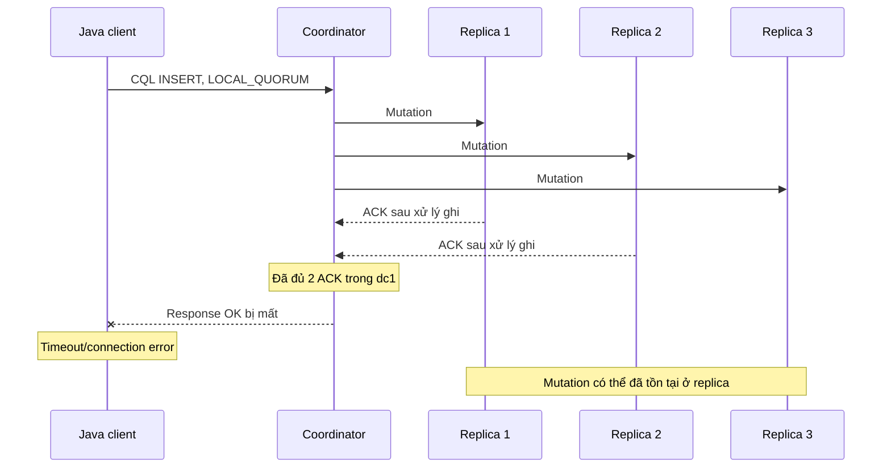
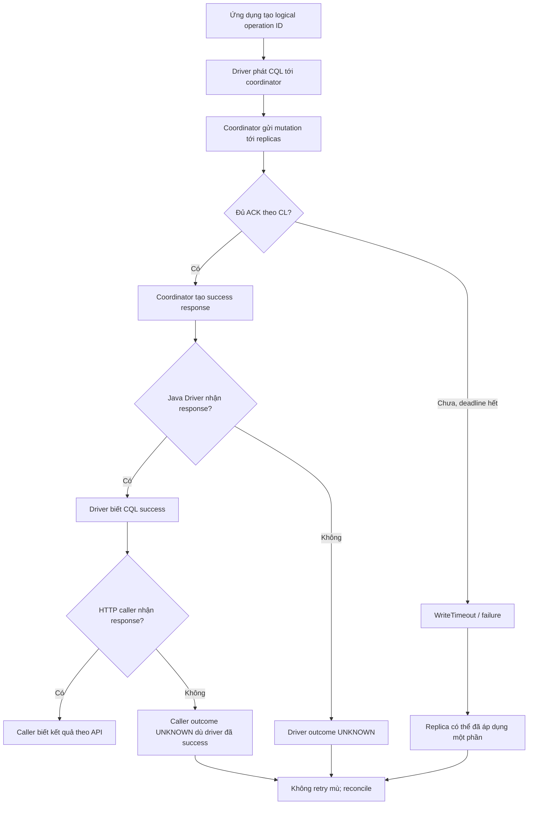
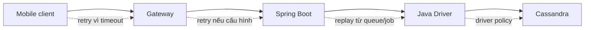
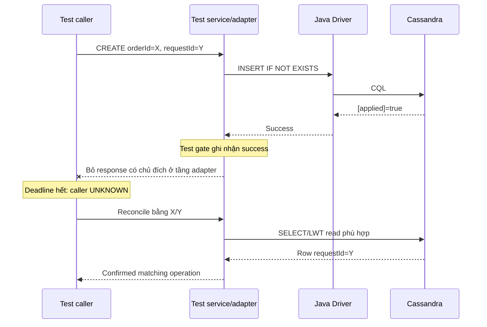
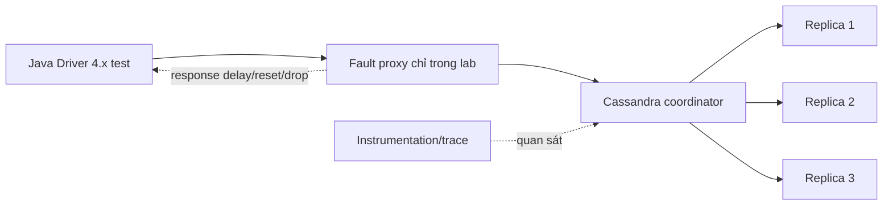
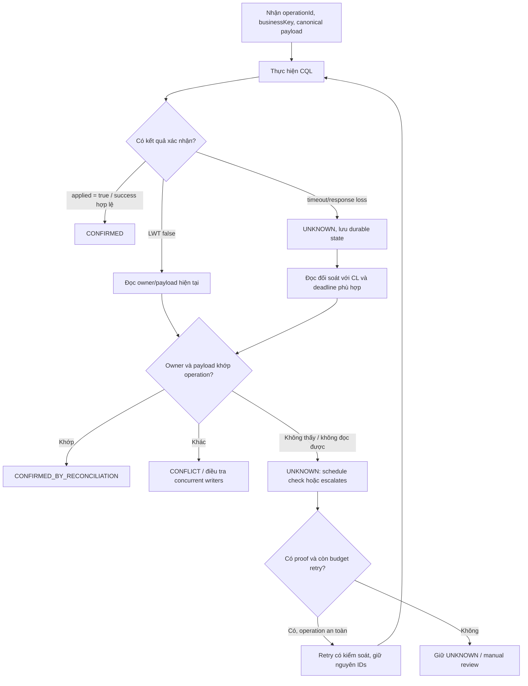

# Ghi được áp dụng nhưng phản hồi bị mất trong Cassandra: kiểm thử và xử lý kết quả chưa xác định

## 1. Một thao tác ghi đã xảy ra, tại sao ứng dụng vẫn báo lỗi?

Apache Cassandra là cơ sở dữ liệu **wide-column phân tán**: application gửi CQL tới một **coordinator**, coordinator chuyển mutation đến các **replica** theo partition key, replication factor (RF) và topology, rồi chờ số phản hồi theo **consistency level (CL)**. Đường truyền từ application đến coordinator và từ coordinator đến replica đều có thể mất gói, bị ngắt kết nối hoặc trễ hơn timeout.

Xét nghiệp vụ tạo đơn:

```text
POST /orders
requestId = 8d1e... (ổn định cho cùng logical request)
orderId   = 51a3...

1. Ứng dụng gửi INSERT/CAS vào Cassandra.
2. Mutation được áp dụng trên các replica theo cơ chế ghi.
3. Coordinator hoàn thành công việc và chuẩn bị gửi response.
4. Response thất lạc hoặc đường truyền bị cắt trước khi caller thấy.
5. Caller nhận timeout / connection reset.
6. Caller gửi lại cùng yêu cầu: liệu có tạo đơn thứ hai?
```

Điểm nguy hiểm nhất là bước 5. **Timeout tại client không chứng minh mutation chưa được áp dụng**. Ngay cả khi server đã đáp ứng điều kiện thành công theo CL, client vẫn có thể không nhận được ACK cuối cùng. Khi đó hành động “retry cho chắc” có thể làm sai dữ liệu, nhất là với **counter increment, list append, TTL, conditional mutation (LWT)** và side effect ngoài Cassandra.

**Mục tiêu:** thiết kế thí nghiệm có thể tái hiện việc **đã ghi nhưng không thấy phản hồi**, phân loại outcome từ góc nhìn từng bên và xây cơ chế xác nhận/đối soát có tính đúng đắn trong Java Driver 4.x, Spring Boot và hệ thống đa replica.

### Kết quả học tập

1. Phân biệt **mutation đã được một replica áp dụng**, **CL đã được coordinator đáp ứng** và **client đã nhận kết quả**.
2. Giải thích các vị trí mất phản hồi trên write path, cả phía CQL lẫn HTTP/gateway.
3. Phân loại lỗi `WriteTimeout`, `WriteFailure`, `DriverTimeout`, `Unavailable` và ngắt kết nối mà không suy diễn quá mức.
4. Nhận biết khi nào retry bảo toàn ý nghĩa nghiệp vụ và khi nào có thể nhân đôi tác động.
5. Thiết kế `operation_id`/`request_id` ổn định, LWT `IF NOT EXISTS` và **đối soát sau UNKNOWN**.
6. Thực hành CQL + Java Driver, một test giả lập **mất phản hồi sau server success** theo cách xác định, và kịch bản proxy fault trong lab.
7. Đo số lượng UNKNOWN, duplicates, elapsed time, CL, attempts và recovery; đặt guardrail để không gây lỗi ngoài môi trường thử nghiệm.

> **Thông điệp cốt lõi:** *Kết quả không rõ từ phía client là một trạng thái cần xử lý riêng, không phải một giá trị false của nghiệp vụ.* Muốn retry an toàn phải có căn cứ về idempotency và cách nhận diện **cùng một logical operation**.

## 2. Ba sự kiện khác nhau: APPLY, QUORUM ACK, CLIENT OBSERVE

Với keyspace RF3 trong `dc1` và write ở `LOCAL_QUORUM`, một coordinator thường cần ACK từ **hai replica địa phương** để trả kết quả thành công cho một ghi thông thường. Nhưng client còn phụ thuộc response từ coordinator qua connection.



Đây là **một kịch bản có thể xảy ra**, không khẳng định mọi message luôn đến theo thứ tự vẽ. Với LWT/counter/batch, nội bộ xử lý khác thao tác ghi đơn giản. Điểm chung là không thể dùng sự kiện **client không thấy ACK** để suy ngược rằng mọi replica chưa làm gì.

| Sự kiện | Ai có thể biết? | Nó chứng minh điều gì? | Nó **không** chứng minh |
| --- | --- | --- | --- |
| R1 đã áp dụng mutation | R1 và quan sát đủ tin cậy tại server | Ít nhất một replica đã xử lý thay đổi | Write đạt CL, đã đồng bộ mọi replica, client đã nhận |
| Coordinator đủ ACK theo CL | Coordinator và trace đủ tin cậy | Điều kiện xác nhận của lần write đã được đáp ứng tại thời điểm đó | HTTP caller nhận được thành công, mọi DC đều hội tụ |
| Java Driver nhận success | Java process/driver | CQL attempt nhận kết quả thành công theo CL | Toàn bộ chuỗi HTTP/business side effects hoàn tất |
| HTTP caller nhận 2xx | Caller/gateway | Endpoint báo success theo contract được định nghĩa | Không có hành động phát sinh sau 2xx ở downstream |
| Client timeout | Client | Không có kết quả trong deadline client | Mutation chắc chắn bị rollback hoặc chưa gửi |

**Cassandra không tự triển khai một transaction rollback chung chỉ vì coordinator/client timeout.** Replica có thể đã ghi commit log/memtable theo write path, dữ liệu có thể được đọc lại dù caller nhận lỗi.

### Không đồng nhất “đã ghi ở một replica” và “ghi đã thành công theo CL”

Giả sử RF3/LOCAL_QUORUM nhưng chỉ một replica gửi ACK trước timeout. Mutation **có thể tồn tại** ở R1, nhưng request **không được coordinator xác nhận đạt LOCAL_QUORUM** cho client. Sau đó, anti-entropy/hints/repair và các request tiếp theo có thể ảnh hưởng sự hội tụ. Không đánh dấu business success chỉ dựa vào một quan sát yếu.

Ngược lại, nếu hai ACK đã đến coordinator rồi response thất lạc trên đường cuối, **CL đã hoàn tất ở server** nhưng client vẫn không biết. Đây là trường hợp điển hình của chủ đề.

## 3. Dòng thời gian và cửa sổ bất định



Chia các vị trí lỗi:

1. **Trước khi tạo request:** lỗi validation rõ ràng có thể chứng minh code chưa hề gọi driver. Đây là bằng chứng thuộc ứng dụng, không phải “mọi network error nghĩa là chưa gửi”.
2. **Sau khi gửi nhưng trước đủ ACK:** một số replicas đã ghi; coordinator timeout hoặc failure.
3. **Sau đủ ACK nhưng trước Java nhận success:** response bị chặn/mất hoặc coordinator chết đúng thời điểm; client không biết CL đã đáp ứng.
4. **Java nhận success nhưng trước HTTP 2xx tới người dùng:** Spring Boot/gateway/network lỗi; người dùng không biết dù driver đã hoàn tất.
5. **Sau HTTP 2xx:** hệ thống gửi event/notification bất đồng bộ có thể vẫn lỗi; API success cần contract cho các bước đó.

Ở các cửa sổ 2–4, câu trả lời đúng thường là **UNKNOWN tới khi đối soát**, không phải “FAILED chắc chắn”.

### Cách đặt tên trạng thái

Một state machine ở tầng application:

```text
PENDING
  ├── CONFIRMED        nhận bằng chứng đủ theo contract
  ├── CONFLICT         một operation khác sở hữu business key
  ├── REJECTED         lỗi có bằng chứng rõ không thực thi
  └── UNKNOWN          phản hồi mất hoặc chưa đủ bằng chứng
         ├── CONFIRMED_AFTER_RECONCILIATION
         ├── CONFLICT_AFTER_RECONCILIATION
         └── NEEDS_MANUAL_REVIEW / RETRY_SCHEDULED_UNDER_POLICY
```

Không trả HTTP `409 Conflict` cho mọi write timeout. Không trả `201 Created` chỉ vì **có một row nào đó** cùng order ID mà chưa chứng minh nó thuộc request vừa gửi.

## 4. RF, CL và việc trả lời đã đủ ACK

Ví dụ keyspace:

```sql
CREATE KEYSPACE IF NOT EXISTS lost_ack_lab
WITH replication = {
    'class': 'NetworkTopologyStrategy',
    'dc1': 3
}
AND durable_writes = true;
```

Với RF3 trong một DC:

| CL cho ghi thông thường | ACK cần trong ví dụ | Một replica Down trước request |
| --- | --- | --- |
| `ONE` | 1 replica đáp ứng | Có thể phục vụ nếu còn replica phù hợp |
| `LOCAL_QUORUM` | 2 replica tại dc1 | Có thể đạt nếu hai replica còn lại khỏe |
| `QUORUM` | 2 trên RF3 một DC | Trong một DC, quorum này trùng số lượng local ở ví dụ |
| `ALL` | 3 replica | Không thể thành công nếu chỉ có hai replica |

Nếu có nhiều DC, `LOCAL_QUORUM` chỉ xét local DC theo RF của DC đó; `QUORUM` có phạm vi khác, và writes ở `EACH_QUORUM` có yêu cầu theo từng DC. Không bê bảng một DC sang multi-DC mà không tính lại RF.

**Không giải quyết lost ACK bằng cách đổi CL từ `LOCAL_QUORUM` xuống `ONE`.** CL yếu hơn có thể tăng số attempts được trả lời nhưng thay đổi consistency contract và không giải quyết kết quả UNKNOWN của request đã gửi.

### Khi đã đủ CL thì dữ liệu đã “an toàn tuyệt đối” chưa?

Không. CL mô tả số replica xác nhận theo protocol cho thao tác tương ứng. Nó **không** phải bằng chứng:

- Tất cả replicas ở mọi DC đã cùng trạng thái.
- Mọi SSTable đã được flush ở tất cả replicas.
- Một backup/snapshot lịch sử chứa mutation.
- Tất cả bảng denormalized hoặc hệ thống ngoài Cassandra đã được cập nhật atomically.
- Sau đó không có concurrent writer/tombstone với timestamp thắng ghi đè.

Cần phân biệt **durable write path**, replica acknowledgment, replication convergence, backup và workflow nghiệp vụ.

## 5. Phân loại timeout và lỗi transport

Các loại lỗi thường gặp trong Java Driver 4.x:

| Tín hiệu | Thông tin client có được | Hướng kết luận về write |
| --- | --- | --- |
| `WriteTimeoutException` | Coordinator không thu đủ phản hồi yêu cầu trong hạn (theo write type/CL) | **Outcome có thể UNKNOWN**; một số replicas có thể đã ghi |
| `WriteFailureException` | Server báo một số thất bại khi ghi, có thông tin write type/acks | Không mặc định tất cả replicas đều chưa ghi |
| `UnavailableException` | Coordinator xác định không đủ replicas để đáp ứng CL tại lúc xử lý | Thường yêu cầu bị từ chối do thiếu quorum, nhưng phân loại theo **request cụ thể** và log/cause |
| `DriverTimeoutException` | Driver client hết request timeout | Coordinator có thể vẫn đang xử lý hoặc đã hoàn thành |
| Ngắt connection sau khi gửi | Không nhận được kết quả đầy đủ | **UNKNOWN**, đặc biệt nếu không biết request đã đến server chưa |
| `AllNodesFailedException` | Driver không hoàn tất trên các node thử; có root causes theo node | Không suy chỉ từ tên rằng chắc chắn request chưa tới coordinator |
| `InvalidQueryException`/unauthorized rõ ràng | Request bị validation hoặc authorization từ chối | Sửa query/permission; không retry như lỗi tạm thời |
| LWT result `[applied]=false` | Server trả điều kiện không thỏa cho **lần thử này** | Không khẳng định logical operation ban đầu thất bại nếu từng timeout |

**Đừng viết `catch (Exception e) { retry(); }`.** Một câu `INSERT ... IF NOT EXISTS` có thể trả false sau lần đầu đã thành công; một counter increment có thể áp dụng nhiều lần; một lỗi authorization sẽ không lành nhờ sleep.

### Write type có giúp xác định chính xác dữ liệu không?

Một số `WriteTimeoutException` có thông tin `WriteType` như SIMPLE, BATCH, COUNTER hoặc CAS theo loại mutation. Dùng nó để **phân nhóm điều tra và retry policy**, không để suy rằng “CAS timeout chắc chắn chưa áp dụng” hay “SIMPLE timeout chắc chắn đã áp dụng”.

Giá trị `received`, `blockFor` phản ánh số phản hồi server biết theo lỗi cụ thể, **không** chứng minh có bao nhiêu replica cuối cùng áp dụng mutation nếu ACK chậm/mất.

### Tại sao tăng timeout chưa đủ?

Timeout dài hơn có thể giúp một số response đến kịp, nhưng:

- Tăng thời gian giữ in-flight requests và tài nguyên.
- Không loại bỏ network partition hoặc coordinator crash.
- Không sửa lỗi retry không idempotent.
- Có thể làm SLO API tệ hơn dù Cassandra cuối cùng đã ghi.

Thử timeout mới cần đo p95/p99, error budget, concurrency và áp lực lên cluster, không điều chỉnh theo cảm tính.

## 6. Idempotency phải được định nghĩa ở cấp nghiệp vụ

Một request **idempotent** không gây tác động nghiệp vụ mới khi cùng logical operation được thực thi lại dưới những giả định đã xác định. Trong Cassandra, tên CQL `INSERT` hay `UPDATE` **không đủ để kết luận**.

| Mutation | Có thể retry mù sau phản hồi mất? | Vì sao |
| --- | --- | --- |
| `SET status='CREATED'` cùng khóa | **Có điều kiện** | Concurrent updates/timestamps có thể khiến retry ghi đè trạng thái mới |
| `INSERT` cùng full primary key và immutable payload | Có điều kiện với LWW/TTL/concurrency | Cùng key không tạo hàng thứ hai, nhưng timestamp/TTL và side effects cần xem |
| `counter = counter + 1` | **Không** | Mỗi attempt có thể cộng thêm |
| `list = list + ['sku-A']` | **Không** | Retry có thể append phần tử mới nữa |
| `list = ['sku-A'] + list` | **Không** | Retry prepend có thể nhân đôi và đổi thứ tự |
| `USING TTL 600` | **Không mặc định** | Replay có thể làm thay thời điểm hết hạn |
| `INSERT ... IF NOT EXISTS` | Không retry mù sau timeout | Retry có thể trả `[applied]=false` vì lần đầu đã tạo |
| `UPDATE ... IF version=?` | Không retry mù sau timeout | Version có thể đã đổi do lần đầu, retry bị từ chối |
| Gọi payment gateway sau Cassandra write | Không chỉ dựa vào idempotency của CQL | Cần chính sách exactly-once/dedup ở hệ thống bên ngoài |

### 6.1. Upsert cùng khóa vẫn cần kiểm tra concurrency

Hai lần ghi cùng `order_id` và cùng `status` thường dẫn đến cùng hàng trong môi trường tĩnh. Nhưng nếu một worker khác đổi `status` thành `PAID` giữa hai lần, retry `status='CREATED'` với timestamp mới hơn có thể làm trạng thái **đi lùi**.

Vì vậy **cùng giá trị và primary key** là điều kiện hữu ích nhưng chưa đủ cho mọi workflow; dùng version, immutable ownership, LWT hoặc state transition policy khi cần.

### 6.2. TTL là một hiệu ứng thời gian

```sql
UPDATE lost_ack_lab.session_flags
USING TTL 600
SET state = 'ACTIVE'
WHERE session_id = 55555555-5555-4555-8555-555555555555;
```

Nếu retry sau một phút, expiration **có thể bị dịch**. Nếu session phải hết hạn theo mốc tuyệt đối do login operation quyết định, lưu `expires_at` như business field rồi kiểm tra nó ở application; dùng TTL để cleanup phụ trợ, không làm nguồn duy nhất của thời hạn quyền.

### 6.3. “Không có response” không biến client thành chủ sở hữu transaction

Client không thể rollback dữ liệu Cassandra đã ghi chỉ vì socket đứt. Cũng không thể phát đi `DELETE` ngay để “hoàn tác” mà không biết ai đã đọc/ghi row sau đó: delete tạo tombstone, có ảnh hưởng concurrency và replica consistency.

**Bù trừ nghiệp vụ (compensation)** cần một sự kiện/operation riêng có trạng thái, không phải thử ghi/xóa ngẫu nhiên cho đến khi thấy row biến mất.

## 7. Kịch bản LWT mất phản hồi: lần hai `[applied]=false`

Một cách bảo vệ business uniqueness là giữ **ID của logical request** và immutable payload fingerprint trong chính row được tạo bằng `IF NOT EXISTS`.

Giả sử:

```sql
CREATE TABLE IF NOT EXISTS lost_ack_lab.orders_by_id (
    order_id uuid PRIMARY KEY,
    request_id uuid,
    payload_hash text,
    status text,
    amount_cents bigint
);
```

Lần đầu:

```sql
INSERT INTO lost_ack_lab.orders_by_id (
    order_id, request_id, payload_hash, status, amount_cents
) VALUES (
    11111111-1111-4111-8111-111111111111,
    22222222-2222-4222-8222-222222222222,
    'sha256:canonical-order-payload-v1',
    'CREATED', 125000
) IF NOT EXISTS;
```

Nếu lần đầu thành công ở server nhưng response mất, gửi lại **cùng câu lệnh** sau đó thường trả:

```text
[applied] = false
current row.request_id = 22222222-2222-4222-8222-222222222222
```

Điều này **không phải thất bại nghiệp vụ** khi cùng operation đã tạo row trước đó. Phải đối chiếu **request_id + payload_hash + invariant bất biến** và phân loại `ALREADY_APPLIED`. Nếu row thuộc request khác, phân loại `CONFLICT`, không gán success.

### Nếu lần đầu thực ra chưa ghi?

Lần retry có thể là lần đầu thành công và trả `[applied]=true`. Đây cũng là reason không dùng `[applied]=false` để kết luận operation đã thất bại ở cấp business sau một request timeout. Đối soát bằng identity và state, không dựa vào thứ tự số lần client gửi.

### Serial consistency và phạm vi

LWT là conditional mutation sử dụng Paxos với **serial consistency** như `SERIAL`/`LOCAL_SERIAL`, đồng thời có consistency level bình thường cho các giai đoạn tương ứng. Với một DC RF3, ví dụ ứng dụng có thể chọn `LOCAL_QUORUM` và `LOCAL_SERIAL` sau khi kiểm chứng semantics ở topology của mình.

LWT không tự tạo exactly-once cho **hai partition khác nhau** hoặc một API thanh toán ngoài Cassandra. `request_id` trong row làm việc đối soát của **row đó** rõ hơn, không chứng minh mọi side effect đã hoàn thành.

## 8. Bảng định danh theo operation ID: thiết kế đủ chặt để đối soát

Một server có thể có hai ID khác nhau:

| ID | Dùng để làm gì? | Có được thay khi retry? |
| --- | --- | --- |
| `order_id` | Khóa định danh đơn hàng nghiệp vụ | **Không**, nếu retry là cùng đơn |
| `request_id` / `operation_id` | Xác định cùng một logical command | **Không**, kể cả qua gateway/queue |
| Trace ID của HTTP attempt | Quan sát từng lần gọi transport | Có thể khác giữa attempts |
| Driver request/attempt ID | Quan sát từng lần gửi CQL | Có thể khác giữa attempts |

Đừng dùng một trace ID **mới** ở mỗi HTTP retry làm idempotency key. Cũng không lấy `UUID.randomUUID()` mỗi lần method `createOrder` được gọi nếu người dùng đang gửi lại cùng đơn.

### Cần ràng buộc cả payload

Nếu client tái dùng cùng `request_id` nhưng body đã đổi `amount_cents`, đó không phải “cùng operation”. Phải tính canonical payload fingerprint có version, ví dụ từ `order_id`, `tenant_id`, amount, currency, các immutable fields và phiên bản rule.

**Tránh** dùng chuỗi hash minh họa `sha256:canonical-order-payload-v1` như checksum thật: trong lab cần thay bằng hash thực sự hoặc một giá trị ổn định được test rõ. Không log payload chứa PII hoặc raw idempotency key trên mọi request.

### Không tạo ledger check-then-write giả transaction

Pattern nguy hiểm:

```text
if (!seen(request_id)) {
    UPDATE counter SET total = total + 1
    INSERT processed_requests(request_id)
}
```

Nếu crash giữa hai câu, sự kiện có thể bị cộng hai lần hoặc bị mất. Không có transaction ACID xuyên các partition chỉ nhờ kiểm tra trước rồi ghi hai bảng. Nếu cần exactly-once mạnh, chọn architecture với **atomic claim + effect phù hợp ranh giới**, hoặc durable event ledger và idempotent projection có thể rebuild/reconcile.

## 9. CQL lab: dữ liệu kiểm thử gồm write thường, LWT, counter và TTL

**Chỉ chạy trên cluster lab cô lập.** Ví dụ `dc1`/RF3 cần tối thiểu ba replica có thể phục vụ; nếu test trên một node RF1, đổi keyspace replication/CL cho phù hợp và **không** lấy kết quả đó làm bằng chứng về quorum khi một replica chết.

```sql
CREATE KEYSPACE IF NOT EXISTS lost_ack_lab
WITH replication = {
    'class': 'NetworkTopologyStrategy',
    'dc1': 3
}
AND durable_writes = true;

CREATE TABLE IF NOT EXISTS lost_ack_lab.orders_by_id (
    order_id uuid PRIMARY KEY,
    request_id uuid,
    payload_hash text,
    status text,
    amount_cents bigint
);

CREATE TABLE IF NOT EXISTS lost_ack_lab.counter_by_tenant (
    tenant_id text PRIMARY KEY,
    completed_orders counter
);

CREATE TABLE IF NOT EXISTS lost_ack_lab.session_flags (
    session_id uuid PRIMARY KEY,
    state text,
    expires_at timestamp
);

CREATE TABLE IF NOT EXISTS lost_ack_lab.events_by_order (
    order_id uuid,
    event_id uuid,
    event_type text,
    PRIMARY KEY ((order_id), event_id)
);
```

Ghi chú: bảng `events_by_order` cung cấp `event_id` bất biến để ghi mỗi event như một row riêng, **không** mặc định atomic với `orders_by_id` hoặc counter. Nó là ví dụ data model có identity, không phải transactional outbox hoàn chỉnh.

### Thiết lập CL trong `cqlsh`

```text
CONSISTENCY LOCAL_QUORUM;
```

Đây là lệnh **cqlsh**, không phải cú pháp CQL DDL. Với môi trường đơn node/RF1, `LOCAL_QUORUM` có ý nghĩa khác; phải ghi rõ trong biên bản test.

### Bài thực hành A — Cùng primary key không tạo thêm hàng

```sql
INSERT INTO lost_ack_lab.orders_by_id
    (order_id, request_id, payload_hash, status, amount_cents)
VALUES (
    11111111-1111-4111-8111-111111111111,
    22222222-2222-4222-8222-222222222222,
    'payload-v1', 'CREATED', 125000
);

INSERT INTO lost_ack_lab.orders_by_id
    (order_id, request_id, payload_hash, status, amount_cents)
VALUES (
    11111111-1111-4111-8111-111111111111,
    22222222-2222-4222-8222-222222222222,
    'payload-v1', 'CREATED', 125000
);

SELECT request_id, payload_hash, status, amount_cents
FROM lost_ack_lab.orders_by_id
WHERE order_id = 11111111-1111-4111-8111-111111111111;
```

Kỳ vọng một logical row vì cùng full primary key, **không** phải hai row. Đây là ví dụ rất hạn chế; nếu có concurrent writer, TTL hoặc update timestamp, replay có thể gây hiệu ứng khác.

### Bài thực hành B — LWT cùng request ID sau một lần đã tạo

Dùng **order_id khác** để không bị kết quả bài A ảnh hưởng:

```sql
INSERT INTO lost_ack_lab.orders_by_id
    (order_id, request_id, payload_hash, status, amount_cents)
VALUES (
    33333333-3333-4333-8333-333333333333,
    44444444-4444-4444-8444-444444444444,
    'payload-v2', 'CREATED', 200000
) IF NOT EXISTS;

-- Chạy lại chính INSERT phía trên, không thay ID/payload.
SELECT request_id, payload_hash, status, amount_cents
FROM lost_ack_lab.orders_by_id
WHERE order_id = 33333333-3333-4333-8333-333333333333;
```

Lần đầu có thể `[applied]=true`; lần sau `false` khi row đã tồn tại. Nếu response lần đầu bị mất, **lần sau false không chứng minh đơn chưa được tạo**.

### Bài thực hành C — Counter increment lặp có hiệu ứng tích lũy

```sql
UPDATE lost_ack_lab.counter_by_tenant
SET completed_orders = completed_orders + 1
WHERE tenant_id = 'tenant-01';

UPDATE lost_ack_lab.counter_by_tenant
SET completed_orders = completed_orders + 1
WHERE tenant_id = 'tenant-01';

SELECT completed_orders
FROM lost_ack_lab.counter_by_tenant
WHERE tenant_id = 'tenant-01';
```

Hai mutations thành công có thể tăng hai đơn vị. Nếu cùng logical event chỉ được tính một lần, **retry counter mù là sai**, kể cả khi lần đầu client timeout.

### Bài thực hành D — TTL replay

```sql
UPDATE lost_ack_lab.session_flags
USING TTL 600
SET state = 'ACTIVE'
WHERE session_id = 55555555-5555-4555-8555-555555555555;

SELECT state, TTL(state), WRITETIME(state)
FROM lost_ack_lab.session_flags
WHERE session_id = 55555555-5555-4555-8555-555555555555;
```

Sau một khoảng thời gian lab có kiểm soát, gửi lại lệnh và quan sát TTL remaining; thời điểm expiry **có thể thay đổi**. `WRITETIME` là mutation timestamp, không phải cùng một đại lượng với thời điểm expire; phải xem semantics TTL của server version mục tiêu.

## 10. Java Driver 4.x: không biến timeout thành “đơn chưa được tạo”

Một Spring Boot service hoặc ứng dụng Java thuần có thể inject/reuse một `CqlSession` đã cấu hình contact points, local datacenter, TLS, authentication và request timeout. Repository dưới đây thực hiện **một** conditional insert theo order ID; nếu result bị mất, nó trả **UNKNOWN** cho các loại lỗi đã phân loại là không rõ outcome.

Điểm quan trọng:

- Tạo `order_id` và `request_id` **trước** khi gọi repository, giữ nguyên qua mọi lần HTTP/queue retry.
- Chọn `LOCAL_QUORUM` và `LOCAL_SERIAL` trong lab RF3/DC1 này.
- `setIdempotent(false)` để không báo sai cho driver rằng LWT an toàn để tự retry vô điều kiện.
- Khi gặp `[applied]=false`, xem **owner request ID** và hash payload của row đang tồn tại.
- Khi gặp timeout/transport error, trả một kết quả riêng `UNKNOWN`, **không khẳng định success hay failure**.
- Lỗi validation/auth rõ ràng được ném lại để caller xử lý; không gọi là UNKNOWN nếu có bằng chứng request bị từ chối.

### 10.1. Repository với kết quả phân loại

```java
import java.util.Iterator;
import java.util.UUID;
import java.util.concurrent.CompletionException;
import java.util.concurrent.CompletionStage;
import java.util.concurrent.ExecutionException;

import com.datastax.oss.driver.api.core.AllNodesFailedException;
import com.datastax.oss.driver.api.core.CqlSession;
import com.datastax.oss.driver.api.core.DefaultConsistencyLevel;
import com.datastax.oss.driver.api.core.DriverTimeoutException;
import com.datastax.oss.driver.api.core.cql.AsyncResultSet;
import com.datastax.oss.driver.api.core.cql.BoundStatement;
import com.datastax.oss.driver.api.core.cql.PreparedStatement;
import com.datastax.oss.driver.api.core.cql.Row;
import com.datastax.oss.driver.api.core.servererrors.ReadFailureException;
import com.datastax.oss.driver.api.core.servererrors.ReadTimeoutException;
import com.datastax.oss.driver.api.core.servererrors.UnavailableException;
import com.datastax.oss.driver.api.core.servererrors.WriteFailureException;
import com.datastax.oss.driver.api.core.servererrors.WriteTimeoutException;

public final class LossAwareOrderRepository {
    public enum Kind {
        APPLIED,
        ALREADY_APPLIED,
        CONFLICT,
        UNKNOWN
    }

    public record CreateResult(Kind kind, String detail) {}

    private final CqlSession session;
    private final PreparedStatement insertIfAbsent;
    private final PreparedStatement selectById;

    public LossAwareOrderRepository(CqlSession session) {
        this.session = session;
        this.insertIfAbsent = session.prepare(
            "INSERT INTO lost_ack_lab.orders_by_id " +
            "(order_id, request_id, payload_hash, " +
            "status, amount_cents) VALUES (?, ?, ?, ?, ?) " +
            "IF NOT EXISTS");
        this.selectById = session.prepare(
            "SELECT request_id, payload_hash, status, " +
            "amount_cents FROM lost_ack_lab.orders_by_id " +
            "WHERE order_id = ?");
    }

    public CompletionStage<CreateResult> create(
            UUID orderId, UUID requestId,
            String payloadHash, long amountCents) {
        BoundStatement write = insertIfAbsent.bind(
                orderId, requestId, payloadHash,
                "CREATED", amountCents)
            .setConsistencyLevel(
                DefaultConsistencyLevel.LOCAL_QUORUM)
            .setSerialConsistencyLevel(
                DefaultConsistencyLevel.LOCAL_SERIAL)
            .setIdempotent(false);

        return session.executeAsync(write).handle((result, error) -> {
            if (error != null) {
                Throwable root = unwrap(error);
                if (isAmbiguousWriteFailure(root)) {
                    return new CreateResult(
                        Kind.UNKNOWN, "CQL outcome not confirmed");
                }
                // Với lỗi khác, để tầng service phân loại rõ.
                throw new CompletionException(root);
            }

            Iterator<Row> rows = result.currentPage().iterator();
            if (!rows.hasNext()) {
                throw new IllegalStateException(
                    "LWT returned no applied result");
            }
            Row row = rows.next();
            if (row.getBoolean("[applied]")) {
                return new CreateResult(
                    Kind.APPLIED, "Condition applied");
            }

            UUID owner = row.isNull("request_id")
                ? null : row.getUuid("request_id");
            String existingHash = row.getString("payload_hash");
            Long existingAmount = row.isNull("amount_cents")
                ? null : row.getLong("amount_cents");

            if (requestId.equals(owner)
                    && payloadHash.equals(existingHash)
                    && Long.valueOf(amountCents).equals(existingAmount)) {
                return new CreateResult(
                    Kind.ALREADY_APPLIED,
                    "Same operation already owns the row");
            }
            return new CreateResult(
                Kind.CONFLICT, "Different owner or payload");
        });
    }

    public CompletionStage<CreateResult> reconcile(
            UUID orderId, UUID requestId,
            String payloadHash, long amountCents) {
        BoundStatement read = selectById.bind(orderId)
            .setConsistencyLevel(
                DefaultConsistencyLevel.LOCAL_QUORUM)
            .setIdempotent(true);

        return session.executeAsync(read).handle((result, error) -> {
            if (error != null) {
                Throwable root = unwrap(error);
                if (root instanceof DriverTimeoutException
                        || root instanceof AllNodesFailedException
                        || root instanceof ReadTimeoutException
                        || root instanceof ReadFailureException
                        || root instanceof UnavailableException) {
                    return new CreateResult(
                        Kind.UNKNOWN, "Cannot reconcile yet");
                }
                throw new CompletionException(root);
            }

            Iterator<Row> rows = result.currentPage().iterator();
            if (!rows.hasNext()) {
                // ABSENT tại lần đọc này không chứng minh
                // mutation trước đó chưa/không thể hoàn tất.
                return new CreateResult(
                    Kind.UNKNOWN, "Row not visible; retry check later");
            }
            Row row = rows.next();
            UUID owner = row.isNull("request_id")
                ? null : row.getUuid("request_id");
            String hash = row.getString("payload_hash");
            Long cents = row.isNull("amount_cents")
                ? null : row.getLong("amount_cents");

            if (requestId.equals(owner)
                    && payloadHash.equals(hash)
                    && Long.valueOf(amountCents).equals(cents)) {
                return new CreateResult(
                    Kind.ALREADY_APPLIED,
                    "Matching immutable row is visible");
            }
            return new CreateResult(
                Kind.CONFLICT, "Row belongs to a different operation");
        });
    }

    private static boolean isAmbiguousWriteFailure(Throwable root) {
        return root instanceof WriteTimeoutException
            || root instanceof WriteFailureException
            || root instanceof DriverTimeoutException
            || root instanceof AllNodesFailedException;
    }

    private static Throwable unwrap(Throwable failure) {
        Throwable current = failure;
        while ((current instanceof CompletionException
                 || current instanceof ExecutionException)
                && current.getCause() != null) {
            current = current.getCause();
        }
        return current;
    }
}
```

### 10.2. Ranh giới bảo đảm của đoạn Java

1. **Không có automatic retry loop**: kể cả `Kind.UNKNOWN`, repository chỉ báo trạng thái để service quyết định reconcile.
2. Hàm `isAmbiguousWriteFailure` chọn thái độ bảo thủ với `AllNodesFailedException`, dù một số root cause cụ thể có thể chứng minh request chưa được gửi; **không đánh đồng mọi loại lỗi node**.
3. Một write timeout có `WriteType` khác nhau và nhận ACK khác nhau; muốn xử lý đúng cần xem exception details và topology, không chỉ exception name.
4. `reconcile` đọc `LOCAL_QUORUM` và kiểm tra identity/payload. Nó không tạo snapshot toàn hệ thống và không biết một LWT đang trong pha chưa hoàn tất; **row chưa thấy không chứng minh đã rollback**.
5. `ALREADY_APPLIED` có nghĩa **row hiện hữu phù hợp với cùng logical operation**, chỉ đáng tin nếu `request_id`, hash và amount **không bị workflow khác sửa** hoặc order ID tái sử dụng.
6. Với status chuyển từ `CREATED` sang `PAID` sau khi tạo, phương pháp so sánh không nên yêu cầu status hiện vẫn `CREATED`; cần chứng minh ownership bất biến và state machine hợp lệ.
7. `setIdempotent(false)` bảo vệ thông tin gửi tới driver policy; nó **không chặn** HTTP gateway, message broker hay client gọi lại `create()`.
8. Nếu cần snapshot, event trail hoặc cross-table atomicity, phải thiết kế ở tầng ứng dụng/hệ thống dữ liệu phù hợp; repository đơn bảng không tự cung cấp.

### 10.3. Vì sao không đọc bằng CL `ONE` rồi kết luận đã/không ghi?

Nếu replica đã áp dụng không phải replica phục vụ lần đọc `ONE`, một row có thể chưa được nhìn thấy. `LOCAL_QUORUM` trong RF3 giúp nâng mức quan sát qua quorum địa phương, nhưng sau một mutation **chưa được xác nhận theo CL** và có concurrency, một lần đọc vẫn chưa đủ để khẳng định operation sẽ không hoàn tất về sau.

Đừng coi `SELECT ... LIMIT 1` trả rỗng là bằng chứng chắc chắn cho phép tạo order ID khác. Nếu hợp đồng yêu cầu kết luận chắc hơn, dùng một durable idempotency ledger, LWT/conditional read phù hợp và quy trình reconcile có deadline/điều kiện kết thúc rõ.

## 11. Spring Boot/API: chuyển UNKNOWN thành trạng thái có thể kiểm tra

Một API tốt cần định nghĩa outcome **theo khả năng chứng minh**, thay vì ép mọi thao tác trả 200 hoặc 500:

| Tình huống backend | Contract API gợi ý | Client làm gì? |
| --- | --- | --- |
| LWT `[applied]=true` | `201 Created` hoặc thành công tương ứng | Dùng `order_id` |
| `[applied]=false`, cùng request/payload | `200 OK`/`201` theo contract idempotency | Không tạo đơn mới |
| `[applied]=false`, khác owner/payload | `409 Conflict` | Sửa yêu cầu hoặc điều tra |
| CQL outcome UNKNOWN, service còn kiểm soát response | `202 Accepted` với status endpoint **nếu có durable tracking**; hoặc lỗi tạm thời có operation ID | Poll theo ID, không đổi payload/ID |
| HTTP response bị mất hoàn toàn | Không có status code tới caller | Caller gửi lại **cùng ID**, hoặc kiểm tra status qua đường riêng |
| Lỗi validation/authorization rõ | `400`/`403`/status phù hợp | Sửa input/quyền, không retry mù |

**Không trả `202 Accepted` giả** nếu service không có chỗ lưu workflow hoặc status endpoint để tiếp tục đối soát. Đối với UNKNOWN, app có thể trả lỗi mạng/tạm thời rõ nghĩa, kèm hướng dẫn giữ idempotency key; điều quan trọng là **không khẳng định chắc chắn không có ghi**.

### Mẫu endpoint kiểm tra trạng thái

```text
POST /orders
Idempotency-Key: 22222222-2222-4222-8222-222222222222
Body: {"orderId":"33333333-3333-4333-8333-333333333333",
       "amountCents":200000}

GET /operations/22222222-2222-4222-8222-222222222222
→ PENDING / CONFIRMED / CONFLICT / UNKNOWN / NEEDS_REVIEW
```

Đây là **minh họa HTTP contract**, không phải một API tự có sẵn của Cassandra. Cần xác thực caller trên **mỗi request**, ràng buộc operation ID với tenant/principal và canonical payload, có retention/expiry của idempotency record, tránh cho user dò operation của người khác.

### Retry từ nhiều tầng



Một cờ `setIdempotent(false)` **không vô hiệu mọi mũi tên retry** trong sơ đồ. Nếu gateway, service, driver đều có budget riêng, số attempts có thể tăng theo kiểu lồng nhau. Cần một chiến lược end-to-end: **operation ID cố định, nơi quyết định retry chính, deadline tổng, backoff/jitter, quota, telemetry**.

## 12. Thí nghiệm xác định: ghi thành công rồi cố tình không chuyển HTTP ACK

Thí nghiệm đáng tin nhất để chứng minh “đã ghi nhưng caller không thấy” là **kiểm soát ranh giới phản hồi phía ứng dụng**, sau khi đã có bằng chứng Cassandra write đạt success. Đây là **mô phỏng mất phản hồi HTTP/API**, không phải proof rằng TCP response trực tiếp từ Cassandra bị mất.

### Cơ chế thí nghiệm



Trình tự này tạo bằng chứng rõ:

- Test harness biết **server trả success** trước khi reply bị chặn.
- Caller quan sát **timeout/no response**.
- Truy vấn đối soát tìm đúng row cùng request ID và payload hash.

Nhưng **không được gọi kết quả này là “kiểm thử wire-level CQL ACK loss”**. Nếu mục tiêu là kiểm thử driver khi coordinator response mất, cần proxy/network fault ở mục 13.

### Code JUnit 5: mô phỏng kênh response bị mất sau success

Test dưới đây giả định `CqlSession session` từ một integration-test fixture Cassandra thật, bảng ở mục 9 đã tồn tại. Nó chủ ý không hoàn tất một `CompletableFuture` đại diện cho response **đến caller**, sau khi CQL đã thành công. Sử dụng order ID duy nhất để không ảnh hưởng test khác:

```java
import static org.junit.jupiter.api.Assertions.*;

import java.util.UUID;
import java.util.concurrent.CompletableFuture;
import java.util.concurrent.CompletionException;
import java.util.concurrent.TimeUnit;

import org.junit.jupiter.api.Test;

import com.datastax.oss.driver.api.core.CqlSession;
import com.datastax.oss.driver.api.core.DefaultConsistencyLevel;
import com.datastax.oss.driver.api.core.cql.BoundStatement;
import com.datastax.oss.driver.api.core.cql.Row;

public final class LostHttpResponseIT {
    // Inject từ @BeforeAll/Testcontainers/staging fixture.
    private CqlSession session;

    @Test
    void databaseAcceptedButCallerLostResponse() {
        UUID orderId = UUID.randomUUID();
        UUID requestId = UUID.randomUUID();

        BoundStatement create = session.prepare(
            "INSERT INTO lost_ack_lab.orders_by_id " +
            "(order_id, request_id, payload_hash, " +
            "status, amount_cents) VALUES (?, ?, ?, ?, ?) " +
            "IF NOT EXISTS"
        ).bind(orderId, requestId, "payload-test", "CREATED", 1000L)
         .setConsistencyLevel(
             DefaultConsistencyLevel.LOCAL_QUORUM)
         .setSerialConsistencyLevel(
             DefaultConsistencyLevel.LOCAL_SERIAL)
         .setIdempotent(false);

        Row applied = session.execute(create).one();
        assertNotNull(applied);
        assertTrue(applied.getBoolean("[applied]"));

        // Chỉ giả lập response của service/gateway tới caller;
        // KHÔNG can thiệp response CQL vừa được driver nhận.
        CompletableFuture<String> responseToCaller =
            new CompletableFuture<>();
        assertThrows(CompletionException.class, () ->
            responseToCaller
                .orTimeout(50, TimeUnit.MILLISECONDS)
                .join());

        Row stored = session.execute(
            session.prepare(
                "SELECT request_id, payload_hash, " +
                "amount_cents FROM lost_ack_lab.orders_by_id " +
                "WHERE order_id=?")
                .bind(orderId)
                .setConsistencyLevel(
                    DefaultConsistencyLevel.LOCAL_QUORUM)
                .setIdempotent(true)
        ).one();

        assertNotNull(stored);
        assertEquals(requestId, stored.getUuid("request_id"));
        assertEquals("payload-test",
            stored.getString("payload_hash"));
        assertEquals(1000L, stored.getLong("amount_cents"));
    }
}
```

**Phạm vi code:** `session` cần được thực sự inject trong fixture; đoạn này không tự compile/run như một test độc lập khi chưa có Testcontainers/startup code. `orTimeout(50ms)` chỉ kiểm tra một future **không được hoàn tất có chủ đích**, không mô phỏng network thực và không đo hiệu năng Cassandra. Dùng tên test rõ để không làm báo cáo đánh đồng synthetic HTTP loss với packet loss.

### Mở rộng thành integration test end-to-end

Có thể dùng một **test adapter** giữa HTTP controller và transport, có barrier:

1. Caller gửi request có fixed `Idempotency-Key`.
2. Service thực thi Cassandra và xác nhận success.
3. Test adapter nhận signal `DB_SUCCESS`.
4. Adapter **đóng/drop response** sau điểm đó trên đường tới client.
5. Caller timeout; gửi lại cùng key hoặc gọi operation status endpoint.
6. Assert chỉ một logical order, không bị duplicate side effect; tất cả UNKNOWN đã được phân loại.

Test adapter có thể dùng proxy hoặc harness được cấu hình riêng; **không tạo cơ chế “drop response” nằm trong code production** và tránh ảnh hưởng traffic người dùng.

## 13. Thử mất response trên đường CQL bằng proxy/network fault

Để kiểm tra chính Java Driver khi connection coordinator→client bị ngắt, cần topology lab có **client-facing TCP proxy** hoặc lớp network fault có thể điều khiển. Ví dụ kiến trúc:



Khác với bài HTTP ACK ở mục 12, ở đây thời điểm mất response **có thể không xác định**. Ví dụ đặt network delay trước khi replica xử lý có thể khiến request chưa được gửi; reset connection quá sớm cũng có thể khiến coordinator không nhận mutation. Vì vậy **không được viết test mặc định mọi CQL timeout đều đi kèm row đã tồn tại**.

### Thứ tự thí nghiệm

1. Chuẩn bị Cassandra lab **cô lập**, có quyền thao tác, driver qua proxy, schema/CL/data seed rõ ràng.
2. Chạy baseline không fault; kiểm tra read/write success, p99, retries và root cause của network exceptions.
3. Chọn một **request ID duy nhất** để theo dõi; lưu operation identity ở kho test an toàn.
4. Bật fault có phạm vi đúng connection/client trong **cửa sổ thử**; ghi thời điểm activation/deactivation.
5. Gửi CQL mutation qua proxy; quan sát phản hồi driver (success/timeout/connection failure).
6. Đọc lại bằng đường **không bị fault** với CL thích hợp, đối chiếu operation ID/payload.
7. **Không khẳng định đã áp dụng** nếu chỉ thấy timeout; cần bằng chứng đọc/trace/ACK đáng tin cậy.
8. Tắt fault, xác minh cluster/client connection phục hồi, đối soát dữ liệu và ghi lại artifacts.

### Làm sao xác nhận đã đủ quorum trước khi mất response?

Đọc thấy một row sau đó chứng minh **row đang hiện hữu theo CL của lần đọc**, nhưng không nhất thiết chứng minh coordinator **đã nhận đủ ACK trước lúc response mất**. Nếu mục tiêu học thuật là xác minh đúng cửa sổ “sau quorum ACK, trước Java receive”:

- Dùng driver/coordinator test instrumentation phù hợp, ghi sự kiện ACK ở phía server.
- Dùng barrier/test hook trong một môi trường kiểm thử do nhóm kiểm soát, thay vì phụ thuộc may rủi của network timing.
- Nếu không có instrumentation, báo rõ rằng test xác nhận **client timeout + row visible** chứ **không xác nhận chính xác ACK boundary**.

**Đây là yêu cầu phân biệt chứng cứ, không phải bắt buộc tự sửa Cassandra hoặc bật tracing nặng trên production.** Tracing và capture network phải tuân theo quyền truy cập, PII policy và overhead; không dùng cấu hình thử fault trên cluster chung.

### Mất response khác mất request

Nếu proxy cắt đường **client→server**, coordinator có thể chưa nhận request. Nếu cắt đường **server→client** sau server xử lý, client không nhận response dù server đã hoàn tất. Với TLS, proxy thường không biết nội dung CQL nếu không được phép giải mã; có thể cần instrumentation ở endpoint thay vì dự đoán boundary từ một TCP reset.

## 14. Ma trận test: lỗi ở từng lớp tạo bằng chứng gì?

| Scenario | Fault áp dụng | Quan sát caller | Chứng cứ cần để kết luận |
| --- | --- | --- | --- |
| A. Baseline | Không fault | Success | CL/result + row/payload đúng |
| B. Lost HTTP response sau DB success | Adapter bỏ HTTP reply sau khi thấy driver success | HTTP timeout | Test gate `DB_SUCCESS` + row khớp request ID |
| C. CQL response loss sau server work | Proxy làm mất đường server→client có kiểm soát | Driver timeout/reset | Server trace hoặc query đối soát; không suy ACK chỉ từ row |
| D. WriteTimeout trước đủ CL | Replica/network chậm trong lab | `WriteTimeout` | ACK/received/blockFor + row visibility, outcome vẫn cần kiểm tra |
| E. Một replica Down, RF3/LOCAL_QUORUM | Dừng một replica có kiểm soát | Có thể vẫn success, tail tăng | Hai replica local khác khỏe, p99 và errors |
| F. Coordinator chết sát lúc trả lời | Test hook hoặc fault window xác định | Transport error/timeout | Reconcile, trace; không coi request chưa gửi |
| G. LWT retry sau lost reply | Cùng ID/payload, có lịch sử timeout | `[applied]=false` hoặc success | So identity/payload, không kết luận false=business failure |
| H. Counter hai attempts | Cố ý gửi hai increment trên lab | Có thể tăng hai lần | Event ledger chứng minh hai attempts có cùng logical event |
| I. TTL replay | Replay cùng TTL sau delay | State có thể vẫn giống | `TTL()`/`expires_at` và expiry drift |
| J. Client quá tải | Nhiều callbacks blocking/queue dài | Driver timeout tăng | Thread dump, in-flight, generator scheduling lag |

**Điểm dừng bắt buộc:** bất cứ lúc nào thêm node Down ngoài kế hoạch, không còn đủ quorum theo CL, disk/GC quá tải, dữ liệu test sai mà chưa có khả năng đối soát, hoặc fault lan ngoài test scope — **dừng inject, ngừng tăng tải, phục hồi baseline**.

## 15. Cách đo lỗi mất phản hồi mà không bóp méo benchmark

Tách ít nhất bốn dòng số liệu:

| Metric | Định nghĩa | Vì sao |
| --- | --- | --- |
| `logical_ops_started` | Số nghiệp vụ bắt đầu với operation ID | Không đếm một retry như đơn hàng mới |
| `cql_attempts` | Số lần gửi CQL thực sự theo driver/application | Phát hiện retry/speculative execution |
| `caller_acknowledged` | Caller thấy success theo API contract | Đo trải nghiệm ngoài cùng |
| `confirmed_after_reconcile` | Caller từng UNKNOWN, sau đó chứng minh row khớp | Đo khả năng tự phục hồi sau mất phản hồi |
| `unknown_outcomes` | Chưa có đủ chứng cứ | Không ép UNKNOWN thành failed |
| `duplicate_business_effects` | Cùng logical operation gây tác động hơn một lần | Đo tính đúng, không chỉ availability |
| `reconciliation_latency` | Từ timeout đến kết luận có bằng chứng | Đánh giá RTO của workflow |
| `timeout_by_layer` | HTTP, driver, server, queue | Không lẫn nơi phát sinh lỗi |
| `request_p95_p99` | Tail latency theo nhóm và lớp | Quan sát tải khi retry tăng |
| `retry_attempts_per_logical_op` | Số attempt/operation | Nhìn retry storm |

### Ví dụ minh họa — không phải dữ liệu đo

```text
logical_ops_started = 1000
caller_acknowledged = 940
caller_unknown = 60

Trong 60 UNKNOWN:
  confirmed_after_reconcile = 45
  still_unknown = 10
  conflict = 5

Không được báo "60 ghi thất bại".
Ít nhất 45 đã được chứng minh có hiệu ứng theo contract.
```

Không loại 60 UNKNOWN ra khỏi denominator của error budget hoặc percentile rồi báo “success 100%”. Ngược lại, cũng không đếm 45 confirmed-after-reconcile như **45 logical orders mới**.

### Ranh giới thời gian

Một ứng dụng có thể có:

- `driver-request-timeout`: hạn chờ response CQL của Java Driver.
- `server write_request_timeout`: hạn coordinator đợi xử lý/ACK theo loại thao tác.
- `HTTP deadline`: hạn người dùng/gateway chấp nhận chờ.
- `reconciliation deadline`: khoảng thời gian service cho phép xác minh UNKNOWN trước khi escalates.

Các deadline không tự làm server rollback khi hết. Thay đổi timeout nên được thử **cùng offered load, CL, RF, key distribution và retry policy**, đo cả số in-flight/queue và server health.

## 16. Đối soát kết quả UNKNOWN: quy trình không nhân đôi thao tác

Một hệ thống cần workflow riêng cho kết quả chưa biết:



### 16.1. Không dùng một lần đọc “absent” làm bằng chứng negative tuyệt đối

Nếu write chưa đủ ACK nhưng replica vẫn đang xử lý, một `SELECT` quá sớm có thể trả không có row, rồi row xuất hiện sau đó. Nếu read CL yếu, nó có thể đọc từ replica chưa nhận mutation. Ngay cả LWT có thể đang trải qua các pha protocol/commit/recovery.

Do đó, phân biệt:

- **VISIBLE_MATCH:** thấy row cùng request ID/payload bất biến → có bằng chứng operation hiện diện.
- **VISIBLE_CONFLICT:** thấy row thuộc operation khác → cần kiểm tra business key ownership và concurrent writes.
- **NOT_VISIBLE_YET:** chưa thấy row tại lần đọc này → chưa đủ chứng minh “chưa từng áp dụng” trong mọi tình huống.
- **READ_FAILED:** không lấy được kết quả do timeout/unavailable → vẫn UNKNOWN.

Với yêu cầu mạnh về tuyến tính hóa, phải thiết kế phương án LWT/serial-consistent read và ranh giới identity phù hợp phiên bản, không chỉ hạ CL thành `ONE` để read nhanh.

### 16.2. Nếu có nhiều bảng query-denormalized?

Một order có thể tồn tại ở:

```text
orders_by_id(order_id)
orders_by_customer_day(customer_id, day, created_at, order_id)
order_events_by_order(order_id, event_id)
```

Nếu ghi A thành công nhưng response B mất, không thể coi việc A hiện diện là bằng chứng **B cũng thành công**. Đối soát từng projection với same stable order ID. Khi phát hiện thiếu:

1. Kiểm tra source-of-truth/event ledger.
2. Tính lại row projection cần có.
3. Ghi bổ sung **theo ID ổn định và concurrency policy**.
4. Đo correction lag và số lần reconciliation.

**CQL BATCH không mặc định giải quyết atomicity/business transaction xuyên nhiều partition hoặc external API.** Loại batch, replication/topology và failure mode cần được đánh giá riêng; không dùng batch để che thiếu durable workflow.

### 16.3. Có bao giờ được gửi lại một LWT?

Có thể có một **retry được kiểm soát** khi ứng dụng biết rõ stable request/payload và đã thiết kế cách diễn giải `[applied]`. Tuy nhiên:

- Attempt retry trả true: có thể nó thực hiện mutation lần đầu.
- Attempt retry trả false cùng request ID: có thể attempt trước đã thành công.
- Attempt retry trả false khác request ID: conflict thật hoặc trạng thái đã thay đổi.
- Attempt retry timeout: vẫn UNKNOWN.

**Không bao giờ lấy một giá trị `[applied]` đơn lẻ sau timeout làm sự thật đầy đủ của toàn bộ lịch sử attempts.** Nếu side effect vượt ra ngoài row LWT, cần dedup/ledger ở ranh giới side effect đó.

## 17. Khi response mất giữa lúc counter hoặc list đang được ghi

LWT có thể giúp nhận dạng một row được claim bởi cùng ID. Với **counter**, vấn đề khó hơn:

```text
Initial completed_orders = 100
Logical event E = "order 42 completed"

Attempt 1: counter +1 đã áp dụng, ACK thất lạc.
Attempt 2: counter +1 được gửi lại, thành công.
Observed completed_orders có thể = 102.
Mong đợi theo nghiệp vụ: 101.
```

Không thể sửa bằng `SELECT completed_orders` rồi giảm 1 nếu có đồng thời nhiều sự kiện hoàn tất hợp lệ. Số đọc được không cho biết increment nào là duplicate nếu không có ledger.

### Thiết kế tốt hơn cho event identity

Một bảng event (minh họa):

```sql
INSERT INTO lost_ack_lab.events_by_order (
    order_id, event_id, event_type
) VALUES (
    11111111-1111-4111-8111-111111111111,
    66666666-6666-4666-8666-666666666666,
    'COMPLETED'
) IF NOT EXISTS;
```

Nếu cùng event ID được gửi lại, LWT có thể phát hiện row đã có (vẫn phải kiểm tra ownership/payload và timeout). Một process tổng hợp có thể tính projection từ tập event đã xác nhận, có checkpoint/reconciliation. **Không gọi đây là transaction atomic giữa event insert và counter update**: cần thiết kế chi tiết để không cộng thiếu hoặc cộng đôi khi worker crash.

### Tại sao list append không khác nhiều?

```text
items = items + ['sku-A']
```

Nếu attempt 1 đã append mà caller không thấy, attempt 2 có thể append thêm lần nữa. Nếu business muốn “mỗi cart-item một hàng”, một bảng `PRIMARY KEY ((cart_id), item_id)` với ID ổn định thường giúp nhận diện sự kiện hơn list append không kèm identity.

### TTL còn tạo rủi ro khác

Retry TTL không nhất thiết làm thêm row/counter; nó có thể khiến `expires_at` trên storage trôi so với policy. Một bài test chỉ assert `state='ACTIVE'` sẽ bỏ sót lỗi thời gian. Khi yêu cầu chặt, cần lưu mốc hạn tuyệt đối bất biến và đo `TTL(state)`/mốc quan sát với sai số test hợp lý.

## 18. Runbook lỗi lost ACK khi production đang phục vụ traffic

**Mục tiêu:** giảm nhân đôi side effect và phục hồi khả năng kết luận outcome, không chạy thử phá mạng thật để “xác nhận nguyên nhân”.

### Bước 1 — Xác nhận loại tín hiệu

Ghi:

- Query template và loại mutation (upsert, counter, list, TTL, LWT).
- `order_id`/`operation_id` ở hệ thống audit bảo mật, không phơi bày raw PII trong metric label.
- Driver error class, root cause và nếu có `WriteType`/CL/received/blockFor.
- Datacenter, coordinator/contact point, thời điểm, timeout budgets.
- Retry/speculative executions từ driver, gateway, service, queue và caller.
- Một số attempt được biết đã thành công/không nhận phản hồi.

**Không gộp** `WriteTimeout` và `InvalidQuery` vào một biểu đồ “DB errors”. Lỗi validation cần sửa code/schema; UNKNOWN write cần đối soát.

### Bước 2 — Kiểm tra sức khỏe Cassandra và client

Các lệnh quan sát chỉ đọc, chạy trên node/cluster được phép:

```bash
nodetool status
nodetool describecluster
nodetool tpstats
nodetool compactionstats
nodetool tablestats lost_ack_lab.orders_by_id
nodetool tablehistograms lost_ack_lab orders_by_id
```

Theo dõi song song:

- Pending/dropped tasks, read/write timeout, GC, disk latency và compaction backlog.
- JVM driver request latency/attempts, connection pool saturation và reconnects.
- Proxy/gateway connection resets, HTTP timeout và scheduler/callback blocking.
- Network RTT/packet loss theo DC/rack nếu có telemetry được phép.
- Quorum health thực tế theo RF/CL, không chỉ tổng số node `UN`.

Một node `UN` không bảo đảm p99 tốt; hai replica local khỏe cũng có thể bị nghẽn disk hoặc load trong giờ cao điểm.

### Bước 3 — Ngăn nhân đôi tác động trong khi xử lý sự cố

1. Nếu thấy retry counter/list/TTL/LWT không có policy, **tắt đường replay mù theo change process**.
2. Giữ operation IDs của những requests đã timeout.
3. Giới hạn gateway/service/driver retry budgets và concurrent reconciliation workers.
4. Không giảm CL, reset counter, xóa hàng hoặc nâng RF tùy ý chỉ vì lỗi mất phản hồi.
5. Nếu overload, áp dụng backpressure/load shedding phù hợp hợp đồng API.
6. Tách requests thật sự thất bại validation khỏi requests outcome UNKNOWN.

### Bước 4 — Đối soát và phục hồi

1. Ưu tiên các business operations có tác động tài chính/tồn kho.
2. Đọc owner/payload theo business key với CL phù hợp; dùng ledger/version/snapshot/event log khi cần.
3. Phân loại `CONFIRMED`, `CONFLICT`, `UNKNOWN` và partial projections.
4. Chỉ chạy correction/retry cho thao tác đã chứng minh an toàn và còn budget.
5. Theo dõi **reconciliation lag**, số UNKNOWN tồn đọng và số duplicates tìm được.
6. Xác nhận retry storms dừng, request latency và replica backlog trở về baseline.
7. Viết incident report chỉ với chứng cứ đã có, đánh dấu điều chưa biết.

### Bước 5 — Hậu kiểm

Thử lại kịch bản trong **lab/staging cô lập** với instrumentation được phép. Bổ sung kiểm thử:

- HTTP reply bị mất **sau driver success**.
- CQL reply bị mất nhưng server may/may not have completed.
- Caller retry cùng logical ID và payload.
- Client đổi payload nhưng giữ ID → conflict.
- Retry counters/lists bị chặn, không nhân đôi.
- Quorum latency và coordinator failure.

Không dùng `nodetool repair`, `flush` hay major compaction như cách “rollback retry trùng”; đó là công cụ lưu trữ/anti-entropy, không biết event nào thuộc cùng logical operation.

## 19. Quan sát đủ để chứng minh “đã áp dụng nhưng caller không biết”

Một báo cáo nên có bảng **bằng chứng theo lớp**:

| Bằng chứng | Phản ánh điều gì? | Hạn chế |
| --- | --- | --- |
| Driver nhận `[applied]=true` trước khi adapter drop HTTP response | Server xác nhận LWT; client HTTP mất reply | Không phải CQL wire-level lost ACK |
| Driver `WriteTimeout` và row sau đó hiện hữu | Mutation hiện diện khi đối soát | Không chứng minh coordinator đã đủ ACK trước khi lỗi |
| Server trace/instrumented event quorum ACK trước reset | Mạnh hơn về ranh giới ACK của attempt | Trace có overhead, phải có tín nhiệm và clock alignment |
| Read `LOCAL_QUORUM` thấy đúng request ID/payload | Row matching operation đang visible local | Không xác minh mọi DC và mọi side effect |
| Sau retry thấy LWT `[applied]=false` cùng owner | Row đã tồn tại ở attempt sau | Không biết attempt nào thực sự tạo nếu không có trace |
| Counter tăng hai trong lab sau hai confirmed increments | Hai mutation cộng hai lần | Không đủ để truy ra duplicate trong production không có event IDs |

### Mẫu timeline điều tra

```text
2026-11-20T10:00:00.000Z  opId=Y  HTTP request accepted
2026-11-20T10:00:00.010Z  driver sends CQL request
2026-11-20T10:00:00.025Z  server ACK threshold reached (if instrumented)
2026-11-20T10:00:00.030Z  adapter suppresses response
2026-11-20T10:00:02.000Z  caller deadline exceeded
2026-11-20T10:00:02.100Z  reconcile reads row opId=Y
2026-11-20T10:00:02.130Z  opId=Y classified CONFIRMED
```

Thời gian trên là **giả định**. Không tự lấp sự kiện “server ACK threshold reached” nếu hệ thống chỉ có client logs và row read sau timeout. Đồng hồ giữa các host cần được đồng bộ/hiệu chỉnh sai số; dùng monotonic elapsed time cho latency bên trong mỗi process.

### Metrics và logs an toàn

Nên có `query_template`, `mutation_kind`, `consistency_level`, `dc`, `fault_scenario`, `outcome_class` và `reconcile_result`. Tránh label theo `order_id`, `request_id` hoặc raw tenant/customer ID có cardinality lớn và nhạy cảm. Operation IDs phục vụ audit/reconcile nên ở storage có kiểm soát truy cập và thời hạn.

Không bật request tracing toàn bộ sản lượng production một cách vô thời hạn; overhead và dữ liệu nhạy cảm có thể tăng. Dùng sampling/incident window được phê duyệt và sanitize artifacts.

## 20. Tình huống trong môi trường nhiều datacenter

Giả sử `dc1` và `dc2` đều RF3, một service ở dc1 ghi `LOCAL_QUORUM`. Các replica dc1 có thể đạt hai ACK và coordinator tạo success, nhưng response mất. Các replica ở dc2 có thể chưa nhận đầy đủ dữ liệu nếu WAN bị trễ.

Nếu app failover sang dc2 và ngay lập tức đọc `LOCAL_QUORUM` ở dc2:

- Row có thể chưa được quan sát tại dc2.
- Một negative read ở dc2 **không** chứng minh write ở dc1 chưa thành công.
- Không tự đổi operation ID và tạo order mới.
- Phải biết consistency contract xuyên DC, tình trạng WAN và convergence/reconciliation.

Với LWT và nhu cầu uniqueness toàn hệ thống, `LOCAL_SERIAL` có phạm vi khác `SERIAL`. **Không khẳng định rằng LWT local tại hai DC độc lập luôn bảo vệ cùng một global uniqueness invariant.** Phải thiết kế nơi sở hữu quyền ghi, serial consistency và failover policy cho đúng Cassandra version/topology.

### Những câu hỏi phải trả lời trước khi failover

1. Client có giữ cùng request ID và canonical payload qua DC không?
2. Request ban đầu được gửi tới DC nào, đã nhận CL success tại đó chưa?
3. LWT serial consistency scope là gì?
4. Retry từ DC mới có thể tạo một operation cạnh tranh không?
5. Dữ liệu/events từ DC cũ được đối soát thế nào khi WAN khôi phục?
6. Bao lâu caller có thể ở trạng thái UNKNOWN trước manual review?

Không coi việc “hai DC đều Up” là đủ bằng chứng dữ liệu đã hội tụ. Phân tích theo keyspace RF, CL, serial CL và nghiệp vụ.

## 21. Các anti-pattern dẫn tới kết quả sai sau mất ACK

### 21.1. `catch timeout → create new order ID`

Cùng một yêu cầu mua hàng có thể tạo hai đơn. Giữ logical ID và request ID ổn định, kiểm tra ownership.

### 21.2. `[applied]=false` nghĩa là “lần đầu thất bại”

Lần đầu có thể đã tạo row và reply thất lạc; lần hai thấy row tồn tại. Đối chiếu request ID/payload.

### 21.3. `SELECT` ở CL `ONE` không thấy row nên retry non-idempotent

Một replica chưa được cập nhật có thể phục vụ read. Không dùng negative read như proof rollback.

### 21.4. Retry counter/list append vì “mạng vừa chập chờn”

Mutation có hiệu ứng tích lũy. Thêm delay/backoff không thay semantics; cần event ID/dedup/ledger.

### 21.5. Retry `USING TTL` nhiều lần rồi chỉ so giá trị trường

Giá trị có thể vẫn giống, nhưng expiration bị thay. Test phải biết business expiry contract.

### 21.6. `setIdempotent(true)` cho mọi câu `INSERT`

Driver metadata không thay thế phân tích concurrency, TTL, LWT, side effects. Không bật automatic retry bằng niềm tin chưa chứng minh.

### 21.7. Đọc thấy row rồi nói coordinator đã đủ ACK

Visibility lúc đối soát không khẳng định chính xác boundary quorum ACK trước khi response mất. Muốn chứng minh ACK boundary cần instrumentation phù hợp.

### 21.8. Dùng `BATCH` để gọi hai bảng “transaction ACID”

Batch có semantics và chi phí riêng; không tự giải quyết multi-partition workflow, retry, external payment hoặc trạng thái UNKNOWN.

### 21.9. Giảm CL từ `LOCAL_QUORUM` xuống `ONE` khi timeout

Thay consistency contract để che lỗi, vẫn chưa biết outcome của attempt đầu. Giữ policy và xử lý nguyên nhân mạng/tải.

### 21.10. Đánh dấu UNKNOWN là lỗi hoàn toàn rồi bỏ qua

Nếu service không lưu operation ID và status, người dùng tiếp tục gửi lại hoặc mất cơ hội xác minh. Cần durable workflow, bounded reconciliation và manual-review path.

### 21.11. Coi fault proxy reset là bằng chứng response bị mất sau commit

Reset có thể xảy ra **trước** khi request tới server hoặc trước khi đủ ACK. Test phải có chứng cứ, không suy từ thời điểm client timeout.

### 21.12. Thử failure injection trên production

Fault có thể làm mất quorum, tạo retries/timeout hàng loạt và ảnh hưởng người dùng. Phải dùng lab/staging được phê duyệt, phạm vi hạn chế và kill-switch.

## 22. Bài tập tình huống và đáp án định hướng

### Tình huống A — Hai ACK đã có, client không nhận

RF3 tại dc1, ghi `LOCAL_QUORUM`; coordinator đã thấy R1/R2 ACK nhưng response tới Java bị mất. Client có thể kết luận thất bại không?

**Đáp án:** Không. Server đã đạt ngưỡng CL trong mô hình, nhưng client vẫn UNKNOWN. Không tự retry mutation không idempotent; đối soát theo operation ID và CL.

### Tình huống B — Chỉ một replica ghi

RF3/`LOCAL_QUORUM`, một replica xác nhận trước timeout. Sau đó đọc `ONE` ở đúng replica thấy row. Vậy ghi đã thành công theo CL chưa?

**Đáp án:** Chưa chứng minh được. Một replica áp dụng khác yêu cầu hai ACK để coordinator xác nhận `LOCAL_QUORUM`; đọc thấy row không đồng nghĩa đạt quorum lúc write.

### Tình huống C — HTTP timeout nhưng driver đã success

Spring Boot log có `[applied]=true`; reverse proxy cắt response, mobile client báo lỗi. API client gửi lại cùng `request_id` và `order_id`.

**Đáp án:** Server phải nhận diện cùng operation/payload và trả kết quả idempotent phù hợp, không tạo order ID mới. Đây là mất HTTP reply chứ không nhất thiết mất CQL ACK.

### Tình huống D — LWT false sau lần trước timeout

Attempt A `INSERT IF NOT EXISTS` timeout. Attempt B cùng IDs trả `[applied]=false`, row có `request_id` và payload hash trùng. Nên trả `409` không?

**Đáp án:** Không mặc định. Nếu row immutable và cùng logical operation, phân loại `ALREADY_APPLIED`/success theo contract. `409` dành cho khác owner/payload.

### Tình huống E — Counter tăng từ 10 lên 12

Client chỉ xử lý một event nghiệp vụ, đã gửi counter increment hai lần vì mất response. Có nên trừ 1 ngay?

**Đáp án:** Không nếu chưa có ledger/căn cứ rằng không có event hợp lệ đồng thời. Dùng event ID, reconciliation, correction có kiểm soát; không suy chỉ từ số counter.

### Tình huống F — Reconcile read rỗng

Sau `DriverTimeoutException`, service đọc một lần ở `ONE` không thấy đơn. Có thể tạo một order ID khác không?

**Đáp án:** Không. Read chưa đủ mạnh và có thể quá sớm; giữ same operation ID, kiểm tra tiếp theo chính sách và không biến UNKNOWN thành failed.

### Tình huống G — Một DC đọc rỗng

Write `LOCAL_QUORUM` ở dc1 đạt ACK nhưng response mất. Client failover dc2 và đọc `LOCAL_QUORUM` không thấy row.

**Đáp án:** Không đủ để nói write dc1 thất bại. Replication/WAN có thể chưa hội tụ; cần mô hình failover, serial consistency và đối soát xuyên DC.

### Tình huống H — TTL replay sau một phút

Một session có hạn 10 phút từ khi login. Sau timeout, service gửi lại `USING TTL 600` muộn một phút. Có thể chỉ assert `state='ACTIVE'`?

**Đáp án:** Không. Expiration có thể bị gia hạn. Giữ mốc `expires_at` bất biến theo business operation và test expiry contract.

### Tình huống I — Fault proxy cắt response

Test báo client socket reset; sau 3 giây đọc thấy row. Team ghi “proved quorum ACK was lost after commit”. Bằng chứng đủ chưa?

**Đáp án:** Chưa. Nó chứng minh response lỗi ở client và row visible sau đó. Muốn biết coordinator đã đủ ACK **trước reset**, cần server instrumentation hoặc test barrier tương ứng.

### Tình huống J — `UnavailableException` và `WriteTimeout`

Một cluster RF3/`LOCAL_QUORUM` chỉ còn một replica khỏe, ghi báo `Unavailable`. Đội muốn áp dụng cùng logic “đã ghi rồi” như `WriteTimeout`.

**Đáp án:** Hai lỗi có cơ chế khác nhau. `Unavailable` thường báo không đủ replicas để bắt đầu đáp ứng CL; cần xem specific request và coordinator decision. Không gom mọi exception, không tự hạ CL; dùng bằng chứng khi phân loại.

### Tình huống K — Projection thứ hai chưa thấy

`orders_by_id` có đơn; `orders_by_customer_day` trống sau timeout, còn event ledger ghi CREATE. Có phải order chưa tồn tại?

**Đáp án:** Đây là khả năng projection drift. Đối soát từng bảng theo source-of-truth và stable IDs, sửa projection theo policy, không tạo logical order mới.

### Tình huống L — Lost ACK ở giờ peak

Trong burst 1000 ops/s, driver retries tăng gấp đôi. Application success rate vẫn cao, nhưng server pending tasks tăng mãi và p99 xấu. Có cần tăng retry tiếp?

**Đáp án:** Không. Retry có thể nhân tải khi cluster đã nghẽn. Kiểm tra offered/admitted/attempts/latency và giới hạn budgets; ưu tiên backpressure, sửa nguyên nhân, đối soát UNKNOWN.

## 23. Checklist thiết kế test “ghi áp dụng, phản hồi mất”

**Ngữ nghĩa và dữ liệu**

- [ ] Có `businessKey`, `operation_id`/`request_id` và canonical payload hash bất biến qua retry.
- [ ] Phân biệt replica applied, CL satisfied, driver success và HTTP caller success.
- [ ] Không biến timeout/connection reset thành bằng chứng rollback.
- [ ] Có quy tắc rõ cho `APPLIED`, `ALREADY_APPLIED`, `CONFLICT`, `UNKNOWN`.
- [ ] Mutation counter/list/TTL/LWT được xét idempotency riêng; không retry mù.
- [ ] Có chính sách concurrent writers, timestamps, TTL và state transitions.
- [ ] Cross-table/external side effects có ledger/reconciliation phù hợp, không tin batch là ACID tổng quát.

**Kịch bản lab/fault**

- [ ] Dùng cluster lab/staging được phép thử, tách khỏi production và credentials production.
- [ ] Cấu hình RF, CL, DC/rack và timeout đúng kịch bản; không suy từ RF1 về RF3.
- [ ] Có baseline không fault và seed unique IDs cho mỗi test.
- [ ] Thử deterministic **HTTP response loss sau driver success**, đặt đúng nhãn tầng lỗi.
- [ ] Nếu thử CQL response loss qua proxy, có bằng chứng server/row và nêu rõ giới hạn kết luận về quorum ACK.
- [ ] Có scenario LWT lần hai `[applied]=false` cùng request ID, scenario khác ID/payload → conflict.
- [ ] Có tests cho counter/list/TTL replay và dữ liệu sau timeout.
- [ ] Không inject nhiều lỗi cùng lúc trước khi hiểu riêng từng lỗi.
- [ ] Có guardrails, kill-switch, rollback/recovery và thu dọn fault infrastructure.

**Java Driver và API**

- [ ] Dùng `CqlSession` tái sử dụng, prepared CQL, `LOCAL_QUORUM`/serial CL theo business contract.
- [ ] `setIdempotent` được đặt theo semantics, không bật true để “fix timeout”.
- [ ] Parse exception root cause, `WriteType`/CL/received/blockFor khi có.
- [ ] Không `join/get` trên driver callback hoặc retry vô hạn.
- [ ] HTTP/gateway/queue retries giữ nguyên operation ID và payload.
- [ ] Status endpoint/tracking workflow tồn tại nếu API hứa `202`/polling.
- [ ] Có bounded reconciliation, deadline, backoff và manual-review path.
- [ ] Authorization/tenant binding được kiểm trên mỗi lần hỏi operation status.

**Quan sát và xác minh**

- [ ] Đo logical ops, CQL attempts, caller acknowledged, UNKNOWN, conflicts và duplicates riêng.
- [ ] Đối soát row owner/hash ở CL phù hợp; không kết luận negative read=chưa ghi tuyệt đối.
- [ ] Báo p95/p99, timeouts, retries, coordinator/replica health và backlog.
- [ ] Ghi dấu thời gian fault/server ACK/caller timeout theo mức chứng cứ có thật.
- [ ] Không log credentials, toàn bộ CQL bind nhạy cảm hoặc operation IDs làm labels high-cardinality.
- [ ] Chỉ kết luận hoàn thành khi UNKNOWN còn lại đã được phân loại hoặc được công bố rõ.
- [ ] Báo cáo tách biệt synthetic HTTP loss, CQL wire-level fault và behavior production.

**Ghi nhớ:** Khi một ghi Cassandra **đã được áp dụng hoặc thậm chí đã đạt CL** nhưng response bị mất, **client có thể hoàn toàn không biết điều đó**. Timeout và `[applied]=false` trong attempt sau không được diễn giải bằng suy đoán. Muốn hệ thống đúng, phải giữ **operation ID bất biến**, hiểu sự khác nhau giữa **replica ACK, coordinator CL success và client-visible success**, thiết kế **idempotency/reconciliation** cho từng loại mutation, rồi kiểm thử mất phản hồi ở đúng ranh giới với bằng chứng và guardrails phù hợp.
