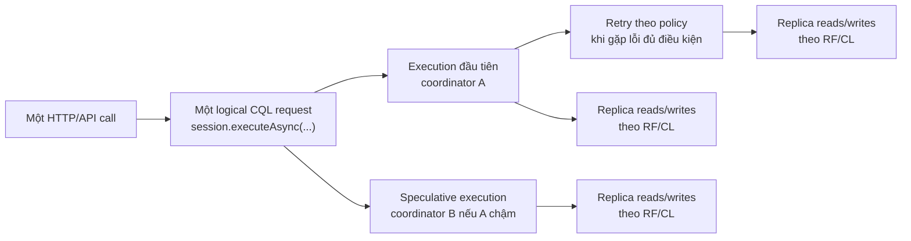
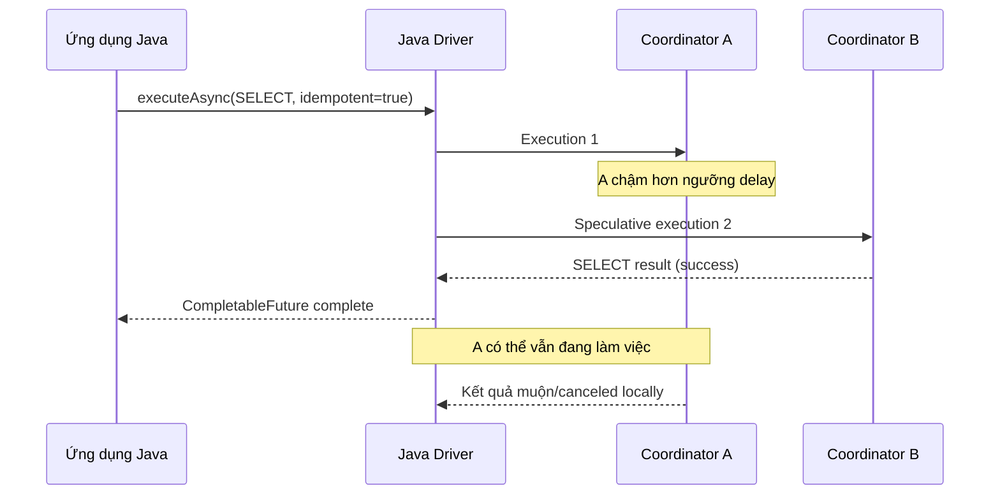
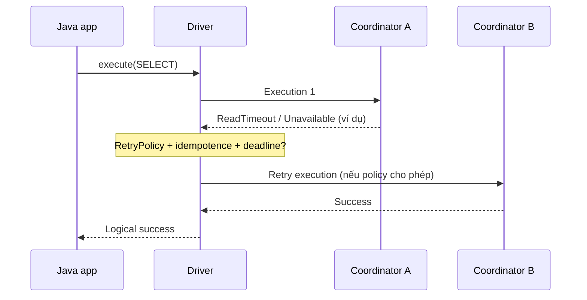
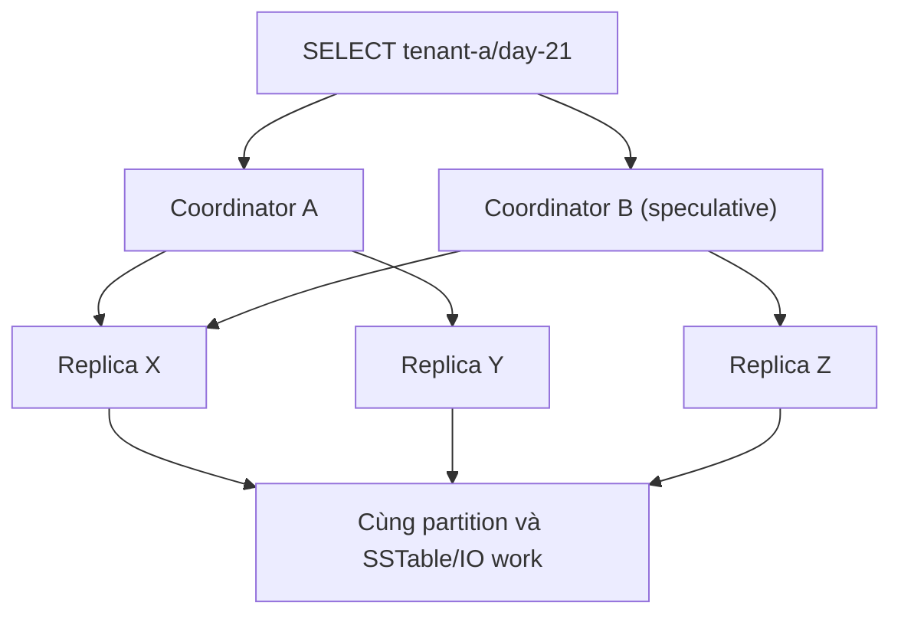
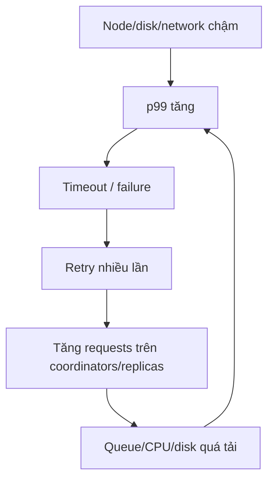
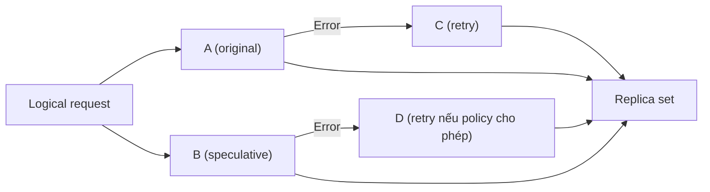

# Kiểm chứng ảnh hưởng của speculative execution và retry

**Chương:** Đo tải và lỗi phân tán  
**Module:** `DATABASE_ENGINE_WIDE_COLUMN_CASSANDRA` — Apache Cassandra

Một API Java đọc thông tin đơn hàng từ Apache Cassandra ở `LOCAL_QUORUM`. Trong điều kiện bình thường, 99% request trả kết quả nhanh, nhưng một vài request chậm vì coordinator hoặc replica có tail latency cao. Người vận hành bật **speculative execution** để gửi thêm một execution tới coordinator khác khi lần đầu còn chờ. Đồ thị p99 lập tức đẹp hơn trong một bài thử nhỏ. Tuy vậy, khi tăng lưu lượng, số request trên node tăng, hàng đợi dài hơn, số retries tăng, và p99 có thể xấu hơn cả trước khi bật.

Một thay đổi khác — cho phép retry mỗi khi timeout — cũng có thể giúp qua lỗi mạng ngắn, nhưng **không tạo ra thêm replica, không tăng throughput thực của cluster và không đảm bảo một write chưa được áp dụng**. Với counter, list append, LWT hoặc thao tác có side effect ngoài Cassandra, retry sai còn có thể vi phạm hợp đồng nghiệp vụ.

Bài này hướng dẫn cách **kiểm chứng ảnh hưởng** của hai cơ chế bằng thí nghiệm có đối chứng, không chỉ cách bật cấu hình. Kết hợp kiến trúc phân tán Cassandra, partition key, bảng theo truy vấn, RF/CL, compaction/repair, CQL, lỗi phân tán và Java Driver; mục tiêu là tìm được chính sách **giảm độ trễ mà không phá tính đúng hay làm tăng quá tải**.

> **Phạm vi:** Apache Cassandra 4.1/5.x; Java Driver 4.x (các tên option dùng theo họ Driver 4.18.x); môi trường **RF3 một DC** cho bài thử lỗi replica, có thể dùng single-node disposable chỉ để kiểm tra API cơ bản. Ví dụ HOCON/CQL/Java cần đối chiếu API và version đang triển khai. Các số về thời gian, tải và ngưỡng đều là **giả định minh họa**, không phải giá trị khuyến nghị cho production. Không cố ý tạo overload, chặn mạng, tắt node hoặc sửa replication ở production. Không thực thi bài lab trong bước viết nội dung này.

## 1. Mục tiêu học tập

Sau bài này, bạn có thể:

1. Phân biệt **logical request**, **execution/attempt**, **speculative execution**, **retry** và **replica subrequest**.
2. Giải thích lý do speculation có thể giảm p99 khi **một coordinator chậm bất thường** nhưng thường gây hại khi **toàn cluster đang quá tải**.
3. Mô tả cơ chế retry xử lý lỗi theo `RetryPolicy`, deadline, consistency level và idempotence.
4. Nêu sự khác biệt giữa `NoSpeculativeExecutionPolicy`, `ConstantSpeculativeExecutionPolicy` và một chính sách dựa trên percentile (nếu được phiên bản hỗ trợ).
5. Xây bốn nhánh đối chứng: **không retry/không speculation; chỉ retry; chỉ speculation; cả hai**.
6. Giải thích tại sao speculative execution chỉ nên áp dụng cho statement **thật sự idempotent**.
7. Không diễn giải `DriverTimeoutException` hoặc `WriteTimeoutException` như bằng chứng chắc chắn mutation chưa áp dụng.
8. Thiết kế workload với partition keys phân bố đều, queries theo partition và cùng RF/CL/timeout giữa các nhánh.
9. Tạo baseline, tiêm độ trễ/failure có kiểm soát trên **cluster cô lập**, ghi timeline và rollback fault.
10. Đo **logical success**, p50/p95/p99/p99.9, retry/speculation counts, actual coordinator attempts, queue wait, node/replica load và correctness.
11. Đọc dấu hiệu retry storm, speculative amplification, hotspots và head-of-line blocking.
12. Dùng Java Driver 4.x với prepared statements/`setIdempotent`/`CompletionStage` và admission control hữu hạn.
13. Tách thử nghiệm SELECT, INSERT ổn định, counter, LWT và các nghiệp vụ cần fail closed.
14. Lập báo cáo thực nghiệm có cấu hình, raw measurements, hạn chế, stop conditions và rollout/canary plan.

## 2. Mô hình request: một lời gọi Java chưa chắc chỉ có một CQL execution

### 2.1. Các tầng cần phân biệt



Một **logical request** là ý định ứng dụng, ví dụ “đọc trạng thái thiết bị X”. Driver có thể dùng nhiều executions tới **các coordinators** khác nhau nếu chính sách retry/speculation cho phép. **Mỗi coordinator** có thể lại liên lạc nhiều replicas để đáp ứng consistency level. Vì vậy **1 logical request ≠ 1 network message ≠ 1 replica read**.

Các khái niệm:

| Thuật ngữ | Nghĩa | Ví dụ |
| --- | --- | --- |
| Logical request | Lời gọi CQL từ ứng dụng | `executeAsync(boundStatement)` |
| Execution / coordinator attempt | Một lần thử thực thi qua coordinator được chọn | A xử lý SELECT |
| Speculative execution | Một execution **song song bổ sung** khi execution trước còn chậm | B nhận cùng SELECT sau delay |
| Retry | Chính sách quyết định thử lại **sau lỗi/timeout được phân loại** | Retry read trên node khác |
| Replica subrequest | Coordinator hỏi replicas để đạt CL | A gửi read tới B,C |
| Response thắng | Execution trả kết quả đủ điều kiện trước | B trả trước A |
| Late/in-flight loser | Execution khác chưa nhận hủy, vẫn có thể tiêu thụ tài nguyên | A tiếp tục CPU/I/O |
| Unknown write outcome | Client không biết chắc mutation đã áp dụng hay chưa | ACK bị mất sau write |

**Speculation không đợi lần đầu thất bại**, trong khi retry thường là phản ứng với **tín hiệu lỗi**. Hai thứ có thể xảy ra trong cùng logical request nhưng **không được đếm như một cơ chế**.

### 2.2. Timeline của một speculative read



**Giảm latency phía client không đồng nghĩa giảm việc trên backend.** B thực thi SELECT và có thể gửi truy vấn tới replicas trong khi A vẫn tiêu CPU/đọc SSTables. “Thắng” ở cấp logical request không làm rollback toàn bộ việc đã gửi trên mạng.

### 2.3. Timeline của một retry



Retry tạo thêm work **khi đã có lỗi**, có thể giúp đi qua một node tạm không sẵn sàng. Nhưng nếu mọi coordinator đều nhìn cùng replicas/disk bottleneck, retry có thể gây vòng lặp: **chậm → timeout → retry → tải tăng → chậm hơn**.

### 2.4. Cách đếm amplification

Đặt:

- `N_started`: số logical requests **đã được nhận và bắt đầu ít nhất một coordinator execution** trong khoảng đo. Phân biệt với `N_offered` gồm cả request bị application/driver admission từ chối trước khi bắt đầu.
- `A`: tổng **coordinator execution attempts đã thực sự bắt đầu**, gồm lần gốc, retries và speculative executions.
- `R`: số executions khởi động do retry.
- `S`: số speculative executions đã khởi động.
- `C`: số logical requests thành công; `F=N-C` là các lỗi theo định nghĩa SLA.

Khi mỗi execution có thể phân loại vào đúng một nhóm, cách đếm khái niệm là:

\[
A=N_{\mathrm{started}}+R+S
\]

Hệ số khuếch đại:

\[
\text{attempt amplification}=\frac{A}{N_{\mathrm{started}}}
=1+\frac{R+S}{N_{\mathrm{started}}}
\]

Đây là **mô hình hạch toán**, không phải cam kết mỗi driver metric đếm từng attempt giống nhau. Request bị từ chối **trước** execution gốc không nằm trong `N_started`; phải tính riêng vào offered/admission rejection rate. Speculative executions có thể chưa kịp start trước khi response đến; retry có thể bị deadline/policy chặn. Nếu muốn dùng công thức, **thu trực tiếp counters/attempt tracing ở cả client và nodes**, định nghĩa rõ các mẫu bị loại.

Ví dụ minh họa:

| Biến | Giá trị |
| --- | ---: |
| Logical requests đã bắt đầu `N_started` | 10.000 |
| Retry executions thực sự khởi chạy `R` | 500 |
| Speculative executions thực sự khởi chạy `S` | 1.500 |
| Tổng coordinator attempts `A` | 12.000 |
| Attempt amplification | **1,20×** |

Điều này chỉ nói lượng **coordinator attempts** tăng 20%. Nếu mỗi coordinator còn đọc nhiều replica, mức tăng **replica reads/disk work** có thể khác, thậm chí lớn hơn 20%; phải đo ở server.

## 3. Vì sao retry/speculation liên quan trực tiếp consistency và data modeling?

### 3.1. Một coordinator khác không phải một bản sao dữ liệu “miễn phí”

Cassandra đặt partition theo **token của partition key** và `NetworkTopologyStrategy`/RF. Dù driver chọn coordinator A hay B, truy vấn full partition key vẫn cần replica set phục vụ partition ấy. Trong một DC RF3, các coordinators khác nhau có thể fan out tới cùng replicas. Khi một partition hot, speculation sang coordinator khác **không tự phân tán hot partition lên mọi node**.



Sơ đồ là một khả năng phân phối subrequests, **không** cố định coordinator sẽ chọn hai replica nào; driver/server và topology quyết định. Điểm chính: **tăng coordinators không đổi token ownership**.

### 3.2. RF3 và LOCAL_QUORUM

Với RF3 trong một DC:

\[
LOCAL\_QUORUM=\left\lfloor\frac{3}{2}\right\rfloor+1=2
\]

Write ở `LOCAL_QUORUM` cần quorum các replica theo semantics tương ứng; read `LOCAL_QUORUM` cũng lấy đủ phản hồi để đạt CL. Giao tập W=2 và R=2 hỗ trợ visibility trong những giả định hợp lệ, nhưng **không** là một SQL transaction tuyến tính cho mọi kiểu đồng thời.

Khi một replica down, một read vẫn có thể đáp ứng từ hai replica còn sống. Nếu các attempts/speculations cùng dùng replica chậm hoặc disk bottleneck, việc gửi thêm query **không tạo quorum thứ hai ít tốn hơn một cách chắc chắn**.

### 3.3. Kiểu CQL quyết định an toàn khi phát lại

| CQL/workflow | Có thể lũy đẳng? | Rủi ro khi retry/speculate |
| --- | --- | --- |
| `SELECT` thuần theo PK, không side effect | Thường có | Backend extra read, p99/queue; read result có thể phản ánh thời điểm khác trong concurrent writes |
| `INSERT` same full PK + giá trị/timestamp xác định | Có trong những giả định rõ | Nếu app tạo ID/TTL/timestamp mới thì semantics thay |
| `UPDATE SET state = 'PAID'` với PK cố định | Có thể | Concurrent writers/timestamps có thể thay last-write-wins |
| `UPDATE counter = counter + 1` | **Không** | Double increment khi một attempt lặp |
| `UPDATE list = list + ['x']` | **Không** | Duplicate list element |
| `DELETE` đúng full PK | Thường lũy đẳng nếu timestamps/retention giữ semantics | Tombstone, race với concurrent updates |
| `IF NOT EXISTS` / LWT | Cần xử lý riêng | Lần sau có thể trả `[applied]=false` dù lần trước đã áp dụng; timeout có outcome chưa rõ |
| External payment + Cassandra write | Không phải một CQL operation | Speculation/retry không đảm bảo exactly-once side effects |
| Batch nhiều partition | Không tương đương SQL transaction | Partial failure/unknown outcome, retry rất rủi ro |

**Đánh dấu `setIdempotent(true)` không biến counter/LWT/business workflow thành lũy đẳng.** Đây là **khai báo về semantics của statement** để driver có thể quyết định retry/speculative execution; nếu khai báo sai, rủi ro thuộc về ứng dụng.

### 3.4. Timeout sau write là “outcome không rõ”

Một write có thể được một số hoặc đủ replicas nhận, nhưng response bị mất hoặc client timeout. `WriteTimeoutException` và `DriverTimeoutException` không đảm bảo “chưa ghi gì”. Đối với money, inventory, quyền truy cập, counter, list append, phải có **event ID, nguồn sự thật, reconciliation và chính sách fail closed** phù hợp. Không hạ consistency level hoặc bật automatic retry để làm test chuyển xanh.

## 4. Chính sách speculative execution trong Java Driver 4.x

### 4.1. Hành vi mặc định: không speculation

Với Driver 4.x, khi không bật chính sách speculation, query không được driver cố ý gửi thêm vì phản hồi chậm. Có thể thể hiện tường minh:

```hocon
datastax-java-driver {
  advanced.speculative-execution-policy {
    class = NoSpeculativeExecutionPolicy
  }
}
```

Đây là **baseline quan trọng** để so sánh. Đừng nói “không speculation nghĩa không retry”: retry thuộc chính sách riêng.

### 4.2. Constant delay

Ví dụ lab: khi chưa có phản hồi sau `100 ms`, policy có thể cho thêm speculative execution nếu còn ứng viên/coordinator và điều kiện áp dụng:

```hocon
# LAB minh họa, không phải đề xuất production.
datastax-java-driver {
  advanced.speculative-execution-policy {
    class = ConstantSpeculativeExecutionPolicy
    max-executions = 1
    delay = 100 milliseconds
  }
}
```

**Cần phân biệt:** `max-executions` trong cấu hình speculative policy giới hạn **số speculative executions bổ sung** theo semantics của Driver version, không phải “tổng mọi retries và executions” hay số replicas. Với `max-executions=1`, một logical request có thể có execution gốc và **tối đa một** execution đầu cơ nếu đủ điều kiện. RetryPolicy vẫn có thể phát sinh attempt khác nếu gặp lỗi đủ điều kiện; kiểm tra số attempts thực tế bằng instrumentation.

### 4.3. Delay cố định không phù hợp mọi query

- `SELECT` point lookup 5 ms bình thường và `SELECT` scan một partition rất rộng không có cùng latency distribution.
- Với `delay=5 ms` khi p50 là 8 ms, nhiều request khỏe cũng bị speculate.
- Với `delay=2 s` nhưng API deadline 1 s, speculative attempt hầu như không có tác dụng.
- Với p99 do disk/compaction bão hòa toàn cluster, phát thêm copies có thể làm tình trạng xấu hơn.

Đặt delay theo **p95/p99 baseline, request timeout và phần budget còn lại**, không copy con số từ blog. Nếu driver version hỗ trợ policy theo percentile, có thể xem như một phương án tự điều chỉnh từ latency observations, nhưng cần kiểm tra sample size, biến động, per-node/per-query measurement, thời gian warm-up và hành vi dưới tải; không tự xem adaptive là không cần tuning.

### 4.4. Speculation phụ thuộc tính lũy đẳng

Một statement được đánh dấu **idempotent** có thể đủ điều kiện cho speculative execution khi policy được bật. Một statement **không idempotent** không được gửi thêm chỉ vì chậm. Vì vậy thử nghiệm phải kiểm tra cả hai trường hợp:

```java
import com.datastax.oss.driver.api.core.cql.BoundStatement;

// SELECT theo partition key, không side effects:
BoundStatement read = readPrepared.bind(tenantId, deviceId)
    .setIdempotent(true);

// Counter +1: không lũy đẳng; KHÔNG cho speculation/retry mù:
BoundStatement increment = counterPrepared.bind(metricId)
    .setIdempotent(false);
```

Không bật `basic.request.default-idempotence=true` cho toàn ứng dụng đa dạng queries nếu chưa phân loại mọi statement. Kể cả với `INSERT` cùng PK, phải xem generated timestamp/TTL, LWT, trigger và side effects khác.

### 4.5. Quản lý bằng execution profile

Khi có workload khác nhau, nên áp dụng profile phù hợp: interactive read có thể cân nhắc speculation, ghi tiền/ledger thì không. Nhưng thuộc tính nào **cho phép override theo execution profile** và thuộc tính nào **session-level** phụ thuộc API/version. Không đoán một profile config ghi vào HOCON đã được áp dụng chỉ vì ứng dụng không ném lỗi.

Có thể kiểm tra effective config và gắn `ExecutionProfile` cho từng statement; nếu cần **cách ly hoàn toàn** tài nguyên và chính sách, dùng tách workload/sessions/deployments khi đã đánh giá thêm cost connection pool.

## 5. RetryPolicy: khi gặp lỗi sẽ xảy ra gì?

### 5.1. Một default policy không có nghĩa retry mọi lỗi

Driver 4.x có `DefaultRetryPolicy`, và quyết định tùy **loại lỗi, trạng thái, số attempts, idempotence và cấu hình**. Không nên diễn giải default là “retry ba lần bất kể lỗi nào”. Một số tình huống timeout được retry theo điều kiện nhất định; write timeout đặc biệt không thể mặc định an toàn.

```hocon
datastax-java-driver {
  advanced.retry-policy {
    class = DefaultRetryPolicy
  }
}
```

Không dùng `ConsistencyDowngradingRetryPolicy` chỉ để làm timeout rate đẹp hơn khi nghiệp vụ đòi `LOCAL_QUORUM`: nó có thể đổi mức bảo đảm đọc/ghi. Ở các thử nghiệm “retry OFF” bên dưới, cần **policy thực sự không retry** hoặc một cơ chế test được xác nhận, không chỉ tắt speculative execution.

### 5.2. Những nguyên nhân đáng phân loại

| Tín hiệu | Tầng chủ yếu | Quyết định hợp lý cần kiểm tra |
| --- | --- | --- |
| `UnavailableException` | Coordinator/replica availability theo CL | Có đủ nodes khác giúp không? Không tự hạ CL |
| `ReadTimeoutException` | Coordinator thiếu read responses đúng hạn | Retry có thể hợp lý trong tình huống cụ thể; xem policy |
| `WriteTimeoutException` | Write chưa đạt ACK theo yêu cầu | Unknown outcome; retry non-idempotent nguy hiểm |
| `ReadFailureException` / `WriteFailureException` | Replica failure trong request | Xem số successful/failed, CL và policy |
| `OverloadedException` | Server báo overload | Retry tức thì có thể khuếch đại lỗi |
| `DriverTimeoutException` | Deadline phía client | Có thể đã gửi hoặc còn trong throttler queue |
| `AllNodesFailedException` | Không tìm được coordinator để hoàn tất | Xem lỗi theo node/pool/network/DC |
| `RequestThrottlingException` | Throttler queue client đầy | Giảm arrival, không tight loop retry |
| `InvalidQueryException` / `UnauthorizedException` | CQL/schema/permission | Sửa query/role, không retry để tăng tải |

Retry thành công cũng không chứng minh root cause đã biến mất. Nếu node A vẫn chậm, request tiếp theo có thể lại bị ảnh hưởng.

### 5.3. Retry budget và deadline

Driver request timeout bao gồm giai đoạn client throttling và các attempts trong logical request theo semantics của Driver 4.x. Do đó retry/speculative attempts **không có toàn bộ timeout mới như một request độc lập**.

```text
T0       +100 ms       +180 ms          +450 ms
|-----------|--------------|----------------|
execution A  \ timeout?                 |
             speculative B   \ success?  |
                         retry C?       |
<----- Một request-level deadline ------>

Không có lý do để giả định mỗi attempt có thêm 2 s đầy đủ.
```

Thời gian thực có thể chồng lấp, và nếu deadline đến trước một attempt mới, attempt đó có thể không khởi chạy. Cần đo timestamp phát/nhận thay vì suy từ config đơn lẻ.

### 5.4. Retry storm



Để ổn định:

- Retry hữu hạn, giữ deadline/budget và dùng backoff + jitter ở **tầng ứng dụng** khi phù hợp.
- Tránh cùng một lỗi được retry cả ở Driver, API gateway, queue consumer và job scheduler mà không có tổng budget.
- Không retry sync ngay trên I/O callback Netty với `Thread.sleep` hoặc `join`.
- Kiểm tra dữ liệu idempotent và unknown outcome.
- Khi tất cả nodes chậm vì disk/compaction, **giảm nguồn phát** quan trọng hơn thêm attempts.
- Giữ nguyên RF/CL theo yêu cầu; timeout nhiều không biện minh âm thầm downgrade consistency.

## 6. Tương tác speculation và retry

### 6.1. Không phải hai cơ chế độc lập về tài nguyên

Speculation được phát **khi execution đang chậm**, retry sau **lỗi đủ điều kiện**. Nếu vừa bật cả hai, một logical request có thể có execution gốc, speculative execution và retries. Các execution có thể sử dụng nhiều coordinators nhưng lại yêu cầu dữ liệu từ cùng replica set, nên **workload bị nhân rộng đúng lúc cluster đang khó khăn**.



Sơ đồ mô tả **khả năng**, không khẳng định Driver luôn tạo bốn attempts hay mỗi speculative branch có retry riêng. Đếm actual attempts từ metrics/events, không áp một sơ đồ lý thuyết làm kết quả thực nghiệm.

### 6.2. Các điều kiện cần trước khi kỳ vọng cải thiện

1. Query **idempotent thật**, thường ưu tiên point reads theo full partition key.
2. Chậm có tính **cục bộ/không tương quan** giữa các coordinators và có spare capacity.
3. Token/replica path tới coordinator khác thực sự có khả năng hoàn tất nhanh hơn.
4. Delay nhỏ hơn remaining request deadline nhưng lớn hơn tail latency bình thường để tránh speculation vô ích.
5. Có observability về **speculative launches, retry attempts và server work**, không chỉ p99 client.
6. Không có hot partition/compaction/disk bottleneck chung khiến mọi attempts đều chậm.
7. Chính sách retry và max speculative executions có budget rõ, được bảo vệ bằng rate/concurrency admission.

### 6.3. Bảng nhận diện tình huống

| Tình huống | Retry có thể giúp? | Speculation có thể giúp? | Rủi ro chính |
| --- | --- | --- | --- |
| Coordinator A mất kết nối ngắn | Có, tùy failure/policy | Có nếu request đủ điều kiện và coordinator B tốt | Attempts/routing overhead |
| Một coordinator A tail latency bất thường | Có sau timeout | **Có khả năng** trước timeout | Extra replica work |
| Mọi nodes chậm do disk I/O | Ít khả năng | Thường không | Retry storm và overload |
| Hot partition lớn | Có thể không | Không đổi token ownership | Cùng replica set chịu nhiều lần đọc |
| API deadline rất ngắn so với delay | Ít cơ hội | Có thể quá muộn | Chờ/timeout tăng |
| Counter increment | Không an toàn khi unknown outcome | **Không** | Double increment |
| LWT/CAS | Cần logic riêng | Cần thận trọng, không bật mù | `[applied]`/unknown outcome |
| Read ở `ONE` giữa replicas lệch | Có thể đổi bản được đọc | Có thể chọn response nhanh nhưng không nhất thiết mới nhất | Stale reads |
| Read `LOCAL_QUORUM` RF3 khỏe | Có thể | Có thể với outlier rõ | Fan-out, tail/disk cost |
| Server báo overload | Retry ngay thường hại | Speculation thường hại | Positive feedback loop |

**Nguyên tắc:** Mục tiêu **không phải 0 exceptions bất kể giá**. Mục tiêu là thỏa **độ trễ, availability, consistency và correctness** dưới một ngân sách tài nguyên rõ ràng.

## 7. Thiết kế thí nghiệm đối chứng A/B/C/D

### 7.1. Bốn cấu hình bắt buộc

Giữ **cùng cluster, cùng CQL, RF/CL, query distribution, load generator, timeout và cửa sổ đo**; chỉ thay hai chính sách.

| Arm | Retry policy | Speculative policy | Câu hỏi cần trả lời |
| --- | --- | --- | --- |
| **A — baseline** | `FallthroughRetryPolicy` | `NoSpeculativeExecutionPolicy` | Một execution không phát lại thì latency/lỗi thế nào? |
| **B — retry only** | `DefaultRetryPolicy` | `NoSpeculativeExecutionPolicy` | Retry khi lỗi giảm failures bao nhiêu và tăng work bao nhiêu? |
| **C — speculation only** | `FallthroughRetryPolicy` | `ConstantSpeculativeExecutionPolicy` | Gửi thêm execution khi chậm giúp p99 hay gây work dư? |
| **D — cả hai** | `DefaultRetryPolicy` | `ConstantSpeculativeExecutionPolicy` | Hai cơ chế cùng bật có tạo khuếch đại/overload không? |

**Không gọi arm A “retry OFF” nếu chỉ thiết lập `NoSpeculativeExecutionPolicy`.** Phải dùng chính sách **không retry thật sự** như `FallthroughRetryPolicy` của Driver version đang dùng, hoặc custom no-retry policy được review. Đồng thời, **không phải mọi exception đều được DefaultRetryPolicy retry** — cần thu actual retry counts để biết có khác biệt giữa A và B không.

### 7.2. HOCON tối thiểu cho từng arm

Ví dụ các đoạn sau là **bốn phiên cấu hình thay thế**, mỗi run chỉ dùng một cấu hình; không cộng tất cả vào một `application.conf`.

**Arm A — không retry, không speculation:**

```hocon
datastax-java-driver {
  basic.request.timeout = 1500 milliseconds
  basic.request.default-idempotence = false

  advanced.retry-policy.class = FallthroughRetryPolicy

  advanced.speculative-execution-policy {
    class = NoSpeculativeExecutionPolicy
  }
}
```

**Arm B — chỉ retry:**

```hocon
datastax-java-driver {
  basic.request.timeout = 1500 milliseconds
  basic.request.default-idempotence = false

  advanced.retry-policy.class = DefaultRetryPolicy

  advanced.speculative-execution-policy {
    class = NoSpeculativeExecutionPolicy
  }
}
```

**Arm C — chỉ speculation:**

```hocon
datastax-java-driver {
  basic.request.timeout = 1500 milliseconds
  basic.request.default-idempotence = false

  advanced.retry-policy.class = FallthroughRetryPolicy

  advanced.speculative-execution-policy {
    class = ConstantSpeculativeExecutionPolicy
    max-executions = 1
    delay = 100 milliseconds
  }
}
```

**Arm D — cả hai:**

```hocon
datastax-java-driver {
  basic.request.timeout = 1500 milliseconds
  basic.request.default-idempotence = false

  advanced.retry-policy.class = DefaultRetryPolicy

  advanced.speculative-execution-policy {
    class = ConstantSpeculativeExecutionPolicy
    max-executions = 1
    delay = 100 milliseconds
  }
}
```

Các policy names và option paths theo Driver 4.x; khi chạy thực tế **phải in/kiểm tra effective config và xác nhận class đã load**. Không chỉ tin rằng file được mount đúng; trong Spring Boot hoặc môi trường nhiều execution profiles có thể có override. Nếu phiên bản driver khác hoặc dùng shading/BOM, kiểm tra reference `advanced.speculative-execution-policy` và `advanced.retry-policy` trước khi chạy.

### 7.3. Bảng biến kiểm soát

| Nhóm | Giữ cố định | Vì sao |
| --- | --- | --- |
| Cassandra topology | 3 nodes cùng DC, RF3, rack/versions tương đương | Đảm bảo quorum/replica placement so sánh được |
| Schema | Chính xác cùng keyspace/table/options/compaction | Tránh khác read/write path |
| Workload | Query templates, key distribution, payload, read/write mix | Tránh biến workload thành nhiễu |
| CL | `LOCAL_QUORUM` cho read và các writes được thử | Không làm đẹp metrics nhờ đổi bảo đảm nhất quán |
| Driver | Cùng version, contact points, pool, timeouts, metrics setup | Tách tác động chính sách |
| App | Số pods/sessions, host JVM/GC, concurrency/rate | Autoscale làm nhân tổng attempts |
| Data | Cùng số rows/partition, TTL/tombstone density | Query tail chịu ảnh hưởng storage |
| Thời gian | Warm-up, thời lượng đo, số samples, fault timeline | p99 cần đủ mẫu, tránh lấy bootstrap latency |
| Network | Chỉ inject đúng lỗi đã định | So sánh lỗi đích chứ không gây storm ngẫu nhiên |
| Metrics | Cùng exporter/sampling, clocks và tags | Đủ bằng chứng tính amplification |

**Quan trọng:** Retry và speculation làm hệ thống động. Khi arm D tự tạo thêm work, đó là **tác động cần đo**, không phải lý do tăng server capacity chỉ cho D. Nhưng để tránh run sau bị ảnh hưởng, phải cho cluster phục hồi giữa arms.

### 7.4. Không chạy 4 arms cùng lúc trên một cluster nếu muốn đo riêng

Nếu chạy đồng thời A/B/C/D, các arms cùng chia sẻ replicas/disk. D có thể làm A chậm theo, khiến kết quả khó quy nguyên nhân. Khuyến nghị run **tuần tự**, lặp nhiều lần theo thứ tự đã randomize/cân bằng, cùng trạng thái ban đầu, hoặc dựng các cluster cô lập giống nhau có số đo baseline kiểm chứng.

Ví dụ chuỗi 4 vòng:

```text
Vòng 1: A → B → C → D
Vòng 2: C → A → D → B
Vòng 3: D → C → B → A
Vòng 4: B → D → A → C

Mỗi run:
  warm-up → clean interval → measured interval → cooldown
  assert cluster recovered and metrics stabilized before next arm
```

Một arm đo 30 giây với 200 requests không đủ để nói p99. Không lấy một lần p99 thấp làm kết luận; dùng đủ mẫu, intervals/replicates và báo độ biến thiên.

## 8. Chuẩn bị cluster thử cô lập và CQL

### 8.1. Điều kiện an toàn

Thực nghiệm latency/network fault chỉ chạy khi có:

- Cluster disposable **ba Cassandra nodes** cùng ring, tên DC giả định `dc1` và keyspace RF3.
- Snapshot dữ liệu test (nếu cần), đủ CPU/RAM/disk và khả năng reset/recreate nhanh.
- Keyspace/table không chứa dữ liệu người dùng hoặc production credentials.
- Quyền vận hành rõ: ai được dừng node, dùng network emulator, rollback và xác nhận trạng thái sau thử.
- Out-of-band access vào các nodes để sửa lỗi nếu client CQL không còn kết nối.
- Stop conditions cho p99, timeout, CPU/GC, disk I/O và unavailable.
- Có thể lấy `nodetool status`/JMX/logs; đồng bộ timestamp UTC của app và server.
- Không có sửa schema/repair/upgrade song song trong thời gian đo.

Chỉ có **một node** với RF1 đủ để kiểm tra Java code, HOCON và metrics instrumentation, **không đủ** để kiểm chứng speculation/CL khi một replica Down hoặc failover.

### 8.2. Xác minh topology trước khi test

```bash
# Chạy trên từng node trong cluster thử, không phải production:
nodetool status
nodetool describecluster
nodetool info
nodetool tpstats
nodetool compactionstats
```

Preflight cần xác nhận:

1. Cả ba nodes `UN`, không joining/leaving/moving.
2. DC/rack/host IDs như dự kiến, cùng cluster name.
3. Server/schema versions và schema agreement phù hợp.
4. Keyspace RF3 thực sự có ba replicas cho token được thử.
5. Không có repair/streaming/compaction backlog quá lớn trước baseline.
6. Các endpoint từ Java không vô tình trỏ sang cluster khác.
7. Có capacity headroom để đo thêm work mà không ép cluster đến failure không kiểm soát.

**Không** suy “ba containers được start” nghĩa chúng tự là một Cassandra cluster: seed/gossip/snitch/network cần đúng. Nếu trên `nodetool status` mỗi node chỉ thấy chính mình, preflight FAIL.

### 8.3. Schema CQL cho lab

Trong một cluster disposable DC `dc1` đã xác minh:

```sql
CREATE KEYSPACE IF NOT EXISTS lab_spec_retry
WITH replication = {
    'class': 'NetworkTopologyStrategy',
    'dc1': 3
}
AND durable_writes = true;

CREATE TABLE IF NOT EXISTS lab_spec_retry.status_by_device_id (
    device_id uuid PRIMARY KEY,
    state text,
    updated_at timestamp
);

CREATE TABLE IF NOT EXISTS lab_spec_retry.events_by_device_day (
    device_id uuid,
    bucket_day date,
    event_ts timestamp,
    event_id uuid,
    event_type text,
    payload text,
    PRIMARY KEY ((device_id, bucket_day), event_ts, event_id)
) WITH CLUSTERING ORDER BY (event_ts DESC, event_id ASC);

CREATE TABLE IF NOT EXISTS lab_spec_retry.counters_by_id (
    counter_id uuid PRIMARY KEY,
    hits counter
);

CREATE TABLE IF NOT EXISTS lab_spec_retry.once_by_event_id (
    event_id uuid PRIMARY KEY,
    state text,
    created_at timestamp
);
```

| Bảng | Query shape | Vai trò trong thí nghiệm |
| --- | --- | --- |
| `status_by_device_id` | Point read `WHERE device_id=?` | Read-only, statement idempotent |
| `events_by_device_day` | Timeline theo toàn bộ partition key, `LIMIT` | Đo chi phí clustering/partition và hot key |
| `counters_by_id` | Increment theo ID | Negative control: mutation không idempotent |
| `once_by_event_id` | `IF NOT EXISTS` | LWT/unknown outcome/collision |

**Không** dùng `ALLOW FILTERING` cho truy vấn thiếu partition key chỉ để tạo load. Query scan không đại diện cho point lookup và có thể phá một test cluster nhỏ.

### 8.4. Tạo dữ liệu nền có giới hạn

Ví dụ CQL để smoke test:

```sql
CONSISTENCY LOCAL_QUORUM

INSERT INTO lab_spec_retry.status_by_device_id (
    device_id, state, updated_at
) VALUES (
    10000000-0000-4000-8000-000000000101,
    'ONLINE',
    '2026-11-21T00:00:00Z'
);

INSERT INTO lab_spec_retry.events_by_device_day (
    device_id, bucket_day, event_ts, event_id, event_type, payload
) VALUES (
    10000000-0000-4000-8000-000000000101,
    '2026-11-21',
    '2026-11-21T10:00:00Z',
    20000000-0000-4000-8000-000000000101,
    'DEVICE_ONLINE', 'lab'
);

SELECT state, updated_at
FROM lab_spec_retry.status_by_device_id
WHERE device_id = 10000000-0000-4000-8000-000000000101;

SELECT event_ts, event_type
FROM lab_spec_retry.events_by_device_day
WHERE device_id = 10000000-0000-4000-8000-000000000101
  AND bucket_day = '2026-11-21'
LIMIT 20;
```

Để đo đạc, cần **nhiều device IDs phân bố đều** (ví dụ hàng nghìn/hàng chục nghìn tùy capacity), cùng quy tắc deterministic tạo data; ví dụ một ID chỉ minh họa cú pháp. Không đo throughput từ một hot partition rồi suy cho toàn cluster.

Nếu một lookup key **không tồn tại**, Cassandra vẫn phải thực hiện read path/negative lookup, nhưng chi phí không nhất thiết giống read có dữ liệu, tombstones hoặc wide partitions. Phải tách **hit ratio** giữa các arms.

### 8.5. Hai workload để tránh ngộ nhận

**Workload 1 — read-only point lookup:** chọn ngẫu nhiên trong tập IDs có sẵn, tỷ lệ hits cố định, `LOCAL_QUORUM`; phù hợp để kiểm chứng tail-latency improvement mà không có side effects.

**Workload 2 — idempotent write với full PK:** `INSERT` vào các events theo stable `event_id`/`event_ts`/payload, giữ timestamp/TTL semantics; dùng để chứng minh count và unknown outcome. **Không** dùng ngay workload mutation tiền, quyền, tồn kho hoặc counter để bật speculation thử.

Một workload **hot partition riêng** có thể hữu ích để chứng minh speculation **không chữa partition model sai**. Chạy nó thành scenario khác, không trộn âm thầm với uniform workload.

## 9. Kịch bản fault/latency injection có kiểm soát

### 9.1. Phân biệt ba nhóm nguyên nhân

| Nhóm | Tiêm gì? | Giả thuyết |
| --- | --- | --- |
| **H0: healthy** | Không inject lỗi | Speculation gây overhead khi không có outlier? |
| **H1: một coordinator chậm** | Tăng network latency/queue tới một coordinator được chọn | Speculation sang node khỏe có giảm p99? |
| **H2: một node Down** | Dừng một node trong RF3 lab | Retry/driver routing giúp availability ra sao? |
| **H3: bottleneck chung** | Giảm giới hạn arrival hoặc gây tải có kiểm soát trên toàn cluster | Extra attempts làm p99/CPU/GC xấu hơn? |
| **H4: hot partition** | Cố ý tập trung keys vào một partition disposable | Speculation có thực sự khắc phục read hotspot? |
| **H5: network jitter** | Thêm latency dao động ở proxy/network path | Delay threshold phù hợp p95 hay chưa? |

**Không chạy H1/H2/H3/H4/H5 trên production.** Với H3, không tạo sự cố đĩa đầy hoặc OOM; chỉ tăng load tới ngưỡng dừng đã xác định, giữ quyền giảm load tức thì.

### 9.2. Tạo một coordinator chậm không đồng nghĩa làm tất cả replicas chậm

Các lựa chọn trong lab:

- Toxiproxy/traffic shaping **trên client→coordinator path**, phù hợp nếu có cách điều khiển kết nối rõ và đủ coordinators còn khỏe.
- Linux `tc netem` trong network namespace/container **có quyền NET_ADMIN** và công cụ `tc`, với rollback xóa qdisc.
- Fault injection do orchestration test cung cấp, có log chính xác host/port/duration.
- Tạm tăng CPU pressure **giới hạn** trên một node disposable, nhưng phải phân biệt tác động coordinator và replica work.

Để kiểm chứng speculation, cần xác nhận **execution gốc thực sự đi qua node bị làm chậm**, còn speculative execution có cơ hội chọn coordinator khác. Token-aware routing và pool có thể thay đổi thứ tự coordinator; không giả định cứ chặn “node số 1” thì mọi query đều gửi tới đó. Thu **per-node coordinator attempts** hoặc tracing/sampled driver events để chứng minh.

### 9.3. Blueprint `tc netem` cho Linux disposable (không phải lệnh production)

Ví dụ minh họa khi container `lab-cass-2` đã có `tc`, interface `eth0` và quyền `NET_ADMIN`. Phải xác minh interface/permissions trước, vì image Cassandra mặc định có thể **không** cài `tc`:

```bash
# CHỈ trong lab disposable: tên node/interface phải được xác minh.
docker exec lab-cass-2 tc qdisc show dev eth0

# Tiêm outbound latency 120ms +/- 20ms; có thể ảnh hưởng cả internode!
docker exec lab-cass-2 tc qdisc replace dev eth0 \
  root netem delay 120ms 20ms

# Luôn rollback ngay khi hết cửa sổ đã định.
docker exec lab-cass-2 tc qdisc del dev eth0 root

# Kiểm tra không còn netem rule.
docker exec lab-cass-2 tc qdisc show dev eth0
```

**Cảnh báo quan trọng:** `tc qdisc` trên `eth0` tác động **outbound traffic của node**, có thể ảnh hưởng cả internode gossip/replica ACK và coordinator response. Kết quả **không còn cô lập hoàn toàn “chỉ coordinator chậm”**. Nếu mục tiêu H1 là client→coordinator latency riêng, hãy đặt traffic shaping ở **client proxy path** và xác nhận không tác động replica links. Không chạy `tc` nếu không có rollback/out-of-band access. Một test H1 thiếu xác nhận route phải được đánh dấu **INCONCLUSIVE**, không suy speculation có/không có hiệu quả.

### 9.4. Dừng một node: test sai số lượng replicas dễ gây kết luận sai

Trong RF3, khi một node Down:

- `LOCAL_QUORUM` cần hai replica; có thể vẫn đáp ứng từ hai node còn lại.
- `ALL` không đủ ACK nếu partition có replica down.
- `ONE` có thể vẫn hoạt động nhưng yếu hơn CL hợp đồng.
- Speculative execution không tạo thêm replica khỏe.
- Retry có thể tìm coordinator khác, nhưng không phải lúc nào giúp vượt lỗi thiếu replica.

Sau fault, đợi cluster trở lại `UN`, quan sát hints/streaming/repair và kiểm tra data. **Không** coi “node báo UN” là bằng chứng mọi mutation bị bỏ lỡ đã được đồng bộ ngay.

### 9.5. Stop conditions và rollback

Định nghĩa trước ngưỡng dừng, ví dụ chỉ mang tính minh họa:

| Điều kiện | Hành động |
| --- | --- |
| p99 client vượt 2× baseline trong ≥2 cửa sổ đo | Dừng tăng arrival rate, đánh giá |
| Retry/spec attempts liên tục tăng với success rate giảm | Tắt arm đang thử, giảm load |
| `RequestThrottlingException`/timeouts vượt error budget | Fail fast và rollback |
| Node disk free gần ngưỡng vận hành, pending tasks tăng liên tục | Dừng test, không tiếp tục inject |
| JVM GC pause quá cao/CPU bão hòa | Dừng hoặc hạ rate ngay |
| Mất ≥2 replica trên RF3 khi kịch bản chỉ cho phép một | Abort fault, khôi phục cluster |
| Unknown write outcomes tăng, không đối soát được | Dừng mutation workload, giữ evidence |
| Không còn access tới node qua control plane | Khôi phục từ console/orchestrator, không chạy lệnh mới |

Con số 2× là ví dụ về guardrail; production/lab phải dùng ngưỡng theo SLO thực, capacity và quyền vận hành. Ghi rõ người chịu trách nhiệm **rollback cả fault injection lẫn config driver**.

## 10. Thực hiện một run có thể tái lập

### 10.1. Các pha

```text
1. PRECHECK
   - nodetool status: 3 UN; keyspace RF3
   - CQL schema, driver config, clocks, metrics, load generator

2. WARMUP
   - điểm đọc/ghi đại diện, chưa tính latency thống kê
   - đủ để chuẩn bị statements, pools, caches và JVM

3. HEALTHY MEASUREMENT
   - giữ arrival rate X, query mix/key distribution cố định
   - đo baseline per arm

4. FAULT WINDOW
   - tiêm đúng một fault, ghi UTC start
   - không đổi các biến khác
   - đo steady/fault transition và error classes

5. RECOVERY WINDOW
   - bỏ fault, ghi UTC stop
   - đo thời gian trở về baseline và backlog

6. COOLDOWN/RESET
   - ensure 3 UN, metrics/queues ổn định
   - dọn data state nếu cần, không TRUNCATE shared tables

7. NEXT ARM
   - thay HOCON policy, khởi động session sạch
   - lặp cùng kịch bản với seed và data policy tương đương
```

**Đừng gộp warm-up vào p99** nếu câu hỏi là steady-state; nhưng vẫn lưu warm-up và recovery riêng, vì restart/cold cache cũng có thể là yêu cầu nghiệp vụ.

### 10.2. Open-loop và closed-loop load

| Loại phát tải | Mô tả | Rủi ro |
| --- | --- | --- |
| **Closed-loop** | Gửi request mới sau khi một request hoàn thành; số in-flight cố định | Khi server chậm, arrival tự giảm → **coordinated omission** và p99 nhìn đẹp giả |
| **Open-loop** | Gửi theo lịch arrival rate mục tiêu bất kể hoàn thành | Có thể tạo queue/tải mất kiểm soát nếu không có cap |
| **Bounded open-loop** | Lịch arrival rate cố định **và** in-flight/queue/deadline cap | Cho tín hiệu thực tế hơn, nhưng phải đo rejected arrivals |

Với retry/speculation, **open-loop có giới hạn** thường rõ hơn để đo tác động lên hệ thống ở cùng offered load. Bắt buộc ghi **offered RPS**, **admitted RPS**, **completed RPS** và **rejected/deferred RPS**, vì chỉ đo completed throughput có thể che việc driver từ chối workload.

### 10.3. Load không được “tự đổi” khi arm D chậm

Nếu generator dùng `for { execute(); }` đồng bộ và chỉ gửi request kế khi request trước kết thúc, arm D có thể tạo **ít logical requests hơn** arm A khi chậm; p99 và server work không còn so ở cùng arrival rate. Ngược lại, nếu arm D nhanh hơn, nó phát **nhiều requests hơn** nên có thể tự đẩy cluster tới saturation. Cần scheduler/arrival pacing hoặc báo cáo rõ kết quả closed-loop và chỉnh cách diễn giải.

### 10.4. Tính chính xác của p99

Với `N=1000`, chỉ khoảng mười mẫu nằm ở nhóm trên cùng 1%; p99 dao động mạnh giữa runs. Với `N=100.000`, p99 có nhiều mẫu hơn nhưng vẫn cần confidence intervals, phân lớp theo fault window/steady state và xem toàn bộ tail distribution. Không loại “outliers” tuỳ tiện vì tail latency chính là điều đang kiểm chứng.

Cần ghi:

- UTC timestamps/fault window và đồng hồ.
- Percentiles p50/p95/p99/p99.9 từ histogram/measurement đúng nghĩa.
- Số samples **trong từng cửa sổ**.
- Số logical failures và status/error classes.
- Attempts per logical request distribution, không chỉ average.
- Arrival/completion rates; CPU/GC/disk/network và queue metrics đồng thời.
- Kết quả từng replicate và biến thiên, không chỉ mean của p99.

## 11. Java Driver 4.x: mã đo logical request có giới hạn

### 11.1. Điều kiện

Ví dụ dùng Java 17+, Apache Java Driver 4.x, cluster thử với keyspace `lab_spec_retry` được tạo trước, một số rows `status_by_device_id` đã có, và **một** HOCON config cho arm hiện tại. Mã dưới đây minh họa **một phép đo và guardrail**, không tự là load generator open-loop hoàn chỉnh.

Dùng prepared statements với **đầy đủ partition key**. Việc dùng statement `SELECT` đảm bảo bạn không vô tình thử speculation trên một mutation nguy hiểm ngay từ đầu.

### 11.2. Một lớp Probe an toàn, không tạo futures vô hạn

```java
import com.datastax.oss.driver.api.core.CqlSession;
import com.datastax.oss.driver.api.core.DefaultConsistencyLevel;
import com.datastax.oss.driver.api.core.cql.AsyncResultSet;
import com.datastax.oss.driver.api.core.cql.BoundStatement;
import com.datastax.oss.driver.api.core.cql.PreparedStatement;
import com.datastax.oss.driver.api.core.cql.Row;

import java.time.Duration;
import java.util.UUID;
import java.util.concurrent.CompletableFuture;
import java.util.concurrent.CompletionException;
import java.util.concurrent.CompletionStage;
import java.util.concurrent.Semaphore;
import java.util.concurrent.atomic.LongAdder;

public final class BoundedCassandraReadProbe {
    public record Outcome(
        UUID deviceId,
        boolean accepted,
        boolean success,
        boolean found,
        long latencyMicros,
        String errorType
    ) {}

    private final CqlSession session;
    private final PreparedStatement read;
    private final Semaphore slots = new Semaphore(32);

    public final LongAdder completed = new LongAdder();
    public final LongAdder failed = new LongAdder();
    public final LongAdder rejectedByApplication = new LongAdder();

    public BoundedCassandraReadProbe(CqlSession session) {
        this.session = session;
        this.read = session.prepare(
            "SELECT state, updated_at " +
            "FROM lab_spec_retry.status_by_device_id " +
            "WHERE device_id = ?"
        );
    }

    public CompletionStage<Outcome> read(UUID deviceId) {
        // Giới hạn tại ứng dụng. Không block trên Netty callbacks.
        if (!slots.tryAcquire()) {
            rejectedByApplication.increment();
            return CompletableFuture.completedFuture(
                new Outcome(deviceId, false, false, false, 0,
                    "APPLICATION_ADMISSION_REJECTED")
            );
        }

        long startNanos = System.nanoTime();

        try {
            BoundStatement statement = read.bind(deviceId)
                .setConsistencyLevel(
                    DefaultConsistencyLevel.LOCAL_QUORUM)
                .setTimeout(Duration.ofMillis(1500))
                .setIdempotent(true);

            CompletionStage<AsyncResultSet> result =
                session.executeAsync(statement);

            return result.handle((page, failure) -> {
                // Callback phải ngắn để không làm sai p99 của driver.
                long latencyMicros =
                    (System.nanoTime() - startNanos) / 1_000;
                slots.release();

                if (failure != null) {
                    failed.increment();
                    Throwable t = unwrap(failure);
                    return new Outcome(
                        deviceId, true, false, false, latencyMicros,
                        t.getClass().getSimpleName());
                }

                Row row = page.one();
                completed.increment();
                return new Outcome(
                    deviceId, true, true, row != null,
                    latencyMicros, "");
            });
        } catch (RuntimeException ex) {
            slots.release();
            failed.increment();
            long latencyMicros =
                (System.nanoTime() - startNanos) / 1_000;
            return CompletableFuture.completedFuture(
                new Outcome(deviceId, true, false, false,
                    latencyMicros, ex.getClass().getSimpleName())
            );
        }
    }

    private static Throwable unwrap(Throwable t) {
        while (t instanceof CompletionException &&
               t.getCause() != null) {
            t = t.getCause();
        }
        return t;
    }
}
```

**Cách hiểu đúng đoạn mã:**

- Có tối đa **32 accepted in-flight logical requests** trên instance probe; nếu hết slot, trả result rejected ngay. Đây là giới hạn **tại ứng dụng**, khác Driver throttler/connection pool.
- `setIdempotent(true)` áp dụng cho `SELECT` thuần; không copy sang `counter +1` hay list append.
- `setTimeout(1500ms)` là timeout của **logical driver request**; nó không cam kết speculative attempt mới luôn có 1500 ms riêng.
- `latencyMicros` là thời gian quan sát được từ lúc admission thành công tới khi `CompletionStage` hoàn tất; **rejected requests không được đưa vào histogram thành công** mà phải tính rejection rate riêng.
- Handler chỉ xử lý một row và ghi counter nhẹ; không gọi `Thread.sleep`, `join` hoặc blocking database API trên callback.
- Nếu query trả nhiều pages, mẫu trên chỉ đo **lần lấy trang đầu**; paging benchmark phải đo toàn bộ request/stream khác.
- Lớp này **không biết số coordinator attempts từ result boolean**. Cần driver instrumentation/node metrics để đo retry/speculation thật.
- Nếu application có 20 pods, mỗi pod 32 slots, tổng gate có thể cho tới 640 in-flight; không phải capacity an toàn mặc định của cluster.
- Kết quả rejected bởi application không đồng nghĩa `RequestThrottlingException` từ Driver; ghi hai counters riêng.

### 11.3. Mở session theo đúng HOCON arm

Ví dụ entrypoint cho lab, không tạo session mỗi request:

```java
import com.datastax.oss.driver.api.core.CqlSession;
import com.datastax.oss.driver.api.core.config.DriverConfigLoader;

import java.io.File;
import java.net.InetSocketAddress;

public final class ProbeBootstrap {
    public static CqlSession openSession(
            String host, int port, String configFile) {

        DriverConfigLoader loader =
            DriverConfigLoader.fromFile(new File(configFile));

        return CqlSession.builder()
            .addContactPoint(new InetSocketAddress(host, port))
            .withLocalDatacenter("dc1")
            .withConfigLoader(loader)
            .build();
    }
}
```

Cách dùng ở **main thread** của harness:

```java
try (CqlSession session = ProbeBootstrap.openSession(
        "127.0.0.1", 9042, "driver-arm-a.conf")) {
    BoundedCassandraReadProbe probe =
        new BoundedCassandraReadProbe(session);

    // Scheduler/load generator riêng:
    // 1) phát theo offered RPS đã chọn
    // 2) gọi probe.read(deviceId) với IDs định trước
    // 3) ghi cả rejected/admitted/completed/failed
    // 4) phân phối outcome vào histogram hữu hạn/streaming
    // 5) kết thúc sau số giây và drain trong deadline
}
```

**Không hardcode `127.0.0.1:9042` cho Docker/Testcontainers remote host**; ví dụ chỉ dành cho lab chạy native CQL trên host đó. Với Testcontainers dùng `getContactPoint()/getLocalDatacenter()` từ container sau startup; cluster nhiều nodes có thể cần nhiều contact points. Bài chỉ trình bày cách bootstrap; không tự tạo các file `driver-arm-a.conf`.

### 11.4. Tạo scheduled arrivals mà không tạo backlog vô hạn

Mục tiêu là **offered RPS cố định** và **in-flight cap**. Có thể dùng Gatling/k6 (thông qua API Java của ứng dụng), custom harness, hoặc workload generator có khả năng đo coordinated omission. Nếu kiểm tra chính sách **Java Driver**, load generator phải đi qua **đúng Driver/session/config**; `cassandra-stress` độc lập có client behavior khác, không thay thế test Java RetryPolicy.

Pseudo-loop hợp đồng:

```text
for each scheduled arrival in [T0, T_end]:
    if test aborted:
        stop
    choose deviceId from predefined seeded set
    call probe.read(deviceId) without waiting for completion
    if application admission rejects:
        record REJECTED, never silently drop
    else:
        record start/deadline
        on completion:
            record success/error class/latency
    never hold unbounded List<CompletableFuture>
    honor max in-flight and max queued scheduled tasks

after T_end:
    stop new arrivals
    drain outstanding requests up to bounded deadline
    mark uncompleted requests TIMEOUT/UNKNOWN in report
```

Nếu generator không thể giữ offered RPS khi cluster chậm, **đó là closed-loop test**; báo cáo như vậy, đừng gắn nhãn open-loop.

### 11.5. Không dùng callback tải nặng làm nhân tố nhiễu

```java
// PHẢN VÍ DỤ: callback có thể chạy trên Netty I/O thread.
session.executeAsync(statement).thenApply(rs -> {
    Thread.sleep(500);                 // nếu code compile, vẫn sai thiết kế
    return expensiveSynchronousWork(rs);
});
```

Đoạn trên chỉ minh họa **anti-pattern** (có checked exception và method giả định, không phải mã compilable). Đừng đưa blocking/cpu-bound transform vào driver I/O thread khi đang đo tail latency. Nếu cần công việc nặng, offload sang bounded executor và đo riêng thời gian xử lý ứng dụng.

## 12. Trên cùng một logical request, đo những gì?

### 12.1. Bộ chỉ số tối thiểu

| Lớp | Metric | Đơn vị/diễn giải |
| --- | --- | --- |
| App | Offered logical requests | requests/s được lên lịch |
| App | Admitted, completed, rejected | requests/s, phân biệt application admission và driver rejection |
| App | Success/error by class | Tỷ lệ, số lượng, không gộp mọi lỗi thành timeout |
| App | Caller latency p50/p95/p99/p99.9 | Histogram từ bắt đầu logic đến completion |
| Driver | Retry executions | Số attempts do retry thực tế (per node/request nếu có) |
| Driver | Speculative executions | Số extra attempts đã launch |
| Driver | CQL requests/latency | Đọc semantics metric: logical hay per-attempt |
| Driver | `throttling.delay` / queue / errors | Độ trễ đợi throttler, hàng đợi client, rejection |
| Driver/node | `pool.available-streams` | Stream IDs còn lại, tránh nhầm với throttler queue |
| Cassandra | Read/write latency per node | Microseconds/milliseconds; theo operation |
| Cassandra | Read/write request rate | Không suy trực tiếp từ client RPS |
| Cassandra | Coordinator/replica CPU, GC, disk I/O | Work amplification/saturation |
| Cassandra | `nodetool tpstats` dropped/pending | Bằng chứng pressure trên message queues |
| Cassandra | Compaction backlog, SSTables, tombstone scanned | Nguyên nhân tail của storage |
| Nghiệp vụ | Duplicate/missing events, stale/unknown outcomes | Correctness không thể thay bằng p99 |

Với Java Driver 4.x, một số **metric identifiers** thường xuất hiện trong tài liệu là `cql-requests`, `cql-messages`, `retries`, `speculative-executions`, `throttling.delay`, `throttling.queue-size`, `throttling.errors` và `pool.available-streams`. **Đối chiếu danh sách enum/metric thực tế của Driver version và metrics implementation đang cài** trước khi copy cấu hình. Không giả định tất cả metrics enabled mặc định.

### 12.2. Bật metrics cần integration phù hợp

Ví dụ minh họa HOCON cho driver metrics:

```hocon
datastax-java-driver {
  advanced.metrics {
    session.enabled = [
      cql-requests,
      cql-client-timeouts,
      throttling.delay,
      throttling.queue-size,
      throttling.errors
    ]

    node.enabled = [
      cql-messages,
      retries,
      speculative-executions,
      pool.available-streams
    ]
  }
}
```

**Lưu ý:** Danh sách trên là **mục tiêu instrumentation**; version cụ thể có thể thay metric names/nhóm session vs node. Driver cần module/integration exporter (ví dụ Micrometer/Dropwizard theo release) và đăng ký metrics phù hợp; bật `enabled` trong HOCON không tự xuất dữ liệu Prometheus. Nếu cấu hình metric không được Driver chấp nhận, sửa theo reference release và báo rõ thay đổi giữa các arms; không “đoán đã bật”.

### 12.3. Đếm actual attempts đúng tầng

Một phản ví dụ:

```text
HTTP succeeded = 1
Driver retry = 1
Driver speculative = 1
=> "3 replicas đã xử lý"            # SAI
```

Đó là **3 coordinator executions theo giả định**, không phải 3 replica reads. Mỗi coordinator có thể liên hệ nhiều replicas. Cần phân biệt:

- `A/N`: coordinator attempts per logical request.
- `RPC_to_replicas/N`: replica subrequests trên logical request, nếu tracing/metrics cho phép thu.
- `CPU/GC/disk read IO`: mức tài nguyên tiêu thụ trên servers.
- `C/N`: logical success rate.
- `p99_client`: tail latency mà API người dùng thấy.

Một số driver metrics gắn với **node** được chọn, còn server metrics có thể gộp coordinator và replica operations. Nếu không truy vết được hết, báo **metric proxy** và hạn chế, không biến ước tính thành “số attempt chắc chắn”.

### 12.4. Tỷ lệ speculative attempts vô ích

Đặt:

\[
p_{\mathrm{spec}} = \frac{S}{N_\mathrm{started}}
\]

\[
p_{\mathrm{retry}} = \frac{R}{N_\mathrm{started}}
\]

Các tỷ lệ cho thấy mức amplification. Nhưng `p_spec` cao **không tự** nghĩa policy kém nếu phần lớn tail requests được cứu; ngược lại p_spec thấp chưa chắc tốt nếu speculation xảy ra ở những hot partitions gây overload.

Với từng speculative execution cần cố gắng xác định:

- Nó được launch lúc nào so với request deadline?
- Có trả kết quả thắng/giúp tránh timeout không?
- Khi response khác thắng, extra execution có còn dùng tài nguyên không?
- Mức CPU/disk/queue tăng trong cùng cửa sổ là bao nhiêu?
- Có tạo more read repair, tombstone scan hoặc network traffic không?

Không nhất thiết driver công khai một counter “useful speculative attempts” sẵn có; có thể cần sampled tracing/application instrumentation và đánh dấu **estimated** nếu không quan sát trực tiếp.

### 12.5. Báo cáo mẫu (số hoàn toàn giả định)

| Metric trong fault H1 | A: no/no | B: retry | C: speculate | D: cả hai |
| --- | ---: | ---: | ---: | ---: |
| Offered logical RPS | 200 | 200 | 200 | 200 |
| Completed success (%) | 96,0 | 97,0 | 99,0 | 99,0 |
| Client p99 (ms) | 720 | 660 | 390 | 410 |
| Avg attempts/logical | 1,00 | 1,06 | 1,21 | 1,27 |
| Peak node CPU (%) | 45 | 48 | 61 | 65 |
| Throttler errors | 0 | 0 | 0 | 0 |
| Data correctness violations | 0 | 0 | 0 | 0 |

**Đây không phải số liệu đã đo**. Nó minh họa cách đọc: C giảm p99 **nhưng** tăng attempts/CPU; D có thể thêm work nhưng không cải thiện hơn C. Nếu đổi sang H3 (bottleneck chung), thứ tự p99 có thể đảo ngược; phải xem mọi kịch bản.

### 12.6. Khi nào có thể tuyên bố policy tốt hơn?

Một kết luận có căn cứ cần:

1. So ở **cùng offered RPS, CL, dataset và fault window**.
2. Có đủ replicates và sample count cho p99, tránh chỉ xem một đường biểu diễn.
3. Đạt SLO/error budget, không đổi business semantics.
4. Không có duplicate/missing/unknown outcome chưa đối soát.
5. Amp attempts/CPU/GC/disk còn trong capacity budget.
6. Recovery time sau fault không xấu rõ rệt.
7. P99 cải thiện **có ý nghĩa** so với độ biến thiên/chi phí.
8. Phân loại kết quả theo healthy vs isolated outlier vs correlated slowdown.

Nếu chỉ p99 của một test nhỏ giảm còn CPU/queue tăng không đo được, kết luận đúng là **“có tín hiệu cải thiện latency trong phạm vi thử, cost chưa xác minh”**, không phải “nên bật speculation trên production”.

## 13. Phân tích trade-off bằng ví dụ số

### 13.1. Speculation có thể làm giảm tail chỉ ở một phân bố

Giả sử một SELECT có:

- 99% coordinator response ~20 ms.
- 1% response ~700 ms do một coordinator bị outlier.
- `delay=100 ms` và coordinator khác còn headroom.

Nếu phần lớn 1% chậm được một speculative execution thứ hai trả ở ~40 ms sau khi phát (tổng ~140 ms), p99 client có thể giảm. Tuy nhiên các requests khác vẫn có thể bị speculate nếu scheduler/latency vượt 100 ms; và A có thể tiếp tục đọc SSTables. Do đó cần nhìn **p95/p99.9, extra IO, ảnh hưởng tới requests khác**, không chỉ một percentile.

### 13.2. Mô hình retry storm

Giả sử offered **500 logical reads/s**. Mỗi request có xác suất retry 30% trong một cửa sổ khi nodes chậm; nếu chỉ thêm một retry:

\[
A_{\mathrm{retry}}\approx 500\times(1+0.30)=650
\text{ coordinator executions/s}
\]

Nếu thêm 20% speculative launches nữa (giả định không trùng cách phân loại):

\[
A_{\mathrm{combined}}\approx500\times(1+0.30+0.20)=750
\text{ executions/s}
\]

Tăng **50% coordinator executions** khi backend đang chậm có thể kéo theo nhiều replica reads. Đây chỉ là mô hình **trung bình minh họa**, không phải quota/prediction của RetryPolicy. Nếu tỉ lệ timeout tăng theo queue length, loop này có thể tự khuếch đại.

### 13.3. Little's law và request đang bay

Với throughput `λ` và latency trung bình `W`:

\[
L\approx\lambda W
\]

Nếu 500 logical requests/s và mean latency tăng từ 40 ms lên 200 ms:

\[
L_{\mathrm{old}}\approx20,\quad L_{\mathrm{new}}\approx100
\]

Ngay cả khi offered RPS không đổi, in-flight trung bình tăng. Nếu thêm speculative/retry attempts, **coordinator executions in-flight** có thể tăng nữa. Tăng client queue/timeouts không khôi phục server capacity; chỉ trì hoãn lỗi.

### 13.4. P99 giảm nhưng user experience không cải thiện

Ví dụ arm C trên một test trả thành công 99% nhanh hơn, nhưng:

- 1% còn lại bị timeout và API trả 503.
- Rejection rate của app tăng.
- Hệ thống mất nhiều thời gian hơn để hồi phục sau fault.
- Workload cấp thấp/tenant khác bị ảnh hưởng do extra reads.
- Một read `ONE` trả bản cũ nhanh hơn, không đáp ứng freshness.
- Billing write bị replay và double-effect.

Khi đó **median/p99 trên success-only samples** có thể đẹp trong khi SLO thật tệ hơn. Ghi latency của **mọi logical requests**, bao gồm error/rejection, và báo percentiles theo định nghĩa rõ.

## 14. Đối chiếu correctness khi bật retries/speculation

### 14.1. SELECT có thể trả các phiên bản khác nhau khi có concurrent writes

Speculative executions gửi tới coordinator khác nhưng có thể nhìn các replica/phiên bản khác tại những thời điểm khác nhau. `SELECT` thuần là idempotent về side effect, **không** có nghĩa hai execution phải trả byte-for-byte giống nhau khi row đang bị cập nhật đồng thời. Cần phân biệt:

- **Correctness contract:** “Có thể stale trong giới hạn” hay “phải đạt LOCAL_QUORUM”?
- **Test setup:** Có concurrent writers không?
- **Version/timestamp:** Kết quả có đúng theo reconciliation semantics không?
- **CL:** Có bị hạ ngầm không?
- **Result mapping:** API có chấp nhận biến thể về thời điểm đọc không?

Trong baseline đọc dữ liệu tĩnh, expected state nên cố định để kiểm latency mà không trộn correctness race. Test race/concurrent updates phải là một kịch bản riêng.

### 14.2. INSERT cùng full key

```sql
INSERT INTO lab_spec_retry.events_by_device_day (
  device_id, bucket_day, event_ts, event_id, event_type, payload
) VALUES (
  10000000-0000-4000-8000-000000000101,
  '2026-11-21',
  '2026-11-21T10:30:00Z',
  20000000-0000-4000-8000-000000000201,
  'CHECKIN', 'stable-data'
);

-- Replay có chủ đích cùng CQL logical key:
INSERT INTO lab_spec_retry.events_by_device_day (
  device_id, bucket_day, event_ts, event_id, event_type, payload
) VALUES (
  10000000-0000-4000-8000-000000000101,
  '2026-11-21',
  '2026-11-21T10:30:00Z',
  20000000-0000-4000-8000-000000000201,
  'CHECKIN', 'stable-data'
);

SELECT event_ts, event_id, event_type
FROM lab_spec_retry.events_by_device_day
WHERE device_id =
  10000000-0000-4000-8000-000000000101
  AND bucket_day = '2026-11-21';
```

Hai writes cùng full PK thông thường để lại **một logical row**. Nhưng replay có thể thay write timestamps/TTL, race với writers khác và side effects ngoài Cassandra. Nếu mỗi retry sinh `event_id` mới, hai rows khác nhau có thể xuất hiện. Bài đo tải phải giữ **stable event IDs** qua attempts.

### 14.3. Counter — negative control

```sql
-- Chỉ trên counter ID mới trong lab disposable:
UPDATE lab_spec_retry.counters_by_id
SET hits = hits + 1
WHERE counter_id =
  30000000-0000-4000-8000-000000000301;

-- Gửi lại một lần, mô phỏng duplicate request:
UPDATE lab_spec_retry.counters_by_id
SET hits = hits + 1
WHERE counter_id =
  30000000-0000-4000-8000-000000000301;

SELECT hits FROM lab_spec_retry.counters_by_id
WHERE counter_id =
  30000000-0000-4000-8000-000000000301;
```

Với key mới và hai increments thành công, giá trị có thể thành 2. Không đặt `setIdempotent(true)` cho statement delta để “xem speculation nhanh hơn”; thí nghiệm đó không phải lựa chọn production an toàn.

### 14.4. LWT — kiểm tra `[applied]` không chỉ HTTP status

```sql
INSERT INTO lab_spec_retry.once_by_event_id (
  event_id, state, created_at
) VALUES (
  40000000-0000-4000-8000-000000000401,
  'CREATED',
  '2026-11-21T11:00:00Z'
) IF NOT EXISTS;
```

Lần đầu có thể trả `[applied]=true`, lần gửi lại có thể trả `[applied]=false` vì record đã tồn tại. Điều đó **không phải lỗi mạng** và không có nghĩa lần đầu thất bại. Khi LWT timeout, outcome có thể không rõ; app cần xác định trạng thái qua read/reconciliation và business event ID trước khi quyết định tiếp tục. Không tự speculative/retry LWT như SELECT thông thường chỉ vì mục tiêu p99.

### 14.5. Hợp đồng đúng cho các nghiệp vụ nhạy cảm

| Nghiệp vụ | Câu hỏi correctness | Cách xử lý ưu tiên |
| --- | --- | --- |
| Dashboard đọc analytics | Có cho phép stale vài giây? | Read fallback có nhãn/staleness budget nếu được phép |
| Đọc quyền truy cập | Có được trả kết quả cũ? | Fail closed/consistency phù hợp; không downgrade |
| Tồn kho/đặt hàng | Có gây oversell hay duplicate? | Idempotency key và reconciliation/guardrails |
| Billing/payment | Một event có bị charge hai lần? | Source-of-truth, dedup/transaction workflow phù hợp |
| Event ingest | Replay có tạo rows/TTL khác không? | Stable event ID, PK, timestamp/TTL policy |
| Counter metrics | Counter +1 có bị lặp? | Không blind retry; cân nhắc facts + aggregation |
| Audit log | Có mất/thay đổi thứ tự hay dữ liệu? | Durable source/append-only table theo yêu cầu |

Không đưa write nghiệp vụ nhạy cảm vào test speculative execution nếu chưa thiết kế idempotence và approval. Một test giảm p99 nhưng sai dữ liệu là **FAIL**, không phải trade-off chấp nhận được mặc định.

## 15. Các chỉ báo để phân biệt nguyên nhân

### 15.1. Speculation thật sự giúp qua một coordinator outlier

Tín hiệu mong đợi:

- H1 có một coordinator chậm được xác nhận từ per-node metrics.
- Arm C/D cải thiện p99 client so A/B cùng offered load.
- Số speculative executions >0 và có evidence chúng tới coordinator khác.
- CL/correctness giữ nguyên; errors không tăng.
- CPU/network/disk overhead tăng **trong headroom** cho phép.
- Recovery về trạng thái thường sau bỏ fault.

Nếu chỉ số `speculative-executions` tăng nhưng p99 không đổi, delay có thể quá muộn, node dự phòng cùng bottleneck hoặc tail đến từ replica/storage thay vì coordinator.

### 15.2. Correlated slowdown do chung replica/disk bottleneck

Tín hiệu:

- H3 hoặc hot partition: các coordinators cùng chậm.
- P99 tăng, attempts/logical tăng khi bật speculation/retry.
- `ReadLatency` per-node, disk await, pending tasks/tombstones/compaction đều tăng.
- Throttler queue/client timeouts có thể tăng.
- Recovery chậm do backlog còn sau fault.

Hành động: giảm arrival/concurrency, xử lý hot partition/compaction/I/O và data modeling. Đừng tăng `max-executions` khi thiếu capacity.

### 15.3. Pool/stream IDs cạn trước policy

Tín hiệu:

- `AllNodesFailedException` có `BusyConnectionException` theo node.
- `pool.available-streams` xuống rất thấp.
- Throttler queue có thể chưa đầy, nhưng network in-flight đã cao.
- Retry/speculation làm cạn stream IDs nhanh hơn.

Cần xem pool, connections, in-flight, server resources và per-session limits. Tăng throttler queue không tự giải quyết stream IDs cạn.

### 15.4. Không có speculative attempts dù đã bật

Có thể do:

- Statement không được đánh dấu idempotent, mặc định false.
- Không có coordinator khác đủ điều kiện theo query plan/DC/health.
- Request hoàn thành trước delay threshold.
- Remaining request deadline quá ngắn.
- Policy không thực sự được load hoặc bị override.
- Max speculative executions = 0.
- Instrumentation/exporter không thu được metric, không đồng nghĩa không có attempt.

**Đừng** hạ delay xuống 1 ms chỉ để “thấy metric tăng”; đó có thể làm cả workload bình thường bị nhân đôi.

### 15.5. Retry không xảy ra dù có timeout

Có thể:

- Lỗi là `DriverTimeoutException` sau toàn bộ request deadline, không còn ngân sách thử lại.
- RetryPolicy từ chối loại lỗi, số attempts đã tới giới hạn.
- Statement không idempotent.
- `UnavailableException` không thể được khắc phục bởi coordinator khác với CL hiện tại.
- Configuration đang dùng `FallthroughRetryPolicy`.
- App đã tự cancel/hết deadline trước khi driver có retry.

Thu **effective policy, exception type, attempt timeline và metrics** trước khi kết luận Driver retry “không hoạt động”.

## 16. Tình huống chẩn đoán và xử lý lỗi

### A. p99 giảm khi bật speculation nhưng CPU Cassandra tăng 35%

Chưa thể kết luận tốt/xấu chỉ từ hai số. So **attempt amplification**, disk I/O, p99 của workload khác, queue wait và error budget. Nếu cluster còn headroom, cost có thể chấp nhận; nếu đang gần giới hạn, cần giảm số speculative launches, tăng delay hoặc bỏ policy. Ghi cost theo **logical request thành công**, không chỉ theo coordinator attempt.

### B. Healthy baseline đã có 20% requests bị speculate

Delay có thể quá nhỏ so với p90/p95 hoặc driver đang phát speculation cho query chậm bẩm sinh. Phân chia query classes, đo latency distribution trước speculation, kiểm statement idempotence và policy config. Mục tiêu không phải tăng số spec, mà cứu **outlier thật**.

### C. Bật retry giảm `UnavailableException` nhưng tăng `ReadTimeoutException`

Retry có thể chuyển workload sang coordinators/replicas khác, tăng hàng đợi khi cluster thiếu capacity. Kiểm tra RF/CL và số replicas khỏe, số retries, disk/CPU/GC, per-node latency. Không tự downgrade CL. Một số failures có thể không khắc phục được bằng coordinator khác.

### D. Chỉ arm D bị `RequestThrottlingException`

Extra attempts/retries có thể gia tăng áp lực lên session, nhưng throttler queue full vẫn là **client-side admission**; tách nó với server `OverloadedException`. Đo session queue, available streams, offered RPS, app admission. Hạ source rate và xem policy amp thay vì mở queue vô hạn.

### E. Node A chậm nhưng speculation không giảm p99

Có thể token-aware query plan vẫn chọn coordinator/replica path chịu bottleneck, node B cũng đang chậm, delay quá dài, hoặc app deadline hết trước speculative response. Xác minh actual coordinator routes và sampled attempt timelines. Không suy “policy vô dụng” từ một kịch bản chưa kiểm chứng.

### F. Một hot partition làm cả hai coordinators chậm

Speculation tới B nhưng B vẫn đọc cùng partition trên replica set. P99 có thể tăng vì nhiều tombstone scans. Cần redesign partition key, bucket/shard/access pattern và xử lý compaction. Speculation **không** chia một partition lên tất cả nodes.

### G. Chạy `cassandra-stress` cho thấy p99 khác Java app

`cassandra-stress` có mô hình workload và client driver/policy riêng; nó hữu ích cho server workload baseline nhưng **không kiểm chứng chính sách Java Driver 4.x của app**. Khi test retry/speculation, phải chạy workload qua đúng client/session/config và ghi query distribution.

### H. Request timeout vẫn 1,5 s nhưng p99 vượt 1,5 s

P99 có thể là latency **API end-to-end** gồm queue upstream, validation, executor, retries ở nhiều tầng và response serialization; Driver per-statement timeout là phạm vi hẹp hơn. Ngược lại, client timeout có thể xảy ra khi request còn trong throttler queue. Đặt deadline theo budget, đo từng tầng.

### I. Speculative metric = 0 khi bật policy

Có thể không có request nào vượt delay hoặc statements chưa đánh dấu idempotent. Cũng có thể HOCON/metrics exporter không được load. Kiểm effective config, inject **một** outlier được chứng minh trên disposable cluster, so coordinator metrics. Không hạ delay mù.

### J. Counter tăng hai lần sau khi retry

Đây là correctness failure, không phải “tăng throughput”. Dừng test mutation, giữ log event ID/time window, đối soát business facts và sửa idempotence policy. Không tự set true hoặc dùng speculative policy cho counter để giảm p99.

### K. LWT lần thứ hai trả `[applied]=false` nhưng app trả HTTP 500

Có thể lần đầu đã áp dụng nhưng response mất. `[applied]=false` không phải transport failure; cần đọc trạng thái theo request/event ID và biết đó là duplicate hợp lệ hay conflicting operation. Không retry LWT vô hạn.

### L. Khi node C Down, `LOCAL_QUORUM` vẫn thành công nhưng `ALL` không

Đây là kết quả có thể **đúng** với RF3 nếu hai replicas còn sống. Không “sửa” bằng cách hạ `ALL` để đạt success; chọn CL theo business contract rồi assert đúng failure behavior khi thiếu replicas.

### M. Các arms có cùng p99 nhưng arm D kéo dài recovery

Nếu số retries/speculations trong giai đoạn fault để lại backlog, D có thể giữ pressure sau fault. **Recovery time** là một outcome quan trọng; không chỉ nhìn steady-state p99. Thử giảm max speculative executions, tăng delay, hạ offered RPS hoặc loại bỏ retry trùng ở app.

### N. Có nhiều `BusyConnectionException` khi bật D

Pool stream IDs có thể cạn trước các limit khác. Đo `pool.available-streams`, `cql-messages`, open connections và in-flight. Tăng kết nối chỉ khi cluster còn capacity, không dùng kết nối để che disk saturation.

### O. P99 “thành công” giảm mạnh, nhưng API 503 tăng

Nếu histogram chỉ chứa completed successes, lỗi nhanh sẽ rời mẫu và p99 trông đẹp giả. Báo cả error rate, rejected arrivals, **deadline misses** và latency toàn bộ logical requests theo định nghĩa SLO. Một policy giảm p99 success-only nhưng làm tăng failures thường không đạt business goal.

### P. Canary cải thiện nhưng production autoscale khiến cluster quá tải

Speculation/retry counters có thể tăng cùng số pods/sessions. Mỗi session có policy của nó; tăng pods có thể tăng global attempts. Capacity plan phải tính **sessions × offered logical RPS × attempts/logical**, không chỉ config per pod.

### Q. Read `ONE` nhanh hơn sau speculation nhưng trả dữ liệu cũ

Speculative execution có thể thắng ở coordinator/replica phản hồi nhanh, không tự nâng CL. Nếu nghiệp vụ yêu cầu freshness/quorum, không đổi read consistency vì latency hoặc kết luận thành công chỉ vì HTTP 200. Test correctness bằng version/event timestamp có oracle phù hợp.

### R. Server logs ít lỗi hơn sau bật speculation, nhưng disk writes/read IO tăng

Coordinator thành công nhanh có thể che attempts muộn/canceled local. Server vẫn xử lý work đã được gửi. Dùng per-node read/write operation rates và disk I/O cùng logical RPS để nhận diện amplification.

### S. Fault H1 dùng `tc` trên cả `eth0` rồi kết luận “chỉ coordinator chậm”

Traffic shaping trên interface ấy cũng có thể ảnh hưởng internode gossip/replica ACK. Cần sửa mô tả kịch bản hoặc chuyển tới proxy cô lập client→coordinator, xác nhận packet path; nếu không, đánh dấu kết quả **INCONCLUSIVE**.

### T. Data drift giữa các arms làm p99 thay đổi

Compaction, memtable flush, page cache, TTL/tombstone growth hoặc read repair có thể khác theo thứ tự chạy. Ghi trạng thái SSTables/disk/GC, warm-up/cooldown và data lifecycle; randomize order và chạy lặp. Không quy mọi thay đổi cho policy.

## 17. Quy tắc quyết định: có bật speculative execution không?

### 17.1. Điều kiện để cân nhắc bật

Cân nhắc nếu đồng thời đáp ứng:

- Workload được phân loại là **idempotent**, thường point read.
- Có đo đạc chỉ ra tail latency là **outlier trên một coordinator/đường mạng**, không phải bottleneck chung.
- Có ít nhất một coordinator thay thế khỏe, không cùng nghẽn.
- P99/p99.9 cải thiện có ý nghĩa ở cùng offered load và CL.
- Error rate/timeout không tăng, data correctness không vi phạm.
- Attempt amplification và server CPU/disk/network overhead **còn headroom**.
- Có giám sát, guardrail, canary/rollback và người vận hành.
- Không có retry storms từ nhiều tầng.
- Recovery time không xấu hơn ngoài ngưỡng chấp nhận.

Nếu thiếu các điều kiện ấy, ưu tiên **không bật speculation** và sửa nguyên nhân tail latency thực sự.

### 17.2. Điều kiện không nên bật

- Mutation không idempotent như counter/list append.
- LWT/transaction-like workflow không có phương án xử lý unknown outcome.
- Cluster đã bão hòa disk/GC/compaction hoặc có hot partitions.
- Chỉ có một coordinator khả dụng.
- Deadline quá ngắn để speculative response giúp.
- Không có metrics per-node/attempt và không phân biệt success-only p99.
- Business contract không cho phép stale/downgraded consistency.
- Chưa có cơ chế hạn chế retries tổng thể ở app/gateway.
- Tải rất biến động, delay threshold chưa được kiểm chứng.
- Thí nghiệm chỉ có Cassandra RF1 nhưng kết luận cho RF3 failover.

### 17.3. Ví dụ một quyết định có điều kiện

```text
Decision: CONDITIONAL_GO

Scope:
  Point SELECT by full partition key
  RF3 dc1; LOCAL_QUORUM; idempotent=true
  Không áp dụng cho writes, counters, LWT

Experiment:
  H1 isolated coordinator slowness: pass
  H0 healthy overhead: pass
  H3 correlated slowdown: fail-safe/rollback tested
  H2 one-node-down: data correctness passes

Evidence:
  Client p99 giảm vượt độ biến thiên của baseline
  Retry/spec attempts và server IO có thống kê
  Không có error budget/correctness violation
  Recovery interval nằm trong giới hạn

Guardrails:
  max speculative executions=1
  delay dựa trên baseline latency đã đo
  per-pod load cap, offered RPS budget
  error-rate and node IO alerts
  revert to NoSpeculativeExecutionPolicy if threshold crossed

Known gaps:
  multi-DC chưa thử
  chưa đo peak production load
  chưa thử Cassandra upgrade
```

Đây là **mẫu quyết định** không chứa số liệu thực. Nếu H3 cho thấy speculation gây overload, phải có biện pháp tự động/manual rollback xác minh được, không ghi một câu “theo dõi sau” chung chung.

## 18. Runbook vận hành một experiment hoàn chỉnh

### P0 — Chốt hợp đồng nghiệp vụ

Xác định use case, query shapes, partition key, RF/CL, số replicas, semantics read-after-write, idempotence và deadline. Phân loại workloads **được** và **không được** thử speculation. Ghi rõ KPI chính (p99 client, success rate) và guardrails (amp, CPU/disk, data correctness).

### P1 — Chụp cấu hình/phiên bản baseline

Lưu Cassandra version/JDK/Java Driver 4.x/Testcontainers or orchestration, HOCON retry/spec policies, pool, throttler, timeout, service pod count. Kiểm tra effective config. Không trộn thay pool/timeout và speculation trong cùng thử nghiệm.

### P2 — Chuẩn bị môi trường disposable

Cluster cùng ring, RF3, DC/rack/seed đúng, schema agreement, CQL tables và dataset. Chỉ dùng synthetic data. Trước mọi lỗi: `nodetool status`, CPU/GC/disk, compaction backlog, metrics exporter hoạt động.

### P3 — Định nghĩa chính xác bốn arms

Tạo A/B/C/D theo mục 7. Mỗi arm dùng configuration mới, CqlSession mới và cùng offered logical RPS/dataset/CL. Kết quả phải ghi **tên policy effective**, không chỉ file path. Tắt driver speculation **không** tắt retry.

### P4 — Kiểm chứng instrumentation trước load

Tạo vài requests idempotent; kiểm metrics client và server cùng tăng theo mong đợi. Nếu fault H1 không làm speculative attempts xuất hiện vì request chưa đủ delay, điều tra routing/metrics/idempotence trước khi chạy volume lớn. Không biến một số counter bằng 0 thành giả thuyết đúng.

### P5 — Chạy healthy control H0

Warm-up rồi đo p50/p95/p99/p99.9, success rate, attempts, CPU, disk, queue. Chạy tất cả arms, không inject fault để đo **overhead khi khỏe**.

### P6 — Chạy lỗi cô lập H1/H2

Chỉ một fault tại một thời điểm. Ghi UTC start/end, target node, phương pháp tác động, observation về coordinator route. Trong H2 node Down, phải kiểm RF3/CL đúng và có phương án khôi phục.

### P7 — Chạy bottleneck chung H3/H4 riêng

Tăng offered RPS có giới hạn hoặc tạo hot partition disposable; giữ stop conditions. Đo có “amplification spiral” hay không. Không làm OOM/disk full, không phá metadata/storage.

### P8 — Phục hồi và đối soát dữ liệu

Bỏ fault và xác minh cluster `UN`/schema stable. Đo recovery time, backlog, hints/repair needs. Đối soát event IDs, logical rows, counters/test mutations nếu có; không chỉ so HTTP status.

### P9 — Phân tích nguyên nhân và kết luận

So arms trong cùng H0–H4 với error bars/số mẫu, không chỉ một p99. Đặt kết luận: **GO / CONDITIONAL_GO / NO_GO / INCONCLUSIVE**. Ghi giới hạn: cold cache, insufficient samples, correlated network fault, unknown outcome hoặc config mismatch.

### P10 — Canary và rollback nếu có triển khai

Chỉ bật với workload đã phê duyệt, khởi đầu tỷ lệ nhỏ. Giữ metrics and alerts; có lệnh/quy trình revert `NoSpeculativeExecutionPolicy` hoặc policy trước, giảm ingress nếu overload. Không áp dụng retry/spec policy mới đồng thời với nâng RF, thay compaction và đổi load balancer — quá nhiều biến cùng lúc.

### 18.1. Biên bản thí nghiệm

```text
EXPERIMENT_ID:
OWNER / APPROVER:
UTC_START / UTC_END:
GOAL_AND_PRIMARY_SLO:
QUERY_TEMPLATE / KEYSPACE / TABLE:
PARTITION_KEY_DISTRIBUTION:
READ_WRITE_MIX:
RF / CL / SERIAL_CL_IF_LWT:
CASSANDRA_VERSION:
JAVA_DRIVER_VERSION:
JAVA_JDK_VERSION:
APP_PODS_AND_SESSIONS:
THROTTLER_AND_POOL_CONFIG:
REQUEST_TIMEOUT:
RETRY_POLICY_PER_ARM:
SPECULATION_POLICY_PER_ARM:
SPEC_DELAY / MAX_EXTRA_EXECUTIONS:
IDEMPOTENCE_POLICY:
DATASET_SIZE / ROWS_PER_PARTITION:
TOMBSTONE_TTL / COMPACTION_STATE:
OFFERED_RPS / ADMITTED_RPS / COMPLETED_RPS:
WARMUP / MEASURED / COOLDOWN_DURATION:
FAULT_SCENARIO / TARGET_NODE / DURATION:
FAULT_ROLLBACK_CONFIRMED:
LOGICAL_SUCCESS_RATE:
CLIENT_P50 / P95 / P99 / P99_9:
REQUEST_ERRORS_BY_CLASS:
RETRY_EXECUTIONS / SPEC_EXECUTIONS:
COORDINATOR_ATTEMPT_AMPLIFICATION:
SERVER_READ_WRITE_RATE / CPU / GC / DISK_IO:
THROTTLER_QUEUES / POOL_AVAILABLE_STREAMS:
CORRECTNESS_RESULTS / UNKNOWN_OUTCOMES:
RECOVERY_TIME:
SAMPLE_COUNT_AND_REPLICATES:
KNOWN_LIMITATIONS:
DECISION_AND_GUARDRAILS:
ROLLBACK_TEST_RESULT:
```

Những mục chưa đo phải ghi `NOT_MEASURED`, không điền “0” nếu thật sự không có exporter. Khi báo cáo p99, kèm mẫu, khoảng đo và cách xử lý failures/rejections.

## 19. Bài tập thực hành

### Bài A — Phân biệt attempts

Một request `SELECT` gửi coordinator A, sau 100 ms chạy speculative execution ở B, cả hai chưa trả; A trả `ReadTimeoutException` rồi driver retry ở C theo policy. Hãy phân loại logical request, speculative execution, retry, coordinator attempts và replica subrequests. Vì sao không thể nói “ba replicas đã xử lý”?

### Bài B — Chọn delay

Một workload point read có p50=9 ms, p95=25 ms, p99=70 ms, p99.9=800 ms khi một coordinator outlier. Hãy đề xuất **khoảng delay cần thử**, giả thuyết giảm tail và chỉ số guardrail. Vì sao `delay=1ms` không phải ý hay?

### Bài C — Không cùng offered load

Arm A closed-loop hoàn tất 300 requests/s, arm D hoàn tất 400 requests/s. P99 của D cao hơn. Có thể kết luận speculation gây chậm không? Đề xuất bounded open-loop để so sánh.

### Bài D — Amplification

Trong 10.000 logical requests **đã bắt đầu một execution gốc**, có 400 retries và 1.200 spec launches. Tính coordinator attempts/logical và mức tăng phần trăm. Vì sao không thể suy trực tiếp tăng server disk IO cùng tỷ lệ?

### Bài E — RF3 failover

Cluster RF3 một DC có 3 nodes, 1 Down. Read `LOCAL_QUORUM` có thể thành công không? `ALL` thế nào? Retry/speculation có tạo thêm replica để đạt `ALL` không?

### Bài F — Counter timeout

Ứng dụng gửi `counter +1`, client timeout, job retry. Hãy giải thích unknown outcome và thiết kế thay thế bằng event facts/dedup/reconciliation. Vì sao không đặt `setIdempotent(true)`?

### Bài G — Negative control

Một statement được khai báo `setIdempotent(false)`, policy speculation bật với delay nhỏ. Vì sao kỳ vọng không có speculative attempt là đúng? Làm sao kiểm chứng có stimulus đủ chậm thay vì “0 vì query quá nhanh”?

### Bài H — Hot partition

Trong H4, một device/day chứa hàng triệu events và TTL/tombstones; arm C tăng server CPU nhưng p99 không giảm. Đề xuất data modeling/compaction/workload actions thay vì thêm coordinator attempts.

### Bài I — HOCON không có tác dụng

Bạn bật `ConstantSpeculativeExecutionPolicy` nhưng metric zero và response đều nhanh dưới delay. Hãy liệt kê ít nhất năm nguyên nhân và một kế hoạch xác minh effective config.

### Bài J — Recover sau fault

H1 kéo dài 30 s; arm C p99 tốt hơn A nhưng sau bỏ fault C cần thêm 60 s mới giảm queue. SLO cần recovery dưới 20 s. Kết luận GO/NO_GO và lý do?

### Bài K — False p99 success-only

Một arm có 20% requests bị reject nhanh, phần còn lại p99=10 ms. Arm khác 0% reject và p99=100 ms. Chỉ từ p99 success-only có thể quyết định arm nào tốt hơn không? Cần metrics nào?

### Bài L — Concurrent writes

Hai speculative `SELECT` đọc cùng PK trong khi ứng dụng khác đang `UPDATE`. Vì sao kết quả có thể khác nhau? `LOCAL_QUORUM` hỗ trợ gì, nhưng không bảo đảm điều gì cho read tổng quát khi có concurrent writers?

### Bài M — Inject chậm trên interface

Một tester chạy `tc netem` trên `eth0` của Cassandra node và nói chỉ client→coordinator traffic chậm. Những đường nào khác có thể bị ảnh hưởng? Cần test nào/telemetry nào trước khi chấp nhận H1?

### Bài N — Retry storm ở nhiều tầng

Driver retry một lần, API gateway retry hai lần và Kafka consumer redeliver sau HTTP timeout. Viết cách lập **total attempt budget**, phân biệt những retry sau khi request gốc đã có unknown outcome.

### Bài O — Thực nghiệm theo canary

Bạn được yêu cầu chỉ bật speculation cho read-only dashboard, không áp dụng cho billing writes. Hãy thiết kế rollout/canary, config isolation, metrics, stop conditions và rollback sau khi H0–H3 PASS.

## 20. Câu hỏi tự kiểm tra

1. Logical request khác execution attempt như thế nào?
2. Speculative execution khác retry ở điều kiện khởi động ra sao?
3. Một coordinator execution có tương ứng đúng một replica subrequest không?
4. Vì sao response từ speculative execution thắng không hủy chắc chắn việc ở coordinator gốc?
5. `NoSpeculativeExecutionPolicy` có tắt retry không?
6. `DefaultRetryPolicy` có retry mọi lỗi đúng ba lần không?
7. `FallthroughRetryPolicy` dùng để kiểm chứng điều gì?
8. Trong cấu hình `max-executions=1`, số speculative executions bổ sung tối đa là bao nhiêu theo semantics policy?
9. Vì sao delay phải nhỏ hơn deadline nhưng không quá nhỏ so với healthy latency?
10. Vì sao cần đánh dấu `setIdempotent(true)` chỉ khi câu CQL thật sự lũy đẳng?
11. `SELECT` thuần có thể không có side effects nhưng hai execution trả giá trị khác nhau vì sao?
12. Vì sao counter increment và list append không an toàn cho blind retry?
13. LWT `[applied]=false` có nghĩa chắc chắn attempt trước chưa ghi không?
14. `WriteTimeoutException` có chứng minh chưa có replica nào áp dụng mutation không?
15. RF3 `LOCAL_QUORUM` cần mấy replica?
16. Vì sao speculative coordinator khác không đổi token owner của hot partition?
17. Tại sao với H3 correlated overload, speculation thường có hại?
18. Một `UnavailableException` luôn được khắc phục bằng coordinator khác không?
19. `RequestThrottlingException` phát sinh ở tầng nào?
20. `BusyConnectionException` và `pool.available-streams` giúp chẩn đoán gì?
21. Phân biệt offered RPS, admitted RPS và completed RPS.
22. Closed-loop load tạo coordinated omission ra sao?
23. Open-loop không có cap gây rủi ro gì?
24. Cần bao nhiêu mẫu/replicates để p99 đáng tin hơn một test rất ngắn?
25. Vì sao chỉ so p99 của successful requests có thể gây kết luận sai?
26. Công thức hạch toán coordinator attempt amplification là gì?
27. Vì sao amplification per coordinator không bằng số replica reads thực tế?
28. Metric `speculative-executions` bằng 0 có thể do những nguyên nhân nào?
29. Khi nào phải đánh dấu fault test INCONCLUSIVE?
30. Mọi node Up trở lại có chứng minh dữ liệu đã hội tụ không?
31. Vì sao phải chạy H0 healthy song song với H1 outlier và H3 shared bottleneck trong kế hoạch test?
32. Tại sao chạy A/B/C/D đồng thời trên một cluster gây nhiễu?
33. Cần giữ những biến nào cố định giữa arms?
34. Java callback trên Netty I/O thread nên tránh thao tác gì?
35. Driver timeout có bao gồm chờ throttler queue không?
36. `setIdempotent(true)` có tự tạo exactly-once không?
37. Vì sao Cassandra-stress không thay một experiment Java RetryPolicy?
38. Cần thu metrics nào để biết p99 giảm nhưng CPU/disk tăng?
39. Khi autoscale số app pods, tổng global coordinator attempts có thể thay đổi ra sao?
40. Khi nào kết luận hợp lệ là NO_GO dù speculation giảm p99?
41. Phân biệt FAIL, INCONCLUSIVE và NOT_MEASURED trong báo cáo.
42. Cấu hình/điều kiện rollback tối thiểu gồm những gì?

### Checklist trước khi kết luận experiment đạt

- [ ] Hợp đồng nghiệp vụ xác định rõ RF/CL, freshness, idempotence và deadline.
- [ ] Đã phân biệt logical requests, retries, speculative executions và replica reads.
- [ ] Đã đối chiếu policy names/options với Driver 4.x hiện hành.
- [ ] HOCON effective được xác minh; không chỉ tin file đã deploy.
- [ ] Có bốn arms A/B/C/D, mỗi arm chỉ thay retry/spec policies.
- [ ] `FallthroughRetryPolicy` thực sự dùng ở arms no-retry.
- [ ] Dataset, query shapes, partitions, hit ratio và CL giống nhau.
- [ ] Cluster thử cô lập RF3, cả ba nodes chung ring và `UN` khi baseline.
- [ ] Không tạo fault trên production hoặc môi trường có dữ liệu thật.
- [ ] Chỉ đánh dấu idempotent cho statements an toàn thực sự.
- [ ] Không speculative/retry counter/list append hoặc LWT mù.
- [ ] Đã đo healthy H0 và ít nhất một kịch bản outlier H1.
- [ ] Đã xem bottleneck chung H3/hot partition H4 để tránh overload amplification.
- [ ] Injected fault có target, timeline, scope và rollback đã xác minh.
- [ ] Offered/admitted/completed RPS được ghi riêng.
- [ ] Có bounded admission/in-flight, không tạo unbounded futures/queue.
- [ ] Có p50/p95/p99/p99.9 kèm sample count, error rate và method.
- [ ] Đã ghi retry/spec launch counts và coordinator attempts/logical.
- [ ] Không dùng attempts/logical làm số replica reads nếu chưa đo.
- [ ] Có driver throttler/pool metrics và server CPU/GC/disk/compaction.
- [ ] Không chỉ báo p99 của successful responses mà bỏ failures.
- [ ] Có correctness checks, stable event IDs và unknown outcome handling.
- [ ] Đã kiểm tra recovery time/backlog/hints sau fault.
- [ ] Có số lần lặp/randomized arm order hoặc limitation rõ.
- [ ] Đã báo các biến không kiểm soát/không đo được.
- [ ] Có guardrails, canary rollout, người phê duyệt và rollback plan.
- [ ] Không hạ consistency level chỉ để che lỗi.
- [ ] Không kết luận production capacity từ một test nhỏ RF1.
- [ ] Nếu không chứng minh được coordinator routes/fault scope, ghi INCONCLUSIVE.
- [ ] Bài học vẫn cần thực thi lab và QA nội dung chuyên môn ở bước sau.

**Ghi nhớ:** **Speculative execution là hedge một request chậm, không phải một bản sao replica miễn phí; retry là phản ứng với lỗi, không phải bảo đảm mọi write an toàn phát lại.** Mỗi cơ chế có thể cứu một số requests nhưng cũng khuếch đại coordinator/replica work, đặc biệt khi Cassandra có hot partition, compaction backlog hoặc disk saturation. Quyết định bật phải dựa trên **thí nghiệm đối chứng với cùng offered load, RF/CL, idempotence, error budget, p99, attempt amplification, server cost và correctness** — không chỉ dựa trên một đường latency đẹp hơn.

## Tài liệu kỹ thuật tham khảo

- [Apache Cassandra Java Driver 4.18.1 — Speculative Execution](https://apache.github.io/cassandra-java-driver/4.18.1/core/speculative_execution/).
- [Apache Cassandra Java Driver 4.18.1 — Retries](https://apache.github.io/cassandra-java-driver/4.18.1/core/retries/).
- [Apache Cassandra Java Driver 4.18.1 — Idempotence](https://apache.github.io/cassandra-java-driver/4.18.1/core/idempotence/).
- [Apache Cassandra Java Driver 4.18.1 — Request throttling](https://apache.github.io/cassandra-java-driver/4.18.1/core/throttling/).
- [Apache Cassandra Java Driver 4.18.1 — Metrics](https://apache.github.io/cassandra-java-driver/4.18.1/core/metrics/).
- [Apache Cassandra Java Driver 4.18.1 — Load balancing](https://apache.github.io/cassandra-java-driver/4.18.1/core/load_balancing/).
- [Apache Cassandra Java Driver 4.18.1 — Driver configuration](https://apache.github.io/cassandra-java-driver/4.18.1/core/configuration/).
- [Apache Cassandra — Dynamo architecture, replication và consistency](https://cassandra.apache.org/doc/stable/cassandra/architecture/dynamo.html).
- [Apache Cassandra — CQL DDL và partition/clustering keys](https://cassandra.apache.org/doc/stable/cassandra/developing/cql/ddl.html).
- [Apache Cassandra — CQL DML, consistency và LWT](https://cassandra.apache.org/doc/stable/cassandra/developing/cql/dml.html).
- [Apache Cassandra — Monitoring và nodetool](https://cassandra.apache.org/doc/stable/cassandra/managing/operating/metrics.html).

**Lưu ý cuối:** Ví dụ, command, sơ đồ và các số benchmark trong bài là **mẫu hướng dẫn, không phải kết quả đo đã chạy**. Khi thực hiện, hãy kiểm chứng exact Java Driver policy/metrics API và phiên bản Cassandra đang dùng, chuẩn bị cluster disposable, giữ dữ liệu và mạng production ngoài phạm vi fault injection, rồi lưu evidence thực tế để người khác tái lập. STEP 6 sẽ QA học thuật sau khi bài học và các thành phần đánh giá liên quan được tạo.
