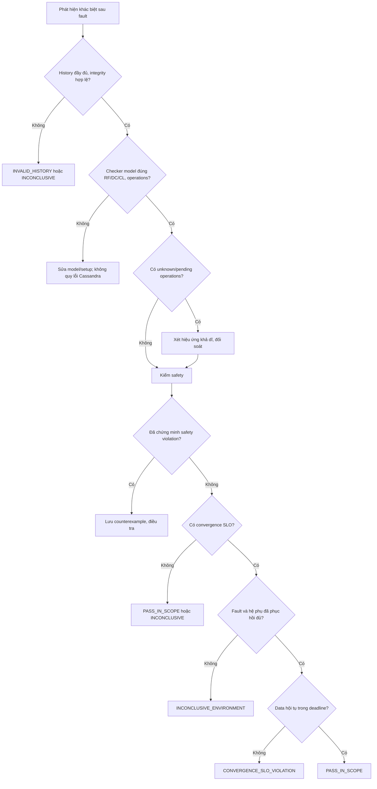

# Lưu lịch sử thao tác và kiểm tra bất biến sau sự cố

> **Chương:** Đo tải và lỗi phân tán  
> **Bối cảnh:** Apache Cassandra với mô hình wide-column, partition key, replication, consistency level, compaction/repair, fault injection và Java Driver 4.x. Bài viết hướng dẫn xây **operation history** để đánh giá tính đúng đắn, không chỉ biểu đồ throughput và latency.
>
> **Mục tiêu:** Phân biệt yêu cầu đã gửi với hiệu ứng đã xảy ra; lưu dấu `invoke`, `ok`, `fail`, `info`; gắn business IDs với retry attempts; kiểm tra invariant bằng lịch sử hai client; hiểu khi nào timeout là outcome chưa xác định; phân biệt *safety*, *linearizability* và *eventual convergence*; đối soát data sau khi Cassandra cluster phục hồi; lập báo cáo PASS/FAIL/INCONCLUSIVE dựa trên bằng chứng.

## 1. Bài toán: ứng dụng timeout nhưng Cassandra vẫn có dữ liệu

Một client Java gửi yêu cầu cập nhật trạng thái đơn:

```text
t=0 ms      Client A: UPDATE status='PAID'
t=15 ms     Replica R1 nhận mutation
t=20 ms     Replica R2 nhận mutation
t=25 ms     Coordinator gửi ACK nhưng network bị ngắt
t=500 ms    Client A nhận timeout
t=600 ms    Client B đọc và thấy status='PAID'
```

Nếu chỉ ghi log:

```text
ERROR: write FAILED
INFO: status PAID
```

ta có thể kết luận nhầm rằng Cassandra “đã ghi dù transaction thất bại”. Thực tế, một **timeout không chứng minh mutation chưa áp dụng**. Có thể coordinator/replica đã làm xong nhưng client mất phản hồi; hoặc một số replica đã ghi, những replica khác cần hồi phục.

Muốn kiểm thử chính xác phải biết:

1. A có **định thực hiện** operation nào, theo partition key nào?
2. Request thực sự được gửi lúc nào, với consistency level nào?
3. A đã nhận ACK, một lỗi chắc chắn, hay một kết quả chưa thể xác định?
4. B đọc vào khoảng thời gian nào, qua coordinator/DC nào và thấy version gì?
5. Sau khi fault kết thúc, các replica và bảng projection có hội tụ đúng mô hình không?
6. Sự khác biệt đến từ Cassandra, ứng dụng, retry hay **bộ đo làm mất lịch sử**?

**Operation history** là chuỗi quan sát để trả lời các câu hỏi đó. Nó không phải chỉ là bảng log “INFO/ERROR”.

## 2. Một lịch sử thao tác khác log ứng dụng thông thường thế nào?

Log thường gặp:

```text
10:00:00 Start update
10:00:01 Timeout update
10:00:02 Get order success
```

Một operation history đầy đủ hơn:

```text
run_id      = run-001
op_id       = op-A
actor       = client-A
kind        = cas
key_ref     = tenant-a/order-42
invoke_ns   = 100000000
outcome_ns  = 600000000
outcome     = info (unknown)
expected    = version=3
requested   = version=4, state=PAID
CL          = LOCAL_QUORUM
serial_CL   = LOCAL_SERIAL

op_id       = op-B
actor       = client-B
kind        = read
key_ref     = tenant-a/order-42
invoke_ns   = 700000000
outcome_ns  = 720000000
outcome     = ok
observed    = version=4, state=PAID
CL          = LOCAL_QUORUM
```

Cấu trúc này cho phép:

- Ghép cặp lúc gọi và lúc phản hồi.
- Phân biệt request hoàn tất với request đang chờ/không rõ kết quả.
- Xây quan hệ nhân quả và kiểm tra thứ tự real-time.
- Áp dụng state-machine model cho CAS hoặc register.
- Đối chiếu với dữ liệu cuối theo partition key.
- Tìm một **counterexample** khi invariant bị phá vỡ.

Log stack trace có thể hỗ trợ chẩn đoán, nhưng **không thay thế** những trường thông tin mà checker cần.

## 3. Bốn loại outcome quan trọng

| Phase | Ý nghĩa | Dùng khi nào |
| --- | --- | --- |
| `invoke` | Client bắt đầu operation | Phải có trước dispatch trong history bền vững |
| `ok` | Operation có phản hồi xác định, hợp lệ theo mô hình | SELECT có kết quả; CAS trả `[applied]` |
| `fail` | Có bằng chứng operation không thành công theo contract | Input bị chặn trước dispatch; CQL invalid được từ chối rõ |
| `info` | Không thể xác định operation có hiệu ứng hay không | Write timeout, mất connection sau dispatch, client chết |

Ví dụ LWT:

- `INSERT ... IF NOT EXISTS` trả `[applied]=true` → `ok`, condition đã áp dụng.
- Trả `[applied]=false` → **vẫn `ok`**, đây là kết quả CAS hợp lệ nhưng không sửa row.
- `DriverTimeoutException` sau khi request được gửi → thường **`info`**, chưa biết mutation có áp dụng không.
- Client process chết giữa `invoke` và response → operation **pending**, không tự coi `fail`.

**Không dùng catch-all exception để biến mọi lỗi thành fail.** Đó là cách nhanh nhất tạo false positive/false negative cho checker.

## 4. Business operation, logical request và attempts

Một business action có thể tạo nhiều request:

```text
business_id = payment-123
    |
    +-- HTTP request req-01
    |      +-- driver execution attempt 1
    |      +-- driver speculative attempt 2
    |
    +-- HTTP retry req-02
           +-- driver execution attempt 1
```

Cần tối thiểu ba cấp định danh:

1. **Business operation ID:** ổn định qua retries; dùng cho idempotency.
2. **Logical request ID:** mỗi lần service yêu cầu CQL/HTTP.
3. **Attempt ID:** mỗi lần thực thi thực sự nếu instrument được.

Không gộp các retries thành những thanh toán mới khi check nghiệp vụ; cũng không xóa số attempts vì chúng tạo thêm coordinator/replica work.

Driver 4.x có metrics/tracing về retries/speculation tùy cấu hình; không tự khẳng định đã quan sát từng internode RPC nếu harness chỉ biết logical request. Ghi rõ **phạm vi bằng chứng client-side**.

## 5. Lịch sử nhiều client cần biểu diễn thời gian đúng cách

```text
Client A                 Cassandra cluster             Client B
   |                           |                          |
   | invoke op-1               |                          |
   +-------------------------->|                          |
   |                           | write R1/R2              |
   | timeout: info             |                          |
   |                           |<-------------------------+ invoke read
   |                           +------------------------->|
   |                           |                          | ok: version 4
```

Các đồng hồ không tương đương:

| Đồng hồ | Phù hợp với | Giới hạn |
| --- | --- | --- |
| `System.nanoTime()` | Duration trong **một JVM** | Không so giá trị tuyệt đối giữa hai máy |
| `Instant.now()`/UTC | Liên hệ event với fault timeline | Clock skew/NTP có thể chỉnh |
| CQL write timestamp | Cassandra reconciliation/LWW | Không phản ánh chắc chắn thứ tự invoke |
| Driver/server tracing clock | Điều tra coordinator/replica path | Có sai lệch giữa hosts, overhead và sampling |

Ví dụ A ghi `t=100ms` trên máy A, B ghi `t=90ms` trên máy B. Nếu clocks lệch, không được suy B xảy ra trước A.

Tốt hơn là giữ:
- Invocation/response interval theo process-local monotonic clock.
- Process/actor ID và sequence numbers.
- Explicit causal links (A response rồi trigger B request).
- Clock synchronization/uncertainty khi cần so host.
- Fault controller timeline và chứng cứ health.

**Linearizability checker phải tôn trọng thứ tự chắc chắn, không sort mù tất cả JSONL theo một timestamp UTC.**

## 6. Manifest cho một lần fault test

Bên cạnh history cần một manifest bất biến:

```yaml
run:
  id: "fault-run-001"
  seed: 314159
  scenario: "cas-plus-projection"
  target_slo: "<approved>"
  cassandra:
    distribution: "Apache Cassandra"
    server_release: "<observed>"
    native_protocol: "<observed>"
    cluster_name: "<observed>"
    replication:
      strategy: "NetworkTopologyStrategy"
      dc1: {nodes: 3, rf: 3}
    read_cl: "LOCAL_QUORUM"
    write_cl: "LOCAL_QUORUM"
    serial_cl: "LOCAL_SERIAL"
    schema_revision: "<hash>"
  java:
    jdk_release: "<observed>"
    driver_artifact: "<resolved>"
    application_instances: 2
    retry_policy: "<resolved>"
    speculative_policy: "<resolved>"
  fault:
    kind: "node-network-isolation"
    target: "<approved-test-node>"
    start_utc: "<observed>"
    stop_utc: "<observed>"
  artifacts:
    histories: ["client-A.jsonl", "client-B.jsonl"]
    checksums: "<sha256-manifest>"
```

Các giá trị trong ngoặc nhọn là **placeholders**, không phải cấu hình đã xác minh. Không dùng manifest của một node RF1 để tuyên bố đã kiểm tra quorum 2/3.

Cần ghi rõ test là lab một node, multi-node, multi-DC hay staging; thời điểm fault kết thúc **khác** thời điểm cluster phục hồi đủ điều kiện đối soát.

## 7. Bất biến là gì và ai phải bảo đảm?

Bất biến là điều kiện không được vi phạm trong phạm vi đã khai báo.

| Bất biến | Phạm vi | Cơ chế chính |
| --- | --- | --- |
| Tối đa một winner của CAS cùng version | Một partition/lifecycle hợp lệ | LWT, Paxos |
| Đọc đúng row với đủ primary key | Query shape + CL | Cassandra + mapping |
| Read-after-write theo quorum giao nhau | Cùng DC/RF/CL, điều kiện không conflict | Replica read/write CL |
| Không tạo business payment trùng | API/retry/queue | Idempotency của **ứng dụng** |
| Canonical và projection cuối cùng khớp version | Nhiều bảng/partitions | Reconciliation của **ứng dụng** |
| Không giảm trạng thái job sau SUCCEEDED | Business state machine | CAS/version và validation |
| Dữ liệu DELETE không tái xuất sau node outage | Multi-replica, repair/gc conditions | Tombstones + repair/vận hành |
| Tổng tiền hai account luôn đúng tức thời | Nhiều partition | Không được hứa bởi BATCH thường |
| Read ở mọi DC luôn mới nhất sau local quorum write | Nhiều DC | Không phải bảo đảm mặc định |

**Không được áp một invariant mạnh hơn hợp đồng thực tế của Cassandra rồi kết luận engine có bug.**

## 8. Safety và liveness/convergence khác nhau

**Safety:** “điều xấu có xảy ra không?”

Ví dụ hai CAS cùng expectedVersion=0 trên một partition đều báo `[applied]=true` dù không có reset/ghi xen vào. Nếu có bằng chứng đầy đủ, đó là candidate safety violation.

**Liveness/convergence:** “một trạng thái mong muốn cuối cùng có đạt không?”

Ví dụ sau outage, bảng projection phải đuổi kịp canonical trong 60 giây **sau khi projector và cluster được xác nhận phục hồi** theo SLO đã duyệt.

Một read ngay trong lúc fault:

```text
canonical: version 5
projection: version 4
```

không tự là lỗi nếu hệ thống chấp nhận eventual consistency.

Ngược lại, đợi 30 giây không “chữa” được hai successful CAS winners trái invariant. **Safety violation không biến mất chỉ vì final state đã hội tụ.**

## 9. Lab schema: canonical state và projection

Giả sử test cluster có DC thật tên `dc1` và đủ replica RF3:

```cql
CREATE KEYSPACE IF NOT EXISTS fault_lab
WITH replication = {
    'class': 'NetworkTopologyStrategy',
    'dc1': 3
};

CREATE TABLE IF NOT EXISTS fault_lab.job_state_by_id (
    tenant_id text,
    job_id uuid,
    version bigint,
    state text,
    amount bigint,
    updated_at timestamp,
    PRIMARY KEY ((tenant_id, job_id))
);

CREATE TABLE IF NOT EXISTS fault_lab.job_state_by_owner (
    tenant_id text,
    owner_id uuid,
    job_id uuid,
    source_version bigint,
    state text,
    PRIMARY KEY ((tenant_id, owner_id), job_id)
);
```

`fault_lab.job_state_by_id` là canonical. `job_state_by_owner` là projection phục vụ truy vấn theo owner.

**Hai bảng có hai partition keys khác nhau.** Cassandra không tự đồng bộ projection khi canonical thay đổi. Nếu test bằng **một container**, đổi sang keyspace lab RF1 và CL tương ứng; không copy RF3/`LOCAL_QUORUM` mà chỉ có một replica.

Trong nghiệp vụ giả định:

```text
NEW -> RUNNING -> SUCCEEDED
NEW -> CANCELLED
RUNNING -> FAILED
```

Cassandra không tự cấm một ordinary `UPDATE` chuyển `SUCCEEDED -> NEW`. Ứng dụng phải enforce state machine qua mô hình/version/conditional update phù hợp.

## 10. Khởi tạo row bằng LWT

```cql
INSERT INTO fault_lab.job_state_by_id (
    tenant_id, job_id, version, state, amount, updated_at
) VALUES (
    'tenant-a',
    11111111-1111-4111-8111-111111111111,
    0, 'NEW', 1000,
    '2026-11-21T10:00:00Z'
) IF NOT EXISTS;
```

Nếu trả `[applied]=true`, ta biết điều kiện tạo đã thỏa. Nếu `false`, row đã tồn tại — không nên coi đó là mutation được áp dụng từ yêu cầu hiện tại.

Cần **key mới mỗi test**; nếu test trước vẫn để row tồn tại, cả hai client tranh cùng khóa có thể đều trả false, tạo kết luận sai.

## 11. CAS theo version: invariant rõ và dễ tái lập

```cql
UPDATE fault_lab.job_state_by_id
SET version = 1,
    state = 'RUNNING'
WHERE tenant_id = 'tenant-a'
  AND job_id = 11111111-1111-4111-8111-111111111111
IF version = 0;
```

Hai clients A/B gửi:

```text
A: expected version 0, next version 1, state RUNNING
B: expected version 0, next version 1, state CANCELLED
```

Nếu **cả hai có kết quả xác định**, cùng partition, cùng lifecycle và không có writer bypass LWT, **tối đa một** operation có `[applied]=true`.

Nếu A timeout và B `false`, không được suy A chắc chắn thất bại. Có thể A đã thắng nhưng không nhận response. Readback với CL được khai báo và history giúp thu hẹp kết quả.

### Dữ liệu cần log cho một CAS

- `op_id` và stable business ID.
- Partition-key reference (anonymized).
- Expected version, proposed next version và state.
- Invocation timestamp.
- Return `[applied]` hoặc outcome unknown.
- Regular CL và serial CL.
- Coordinator/attempt metadata nếu quan sát được.
- Một danh sách writers nào có quyền cập nhật cùng row.

**LWT hỗ trợ CAS theo phạm vi Cassandra có bảo đảm; không biến các projection khác partition thành transaction SQL.**

## 12. Ordinary UPDATE dùng quy tắc khác CAS

Ví dụ:

```cql
UPDATE fault_lab.job_state_by_id
SET state = 'RUNNING'
WHERE tenant_id = 'tenant-a'
  AND job_id = 11111111-1111-4111-8111-111111111111;
```

Cassandra có reconciliation theo write timestamps và tie-break của cells. Khi hai clients ghi cạnh tranh, operation hoàn tất sau theo clock client **không phải lúc nào cũng thắng** nếu timestamp thấp hơn.

Không dùng checker ngây thơ:

```text
"Operation nào response sau thì phải là trạng thái cuối".
```

Muốn kiểm LWW, cần timestamp inputs, schema và data type semantics. Muốn chặn chuyển trạng thái trái domain, dùng CAS/version hoặc một transactional mechanism đáp ứng yêu cầu thay vì phụ thuộc thứ tự HTTP.

## 13. Two-table invariant: trạng thái tạm lệch có thể hợp lệ

Sau update canonical:

```text
canonical: version=7, state=SUCCEEDED
projection: source_version=6, state=RUNNING
```

Hệ eventual projection có thể tạm lệch. Cần tách:

- **Safety của canonical:** version và state transition không vi phạm mô hình.
- **Convergence của projection:** sau recovery, projector/reconciliation đưa `source_version` lên 7 trong deadline đã thống nhất.
- **Read contract:** UI/API có thể hiển thị trạng thái syncing hoặc đọc canonical.

Logged BATCH nhiều partition có batchlog để hỗ trợ thực hiện các mutation sau lỗi; **không có snapshot isolation xuyên partition**. `BEGIN UNLOGGED BATCH` nhiều partition không có batchlog recovery group như logged batch.

**Không coi hai SELECT từ hai bảng là một snapshot giao dịch chỉ vì chúng dùng cùng một `CqlSession`.**

## 14. Operation history dạng JSON Lines

Mỗi dòng là một event:

```json
{"runId":"r-001","opId":"op-1","actor":"client-A","phase":"invoke","kind":"cas","keyRef":"k-7","expectedVersion":0,"nextVersion":1,"monoNanos":100000000,"wallUtc":"2026-11-21T10:00:00Z"}
{"runId":"r-001","opId":"op-2","actor":"client-B","phase":"invoke","kind":"cas","keyRef":"k-7","expectedVersion":0,"nextVersion":1,"monoNanos":101000000,"wallUtc":"2026-11-21T10:00:00.001Z"}
{"runId":"r-001","opId":"op-1","actor":"client-A","phase":"info","kind":"cas","keyRef":"k-7","errorClass":"RequestTimeout","monoNanos":600000000,"wallUtc":"2026-11-21T10:00:00.500Z"}
{"runId":"r-001","opId":"op-2","actor":"client-B","phase":"ok","kind":"cas","keyRef":"k-7","applied":false,"monoNanos":620000000,"wallUtc":"2026-11-21T10:00:00.520Z"}
```

Đây là **dữ liệu giả định**. Các IDs `k-7` là opaque keys mẫu. Với production data nên dùng stable hash/salt và tránh raw PII.

### Trường tối thiểu

| Field | Công dụng |
| --- | --- |
| `runId` | Không trộn nhiều test runs |
| `opId` | Ghép invoke ↔ outcome |
| `actor`/`processId` | Phân biệt các clients/JVM |
| `phase` | invoke/ok/fail/info |
| `kind` | read/write/cas/delete/batch |
| `keyRef` | Khóa thuộc cùng partition cho checker |
| `expectedVersion`/`nextVersion` | Đầu vào state machine |
| `applied`/`observed` | Kết quả thật |
| `monoNanos`/`wallUtc` | Intervals/diagnostics |
| `cl`/`serialCl` | Phạm vi consistency |
| `attemptId`/`businessId` | Retry và deduplication |
| `errorClass` | Phân loại kết quả |
| `faultEpoch` | Liên hệ với thời điểm fault |

Không ghi passwords, tokens, private keys, bind values nhạy cảm hoặc dữ liệu khách hàng thô chỉ để tăng độ chi tiết.

## 15. Ghi `invoke` bền vững trước khi dispatch

Anti-pattern:

```java
session.executeAsync(statement)
    .thenAccept(result -> history.write("ok"));
```

Nếu client bị kill sau khi Cassandra nhận mutation nhưng trước callback, history **không có dấu vết operation đó**.

Quy tắc:

```text
1. Sinh stable op ID.
2. Persist "invoke" và chờ acknowledgement của history store.
3. Chỉ sau đó dispatch CQL.
4. Khi có response, ghi ok/fail/info.
5. Nếu process chết, giữ invoke-only = pending.
6. Nếu history recorder hỏng, run INVALID/INCONCLUSIVE.
```

Chỉ enqueue `invoke` vào RAM chưa chắc đã durable; crash có thể mất nó. Khi cần log bền vững, phải xác định fsync/remote durable ACK boundary. Tuy nhiên, **không fsync trực tiếp trên driver event-loop** vì có thể làm sai số đo latency và nghẽn request handling.

## 16. History writer cần bounded queue và failure policy

Một writer phải:

- Không làm mất events im lặng.
- Có queue hữu hạn hoặc backpressure có giới hạn.
- Biết được độ trễ append/fsync.
- Phát lỗi nếu storage không ghi được.
- Không giữ full history chỉ trong heap.
- Có log rotation/manifest/checksums.
- Không dừng mà bỏ pending outcomes khi graceful shutdown.
- Không gọi println per request trên thread sinh tải hoặc callback driver.

Trong **correctness mode**, có thể chấp nhận overhead để đổi lấy durability. Trong **peak throughput benchmark**, có thể dùng logging strategy khác nhưng phải công bố chính xác mức mất dữ liệu cho phép. **Không sampling history của các operations cần checker chứng minh invariant.**

## 17. Java 17: JSONL recorder với writer thread riêng

Đoạn dưới dùng Jackson `ObjectMapper`, `FileChannel` và executor có queue giới hạn. Nó minh họa durability boundary; không phải thư viện production đầy đủ.

```java
import com.fasterxml.jackson.databind.ObjectMapper;

import java.io.IOException;
import java.io.UncheckedIOException;
import java.nio.ByteBuffer;
import java.nio.channels.FileChannel;
import java.nio.file.Path;
import java.nio.file.StandardOpenOption;
import java.time.Instant;
import java.util.concurrent.ArrayBlockingQueue;
import java.util.concurrent.CompletableFuture;
import java.util.concurrent.CompletionStage;
import java.util.concurrent.RejectedExecutionException;
import java.util.concurrent.ThreadPoolExecutor;
import java.util.concurrent.TimeUnit;

public final class DurableJsonlHistory implements AutoCloseable {

    public record Event(
        String runId,
        String opId,
        String actor,
        String phase,
        String kind,
        String keyRef,
        Long expectedVersion,
        Long nextVersion,
        Boolean applied,
        String observed,
        String errorClass,
        long monoNanos,
        String wallUtc
    ) {}

    private final ObjectMapper mapper = new ObjectMapper();
    private final FileChannel channel;
    private final ThreadPoolExecutor writer;

    public DurableJsonlHistory(Path path) throws IOException {
        channel = FileChannel.open(
            path, StandardOpenOption.CREATE,
            StandardOpenOption.WRITE, StandardOpenOption.APPEND
        );
        writer = new ThreadPoolExecutor(
            1, 1, 0L, TimeUnit.MILLISECONDS,
            new ArrayBlockingQueue<>(4096),
            runnable -> {
                Thread t = new Thread(runnable, "history-writer");
                t.setDaemon(false);
                return t;
            },
            new ThreadPoolExecutor.AbortPolicy()
        );
    }

    public CompletionStage<Void> append(Event event) {
        try {
            return CompletableFuture.runAsync(
                () -> appendDurably(event), writer);
        } catch (RejectedExecutionException overloaded) {
            return CompletableFuture.failedFuture(overloaded);
        }
    }

    private void appendDurably(Event event) {
        try {
            byte[] json = mapper.writeValueAsBytes(event);
            byte[] line = new byte[json.length + 1];
            System.arraycopy(json, 0, line, 0, json.length);
            line[json.length] = (byte) '\n';

            ByteBuffer bytes = ByteBuffer.wrap(line);
            while (bytes.hasRemaining()) {
                channel.write(bytes);
            }

            // Writer thread, KHÔNG phải driver I/O callback.
            channel.force(false);
        } catch (IOException e) {
            throw new UncheckedIOException(e);
        }
    }

    @Override
    public void close() throws Exception {
        writer.shutdown();
        if (!writer.awaitTermination(30, TimeUnit.SECONDS)) {
            throw new IllegalStateException("History not drained");
        }
        channel.close();
    }
}
```

### Những giới hạn của implementation

- `channel.force(false)` là yêu cầu flush ở API; mức bền vững thực phụ thuộc filesystem/OS/hardware và kiểu crash.
- Có queue 4096: quá tải → lỗi, không tự động drop event.
- Fsync từng event có overhead cao, cần **calibration**; có thể trở thành bottleneck.
- Chưa có log rotation, checksum, directory sync, disk-full recovery, distributed sequence number.
- Không gọi `close` khi operations vẫn còn đang tạo outcomes; nếu callback append sau close, run không đầy đủ.
- Writer errors phải làm run fail/INVALID, không chỉ cảnh báo.
- Khi process chết giữa invoke và response, có invoke-only, đúng meaning **pending/unknown**.

Nếu tải quá cao, dùng durable log store đã kiểm chứng và xác định ACK semantics; không tự thay executor bằng queue vô hạn rồi cho rằng bài test an toàn.

## 18. Java Driver 4.x: bọc LWT CAS bằng history

Mã sử dụng Java Driver 4.x và `DurableJsonlHistory` của phần trước. Mục đích: persist invoke trước CQL; phân biệt CAS `applied` với timeout.

```java
import java.time.Instant;
import java.util.UUID;
import java.util.concurrent.CompletionStage;

import com.datastax.oss.driver.api.core.CqlSession;
import com.datastax.oss.driver.api.core.DefaultConsistencyLevel;
import com.datastax.oss.driver.api.core.cql.AsyncResultSet;
import com.datastax.oss.driver.api.core.cql.BoundStatement;
import com.datastax.oss.driver.api.core.cql.PreparedStatement;
import com.datastax.oss.driver.api.core.cql.Row;

public final class HistoryAwareCasClient {

    public record CasOutcome(
        String opId,
        Boolean applied,
        String errorClass,
        boolean unknown
    ) {}

    private final CqlSession session;
    private final PreparedStatement cas;
    private final DurableJsonlHistory history;
    private final String runId;
    private final String actor;

    public HistoryAwareCasClient(
        CqlSession session,
        DurableJsonlHistory history,
        String runId,
        String actor
    ) {
        this.session = session;
        this.history = history;
        this.runId = runId;
        this.actor = actor;
        cas = session.prepare(
            "UPDATE fault_lab.job_state_by_id " +
            "SET version = ?, state = ? " +
            "WHERE tenant_id = ? AND job_id = ? " +
            "IF version = ?"
        );
    }

    private DurableJsonlHistory.Event event(
        String opId, String phase, String keyRef,
        long oldVersion, long newVersion,
        Boolean applied, String observed, String error
    ) {
        return new DurableJsonlHistory.Event(
            runId, opId, actor, phase, "cas",
            keyRef, oldVersion, newVersion,
            applied, observed, error,
            System.nanoTime(), Instant.now().toString()
        );
    }

    public CompletionStage<CasOutcome> attempt(
        String tenantId, UUID jobId,
        String keyRef, long oldVersion, String nextState
    ) {
        String opId = UUID.randomUUID().toString();
        long newVersion = oldVersion + 1;

        BoundStatement statement = cas
            .bind(newVersion, nextState, tenantId,
                  jobId, oldVersion)
            .setConsistencyLevel(
                DefaultConsistencyLevel.LOCAL_QUORUM)
            .setSerialConsistencyLevel(
                DefaultConsistencyLevel.LOCAL_SERIAL)
            .setIdempotent(false);

        return history.append(
            event(opId, "invoke", keyRef,
                  oldVersion, newVersion,
                  null, null, null)
        ).thenCompose(ignored -> {

            CompletionStage<AsyncResultSet> stage;
            try {
                stage = session.executeAsync(statement);
            } catch (RuntimeException ex) {
                return history.append(
                    event(opId, "info", keyRef,
                          oldVersion, newVersion,
                          null, null, ex.getClass().getName())
                ).thenApply(v -> new CasOutcome(
                    opId, null, ex.getClass().getName(), true
                ));
            }

            return stage.handle((result, error) -> {
                if (error != null) {
                    return new CasOutcome(
                        opId, null,
                        error.getClass().getName(), true
                    );
                }
                Row row = result.one();
                if (row == null) {
                    return new CasOutcome(
                        opId, null, "MissingCasResult", true
                    );
                }
                return new CasOutcome(
                    opId, row.getBoolean("[applied]"),
                    null, false
                );
            }).thenCompose(outcome -> {
                String phase = outcome.unknown() ? "info" : "ok";
                String observed = outcome.applied() == null
                    ? null : "applied=" + outcome.applied();

                return history.append(
                    event(opId, phase, keyRef,
                          oldVersion, newVersion,
                          outcome.applied(), observed,
                          outcome.errorClass())
                ).thenApply(v -> outcome);
            });
        });
    }
}
```

### Bất biến của luồng ghi

1. Sinh `opId` trước side effect.
2. `invoke` được persist xong mới gửi CQL.
3. Response `[applied]` xác định → `ok`, kể cả false.
4. Timeout/lỗi không chắc kết quả → `info`.
5. Outcome được persist trước khi stage của client coi là hoàn tất.
6. Nếu recorder lỗi, operation/harness thất bại: **không được dùng kết quả để cấp PASS**.
7. Không log raw tenant/user keys dưới dạng `keyRef` nếu có PII.
8. `LOCAL_QUORUM`/`LOCAL_SERIAL` giả định RF3 ở dc1, không phải test RF1.
9. Dùng CAS version model; **mọi writer liên quan phải tuân thủ** nếu checker dựa vào nó.

Đoạn code bảo thủ coi mọi exception không có CQL result là unknown. Một harness thật có thể phân loại một số lỗi chắc chắn không dispatch thành `fail` nếu có bằng chứng, nhưng không mặc định.

## 19. Nếu journal lỗi, history không đủ để PASS

Tình huống:

```text
op-7 invoke đã ghi
CQL request được gửi
Recorder queue đầy trước khi ghi outcome
```

Có thể Cassandra đã ghi. Lịch sử còn pending, và recorder đã mất khả năng xác nhận kết quả.

Báo cáo đúng:

```text
history_integrity = INVALID
op-7 = pending/unknown
test_conclusion = INCONCLUSIVE hoặc INVALID_HISTORY
```

**Không tự ghi thêm `fail` vào file sau test, không xóa invoke và không giả kết quả** để các con số trông đẹp.

## 20. Hai `CqlSession` không tự tạo hai coordinators

Một test có:

```text
Client A --> CqlSession A ----+
                             +--> Cassandra
Client B --> CqlSession B ----+
```

giúp tách state/driver pools, kiểm race, read-after-write và LWT competition. Nhưng nếu chỉ có một Cassandra container, cả hai vẫn kết nối cùng một node.

Để kiểm node failure/cross-DC, phải có cluster nhiều nodes và **xác nhận actual coordinator, local DC, RF, CL** qua driver metadata/logs/tracing thích hợp.

### Hai sessions không tạo snapshot

Mở `CqlSession` lúc 10:00 **không** tạo snapshot tại 10:00. Mỗi SELECT là một request độc lập. B đọc hai bảng bằng cùng session không đồng nghĩa hai SELECT được cô lập như một SQL transaction.

## 21. Concurrency test: hai CAS, một version

Sau khởi tạo `version=0`, hai client gửi:

```text
A expected=0, set version=1, state RUNNING
B expected=0, set version=1, state CANCELLED
```

Kiểm thử cần:

- Hai `CqlSession` riêng.
- Barrier để gửi gần nhau.
- Deadline hữu hạn cho futures.
- `[applied]` và exception phân loại riêng.
- Không assert A luôn thắng.
- Nếu cả hai result xác định, **tối đa một** CAS applied.
- Nếu một timeout, **không assert chính xác một winner** mà giữ unknown.

Với nhiều operations, log key/version/lifecycle và kiểm sự kiện ở tất cả clients. Bản thân `CountDownLatch` không điều khiển thứ tự coordinator nhận RPC.

## 22. Pseudocode checker đơn giản cho CAS

```text
for mỗi (key_ref, lifecycle_epoch, expected_version):
    applied_ops = các op_id riêng biệt có:
        phase = ok
        kind = cas
        applied = true

    if count(applied_ops) > 1:
        report candidate SAFETY_VIOLATION
    else:
        không có bằng chứng vi phạm invariant này
```

Checker này có ý nghĩa khi:

- Version không reset/reuse trong cùng epoch.
- Không có writer bỏ qua LWT để sửa version.
- `key_ref` ánh xạ ổn định tới đúng Cassandra partition.
- Mỗi op_id thực sự là một logical CAS distinct.
- History đầy đủ, không duplicate outcome logs.

Nó **chưa chứng minh linearizability đầy đủ**: không kiểm real-time order, read results, pending ops và state-machine transitions phức tạp.

## 23. Linearizability: cần intervals, không chỉ final value

Một history linearizable nếu tồn tại một cách sắp các operations thành thứ tự tuần tự phù hợp với:

1. State machine của đối tượng.
2. Input/output đã quan sát.
3. Real-time precedence: nếu A **hoàn tất** trước khi B **được gọi**, A phải xếp trước B.

Ví dụ:

```text
A invoke -------- result
  B invoke --- result
```

A/B overlap, checker có thể thử nhiều thứ tự.

```text
A invoke --- result
                        B invoke --- result
```

A chắc chắn đứng trước B nếu cùng đối tượng và một thứ tự real-time đáng tin được ghi.

Với Cassandra, chọn model phù hợp:
- LWT/CAS trên partition có semantics riêng theo Paxos/serial CL.
- Ordinary writes/LWW và `LOCAL_ONE` không tự là register linearizable toàn cluster.
- Logged BATCH cross-partition không cho snapshot isolation.
- `LOCAL_QUORUM` ở hai DC khác nhau không mặc nhiên giao nhau.

**Checker mạnh hơn hợp đồng được hỗ trợ sẽ tạo những “vi phạm” không có giá trị.**

## 24. Pending/unknown operations phải được xem xét

```text
A invoke CAS 4 -> 5
A bị kill trước khi nhận phản hồi
B read sees version 5
```

A có thể đã áp dụng. Checker không thể tự đánh dấu A fail. Trong linearizability analysis, pending op có thể được xét như không effect hoặc có effect trong khoảng hợp lệ khi không có bằng chứng phản bác.

Nếu có stable business ID và một ledger idempotency, có thể thu hẹp unknown. Nếu không, báo `INCONCLUSIVE_UNKNOWN_OUTCOME` khi model không đủ kết luận.

### Final row không kể toàn bộ sự thật

```text
A write(1) -> timeout
B write(2) -> ok
Final read -> 2
```

Final value 2 không chứng minh A chưa từng ghi 1. Với counters, list append, external side effects, dấu vết trung gian đặc biệt quan trọng.

## 25. Offline checker phải validate history trước khi check data

Một pipeline tối thiểu:

1. Parse tất cả JSONL segments từ mọi clients.
2. Xác minh manifest, checksums, run IDs và schema version.
3. Xác minh mỗi outcome có một invoke hợp lệ.
4. Phân biệt pending, info, fail và ok.
5. Kiểm tra stable IDs, retries/attempt parentage, lifecycle epochs.
6. Dựng per-process order và causal relationships.
7. Không sort mù theo UTC giữa hosts.
8. Nạp expected initial state của các test keys.
9. Chạy safety checker theo model version.
10. Ghi kết quả/counterexample, sau đó đối soát final data.

Một checker bỏ qua malformed events hoặc tự xóa pending trước khi phân tích có thể báo **false PASS**.

## 26. Bảng phân loại exception/outcome để dùng trong history

| Hiện tượng | Phân loại thích hợp | Lý do |
| --- | --- | --- |
| CAS trả `[applied]=true` | `ok` | Mutation condition áp dụng |
| CAS trả `[applied]=false` | `ok` | Condition không thỏa, kết quả rõ |
| SELECT trả row | `ok` | Có quan sát |
| SELECT trả null | `ok` | Không thấy row sống tại CL đó |
| App validation reject trước DB | `fail` | Biết CQL chưa dispatch |
| CQL invalid schema/column | `fail` nếu chứng cứ chắc | Server từ chối statement |
| Write timeout | **`info`** | Mutation có thể vẫn áp dụng |
| Network disconnect sau dispatch | **`info`** | Outcome không biết |
| LWT timeout | **`info`** | Không biết CAS applied |
| Client killed sau invoke | pending | Chưa có response |
| History writer drop event | INVALID_HISTORY | Không đủ bằng chứng |

## 27. Không nhầm timeout với rollback

```text
Client A: UPDATE -> timeout
Client B: SELECT -> thấy giá trị mới
```

Đây là trạng thái có thể hợp lệ của hệ phân tán. `DELETE` gửi sau đó để “undo” sẽ là **một mutation mới**, có timestamp, tombstone và lỗi riêng; không phải SQL rollback transaction.

Nếu nghiệp vụ cần compensation, phải log business action mới và thiết kế idempotency/reconciliation. Không xóa history cũ khi thao tác bù được thực hiện.

## 28. Đọc sau ghi với RF/CL phải đúng hợp đồng

Giả sử Cassandra có RF=3 trong DC `dc1`:

```text
R1, R2, R3 giữ các replicas của partition P

Write LOCAL_QUORUM cần hai phản hồi local
Read  LOCAL_QUORUM cần hai phản hồi local
```

Khi không có các ghi cạnh tranh với timestamp lấn át và hệ tuân theo điều kiện replication, quorum đọc/ghi trong **cùng DC** giao nhau. Điều này là một cơ sở để thử read-after-write mạnh hơn `LOCAL_ONE`.

Tuy nhiên:

- **`LOCAL_ONE`** có thể đọc replica chưa cập nhật.
- Hai `LOCAL_QUORUM` ở **hai DC khác nhau** không mặc nhiên giao cùng replica.
- Timestamp reconciliation có thể làm một write không phải “mới nhất” theo wall-clock client.
- Quorum không tạo **snapshot transaction xuyên nhiều SELECT**.
- LWT/serial semantics phải được kiểm tra riêng, không trộn với ordinary writes.

Nếu một test chỉ dùng một container RF=1, `LOCAL_QUORUM` cũng chỉ cần một replica local. Nó **không chứng minh** quorum 2/3 của production.

### Mẫu record về CL

```json
{"opId":"r-101","kind":"read","phase":"invoke","cl":"LOCAL_QUORUM","keyRef":"k-7","actor":"dc1-client"}
{"opId":"r-101","kind":"read","phase":"ok","cl":"LOCAL_QUORUM","keyRef":"k-7","observed":"version=5","actor":"dc1-client"}
```

History phải khai báo DC/CL theo operation hoặc effective profile đã xác minh, không chỉ ghi default config một lần rồi bỏ qua statement overrides.

## 29. Cross-DC local quorum không cho global snapshot

Ví dụ keyspace có `NetworkTopologyStrategy` RF=3 tại cả `dc1` và `dc2`. Đây là **kịch bản chỉ phù hợp với cluster thực có hai DC**:

```cql
-- Chỉ minh họa topology; không chạy trên lab một DC.
CREATE KEYSPACE IF NOT EXISTS global_lab
WITH replication = {
  'class': 'NetworkTopologyStrategy',
  'dc1': 3,
  'dc2': 3
};
```

```text
Client A (dc1): UPDATE with LOCAL_QUORUM
Client B (dc2): SELECT with LOCAL_QUORUM
```

B có thể tạm thấy phiên bản cũ do replication liên DC chưa hội tụ. Checker không nên đòi mọi DC đọc giá trị mới tức thì khi chỉ có local CL.

Thay vào đó phải định nghĩa:

- Safety/correctness trong local DC theo RF/CL.
- **Convergence** giữa DC sau khi liên kết ổn và cơ chế replica đã thực hiện đủ.
- Deadline và preconditions rõ của SLO nghiệp vụ.
- Các observation từ từng DC có actor/coordinator identifier.

**Mốc “network link đã mở lại” không nhất thiết đồng nghĩa “mọi replica đã theo kịp”.**

## 30. Logged BATCH và history nhiều partition

Một logged batch:

```cql
BEGIN BATCH
  UPDATE fault_lab.job_state_by_id
  SET state = 'SUCCEEDED'
  WHERE tenant_id = 'tenant-a'
    AND job_id = 11111111-1111-4111-8111-111111111111;

  UPDATE fault_lab.job_state_by_owner
  SET state = 'SUCCEEDED'
  WHERE tenant_id = 'tenant-a'
    AND owner_id = aaaaaaaa-aaaa-4aaa-8aaa-aaaaaaaaaaaa
    AND job_id = 11111111-1111-4111-8111-111111111111;
APPLY BATCH;
```

Hai mutations nằm ở **hai bảng/partition khác nhau**. Logged batch có batchlog hỗ trợ việc đưa những mutations vào trạng thái cuối khi khôi phục theo cơ chế Cassandra; **không cung cấp isolation/snapshot xuyên partitions**.

History của batch cần:

1. Một logical batch ID.
2. Danh sách statement kinds và partition references đã ẩn danh.
3. Loại `LOGGED`/`UNLOGGED` hoặc `COUNTER`.
4. CL và status/exception của batch request.
5. Fault start/end, coordinator/node health.
6. Read observations của từng partition trước/trong/sau lỗi.
7. Final reconciliation, pending/unknown outcomes.
8. Batchlog/repair diagnostics nếu hỗ trợ trong server release.

### Không assert một thuộc tính Cassandra không hứa

```text
"Session B phải thấy old/old hoặc new/new ở mọi lúc."
```

Đây là giả định **snapshot isolation xuyên partition** và không được bảo đảm bởi logged batch thông thường. Có thể có trạng thái `new/old` trong lúc batch chưa hội tụ.

`BEGIN UNLOGGED BATCH` nhiều partition lại không có cơ chế batchlog recovery group của logged batch. Khi fail, app cần idempotent write/reconciliation theo business contract; không đợi batchlog của unlogged batch giải quyết mọi thứ.

## 31. Dùng business IDs kiểm lỗi ghi trùng

Ví dụ các events thanh toán:

```text
Expected:
  payment-A: amount=100
  payment-B: amount=200
  payment-C: amount=300

Observed:
  payment-A applied twice
  payment-B not applied
  payment-C applied once
```

Nếu chỉ kiểm tổng số ACK hoặc số rows, lỗi có thể không được phát hiện.

Checker nên đối chiếu:

- **Tập business event IDs** thay vì tổng count.
- Những IDs đã applied.
- Số side effects của từng ID.
- Unknown requests cần reconcile.
- Tổng tiền theo event IDs khi mô hình cho phép.
- Những mutations trùng do queue redelivery/HTTP retries/driver attempts.

Đặc biệt, CQL counter increment **không idempotent**: retry có thể cộng hai lần. Cassandra logged batch cũng không bảo đảm exactly-once business effect trên các hệ thống bên ngoài.

Nếu yêu cầu là một ledger không trùng, thiết kế idempotency key/conditional write phù hợp và test trong cả tình huống timeout; không chỉ bật retry.

## 32. Canonical và projection: kiểm tra eventual convergence

Bảng canonical:

```text
job_id J, version 8, state SUCCEEDED
```

Bảng projection:

```text
job_id J, source_version 7, state RUNNING
```

Một checker hội tụ cần:

1. Xác định **fault thực sự kết thúc**.
2. Xác minh cluster/consumer/projector **đã phục hồi**.
3. Bắt đầu deadline hội tụ được phê duyệt.
4. Đọc canonical/projection theo đúng partition keys.
5. Kiểm `source_version` và state, không chỉ row count.
6. Poll có bounded interval và giới hạn concurrency.
7. Ghi mọi read observation vào history.
8. Nếu hết deadline vẫn lệch, báo `CONVERGENCE_SLO_VIOLATION` với bằng chứng.
9. Nếu projector vẫn chưa phục hồi, ghi `INCONCLUSIVE_ENVIRONMENT`.
10. Không gọi một read chưa đạt trong lúc fault là bằng chứng datastore sai.

**SLO hội tụ là hợp đồng của workflow ứng dụng**, không phải thời gian đảm bảo cứng mặc định cho mọi CQL write.

## 33. Thử safety xóa dữ liệu với tombstone

Cassandra `DELETE` tạo tombstone, không tức thời xóa mọi phiên bản cell khỏi các SSTable. Nếu một replica offline bỏ lỡ delete và repair không đủ trong điều kiện retention, có thể phát sinh vấn đề dữ liệu cũ xuất hiện trở lại.

Một thử nghiệm đúng tầng:

1. Tạo key riêng, xác nhận dữ liệu sống.
2. Chạy cluster nhiều node với RF/CL đã khai.
3. Gây replica outage có kiểm soát.
4. DELETE theo consistency contract.
5. Ghi invoke/outcome/timestamps của delete.
6. Phục hồi node và theo repair runbook được hỗ trợ.
7. Đọc/đối soát nhiều đường trong thời gian có ý nghĩa.
8. Theo dõi compaction/`gc_grace_seconds`, không sửa ngẫu nhiên.
9. Không dùng một SELECT sau delete để tuyên bố mọi SSTable/replica sạch.
10. Ghi rõ những điều chưa kiểm chứng.

**Không hạ `gc_grace_seconds` hay gián đoạn repair trên production để làm test nhanh.** Đây là chủ đề nhiều replica và thời gian; một container RF1 không đủ.

## 34. Fault timeline nên lưu cùng operation history

Ví dụ:

```json
{"runId":"r-001","event":"fault_start","faultId":"f-1","target":"node-2","kind":"network-isolation","wallUtc":"2026-11-21T10:00:00Z"}
{"runId":"r-001","event":"fault_end","faultId":"f-1","target":"node-2","kind":"network-isolation","wallUtc":"2026-11-21T10:00:20Z"}
{"runId":"r-001","event":"cluster_healthy","target":"dc1","wallUtc":"2026-11-21T10:00:50Z"}
{"runId":"r-001","event":"reconcile_start","wallUtc":"2026-11-21T10:01:00Z"}
```

Phải phân biệt:

- Fault controller gửi lệnh gây sự cố.
- Sự cố thật sự được quan sát.
- Fault controller gửi lệnh khôi phục.
- Node/cluster thật sự trở lại trạng thái đủ lành mạnh.
- Replication/repair/projector đã bắt kịp đến mức cần cho checker.
- Checker bắt đầu đo convergence SLO.

Một node “UP” theo một công cụ không tự chứng minh không còn backlog/replica divergence. Kết luận phải dựa vào health signals phù hợp.

### Những thông tin về fault cần ghi

| Trường | Lý do |
| --- | --- |
| Fault ID/type | Phân biệt network, disk, kill, GC |
| Node/DC/rack/coordinator | Biết replica nào bị ảnh hưởng |
| Planned start/end | So với lịch workload |
| Actual observed start/end | Biết fault thật xảy ra khi nào |
| Fault tool/config | Tái hiện packet loss/latency |
| Safety stop thresholds | Không gây thiệt hại lab vượt dự định |
| In-flight at fault | Biết operations nào chịu unknown outcome |
| Health-restored evidence | Có quyền chốt convergence deadline |
| Repair/streaming/projector state | Giải thích lag kéo dài |

Fault injection **chỉ trên lab/staging được phê duyệt**.

## 35. Kịch bản RF3 mất một replica

Với `dc1` có R1, R2, R3, read/write `LOCAL_QUORUM` cần hai replica local.

```text
t=0      Baseline: tất cả R1/R2/R3 khỏe
t=10     Client A/B phát CAS và reads, ghi history
t=20     R3 bị cô lập
t=20-50  Tiếp tục có kiểm soát, đo error/latency
t=50     Gỡ fault
t=80     Cluster được xác minh phục hồi
t=90     Chạy safety và convergence checker
```

Một replica lỗi **không tự làm mọi request thất bại** nếu hai replica khác vẫn sẵn sàng và đường coordinator hợp lệ. Nhưng latency, timeouts và retries có thể tăng do routing/network/workload.

Checker cần biết:

- CL nào ở mỗi request.
- Coordinator nào, nếu instrument được.
- Operations hoàn tất `ok`.
- Operations `info`/pending.
- Bất biến CAS có bị vi phạm không.
- Dữ liệu sau recovery có hội tụ không.
- Recovery time có đạt SLO không.

**Không chỉ đo số lỗi, mà phải kiểm các hiệu ứng dữ liệu đã có dù client không nhận được ACK.**

## 36. Kịch bản RF3 mất hai replica

Khi chỉ R1 còn sẵn sàng trong local RF3, `LOCAL_QUORUM` thiếu quorum.

Ta kỳ vọng các request đòi quorum có thể trả `Unavailable` hoặc timeout tùy trạng thái/đường đi. History phải:

- Giữ invoke của request.
- Ghi lỗi cụ thể, không tự gán rollback.
- Không nâng retry vô hạn để “duy trì QPS”.
- Không đổi CL xuống `ONE` mà bỏ ghi metadata.
- Theo dõi request nào đã được xử lý trước khi hệ nhận biết thiếu quorum.
- Đọc đối soát unknown outcomes khi các replica hồi phục.

Kết quả cuối phải nói rõ **availability bị giảm theo hợp đồng CL**, không tự coi đây là vi phạm safety.

## 37. Coordinator chết trong logged BATCH

Để đánh giá batchlog recovery:

1. Dùng multi-node Cassandra lab với RF phù hợp.
2. Chọn nhiều partitions đã biết, không dùng dữ liệu khách hàng thật.
3. Gửi logged BATCH bằng client A.
4. Ghi `invoke` bền vững trước dispatch.
5. Gây fault coordinator có instrument/timing được duyệt.
6. Ghi A trả `ok`, `info` hay connection error.
7. Client B đọc từng partition ở nhiều mốc; có thể thấy partial visibility.
8. Chờ phục hồi/batchlog replay theo điều kiện cluster.
9. Chạy convergence checker và đối chiếu workload.
10. Lưu logs/metrics, không khẳng định snapshot isolation.

Một container RF1 không đủ kiểm chứng kịch bản này. Đừng dùng `Thread.sleep(10)` rồi khẳng định đã tái hiện mọi trạng thái giữa chừng.

## 38. History store cũng có failure domain

Một kiến trúc khả dĩ:

```text
Client A -----+
              +----> Durable history storage
Client B -----+
              |
Fault runner -+----> Fault event log
              |
Cassandra cluster
```

Nếu history store nằm cùng node/volume với Cassandra đang bị kill, cả hai có thể đồng thời mất dữ liệu. Nếu history store ở xa, network fault có thể chặn đường log trước khi chặn đường CQL.

Cần thiết kế rõ:

- Log intent durable trước dispatch.
- Queue bounded và reject policy.
- Log rotation và file integrity.
- Recovery khi client process chết.
- Số events đã gửi/được xác nhận ghi.
- Các đoạn history bị thiếu.
- Clock synchronization và causal ordering.
- Bảo mật/redaction/retention.

**Một test có history mất mát không được báo PASS về thuộc tính cần history đó chứng minh.**

## 39. Bộ artifacts để tái hiện

Một test harness riêng có thể lưu:

```text
run-manifest.json
client-A-history-0001.jsonl
client-B-history-0001.jsonl
fault-events.jsonl
readback-observations.jsonl
history-integrity-report.json
checker-report.json
checksums.sha256
```

Đây là ví dụ cấu trúc artifacts của hệ kiểm thử, **không phải chỉ thị tạo thêm file** ngoài phạm vi bài học hiện tại.

Trước khi checker chạy:

1. Kiểm tra `runId` đúng ở mọi file.
2. Xác minh checksum SHA-256 và danh sách segments.
3. Parse tất cả JSONL rows; không silently skip malformed lines.
4. Kiểm tra mọi outcome có invocation hợp lệ.
5. Kiểm tra không có duplicate op ID ngoài định nghĩa retry.
6. Gắn lifecycle epoch cho những keys có reset.
7. Giữ pending/info operations.
8. Nạp model/checker version đúng với schema/test workload.
9. Không trộn UTC/monotonic timestamp thành một order không có bằng chứng.
10. Nếu không đủ dữ liệu, trả `INVALID_HISTORY` hoặc `INCONCLUSIVE`.

## 40. Java: checker at-most-one CAS winner

Một checker tối giản đọc JSONL từ `DurableJsonlHistory`. Nó không phải linearizability checker đầy đủ nhưng phát hiện candidate violation khi **hai distinct successful CAS cùng key/expected version/lifecycle**.

```java
import com.fasterxml.jackson.databind.JsonNode;
import com.fasterxml.jackson.databind.ObjectMapper;

import java.nio.file.Files;
import java.nio.file.Path;
import java.util.HashMap;
import java.util.HashSet;
import java.util.Map;
import java.util.Set;

public final class CasWinnerChecker {

    public static void check(Path file) throws Exception {
        ObjectMapper mapper = new ObjectMapper();
        Map<String, Set<String>> winners = new HashMap<>();

        try (var lines = Files.lines(file)) {
            for (String line : (Iterable<String>) lines::iterator) {
                if (line.isBlank()) continue;

                JsonNode e = mapper.readTree(line);
                if (!"ok".equals(e.path("phase").asText())) {
                    continue;
                }
                if (!"cas".equals(e.path("kind").asText())) {
                    continue;
                }
                if (!e.path("applied").asBoolean(false)) {
                    continue;
                }

                String key = e.path("keyRef").asText();
                String version =
                    e.path("expectedVersion").asText();
                String opId = e.path("opId").asText();

                if (key.isBlank() || version.isBlank()
                    || opId.isBlank()) {
                    throw new IllegalStateException(
                        "Malformed successful CAS event");
                }

                String group = key + ":" + version;

                winners.computeIfAbsent(
                    group, ignored -> new HashSet<>()
                ).add(opId);
            }
        }

        for (var entry : winners.entrySet()) {
            if (entry.getValue().size() > 1) {
                throw new AssertionError(
                    "More than one CAS winner for " +
                    entry.getKey() + ": " + entry.getValue()
                );
            }
        }
    }
}
```

### Giới hạn của code

- Chỉ kiểm một invariant **hẹp** của CAS.
- Cần merge histories từ **mọi clients** trước khi check.
- Cần verify event integrity/`invoke` ghép outcome ở pipeline trước.
- Nếu cùng key/version được **reset/reused**, phải thêm lifecycle epoch vào group.
- Nếu writer bypass LWT hoặc tự tạo op IDs mới cho retry, cần mô hình xử lý.
- Không kiểm invocation/response intervals hay read observations.
- Không mô hình pending/unknown operations đầy đủ.
- Kết quả PASS **không có nghĩa toàn hệ Cassandra linearizable**.

Để kiểm linearizability thực, dùng checker state-machine có hỗ trợ concurrency intervals và unknown outcomes, trên đúng operation semantics. Không phát minh “bảo đảm” từ một script đếm winners.

## 41. Bounded reconciliation: không polling vô hạn

Anti-pattern:

```java
// SAI: có thể tạo read storm hoặc treo vô hạn.
while (!projectionMatchesCanonical()) {
    // No deadline; no pause; no rate limit.
}
```

Một kiểm tra hội tụ phải có:

- Start time sau khi recovery preconditions thỏa.
- Deadline, interval và max concurrent reads.
- Consistency level cố định/được ghi.
- Per-key observation log.
- Cancellation và unfinished policy.
- Tiêu chí đạt dựa vào version/state, không chỉ row existence.
- Kết luận rõ khi không đủ thông tin.

Pseudocode:

```text
deadline = monotonicNow + approvedSloWindow

while monotonicNow < deadline:
    read canonical and projection by full partition key
    append observation to history
    if sourceVersion == canonical.version
       and projection.state == canonical.state:
         return CONVERGED
    boundedWait()

return CONVERGENCE_SLO_VIOLATION
```

Nếu cluster chưa healthy hoặc projector bị tắt, nên trả `INCONCLUSIVE_ENVIRONMENT` thay vì tự coi mỗi read chưa khớp là dữ liệu sai vĩnh viễn.

### Không biến checker thành nguồn tải lớn

Một triệu keys polling mỗi 250 ms có thể tạo tải khổng lồ. Chia keys thành shards, giới hạn QPS/in-flight, ưu tiên affected keys, đo readback p95/p99 và tiến độ.

## 42. Phân loại kết luận phải trung thực

| Trạng thái | Ý nghĩa |
| --- | --- |
| `PASS_IN_SCOPE` | Không thấy vi phạm các invariants đã định trong phạm vi thử |
| `SAFETY_VIOLATION` | Có counterexample đúng với model và history integrity |
| `CONVERGENCE_SLO_VIOLATION` | Sau recovery, không hội tụ trong deadline đã phê duyệt |
| `INCONCLUSIVE_UNKNOWN_OUTCOME` | Pending/info operations chưa thể phân giải |
| `INCONCLUSIVE_ENVIRONMENT` | Cluster/projector chưa phục hồi đủ điều kiện |
| `INVALID_HISTORY` | Log drops, checksum mismatch, corruption hoặc thiếu events |
| `TEST_SETUP_FAILURE` | RF/DC/CL, version, schema hoặc fault không đúng kế hoạch |

**PASS chỉ là PASS trong phạm vi test**, không là chứng minh hệ thống không bao giờ có lỗi.

## 43. Counterexample cần ngắn nhưng giữ quan hệ nhân quả

Ví dụ:

```text
Run r-104; key K; lifecycle 1
Initial version=0, RF3 dc1, LWT LOCAL_SERIAL

A invoke CAS 0->1 RUNNING at t=100
B invoke CAS 0->1 CANCELLED at t=110
A ok applied=true at t=200
B ok applied=true at t=210

Không có reset/DELETE/writer khác.
Candidate SAFETY_VIOLATION.
```

Trước khi quy lỗi Cassandra:

1. Hai CAS có cùng **partition key thực**?
2. Key references có collision không?
3. Có đúng một lifecycle epoch?
4. History có duplicate results do recorder không?
5. Có writer ordinary UPDATE không?
6. Cả hai `[applied]` có thật, không phải mapper parse sai?
7. Hai clients có kết nối cùng cluster/keyspace không?
8. Serial CL/regular CL và server release đúng?
9. Có operation bị thiếu do history corruption không?
10. Counterexample có giữ tất cả causal/real-time edges không?

Giữ bản raw history riêng với bản minimized; không xóa pending operations có thể giải thích khác thứ tự.

## 44. Metrics client và Cassandra cần lưu

| Nhóm | Ví dụ metric/evidence |
| --- | --- |
| History | invoke/ok/fail/info counts, pending operations |
| Recorder | writer queue depth, fsync p99, log drops, checksum |
| Workload | offered/dispatched/completed QPS, in-flight, rejected |
| Driver | request errors/timeouts, retry/speculation counts |
| Read/write | CL, serial CL, coordinator/DC, row versions |
| Fault | start/end timestamps, affected node, health-restored |
| Cassandra | CPU, heap/offheap, GC, disk await, pending/dropped |
| Replication | repair/streaming status, internode messaging |
| Data | duplicate business IDs, version drift, projection lag |
| Checker | model version, counterexample IDs, unknown count |

Tên cụ thể phụ thuộc Java Driver/Cassandra/exporter release; không tự khẳng định metric nào cũng có sẵn. Không đưa raw tenant/customer IDs vào time-series labels với cardinality cao.

**Operation history và metrics bổ sung nhau:** metrics cho quy mô/tương quan, history cho bằng chứng chi tiết theo operations.

## 45. Quy trình bảo vệ dữ liệu lịch sử

History có thể chứa partition keys, payment IDs, amounts, network endpoints và lỗi nội bộ. Cần:

1. Chỉ ghi dữ liệu checker thực sự cần.
2. Ẩn danh key references bằng mapping/hash ổn định.
3. Không ghi bearer tokens, passwords, private keys.
4. Tránh raw CQL bind values có PII.
5. Mã hóa dữ liệu tại rest/in transit.
6. RBAC cho ai đọc history và checker output.
7. Retention/TTL theo chính sách bảo mật.
8. Redaction trước khi chia sẻ counterexamples.
9. Giữ trace/run ID đủ để correlating mà không lộ secrets.
10. Ưu tiên synthetic test data; dùng production data cần phê duyệt.

Một hash biến đổi khác nhau cho mỗi event cùng key sẽ làm checker không ghép được operations; nếu dùng salt, giữ nó nhất quán trong phạm vi run.

## 46. Sự cố A: client chết, history không có outcome

**Triệu chứng:** canonical version tăng nhưng A chỉ có `invoke`.

**Diễn giải:** operation có thể đã áp dụng. Không biến nó thành fail.

**Xử lý:** đọc đối soát có CL phù hợp; kiểm stable business ID, version và các concurrent writers. Giữ `pending` nếu không phân giải chắc chắn.

Nếu recorder chỉ ghi sau result và đã mất cả invoke, run có thể không đủ evidence; đó là vấn đề test harness, không tự gán Cassandra bug.

## 47. Sự cố B: recorder queue đầy và benchmark “xanh giả”

**Triệu chứng:** p99 Cassandra khá thấp nhưng log writer chậm; nhiều operations bị bỏ, bị chặn hoặc không có outcome.

**Xử lý:**

- Đo recorder latency/queue depth.
- Dừng run khi history integrity không được bảo đảm.
- Giảm offered load hoặc tăng năng lực history store có kiểm soát.
- Đừng chuyển bounded queue thành unbounded.
- Đánh giá overhead recorder bằng synthetic benchmark.
- Không bỏ các requests bị recorder reject khỏi mẫu số offered workload.

**Kết luận:** `INVALID_HISTORY` hoặc `INCONCLUSIVE`, không PASS.

## 48. Sự cố C: projection vẫn sai sau lỗi

```text
canonical: version=12, state=SUCCEEDED
projection: version=10, state=RUNNING
```

Điều tra:

- Projector/consumer có đang hoạt động không?
- Queue backlog/DLQ, checkpoint, retries?
- Fault đã kết thúc thật, cluster đủ replica?
- Có events out-of-order hoặc idempotency bug?
- Có timestamp cũ che state mới?
- Projection có trỏ đúng owner/tenant partition?
- RF/DC/CL của readback có phù hợp?
- Repair/compaction/network còn gây áp lực không?

Nếu deadline sau recovery đã hết và workflow đúng được phép chạy, báo **convergence SLO failure** của toàn workflow; không tự nói đó là storage-engine defect.

## 49. Sự cố D: DELETE xong lại thấy dữ liệu cũ

Nếu một replica bỏ lỡ tombstone, cần ghi exact node outage, DELETE CL, repair history và `gc_grace_seconds`. Kiểm tra cả khả năng **ứng dụng gửi lại old value** hoặc replay events.

Không chạy `nodetool compact` hoặc hạ `gc_grace_seconds` trên production một cách tự phát. Repair là cơ chế hội tụ replicas, không là rollback của mutation nghiệp vụ.

## 50. Ma trận kiểm thử history và invariants

| Case | Điều kiện | Kỳ vọng |
| --- | --- | --- |
| H1 | Invoke rồi ok | Ghép op IDs và values đúng |
| H2 | Invoke rồi timeout | `info`, không fail giả |
| H3 | Process chết sau invoke | Pending giữ nguyên |
| H4 | Validation reject trước dispatch | `fail` có bằng chứng |
| H5 | History queue overflow | Run INVALID |
| H6 | JSONL bị cắt giữa dòng | Parse/checksum fail |
| H7 | Log segment bị mất | Manifest integrity fail |
| H8 | Retry cùng business ID | Attempts có parent ID |
| H9 | Duplicate op ID | Collision được phát hiện |
| H10 | Cross-host clock skew | Không sort theo UTC mù |
| H11 | Synthetic two CAS winners | Checker báo violation |
| H12 | One CAS true, one false | Không báo lỗi |
| H13 | CAS true + timeout | Outcome unknown được giữ |
| H14 | Two CAS unknown | Không kết luận winner |
| H15 | Version reset/recreate | Lifecycle epochs tách riêng |
| H16 | Ordinary LWW writes | Model timestamp đúng |
| H17 | RF1 single node | Chỉ claim CQL contract |
| H18 | RF3 LOCAL_QUORUM | Thử quorum 2/3 |
| H19 | Một replica down | Availability/unknown outcomes |
| H20 | Hai replicas down | Error/timeout, không rollback giả |
| H21 | Coordinator crash | Pending log còn nguyên |
| H22 | Logged batch nhiều partition | Final convergence, không snapshot |
| H23 | Unlogged cross-partition batch | Không suy có group recovery |
| H24 | Cross-DC local reads | Stale remote read được mô hình |
| H25 | Driver retry/speculation | Attempt amplification được ghi |
| H26 | Counter increment retry | Duplicate effect test |
| H27 | Business event redelivery | Stable ID/idempotency |
| H28 | Projection sau canonical | Bounded convergence |
| H29 | Projection quá SLO | Convergence violation |
| H30 | Projector chưa hồi phục | Environment inconclusive |
| H31 | DELETE khi replica offline | Repair/tombstone test |
| H32 | Mixed TTL data | Retention semantics |
| H33 | Readback key missing | Phân loại theo history |
| H34 | Fault event missing | Không claim fault xảy ra |
| H35 | In-flight chưa drain | Pending/unfinished report |
| H36 | Hot partition data | Workload coverage ghi rõ |
| H37 | Schema revision khác test | Setup failure |
| H38 | Không có CL metadata | Không overclaim consistency |
| H39 | Event projection out-of-order | Version reconciliation |
| H40 | Canonical version giảm trái model | Safety candidate |
| H41 | Batch partial visibility | Không tự gọi DB bug |
| H42 | Safety PASS, projection FAIL | Hai kết quả riêng |
| H43 | History INVALID, final data đúng | Không cho PASS mạnh |
| H44 | Cluster còn repair backlog | Không chốt SLO sai mốc |
| H45 | Minimized counterexample | Giữ causal edges |
| H46 | Các clients khác releases | Ghi dependency manifest |
| H47 | History store mất trong fault | Giữ unknown/incomplete |
| H48 | PII trong history | Redaction/RBAC test |
| H49 | Ghi log làm generator nghẽn | Observability overhead |
| H50 | End-to-end run hoàn chỉnh | PASS/FAIL/INCONCLUSIVE rõ |

## 51. Câu hỏi và bài tập

1. Vì sao write timeout không đồng nghĩa write chưa áp dụng?
2. So sánh log ứng dụng với operation history.
3. Khi nào `[applied]=false` vẫn là `ok`?
4. `info` khác `fail` về hậu quả dữ liệu ra sao?
5. Client kill sau invoke nên để operation ở trạng thái nào?
6. Phân biệt business ID, request ID và attempt ID.
7. Vì sao phải giữ invoke bền vững trước dispatch?
8. Một event trong RAM queue đã được gọi durable chưa?
9. Nếu fsync làm scheduler trễ, cần điều chỉnh thế nào?
10. Vì sao recorder phải có bounded queue?
11. `System.nanoTime()` có so trực tiếp giữa hai JVM được không?
12. Clock skew làm một linearizability checker sai thế nào?
13. Phân biệt CQL write timestamp và invocation timestamp.
14. Safety invariant khác convergence SLO ở đâu?
15. Một CAS trên partition có bao nhiêu winners khi hai clients cùng expectedVersion?
16. Nếu một CAS timeout, vì sao không chắc nó thua?
17. Khi nào checker đếm winners báo false positive?
18. Reset version có cần lifecycle epoch không?
19. Ordinary UPDATE có tự bảo vệ business state machine không?
20. Vì sao multi-table projection thường cần reconciliation?
21. Logged BATCH có snapshot isolation xuyên partitions không?
22. Unlogged BATCH nhiều partitions thiếu cơ chế recovery nào?
23. Với RF3, local quorum là bao nhiêu?
24. RF1 với LOCAL_QUORUM có chứng minh 2/3 quorum không?
25. Hai LOCAL_QUORUM ở hai DC có cùng tập replica không?
26. Định nghĩa linearizability và real-time order.
27. Hai operations overlap có bắt buộc theo invoke time không?
28. Pending op ảnh hưởng model checker thế nào?
29. Final value đúng có chứng minh không có duplicate side effect không?
30. Counter retries gây lỗi nghiệp vụ như thế nào?
31. Làm sao dùng stable payment IDs để tìm duplicate effects?
32. Vì sao SELECT row theo PK nên dùng readback CL rõ ràng?
33. Khi nào đọc projection version cũ là hợp lệ tạm thời?
34. Những điều kiện gì phải có trước khi bắt đầu convergence deadline?
35. Tại sao không polling hàng triệu keys mỗi 10ms?
36. DELETE tạo tombstone và liên quan repair thế nào?
37. Vì sao không thử repair convergence trên một node?
38. Fault end khác cluster healthy ở đâu?
39. Nếu fault controller mất log, có tuyên bố PASS được không?
40. Checksum có thay thế model correctness không?
41. History integrity validation phải làm trước state checker vì sao?
42. Thử “hai winners” synthetic có ích gì?
43. Vì sao một checker winners chưa chứng minh linearizability?
44. Lỗi nhận lẫn hai partition keys có thể gây false violation thế nào?
45. Một thao tác compensation/DELETE có phải rollback SQL không?
46. Khi nào environment inconclusive khác convergence fail?
47. Những artifacts nào cần lưu để tái hiện test?
48. Dữ liệu PII có thể rò trong CQL history bằng những cách nào?
49. Một báo cáo counterexample phải giữ các mốc và metadata nào?
50. Khi nào phải cân nhắc transactional storage thay Cassandra cho invariant xuyên partition?

## 52. Runbook — trước khi inject fault

1. Xác định safety invariants và eventual SLO riêng.
2. Chọn CQL operation model: CAS, ordinary write, batch, read, delete.
3. Ghi query-first partition keys, canonical vs projection.
4. Kiểm tra server release, driver/JDK và schema migration.
5. Xác minh RF/DC/CL/serial CL theo topology thực.
6. Chọn test data/IDs synthetic và controlled seed.
7. Chọn run ID, business IDs và retry attempt linkage.
8. Chuẩn hóa history JSON schema, event phases.
9. Test recorder bounded queue, durability và integrity.
10. Cho checker synthetic history có violation để thử.
11. Cho checker history có unknown outcome để thử không false positive.
12. Đặt điều kiện stop an toàn về tải/CPU/disk.
13. Lập fault timeline events và kịch bản rollback.
14. Đảm bảo test không chạm production/shared env ngoài quyền.
15. Có chủ sở hữu, deadlines và báo cáo dạng PASS/FAIL/INCONCLUSIVE.

## 53. Runbook — khi fault đang diễn ra

1. Ghi invoke trước mọi CQL dispatch.
2. Ghi response/`[applied]` hoặc `info` khi không biết.
3. Đếm offered/dispatched/completed, in-flight và retry attempts.
4. Ghi fault actual start/end và affected node/DC.
5. Theo dõi coordinator/replica queues, timeout, CPU/GC/disk.
6. Không retry writes non-idempotent không kiểm soát.
7. Không xóa pending operations để làm log đẹp.
8. Không chạy recorder queue vô hạn.
9. Dừng bài test khi vượt safety thresholds.
10. Đừng tự sửa data ngoài history trong lúc đang đo.
11. Ghi client crashes, network failures, reconnects.
12. Giữ timeseries trên mọi phases: baseline, fault, recovery.

## 54. Runbook — sau fault và đối soát

1. Thực hiện gỡ fault, xác minh node/link hoạt động thật.
2. Ngừng phát requests mới và drain in-flight theo deadline.
3. Ghi unfinished/pending/unknown outcomes.
4. Xác nhận cluster health, RF/DC và CL.
5. Chờ repair/projector/consumer đạt preconditions đã định.
6. Chốt mốc bắt đầu convergence SLO.
7. Parse/validate toàn bộ history segments.
8. Xác minh manifest, checksums, op IDs và model version.
9. Chạy safety checker trên completed và pending histories.
10. Readback canonical/projection theo keys của workload.
11. Poll bounded convergence, có limit QPS/in-flight.
12. Kiểm duplicate business IDs, state/version và TTL/delete.
13. Khi có vi phạm, lưu raw history và minimized counterexample.
14. Khi có unknown/invalid history, trả kết luận thích hợp.
15. Báo riêng correctness và operational SLO.
16. Lưu artifacts theo privacy/retention policy.
17. Chỉ GO nếu test scope và các tiêu chí được duyệt đều đạt.

## 55. Sơ đồ quyết định



## 56. Kết luận

Sau một sự cố phân tán, **độ đúng dữ liệu không được chứng minh bằng một dòng log ERROR hay một SELECT cuối cùng**. Client timeout có thể không biết mutation đã áp dụng chưa; retry có thể nhân tác động; logged batch không cho isolation xuyên partition; local quorum giữa hai DC không mặc nhiên bảo đảm quan sát tức thì.

Để kiểm thử đáng tin cậy:

- Ghi **`invoke` bền vững trước dispatch**, giữ `ok`/`fail`/`info` và pending đúng nghĩa.
- Kết nối **business IDs → logical requests → execution attempts** để tìm duplicate effects.
- Lựa chọn invariant đúng với Cassandra: LWT/CAS theo phạm vi hỗ trợ, replication/CL theo RF/DC, và reconciliation do ứng dụng chịu trách nhiệm.
- Tách **safety violation** khỏi **eventual convergence SLO**.
- Kiểm history integrity, model version và clock/causal ordering trước khi báo vi phạm.
- Sau fault: xác nhận recovery, drain, readback theo partition key, poll bounded và đối soát.
- Ghi kết luận **PASS_IN_SCOPE**, **SAFETY_VIOLATION**, **CONVERGENCE_SLO_VIOLATION**, **INCONCLUSIVE** hoặc **INVALID_HISTORY** theo bằng chứng, không chỉ báo PASS/FAIL đơn giản.

**Ghi nhớ:** **Lịch sử thao tác là bằng chứng; bất biến là tiêu chuẩn; checker là phương pháp suy luận.** Chỉ khi cả ba khớp query-first data model, RF/DC/CL và failure semantics của Apache Cassandra thì kết luận sau sự cố mới đáng tin.
