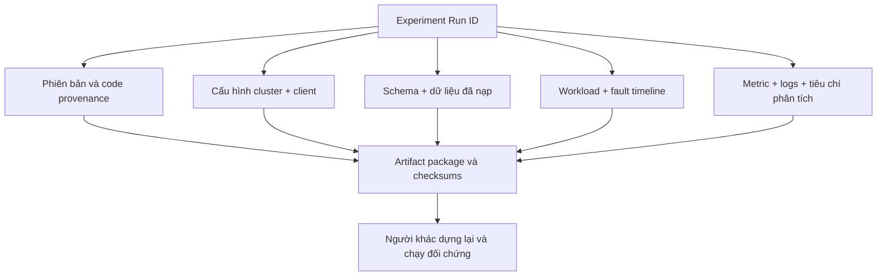

# Ghi lại phiên bản, cấu hình, dữ liệu và điều kiện để tái hiện kết quả đo tải/lỗi Apache Cassandra

## 1. Tái hiện kết quả là một phần của kiểm thử, không phải bước ghi chú cuối

Trong module **DATABASE_ENGINE_WIDE_COLUMN_CASSANDRA**, Apache Cassandra là cơ sở dữ liệu **wide-column phân tán**. Khóa phân vùng (*partition key*) quyết định phân bố dữ liệu theo token, **replication factor (RF)** xác định số replica, **consistency level (CL)** quyết định điều kiện xác nhận thao tác đọc/ghi; thiết kế bảng theo truy vấn, compaction, repair, schema, mạng và Java Driver cùng ảnh hưởng đến độ trễ.

Giả sử một team báo cáo:

> “Sau khi tăng concurrency lên 256, thông lượng tăng 35%, p99 không đổi; khi một node DOWN, hệ thống vẫn hoạt động.”

Báo cáo này **chưa đủ để tái hiện hoặc kiểm chứng**. Cần biết ít nhất:

- Cassandra Server phiên bản nào, chạy bao nhiêu node, thuộc DC/rack nào, RF/CL bao nhiêu?
- Java Driver/Spring Boot/JDK và retry/speculative execution policy ra sao?
- Partition key, CQL, kích thước row, số partition, phân phối hot keys và TTL/tombstone thế nào?
- Workload gửi 256 **request in-flight**, 256 **threads** hay 256 **operations/giây**?
- p99 đo từ Java Driver, từ HTTP ingress hay từ một lần coordinator attempt?
- Có tính request timeout, rejected và pending vào mẫu đo không?
- Fault tiêm lúc nào, nhắm node nào, kéo dài bao lâu, khôi phục thế nào?
- Cùng test chạy lại ba lần có được kết quả tương đương, hay chỉ một lần may mắn?

**Mục tiêu của bài:** xây dựng một **experiment record** đủ để một người khác dựng lại **cùng điều kiện có ý nghĩa**, kiểm tra dữ liệu, thực thi cùng workload/fault và giải thích những sai khác có thể xảy ra. Tái hiện không có nghĩa hai lần chạy phải cho **đúng từng mili giây**: Cassandra và hệ điều hành có scheduler, GC, cache, compaction và network timing không hoàn toàn tất định.

Bài thuộc chương **Đo tải và lỗi phân tán**, tập trung trực tiếp vào **ghi lại phiên bản, cấu hình, dữ liệu và điều kiện để tái hiện kết quả**.

### Mục tiêu học tập

Sau bài học, bạn có thể:

1. Lập manifest cho một run đo tải/fault với **run ID**, code revision, image digest, version Cassandra/Driver/JDK và topology.
2. Ghi đầy đủ **RF/CL, schema/compaction, retry/timeout, hardware, network và cấu hình JVM** liên quan.
3. Tạo dataset có **seed, kích thước, phân phối partition keys, timestamp/TTL và fingerprint** kiểm chứng được.
4. Định nghĩa workload, warm-up, open-loop/closed-loop, các giai đoạn fault, stop condition và các thước đo.
5. Đo và báo cáo **goodput, p50/p95/p99, error rate, queue wait và trạng thái UNKNOWN** đúng ranh giới.
6. Ghi fault timeline, điều kiện khôi phục, node/token bị tác động và bằng chứng cluster trước/sau.
7. Phân biệt số liệu thật, giả định, thay đổi có chủ đích, biến nhiễu và giới hạn kết luận.
8. Thiết kế artifact package và checklist để chạy lại trong CI/lab mà không tác động production.

## 2. Ba khái niệm: repeatability, reproducibility và comparability

| Khái niệm | Câu hỏi | Ví dụ trong Cassandra |
| --- | --- | --- |
| **Repeatability** — lặp lại cùng môi trường | Chạy ba lần trên cùng cluster/code có cho phân phối metric tương tự? | Cùng RF=3, CQL, dataset, traffic và config; p99 biến động trong khoảng có thể giải thích |
| **Reproducibility** — tái hiện từ mô tả | Người khác dựng môi trường theo manifest và chạy được phép thử tương đương? | Dùng image/version/config/schema/seed/workload/fault script được lưu, có checks |
| **Comparability** — so sánh công bằng | Run trước và sau chỉ khác đúng yếu tố muốn đánh giá? | Thử `LOCAL_ONE` vs `LOCAL_QUORUM` nhưng giữ nguyên row size, skew, node count và workload |

**Không cần các giá trị p99 giống hệt nhau** để xem một phép thử có thể tái hiện. Điều cần là **phương pháp, dữ liệu đầu vào, phân phối quan sát và nguồn biến thiên** đủ rõ để kiểm tra kết luận.

Ví dụ một thay đổi partition bucketing có thể làm p99 thấp hơn. Nhưng nếu run “sau” còn đồng thời giảm row size, giảm CL và xóa 90% dữ liệu thì bạn **không thể quy lợi ích cho bucketing**.

### 2.1. Năm nhóm thông tin bắt buộc



Từng nhóm phải phân biệt: **giá trị mong muốn**, **giá trị quan sát thực tế** và **bằng chứng**. Chỉ lưu một file `application.yml` không chứng minh runtime đã dùng đúng các giá trị đó.

## 3. Experiment ID và cách tổ chức một run

Mỗi lần chạy nên có một ID không trùng và một tên scenario ổn định:

```text
experiment_id: cassandra-hot-partition-rf3-cl-localquorum
run_id: 2026-11-21T09-30-00Z_7f92c4d8
scenario: hot-partition-80pct
phase_set: baseline-warmup-fault-recovery
attempt: 2-of-5
```

**Experiment** mô tả phương pháp và giả thuyết. **Run** là một lần thực hiện cụ thể, với timestamp, biến động và artifacts riêng. Không ghi đè run cũ để “giữ báo cáo mới nhất”.

Gợi ý phân tầng thông tin:

| Trường | Ý nghĩa |
| --- | --- |
| `experiment_id` | Tên phép thử có thể chạy nhiều lần |
| `run_id` | ID duy nhất cho lần chạy; có thể dùng trong metric labels/logs |
| `scenario_id` | Baseline, hot-key, wide-partition, tombstone, node-down |
| `attempt`/`repetition` | Lần lặp số mấy trong một design |
| `operator`/`ci_job_id` | Ai hoặc pipeline nào thực thi (không lưu secret) |
| `started_at_utc`/`ended_at_utc` | Cửa sổ thời gian tuyệt đối |
| `git_commit`/`schema_version` | Code và DDL chính xác |
| `environment_id` | Cluster/testbed, máy generator |
| `outcome` | PASS/FAIL/ABORTED/INCONCLUSIVE theo tiêu chí |
| `artifact_manifest_sha256` | Dấu kiểm tra toàn bộ gói bằng chứng |

### 3.1. Quy tắc đặt tên và phạm vi

Tên keyspace `load_it`, node test và file output có thể chứa `run_id`, nhưng **không tự sinh hàng trăm keyspace/schema trên cluster dùng chung**. Chỉ sử dụng môi trường đã được cách ly và đặt giới hạn tài nguyên.

Kết quả tối thiểu mỗi run nên gồm: *manifest*, *dữ liệu mô tả dataset*, *log workload*, *metrics*, *fault events*, *schema/config fingerprints*, *kết quả kiểm tra đúng đắn* và *bản phân tích*. Không cần chứa dữ liệu người dùng thật.

## 4. Ghi phiên bản: Server, Driver, JDK, ứng dụng và image

### 4.1. Phiên bản nào ảnh hưởng kết quả?

| Thành phần | Cần lưu gì | Vì sao |
| --- | --- | --- |
| Cassandra Server | Exact version/build của **mọi node**, trạng thái mixed-version | Đường read/write, compaction, metrics và giới hạn khác nhau giữa bản |
| Java Driver | Exact artifact group/version/module, request policy | Retry, paging, protocol, connection pool, routing |
| JDK/JVM | Vendor/build, `java -version`, GC, heap, JVM flags | GC pauses, allocations, threads, TLS |
| Spring Boot/Data (nếu dùng) | Exact version, app profile, dependency lock/BOM | Mapping, CQL generation, auto-configuration |
| Load generator | Commit/build/container digest/version | Thuật toán chọn key, throttle, percentile logic có thể thay đổi |
| Cassandra image | Tag **và digest**; hoặc package build ID | Image tag có thể thay, digest xác định bytes |
| OS/kernel/container runtime | Version, architecture, CPU/RAM limits | Scheduler, I/O, network, cgroups |
| Test/fault tool | Version, rule IDs, fault implementation | Pause/latency/drop semantics khác nhau |

**Đừng ghi “Cassandra 4.x” hoặc “Java Driver latest”** rồi tuyên bố có thể tái hiện. Lưu exact version và nếu dùng container, digest.

### 4.2. Lấy bằng chứng phiên bản từ runtime

Ví dụ các câu lệnh đọc trạng thái được dùng **trên lab**:

```bash
# Java trên máy ứng dụng / load generator:
java -version

# Commit của mã test đang chạy:
git rev-parse HEAD
git status --short

# Thông tin phiên bản Cassandra từ nodetool trên node:
nodetool version
nodetool status

# Container image digest qua runtime thích hợp:
docker image inspect cassandra:4.1.6
```

Các lệnh chỉ minh họa. `docker image inspect` trả nhiều trường; hãy trích **repo digest/image ID** đáng tin, không chỉ giữ tag. Không giả định một lệnh `nodetool version` trên node A chứng minh các node B/C cùng phiên bản.

Có thể lấy một phần qua CQL:

```sql
SELECT host_id, cluster_name, data_center, release_version
FROM system.local;
```

`system.local` thể hiện node/coordinator kết nối tới; muốn nắm chính xác **từng node**, phải kiểm từng node hoặc thu kết quả từ hệ thống giám sát/topology đúng thời điểm. Cẩn thận khi rolling upgrade khiến cluster có nhiều version.

### 4.3. Lưu dependencies như một hợp đồng

Một lần nâng Java Driver, Netty, JDK hoặc Spring Data có thể ảnh hưởng tail latency mà code ứng dụng không đổi. Khi review, cần có:

- Commit/hash của source code và build artifact.
- Dependency lockfile hoặc tập resolved dependency versions.
- Docker image digest của app/generator.
- Runtime JVM flags, GC và container limits.
- Driver configuration **đã resolve** từ file/env/overrides, trừ secrets.
- Thời điểm triển khai phiên bản lên từng node; kiểm cluster có mixed-version hay không.

Không dump nguyên credential, token, truststore private key hay environment variables chứa secret vào artifact.

## 5. Cấu hình cluster: topology, RF/CL và các thông số server

### 5.1. Topology và replica placement là đầu vào bắt buộc

Một kết quả `LOCAL_QUORUM` không có ý nghĩa nếu thiếu RF và datacenter.

Ví dụ:

```text
cluster: cassandra-lab-3node
dc1:
  node-a, rack-a
  node-b, rack-b
  node-c, rack-c

keyspace replication:
  NetworkTopologyStrategy
  dc1: 3

read CL: LOCAL_QUORUM
write CL: LOCAL_QUORUM
serial CL (nếu dùng LWT): LOCAL_SERIAL
```

Với RF(dc1)=3:

\[
\operatorname{quorum}=\left\lfloor\frac{3}{2}\right\rfloor+1=2
\]

`LOCAL_QUORUM` cần **hai replica ở dc1**. Một node DOWN có thể vẫn cho phép đáp ứng hai replica khác, nhưng nếu replica còn lại chậm, vẫn có thể timeout.

Trong manifest phải có:

1. Danh sách node ID/IP nội bộ đã được **ẩn/anonymize** nếu công bố ra ngoài.
2. DC/rack và snitch placement.
3. Token ownership/vnodes và replica của partition được test.
4. Node status UP/DOWN **trước, trong và sau** phép thử.
5. RF cho **keyspace thực**, không chỉ cluster default.
6. CL **của từng loại CQL**, serial CL cho LWT.
7. Coordinator/routing/load-balancing policy của Java Driver.
8. Cluster đang bootstrap, stream, repair, upgrade hoặc replace node không?

### 5.2. Schema và table options

Một bảng time-series:

```sql
CREATE KEYSPACE IF NOT EXISTS load_it
WITH replication = {
    'class': 'NetworkTopologyStrategy',
    'dc1': 3
};

CREATE TABLE IF NOT EXISTS load_it.events_by_device_day (
    device_id uuid,
    event_day date,
    event_ts timestamp,
    event_id uuid,
    payload text,
    state text,
    PRIMARY KEY (
        (device_id, event_day),
        event_ts,
        event_id
    )
) WITH CLUSTERING ORDER BY (
    event_ts DESC, event_id ASC
);
```

Với một node lab, ví dụ RF=3 phải đổi thành RF=1 và CL phù hợp. **Không chạy code trên một node rồi tuyên bố kiểm chứng quorum RF=3.**

Các thông số schema cần lưu:

| Thuộc tính | Vì sao ảnh hưởng đo |
| --- | --- |
| Partition key + clustering key | Định tuyến, partition size, thứ tự đọc |
| Column types, frozen/collections/UDT | Row bytes và decoding |
| Compaction strategy/options | SSTable count, tombstone purge, disk I/O |
| Compression | CPU và bytes đọc/ghi |
| TTL / `default_time_to_live` | Tombstone lifecycle |
| `gc_grace_seconds` | Quy tắc liên quan tombstone/repair |
| Index/materialized views nếu có | Write amplification, read path |
| Speculative retry policy server (nếu version có) | Số read attempts và tail behavior |
| Memtable/commit log/cache settings | Latency và memory |
| Repair/compaction/flush state | Điều kiện nền thay đổi theo thời gian |

**Không chỉ ghi đoạn `CREATE TABLE` ban đầu**: bảng có thể đã `ALTER TABLE` hoặc `ALTER ... WITH` từ migration khác. Cần snapshot **schema thực tế** và kiểm nó khớp schema/migration version mong đợi.

### 5.3. Các lệnh thu trạng thái trước và sau

```bash
nodetool status
nodetool describecluster
nodetool info
nodetool tpstats
nodetool compactionstats
nodetool netstats

# Khi đo bảng cụ thể và version hỗ trợ:
nodetool tablestats load_it.events_by_device_day
nodetool tablehistograms load_it events_by_device_day
```

Các lệnh/metric names có thể thay đổi giữa các bản Cassandra; lưu **raw output có timestamp và tên node**, không chỉ một ảnh chụp màn hình. `nodetool status` theo góc nhìn node đang hỏi, không chứng minh toàn cluster hoàn toàn ổn định.

**Không ép flush/compaction cho hai run để tạo cảm giác “giống nhau” mà không ghi lại thao tác đó.** Flush/compaction thay cấu trúc dữ liệu vật lý và có thể là chính biến cần quan sát. Nếu thật sự cần chuẩn hóa, coi chúng là một phần **chuẩn bị có thể tái hiện**, với gate và ảnh hưởng được ghi.

## 6. Cấu hình Java Driver: những thứ phải khóa khi so sánh

Cùng `SELECT` nhưng Java Driver khác timeout/retry/routing/pool có thể tạo kết quả khác.

| Thiết lập | Cần ghi | Ảnh hưởng |
| --- | --- | --- |
| Local datacenter | `dc1` | Routing coordinator trong DC |
| Contact points | Endpoints/config discovery | Bootstrap và metadata |
| Default/statement CL | `LOCAL_ONE`, `LOCAL_QUORUM`… | Replica responses cần |
| Serial CL | `LOCAL_SERIAL`/`SERIAL` với CAS | LWT semantics/latency |
| Request timeout | Milliseconds và override | Phân biệt driver vs coordinator timeout |
| Page size | Rows/page và cách duyệt | Response memory, round trips |
| Retry policy | Class/config + attempts thực | Overload, latency, kết quả write chưa rõ |
| Speculative execution | Enabled/disabled, policy | Tăng số attempts, giảm tail trong một số đường đọc |
| Idempotency metadata | `setIdempotent(true/false)` | Điều kiện để một số policy có thể retry/speculate |
| Connection/pool limits | Số connections/requests, queue | Client-side saturation |
| Execution profiles | Tên profile dùng ở từng statement | Config thực có thể khác default |
| Auth/TLS | Trạng thái bật/tắt, thuật toán/phân phối hợp lý | Chi phí handshake/CPU, không log secrets |

**Không giả định `setIdempotent(true)` biến CQL mutation thành an toàn**. Với counter increment, append vào list, LWT và side effect ngoài Cassandra, retry mù quáng có thể gây kết quả sai. Cần thiết kế idempotency/reconciliation riêng.

### 6.1. Ví dụ thông tin query trong manifest

```yaml
queries:
  - id: read-latest-20
    cql: "SELECT event_ts, event_id, payload FROM load_it.events_by_device_day WHERE device_id = ? AND event_day = ? LIMIT 20"
    category: read
    consistency: LOCAL_QUORUM
    page_size: 100
    request_timeout_ms: 2000
    idempotent: true
    execution_profile: "read-profile"
    expected_rows_min: 1
    expected_rows_max: 20

  - id: upsert-event
    cql: "INSERT INTO load_it.events_by_device_day (device_id, event_day, event_ts, event_id, payload, state) VALUES (?, ?, ?, ?, ?, ?)"
    category: write
    consistency: LOCAL_QUORUM
    request_timeout_ms: 2000
    idempotent: false
    expected_effect: "one logical event keyed by device/day/ts/eventId"
```

Đây là **manifest minh họa**, không phải file cấu hình Java Driver tự nhận. Statement idempotency cho write cố ý đặt bảo thủ; chỉ đánh dấu true sau khi xét timestamp, TTL, concurrent writers và hợp đồng nghiệp vụ.

## 7. Dataset: lưu không chỉ số row, mà cả hình dạng và phân phối

Một bộ dữ liệu “10 triệu rows” có thể tạo hai workload rất khác:

- Dataset A: 1 triệu partitions × 10 rows, row nhỏ, không tombstone.
- Dataset B: 100 partitions × 100.000 rows, row lớn, 80% rows có tombstone.
- Dataset C: nhiều partitions nhưng 90% query dồn về một key.

**Row count tổng không đủ mô tả khối lượng công việc.** Phải có partition cardinality, phân phối rows/partition, bytes/row, thời gian, TTL/delete, hot-key skew và đường truy vấn.

### 7.1. Dataset manifest

```yaml
dataset:
  dataset_id: "events-fixture-v3"
  source_generator_commit: "<full-git-commit>"
  random_seed: 20261121
  dataset_generation_version: 3
  schema_migration_version: "V014"
  keyspace: load_it
  table: events_by_device_day

  partition_count: 10000
  rows_per_partition:
    distribution: fixed
    value: 200
  payload_bytes:
    distribution: fixed_ascii
    value: 256
  event_time:
    start_utc: "2025-03-01T00:00:00Z"
    interval_ms: 1000
    bucketing_timezone: UTC
  null_rate: 0.00
  ttl_seconds: null
  delete_fraction: 0.00
  hot_key:
    top_key_query_share: 0.05
    selection_algorithm: "seeded-prng-v1"

  expected_logical_rows: 2000000
  expected_partition_fingerprint: "<sha256-of-canonical-spec>"
  seed_completion_utc: "<observed-utc>"
  verification_status: "not-yet-verified"
```

`expected_partition_fingerprint` là dấu kiểm của **dataset specification/logic hoặc các rows canonical được xác minh**, không phải hash của SSTable files. SSTable layout thay đổi theo flush/compaction, dù dữ liệu logic giống nhau.

### 7.2. Phân biệt seed RNG và dataset fingerprint

- **RNG seed** làm dãy ngẫu nhiên của một thuật toán/implementation có thể tái hiện.
- **Generator version** rất quan trọng: đổi thuật toán shuffle/hashing trong code vẫn làm dataset khác dù seed như nhau.
- **Fingerprint/hash** xác minh dữ liệu hoặc manifest canonical thật sự giống.
- **Rows verified/read-back** chứng minh seed đã ghi vào Cassandra theo CL phù hợp, không chỉ generator đã gọi `executeAsync`.

**Không dùng `UUID.randomUUID()` ở mọi lần chạy** nếu test yêu cầu tái hiện chính xác cùng partition keys. Dùng seeded generator/deterministic mapping từ `device_index`, `event_index`.

### 7.3. Java tạo ID và payload xác định

```java
import java.nio.charset.StandardCharsets;
import java.time.Instant;
import java.time.LocalDate;
import java.time.ZoneOffset;
import java.util.UUID;

public final class DeterministicEventFixture {

    private static final Instant BASE =
        Instant.parse("2025-03-01T00:00:00Z");

    public static UUID deviceId(int deviceIndex) {
        return UUID.nameUUIDFromBytes(
            ("device-v3-" + deviceIndex)
                .getBytes(StandardCharsets.UTF_8));
    }

    public static UUID eventId(int deviceIndex, int eventIndex) {
        return UUID.nameUUIDFromBytes(
            ("event-v3-" + deviceIndex + "-" + eventIndex)
                .getBytes(StandardCharsets.UTF_8));
    }

    public static Instant eventTime(int eventIndex) {
        return BASE.plusSeconds(eventIndex);
    }

    public static LocalDate eventDayUtc(Instant time) {
        return time.atZone(ZoneOffset.UTC).toLocalDate();
    }

    public static String payload(int bytes) {
        if (bytes < 1 || bytes > 1024) {
            throw new IllegalArgumentException("Out of lab bounds");
        }
        // ASCII: mỗi ký tự x chiếm một byte UTF-8.
        return "x".repeat(bytes);
    }

    private DeterministicEventFixture() { }
}
```

Cùng `deviceIndex`, `eventIndex` và phiên bản generator tạo cùng UUID/Instant/ASCII payload. **Không nhầm** “rows logic giống nhau” với “Cassandra sẽ có cùng write timestamps/SSTable layout”: Cassandra server/driver vẫn có timing, compaction và storage effects. Nếu thí nghiệm phụ thuộc vào write timestamps/TTL, phải ghi riêng cách set chúng và thận trọng với last-write-wins.

### 7.4. Kiểm seed hoàn tất

Một seed job chỉ được đánh dấu thành công khi:

1. Tất cả write futures đã hoàn tất hoặc lỗi được phân loại và xử lý an toàn.
2. Số operations dự kiến và số operations đã xác nhận được đối soát.
3. Kiểm mẫu partitions theo phân phối key và số rows/payload/attributes.
4. Với use case yêu cầu số rows chính xác, xác minh bằng query/manifest riêng **có giới hạn**, không liên tục `COUNT(*)` trên partition rộng.
5. Schema/compaction/repair đã ở trạng thái được ghi nhận cho phép đo.
6. Những mutation nhận `WriteTimeout` hoặc `DriverTimeout` được **đánh dấu UNKNOWN**, không coi là “chưa ghi” rồi retry vô hạn.

### 7.5. Ghi đặc biệt cho tombstone/TTL

Nếu thử nghiệm tombstone-heavy:

```yaml
deletions:
  method: "per-row DELETE"
  rows_inserted: 2000
  rows_targeted_for_delete: 1800
  clustering_selection: "newest-by-event_ts"
  delete_completion: "all-acks-observed"
  ttl_variant: false
  gc_grace_seconds: "<actual-table-value>"
  compaction_state_before: "<captured>"
  compaction_state_after: "<captured>"
```

**Không suy** “đã gửi 1.800 DELETE” thành “Cassandra đã có đúng 1.800 tombstones trên mọi SSTable”. Cần đo **tombstones scanned/read**, trạng thái SSTable và kết quả truy vấn theo version. TTL có thời điểm hết hạn theo thời gian thực của server; wall-clock và khoảng chờ giữa các pha là một phần dataset condition.

## 8. Mô tả workload: request shape, arrival, concurrency và think time

### 8.1. Những biến hay bị nhập nhằng

| Thông số | Diễn giải đúng |
| --- | --- |
| `total_requests` | Số **logical operations** dự kiến |
| `offered_rps` | Tốc độ sinh request dự kiến (open-loop) |
| `admitted_rps` | Tốc độ qua admission control |
| `completed_rps` | Tốc độ operations có terminal response |
| `successful_rps` / **goodput** | Số operations hoàn tất đúng mỗi giây |
| `max_in_flight` | Tối đa CQL requests đang chờ (cần định nghĩa scope) |
| `worker_threads` | Thread thực, **không đồng nghĩa** in-flight |
| `think_time` | Thời gian nghỉ giả lập của virtual user |
| `request_timeout_ms` | Deadline do driver/app áp |
| `retry_attempts` | Số attempts kỹ thuật thêm vào cho một logical operation |
| `page_size` | Row/page mục tiêu; **không phải** CQL LIMIT |
| `LIMIT` | Giới hạn số row logic theo CQL; không chặn mọi tombstone scan |

Nếu hai run đều ghi “concurrency=128”, nhưng một run dùng 128 worker threads sync còn run kia phát 128.000 futures async không giới hạn, chúng **không cùng điều kiện**.

### 8.2. Closed-loop vs open-loop

**Closed-loop**: gửi thêm request khi một request hoàn tất hoặc có in-flight slot. Mô hình này dễ bound memory, nhưng server càng chậm thì tốc độ submit càng giảm. Có thể bị **coordinated omission** nếu đánh giá SLO theo arrival rate ngoài đời.

**Open-loop**: phát request theo lịch `offered_rps` độc lập với thời gian xử lý. Khi overload, phải có **bounded queue**, admission/rejection policy và đo thời gian từ lịch đến/ingress, không chỉ đo từ sau khi đã có slot.

Để tái hiện, ghi rõ:

- Workload model: open-loop hay closed-loop.
- Arrival distribution: constant, Poisson, burst hoặc trace replay; **seed**.
- In-flight cap và pending queue cap.
- Stop condition khi overload hoặc failure rate quá cao.
- Có replay từ log traffic hay generator synthetic?
- Mỗi request chọn partition key theo phân phối nào?
- Mỗi request có bao nhiêu pages/rows/bytes?
- Client retries/speculation và logical ID được đếm thế nào?

### 8.3. Workload theo giai đoạn

Một kịch bản load-and-fault có thể chia:

```text
T-120 s .. T0        Warmup: stable load, không đưa samples vào báo cáo chính
T0 .. T+120 s        Baseline steady-state
T+120 .. T+180 s     Fault active: một replica gặp network delay
T+180 .. T+300 s     Recovery: bỏ fault, theo dõi catch-up
T+300 .. T+420 s     Post-recovery steady-state
T+420 .. drain       Dừng phát request, chờ in-flight có giới hạn
```

Các mốc là **minh họa**, không phải lịch bắt buộc. Nếu thí nghiệm dùng time-series TTL hoặc compaction theo cửa sổ, warmup/recovery có thể cần lâu hơn. Đặc biệt phải lưu **thời điểm thực** fault bắt đầu/được xác nhận, không chỉ lịch dự kiến.

## 9. Fault injection: ghi cả ý định, sự kiện và trạng thái được quan sát

Một thử nghiệm lỗi phân tán không đủ chỉ với dòng “node 2 down”. Muốn tái hiện, cần biết:

- **Fault type:** dừng process, network latency, packet loss, partition, CPU pressure, disk latency, clock skew giả lập (chỉ trong môi trường cho phép).
- **Target:** node/role/DC/rack, nó có là **replica của partition** được test không?
- **Scope:** inbound/outbound, client→coordinator hay coordinator→replica.
- **Parameters:** latency ms, jitter, loss %, bandwidth, duration; mỗi fault tool có semantics riêng.
- **Trigger:** theo wall-clock hoặc event (“sau khi baseline đạt stable”).
- **Start actual/stop actual:** thời điểm hệ thống fault xác nhận thay đổi đã áp dụng/gỡ.
- **Observations:** node status, driver errors, CL result, queue, GC, repair/streaming.
- **Recovery gate:** node UP, cluster agreement, backlog/compaction/recovery ổn định.
- **Safety controls:** allowlist target, abort threshold và rollback.

### 9.1. Ví dụ fault event log dạng JSON Lines

```json
{"run_id":"sample-001","event":"BASELINE_START","time_utc":"2026-11-21T09:00:00Z"}
{"run_id":"sample-001","event":"FAULT_SCHEDULED","time_utc":"2026-11-21T09:02:00Z","fault_id":"replica-delay-01"}
{"run_id":"sample-001","event":"FAULT_APPLIED","time_utc":"2026-11-21T09:02:01.240Z","fault_id":"replica-delay-01","target_alias":"node-b","parameters":{"direction":"replica-inbound","latency_ms":120,"jitter_ms":20}}
{"run_id":"sample-001","event":"FAULT_REMOVED","time_utc":"2026-11-21T09:03:01.740Z","fault_id":"replica-delay-01"}
{"run_id":"sample-001","event":"RECOVERY_CONFIRMED","time_utc":"2026-11-21T09:03:30Z","checks":["node-up","backlog-within-gate"]}
```

Đây là **log ví dụ**, không phải một fault thật đã chạy. Dùng aliases khi cần chia sẻ, nhưng phải giữ mapping alias→node thực trong kho an toàn để nội bộ có thể lặp lại.

### 9.2. Đồng hồ và thời gian đo

- Dùng `Instant.now()`/wall clock UTC để **ghép timeline nhiều máy**; có NTP/clock sync và ghi sai lệch đồng hồ.
- Dùng `System.nanoTime()` để đo **khoảng thời gian trong cùng process**, không so giá trị nanoTime giữa JVM khác nhau.
- Ghi timezone theo ISO 8601 UTC và timezone ID nếu cần diễn giải lịch.
- Lưu actual fault applied timestamp vì tool có thể mất thời gian thực thi.
- Nếu nghi clock skew, đừng âm thầm hiệu chỉnh timestamp; lưu offset/độ bất định để người phân tích biết.
- Đừng dùng timestamp CQL `now()` như đồng hồ đo latency end-to-end: đó không phải boundary giống client.

### 9.3. Failover yêu cầu biết replica placement

Với keyspace `RF=3`, một partition có các replica xác định bởi token range/topology. Làm chậm **node không sở hữu partition** có thể không ảnh hưởng đúng đường thử. Ghi:

```text
partition_under_test:
  partition_key: "<anonymized or synthetic device/day>"
  token: "<actual-or-hashed-token-if-sensitive>"
  replicas_before_fault:
    - node-a
    - node-b
    - node-c
  fault_target: node-b
  is_target_replica: true
  coordinator_candidates: "<observed>"
```

Xác minh placement qua metadata driver/token map hoặc công cụ Cassandra phù hợp bản chạy, không tự đoán từ tên node.

**Giới hạn an toàn:** không chạy fault injection trên production hoặc địa chỉ do người dùng nhập tùy ý. Testbed cần allowlist, quota thời gian, cleanup và quản trị phê duyệt. Các lệnh làm mất mạng/dừng node không nằm trong bài học này vì mỗi hạ tầng có cách recovery khác nhau.

## 10. Measurement contract: metric được tính thế nào?

### 10.1. Throughput thành công và mẫu số của error rate

Giả sử một run trong 60 giây có:

```text
Offered logical requests:   10,000
Admitted requests:           9,600
Rejected before send:          400
Completed CQL operations:    9,200
  Success:                   9,000
  Error/timeout:               200
Still in-flight at cutoff:     400
```

Các phép tính minh họa:

\[
\mathrm{goodput}=\frac{9000}{60}=150\ \mathrm{successful\ ops/s}
\]

\[
\mathrm{completion\ error\ rate}=\frac{200}{9200}\approx2.17\%
\]

\[
\mathrm{admission\ rejection\ rate}=\frac{400}{10000}=4\%
\]

\[
\mathrm{success\ over\ offered}=\frac{9000}{10000}=90\%
\]

**Lưu ý:** 400 in-flight ở cutoff **chưa phải thất bại** cho đến khi được drain/phân loại. Nếu dừng báo cáo ngay và bỏ chúng khỏi mẫu, error rate có thể bị làm đẹp. Cần ghi số pending, timeout/drain policy và thời điểm kết thúc thực.

### 10.2. Latency percentile

Phân biệt ít nhất:

1. **Driver request latency:** từ `execute/executeAsync` đến terminal result/failure.
2. **Logical operation latency:** có thể gồm retries, pagination và xử lý nghiệp vụ.
3. **End-to-end latency:** tính từ ingress/arrival, gồm admission queue, serialization và response.

Với các mẫu cùng định nghĩa:

- `p50`: 50% observations không vượt mức này.
- `p95`: 95% không vượt mức này.
- `p99`: 99% không vượt mức này.

Đo và báo rõ **success latency** và **failed/timed-out latency**. Nếu chỉ có success p99 mà 25% requests timeout, không thể tuyên bố SLO tốt.

**Không so p99 của “chỉ trang đầu” từ async với p99 “đọc hết mọi trang” từ sync**. Nếu operation cần tổng hợp nhiều pages, latency phải tính tới lúc nghiệp vụ có đủ dữ liệu.

### 10.3. Per-phase metrics

Chia kết quả theo `baseline`, `fault_active`, `recovery`, `post_recovery`. Một số metric có tính chậm/độ trễ thu thập; ghi sampling interval, exporter version và khoảng trễ.

| Metric | Vai trò | Cần lưu thêm |
| --- | --- | --- |
| p50/p95/p99 e2e | Trải nghiệm endpoint | Boundary đo, histogram setup |
| Goodput + completion/error/rejection | Năng lực thực | Denominators và pending |
| Retry/speculative attempts | Load amplification | Attempts/logical operation |
| `Unavailable`/`ReadTimeout`/`WriteTimeout`/`DriverTimeout` | Phân loại thất bại | CL, statement, coordinator |
| Java heap/RSS, threads, GC | Bão hòa client | JVM flags, container limits |
| Node CPU/disk/network/GC | Bão hòa server | Node/DC/rack labels |
| Read/write latency server | Đường xử lý server | Node và operation type |
| Tombstone scanned/SSTables per read | Read amplification | Metric names theo phiên bản |
| Compaction pending/active | Nhiễu nền và áp lực disk | Strategy + table |
| Repair/streaming state | Điều kiện nhất quán/dữ liệu | Thời gian chạy |
| Queue depth/in-flight/admission wait | Backpressure | Client/load generator |
| Replica node status/schema agreement | Health khi fault/recover | Timeline đầy đủ |

### 10.4. Dữ liệu kiểu histograms

Một average latency có thể ổn dù tail p99 tăng mạnh. Khi xuất Prometheus/Micrometer/HDR Histogram:

- Ghi kiểu histogram/bucket/resolution và số observations.
- Chọn bucket phù hợp SLO (ví dụ từ vài ms đến giây), không lấy bucket quá thô để so p99 chênh 5 ms.
- Không giữ hàng triệu `Long` latency samples vô hạn trong JVM chỉ để tính percentile.
- Lưu raw/aggregated histogram per phase, không chỉ screenshot dashboard.
- Khi tổng hợp qua nhiều replicas, không lấy trung bình các `p99` node để cho ra `p99` toàn hệ thống.

## 11. Java Driver 4.x: ghi thời gian, kết quả và phân phối key có giới hạn

Một load generator có thể tạo ra sự khác biệt lớn nếu code thay đổi giữa hai run. Ví dụ sau cho phép **đọc theo partition key**, gửi tối đa `16` CQL requests cùng lúc, cố định seed RNG, đếm success/failure và đo latency. Nó **không** tự inject fault; fault timeline được ghi ở công cụ riêng.

### 11.1. Thiết kế request và fixture

Giả sử table `load_it.events_by_device_day` đã có các row, 64 thiết bị có dữ liệu ở ngày `2025-03-01`. Benchmark query:

```sql
SELECT event_ts, event_id
FROM load_it.events_by_device_day
WHERE device_id = ?
  AND event_day = ?
LIMIT 20;
```

Gắn `run_id` trong log/metrics của load generator; mỗi key được chọn từ danh sách synthetic IDs **đã seed và xác minh**, không sinh UUID chưa tồn tại trong khi đo nếu mục tiêu là read hit.

### 11.2. Ví dụ Java có bounds và manifest printout

```java
import java.net.InetSocketAddress;
import java.time.Duration;
import java.time.Instant;
import java.time.LocalDate;
import java.util.ArrayList;
import java.util.Collections;
import java.util.List;
import java.util.Random;
import java.util.UUID;
import java.util.concurrent.CountDownLatch;
import java.util.concurrent.Semaphore;
import java.util.concurrent.TimeUnit;
import java.util.concurrent.atomic.AtomicInteger;

import com.datastax.oss.driver.api.core.CqlSession;
import com.datastax.oss.driver.api.core.DefaultConsistencyLevel;
import com.datastax.oss.driver.api.core.cql.PreparedStatement;

public final class ReproducibleReadRun {

    private static final int REQUESTS = 2_000;
    private static final int MAX_IN_FLIGHT = 16;
    private static final long RNG_SEED = 20261121L;
    private static final LocalDate DAY =
        LocalDate.parse("2025-03-01");

    static void run(CqlSession session, List<UUID> seededKeys,
            String runId) throws InterruptedException {

        if (seededKeys.size() != 64
                || seededKeys.stream().distinct().count() != 64) {
            throw new IllegalArgumentException(
                "Cần đúng 64 partition keys đã có fixture");
        }

        PreparedStatement select = session.prepare(
            "SELECT event_ts, event_id " +
            "FROM load_it.events_by_device_day " +
            "WHERE device_id = ? AND event_day = ? LIMIT 20");

        Random random = new Random(RNG_SEED);
        Semaphore permits = new Semaphore(MAX_IN_FLIGHT);
        CountDownLatch done = new CountDownLatch(REQUESTS);
        AtomicInteger succeeded = new AtomicInteger();
        AtomicInteger failed = new AtomicInteger();
        List<Long> successLatencyNs =
            Collections.synchronizedList(
                new ArrayList<>(REQUESTS));

        Instant wallStartUtc = Instant.now();
        long runStart = System.nanoTime();

        // Closed-loop: chỉ có tối đa MAX_IN_FLIGHT request chờ.
        for (int i = 0; i < REQUESTS; i++) {
            permits.acquire();
            UUID deviceId =
                seededKeys.get(random.nextInt(seededKeys.size()));
            long requestStart = System.nanoTime();

            try {
                session.executeAsync(
                    select.bind(deviceId, DAY)
                        .setConsistencyLevel(
                            DefaultConsistencyLevel.LOCAL_ONE)
                        .setPageSize(100)
                        .setTimeout(Duration.ofSeconds(2))
                        .setIdempotent(true))
                    .whenComplete((page, error) -> {
                        try {
                            if (error == null && page != null
                                    && page.currentPage()
                                        .iterator().hasNext()) {
                                succeeded.incrementAndGet();
                                successLatencyNs.add(
                                    System.nanoTime() - requestStart);
                            } else {
                                failed.incrementAndGet();
                            }
                        } finally {
                            permits.release();
                            done.countDown();
                        }
                    });
            } catch (RuntimeException error) {
                failed.incrementAndGet();
                permits.release();
                done.countDown();
            }
        }

        if (!done.await(60, TimeUnit.SECONDS)) {
            throw new IllegalStateException(
                "Run timeout: còn requests chưa được phân loại");
        }

        long totalNs = System.nanoTime() - runStart;
        Instant wallEndUtc = Instant.now();
        Collections.sort(successLatencyNs);

        double seconds = totalNs / 1_000_000_000.0;
        System.out.printf(
            "run=%s start=%s end=%s model=closed-loop " +
            "requests=%d maxInFlight=%d rngSeed=%d " +
            "ok=%d failed=%d goodput=%.1f/s%n",
            runId, wallStartUtc, wallEndUtc,
            REQUESTS, MAX_IN_FLIGHT, RNG_SEED,
            succeeded.get(), failed.get(),
            succeeded.get() / seconds);

        if (!successLatencyNs.isEmpty()) {
            System.out.printf(
                "run=%s successP50Ms=%.2f " +
                "successP95Ms=%.2f successP99Ms=%.2f%n",
                runId,
                percentileMs(successLatencyNs, 0.50),
                percentileMs(successLatencyNs, 0.95),
                percentileMs(successLatencyNs, 0.99));
        }
    }

    private static double percentileMs(
            List<Long> sorted, double quantile) {
        int index = (int) Math.ceil(
            quantile * sorted.size()) - 1;
        index = Math.min(sorted.size() - 1, Math.max(0, index));
        return sorted.get(index) / 1_000_000.0;
    }

    public static void main(String[] args) throws Exception {
        String runId = "sample-repro-read-v1";
        List<UUID> keys = loadVerifiedFixtureKeys();

        // Chỉ kết nối vào Cassandra LAB đã kiểm tra endpoint/DC.
        try (CqlSession session = CqlSession.builder()
                .addContactPoint(
                    new InetSocketAddress("127.0.0.1", 9042))
                .withLocalDatacenter("datacenter1")
                .build()) {
            run(session, keys, runId);
        }
    }

    // Placeholder: thay bằng IDs có fixture thực, thứ tự cố định.
    private static List<UUID> loadVerifiedFixtureKeys() {
        throw new UnsupportedOperationException(
            "Phải nạp/cố định 64 IDs trước benchmark");
    }
}
```

**Giới hạn của ví dụ (phải công bố trong báo cáo):**

1. `loadVerifiedFixtureKeys()` là **stub**; người chạy phải nạp danh sách 64 IDs đã seed/verify theo thứ tự cố định. Không tuyên bố đây là runnable project hoàn chỉnh nếu thiếu helper và dependency.
2. `LOCAL_ONE` được chọn cho **lab một node RF=1**, không phải thay cho production `LOCAL_QUORUM` RF=3. Đổi topology phải cập nhật cả RF/CL và ghi rõ vào manifest.
3. `REQUESTS=2.000`, `MAX_IN_FLIGHT=16` là bounds; đoạn đo tính latency **sau khi lấy permit**, chưa bao gồm thời gian chờ admission. Khi đánh giá API SLO phải đo queue wait và ingress.
4. Đây là **closed-loop**, nên offered rate không độc lập với server latency; muốn tái hiện overload cần open-loop riêng.
5. `successLatencyNs` chỉ chứa requests thành công và có row ở trang đầu. Báo cáo **bắt buộc** có failed count, và bản triển khai tốt hơn cần histogram lỗi/timeout. Với số requests lớn phải dùng bounded histogram thay vì `List<Long>`.
6. `currentPage().iterator().hasNext()` chỉ kiểm có row trong **trang đầu**, không kiểm đầy đủ payload/pagination. Test correctness/row count nên chạy riêng hoặc bổ sung thao tác phù hợp khi đó là ranh giới logical operation.
7. Trên lỗi `whenComplete`, `error` có thể bị bọc trong `CompletionException`; triển khai thật phải unwrap, phân loại exception và ghi counts theo lỗi.
8. Khi `done.await` timeout, còn operation chưa hoàn tất: **không** coi các requests đó là “không được gửi”. Phải stop/drain/cancel theo policy và lưu trạng thái incomplete.
9. Cùng code trên các máy khác nhau có scheduling/GC khác; seed cố định không làm latency tất định.

### 11.3. Mở rộng để ghi lỗi không rõ kết quả

Với `SELECT` read-only, retry có điều kiện dễ lý giải hơn. Với `INSERT/UPDATE` và `WriteTimeout`/driver timeout, dữ liệu **có thể đã ghi** nhưng ACK không đến. Muốn benchmark write:

- Dùng **logical operation ID** không đổi.
- Tách số **attempts** khỏi số **business operations**.
- Phân loại `CONFIRMED / UNKNOWN / FAILED_CONFIRMED` bằng protocol phù hợp.
- Không biến `setIdempotent(true)` thành lời hứa exactly-once.
- Đối soát cuối run để biết fixture và invariant có đạt không.
- Không reset/truncate khi vẫn có async writes đang in-flight.

Một benchmark “thông lượng ghi 10.000/s” nhưng không xác nhận dữ liệu/CL có thể chỉ đang đếm những lời gọi được gửi.

## 12. Manifest đầy đủ: mẫu YAML cho một run

Manifest cần bao gồm **planned configuration** và các trường **observed**. Bản dưới đây là **biểu mẫu học tập có placeholder**, không phải kết quả đã đo:

```yaml
schema_version: 1
experiment_id: "cassandra-node-delay-rf3-lq"
run_id: "2026-11-21T09-30-00Z_7f92c4d8"
status: "PLANNED"
operator_or_ci_job: "<internal-id>"
started_at_utc: null
ended_at_utc: null

source:
  application_git_commit: "<full-sha>"
  generator_git_commit: "<full-sha>"
  schema_migration_version: "<version>"
  migration_sha256: "<sha256>"
  generator_image_digest: "<digest>"

versions:
  cassandra_nodes:
    node_a: "<exact-server-build>"
    node_b: "<exact-server-build>"
    node_c: "<exact-server-build>"
  java_driver_group: "<artifact-group>"
  java_driver_version: "<exact-version>"
  jdk_vendor_build: "<exact-build>"
  spring_boot_version: null
  test_tool_version: "<exact-version>"
  fault_tool_version: "<exact-version>"
  os_kernel: "<version>"
  container_runtime: "<version>"

topology:
  cluster_id: "cassandra-lab-3node"
  datacenters:
    dc1:
      racks: ["rack-a", "rack-b", "rack-c"]
      node_count: 3
  snitch: "<snitch-class>"
  token_and_replica_mapping_artifact: "topology/replicas.json"
  keyspace: load_it
  replication_strategy: NetworkTopologyStrategy
  rf_by_dc:
    dc1: 3
  expected_live_replicas_before: 3

schema:
  table: events_by_device_day
  ddl_artifact: "schema/expected.cql"
  observed_schema_artifact: "schema/observed.json"
  compaction_class: "<actual-strategy>"
  compression: "<actual-option>"
  default_ttl_seconds: 0
  gc_grace_seconds: "<actual-number>"
  schema_agreement_before: null

client:
  local_datacenter: dc1
  consistency:
    read: LOCAL_QUORUM
    write: LOCAL_QUORUM
    serial: null
  request_timeout_ms: 2000
  page_size: 100
  retry_policy: "<class-and-options>"
  speculative_execution: "<enabled-and-options>"
  pool_config_artifact: "client/resolved-config-redacted.txt"
  app_heap_mb: 1024
  gc_algorithm: "<algorithm>"
  container_cpu_limit: "<cpu-units>"
  container_memory_mb: "<memory-mb>"

dataset:
  id: events-fixture-v3
  seed: 20261121
  generator_version: 3
  device_count: 10000
  rows_per_device_day: 200
  payload_bytes: 256
  event_timestamp_origin_utc: "2025-03-01T00:00:00Z"
  ttl_seconds: null
  delete_fraction: 0.0
  fixture_manifest_sha256: "<sha256>"
  verified_rows: null
  verification_artifact: "dataset/verification.json"

workload:
  model: open_loop
  offered_rps: 1000
  arrivals: constant
  arrival_seed: 42
  max_in_flight: 128
  max_pending_queue: 256
  warmup_seconds: 120
  baseline_seconds: 120
  fault_seconds: 60
  recovery_seconds: 120
  query_mix:
    read_latest: 0.95
    upsert_event: 0.05
  hot_key_share: 0.05
  operation_definition: "one request/response, read first page"
  success_definition: "successful response plus expected row checks"
  timeout_and_drain_policy: "<documented>"

fault:
  id: replica-delay-01
  type: network_latency
  target_alias: node-b
  target_is_replica: true
  latency_ms: 120
  jitter_ms: 20
  planned_start_after_baseline_seconds: 120
  apply_and_remove_log: "faults/events.jsonl"
  rollback_verified: null

observability:
  time_sync_status: "<measured>"
  metrics_sampling_seconds: 5
  latency_histogram_spec: "<tool-and-buckets>"
  driver_request_log_values_enabled: false
  metrics_artifact: "metrics/timeseries.jsonl"
  result_summary_artifact: "results/summary.json"
  server_logs_redacted: "logs/"
  nodetool_snapshots: "cluster/"

gates:
  stop_if_node_not_up_unexpectedly: true
  max_error_rate_fraction: 0.10
  max_disk_usage_fraction: 0.80
  max_duration_seconds: 900
  require_all_async_requests_accounted_for: true

observed:
  admitted: null
  rejected: null
  completed: null
  succeeded: null
  errored: null
  pending_at_cutoff: null
  p99_end_to_end_ms: null
  goodput_ops_sec: null
  aborted_reason: null
  recovery_confirmed_at_utc: null
```

**Không phải mọi field đều áp dụng cho mọi scenario.** Ví dụ đọc thuần có thể không cần `serial CL`, và một run RF=1 không nên khai báo fault target RF=3. Nếu không áp dụng, dùng `null` hoặc `not_applicable` rõ nghĩa, không tạo giá trị giả để lấp chỗ trống.

Một manifest có nhiều fields nhưng chưa được điền **observed** không phải kết quả đo; phải kèm artifacts và xác minh.

## 13. Evidence package: những artifact phải giữ

Ví dụ cấu trúc một gói output cho một run:

```text
results/
  2026-11-21T09-30-00Z_7f92c4d8/
    manifest.yaml
    checksums.sha256
    schema/
      expected.cql
      observed.json
      migrations.json
    versions/
      dependencies.txt
      images.txt
      runtime.txt
    topology/
      nodes.json
      replicas.json
      nodetool-before.txt
      nodetool-during.txt
      nodetool-after.txt
    client/
      resolved-config-redacted.txt
    dataset/
      generator-spec.yaml
      verification.json
      sample-keys-hashed.txt
    workload/
      phase-plan.yaml
      offered-admitted-completed.jsonl
    faults/
      events.jsonl
      recovery-checks.json
    metrics/
      latency-histogram.hdr
      timeseries.jsonl
      phase-summary.json
    logs/
      application-redacted.log
      cassandra-redacted.log
    analysis/
      conclusions.md
      limitations.md
```

Đây là **cấu trúc gợi ý trong bài học**, không tạo các file này trong module được giao. Mỗi artifact thực tế cần:

- Tên, timestamp và **hash SHA-256** khi có thể.
- Schema của log/metric và version của exporter.
- Nguồn tạo (máy/container/node alias).
- Timezone UTC và sampling interval.
- Giải thích nếu artifact thiếu hoặc đã bị sampling/redaction.

### 13.1. Checksums không biến dữ liệu thành “đúng”

Checksum bảo đảm file **không bị thay đổi** ngoài ý muốn; nó **không chứng minh** dataset được seed đầy đủ hay metrics đúng. Cần cả:

- `manifest.yaml` ↔ schema/config version checks.
- `dataset/verification.json` ↔ expected count/key samples.
- `metrics` ↔ generator counters và server metrics.
- `faults/events.jsonl` ↔ node state/log xác nhận fault áp dụng.
- `checksums.sha256` ↔ files còn nguyên vẹn.

### 13.2. Secret và dữ liệu nhạy cảm

Không lưu:

- Cassandra passwords/credentials, session tokens, TLS private keys.
- Raw bind values nhạy cảm, customer identifiers thật, payment tokens.
- Full environment dump chứa secrets hoặc nội dung request thật.

Có thể lưu **alias/pseudonym, hashes của synthetic IDs**, redacted config và danh sách key names không nhạy cảm. Nếu muốn tái hiện dữ liệu thật theo thống kê, hãy tạo **synthetic dataset** giữ phân phối nhưng không sao chép dữ liệu nhận dạng cá nhân.

## 14. Các biến nhiễu không thể bỏ qua

### 14.1. Caching và warmup

Một query sau nhiều lần đọc có thể nhanh hơn do page cache/row cache/key cache/JIT. Vì vậy, ghi:

- Cold start hay warm cache?
- Warmup bao lâu và với phân phối key nào?
- Cache settings, dataset có vượt RAM không?
- Có reboot/flush/compaction giữa hai run không?
- Có nhiều client cùng warmup không?

Không nên so “trước khi warmup” với “sau khi warmup” rồi quy lợi ích cho một thay đổi code.

### 14.2. Compaction, repair và tombstone lifecycle

Cassandra có hoạt động nền làm thay đổi read/write latency và physical data layout. Ghi:

- Compaction strategy, pending/running tasks và cửa sổ đo.
- Repair state/schedule, streaming/bootstrap.
- Data vừa seed còn trong memtable hay đã flush?
- TTL đã hết hạn chưa, tombstones đã đủ điều kiện purge hay chưa?
- Số SSTables/read, partition size estimates.

Nếu cần thử ảnh hưởng tombstones, snapshot ở đúng giai đoạn **trước DELETE, sau DELETE, sau compaction nếu xảy ra**. **Không tự ý hạ `gc_grace_seconds`** hoặc chạy forced compaction trên production để “làm sạch điều kiện”.

### 14.3. Traffic chéo và giới hạn hạ tầng

Ngay cả một cluster test dành riêng vẫn có thể chịu:

- Backup/snapshot job, compaction, monitoring overhead.
- Container CPU throttling, RAM pressure, noisy neighbor.
- Network congestion, DNS/TLS handshake, packet retransmission.
- JVM GC pauses ở client và server.
- Hot partition skew thay đổi khi RNG/fixture khác.
- Nhiều driver retry attempts hơn logical operations.
- Disk cache/temp, storage volume vừa resize hoặc filesystem khác.

**Nếu một biến nhiễu xuất hiện trong lúc đo**, ghi lại và đánh dấu run `INCONCLUSIVE` nếu không thể tách ảnh hưởng. Không âm thầm xóa các điểm bất lợi khỏi histogram.

### 14.4. Random hóa thứ tự và lặp run

Thực nghiệm so A/B thường chịu ảnh hưởng bởi thứ tự (A luôn chạy khi cluster lạnh, B luôn chạy khi ấm). Có thể:

1. Chạy ít nhất một baseline và nhiều repetitions theo ngân sách kiểm thử.
2. Thay đổi thứ tự A/B (ví dụ ABBA hoặc random order có seed).
3. Cho cluster thời gian trở lại gate trước run kế tiếp.
4. Giữ data/schema giống hoặc tái dựng dữ liệu theo manifest.
5. Báo biến thiên giữa các run, không lấy một p99 tốt nhất làm kết quả.

**Percentile là thống kê từ phân phối.** Khi số samples rất ít, p99 có độ bất định cao. Đừng công bố giảm p99 3% là chắc chắn có ý nghĩa khi mỗi run chỉ vài trăm samples và CI có noise lớn.

## 15. So sánh before/after có kiểm soát

### 15.1. Định nghĩa thay đổi duy nhất

Giả sử giả thuyết:

> Chia events thành partition theo `(device_id, event_day)` làm p99 đọc latest events thấp hơn so với một partition kéo dài nhiều tháng.

**Giữ cố định:**

- Cassandra Server/Driver/JDK, node count, DC/rack, RF/CL.
- Số events logic, row size, phân phối device IDs.
- Query trả cùng thông tin nghiệp vụ.
- Concurrency/offered load, retries, timeout, page size.
- Hardware/disk/network, compaction strategy trừ khi nó **là biến đang thử**.
- Thời gian warmup và cách thu histogram.

**Biến cần thử:** schema partitioning (unbucketed vs daily bucket). Nhưng thay schema khiến **query shape có thể khác**; phải tính tổng read fan-out, số requests/operation, merge latency và dữ liệu late-arriving. Không được so một query đơn của bucket mới với một operation đầy đủ của schema cũ nếu hai bên không trả cùng kết quả.

### 15.2. Bảng số liệu minh họa — không phải benchmark thật

| Run | Schema | Goodput | E2E p50 | E2E p95 | E2E p99 | Error % | Node disk util |
| --- | --- | ---: | ---: | ---: | ---: | ---: | ---: |
| A1 | Unbucketed | 950 ops/s | 18 ms | 55 ms | 170 ms | 0,2% | 68% |
| B1 | Bucketed | 980 ops/s | 17 ms | 45 ms | 125 ms | 0,2% | 61% |
| B2 | Bucketed | 975 ops/s | 18 ms | 49 ms | 133 ms | 0,3% | 65% |
| A2 | Unbucketed | 930 ops/s | 20 ms | 60 ms | 186 ms | 0,3% | 72% |

**Mọi số trên là giả định để luyện phân tích.** Dựa vào đây, chưa thể tuyên bố đã chứng minh cải thiện production. Cần số mẫu, phương pháp lấy percentile, error accounting, độ lệch giữa repetitions, CPU/disk/node pressure và tính đúng của query.

### 15.3. Khi nào kết luận “không tái hiện được”?

Một run không tái hiện p99 tăng có thể do:

- Tải dưới ngưỡng bão hòa.
- Dataset không chứa hot key hoặc tombstone pattern của lỗi thật.
- Query khác predicate/page size/CL.
- Cache/compaction trạng thái khác.
- Fault target không phải replica của partition bị kiểm.
- Coordinator routing/rack/DC khác.
- Client timeout/retry khác.
- Lab RF=1 không có nhiều replica như production.

Cần viết **“chưa tái hiện trong điều kiện X, Y, Z”**, không viết “lỗi đã được chứng minh không tồn tại”.

## 16. Báo cáo định tính lỗi: kết quả chưa rõ và tính nhất quán

### 16.1. Không phân loại sai timeout

| Lỗi | Điều có thể suy ra | Điều chưa thể kết luận |
| --- | --- | --- |
| `UnavailableException` | Coordinator thấy không đủ replica khả dụng cho CL của attempt | Mọi dữ liệu đã mất |
| `ReadTimeoutException` | Không có đủ phản hồi/data đúng hạn | Row không tồn tại |
| `WriteTimeoutException` | Chưa nhận đủ xác nhận ghi đúng hạn | Mutation chắc chắn chưa áp dụng |
| `DriverTimeoutException` | Client hết request deadline | Coordinator chưa nhận/gửi mutation |
| Lỗi mạng khi write in-flight | Client mất liên lạc | Không có side effect |

Đối với **load test write**, ngoài số attempts và successful responses, phải có:

- Số logical request IDs dự kiến.
- Số IDs được Cassandra xác nhận theo hợp đồng CL.
- Số IDs có trạng thái `UNKNOWN` sau timeout.
- Phương pháp đối soát bằng read-back/LWT hoặc nguồn sự thật nghiệp vụ.
- Số duplicate/conflict phát hiện.
- Thời điểm chuyển `UNKNOWN` sang terminal sau recovery.

Nếu không ghi phần này, một phép thử “retry tăng throughput” có thể đang tạo **ghi trùng**.

### 16.2. Tính đúng của workload

Ví dụ client đọc `LIMIT 20` và chỉ kiểm HTTP 200 mà không xác minh các row thuộc đúng device/day, test có thể “thành công” dù data model/query sai.

Một phép đo đáng tin phải xác nhận **đủ mức**:

1. Schema/partition key hợp lệ.
2. Fixture đã tồn tại đúng.
3. Query trả đúng phạm vi rows/fields/order cần thiết.
4. Không có unexpected duplicates/missing rows theo consistency contract.
5. Những failures được phân loại đúng, không biến timeout thành “not found”.

Không nhất thiết chạy full payload validation trên **mọi** request khi việc đó gây overhead, nhưng phải có một con đường correctness check độc lập, lấy mẫu hoặc chạy phase riêng được ghi trong manifest.

## 17. Runbook: từ một kết quả lạ đến gói tái hiện được

### Pha A — Xác định câu hỏi và giả thuyết

1. Định nghĩa vấn đề: p99 đọc `events_by_device_day` tăng khi một replica chậm? Hay write throughput giảm vì hot partition?
2. Chốt một giả thuyết có thể bác bỏ: ví dụ “80% reads vào một partition làm replica sở hữu token bão hòa”.
3. Xác định **biến độc lập**, biến giữ cố định, metric đầu ra và tiêu chí PASS/FAIL/INCONCLUSIVE.
4. Chốt môi trường test riêng, giới hạn tài nguyên và stop condition; không thử trực tiếp trên production.
5. Cấp `experiment_id`, `run_id` và mô tả scope.

### Pha B — Đóng băng phiên bản/config/dataset

1. Lưu code commit/build, image digest, server versions từng node và driver/JDK version.
2. Lưu topology DC/rack/node status/token map, RF/CL, server/driver configs đã resolve (redacted).
3. Lưu schema DDL/migration version và schema observed/metadata.
4. Dùng generator version + RNG seed và deterministic fixture; lưu counts/distributions/hash.
5. Seed, đợi completion, kiểm read-back/schema agreement và cluster health.
6. Ghi warm/cold cache, compaction/repair/flush baseline, CPU/disk/RAM và time sync.

### Pha C — Thực thi theo timeline có gate

1. Khởi động metrics/logging, lưu timestamp UTC và sampling interval.
2. Warmup với workload đã định, không trộn samples vào measurement.
3. Chạy baseline, lưu offered/admitted/completed, histogram và server metrics.
4. Áp dụng fault theo allowlist **trong testbed**; ghi event actual apply + state verify.
5. Chạy fault phase, ghi exception types, CL, retry attempts và node state.
6. Gỡ fault, ghi actual removed timestamp; chờ recovery gate, lưu backlog/repair/compaction.
7. Dừng phát request; **drain** có deadline, phân loại pending/UNKNOWN.
8. Lưu manifest observed, artifacts và checksums.

### Pha D — Phân tích và lặp lại

1. Kiểm dữ liệu đã đủ và query semantics đúng.
2. So per-phase p50/p95/p99, goodput, error/rejection/pending, server pressure và tombstone/partition metrics.
3. Đánh dấu biến nhiễu hoặc artifact thiếu; nếu nghiêm trọng, kết luận INCONCLUSIVE.
4. Lặp run với cùng manifest (run ID mới), ghi biến thiên giữa các run.
5. Khi thử thay đổi A/B, giữ biến khác cố định và đảo thứ tự nếu phù hợp.
6. Viết kết luận kèm giả thuyết, bằng chứng, giới hạn và đường dẫn artifacts.
7. Chỉ mở rộng sang môi trường production khi có quy trình canary/safety riêng đã được phê duyệt.

## 18. Sai lầm thường gặp khi muốn “reproduce”

| Sai lầm | Vì sao làm sai phép thử | Cách sửa |
| --- | --- | --- |
| Ghi “Cassandra 4.x” | Các build/version khác nhau | Lưu exact version từng node |
| Ghi image tag mà không digest | Tag có thể đổi bytes | Lưu image digest/build ID |
| Quên Java Driver retry policy | Số attempts khác, p99 khác | Lưu resolved config và attempts |
| Chỉ ghi node count | Không biết RF, DC/rack/token/replicas | Lưu topology và keyspace replication |
| Copy `LOCAL_QUORUM` sang RF=1 | Quorum khác RF=3 | Ghi RF/CL thật, không suy failover |
| Chỉ ghi row count tổng | Không biết partition skew/wide | Lưu phân phối rows/partition và hot keys |
| Sinh UUID khác mỗi run | Dataset và token map khác | Seed/generator version/fingerprint |
| Đổi TTL rồi coi dataset giống | Tombstone/read path khác | Lưu TTL, delete window, compaction state |
| Không ghi warmup/cache | Run sau lợi thế cache | Lưu warmup, reset conditions |
| Đo only successful latency | Bỏ mất timeout tail | Báo lỗi/pending và hist failure |
| Đếm attempts thành throughput nghiệp vụ | Retry làm load amplification | Đếm logical operations và goodput |
| Đo p99 từ các bucket quá thô | Không phân biệt thay đổi nhỏ | Lưu histogram method/resolution |
| “Node DOWN” không ghi target token | Fault có thể không chạm replica | Lưu replica mapping/fault target |
| Dùng clock wall để đo ns | Đồng hồ có thể điều chỉnh | `nanoTime` trong process; UTC cho timeline |
| Không ghi actual fault apply time | Thời điểm dự kiến lệch thực tế | Event log confirmed applied/removed |
| So hot scenario với dataset khác | Không cô lập skew | Giữ row size/rows/key distribution trừ biến cần thử |
| Chụp screenshot dashboard duy nhất | Không có raw metric cho phân tích lại | Export time series/histograms |
| Bỏ qua compaction đang chạy | Nhiễu latency lớn | Ghi phase/metrics, rerun nếu cần |
| Không có stop condition | Có thể làm hỏng testbed | Quota, allowlist, abort/rollback |
| Dùng dữ liệu production | Rủi ro an toàn và privacy | Synthetic data giữ phân phối |
| Ghi “PASS” khi thiếu logs/dataset verify | Kết luận không kiểm chứng được | Fail/INCONCLUSIVE theo quality gate |

## 19. Bài tập tình huống

### Bài 1 — Tái hiện quorum

Báo cáo A: “`LOCAL_QUORUM` vẫn thành công khi một node DOWN.” Lab của bạn có một Cassandra container RF=1, chạy `LOCAL_QUORUM` và tất cả requests thành công.

1. Lab có chứng minh báo cáo A đúng trong production RF=3 không?
2. Cần ghi những trường topology nào để kiểm tra?
3. Thiết kế một testbed đủ replica và các fault/verification gates tương ứng.
4. Làm thế nào kiểm node bị fault **thực sự là replica** của partition đang đọc?

**Gợi ý:** không. RF=1 quorum chỉ cần một replica. Cần multi-node RF=3, token/replica map, DC/rack, fault target và CL đúng.

### Bài 2 — Hai dataset cùng 1 triệu rows

- Dataset A: 100.000 partitions × 10 rows.
- Dataset B: 100 partitions × 10.000 rows.
- Cả hai có 1 triệu rows, payload 256 B.

1. Tại sao hai run có thể cho read latency khác?
2. Manifest phải lưu thêm phân phối nào?
3. Query `LIMIT 20` có bị ảnh hưởng như nhau nếu một partition có nhiều tombstones không?
4. Nêu một cách kiểm chứng dataset mà không chạy `COUNT(*)` liên tục.

**Gợi ý:** partition distribution, clustering range, tombstone scan, SSTables/read khác. Lưu rows/partition histogram, hot-key shares, TTL/delete; verify via manifest và sampled partition reads.

### Bài 3 — Driver version thay đổi ngoài ý muốn

Run A dùng Java Driver `4.x.y`, run B cập nhật dependency transitively nhưng team chỉ ghi “Java Driver 4.x”. p99 giảm 12%.

1. Có đủ bằng chứng quy cải thiện cho data model mới không?
2. Những artifacts/version nào cần pin?
3. Nếu config retry/speculation thay đổi, thông lượng và p99 có thể thay đổi thế nào?

**Gợi ý:** chưa đủ; cần resolved dependency graph, driver exact build, request config, attempts, server versions, workload/data unchanged.

### Bài 4 — Clock drift trong fault timeline

Fault injector ghi `09:03:00Z`, load generator ghi spike p99 lúc `09:02:59Z`, hai máy lệch đồng hồ 3 giây.

1. Có thể kết luận spike xảy ra **trước** fault không?
2. Phải lưu clock sync/offset và actual applied event thế nào?
3. Khi đo latency trong Java, chọn `Instant.now` hay `System.nanoTime`?

**Gợi ý:** không thể dùng timestamps không đồng bộ để suy thứ tự chính xác. Dùng UTC + offset cho timeline; dùng nanoTime để đo durations trong process.

### Bài 5 — Goodput và rejected/pending

Một run 60 giây có 10.000 offered, 9.600 admitted, 9.200 completed, 9.000 success, 200 errors; còn 400 pending, 400 rejected.

1. Tính goodput, completion error rate và rejection rate.
2. Có thể kết luận error rate tổng là 2% không?
3. Phải làm gì với 400 pending khi kết thúc run?
4. Nếu retries được tính như operations mới, số liệu sai ở đâu?

**Gợi ý:** goodput 150 ops/s; 200/9200≈2,17%; rejected/offered=4%. Pending cần drain/timeout/reconcile; giữ logical IDs.

### Bài 6 — Bucketing được so không công bằng

Run A unbucketed trả 20 events mới nhất. Run B bucketed chỉ query một shard rồi trả 20 rows của shard đó, báo p99 thấp hơn 50%.

1. Vì sao không thể quy lợi ích cho bucketing?
2. Query nào cần để trả **cùng** 20 latest events toàn bộ shards?
3. Metric nào phải đo thêm ở B?

**Gợi ý:** cần bounded fan-out, merge rows từ đủ buckets/shards và đo total logical operation latency/requests/bytes, không chỉ một CQL attempt.

### Bài 7 — Tombstone test không thể lặp lại

Một lần thử `DELETE` 90% rows làm p99 tăng; lần sau p99 không tăng dù cùng SQL.

1. Nêu năm biến có thể khác giữa hai run.
2. Có nên ép `gc_grace_seconds=0` để tombstones biến mất và phép thử ổn định không?
3. Ghi trạng thái SSTable/compaction/repair/TTL thế nào?
4. Khi nào nên kết luận run INCONCLUSIVE?

**Gợi ý:** dữ liệu đã flush/compacted, tombstones đủ điều kiện purge, cache, read range, version, disk, GC, thời gian/TTL. Không đổi grace tùy tiện; báo biến nhiễu không kiểm soát.

### Bài 8 — Viết manifest tối thiểu

Bạn nhận một log duy nhất: “Có 2.000 writes/s, 1% timeout, node B bị làm chậm 120 ms.” Hãy bổ sung:

- Phiên bản/server/node/DC/RF/CL.
- Schema/table/query/partition-key distribution.
- Driver timeout/retry/idempotence/page size.
- Dataset generator seed, row count, TTL/delete, verification.
- Workload arrival/concurrency/warmup/measurement window.
- Actual fault timeline, target replica, recovery criteria.
- Success/error/UNKNOWN accounting và artifacts.

**Gợi ý:** chỉ khi đủ các nhóm này mới có thể lập thí nghiệm đối chứng, phân biệt timeout do coordinator/driver và biết writes đã được xác nhận hay chưa.

## 20. Checklist tái hiện kết quả trước khi công bố

- [ ] Có `experiment_id`, `run_id` riêng và source commit/build đầy đủ.
- [ ] Lưu exact Cassandra Server version **từng node**, không chỉ major version.
- [ ] Lưu Java Driver artifact/version, JDK build, framework/Testcontainers/tool versions.
- [ ] Image tag **và** digest/ID được pin; không dùng “latest” như một version.
- [ ] Ghi CPU, RAM, disk, kernel/container limits, network và generator placement.
- [ ] Ghi DC/rack, token/replica placement, node health, keyspace RF và CL từng query.
- [ ] Ghi schema thực, migrations/checksums, compaction/compression, TTL và `gc_grace_seconds`.
- [ ] Ghi server settings/JVM flags và driver config đã resolve, **không ghi secrets**.
- [ ] Ghi CQL cụ thể, prepared/bound semantics, page size, timeout, retry và idempotency policy.
- [ ] Dataset có generator version/seed, partitions, rows/partition, payload bytes, time range, hot-key skew và tombstone fraction.
- [ ] Seed đã hoàn thành và được kiểm nghiệm bằng CQL/fixture verification, không chỉ dựa vào số lần submit.
- [ ] Ghi điều kiện memtable/SSTables, compaction/repair/streaming và cache trước/sau.
- [ ] Chỉ thay **một biến có chủ đích** hoặc ghi đầy đủ những biến được thay trong factorial design.
- [ ] Workload có arrival model, rate, request mix, think time, concurrency, queue và stop conditions.
- [ ] Warmup/measurement/fault/recovery/drain phases có timestamp UTC rõ.
- [ ] Fault có target alias, replica mapping, tham số, actual apply/remove times và rollback proof.
- [ ] Clock sync/offset giữa các host được ghi; nanoTime chỉ dùng đo duration trong process.
- [ ] Goodput, offered/admitted/completed/rejected/pending được phân biệt rõ.
- [ ] Có error breakdown và số retry/speculative attempts trên mỗi logical operation.
- [ ] p50/p95/p99 có định nghĩa boundary, histogram method, sampling và count.
- [ ] Failed/timed-out requests không bị loại bỏ khi công bố hiệu năng.
- [ ] Với writes, có logical request IDs, UNKNOWN handling và reconciliation/correctness checks.
- [ ] Đã lưu raw metrics/histograms, logs redacted, nodetool snapshots, fault events và checksums.
- [ ] Đã lặp nhiều run, có kiểm soát cache/compaction và trình bày biến thiên/khoảng bất định.
- [ ] Nếu không tái hiện được lỗi, ghi **điều kiện không tái hiện được**, không tuyên bố lỗi không tồn tại.
- [ ] Testbed tách production, có resource quota, allowlist fault target, abort/cleanup/recovery.
- [ ] Báo cáo ghi rõ số liệu **đo thật** hay **giả định minh họa**.
- [ ] Kết luận chỉ nói điều dữ liệu hỗ trợ, nêu giả thuyết chưa kiểm và công việc tiếp theo.

## 21. Tài liệu tham khảo theo phiên bản

Khi triển khai, tra cứu tài liệu tương ứng với Cassandra Server và Java Driver đang được khóa version:

- [Apache Cassandra — Documentation](https://cassandra.apache.org/doc/latest/): kiến trúc, schema, replication, compaction, repair, vận hành và giới hạn theo phiên bản.
- [Apache Cassandra — CQL](https://cassandra.apache.org/doc/latest/cassandra/developing/cql/index.html): partition/clustering keys, types, TTL, consistency và truy vấn.
- [Apache Cassandra — nodetool](https://cassandra.apache.org/doc/latest/cassandra/managing/tools/nodetool/nodetool.html): node status, table statistics, compaction và thông tin vận hành.
- [Apache Cassandra Java Driver — Query Options](https://apache.github.io/cassandra-java-driver/4.18.1/core/query_options/): CL, timeout, page size, idempotence per statement.
- [Apache Cassandra Java Driver — Request Tracker](https://apache.github.io/cassandra-java-driver/4.18.1/core/request_tracker/): quan sát attempts, success/failure, coordinator và request metadata.
- [Apache Cassandra Java Driver — Execution Profiles](https://apache.github.io/cassandra-java-driver/4.18.1/core/configuration/reference/): cấu hình và phạm vi áp dụng của execution profile theo bản Driver.
- [HdrHistogram](https://hdrhistogram.github.io/HdrHistogram/): cách giữ và phân tích latency histograms; kiểm phương pháp sampling/coordinated omission của load generator đang dùng.

**Kết luận:** Một con số p99, throughput hay tỷ lệ timeout **không phải** kết quả đo tải có thể kiểm chứng nếu thiếu **phiên bản, cấu hình, schema, dữ liệu, cách phát request, fault timeline và bằng chứng runtime**. Với Cassandra, phải đặc biệt ghi **RF/CL, token/replica placement, partition-key distribution, tombstone/TTL, compaction/repair, retry/idempotency và trạng thái UNKNOWN của writes**. Mỗi run nên có manifest versioned, fixture deterministic, raw metrics/histograms, logs/fault events, checksums và kết luận có giới hạn. Cách làm này giúp phân biệt một cải tiến thật với cache noise, thay đổi cấu hình không chủ đích hoặc sai phép đo — đồng thời cho phép một nhóm khác chạy lại thí nghiệm an toàn trên testbed của họ.
