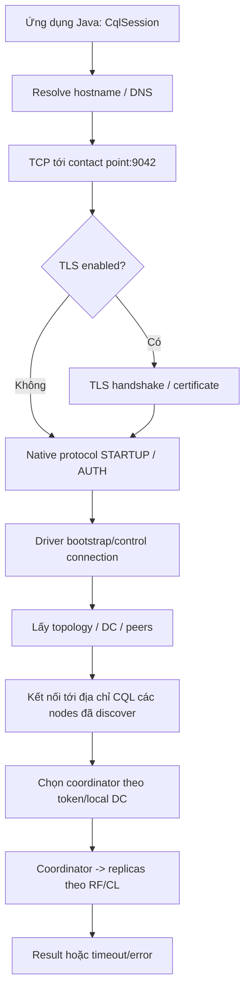
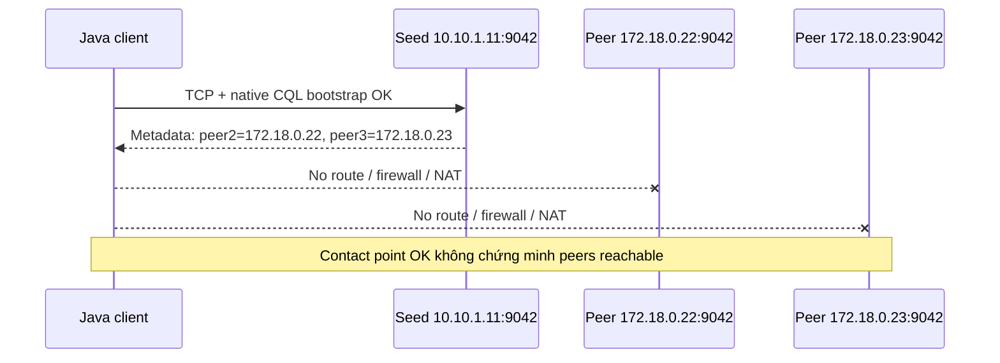
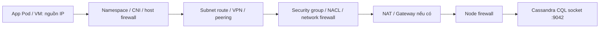
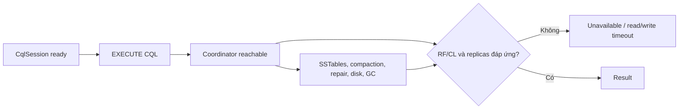

# Không kết nối được do địa chỉ, cổng, DNS, firewall hoặc topology

## 1. Tình huống: cổng 9042 mở nhưng Java vẫn không kết nối được

Một ứng dụng Java chạy trong Kubernetes được cấu hình kết nối Apache Cassandra bằng `db-seed.internal.example:9042`. Lệnh thử TCP từ Pod đến seed thành công; công cụ `cqlsh` trên chính node Cassandra cũng chạy bình thường. Tuy nhiên ứng dụng vẫn gặp `AllNodesFailedException` khi tạo `CqlSession`, hoặc khởi động thành công rồi nhiều truy vấn bất ngờ timeout sau vài giây.

Lỗi có thể nằm ở bất kỳ điểm nào: hostname sai; DNS trả IPv6 nhưng mạng chỉ có IPv4; host/port không có process lắng nghe; firewall chặn đường từ Pod; TLS/client authentication thất bại; Java Driver chọn sai local datacenter; hoặc **seed liên lạc được nhưng các địa chỉ node do Cassandra quảng bá lại không được phép truy cập**.

**Nguyên tắc quan trọng:** “Không kết nối được” là *triệu chứng*, không phải một chẩn đoán. Cần xác định **tầng hỏng** bằng bằng chứng từ đúng nơi chương trình chạy, rồi mới sửa chính xác một cấu hình.

Bài thuộc chương **Xử lý sự cố** của mô-đun `DATABASE_ENGINE_WIDE_COLUMN_CASSANDRA`. Bối cảnh gồm kiến trúc phân tán, partition/token, replica/consistency, CQL, replication, repair/compaction, xử lý lỗi và kết nối từ Java. Vấn đề kết nối không được đánh đồng với một truy vấn chậm do hot partition hoặc thiếu quorum.

### Mục tiêu học tập

Sau bài, người học có thể:

1. Phân loại lỗi thành **DNS → TCP/port → TLS → native protocol/auth → driver discovery/routing → request/replica**.
2. Kiểm tra sự khác nhau giữa `listen_address`, `rpc_address`, `broadcast_address` và `broadcast_rpc_address`, biết cổng 9042 là native CQL.
3. Giải thích vì sao mở được một contact point chưa đủ khi driver phát hiện các Cassandra peers.
4. Kiểm tra từ **đúng namespace/host/Pod** bằng công cụ an toàn như `Resolve-DnsName`, `Test-NetConnection`, `getent`, `nc`, `openssl` và `cqlsh`.
5. Chẩn đoán Java Driver 4.x, `AllNodesFailedException`, local DC, TLS/auth, Docker/Kubernetes/NAT và nhiều datacenter.
6. Soạn runbook có tiêu chí xác nhận, rollback và quy tắc an toàn; không “chữa” lỗi mạng bằng cách hạ consistency level hoặc tắt bảo mật.

> **Phiên bản và phạm vi:** minh họa cho Apache Cassandra 4.1/5.x, Apache Cassandra Java Driver 4.18.x, Java 17 và Spring Boot 3.x. Tên một số options, cơ chế TLS hoặc bảng metadata có thể khác ở phiên bản/nhà cung cấp khác. Các lệnh chủ yếu **chỉ đọc**; phần thay đổi cấu hình là ví dụ cho lab/triển khai đã phê duyệt. Không mở CQL ra Internet công cộng, không vô hiệu hóa TLS hoặc nới toàn bộ firewall để thử.

## 2. Bản đồ luồng kết nối từ ứng dụng tới Cassandra



**Đọc từ trên xuống:** DNS, TCP và TLS thành công là điều kiện cần để nói đến native CQL. Sau khi nhận topology, driver còn phải liên lạc với **những node được chọn làm coordinator**; các node ấy không nhất thiết có cùng địa chỉ với seed trong config. Cuối cùng, kết nối client–coordinator hoạt động vẫn không đảm bảo một query `LOCAL_QUORUM` có đủ replicas để trả kết quả.

### Hai mô hình lỗi cần tách

- **Không khởi tạo được session:** ứng dụng không lấy được metadata/login/connection thích hợp. Điều tra contact points, DNS, port, TLS/auth, local DC, error map.
- **Session khởi tạo được nhưng query lỗi:** có thể là peer address không reachable, pool bị bão hòa, schema/permission lỗi, request timeout, replica không đạt CL hoặc cluster đang repair/compaction; phải nhìn thêm execution info, node status và metric.

Một Pod khởi động được nhưng không query được **không chứng minh** DNS/contact points hoàn toàn đúng. Ngược lại, thấy `nodetool status` báo các node `UN` **không chứng minh** port 9042 được phép từ subnet ứng dụng.

## 3. Các cổng Cassandra: đừng nhầm client với internode

| Cổng TCP thường gặp | Vai trò | Ai cần truy cập? | Ghi chú |
| --- | --- | --- | --- |
| **9042** | CQL **native transport**, mặc định | Java Driver, `cqlsh`, ứng dụng | Có thể dùng TLS **trên chính 9042** nếu server cấu hình như vậy |
| **9142** | Cổng native TLS **riêng** khi cấu hình | Chỉ client được chỉ định | **Không mặc định luôn mở**; tùy `native_transport_port_ssl`; tùy chọn cổng riêng bị deprecate ở Cassandra 5.0 |
| **7000** | Internode traffic/gossip/streaming thường gặp | Các Cassandra nodes | **Không** là cổng client CQL |
| **7001** | Cổng inter-node TLS legacy/tùy config | Các Cassandra nodes | Từ Cassandra 4.0 có thể dùng chung port cho secure/insecure; không mặc định luôn dùng 7001 |
| **7199** | JMX/nodetool thường gặp | Operator/monitoring được cấp quyền | Không dùng Java Driver để query CQL |
| **9160** | Thrift legacy ở hệ Cassandra rất cũ | Không dùng trong Cassandra CQL hiện đại | Đừng cấu hình Java Driver 4.x tới 9160 |

Đây là **giá trị thông dụng**, không phải chân lý của mọi container/cloud/vendor: cổng có thể đổi hoặc ánh xạ qua NAT/Service/Load Balancer. Kiểm tra `native_transport_port`, cấu hình TLS, endpoint thực và port published **từ chính môi trường đang chạy**.

### “Port open” có nghĩa chính xác gì?

Một lệnh TCP connect thành công chứng minh đường mạng đến **một listener TCP** tại host/port ở thời điểm thử; nó **không** chứng minh listener đó là Cassandra, support native protocol version, cho phép TLS/auth hay có khả năng truy vấn bảng.

Một kết nối TCP `REFUSED` thường là listener không có hoặc chủ đích từ chối; `TIMED OUT` có thể do ACL/firewall/routing hoặc node không phản hồi. Nhưng không nên suy tuyệt đối: thiết bị mạng có thể gửi REJECT/RESET, NAT/firewall có policy khác, và kết quả phải được đối chiếu ở hai đầu.

## 4. Ma trận triệu chứng → lớp lỗi

| Triệu chứng ở client | Nguyên nhân ưu tiên kiểm tra | Bằng chứng quyết định |
| --- | --- | --- |
| `UnknownHostException` | DNS sai hostname/search domain, DNS service lỗi | Resolver trong Pod/JVM, `getent`/`Resolve-DnsName` |
| `Connection refused` đến `IP:9042` | Native transport không listen, port sai, REJECT firewall | `ss -ltn` node, runtime config, TCP từ client |
| `Connect timed out` | Routing, security group, NetworkPolicy, firewall DROP | Source→destination 5-tuple, route, counters |
| `SSLHandshakeException` | TLS mode/CA/hostname/SNI/client cert | TLS handshake bằng đúng hostname/CA |
| `AuthenticationException`/bad credentials | Sai user/password, authenticator hoặc TLS client identity | Auth logs và role cấu hình; không log password |
| `UnauthorizedException` sau kết nối | Thiếu quyền keyspace/table | CQL SELECT hợp lệ nhưng role thiếu permission |
| `AllNodesFailedException` | Một nhóm lỗi theo từng node; **không phải nguyên nhân gốc** | `getAllErrors()` và cause, contact/discovered addresses |
| `NoNodeAvailableException` | Query plan không có coordinator khả dụng | Driver metadata, local DC, node distance/state |
| `UnsupportedProtocolVersionException` | Protocol không tương thích/ép version sai | Driver/server versions, native handshake |
| `DriverTimeoutException` | Phía driver hết request budget | Đã bootstrap hay đã gửi query? pool/network/replica |
| `ReadTimeoutException`/`UnavailableException` | Coordinator/replicas/CL | RF, CL, local DC, replica health, compaction/repair |
| Kết nối được seed, các peer fail | Advertised addresses không reachable | `broadcast_rpc_address`, `system.peers_v2`, DNS/NAT |
| Chỉ fail sau deploy/restart | IP Pod đổi, DNS cache cũ, cert rotate, endpoint đổi | Timeline release, resolved IP, certificate và driver logs |

**Cảnh báo:** một exception class chỉ giúp khoanh vùng, chưa đủ để chọn thao tác sửa. `AllNodesFailedException` đặc biệt có thể chứa **nhiều nguyên nhân khác nhau ở nhiều nodes**. Đừng bắt exception rồi tự đổi kết nối sang `127.0.0.1` hoặc giảm CL, vì có thể gây sai cluster hoặc sai dữ liệu.

## 5. Thu thập thông tin tối thiểu trước khi sửa

Một báo cáo sự cố kết nối cần:

| Trường | Ví dụ dạng an toàn | Dùng để |
| --- | --- | --- |
| Thời điểm | UTC, có timezone | Ghép logs và NetworkPolicy changes |
| Môi trường | `staging/orders-api/pod-a` | Chẩn đoán đúng namespace/subnet |
| Client | Java 17, Driver 4.18.x, Boot 3.x | Kiểm tra compatibility/config |
| Contact points | Hostnames + cổng **đã được phê duyệt** | So DNS/TCP path |
| Local DC | `dc1` thực từ cluster | Phân biệt routing bị bỏ qua |
| Error và causes | Exception class, hostname/port, attempt stage | Phân lớp lỗi |
| RF/CL của request | `dc1:3`, `LOCAL_QUORUM` | Tách lỗi kết nối và quorum |
| Thay đổi gần nhất | DNS/cert/secret/node replacement | Khoanh timeline |
| Kết quả ba phép thử | DNS, TCP, native CQL | Định vị tầng lỗi |
| Cluster/driver metrics | Connections, timeouts, node status | Xác nhận tác động hệ thống |

**Không thu thập** raw password, private key, bearer token, customer payload hoặc toàn bộ bound CQL values vào ticket. Host/IP nội bộ có thể nhạy cảm: báo cáo chia sẻ rộng nên dùng nhãn hoặc hash có kiểm soát; operator trực tiếp vẫn cần đủ dữ liệu để đối chiếu đường mạng.

## 6. Bước 1 — Kiểm tra địa chỉ *thực sự* được dùng

Trước hết xác minh **config đã có hiệu lực**, không chỉ config mà người viết *nghĩ* đã đặt:

- Contact points trong `application.yml`, `application.conf`, environment/service connection; thứ tự ưu tiên cấu hình đúng phiên bản.
- Có vô tình để mặc định Java Driver `127.0.0.1:9042` không? Đây chỉ đúng khi Cassandra **ở cùng network namespace/host**.
- Hostname có phải DNS nội bộ dùng được từ **Pod/container đó**, không phải hostname chỉ tồn tại trên laptop?
- Port trên **client** có phải cổng published qua Load Balancer/NAT, khác cổng Cassandra node nội bộ?
- `local-datacenter` khớp chính xác `system.local.data_center`? Phân biệt `dc1` và `DC1`.
- Ứng dụng có một `CqlSession` dùng chung hay mỗi request lại tạo mới khiến pool/handshake bão hòa?

**Ví dụ hostname:** `cassandra-1.lab.example.invalid` là tên giả; thay bằng DNS của lab được cấp phép. Đừng hard-code IP từ một Pod tạm vào production config hoặc dùng `localhost` bên trong ứng dụng container để chỉ một database container khác.

### Ba địa chỉ rất dễ nhầm

| Địa chỉ | Ý nghĩa | Có dùng làm contact point? |
| --- | --- | --- |
| `127.0.0.1` trên máy developer | Loopback của **máy developer** | Chỉ nếu Cassandra/port-forward tại đó |
| `127.0.0.1` trong Pod Java | Loopback của **Pod network namespace** | Không phải service Cassandra ở Pod khác |
| `10.x.x.x` hoặc tên Kubernetes Service | IP/DNS nội bộ trong cluster | Tùy network policy và cách driver discover peers |

**Docker/Kubernetes:** một cổng được publish từ host vào container không đồng nghĩa các Cassandra nodes sẽ **advertise** địa chỉ published đó cho Java Driver. Đây là vấn đề topology, không sửa bằng cách cứ thêm seed thứ hai.

## 7. Bước 2 — Kiểm tra DNS từ đúng nơi chạy ứng dụng

### Linux/Pod

```bash
# Chỉ đọc; chạy trong đúng container/Pod có network namespace của app.
getent ahosts cassandra-1.lab.example.invalid
getent hosts cassandra-1.lab.example.invalid

# Nếu dig/nslookup được cài, kiểm tra records DNS:
dig +short A cassandra-1.lab.example.invalid
dig +short AAAA cassandra-1.lab.example.invalid

# Không coi ping là test Cassandra native protocol.
```

`getent` phản ánh resolver của môi trường Linux đang chạy, trong khi `dig` truy vấn DNS trực tiếp và có thể không áp dụng toàn bộ quy tắc NSS/`/etc/hosts`. Nếu một câu trả lời khác nhau, kiểm tra `/etc/resolv.conf`, search domains, `/etc/hosts` và resolver rules bằng thao tác **chỉ đọc** theo quyền cho phép.

### Windows/PowerShell

```powershell
Resolve-DnsName -Name cassandra-1.lab.example.invalid
Resolve-DnsName -Name cassandra-1.lab.example.invalid -Type A
Resolve-DnsName -Name cassandra-1.lab.example.invalid -Type AAAA
```

### Những sai lệch DNS cần ghi nhận

1. **NXDOMAIN**: hostname không tồn tại trong zone/search domain đang sử dụng, hoặc app đi sai resolver.
2. **SERVFAIL/TIMEOUT**: DNS server/upstream network chưa trả lời; khác hostname không tồn tại.
3. **A vs AAAA**: DNS trả IPv6 nhưng mạng chỉ cấp IPv4 hoặc JVM/OS chọn family không phù hợp.
4. **Round-robin A records**: các IP có trạng thái khác nhau; thử **từng IP** và ghi mapping/TTL.
5. **Split-horizon DNS**: cùng hostname bên trong VPC/cluster trả private IP, laptop/VPN trả IP khác.
6. **DNS cache**: JVM/OS/CoreDNS có thể giữ record cũ sau failover; TTL và Java security network cache policy cần xem theo JVM thực.
7. **Search suffix**: tên ngắn `cassandra-1` có thể resolve vào namespace sai; thử FQDN rõ.

**Không** khắc phục lâu dài bằng cách sửa `/etc/hosts` trong container rồi quên. Nó che DNS lỗi và không cập nhật khi Pod/node đổi IP.

## 8. Bước 3 — Kiểm tra TCP tới cổng CQL *từ phía client*

### Linux

```bash
# Chạy trong đúng app container/Pod, nếu công cụ sẵn có:
nc -vz -w 3 cassandra-1.lab.example.invalid 9042

# Khi chỉ có Bash và /dev/tcp được hỗ trợ:
timeout 3 bash -c 'echo > /dev/tcp/cassandra-1.lab.example.invalid/9042'

# Đây là test mở TCP, KHÔNG phải CQL SELECT/handshake.
```

Nếu công cụ trên không có trong một image tối giản, dùng **debug container đã được phê duyệt trong cùng namespace/policy**. Debug container ở namespace khác có thể có NetworkPolicy khác, vì vậy một phép thử từ đó **không chứng minh** Pod ứng dụng có cùng khả năng truy cập.

### Windows/PowerShell

```powershell
Test-NetConnection -ComputerName cassandra-1.lab.example.invalid -Port 9042
```

Đọc `TcpTestSucceeded`, địa chỉ resolve và interface nguồn. Nếu tên DNS trả nhiều IP, thử từng đích qua phương pháp được phê duyệt để tìm node/record lỗi.

### Phân biệt các kết quả

| Kết quả | Điều có thể suy ra | Bước tiếp theo |
| --- | --- | --- |
| TCP kết nối thành công | Có listener/đường mạng đến 9042 tại thời điểm thử | Thử TLS/native protocol và node discovery |
| Connection refused | Đích tích cực từ chối hoặc không có listener | Kiểm tra `ss -ltn` và config trên node, firewall REJECT |
| Timeout | Không hoàn tất handshake TCP trong thời gian chờ | Route, firewall DROP, SG/NACL/NetworkPolicy, node reachable |
| No route to host | Vấn đề định tuyến/network stack | Route, subnet, overlay/CNI, VPN/VPC peering |
| DNS resolve nhưng tất cả IP sai | Record/endpoint lỗi | DNS zone/Service/advertise |

**Không sử dụng kết quả “ping được” để thay TCP check**: ICMP có thể bị chặn khi TCP hoạt động và ngược lại. Cũng đừng kết luận chắc “firewall đóng” chỉ vì `nc` timeout; pod có thể không có route hoặc listener đang quá tải.

## 9. Bước 4 — Kiểm tra listener native CQL ở Cassandra node

Trên **đúng node/pod Cassandra** (quyền đọc hệ thống theo chính sách):

```bash
# Linux: xem địa chỉ và cổng đang LISTEN.
ss -ltn '( sport = :9042 )'

# Một số môi trường hỗ trợ:
ss -ltnp | grep ':9042'

# Lệnh này chỉ quan sát OS socket; không đổi server config.
```

Nếu chỉ thấy `127.0.0.1:9042`, các client **ở máy/container khác** thường không kết nối được trực tiếp. Nếu thấy `0.0.0.0:9042`, server đang bind mọi IPv4 interface; **điều này vẫn không đồng nghĩa** mọi subnet có route/firewall cho phép, và cũng không đồng nghĩa `broadcast_rpc_address` hợp lệ.

### Những tùy chọn Cassandra cần đối chiếu trong cấu hình đang chạy

```yaml
# CASSANDRA CONFIG MẪU — không copy nguyên vào production.
start_native_transport: true
native_transport_port: 9042

# Bind CQL listener vào địa chỉ NIC nội bộ của node.
rpc_address: 10.10.1.11

# Địa chỉ mà Java Driver ở subnet ứng dụng có thể tới được:
broadcast_rpc_address: 10.10.1.11

# Internode traffic — một phạm vi khác với CQL:
listen_address: 10.10.1.11
broadcast_address: 10.10.1.11
```

**Ví dụ chỉ hợp lý nếu địa chỉ `10.10.1.11` thực sự thuộc node và reachable theo topology.** Không đồng nhất `rpc_address` với `listen_address` một cách máy móc khi cluster có nhiều NIC/overlay/public-private networking.

| Setting | Phạm vi | Quy tắc trọng yếu |
| --- | --- | --- |
| `start_native_transport` | Cho phép native CQL server | Nếu false, không mong 9042 phục vụ client |
| `native_transport_port` | Cổng native client | Thường 9042, nhưng phải xác minh |
| `rpc_address` / `rpc_interface` | **Bind** client native transport | Có thể bind `0.0.0.0` khi cần, nhưng phải cấu hình broadcast có thể kết nối |
| `broadcast_rpc_address` | **Advertise** CQL address cho driver/peers | **Không** được là `0.0.0.0`, phải reachable từ client |
| `listen_address` / `listen_interface` | Bind/định danh internode | **Không** dùng `0.0.0.0` cho listen_address |
| `broadcast_address` | Internode advertised address | Không nhất thiết giống client CQL advertised address |
| `storage_port`/`ssl_storage_port` | Internode port | Không thay `native_transport_port` |

Theo tài liệu Cassandra, nếu `rpc_address: 0.0.0.0` thì phải có `broadcast_rpc_address` **cụ thể, không phải 0.0.0.0**. Ngược lại, `listen_address: 0.0.0.0` là cấu hình sai cho internode. Hai quy tắc này **khác nhau**.

**Không sửa cấu hình ở node production rồi restart đồng loạt** để thử. Thay bind/advertise có thể tác động membership/discovery, certificate SAN, IP routing, firewall rules và availability. Cần change record, test một node trong lab, kiểm tra hậu quả và rollout/rollback có chủ sở hữu.

## 10. Bước 5 — Vì sao seed kết nối được nhưng Java Driver vẫn fail?

Java Driver 4.x sử dụng **contact points để bootstrap topology**. Sau đó driver nhận thông tin cluster/peers và cố kết nối tới những địa chỉ được node quảng bá, thường liên quan `broadcast_rpc_address`. Vì vậy:



Ví dụ: contact point là địa chỉ public/published của một container, nhưng Cassandra quảng bá dải Docker bridge `172.18.x.x` mà app ở ngoài host không thể route vào. Khi driver tìm peers, pool không mở được và nhiều request thất bại. **Thêm một hostname seed cũng trỏ vào cùng proxy không tự chữa advertise topology.**

### Cách kiểm tra khi đã có một kết nối native CQL hoạt động

```sql
-- Kết nối cqlsh vào một node thực rồi quan sát metadata:
SELECT cluster_name, data_center, rpc_address, release_version
FROM system.local;

-- Với Cassandra 4.x/5.x, các cột node native address thường nằm ở peers_v2.
SELECT peer, data_center, native_address, native_port
FROM system.peers_v2;
```

Một số phiên bản/distribution có thể khác schema bảng hệ thống; **không suy bảng metadata có đủ những hàng/cột như ví dụ ở mọi release**. `system.peers_v2` thường không chứa node local trong danh sách peers; lấy node local từ `system.local`. Đối chiếu mỗi address/port với **đường kết nối từ đúng ứng dụng**.

**Tại sao `nodetool status` chưa đủ?** Nó báo trạng thái gossip/ring của Cassandra, chủ yếu qua **internode traffic**. Một node `UN` có thể có `9042` không listen, firewall client chặn hoặc `broadcast_rpc_address` không dùng được từ Java.

### Hướng sửa theo kiến trúc, không theo mẹo

1. Thiết kế để các `broadcast_rpc_address` của node **reachable** từ mạng ứng dụng, nếu client kết nối trực tiếp.
2. Với NAT, yêu cầu ánh xạ **ổn định và khác nhau cho từng node**, phù hợp TLS cert và driver topology; đánh giá `AddressTranslator` của Driver 4.x khi kiến trúc cần translation.
3. Nếu dùng proxy/gateway Cassandra chuyên dụng, kiểm tra **khả năng hỗ trợ native protocol, topology discovery, TLS và routing**, không coi mọi TCP Load Balancer thông thường đều thay được native cluster topology.
4. Với Kubernetes, cân nhắc headless Service/Stable Pod DNS hoặc cơ chế operator/driver đã hỗ trợ, chỉ trong phạm vi network của client; tránh đưa địa chỉ Pod IP không truy cập được cho ứng dụng bên ngoài cluster.

**Điều không nên làm:** đặt tất cả `broadcast_rpc_address` thành **cùng một** IP của Load Balancer để “giải quyết reachability”. Driver cần nhận dạng và định tuyến **các node riêng biệt**; ánh xạ nhiều node về một IP/port không phân biệt có thể phá topology và token-aware routing.

## 11. Bước 6 — Firewall, route, ACL và TCP handshake

Không nên kiểm tra “firewall Cassandra” như một cấu hình duy nhất: có nhiều lớp chặn khác nhau trên cùng đường đi.



**Đối tượng kiểm tra là một luồng cụ thể:** `(source IP, source port, destination IP, destination port, TCP)` tại thời điểm test. Với NAT, source/destination có thể bị dịch qua từng hop; ghi cả địa chỉ trước và sau NAT nếu cần.

| Vị trí | Ví dụ policy | Triệu chứng |
| --- | --- | --- |
| Pod egress NetworkPolicy | Chỉ cho Pod truy cập một tập IP/port | Pod ứng dụng timeout trong khi debug Pod khác kết nối được |
| Node/VM host firewall | nftables/iptables/firewalld/Windows Firewall | Listener có trên `ss`, client vẫn timeout/refused |
| Cloud security group | Source subnet không được allow TCP 9042 | Một VPC truy cập được, VPC khác không |
| Network ACL | Đường return traffic hoặc ephemeral ports bị chặn | SYN có thể đi nhưng kết nối không hoàn tất |
| Route/peering/VPN | Thiếu route tới private peer address | `No route to host`/timeout |
| Stateful LB/NAT | Idle timeout, port mapping sai hoặc SNAT sai | Kết nối ban đầu được rồi reset sau thời gian rảnh |
| Cassandra node quá tải | Listener có nhưng accept/handshake trễ | Connect/handshake timeout cùng CPU/GC/threads cao |

### Đừng mở cả subnet/Internet như cách chẩn đoán nhanh

Firewall phải cho phép TCP 9042 **từ nguồn ứng dụng được phê duyệt** tới **toàn bộ node CQL endpoints driver có thể dùng**. Port internode 7000/7001 và JMX 7199 có **nhóm nguồn riêng**, không cần mở ra mạng client. Nếu có NetworkPolicy, verify cả egress của app và ingress của Cassandra namespace theo cách CNI triển khai.

**Tại sao return path quan trọng?** TCP bắt đầu bằng SYN/SYN-ACK/ACK. Với firewall stateful, luồng trả lời thường được theo dõi tự động; với NACL stateless, phải cho phép cả chiều về với dải ephemeral ports đúng. NAT hoặc asymmetric routing có thể làm gói trả lời đi đường khác và bị bỏ.

### Bằng chứng phía network team cần nhận

| Câu hỏi | Bằng chứng |
| --- | --- |
| App được cấp source IP gì khi đi qua gateway? | Pod/VM IP, NAT/SNAT mapping, timestamps |
| DNS trả IP nào? | A/AAAA records và TTL từ chính app namespace |
| Port đã được thử? | Destination IP:port, TCP test result, elapsed |
| Có TCP SYN và SYN-ACK không? | Firewall counters hoặc packet capture được phê duyệt |
| Mất gói ở hop nào? | Route/ACL/SecurityGroup/NetworkPolicy logs |
| Cùng lúc node có listen không? | `ss -ltn` và Cassandra native transport logs |

Packet capture có thể mang thông tin nội bộ/traffic nhạy cảm; dùng sampling, scope hẹp và quyền bảo mật thích hợp. **Không yêu cầu người học bật tcpdump toàn cluster hoặc upload raw capture công khai.**

## 12. Bước 7 — TCP thành công nhưng TLS không khớp

Một listener CQL có thể yêu cầu TLS trên chính `9042`. Java Driver không dùng TLS trong khi server đòi TLS, hoặc driver dùng TLS khi server chỉ hỗ trợ plaintext, đều có thể tạo lỗi handshake/protocol trước khi truy vấn CQL. Đừng suy rằng mọi môi trường TLS phải dùng cổng 9142.

### Các giả thiết TLS cần xác minh

1. Server có bật `client_encryption_options` và có yêu cầu TLS trên port đó không?
2. Server cert có hợp lệ, còn hạn và được ký bởi CA mà Java truststore/SSL bundle tin cậy không?
3. **Hostname verification:** tên mà client thực sự dùng có nằm trong SAN của server certificate không?
4. Có yêu cầu **mTLS/client certificate** hay chỉ server-auth TLS?
5. NAT/LB có terminate TLS không? Cassandra/native protocol còn chạy qua đâu sau termination?
6. Java truststore/keystore có được mount/cấp quyền đúng trong **container đang chạy** không?
7. Có đang dùng cổng được cấu hình khác 9042 không? Có dùng 9142 tùy chọn trong release cũ?

### Kiểm tra TLS bằng OpenSSL trong lab/namespace được phép

```bash
# Dùng hostname như ứng dụng, không đổi sang IP tùy tiện nếu cert gắn SAN DNS.
# Có thể bỏ -brief trên OpenSSL rất cũ.
openssl s_client \
  -connect cassandra-1.lab.example.invalid:9042 \
  -servername cassandra-1.lab.example.invalid \
  -showcerts

# Nếu đã có CA phù hợp trong lab:
openssl s_client \
  -connect cassandra-1.lab.example.invalid:9042 \
  -servername cassandra-1.lab.example.invalid \
  -CAfile /path/to/trusted-ca.pem \
  -verify_return_error
```

**Giới hạn:** OpenSSL kiểm tra TLS handshake, certificate chain/trust nếu được cấu hình đúng, **không** xác nhận CQL native protocol/auth/keyspace/driver metadata. `Verify return code: 0` sau một test không thay thế hostname verification khi công cụ không bật kiểm tra hostname riêng; muốn kiểm tra hostname, dùng tùy chọn verification tương ứng của OpenSSL version hoặc test Java Driver với hostname verification bật.

**Không dùng `-verify_return_error` cùng một CA không được cấp quyền chỉ để thu thông tin cert production.** Không gửi private key/mật khẩu vào command line hoặc logs.

### Phân biệt những lỗi TLS

| Symptom | Ưu tiên kiểm tra |
| --- | --- |
| `PKIX path building failed` | CA/truststore, certificate chain |
| `No subject alternative DNS name matching` | SAN/hostname verification, DNS/advertised endpoint |
| `handshake_failure` | Protocol/cipher/mTLS mismatch, policy phía server |
| Server đóng kết nối ngay khi client gửi STARTUP | TLS mismatch hoặc native protocol |
| TCP OK nhưng Java SSL fail sau rotate cert | Secret mount/trust bundle/cert lifetime/rollout |

**Không** “sửa” bằng cách tắt certificate verification ở production. Nếu cert không khớp advertised peer address, sửa **certificate SAN, endpoint/translation hoặc kiến trúc TLS**; tránh dùng TLS insecure trust-all khiến man-in-the-middle không bị phát hiện.

## 13. Bước 8 — Kiểm tra native protocol, authentication và authorization

Sau TCP/TLS, Java Driver bắt tay bằng Cassandra native protocol và thực hiện authentication nếu server bật authenticator. Đây là tầng **khác** network reachability.

### Dùng cqlsh như phép thử native CQL

```bash
# Chạy từ vị trí có đường mạng giống ứng dụng, khi không yêu cầu TLS:
cqlsh cassandra-1.lab.example.invalid 9042

# Nếu server đòi TLS, dùng cqlsh đã cấu hình SSL/trust đúng:
cqlsh cassandra-1.lab.example.invalid 9042 --ssl

# Không truyền mật khẩu trực tiếp vào shell history/log.
```

Khi đã kết nối thành công:

```sql
SELECT release_version, cluster_name, data_center
FROM system.local;

SELECT keyspace_name
FROM system_schema.keyspaces
WHERE keyspace_name = 'system';
```

Đọc `system.local` giúp xác thực bạn đang nói chuyện với **Cassandra nào và DC nào**, không chỉ mở port trên một dịch vụ không rõ. Trong môi trường dùng role restricted, một số query hệ thống có thể có chính sách truy cập riêng; cần phân biệt `UnauthorizedException` (quyền không đủ) với TCP/DNS failure.

### Khi cqlsh chạy được nhưng Java không chạy được

| Sự khác nhau | Câu hỏi cần hỏi |
| --- | --- |
| Vị trí chạy | `cqlsh` chạy **trên node DB**, còn Java chạy trên Pod/VPC khác? |
| DNS/IP | Hai chương trình resolve cùng host thành cùng IP không? |
| Port/TLS | cqlsh dùng 9042 plaintext, Java dùng 9142 TLS hay ngược lại? |
| Credentials | Java role, credential provider, secrets/rotation có khác? |
| Truststore | cqlsh tin CA hệ điều hành, JVM dùng truststore khác? |
| Metadata | cqlsh thường dùng một endpoint, Java Driver còn discover peers? |
| Local DC | Java Driver set `withLocalDatacenter` đúng không? |
| Version | Driver/native protocol và Cassandra server tương thích không? |

**Không cho rằng cqlsh localhost pass chứng minh firewall từ ứng dụng pass.** Phải chạy cqlsh hoặc smoke test từ **cùng đường nguồn** nếu muốn dùng kết quả để loại nguyên nhân network.

## 14. Bước 9 — Cấu hình Java Driver 4.x cho đúng contact points và local DC

Theo Java Driver 4.18.x, nếu không khai báo contact point, driver có thể thử `127.0.0.1:9042` để phục vụ quickstart. Khi đã khai báo contact points tường minh, phải cung cấp **local datacenter** và chọn **contact points thuộc local DC** theo hướng dẫn driver.

### Cấu hình builder trực tiếp

```java
import java.net.InetSocketAddress;
import com.datastax.oss.driver.api.core.CqlSession;
import com.datastax.oss.driver.api.core.cql.Row;

public class CassandraConnectivitySmoke {
    public static void main(String[] args) {
        try (CqlSession session = CqlSession.builder()
                .addContactPoint(new InetSocketAddress(
                    "cassandra-1.lab.example.invalid", 9042))
                .addContactPoint(new InetSocketAddress(
                    "cassandra-2.lab.example.invalid", 9042))
                .withLocalDatacenter("dc1")
                // Trong production, thêm Auth/TLS options theo policy.
                .build()) {

            Row row = session.execute(
                "SELECT release_version, data_center FROM system.local")
                .one();
            if (row == null) {
                throw new IllegalStateException("No system.local row");
            }
            System.out.printf("dc=%s, version=%s%n",
                row.getString("data_center"),
                row.getString("release_version"));
        }
    }
}
```

Đây là **smoke test cho lab không yêu cầu auth/TLS**; không copy nguyên vào production thiếu client authentication/TLS. Trong ứng dụng Spring Boot, tạo **một bean CqlSession dùng chung**, không thực hiện `build()` mỗi HTTP request; container quản lý close lúc shutdown.

### Cấu hình thuần Driver HOCON

```hocon
datastax-java-driver {
  basic {
    contact-points = [
      "cassandra-1.lab.example.invalid:9042",
      "cassandra-2.lab.example.invalid:9042"
    ]
    load-balancing-policy.local-datacenter = dc1
    request.timeout = 2 seconds
  }

  advanced {
    connection.connect-timeout = 5 seconds
  }
}
```

**Hai timeout khác nhau:** `advanced.connection.connect-timeout` giới hạn giai đoạn mở kết nối TCP; `basic.request.timeout` liên quan thời gian request CQL do driver quản lý. Trong thực tế còn có TLS/auth handshake, session initialization deadline và API end-to-end deadline; tăng request timeout không chữa DNS hoặc firewall sai.

### Spring Boot 3.x

```yaml
spring:
  cassandra:
    contact-points:
      - cassandra-1.lab.example.invalid:9042
      - cassandra-2.lab.example.invalid:9042
    local-datacenter: dc1
    keyspace-name: orders_lab_ks
    request:
      timeout: 2s
      consistency: LOCAL_QUORUM
    connection:
      connect-timeout: 5s
    # TLS và credentials phải cấu hình theo môi trường.
```

`orders_lab_ks` là keyspace giả định; nó **không được Spring Boot tự tạo** chỉ vì xuất hiện trong property. Nếu keyspace chưa tồn tại và session khởi tạo với keyspace đó, lỗi khởi tạo có thể phát sinh dù DNS/TCP/TLS đã thành công. Để smoke kết nối, chỉ dùng query hệ thống và cấu hình session **không phụ thuộc keyspace ứng dụng**, sau đó kiểm tra quyền/schema riêng.

**Không dùng `spring.data.cassandra.contact-points` từ hướng dẫn Spring Boot cũ** mà chưa kiểm tra metadata của Boot 3.x. Trên Spring Boot 4.x một số packages auto-config thay đổi; tên properties phải đối chiếu bản thực.

## 15. Bước 10 — Driver metadata và thông báo lỗi theo từng node

Khi driver trả `AllNodesFailedException`, hãy đọc **cause map** thay vì chỉ log message chung. Driver 4.x expose lỗi theo từng node; một node có thể `ConnectException`, node khác `SSLHandshakeException` hoặc `ConnectionInitException`.

### Mẫu Java in **loại lỗi**, không in bí mật

```java
import com.datastax.oss.driver.api.core.AllNodesFailedException;
import com.datastax.oss.driver.api.core.metadata.Node;
import java.util.List;
import java.util.Map;

try {
    // Biến session có thể được khởi tạo trong Spring bean hoặc smoke test.
    session.execute("SELECT release_version FROM system.local");
} catch (AllNodesFailedException failure) {
    for (Map.Entry<Node, List<Throwable>> entry
            : failure.getAllErrors().entrySet()) {
        Node node = entry.getKey();
        for (Throwable error : entry.getValue()) {
            System.err.printf("node=%s causeClass=%s%n",
                node == null ? "unknown" : node.getHostId(),
                error.getClass().getSimpleName());
        }
    }
    throw failure;
}
```

**Giới hạn:** các imports/API trên thuộc Java Driver 4.18.x và có thể cần chỉnh theo minor version; trong một số đường khởi tạo, ngoại lệ bị bọc bởi completion/driver execution exceptions, nên phải unwrap an toàn. Tránh `error.toString()` hoặc in stack trace toàn bộ ra public response khi chứa địa chỉ/hostname/credentials. Log/trace chi tiết chỉ ở nơi có quyền.

### Những trường hợp dễ gây hiểu sai

- `NoNodeAvailableException` là một nhánh của `AllNodesFailedException` khi không có coordinator thích hợp trong query plan, không nhất thiết toàn bộ cluster chết.
- `NodeUnavailableException` có thể là driver đã chọn node nhưng **không có connection trong pool**, chưa chắc node CQL listener không tồn tại.
- `ConnectionInitException` nói tới giai đoạn khởi tạo connection; xem cause để phân biệt auth, TLS, protocol hay port.
- `UnsupportedProtocolVersionException` phải đối chiếu server/driver version; không ép native protocol version tùy tiện.
- `DriverTimeoutException` không mặc nhiên là DNS/TCP failure; nếu đã gửi CQL, có thể do coordinator/replica bị nghẽn hoặc CL không đạt.

**Đừng retry mù** query ghi khi có timeout sau lúc request có thể đã gửi. Unknown write outcome không có nghĩa write chưa xảy ra; giữ idempotency/operation ID để đối chiếu.

## 16. Bước 11 — Local DC sai và “không có node hợp lệ”

Driver 4.x dùng load-balancing policy thiên về **local datacenter**. Nếu cấu hình `local-datacenter: dc-main` nhưng Cassandra node thực báo `dc1`, driver có thể không chọn được nodes phù hợp hoặc session không khởi tạo đúng.

```sql
-- Chạy trên một Cassandra node đang kết nối được:
SELECT data_center, rack, cluster_name
FROM system.local;
```

```bash
# Xem cluster được nhóm theo data center/rack:
nodetool status
nodetool describecluster
```

| Vấn đề | Cách đối chiếu |
| --- | --- |
| Sai chữ hoa/thường hoặc tên DC | `system.local.data_center`, `nodetool status` |
| Contact point thuộc DC khác | Kiểm tra DC của seed; ưu tiên seeds thuộc local DC theo driver docs |
| Cluster chỉ có remote DC nodes trong metadata | Load-balancing node distance / `IGNORED` |
| Vừa chuyển node/rack/DC | Snitch config, restart/topology update theo runbook |
| Multi-DC RF khác nhau | `LOCAL_QUORUM` của DC này không giống số ACK DC khác |

**Không chữa bằng cách đổi `LOCAL_QUORUM` thành `ONE`** hoặc bật remote failover ngẫu nhiên. Cross-DC failover trong Driver 4.x có cấu hình riêng, **mặc định không tự chuyển sang remote DC** và có hệ quả cho `LOCAL_ONE/LOCAL_QUORUM/LOCAL_SERIAL` khi RF giữa các DC khác nhau. Muốn failover giữa vùng, phải có kiến trúc điều phối, routing, consistency, latency WAN và kiểm thử mất DC.

### Vì sao topology có thể lỗi sau khi node trở lại UP?

Sau node replacement/DC change, metadata/advertised address hoặc chứng chỉ TLS có thể thay đổi; driver còn giữ connections tới endpoint cũ cho đến khi topology events/reconnect xử lý. Quan sát **driver metadata, peers addresses và logs** cùng trạng thái node; không kết luận “node UP thì mọi client đã sẵn sàng”.

## 17. Docker/Podman và Kubernetes: hai trường hợp NAT khác nhau

### 17.1. Docker một container

```text
Docker container:
  cassandra internal 9042
  host published 127.0.0.1:19042 -> container:9042

App trên host:
  host:127.0.0.1:19042 (có thể bootstrap)
  Cassandra peers advertise:172.18.x.x:9042 (có thể không route)

App trên cùng Docker network:
  service/container DNS + internal:9042 (thường thích hợp hơn)
```

Một container Cassandra **đơn node** qua published port thường đủ cho local integration smoke test. Với **nhiều container Cassandra**, việc publish một seed qua host chưa đủ; driver cần đi đến các peer addresses nhận qua metadata. Nên đưa client vào **cùng network có thể route** hoặc thiết kế address translation/gateway tương thích native topology.

**Đừng nhầm:** host port 19042 là cổng ngoài, node thực vẫn có `native_transport_port=9042`. Nếu app ở **container khác**, `localhost:19042` là loopback của chính container app, không phải Docker host.

### 17.2. Kubernetes

Ví dụ chỉ đọc trong namespace được phép:

```bash
kubectl -n cassandra get pods -o wide
kubectl -n cassandra get svc
kubectl -n cassandra get endpointslices
kubectl -n cassandra describe svc cassandra-client

# Thử từ app Pod bằng công cụ sẵn có (nếu policy cho phép):
kubectl -n apps exec deploy/orders-api -- \
  sh -c 'getent hosts cassandra-client.cassandra.svc.cluster.local'
```

Tham số `cassandra-client`/`orders-api` là ví dụ; không chắc các tên này tồn tại. Trong nhiều cluster, endpoint là **headless service** và DNS đưa từng Pod địa chỉ riêng. Một ClusterIP/Load Balancer có thể giúp bootstrap, nhưng Java Driver có thể chuyển sang **địa chỉ Pod quảng bá**: Pods trong cluster có thể reach được, app ở ngoài VPC thì không.

**Đường kiểm tra Kubernetes:**

1. Pod Cassandra thật sự `Ready`, và native transport lắng nghe.
2. Service `port/targetPort` đúng cổng, selector trỏ vào đúng Pods; EndpointSlices có backends khỏe.
3. DNS của service/headless peers trả đúng IP hiện có và search domain của app.
4. NetworkPolicy của app **egress** và Cassandra **ingress** cho phép TCP CQL tới tất cả node endpoints.
5. CNI/VPC routing và TLS SAN phù hợp với các địa chỉ được advertise.
6. Java Driver nhận đúng local DC và định tuyến tới peers như mong đợi.

Nếu Service chỉ có một ClusterIP, **đừng khẳng định** driver sẽ tiếp tục gửi mọi request qua Service đó. Native driver không giống một HTTP client luôn dùng cùng hostname ban đầu.

## 18. Multi-DC, VPN, peering và load balancer

Khi ứng dụng và Cassandra ở khác VPC/region/datacenter, phải phân biệt:

- **Reachability:** có route, security groups, network ACL, DNS và source NAT hợp lệ tới **từng peer**.
- **Local DC routing:** driver thường ưu tiên node trong DC được chọn, không tự remote failover theo cách ứng dụng nghĩ.
- **Replica placement và consistency:** `LOCAL_QUORUM` cần quorum trong DC tương ứng theo RF của keyspace, không lấy RF toàn cluster.
- **TLS identity:** node được kết nối qua public hostname, private IP hay proxy? SAN/trust/mTLS có hợp không?
- **Latency WAN:** connect timeout và request timeout có thể khác; chạy một lần TCP handshake thành công không đủ bảo đảm p99.
- **Failure domain:** một VPN bị hỏng có thể làm app mất tất cả peers dù Cassandra nodes vẫn báo UP với nhau.

### Load Balancer có thể dùng được khi nào?

Một proxy/LB đơn giản có thể hữu ích để **khởi tạo** hoặc kết nối tới một Cassandra-compatible gateway được thiết kế cho native protocol. Nhưng Cassandra Java Driver dùng topology/token-aware routing và pooling **theo node**, không được giả LB TCP ngẫu nhiên thay cho cấu hình peers. Nếu kiến trúc yêu cầu đi qua proxy cho tất cả nodes, cần vendor/driver-supported solution và kiểm tra:

| Tiêu chí | Vì sao |
| --- | --- |
| Nhận dạng từng node sau discovery | Token routing và per-node health |
| Ổn định địa chỉ/port mapping | Pool không bị chuyển node ngoài ý muốn |
| TLS end-to-end/termination policy | Cert validation, mTLS, SNI |
| Sticky routing/native protocol assumptions | Driver connections không phải HTTP stateless |
| Topology refresh khi scale/replacement | Tránh stale endpoints |
| Source IP/ACL và connection limits | Tránh resource exhaustion và chặn không nhất quán |

**Không mở cổng Cassandra ra Internet** để “thử cho đơn giản”. Ưu tiên private networking, VPN/peering, allow-list nguồn, TLS/mTLS, credentials tối thiểu và quyền monitoring riêng.

## 19. Phân biệt lỗi kết nối với lỗi RF/CL, repair hoặc compaction

Một ứng dụng có thể đã kết nối thành công qua TCP/TLS/CQL nhưng `SELECT` vẫn trả timeout hoặc `UnavailableException`. Khi đó đừng quay lại đổi DNS ngay. Cần nhìn **đường request sau coordinator**:



| Biểu hiện | Thường ở lớp | Ví dụ hành động |
| --- | --- | --- |
| Không mở TCP socket | Network/listener | Kiểm tra DNS, route, firewall, `rpc_address` |
| TLS fail trước STARTUP | TLS/security | Kiểm tra CA, SAN, truststore, mTLS |
| Session init fail do local DC | Driver/discovery | Kiểm tra `data_center`, contact point, node distances |
| Connect và SELECT `system.local` OK, query app timeout | Query/replica/CL | RF, CL, keyspace, coordinator + replicas, compaction/repair |
| Read theo hot partition chậm | Data model/load | Partition size, token distribution, SSTables/tombstones |
| `UnauthorizedException` khi query bảng | RBAC | Quyền SELECT/MODIFY trên bảng, role hiệu lực |
| Query fail chỉ khi node chết | Replica placement và retries | RF/CL, node pool, token-aware routing, failure domain |

**Ví dụ:** RF3 trong `dc1`, `LOCAL_QUORUM` cần hai responses của replicas trong DC đó. Java Driver có thể có connection tốt tới coordinator A, nhưng nếu chỉ một natural replica của partition sẵn sàng trong DC thì truy vấn không đạt `LOCAL_QUORUM`. **Không sửa bằng cách hạ CL xuống ONE** nếu contract yêu cầu quorum, vì điều đó thay đổi bảo đảm đọc/ghi.

### Các lệnh xem cluster, chỉ đọc

```bash
nodetool status
nodetool describecluster
nodetool netstats
nodetool tpstats
nodetool compactionstats
nodetool tablestats system.local
```

Tùy bản `nodetool tablestats`, đối số `system.local` có thể không cần thiết khi chỉ chẩn đoán connectivity; lệnh tùy chọn này chỉ cho ví dụ bảng hệ thống. Đối với table nghiệp vụ, thay bằng keyspace/table thật **trong phạm vi được phép**, không chạy các lệnh ghi/dọn dữ liệu.

Nếu đang có repair/streaming/compaction nặng, kết quả query timeout có thể là **capacity issue**, không phải sai port. Tuy vậy node gossip `UN` cũng không chứng minh Cassandra có thể đạt CL ở thời điểm đo; cần metrics theo **coordinator và replicas**.

## 20. Metric và log nào giúp xác định tầng lỗi nhanh?

### 20.1. Trên ứng dụng Java

| Quan sát | Giá trị |
| --- | --- |
| DNS resolution errors | Phân biệt hostname sai với network timeout |
| Driver session initialization latency/error | Khởi tạo pool/metadata có vướng không |
| Connection open/close/reconnect count | Connection churn, NAT idle timeout |
| Node distances/status | Local DC sai hoặc nodes bị ignored |
| AllNodesFailed causes theo node | Tập nguyên nhân thật, không chỉ wrapper |
| Request latency, timeout, retries | Request đã chạy nhưng không hoàn tất |
| In-flight requests / pool saturation | Load client/driver có tạo lỗi giả network không |
| TLS/auth failures | Rotate cert/secret và permissions |
| API business error rate | Kết nối đã hồi phục đủ để phục vụ nghiệp vụ? |

### 20.2. Trên Cassandra nodes

| Quan sát | Dùng để |
| --- | --- |
| Native transport listener/accepted connections | Có nhận kết nối client trên đúng NIC/port? |
| Authentication/TLS/server logs | Handshake fail, credential lỗi, cert mismatch |
| Read/Write request latency/timeouts | Phân biệt connect error và request timeout |
| Dropped messages, thread pools | Server bão hòa, thiếu tài nguyên |
| CPU/GC/memtable flush/disk await | Connect/request chậm do resource pressure |
| Compaction/repair/streaming backlog | Latency tăng sau topology change |
| Gossip status/rack/DC | Node membership với local datacenter |

**Đồng bộ thời gian logs** bằng UTC; một kết nối TCP timeout lúc 10:00:02 không thể so với một sự kiện restart lúc 10:05:00 rồi kết luận có quan hệ nhân quả.

### Không bật debug mọi nơi vô thời hạn

Driver debug/native protocol logs, Cassandra traces và packet capture có thể tạo overhead, lộ IP, query text hoặc identifiers. Chỉ bật theo thời gian, nguồn và mẫu nhỏ; dùng correlation ID/query shape không gắn PII/bind values. Sau khi đóng sự cố phải trả logging về mức bình thường.

## 21. Ma trận phép thử theo tầng: một kết quả không thay được tầng kế tiếp

| Test | Thực hiện từ đâu? | Pass chứng minh | Chưa chứng minh |
| --- | --- | --- | --- |
| T1. DNS | App Pod/host thật | Hostname resolve thành IP | TCP, TLS, đúng cluster |
| T2. TCP 9042 | App Pod/host thật | Có đường tới listener | Native CQL/auth và peers |
| T3. TLS handshake | App Pod/host thật | TLS có thể thương lượng; cert theo cấu hình test | Login, keyspace, query |
| T4. `cqlsh` system.local | Đúng source path và TLS/auth | Native protocol + một node login/SELECT OK | Mọi peers reachable |
| T5. Driver session init | Java với config thật | Driver bootstrap/metadata được nhận | Mọi query/CL đều thành công |
| T6. Kiểm tra peers | App host tới từng node advertised | Các endpoints driver khám phá reachable | Replica quorum/data correctness |
| T7. Query theo PK | Java Driver | CQL/permission/CL ở partition được chọn | Mọi partition và mọi DC |
| T8. Multi-node/fault | Lab có RF tương ứng | Khả năng chịu lỗi trong topology thử | Toàn bộ failure modes production |
| T9. Soak + recovery | Cửa sổ đo có tải | Kết nối ổn định, error rate/p99 sau hồi phục | Chắc chắn không bao giờ timeout |

**Đừng dừng ở T2 vì “port thông”.** Để ứng dụng hoạt động đúng, phải đi ít nhất tới T5/T6/T7 theo yêu cầu dịch vụ.

### Script chẩn đoán đọc-only từ Windows

```powershell
# Chạy trên máy/container Windows thuộc cùng mạng ứng dụng.
$hostName = 'cassandra-1.lab.example.invalid'
$port = 9042

Resolve-DnsName -Name $hostName
Test-NetConnection -ComputerName $hostName -Port $port

# Không dùng Invoke-WebRequest / curl HTTP vào 9042: đây không phải HTTP.
```

### Script chẩn đoán đọc-only từ Linux

```bash
HOST=cassandra-1.lab.example.invalid
PORT=9042
getent ahosts "$HOST"
nc -vz -w 3 "$HOST" "$PORT"
# Sau đó mới kiểm tra TLS native CQL nếu được phép.
```

**Không lưu output chứa đầy đủ thông tin nội bộ vào public CI artifacts.** Nếu cần chia sẻ, chỉ giữ hostname/port đã rút gọn hoặc dùng kênh incident bảo mật.

## 22. Thực hành Java: phân biệt lỗi khi tạo session với lỗi khi query

Một smoke test nên có **hai pha riêng**: (A) tạo `CqlSession` để lấy metadata; (B) gửi SELECT hệ thống. Cần ghi kết quả của từng pha và đóng session đúng một lần.

```java
import java.net.InetSocketAddress;
import com.datastax.oss.driver.api.core.CqlSession;
import com.datastax.oss.driver.api.core.cql.Row;

public final class TwoPhaseConnectCheck {
    public static void main(String[] args) {
        CqlSession session;

        // Pha A: bootstrap session.
        try {
            session = CqlSession.builder()
                .addContactPoint(new InetSocketAddress(
                    "cassandra-1.lab.example.invalid", 9042))
                .withLocalDatacenter("dc1")
                .build();
            System.out.println("SESSION_INIT_OK");
        } catch (RuntimeException initializationFailure) {
            System.err.println("SESSION_INIT_FAILED class="
                + initializationFailure.getClass().getSimpleName());
            throw initializationFailure;
        }

        // Pha B: một query thực qua native protocol.
        try (CqlSession owned = session) {
            Row row = owned.execute(
                "SELECT release_version, data_center FROM system.local"
            ).one();

            if (row == null) {
                throw new IllegalStateException("No system.local result");
            }
            System.out.println("CQL_QUERY_OK dc="
                + row.getString("data_center"));
        } catch (RuntimeException queryFailure) {
            System.err.println("CQL_QUERY_FAILED class="
                + queryFailure.getClass().getSimpleName());
            throw queryFailure;
        }
    }
}
```

**Đây là chương trình lab**: config chưa có TLS/auth, không dùng ngoài môi trường đã cho phép. Với ứng dụng Spring Boot, không sở hữu/đóng session được inject vào từng service; Spring container sẽ đóng bean vào shutdown. Nếu session init fail, code không có resource nào để close; nếu pha query fail, khối try-with-resources vẫn close.

### Kiểm chứng local DC và metadata

Một cải tiến cho smoke test: sau khi session khởi tạo, liệt kê node IDs/DCs và endpoints ở mức **internal diagnostics** của Java Driver (không log thông tin nhạy cảm ra public). So với:

- `nodetool status` theo DC;
- `system.local`/`system.peers_v2`;
- DNS+TCP từ app tới **từng advertised address**;
- topology có đúng keyspace/RF theo mục tiêu không.

Nếu có node `IGNORED` hoặc không có pool vì local DC sai, sửa **local DC/topology** trước khi tiếp tục đo query. Không “làm đẹp” lỗi bằng cách thêm một bộ retry vô hạn.

## 23. Kiểm thử tình huống lỗi trong lab

Không cần **phá network production** để dạy chẩn đoán. Có thể dùng CassandraContainer hoặc lab VMs với namespace riêng, logs có giới hạn. Khi một scenario cần nhiều node, **single-node container không đủ** chứng minh topology/multi-DC.

| Kịch bản | Thiết lập trong lab | Kỳ vọng quan sát | Hành động sửa |
| --- | --- | --- | --- |
| F01 — DNS sai | Contact point typo/hostname không tồn tại | DNS fail trước TCP | Sửa zone/FQDN/env |
| F02 — Port sai | Gọi 9043 khi node chỉ listen 9042 | Refused/timeout | Đối chiếu published/native port |
| F03 — Bind localhost | Node native bind loopback, client remote | Local test pass, remote fail | Sửa `rpc_address` theo NIC/policy |
| F04 — NetworkPolicy chặn | App egress tới CQL bị deny | DNS OK, TCP timeout | Allow port theo nguồn/đích cụ thể |
| F05 — TLS mismatch | Client plaintext, server TLS only | TCP OK, handshake/protocol fail | Sửa client TLS/trust |
| F06 — SAN không khớp | Connect theo IP khác cert DNS | Hostname verification fail | Cert SAN/endpoint đúng |
| F07 — Credential sai | App role secret lỗi thời | Auth fail sau network/TLS | Secret rotation/role |
| F08 — Local DC sai | `withLocalDatacenter` khác tên thực | Không có local node/query plan | Đọc `system.local.data_center` |
| F09 — Advertised IP không route | Seed public, peers private Docker IP | Seed OK, peers fail | Reachable advertise/translation |
| F10 — Node native transport tắt | `start_native_transport:false` trong lab | Gossip có thể UP, CQL không listen | Sửa server config có kiểm soát |
| F11 — Node hết pool | Thử quá nhiều request/new sessions | Node unavailable/request queued | Tái sử dụng session, đo pool/concurrency |
| F12 — Replica không đủ CL | RF3 mất 2 replicas, yêu cầu LOCAL_QUORUM | Connect được coordinator, CQL unavailable | Phục hồi replicas; không hạ CL mù |
| F13 — CQL keyspace thiếu | Cấu hình keyspace không tồn tại | Bootstrap/query schema fail sau connect | Schema migration/keyspace config |
| F14 — Advertise peer sai sau thay node | Replacement IP/cert chưa đồng bộ | Kết nối intermittent, reconnect loop | Sửa metadata/addresses/rollout |
| F15 — DNS cache cũ | A record đã đổi, client chưa reload | Lúc đúng lúc sai theo process lifetime | TTL/cache/connection refresh |
| F16 — Port published sai | Docker host 19042 nhưng app gọi 9042 | App ngoài host fail | Dùng published port đúng hoặc same network |

**Đánh giá PASS:** mỗi test phải ghi **tầng gây lỗi**, loại exception, kết quả DNS/TCP/CQL và bằng chứng sau sửa. Ví dụ F09 chỉ pass nếu kiểm tra **tất cả node addresses** sau bootstrap, không phải chỉ thấy seed connect trở lại.

### Test timeout không mặc nhiên chứng minh network

Một request `ReadTimeoutException` có thể phát sinh khi replicas chậm do disk/compaction, dù firewall/DNS không đổi. Khi inject node failure/latency, cần lưu **timeline** và kiểm chứng CQL path. Với write timeout, outcome có thể đã commit; không tự retry mutation không-idempotent.

## 24. Runbook xử lý sự cố: 12 bước có thể dừng sớm

### P0 — Khẳng định phạm vi và mức độ ảnh hưởng

Ghi thời điểm, namespace/host, app release, số clients lỗi, DC/cluster target, API bị ảnh hưởng và mức SLO. Nếu production đang lỗi, ưu tiên **giảm blast radius**: ngăn deploy thêm cấu hình sai, rollback release nếu đã xác định, không chạy lệnh phá hủy.

### P1 — Xác minh config thực tế

Đối chiếu contact points, port, local DC, SSL/auth, keyspace, source of configuration và effective properties. Phân biệt host ngoài container, host trong Pod và public/private/VPN endpoint.

### P2 — DNS tại đúng nguồn

Chạy `getent`/`Resolve-DnsName` từ app namespace; ghi A/AAAA, TTL/search domain và kết quả tại thời điểm lỗi. Nếu nhiều IP, thử từng IP chứ không kết luận từ một lần resolve.

### P3 — TCP 9042 tại đúng nguồn

Thử `nc`/`Test-NetConnection` tới từng đích dự kiến. Nếu timeout, điều tra route, source egress, destination ingress, SG/NACL/NetworkPolicy, NAT/return path. Nếu refused, điều tra listener/port.

### P4 — Listener và cấu hình trên Cassandra node

Kiểm tra `ss -ltn`, `start_native_transport`, `native_transport_port`, `rpc_address`, `broadcast_rpc_address`. Không nhầm internode `listen_address` với client CQL bind address.

### P5 — TLS và native protocol

Nếu TCP OK, kiểm tra đúng TLS mode/CA/SAN/mTLS và chạy `cqlsh` từ một nguồn mạng tương đương. Phân biệt lỗi certificate, authentication, protocol và authorization.

### P6 — Topology discovery

Kiểm tra `system.local`/`system.peers_v2`, node advertised endpoints và DNS/TCP cho **mỗi peer**. Seed OK nhưng peers không route là một nhánh chẩn đoán riêng; không thêm seed tùy ý rồi kết luận hết lỗi.

### P7 — Local DC và load balancing

Đối chiếu `local-datacenter` với `data_center` thật, cluster/tokens/racks, node distances. Không bật remote failover nếu chưa rõ RF, consistency local và WAN impacts.

### P8 — Phân loại lỗi query/replica

Nếu session đã kết nối, nhưng SELECT của ứng dụng fail, kiểm tra RF/CL, keyspace/role, partition key, replica status, compaction/repair, pool saturation. Không thay network config nếu nguyên nhân là `UnavailableException` do quorum.

### P9 — Sửa một thay đổi tối thiểu và có rollback

Ví dụ sửa DNS record, mở TCP 9042 chỉ giữa app và peers, cập nhật TLS SAN/trust, sửa local DC, hoặc advertise address theo kiến trúc. Ghi owner/change/time; rollout từng bước theo topology.

### P10 — Xác minh end-to-end sau sửa

Chạy lại DNS→TCP→TLS→cqlsh→Java session→**tất cả peer endpoints**→CQL query theo key/CL, sau đó load smoke. Kiểm tra p95/p99/error/goodput, pool stability và số lần reconnect; không chỉ “CqlSession tạo được”.

### P11 — Đóng sự cố và chống tái phát

Lưu root cause, bằng chứng, config before/after, test matrix, timeline, hồi phục và rủi ro còn tồn tại. Thêm CI/integration validation cho DNS/ports/TLS/topology và readiness phù hợp. Thu hồi credentials, tắt debug/tracing, theo dõi trong một cửa sổ sau change.

## 25. Readiness, liveness và tránh vòng restart khi Cassandra chập chờn

Trong Spring Boot/Kubernetes, một ứng dụng có thể khởi tạo được HTTP server trước khi Cassandra dùng được. Nhưng để **nhận traffic nghiệp vụ**, readiness cần đánh giá điều kiện tối thiểu:

- Session/connectivity hợp lệ (TLS/auth/topology) và các endpoints quan trọng reachable.
- Nếu service không thể hoạt động thiếu Cassandra, một **readiness check có chi phí thấp và timeout hợp lý** có thể cần thiết.
- Với API quan trọng, có thể có smoke riêng kiểm tra **CQL theo partition key/CL**, nhưng không query các bảng lớn/PII mỗi lần probe.
- **Liveness** nên kiểm tra bản thân tiến trình, không phụ thuộc một outage Cassandra transient; nếu mọi Pod liên tục restart do liveness fail, connection storm có thể làm tình hình tệ hơn.
- Driver reconnection và Spring bean lifecycle phải rõ ràng; nếu ứng dụng cố tạo session lại liên tục trên mỗi request, pool và Cassandra auth sẽ quá tải.

### Ví dụ Spring Boot Actuator (minh họa)

```yaml
management:
  endpoint:
    health:
      probes:
        enabled: true
      show-details: never
  endpoints:
    web:
      exposure:
        include: health,info
```

Tùy Spring Boot version, Cassandra health contributor có thể được auto-config. **Một kết quả health “UP” không chứng nhận mọi node/replica/quorum/partition khỏe**: cần business smoke/observability riêng và không expose environment/password qua endpoints.

## 26. Những cách “sửa nhanh” nguy hiểm

| Cách xử lý sai | Vì sao nguy hiểm | Cách đúng hơn |
| --- | --- | --- |
| Mở TCP 9042 ra `0.0.0.0/0` trên firewall | Lộ native database ra Internet | Allow đúng subnet/application identities |
| Tắt TLS/cert verification để kết nối được | Mất kiểm tra server identity, tăng MITM risk | Sửa CA/SAN/truststore/endpoint |
| Đưa password vào lệnh cqlsh/log | Rò secrets qua history/CI/ticket | Secret management và masked logging |
| Đặt `broadcast_rpc_address=0.0.0.0` | Driver không thể dùng địa chỉ advertise | Dùng endpoint cụ thể reachable |
| Đặt `listen_address=0.0.0.0` | Sai cấu hình internode | Chọn NIC/IP hợp lệ cho node |
| Đổi tất cả peer addresses thành một LB IP | Mất nhận dạng node/topology/token routing | Peer mapping ổn định hoặc giải pháp gateway được hỗ trợ |
| Luôn connect `localhost:9042` khi chạy container | Loopback sai network namespace | Dùng Service/Pod DNS hoặc host published port đúng |
| Thêm nhiều `CqlSession` để “tăng kết nối” | Nhân pool, metadata, handshake, threads | Một session chia sẻ theo cluster/credentials |
| Hạ `LOCAL_QUORUM` xuống `ONE` để tránh lỗi | Thay hợp đồng consistency | Khôi phục replica/quorum, sửa resource issue |
| Bật retry vô hạn và reconnect-on-init vô điều kiện | Retry storm/treo startup, che nguyên nhân | Deadline, backoff, readiness và policy rõ |
| Restart toàn bộ cluster để sửa DNS/firewall | Tăng outage, ảnh hưởng quorum/streaming | Khoanh chính xác tầng lỗi, rollout từng bước |
| Thử kết nối chỉ từ node DB | Đường client app chưa được chứng minh | Test từ đúng app namespace |
| Chỉ xác minh một contact point | Peers có thể không reachable | Kiểm tra tất cả advertised endpoints |
| Dùng ping/curl HTTP như phép thử cuối | Không kiểm native protocol/TLS/auth | Dùng TCP + CQL smoke |
| Xem node `UN` và tuyên bố CQL đã OK | Gossip ≠ native client endpoint | Verify 9042, CQL, auth và CL |

## 27. Bài tập và câu hỏi tự kiểm tra

1. Một Pod Java báo `UnknownHostException` nhưng server Cassandra `UN`. Chẩn đoán nên bắt đầu ở đâu và vì sao?
2. `getent` và `dig` có thể trả kết quả khác nhau bởi những nguồn resolver nào?
3. Vì sao A record đúng trên laptop không chứng minh hostname đúng trong Kubernetes Pod?
4. Khi DNS trả cả IPv4/IPv6, nguồn lỗi nào khiến TCP intermittent?
5. Sự khác biệt giữa `Connection refused`, `Connect timed out` và `No route to host`?
6. `nc -vz host 9042` thành công đã xác nhận những gì? Chưa xác nhận những gì?
7. Cổng 9042, 7000, 7001 và 7199 phục vụ mục đích gì? Khi nào 9142 mới liên quan?
8. Tại sao không kết nối được đến 9042 có thể xảy ra dù `nodetool status` báo node `UN`?
9. Phân biệt `rpc_address` và `broadcast_rpc_address` bằng ví dụ NAT.
10. Vì sao `rpc_address=0.0.0.0` có thể hợp lệ khi `broadcast_rpc_address` cụ thể, nhưng `listen_address=0.0.0.0` là sai?
11. Contact point trong Java Driver có phải danh sách duy nhất các coordinator sẽ được dùng mãi không?
12. Vì sao seed public reachable nhưng peer private advertised IP khiến Java Driver thất bại?
13. Có nên đặt tất cả peers quảng bá cùng LB IP không? Giải thích theo token-aware routing.
14. `system.local` và `system.peers_v2` giúp xác minh những thông tin nào?
15. Vì sao SSL certificate hostname mismatch có thể xảy ra khi ứng dụng kết nối qua IP thay vì DNS?
16. `openssl s_client` pass có đủ chứng minh role Cassandra có quyền SELECT không?
17. Tại sao `cqlsh localhost` thành công nhưng Java ở subnet khác vẫn báo timeout?
18. Nếu một `AllNodesFailedException` có lỗi TLS ở node A và `ConnectException` ở node B, bạn sẽ ghi nhận và điều tra ra sao?
19. `NoNodeAvailableException` có chắc toàn bộ Cassandra cluster đã chết không?
20. Tại sao local DC sai có thể khiến driver không chọn được coordinator dù TCP seed mở?
21. Nếu app local DC có RF3, `LOCAL_QUORUM` cần bao nhiêu replica responses? Điều gì xảy ra khi chỉ còn một?
22. Vì sao giảm CL để query chạy được không phải cách sửa network/availability lỗi?
23. Với Docker host published `19042→9042`, app trên host và app trong container khác phải dùng địa chỉ thế nào?
24. Trong Kubernetes, selector/EndpointSlice/NetworkPolicy nào có thể tạo lỗi “port mở nhưng không tới pod”?
25. Vì sao debug Pod ở namespace khác không đại diện chắc chắn cho app Pod?
26. Sau khi thay node Cassandra, những loại cache/metadata/cert nào cần rà lại?
27. Khi nào cần kiểm tra Security Group, Network ACL và return ephemeral ports?
28. Vì sao liveness probe không nên biến một outage Cassandra tạm thành vòng restart toàn bộ app Pods?
29. Một CQL SELECT `system.local` hoạt động nhưng SELECT business table fail; hãy nêu ba nguyên nhân không thuộc DNS.
30. Lập bảng bằng chứng trước/sau cho một incident lỗi `broadcast_rpc_address`.

### Bài tổng hợp A — “Seed OK nhưng Java chưa sẵn sàng”

Bạn có ba Cassandra nodes trên cùng DC, mỗi node có địa chỉ CQL nội bộ riêng. App Java ở Kubernetes có thể TCP tới seed IP nhưng `AllNodesFailedException` xảy ra sau metadata discovery:

- Ghi config hiệu lực của app: contact points, `withLocalDatacenter`/`spring.cassandra.local-datacenter`, TLS và port.
- Thử DNS/TCP/TLS đến seed từ Pod ứng dụng, không phải từ laptop.
- Nếu cqlsh thành công, đọc `system.local` và `system.peers_v2`; liệt kê **mọi** native endpoints.
- So từng endpoint với route/NetworkPolicy/NAT/SSL SAN của chính Pod.
- Xác định cách sửa advertise address hoặc address translation/gateway để tất cả node IDs có endpoint reachable.
- Kiểm thử Java session bootstrap, query theo primary key, CL đã cam kết và pool stability sau rollout.
- Nêu rollback nếu thay đổi bind/advertise làm nodes khác hoặc client khác không kết nối được.

### Bài tổng hợp B — “Cluster UP nhưng một số truy vấn timeout”

Một ứng dụng Spring Boot có Cassandra health UP nhưng API p99 tăng và nhiều request `ReadTimeoutException` khi một node vừa restart:

- Tách DNS/TCP/TLS/session failures với request/replica failures bằng log ở đúng tầng.
- Ghi RF/CL, partition key, coordinator, node status, repair/compaction/streaming và driver retries.
- Xác minh `LOCAL_QUORUM` còn đủ replicas cho các partition đang lỗi.
- Kiểm tra hot partition, disk await, GC, pool saturation và backlog; không tăng timeout vô hạn hoặc hạ CL tùy tiện.
- Đặt readiness theo hợp đồng ứng dụng, tránh liveness restart storm.
- Đóng incident khi success rate, correctness, latency và recovery metrics đạt, không chỉ khi node báo `UN`.

**Tiêu chí hoàn thành:** người học đi được từ triệu chứng Java đến **bằng chứng đúng tầng** (DNS, port, TLS, auth, topology, driver routing, replica/CL), không nhầm advertised endpoint với listener, không dùng contact point thành công như chứng nhận toàn cluster reachable, và khôi phục kết nối **không làm suy giảm TLS/authorization/consistency**.

## 28. Tài liệu tham khảo

- [Apache Cassandra — cassandra.yaml configuration](https://cassandra.apache.org/doc/stable/cassandra/managing/configuration/cass_yaml_file.html): `rpc_address`/`broadcast_rpc_address`, `listen_address`/`broadcast_address`, native transport ports và TLS.
- [Apache Cassandra Java Driver 4.18 — Core overview](https://apache.github.io/cassandra-java-driver/4.18.0/core/): contact points, session bootstrap, local DC và driver initialization.
- [Apache Cassandra Java Driver 4.18 — Load balancing](https://apache.github.io/cassandra-java-driver/4.18.0/core/load_balancing/): local DC, node distances, token-aware query plan và cross-DC failover.
- [Apache Cassandra Java Driver 4.18 — Driver exceptions API](https://apache.github.io/cassandra-java-driver/4.18.1/api/com/datastax/oss/driver/api/core/package-summary.html): `AllNodesFailedException`, `NoNodeAvailableException`, timeout và protocol lỗi.
- [Apache Cassandra Java Driver 4.18 — AllNodesFailedException](https://apache.github.io/cassandra-java-driver/4.18.1/api/com/datastax/oss/driver/api/core/AllNodesFailedException.html): `getAllErrors()` theo từng node.
- [Apache Cassandra Java Driver 4.18 — AddressTranslator API](https://apache.github.io/cassandra-java-driver/4.18.1/api/com/datastax/oss/driver/api/core/addresstranslation/AddressTranslator.html): chuyển địa chỉ node advertised khi client ở mạng NAT/phân đoạn; xác minh API trên release thực.
- [Apache Cassandra Java Driver 4.18 — Configuration](https://apache.github.io/cassandra-java-driver/4.18.0/core/configuration/): HOCON, contact-points, timeouts, precedence.
- [Apache Cassandra Java Driver 4.18 — Security](https://apache.github.io/cassandra-java-driver/4.18.0/core/security/): TLS, credentials, truststore và client authentication.
- [Apache Cassandra — Cluster architecture](https://cassandra.apache.org/doc/stable/cassandra/architecture/overview.html): topology, coordinator và replicas.
- [Apache Cassandra — Monitoring/metrics](https://cassandra.apache.org/doc/stable/cassandra/managing/operating/metrics.html): node/cluster diagnostics.
- [Spring Boot 3.5 — Cassandra integration](https://docs.spring.io/spring-boot/3.5/reference/data/nosql.html): `spring.cassandra.*` và bean `CqlSession`.
- [Kubernetes — DNS for Services and Pods](https://kubernetes.io/docs/concepts/services-networking/dns-pod-service/): DNS/service/headless DNS.
- [Kubernetes — Network Policies](https://kubernetes.io/docs/concepts/services-networking/network-policies/): Pod egress/ingress theo policy.

**Kết luận:** Khi Java không kết nối được Cassandra, **không nhảy ngay sang tăng timeout, thêm retry hay restart cả cluster**. Bắt đầu từ **đúng app namespace**, xác minh địa chỉ/DNS, TCP listener và firewall; tiếp theo là TLS, native CQL/auth; sau đó đối chiếu **local DC và toàn bộ peer endpoints được advertise**; cuối cùng mới phân tích RF/CL, coordinator và replica/compaction/repair cho lỗi query. Một sửa chữa được coi là hoàn tất khi cả **bootstrap, các đường tới peers, query đúng consistency, tính đúng của dữ liệu, latency và error budget** đều được xác nhận — với TLS, quyền truy cập và khả năng rollback được giữ nguyên.
