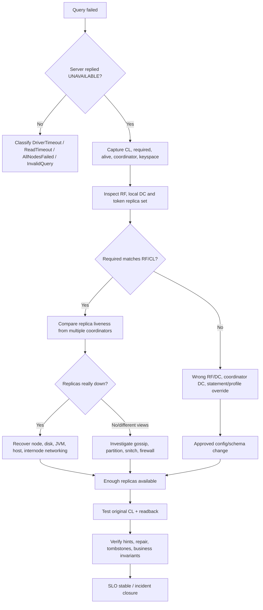

# Unavailable do không đủ replica để đạt CL

> **Chương:** Xử lý sự cố  
> **Mô-đun:** `DATABASE_ENGINE_WIDE_COLUMN_CASSANDRA` — hiểu kiến trúc phân tán và mô hình wide-column của Apache Cassandra, đặc biệt partition key, thiết kế bảng theo truy vấn, mức nhất quán đọc/ghi, CQL, replication, compaction, repair, xử lý lỗi và kết nối từ ứng dụng Java.  
> **Chủ đề:** `UnavailableException` khi coordinator biết **không đủ live replicas** để đáp ứng consistency level (`CL`) của một yêu cầu.  
> **Áp dụng:** Cassandra 4.x/5.x, Java Driver 4.19, Spring Boot 3.x/4.x; đối chiếu API và cấu hình của phiên bản thực đang dùng.

## 1. Tình huống mở đầu: Cassandra còn node Up nhưng request bị Unavailable

Ứng dụng Java ghi một đơn hàng ở CL `LOCAL_QUORUM` và nhận:

```text
com.datastax.oss.driver.api.core.servererrors.UnavailableException
Not enough replicas available for query at consistency LOCAL_QUORUM
(2 required but only 1 alive)
```

Trong cùng thời điểm, `nodetool status` vẫn cho thấy vài node `UN` và ứng dụng kết nối được tới cổng CQL `9042`. Vì sao coordinator từ chối?

Bởi vì **đủ kết nối tới Cassandra** không đồng nghĩa **đủ replicas của partition cần đọc/ghi**. Với keyspace RF3 tại một DC, CL `LOCAL_QUORUM` cần hai replica responses. Nếu coordinator tin chỉ một trong ba replicas của partition còn sống, nó có thể trả `UNAVAILABLE` ngay trước khi thực hiện request.

```text
                         Application Java
                                │
                    SELECT ... WHERE order_id = O42
                                │
                                ▼
                    Coordinator cass-a
                                │
                     Token + keyspace RF
                      /      |       \
                Replica A Replica B Replica C
                    UN        DN       DN
                      \       |       /
                       known alive = 1
                       required    = 2
                                │
                         UNAVAILABLE
```

Không được suy cluster chỉ còn một node Up: `alive=1` chỉ phản ánh **replicas phù hợp và được coordinator tin là còn sống** cho operation đang xét. Ở cluster nhiều token ranges, một node Down có thể làm một số partition bị ảnh hưởng nhưng partition khác vẫn đáp ứng CL.

Một `Unavailable` thường xảy ra ở bước coordinator **biết không đạt điều kiện sống tối thiểu**. Ngược lại, `ReadTimeout` hoặc `WriteTimeout` có thể xảy ra khi coordinator ban đầu tin đủ replicas, đã điều phối request nhưng không nhận phản hồi/ACK kịp.

**Mục tiêu xử lý sự cố:** Đọc đúng CL, required, alive, coordinator, keyspace RF, DC và replica ownership; tìm nguyên nhân làm các replicas không được coi sống; phục hồi **mà không tự động hạ CL và phá bất biến nghiệp vụ**.

## 2. Kết quả học tập

Sau bài này, bạn có thể:

1. Giải thích coordinator, replica, contact point, partition token, RF, NTS, local DC và consistency level.
2. Đọc `UnavailableException` bằng `getConsistencyLevel()`, `getRequired()` và `getAlive()`.
3. Tính ngưỡng `QUORUM`, `LOCAL_QUORUM`, `ONE`, `TWO`, `THREE`, `ALL`, phân biệt `EACH_QUORUM` và `ANY`.
4. Phân biệt `Unavailable` với `ReadTimeout`, `WriteTimeout`, `DriverTimeout`, `AllNodesFailed`, `NoNodeAvailable` và validation errors.
5. Tìm replica set của một partition thay vì suy từ tổng số nodes Up.
6. Kiểm `nodetool status` từ nhiều coordinators và nhận diện network partition/gossip divergence.
7. Đọc `system_schema.keyspaces` để kiểm RF/NTS/DC, biết vì sao RF3 trên một node là cấu hình lab sai.
8. Chẩn đoán local DC sai, RF/DC name mismatch, topology change, bad contact points và per-statement CL override.
9. Phân tích multi-DC `QUORUM` vs `LOCAL_QUORUM` khi đường WAN đứt.
10. Tìm nguyên nhân node Down: disk/GC/JVM/network, internode TLS, address advertisement và membership.
11. Dùng Java Driver 4.19 để phân loại errors an toàn, retry có kiểm soát và không tự downgrade consistency.
12. Sử dụng CQL, Java, JUnit/Testcontainers hoặc cluster lab để tái hiện thiếu replicas.
13. Phân biệt khôi phục CQL availability với hints/repair/data convergence.
14. Lập runbook điều tra, mitigations và post-incident check.
15. Kiểm chứng hiệu lực CL bằng readback, metrics, business invariants và SLO.

## 3. Ba vai trò thường bị trộn lẫn

| Thuật ngữ | Chức năng | Không đồng nghĩa |
|---|---|---|
| **Contact point** | Địa chỉ seed để Java Driver bootstrap và khám phá cluster | Replica cho mọi partition |
| **Coordinator** | Node nhận request CQL và điều phối replicas/CL | Nhất thiết là contact point |
| **Replica** | Node do keyspace replication strategy chọn giữ partition/token range | Mọi node đang Up |
| **Local DC** | Datacenter mà client thường ưu tiên dùng coordinator local | Tên cloud region suy đoán |
| **RF** | Số bản sao được thiết kế cho keyspace/DC | Số clients hoặc connections |
| **CL** | Số/phạm vi responses/ACK phải đạt cho operation | Cấu hình retry |
| **Alive** trong Unavailable | Số replicas phù hợp mà coordinator biết là sống | Tổng số Cassandra nodes trong cluster |

### 3.1. Token map và replica placement

Với bảng:

```sql
CREATE TABLE orders_by_id (
    order_id uuid PRIMARY KEY,
    customer_id uuid,
    state text,
    amount_cents bigint
);
```

Partition key `order_id` được encode/hash thành token; replication strategy chọn các replicas từ token ring. Một cluster 12 nodes RF3 thường chỉ có **3 replicas mỗi partition**. Một node bị Down sẽ ảnh hưởng những token ranges nó sở hữu; kiểm availability theo **partition key**, không phải “11/12 nodes Up nên mọi query đều chạy”.

### 3.2. Coordinator có thể không thuộc replica set

```text
App → Coordinator cass-07
           └── token(order_id=O42)
                       ├── Replica cass-02
                       ├── Replica cass-05
                       └── Replica cass-09
```

Cass-07 có thể còn khỏe trong khi cass-05 và cass-09 Down, khiến query ở `LOCAL_QUORUM` không đạt required. Chỉ restart cass-07 không làm cass-05/cass-09 sống lại.

### 3.3. Contact points không quyết định quorum

Driver dùng contact points để khám phá topology; sau bootstrap driver có thể query các nodes khác. Thêm ba contact points không nâng RF hoặc tạo thêm replicas. Ngược lại, chỉ một contact point Down lúc **startup** có thể khiến driver không bootstrap dù các replica/coordinators khác vẫn khỏe. Cần phân biệt bootstrap error với protocol `UnavailableException` từ một coordinator đã nhận request.

## 4. Định nghĩa protocol và required/alive

### 4.1. Điều kiện phát sinh

Một `UNAVAILABLE` gồm thông tin:

```text
consistency = CL được yêu cầu
required    = số responses/ACK tối thiểu theo CL
alive       = số replicas coordinator tin là sống
```

Trong case thông thường:

\[
\mathrm{alive} < \mathrm{required}.
\]

Ví dụ:

```text
Keyspace: NTS { dc1:3 }
Requested CL: LOCAL_QUORUM
Required: floor(3 / 2) + 1 = 2
Coordinator believes alive replicas: 1
Result: UNAVAILABLE
```

Java Driver 4.19 `UnavailableException` cung cấp `getConsistencyLevel()`, `getRequired()` và `getAlive()`. Đây là **evidence tốt hơn** việc parse chuỗi message theo phiên bản.

### 4.2. Required do đâu quyết định?

- **`ONE`:** một replica đáp ứng.
- **`LOCAL_ONE`:** một replica trong DC của coordinator.
- **`TWO`/`THREE`:** tương ứng 2/3 replicas, khi topology có đủ.
- **`QUORUM`:** quá bán tổng RF của keyspace.
- **`LOCAL_QUORUM`:** quá bán RF ở **local DC của coordinator**.
- **`EACH_QUORUM`:** quorum trong **mỗi DC** cho operation/phiên bản hỗ trợ.
- **`ALL`:** tất cả replicas theo RF.
- **`ANY`:** write-only và có thể nhận hint; **không** là giải pháp cho reads.

Phần lớn ví dụ dưới đây giả định **full replicas** và `NetworkTopologyStrategy`. Nếu dùng **transient replication** (`3/1`, `5/2`), không tính giản đơn như RF full; phải xem semantics/ràng buộc version-specific.

### 4.3. Alive là góc nhìn coordinator

`alive` **không** là số nodes đã connect thành công với driver hay lệnh `kubectl get pods`. Nó là số eligible replicas coordinator biết đang sống ở thời điểm preflight CL. Nếu coordinator A bị cô lập khỏi B/C nhưng app vẫn tới A qua TCP 9042, A có thể trả `alive=1`; coordinator B nhìn thấy C thì có thể đạt `alive=2`.

### 4.4. Một exception chưa nói toàn bộ business outcome

Một `UnavailableException` từ một attempt được coordinator từ chối vì không đủ live replicas. Nhưng cùng command có thể đã có attempt trước, asynchronous side effects hoặc một phần workflow xuyên nhiều bảng đã chạy. Với payment/order job, không lấy lỗi attempt cuối để kết luận “chưa có mutation nào xảy ra”. Dùng business command ID/version và reconcile nếu từng có retry/timeout.

## 5. Quorum theo RF: tính bằng số, không đoán

### 5.1. Công thức

Với RF full replicas \(N\):

\[
Q(N) = \left\lfloor\frac{N}{2}\right\rfloor + 1.
\]

| RF | Quorum | Số replicas có thể Down mà vẫn đạt quorum |
|---:|---:|---:|
| 1 | 1 | 0 |
| 2 | 2 | 0 |
| 3 | 2 | 1 |
| 4 | 3 | 1 |
| 5 | 3 | 2 |
| 6 | 4 | 2 |

Bảng giả định các replica responses còn lại **thực sự tới kịp và coordinator biết chúng Up**. Một node Up nhưng treo I/O có thể gây timeout dù toán học có đủ.

### 5.2. RF3, một DC

```text
A Up, B Up, C Up     → LOCAL_QUORUM 2/3: có thể thành công
A Up, B Up, C Down   → LOCAL_QUORUM 2/3: có thể thành công
A Up, B Down, C Down → LOCAL_QUORUM 2/3: UNAVAILABLE
A Up, B Up, C Down   → ALL 3/3: UNAVAILABLE
```

Nếu A/B/C đều Up theo gossip nhưng B/C không trả response kịp, lỗi có thể là `ReadTimeout`/`WriteTimeout`, không nhất thiết `Unavailable`.

### 5.3. Hai DC RF3 + RF3

```sql
CREATE KEYSPACE orders_prod WITH replication = {
    'class': 'NetworkTopologyStrategy',
    'dc-east': 3,
    'dc-west': 3
};
```

- `QUORUM` toàn cluster: \(Q(6)=4\).
- `LOCAL_QUORUM` với coordinator East: \(Q(3)=2\) East.
- `LOCAL_QUORUM` với coordinator West: \(Q(3)=2\) West.
- `EACH_QUORUM`: yêu cầu \(Q(3)=2\) ở từng DC trong các operations được hỗ trợ.
- `ALL`: cả sáu replicas.

**Ví dụ WAN bị cắt:** East có đủ 3 replicas local, West không reachable. `LOCAL_QUORUM` East có thể tiếp tục, còn global `QUORUM` cần 4 nên không đủ nếu chỉ East 3/6; `EACH_QUORUM` cũng không đạt.

### 5.4. RF3 + RF1, coordinator đặt ở DC khác

```text
NTS: dc-east=3, dc-west=1
Coordinator East: LOCAL_QUORUM required=2
Coordinator West: LOCAL_QUORUM required=1
Global QUORUM required=floor(4/2)+1=3
```

Vì vậy **đổi coordinator/local DC** trong failover có thể làm required thay đổi. Driver 4.19 built-in policy mặc định không tự cross-DC failover; nếu bật failover, phải xét RF/CL và đồng ý rõ tradeoff.

### 5.5. LOCAL_QUORUM và R + W > RF

Với RF3 local, đọc R=2 và ghi W=2:

\[
R+W=4>3=RF.
\]

Hai replica sets có giao điểm, hỗ trợ read-after-write khi đáp ứng điều kiện Cassandra. Nếu tự hạ cả read/write xuống `ONE`:

\[
R+W=1+1=2\leq3,
\]

không còn guaranteed intersection. Vì thế `LOCAL_QUORUM → ONE` **là thay đổi consistency contract**, không phải chỉ đổi timeout.

### 5.6. Trường hợp RF lớn hơn số nodes thực tế

Một Cassandra container lab nhưng keyspace khai RF3:

```sql
CREATE KEYSPACE lab_bad WITH replication = {
    'class': 'NetworkTopologyStrategy',
    'datacenter1': 3
};
```

Không vì khai RF3 mà cluster có ba full replicas; tại local quorum có thể thiếu. **Lab một node nên khai RF1**; không áp dụng ngược “production giảm RF1 cho dễ chạy” trong incident.

### 5.7. `ALL` và `ANY` không phải thuốc chữa

`ALL` làm tăng điều kiện ACK và giảm availability khi một replica Down. `ANY` chỉ hỗ trợ **writes**, có thể coi hint là response trong những điều kiện nhất định nhưng không cho guarantee read-your-write tức thời. Không tự giảm CL sang `ANY`/`ONE` để API trả 200 nếu nghiệp vụ yêu cầu local quorum.

## 6. Unavailable khác timeout, failure và no node

| Lỗi | Nguồn | Diễn giải | Điều tra đầu tiên |
|---|---|---|---|
| `UnavailableException` | Coordinator | Biết `alive < required` ở CL yêu cầu | RF/CL, token replicas, gossip |
| `ReadTimeoutException` | Coordinator | Đã điều phối read, thiếu responses/data đúng hạn | Slow replica, disk, network |
| `WriteTimeoutException` | Coordinator | Đã điều phối write, thiếu ACK đúng hạn | Replica network/storage, outcome chưa chắc |
| `ReadFailureException` | Coordinator | Replica/server trả failure khi read | Logs/failure reasons |
| `WriteFailureException` | Coordinator | Write path trả failure | Commitlog/disk/server errors |
| `DriverTimeoutException` | Java Driver | Không có response trước client deadline | Client/coordinator path, queue, WAN |
| `AllNodesFailedException` | Java Driver | Query plan candidates đều thất bại | Per-node causes; có thể chứa Unavailable |
| `NoNodeAvailableException` | Java Driver | Không có usable coordinator candidate | Discovery, load balancing/local DC |
| `OverloadedException` | Coordinator | Server quá tải | Requests/s, queues, CPU/disk |
| `InvalidQueryException` | Server validation | Sai schema/WHERE/CL constraints | CQL query/model |
| `UnauthorizedException` | CQL authz | Role thiếu quyền | GRANT/auth, không phải replication |

### 6.1. Error timeline của network partition

```text
t0: Mất mạng giữa A và B/C
t1: A vẫn tin B/C Up → gửi request và chờ → ReadTimeout
t2: Failure detector của A coi B/C Down
t3: A thấy alive=1 < LOCAL_QUORUM required=2 → Unavailable
t4: B thấy C Up và có thể đáp ứng local quorum từ góc nhìn B
```

Không mâu thuẫn nếu cùng một partition/CL chuyển từ Timeout sang Unavailable trong quá trình membership hội tụ. Hãy thu log với timestamps, không chỉ chụp một error cuối.

### 6.2. Tại sao Unavailable thường xảy ra nhanh?

Coordinator đã có membership khiến nó biết thiếu replicas, nên từ chối sớm thay vì chờ read timeout. Tăng `basic.request.timeout` từ 2s lên 30s **không làm replicas sống lại**, có thể khiến client queue dài thêm.

### 6.3. Ping/9042 OK không đủ

CQL port `9042` có thể vẫn nhận TCP trong khi internode links giữa coordinator và replicas lỗi. OS container Running cũng không đồng nghĩa node Up trong gossip. Cần kiểm **client→coordinator** và **coordinator↔replica** traffic riêng.

### 6.4. LWT và serial phase

`INSERT ... IF NOT EXISTS` hoặc `UPDATE ... IF ...` có **Paxos serial phase** (`SERIAL`/`LOCAL_SERIAL`) bên cạnh regular CL. Một lỗi trong LWT cần xét quorum/availability của serial phase và regular phase theo version/protocol. Không hạ `LOCAL_SERIAL` như thao tác retry mặc định; đó là thay đổi correctness của conditional write.

## 7. Cách đọc error fields có ích

### 7.1. RF3 LOCAL_QUORUM

```text
operation      = SELECT orders_by_id
keyspace       = orders_prod
coordinator    = cass-a / dc-east
consistency    = LOCAL_QUORUM
required       = 2
alive          = 1
```

**Hướng tiếp theo:** Tìm ba replicas của order_id cụ thể, kiểm vì sao hai replicas không được cass-a coi là Up. Không restart mọi node hoặc thay CL trước khi biết replica set.

### 7.2. ALL trên RF3

```text
consistency = ALL
required    = 3
alive       = 2
```

Một replica Down đủ gây Unavailable. Đây là **hành vi đúng** đối với CL ALL, không là server tính sai. Nếu hệ yêu cầu chịu một node Down, chọn CL phù hợp từ trước theo SLO/RPO, không chữa nóng bằng implicit downgrade.

### 7.3. QUORUM global lớn hơn mong đợi

```text
keyspace NTS = dc-east:3 + dc-west:3
consistency  = QUORUM
required     = 4
alive        = 3
```

Required=4 vì tổng RF6; không dùng RF3 local để tính QUORUM toàn cluster. Nếu use case thực sự cần local, kiểm statement config và business contract trước khi sửa.

### 7.4. Different coordinators, different answers

```text
cass-a → required=2, alive=1
cass-b → required=2, alive=2
```

Có thể A bị cô lập hoặc gossip views chưa hội tụ. Đây là dấu hiệu mạnh để lấy `nodetool status` từ **cả A và B**, kiểm internode network/GC, và kiểm node target trong Java Driver logs.

### 7.5. Ẩn dữ liệu nhạy cảm

Log operation name, CL, required, alive, logical coordinator label, keyspace, DC và correlation ID. Không log CQL password, private key, raw tenant/customer identifiers, bind values chứa PII hoặc full internal IPs ra public HTTP response.

## 8. Cây chẩn đoán nhanh



Một cây quyết định giúp không sửa nhầm lớp: **replica membership** không phải **client contact points**; **RF schema** không phải **driver retry**; **Cassandra repair** không phải **application reconciliation** giữa các bảng denormalized.

## 9. Bảy nguyên nhân gốc phổ biến

### 9.1. Replica thực sự Down

Process crash, node OOM, disk full, OS failure, Cassandra fail startup, GC stall, storage latency, container eviction hoặc service stop. Với RF3 và hai replicas thuộc **cùng partition** Down, local quorum không đạt.

### 9.2. Network partition internode

Coordinator vẫn nhận CQL client nhưng không thấy replicas vì firewall, route, ACL, internode TLS, DNS, NAT, MTU hoặc asymmetric path. Kiểm internode ports theo `cassandra.yaml`/distribution thực, không chỉ CQL `9042`.

### 9.3. Sai snitch/DC placement

Keyspace NTS khai `dc-east` nhưng nodes tự báo `DC-EAST` hoặc `east`. Tên DC case-sensitive; schema/rack layout khác ý định có thể khiến required/placement bất ngờ. Thay snitch hay đổi DC là **topology operation** lớn, không phải đổi một label để bớt lỗi.

### 9.4. RF lớn hơn số full nodes

Một lab một node dùng RF3, hoặc production một DC có RF3 nhưng chỉ còn hai nodes và CL ALL. Đừng thay đổi `contact-points` rồi nghĩ thêm data copies.

### 9.5. CL override không mong muốn

Default ở `application.yml` là `LOCAL_ONE` nhưng `BoundStatement.setConsistencyLevel(ALL)` hoặc execution profile override. Một code path có thể chỉ fail sau deploy. Đọc `getConsistencyLevel()` ở error thực, không chỉ source YAML.

### 9.6. Coordinator bị cô lập

A nghĩ B/C Down, B/C vẫn nói chuyện được. Default retry policy có thể thử coordinator kế tiếp; nếu B thành công, đừng coi A đã khỏe. Theo dõi errors theo coordinator và sửa network.

### 9.7. Topology change chưa hoàn tất

Bootstrap/decommission/replacement, streaming dở dang hoặc node state `UJ/UL` có thể làm replica membership chưa sẵn sàng. Không dùng decommission/replace để xử lý lỗi tạm thời nếu chưa có runbook/capacity.

## 10. Chụp incident evidence theo request

```text
incident_id      = INC-20261121-042
occurred_at_utc  = 2026-11-21T10:30:25Z
operation        = SELECT/INSERT/UPDATE/DELETE/LWT
keyspace         = orders_prod
table            = orders_by_id
partition_key    = <hashed-or-privileged-test-id>
requested_cl     = LOCAL_QUORUM
serial_cl        = <only-if-LWT>
required         = 2
alive            = 1
coordinator      = cass-a / dc-east / rack1
application      = service-api / version / profile
driver_version   = 4.19.x
retry_attempts   = ...
```

- **Một table/keyspace fail, table khác không:** kiểm RF/NTS/schema.
- **Một số keys fail:** kiểm token ranges/replica owners, đặc biệt CL ALL.
- **Chỉ LWT fail:** kiểm serial phase.
- **Chỉ sau deploy fail:** kiểm statement CL/profile, local DC, driver config.
- **Chỉ coordinator A fail:** kiểm A bị cô lập hoặc liveness view.
- **Chỉ một app fail:** kiểm network/client discovery/local DC, không mặc định Cassandra toàn cluster lỗi.

Không đưa production PII vào một test key hay public incident ticket.

## 11. Câu lệnh nodetool quan sát không phá dữ liệu

### 11.1. nodetool status

```bash
# Chạy trên Cassandra host có quyền JMX; read-only.
nodetool status
nodetool status orders_prod
```

Ví dụ:

```text
Datacenter: dc-east
====================================
Status=Up/Down
|/ State=Normal/Leaving/Joining/Moving
--  Address    Load  Tokens  Owns   Host ID  Rack
UN  10.1.1.11  ...   16      ...    id-A     rack1
DN  10.1.2.12  ...   16      ...    id-B     rack2
DN  10.1.3.13  ...   16      ...    id-C     rack3
```

`UN` = Up/Normal; `DN` = Down/Normal **theo node đã hỏi**. `nodetool status` ở coordinator khác có thể thấy khác nhau trong network partition. Lấy đồng thời từ ít nhất hai nodes trước khi kết luận mọi bên nhìn giống nhau.

### 11.2. Gossip, streaming, node details

```bash
nodetool gossipinfo
nodetool describecluster
nodetool info
nodetool netstats
```

- `gossipinfo`: thông tin membership/generation/endpoint state.
- `describecluster`: cluster/snitch/schema-related context.
- `info`: node metadata/uptime.
- `netstats`: streaming/repair/network activity.

Không đọc nguyên output gossip vào public logs; lọc đúng host gây lỗi. Không chạy lệnh force/gossip mutation khi chỉ cần quan sát.

### 11.3. Thread pools và table stats

```bash
nodetool tpstats
nodetool tablestats orders_prod.orders_by_id
```

Các số liệu giúp tìm nguyên nhân replica bị coi Down/slow (GC, queues, dropped messages, compaction/tombstones). Nhưng không suy rằng tăng `read_request_timeout` sẽ tự sửa liveness thiếu. `nodetool` dùng JMX; JMX không truy cập được **không tự chứng minh CQL unavailable**.

## 12. CQL kiểm keyspace replication và DC

### 12.1. Đọc RF chính xác của keyspace

```sql
SELECT keyspace_name, replication, durable_writes
FROM system_schema.keyspaces
WHERE keyspace_name = 'orders_prod';
```

Ví dụ kết quả:

```text
class   = org.apache.cassandra.locator.NetworkTopologyStrategy
dc-east = 3
dc-west = 3
```

Không dùng RF của một keyspace khác, hoặc chỉ nhìn session default khi câu query dùng tên `tenant_a.orders_by_id` fully qualified.

### 12.2. Kiểm DC thực của node

```sql
SELECT data_center, rack
FROM system.local;
```

`system.local` mô tả **node thực sự trả lời** query. Để kiểm toàn cluster, đọc `nodetool status`/metadata từ nhiều nodes, hoặc driver node metadata. Tên DC phải khớp NTS và driver `local-datacenter`. Không tự suy tên DC từ Kubernetes zone hoặc cloud region.

### 12.3. RF schema không chứng minh replicas healthy

`dc-east:3` là **replica placement mong muốn**, không đảm bảo mọi replica Up/Normal ở thời điểm lỗi. Cần thêm `nodetool status`, replica ownership/token mapping và server readiness.

### 12.4. Không ALTER KEYSPACE như phản xạ

`ALTER KEYSPACE` đổi RF không tự stream/repair đầy đủ dữ liệu cho các replicas mới và có thể thay data durability/availability. Việc thay RF phải có migration, backup, capacity, repair/streaming và approval. Không giảm RF trong incident chỉ để required nhỏ lại.

## 13. Xác định replica owners của partition

### 13.1. Replica set quan trọng hơn số nodes Up

Một cluster 12 nodes RF3 với 11 nodes `UN` không bảo đảm **CL=ALL** cho mọi partition. Nếu node Down là replica của partition K, nó mất 1/3; còn các partitions không thuộc node đó có thể đủ replicas. Cần lấy **partition key của request lỗi** và tìm đúng replica set.

### 13.2. nodetool getendpoints

```bash
# Cú pháp chung của nodetool; thay placeholder bằng key đúng kiểu.
nodetool getendpoints orders_prod orders_by_id '<partition-key-value>'
```

`getendpoints` nhận keyspace, table và key. Với `text` partition key đơn có thể truyền literal trực tiếp; với UUID/composite keys phải kiểm cách tool/version encode partition key. **Không** nối UUIDs thành string hoặc dùng Java `hashCode()` để suy Cassandra token. Có thể dùng driver `TokenMap` và routing key do codec tạo khi cần.

### 13.3. Một kết quả mẫu

```text
Partition O42:
  replica cass-01 / dc-east / rack1 / UN
  replica cass-05 / dc-east / rack2 / DN
  replica cass-09 / dc-east / rack3 / DN
  CL LOCAL_QUORUM, required=2, alive=1
```

Dù 10/12 nodes Up, query vẫn thiếu quorum cho **partition O42**. Phải khôi phục cass-05/cass-09 hoặc xử lý góc nhìn gossip; thêm cass-11 vào contact points không tạo replica mới.

### 13.4. Rack-aware replication và topology changes

NTS ưu tiên phân bố replicas qua racks nếu có đủ racks/nodes và snitch metadata đúng. Một lỗi rack/power domain có thể làm hai replicas Down cùng lúc nếu đặt sai. Trong bootstrap/decommission/replacement, token ownership và streaming chưa hội tụ; chụp topology/host IDs/metadata đúng thời điểm, không suy từ bản đồ cũ.

## 14. Case A — RF3, hai replicas thực sự Down

```text
NTS dc1:3
A UN, B DN, C DN
LOCAL_QUORUM required=2, alive=1
```

Đây là **Unavailable đúng theo CL**.

Quy trình:

1. Giới hạn retry storm và số requests in-flight; trả lỗi hạ tầng an toàn nếu cần.
2. Điều tra B/C (host, JVM, OOM, disk full, internode network, TLS).
3. Phục hồi **ít nhất một replica liên quan trong local DC**, không chỉ bất kỳ node cluster nào.
4. Kiểm gossip từ A và node mới phục hồi.
5. Chạy query theo **LOCAL_QUORUM gốc**, xác minh expected data/version.
6. Kiểm hints backlog, repair plan và tombstones.
7. Reconcile các business commands có outcome không chắc sau timeout.

Tăng timeout **không** tạo thêm replicas khi coordinator đã biết thiếu live nodes. Tự động chuyển `LOCAL_QUORUM→ONE` cũng không phải sửa lỗi hạ tầng: nó làm thay đổi read-after-write/durability contract, cần approval, audit và degraded-mode policy nếu được phép.

## 15. Case B — Coordinator bị cô lập

### 15.1. Asymmetric membership

```text
App → A: native CQL OK
A -X→ B và C: internode blocked
B ↔ C: internode healthy

A thấy alive=1 và báo Unavailable.
B thấy C alive và có thể đạt 2/3.
```

Có thể:

- Cassandra trên A vẫn Running và nhận CQL.
- `nodetool status` trên A cho B/C DN.
- `nodetool status` trên B cho C UN.
- Driver retry sang coordinator B và cùng query thành công.

### 15.2. Bằng chứng cần thu

1. Error coordinator per request và `required/alive`.
2. `nodetool status` từ A/B/C ở cùng thời gian.
3. Internode firewall/ACL/port/TLS/broadcast addresses.
4. JVM GC pauses/CPU saturation ở A.
5. Driver query plan/connected nodes/retry count.
6. Replica owners của key để tránh so hai partitions khác nhau.

### 15.3. Giảm tác động mà không làm topology thêm rối

Nếu A cô lập, có thể tạm loại A khỏi serving path theo runbook driver/load balancer và sửa network. Đổi contact points **không nhất thiết** khiến driver bỏ A sau discovery. Không dùng `nodetool decommission` để xử lý một network partition tạm vì decommission gây streaming/topology change.

`DefaultRetryPolicy` có thể thử coordinator khác tối đa một lần cho `Unavailable` khi điều kiện đáp ứng. Nhưng nếu tất cả coordinators thiếu quorum, lặp lại nhiều lần chỉ tạo tải.

## 16. Case C — Multi-DC, WAN outage và CL global

### 16.1. Hai DC mỗi bên RF3

```text
dc-east: E1,E2,E3 (RF3)
dc-west: W1,W2,W3 (RF3)

East nội bộ: 3/3 healthy
East–West: đứt WAN
App East coordinator E1
```

| CL | Required | Chỉ East 3 replicas reachable |
|---|---|---|
| `LOCAL_ONE` tại East | 1 East | Có thể đạt |
| `LOCAL_QUORUM` tại East | 2 East | Có thể đạt |
| `QUORUM` global RF6 | 4 trên tổng | Không đủ |
| `EACH_QUORUM` | 2 East + 2 West | Không đủ West |
| `ALL` | 6 | Không đủ |

Các kết quả giả định toàn bộ remote unreachable, full replicas, server gossip hội tụ. Trước đó có thể thấy timeout thay vì Unavailable.

### 16.2. QUORUM không phải LOCAL_QUORUM

Khi mở rộng single-DC RF3 thành dual-DC RF3+3, `QUORUM` từ required=2 thành required=4. Một service vẫn dùng QUORUM có thể bắt đầu phụ thuộc WAN. Nếu nghiệp vụ chỉ cần local consistency, thay sang LOCAL_QUORUM có thể là design đúng nhưng phải xét RPO/DR/read-your-write cross DC. Không coi việc thay CL giữa incident là vô hại.

### 16.3. Failover đổi coordinator có thể đổi quorum

```text
NTS dc-east:3, dc-west:1
LOCAL_QUORUM coordinator East → 2
LOCAL_QUORUM coordinator West → 1
QUORUM global                    → 3
```

Java Driver 4.x built-in load balancing mặc định ưu tiên **local DC** và không tự dùng remote DC nếu chưa cấu hình. Khi bật remote failover, local CL còn có restrictions và business semantics có thể đổi. Kiểm provider/DC/RF trước khi chuyển app qua West.

### 16.4. Một DC mất hoàn toàn không nhất thiết mất toàn cluster

Tại East, nếu East còn 2/3 local replicas thì LOCAL_QUORUM có thể phục vụ dù West Down; với CL `EACH_QUORUM` thì không. Nhưng những writes chỉ ACK ở East chưa chắc West đã nhận; failover lập tức có thể gặp cross-DC data freshness gap.

## 17. Case D — RF, schema và DC name không khớp

### 17.1. RF3 trên một-node Testcontainers

```yaml
# Lab có chỉ một Cassandra node.
spring:
  cassandra:
    contact-points: "127.0.0.1:9042"
    local-datacenter: "datacenter1"
    keyspace-name: "lab_bad_rf3"
    request:
      consistency: LOCAL_QUORUM
```

```sql
CREATE KEYSPACE lab_bad_rf3 WITH replication = {
    'class': 'NetworkTopologyStrategy',
    'datacenter1': 3
};
```

RF3 không tạo thêm hai physical replicas. Khi cần single-node lab, dùng RF1; khi test quorum, dựng cluster thật RF3. Không giảm RF của production để chữa lỗi Testcontainers.

### 17.2. Tên DC case-sensitive

```text
nodetool status: Datacenter: dc-east
keyspace NTS:   'DC-EAST':3
```

Mismatch giữa snitch và NTS keys có thể làm placement không đạt kỳ vọng. Đừng sửa snitch trên một node production không có plan; đó là topology change. Xác định source of truth, thực hiện schema/topology migration và repair/streaming theo quy trình.

### 17.3. Keyspace của câu query quan trọng

Một CQL statement dùng `other_ks.orders_by_id` dù `CqlSession` default là `orders_prod`. RF/CL behavior phải tính trên **other_ks**, không mặc định mọi query một session dùng cùng keyspace.

### 17.4. Spring Boot version

Spring Boot 2.7 dùng `spring.data.cassandra.*`, Boot 3.x/4.x dùng `spring.cassandra.*`. Sau nâng version mà vẫn giữ prefix cũ, config có thể bị bỏ qua. Kiểm metadata/effective properties, custom session beans và statement overrides trước khi đổ lỗi server.

## 18. Case E — CL statement không giống CL default

### 18.1. Per-statement override

```hocon
datastax-java-driver {
  basic.request.consistency = LOCAL_QUORUM
}
```

```java
BoundStatement query = prepared.bind(orderId)
    .setConsistencyLevel(DefaultConsistencyLevel.ALL);
```

Khi một replica Down trong RF3, statement này required=3/3 dù default LOCAL_QUORUM chỉ required=2. Đọc `Unavailable.getConsistencyLevel()` chứ không đoán từ HOCON/YAML.

### 18.2. Execution profiles

Java Driver profiles có `basic.request.consistency` riêng và Spring Data query options có thể override CL. Một endpoint dùng profile `critical` (ALL) có thể fail trong khi endpoint khác dùng LOCAL_QUORUM vẫn khỏe. Đo effective CL theo operation/query name.

### 18.3. Không hạ CL tự động trong catch

```java
// ANTI-PATTERN: implicit downgrade làm sai contract.
try {
    return session.execute(statement
        .setConsistencyLevel(
            DefaultConsistencyLevel.LOCAL_QUORUM));
} catch (UnavailableException e) {
    return session.execute(statement
        .setConsistencyLevel(
            DefaultConsistencyLevel.ONE));
}
```

Thay đổi CL phải được business owner phê duyệt nếu có degraded read mode. Cần request contract, giới hạn thời gian, observability và rollback. Không sử dụng như default retry policy cho mọi writes.

### 18.4. LWT là trường hợp riêng

`UPDATE ... IF revision = ?`/`INSERT IF NOT EXISTS` dùng serial consistency `SERIAL`/`LOCAL_SERIAL` trong Paxos. Nếu chỉ LWT fail, xem serial phase quorum bên cạnh regular CL, còn contention/timeouts là nhóm triệu chứng khác.

## 19. Điều tra theo lớp giao tiếp và health

| Lớp | Kiểm tra | Không được kết luận sai |
|---|---|---|
| App→coordinator | DNS, TCP 9042, TLS/credentials, Driver connected nodes | Một seed reachable ≠ đủ replicas |
| Coordinator↔replicas | Internode ports, gossip, firewall, TLS, broadcast addresses | CQL 9042 OK ≠ replication khỏe |
| OS/JVM | OOM, GC, process restart, CPU throttling | Container Running ≠ Cassandra gossip Up |
| Storage | Disk free/inodes, commitlog, compaction/flush | Node UN ≠ response luôn nhanh |
| Topology | DC/rack/snitch, host ID, bootstrap/decommission | RF trong schema ≠ dữ liệu đã streamed |
| Driver/app | Local DC, CL profile, retry budget, pooling | Nâng retries ≠ tăng RF |
| Business | Command ID, idempotency, stale reads | Unavailable attempt ≠ mọi side effects chưa xảy ra |

Nếu Cassandra `nodetool` dùng JMX không truy cập được, đó là **JMX failure** cần xét riêng; đừng coi nó là node Down. Ngược lại, `nodetool status` trên một node có thể không đại diện membership của coordinator khác.

## 20. Triage runbook: 15 phút đầu điều tra

Khung thời gian sau là **ví dụ thứ tự hành động**, không phải cam kết có thể phục hồi mọi cluster trong 15 phút.

### Phút 0–2: xác nhận đúng loại lỗi

1. Lấy exception class gốc; phân biệt `UnavailableException` với `AllNodesFailedException` có nguyên nhân Unavailable.
2. Ghi CL, required, alive, coordinator, timestamp, keyspace, table, partition key an toàn.
3. Phân biệt read/write/LWT và query version mới sau deploy.
4. Giới hạn retries/queue theo SLO, không hạ CL.
5. Giao tiếp trạng thái degraded nếu service không đạt business contract.

### Phút 2–5: xác định các replicas liên quan

1. Đọc `system_schema.keyspaces.replication`.
2. Kiểm coordinator DC/local DC và NTS names.
3. Xác định replica owners của partition bằng `getendpoints`/TokenMap.
4. Kiểm `required` theo công thức và actual RF.
5. Khoanh scope một keyspace/partition vs toàn DC.

### Phút 5–10: kiểm membership và network

1. Chụp `nodetool status` từ ít nhất hai nodes.
2. Tìm DN/Joining/Leaving và streamer/backlog.
3. Kiểm CQL vs internode link đúng ports.
4. Kiểm process/disk/GC/JVM logs ở replicas bị coi Down.
5. So errors theo coordinator và client application instance.

### Phút 10–15: chọn tuyến mitigations

- **Replicas thật sự Down:** phục hồi OS/Cassandra/network theo node runbook.
- **Một coordinator bị cô lập:** sửa link/gossip; cân nhắc rút nó khỏi client serving path có kiểm soát.
- **RF/DC mismatch:** rollback deployment/mở migration schema có approval, không sửa nóng vô căn cứ.
- **CL override sai:** revert code/profile/config.
- **WAN outage:** dùng DR strategy đã thiết kế cho local CL/failover.
- **Writes outcome không chắc:** ghi command IDs và chờ reconciliation, không blindly replay non-idempotent writes.

**Không đóng incident khi chỉ thấy node trở lại UN.** Phải xác minh original CL, dữ liệu, hints/repair và SLO.

## 21. Java Driver 4.19: trích chi tiết UnavailableException

### 21.1. CqlSession dùng chung

```java
import java.net.InetSocketAddress;
import com.datastax.oss.driver.api.core.CqlSession;

try (CqlSession session = CqlSession.builder()
        .addContactPoint(
            new InetSocketAddress("cass-a.lab.internal", 9042))
        .addContactPoint(
            new InetSocketAddress("cass-b.lab.internal", 9042))
        .withLocalDatacenter("dc1")
        .withKeyspace("lab_unavailable")
        .build()) {
    // Lấy PreparedStatement, execute và inspect exceptions.
}
```

Ví dụ dùng hostname lab giả định; không chạy nguyên lên production. `CqlSession` nên là application-scoped, không tạo mới mỗi HTTP request hoặc retry.

### 21.2. Hàm lấy fields có cấu trúc

```java
import com.datastax.oss.driver.api.core.servererrors.UnavailableException;

public final class UnavailableDiagnostic {

    public record Detail(
        String coordinator,
        String consistency,
        int required,
        int alive) {}

    public static Detail of(UnavailableException error) {
        var coordinator = error.getCoordinator();
        return new Detail(
            coordinator == null
                ? "unknown"
                : coordinator.getEndPoint().toString(),
            error.getConsistencyLevel().name(),
            error.getRequired(),
            error.getAlive());
    }
}
```

Bốn fields này phản ánh sự cố tại coordinator, không phải số nodes toàn cluster. `getCoordinator()` là API kế thừa từ `CoordinatorException`. Hạn chế log endpoint/IP nội bộ; có thể map sang logical coordinator label.

### 21.3. Statement và CL rõ ràng

```java
import java.util.UUID;

import com.datastax.oss.driver.api.core.CqlSession;
import com.datastax.oss.driver.api.core.DefaultConsistencyLevel;
import com.datastax.oss.driver.api.core.cql.PreparedStatement;
import com.datastax.oss.driver.api.core.cql.Row;
import com.datastax.oss.driver.api.core.servererrors.UnavailableException;

public class OrderLookup {
    private final CqlSession session;
    private final PreparedStatement prepared;

    public OrderLookup(CqlSession session) {
        this.session = session;
        this.prepared = session.prepare(
            "SELECT state, amount_cents " +
            "FROM lab_unavailable.orders_by_id " +
            "WHERE order_id=?");
    }

    public Row read(UUID orderId) {
        var statement = prepared.bind(orderId)
            .setConsistencyLevel(
                DefaultConsistencyLevel.LOCAL_QUORUM)
            .setIdempotent(true);

        try {
            return session.execute(statement).one();
        } catch (UnavailableException ex) {
            var detail = UnavailableDiagnostic.of(ex);
            // Report internal metrics: CL, required, alive, node.
            // Không tự đổi CL sang ONE hoặc trả "not found".
            throw new StorageUnavailableException(
                "Requested CL unavailable", ex);
        }
    }
}
```

`StorageUnavailableException` là **domain exception do ứng dụng tự định nghĩa** (ví dụ subclass `RuntimeException`), không phải Java Driver class. Cùng cách tương tự có thể dùng `CompletionStage`/WebFlux, nhưng cần xử lý wrappers và retry policy.

### 21.4. Không nuốt lỗi thành empty

Một lỗi hạ tầng không phải business not-found:

```java
// ANTI-PATTERN trong service reactive:
return reactiveRepository.findById(orderId)
    .onErrorResume(error -> Mono.empty()); // HTTP có thể thành 404.
```

Đúng hơn: chỉ map `Mono.empty()` của **truy vấn thành công** thành 404, còn lỗi storage thành 503/504 theo error contract, có correlation ID và alert. Nếu Spring Data đã translate exception sang `DataAccessException`, classifier phải xét Spring type/cause chain.

## 22. Java: duyệt AllNodesFailed theo coordinator

### 22.1. API getAllErrors()

Trong Driver 4.19, `AllNodesFailedException.getAllErrors()` trả `Map<Node,List<Throwable>>`. Một coordinator có thể gặp nhiều attempts/errors, nên dùng `getAllErrors()` thay vì `getErrors()` cũ đã deprecated.

```java
import java.util.ArrayList;
import java.util.List;
import java.util.concurrent.CompletionException;
import java.util.concurrent.ExecutionException;

import com.datastax.oss.driver.api.core.AllNodesFailedException;
import com.datastax.oss.driver.api.core.servererrors.UnavailableException;

public final class DriverFailureInspector {

    public record UnavailableAtNode(
        String node, String cl, int required, int alive) {}

    static Throwable unwrap(Throwable thrown) {
        Throwable current = thrown;
        for (int i = 0; i < 8; i++) {
            if ((current instanceof CompletionException
                 || current instanceof ExecutionException)
                && current.getCause() != null) {
                current = current.getCause();
            } else {
                break;
            }
        }
        return current;
    }

    public static List<UnavailableAtNode> collect(
            Throwable thrown) {

        Throwable error = unwrap(thrown);
        List<UnavailableAtNode> result = new ArrayList<>();

        if (error instanceof UnavailableException u) {
            result.add(new UnavailableAtNode(
                String.valueOf(u.getCoordinator()),
                u.getConsistencyLevel().name(),
                u.getRequired(), u.getAlive()));
            return result;
        }

        if (error instanceof AllNodesFailedException all) {
            all.getAllErrors().forEach((node, causes) -> {
                for (Throwable candidate : causes) {
                    Throwable cause = unwrap(candidate);
                    if (cause instanceof UnavailableException u) {
                        result.add(new UnavailableAtNode(
                            String.valueOf(node.getEndPoint()),
                            u.getConsistencyLevel().name(),
                            u.getRequired(), u.getAlive()));
                    }
                }
            });
        }
        return result;
    }
}
```

Mẫu sử dụng `record` và `instanceof pattern matching` của Java 17+, phù hợp nhiều Spring Boot 3/4 services. Nó **chỉ** trích Unavailable causes, không phải classifier hoàn chỉnh cho TLS/auth/network errors. Trong production cần bounded cause-chain traversal nếu framework có wrapper khác và metric theo root category.

### 22.2. List rỗng không có nghĩa request thành công

`AllNodesFailed` có thể do:

- `NodeUnavailableException` vì connection pool không usable.
- `ClosedConnectionException`/TLS handshake.
- Authentication/authorization.
- Query timeouts hoặc coordinator failures.
- Request throttler.

Nếu list `collect()` rỗng, vẫn cần inspect **toàn bộ per-node errors**. Không ép mọi `AllNodesFailed` thành Cassandra `UNAVAILABLE`.

### 22.3. Default retry policy và idempotency

Theo Java Driver 4.19 docs, retry policy mặc định chỉ retry một số trường hợp an toàn, và `onUnavailableVerdict` có thể thử **một coordinator khác** tối đa một lần theo điều kiện. Không có policy nào biến thiếu hai replicas thật thành quorum. Với app-level retry, phải có budget/deadline và idempotency, nhất là nếu command từng có timeout uncertain.

### 22.4. Async wrappers

`CqlSession.executeAsync` trả `CompletionStage<AsyncResultSet>`; lỗi `whenComplete` có thể nằm trong `CompletionException`. Không gọi `get()/join()` trên driver I/O thread. Với diagnostic, unwrap đủ giới hạn và propagate tới request/job boundary để không trả success trước khi query thật sự completed.

## 23. Spring Boot và Spring Data: effective config mới quan trọng

### 23.1. Cấu hình Boot 3/4

```yaml
spring:
  cassandra:
    contact-points: "cass-a.dc1.internal:9042,cass-b.dc1.internal:9042"
    local-datacenter: "dc1"
    keyspace-name: "orders_prod"
    request:
      consistency: LOCAL_QUORUM
      timeout: 3s
    schema-action: none
```

Tên hosts chỉ minh họa; Boot 2.7 dùng `spring.data.cassandra.*`, trong khi Boot 3/4 dùng `spring.cassandra.*`. Khi cấu hình được nhận đúng, auto-configured `CqlSession` thường được inject dùng chung.

### 23.2. Effective CL có thể khác YAML

Một `BoundStatement`, Spring Data query options hoặc Java Driver execution profile có thể override default. Khi lỗi báo `ALL required=3`, hãy tìm source override, không chỉ nhìn `application.yml` viết `LOCAL_QUORUM`.

### 23.3. HealthIndicator không tự chứng minh local quorum

Spring Boot Actuator Cassandra health có thể kiểm basic connectivity/`system.local`, trong khi business table thiếu replica ở `LOCAL_QUORUM`. Readiness phù hợp cần **query nhỏ theo PK**, CL mong muốn và timeout bounded. Không dùng `COUNT(*)` toàn table hoặc `ALLOW FILTERING` làm health.

### 23.4. Spring exception translation

Reactive/imperative Spring Data có thể chuyển driver exception thành `org.springframework.dao.DataAccessException`. Nếu code chỉ bắt `UnavailableException` trực tiếp ở repository boundary, có thể bỏ sót. Kiểm lớp Spring exception và bounded cause chain, không parse message string có thể đổi theo version hoặc chứa thông tin nhạy cảm.

### 23.5. Kiểm local DC và driver metadata

Một app ở East dùng `local-datacenter=dc-west` có thể route tới coordinator khác ý định, với CL local tính theo DC của coordinator. Kiểm `session.getMetadata().getNodes()` và node datacenter, không suy từ Kubernetes namespace. App lỡ trỏ nhầm cluster/keyspace có thể gặp RF/CL bất thường mà không phải server bug.

## 24. Metrics: quan sát coordinator, nodes và SLO

### 24.1. Cassandra JMX ClientRequest.Unavailables

Theo Apache Cassandra monitoring docs, coordinator metrics có các request types và `Unavailables` counter:

```text
ClientRequest.Unavailables.Read
ClientRequest.Unavailables.Write
ClientRequest.Unavailables.CASRead
ClientRequest.Unavailables.CASWrite
```

Tên Prometheus metrics sau JMX exporter **phụ thuộc mapping**, không mặc định đúng nguyên chuỗi trên. Lấy `rate()/increase()` theo node và request type; metrics counters tích lũy có thể reset khi JVM restart.

### 24.2. Dashboard tối thiểu

| Lớp | Metric / evidence | Hỏi được gì? |
|---|---|---|
| Application | Unavailable rate by keyspace/CL/operation | Workload nào bị ảnh hưởng? |
| Driver | Per-node errors, connected nodes, retries | Có coordinator nào chỉ mình nó fail? |
| Cassandra | ClientRequest.Unavailables.Read/Write | Coordinator nào nói thiếu replicas? |
| Membership | Node Up/Down, gossip differences, uptime | Replicas được xem là Down khi nào? |
| Storage/JVM | CPU, GC, disk, dropped messages | Node Down vì host/GC/disk? |
| Repair | Hints pending/delivery, repair status | Hồi phục dữ liệu đến đâu? |
| Business | Successful requests at CL + data checks | Đã phục vụ đúng contract chưa? |

### 24.3. Không trộn mọi HTTP 503

Một đợt outage có thể có 300 Unavailable, 200 DriverTimeout và 100 Auth failures. Chúng cần xử lý khác nhau. Dashboard nên có `error_category` cố định, `coordinator` logical label và `requested_cl`. Không dùng raw query bind values, tenant UUID, passwords hay host IPs nhạy cảm làm metric labels.

### 24.4. Counters reset sau node restart

Một node restart làm JMX counters có thể về 0. Đừng lấy delta âm rồi kết luận Unavailables đã được “chữa” hoặc tổng số events giảm. Dùng rate/increase với reset handling và gắn node uptime/restart marker vào dashboard.

### 24.5. Quan sát chuyển lỗi theo thời gian

Trong network partition, ReadTimeout có thể tăng đầu tiên, sau failure detection Unavailable tăng. Nếu chỉ nhìn số Unavailable cuối cùng sẽ bỏ mất detection window. Ghi timeline: fault t0 → gossip Down → driver reroute → replica recovery → hints/repair → p99 stable.

## 25. Khôi phục node mới chỉ là bước đầu: hints và repair

### 25.1. Node Up không đồng nghĩa dữ liệu đã hội tụ

Giả sử RF3, B Down trong 30 phút, A/C vẫn ACK writes ở `LOCAL_QUORUM`. Khi B khởi động lại:

- B cần tham gia gossip/ring đúng host ID và token ownership.
- Driver reconnect tới B, nếu nó là local node usable.
- B có thể đã bỏ lỡ mutations trong thời gian Down.
- Hinted handoff có thể phát các mutations đã lưu, nhưng **hints là best effort**.
- Anti-entropy `repair` cần thực hiện theo lịch/runbook để bảo vệ consistency dài hạn.

Đừng đánh dấu recovery complete chỉ vì `nodetool status` cho `UN`.

### 25.2. Hinted handoff không là backup

Hints là cơ chế best-effort để giảm thời gian replicas lệch nhau sau outage; chúng bị ràng buộc bởi cửa sổ, disk và chính sách replay. Nếu node Down quá lâu, không được mặc định mọi write đều có hint còn tồn tại. Hãy kiểm hint backlog/metrics và anti-entropy repair.

### 25.3. Repair của Cassandra

```bash
# Lệnh tham khảo: CHỈ được chạy theo plan vận hành,
# vì repair tiêu thụ CPU/disk/network đáng kể.
nodetool repair orders_prod
```

`nodetool repair` so Merkle trees của replicas theo token range rồi stream differences. Nó không được Cassandra tự chạy theo lịch nếu operator chưa cấu hình orchestration. Chọn incremental/full, phạm vi và DC theo Cassandra version/lịch repair thực; không chạy đồng loạt các repairs không có capacity plan.

### 25.4. Tombstone zombie sau outage quá dài

CQL `DELETE`/TTL tạo tombstone. Nếu B Down quá lâu không nhận tombstone rồi A/C purge tombstone sau `gc_grace_seconds` trước repair, stale data trên B có thể **sống lại** khi B quay về. Không rút ngắn grace xuống vài giây để “cho sửa nhanh”. Recovery test phải cân nhắc duration outage, repair schedule và tombstone retention.

### 25.5. Cassandra repair không sửa bảng nghiệp vụ khác

Nếu Java service đã ghi `orders_by_id` nhưng fail trước khi ghi `orders_by_customer_day`, anti-entropy repair **không** tự tạo projection thứ hai. Cần app-level event replay/reconciliation; đừng coi “all nodes UN” hoặc “repair success” là business workflow đã hoàn tất.

### 25.6. Bốn mốc recovery khác nhau

| Mốc | Bằng chứng |
|---|---|
| Transport recovered | CQL connections/driver nodes reconnect |
| Membership recovered | Gossip, ring, node status phù hợp |
| Replica data recovered | Hints delivery/repair/readback và tombstone checks |
| Service SLO recovered | Request success at original CL, p99/retries/queue bình thường |

Bốn mốc có thể cách nhau đáng kể. Mục tiêu incident report là xác định từng mốc, không nén thành một timestamp “node restarted”.

## 26. Không đánh đồng Unavailable với write outcome chưa rõ

### 26.1. Một attempt Unavailable và một attempt WriteTimeout khác nhau

`UnavailableException` trực tiếp cho biết coordinator thấy thiếu live replicas trước khi tiếp tục request đó. `WriteTimeoutException` nghĩa write đã được điều phối nhưng đủ ACK không tới kịp; một số replicas có thể đã ghi. `DriverTimeoutException` nghĩa client hết deadline mà chưa có phản hồi hoàn chỉnh, server có thể đã xử lý xong.

### 26.2. Multi-attempt business command

```text
Command ID: payment-C17
Attempt #1 → WRITE_TIMEOUT (server có thể đã ghi)
Attempt #2 → UNAVAILABLE (coordinator hiện nhìn thiếu replicas)
App thấy error cuối UNAVAILABLE
```

Không được suy toàn command chưa tạo payment nào. Khi phục hồi, đọc canonical state/command ledger bằng deterministic primary key và version rồi quyết định retry/compensation an toàn.

### 26.3. Không retry non-idempotent mutations vô hạn

Counter increments, generated UUID mới, list append, refund/payment side effects hay LWT with uncertain outcome không được coi idempotent chỉ vì CQL syntax là `INSERT`/`UPDATE`. Hãy dùng stable business command IDs, payload hash/version, dedup ledger và retry budget.

### 26.4. Driver retry policy trên Unavailable

Java Driver 4.19 `DefaultRetryPolicy` có thể retry sang coordinator kế tiếp một lần trong điều kiện phù hợp; điều này chủ yếu hữu ích khi một coordinator bị cô lập. Không sử dụng `ConsistencyDowngradingRetryPolicy` vô tư: tài liệu cảnh báo nó có thể giảm CL và phá invariants về visibility/DC locality.

### 26.5. Chỉ hạ CL như một thay đổi nghiệp vụ có điều kiện

Một hệ thống báo cáo read-only có thể định nghĩa degraded mode chấp nhận stale data khi quorum mất, với response metadata “degraded”, TTL và rollback. Nhưng đối với payment/ledger/inventory, read-your-write và conditional transitions có thể cấm điều đó. Không đặt rule “mọi Unavailable → thử ONE” trong shared driver wrapper.

## 27. Giảm tác động đúng cách trong production

### 27.1. Hành động thường an toàn hơn

- Hạn chế retry storm, giữ bounded in-flight và timeout hợp lý.
- Tạm shed noncritical traffic theo API contract.
- Dừng background backfill/export/repair-heavy workload nếu nó làm node phục hồi chậm, theo operator plan.
- Ưu tiên khôi phục replica/host/network gây thiếu quorum.
- Chặn rollout cấu hình local DC/RF/CL sai.
- Cho driver tránh coordinator bị cô lập trong serving path khi đã xác minh fault và có rollback.
- Dùng circuit breaker báo unavailable rõ ràng thay vì trả stale data như chính xác.
- Thu command IDs và reconcile uncertain writes khi hệ thống ổn định.

### 27.2. Hành động không làm tùy tiện

| Thao tác | Rủi ro |
|---|---|
| Đổi CL LOCAL_QUORUM thành ONE | Mất/giảm consistency guarantee |
| Đổi RF3 thành RF1 | Giảm redundancy, cần topology/repair/streaming |
| Chạy decommission một node đang lỗi tạm | Streaming, ownership thay đổi, phức tạp thêm |
| Restart toàn cluster | Mất thêm quorum, có thể kéo dài outage |
| Retry vô hạn | Queue overload, thundering herd |
| Tắt internode TLS/hostname verification | Security boundary bị phá |
| Xóa hints/tombstones để tăng tốc | Mất dữ liệu hoặc zombie |
| Tăng mọi timeout lên 60 giây | Làm phình in-flight, che lỗi liveness |
| Chạy full repair trên mọi node cùng lúc | Bão disk/network, tăng latency |
| Coi ALL fail là bug Cassandra | CL ALL vốn cần tất cả replicas |

### 27.3. Nếu phải sửa NTS RF

Cần:

1. Phê duyệt business durability/RPO.
2. Backup và capacity/thành phần DC/rack đầy đủ.
3. Kiểm app sessions/query CL/execution profiles.
4. Thực hiện schema change theo migration policy.
5. Streaming/rebuild/repair thích hợp sau RF change.
6. Quan sát token ownership, replica placement và availability.
7. Không triển khai nếu đang có topology changes/replicas Down mà procedure cấm.
8. Reconcile dữ liệu đã ACK và kiểm SLA sau đổi.

Thay RF để required nhỏ lại **không phải triage command**.

## 28. Lab CQL: tạo một keyspace và bảng point lookup

### 28.1. Giả định hai kiểu môi trường

**Lab A:** một Cassandra Testcontainer, DC thường `datacenter1`, RF1. Dùng để kiểm Java Driver connection, CQL/schema/exception classifiers; **không** chứng minh RF3 Unavailable khi một replica Down.

**Lab B:** cluster ba Cassandra nodes **cùng cluster/token ring**, một DC `dc1` (theo snitch thực), RF3. Dùng để test một/hai replicas Down, quorum và gossip. Ba Testcontainers độc lập với ba cluster names **không** đủ; phải cấu hình seeds/DC/racks/host IDs/ports/bootstrap thống nhất.

### 28.2. Tạo keyspace cho RF3 lab

```sql
-- CHỈ trên cluster ba node dc1 đã hội tụ.
CREATE KEYSPACE IF NOT EXISTS lab_unavailable
WITH replication = {
  'class': 'NetworkTopologyStrategy',
  'dc1': 3
};
```

Với Testcontainers một node, thay `'dc1':3` bằng `'datacenter1':1` hoặc DC thật của container. Không dùng RF3 trong one-node lab và cho rằng quorum đủ.

### 28.3. Bảng có partition key đơn để dễ getendpoints

```sql
CREATE TABLE IF NOT EXISTS lab_unavailable.orders_by_id (
    order_id uuid PRIMARY KEY,
    state text,
    amount_cents bigint,
    revision bigint,
    updated_at timestamp
);
```

Một row theo `order_id` có đủ partition key cho point lookup. Trong ứng dụng thực có thể thêm tenant ID vào partition key để tránh cross-tenant ID collisions; test đơn giản dùng UUID để rõ token mapping.

### 28.4. Insert fixture và readback

```sql
-- Lệnh cqlsh, KHÔNG phải CQL statement gửi qua session.execute.
CONSISTENCY LOCAL_QUORUM;

INSERT INTO lab_unavailable.orders_by_id (
    order_id, state, amount_cents, revision, updated_at
) VALUES (
    22222222-2222-4222-8222-222222222222,
    'PAID', 2500, 1, '2026-11-21 08:00:00+0000'
);

SELECT order_id, state, amount_cents, revision
FROM lab_unavailable.orders_by_id
WHERE order_id = 22222222-2222-4222-8222-222222222222;
```

`CONSISTENCY` là lệnh `cqlsh`. Trong Java phải dùng `setConsistencyLevel`. Test RF3 cần ghi fixture lúc cluster đã đủ replicas, tránh “lỗi” vì ring chưa bootstrap xong.

### 28.5. Kiểm metadata trước fault

```sql
SELECT keyspace_name, replication
FROM system_schema.keyspaces
WHERE keyspace_name = 'lab_unavailable';

SELECT data_center, rack
FROM system.local;
```

`system.local` trả thông tin một node trả lời; so với `nodetool status` từ nhiều nodes. Kiểm NTS tên DC đúng. Sau đó dùng `nodetool getendpoints` (chú ý UUID format) hoặc Driver TokenMap để chứng minh A/B/C là owners của row test.

### 28.6. Dữ liệu đối chứng

Ghi manifest:

```text
order_id       = 22222222-2222-4222-8222-222222222222
expected_state = PAID
amount_cents   = 2500
revision       = 1
written_at_cl  = LOCAL_QUORUM
```

Khi fault/restore, assert **full PK, revision, amount, state**, không chỉ `COUNT(*)` hoặc presence của một row bất kỳ. Nếu dùng nhiều rows, unique IDs per test giúp tránh tests phá fixtures nhau.

## 29. Lab fault test: một replica và hai replicas Down

### 29.1. Preflight nghiêm ngặt

- Cassandra cluster có ba full nodes A/B/C trong **cùng một ring**, DC đúng.
- Node trạng thái `UN`, không Joining/Leaving.
- Keyspace NTS `dc1:3`.
- CQL fixture đã ghi/đọc at `LOCAL_QUORUM`.
- Có monitor error/timeouts/gossip/hints/retry và stop button.
- Chỉ thao tác **isolated lab**, không shared production nodes.
- Dừng test nếu quá tải/outside blast radius.

### 29.2. Case T1: dừng B, CL LOCAL_QUORUM vẫn có thể chạy

```text
Baseline: A/B/C UN, order O42 available LOCAL_QUORUM.
Fault: stop B.
Expect: A/C đủ 2 replicas, query có thể tiếp tục.
Allow: transient errors khi driver/gossip đang detect.
Restore B and verify original CL + data invariants.
```

Ví dụ lệnh khái niệm:

```bash
# CHỈ khi cass-b là container thuộc lab và đã xác nhận identity.
docker stop cass-b
# Phục hồi đúng container và data volume:
docker start cass-b
```

Không định nghĩa test PASS là mọi request trong detection window đều thành công; có thể có `ClosedConnection`/timeout trước khi driver nhận biết B Down. Chốt trước SLO/error budget và kiểm **acknowledged data**.

### 29.3. Case T2: dừng B và C, A còn Up

```text
Fault: B/C stopped, A remains Up and serves CQL.
Requested CL = LOCAL_QUORUM, required = 2, alive ≈ 1.
Expected: coordinator A replies UNAVAILABLE after membership converges.
Before convergence: timeout may occur.
```

Điểm cần khẳng định: **không có ACK success trái CL khi chỉ còn một replica**. Test đừng assert đúng class `UnavailableException` trong mọi millisecond của fault, vì ban đầu coordinator có thể chờ timeout.

### 29.4. Case T3: CL ONE minh họa tradeoff

Trong lab cách ly, khi chỉ A còn Up, `ONE` có thể thành công. Nhưng đây là **bài học về tradeoff**, không chứng minh chuyển prod sang ONE là an toàn. Đối chiếu dữ liệu sau khi B/C hồi phục và repair. Test ghi rõ result at weaker CL có guarantee khác.

### 29.5. Case T4: coordinator network isolation

Không kill process, chỉ làm A không nói chuyện được với B/C qua **internode links**; giữ client CQL→A. A có thể báo Unavailable, trong khi B/C còn quorum. Test phải kiểm fault thực sự tác động internode, không chỉ đặt proxy trước CQL 9042 rồi tưởng đã cô lập Cassandra replica traffic.

### 29.6. Test startup contact point khác protocol Unavailable

Nếu app chỉ có seed A và A Down **trước bootstrap**, nó có thể trả `AllNodesFailed`/connection errors, không có coordinator để trả protocol Unavailable. Phân biệt test này với case A Up nhưng B/C Down và A trả `UnavailableException`.

### 29.7. Recovery assertions

1. B/C được restore với đúng host IDs/data volumes, không vô tình replace.
2. Ring views hội tụ.
3. Prepared point read/write tại original CL hoạt động.
4. Business row không duplicate/mismatch.
5. Hint replay/repair được đánh giá theo outage window.
6. p99/retry/errors giảm về baseline.
7. Test network rules/toxics đã được gỡ hoàn toàn.

## 30. Testcontainers, JUnit và giới hạn của single node

### 30.1. Testcontainer một node là integration test có ích

```java
import java.net.InetSocketAddress;

import com.datastax.oss.driver.api.core.CqlSession;
import org.junit.jupiter.api.AfterAll;
import org.junit.jupiter.api.BeforeAll;
import org.junit.jupiter.api.Test;
import org.testcontainers.containers.CassandraContainer;
import org.testcontainers.junit.jupiter.Container;
import org.testcontainers.junit.jupiter.Testcontainers;

@Testcontainers
class CassandraSingleNodeIT {

    @Container
    static final CassandraContainer<?> cassandra =
        new CassandraContainer<>("cassandra:4.1");

    static CqlSession session;

    @BeforeAll
    static void setup() {
        session = CqlSession.builder()
            .addContactPoint(new InetSocketAddress(
                cassandra.getHost(),
                cassandra.getMappedPort(9042)))
            .withLocalDatacenter("datacenter1")
            .build();

        session.execute(
            "CREATE KEYSPACE IF NOT EXISTS lab_unavailable " +
            "WITH replication = {'class':'NetworkTopologyStrategy'," +
            "'datacenter1':1}");

        session.execute(
            "CREATE TABLE IF NOT EXISTS " +
            "lab_unavailable.orders_by_id (" +
            "order_id uuid PRIMARY KEY, state text," +
            "amount_cents bigint, revision bigint)");
    }

    @AfterAll
    static void close() {
        if (session != null) session.close();
    }
}
```

Ví dụ dùng Testcontainers **1.x-style** `org.testcontainers.containers.CassandraContainer`; 2.x có thể thay coordinates/packages. `datacenter1` cần xác minh đúng Cassandra image/snitch. Test này chỉ dựng **RF1**, không thể test `LOCAL_QUORUM 2/3` với một replica Down.

### 30.2. Không stop container đang giữ toàn bộ cluster để thử quorum

Với RF1 một container, khi dừng container, app mất coordinator luôn và có thể nhận `AllNodesFailed`. Không lấy đó làm kết luận Cassandra RF3 không chịu lỗi. Nếu cần Unavailable từ coordinator còn sống, dùng **multi-node same cluster**.

### 30.3. Multi-node harness cần gì?

Một JUnit harness RF3 phải có:

- Ba Cassandra processes cùng cluster name/snitch/DC.
- Seeds và internode communication đúng.
- Stable storage host IDs/tokens.
- Schema agreement và ring `UN` trước test.
- Fault controller allowlisted chỉ dừng/cắt links ở lab.
- Metrics, deadline và `try/finally` restore.
- Readback theo CL gốc, repair plan và cleanup.

Đừng tạo ba `CassandraContainer` độc lập rồi giả định chúng tự là ba replicas của cùng ring. Dùng operator/harness đã kiểm chứng hoặc fixture cluster được admin dựng.

### 30.4. JUnit pseudo-test cho RF3

```java
import org.junit.jupiter.api.Test;
import static org.assertj.core.api.Assertions.assertThat;

class UnavailableQuorumScenarioIT {

    @Test
    void twoReplicasDownMustNotAcknowledgeLocalQuorum() {
        // PSEUDOCODE: faultController, runner và verifier là
        // test abstractions do dự án tự cài đặt.
        faultController.assertIsolatedLabCluster();
        faultController.assertRf3AndAllNodesUp();

        try {
            faultController.stop("cass-b");
            faultController.stop("cass-c");
            faultController.waitUntilBothDetectedDown();

            var result = runner.executeAtLocalQuorum(
                "test-order-42", 100);

            assertThat(result.successfulAcknowledgements())
                .isZero();
            assertThat(result.unavailableOrTimeouts())
                .isPositive();
            // Không ép mọi request phải Unavailable ngay lập tức.
        } finally {
            faultController.restore("cass-b");
            faultController.restore("cass-c");
            faultController.waitForRingHealthy();
            verifier.reconcileAtOriginalConsistency();
        }
    }
}
```

`faultController/runner/verifier` là **interfaces giả định**; không claim đoạn code chạy ngay với một Testcontainer. Test thành công cần xác minh fault đã xảy ra đúng scope, đo class errors và giữ business data intact.

### 30.5. Assertions phải phù hợp giai đoạn

Khi fault mới inject, có thể xuất hiện timeout/connection errors. Sau khi gossip phát hiện replicas Down, `Unavailable` trở nên điển hình. Khi restore, có thể cần thời gian reconnect/hints/repair. Không dùng một `Thread.sleep(1000)` cố định để “bảo đảm cluster đã khỏe”, hãy bounded poll node status/health và ghi thời gian thực.

## 31. Ma trận kiểm thử nguyên nhân Unavailable

| ID | Tình huống | Triệu chứng dự kiến | Điều cần assert |
|---|---|---|---|
| U01 | RF3 local, ba nodes khỏe | Local quorum thành công | Data/readback đúng |
| U02 | RF3, một replica Down | Có thể vẫn đạt 2/3 | SLO và quorum contract |
| U03 | RF3, hai replicas Down | Unavailable hoặc timeout khi chưa detect | Không ACK trái CL |
| U04 | RF3, một replica Down, CL ALL | Unavailable | Required=3 |
| U05 | RF1 one-node lab, CL LOCAL_QUORUM | Thành công khi node Up | Required=1, không HA |
| U06 | RF3 khai trên one-node lab | Thiếu replicas | Bắt mismatch schema/topology |
| U07 | Single contact point Down tại bootstrap | Connection/AllNodesFailed | Không gọi là protocol Unavailable |
| U08 | Coordinator A internode-isolated | Unavailable từ A | Per-coordinator membership divergence |
| U09 | Coordinator B có quorum | Có thể thành công | Driver reroute đúng |
| U10 | Replicas Up nhưng chậm | Read/WriteTimeout | Không phân loại thành Unavailable sai |
| U11 | QUORUM global RF3+3, mất WAN | Không đủ 4 nếu chỉ một DC reachable | Required=4 |
| U12 | LOCAL_QUORUM East, mất WAN | Có thể đạt 2/3 East | Local CL đúng |
| U13 | EACH_QUORUM, mất một DC | Không đạt quorum remote | Không fallback silent |
| U14 | RF3+RF1, failover coordinator West | Local quorum required có thể là 1 | Phát hiện semantics change |
| U15 | LWT, thiếu serial quorum | LWT fail | Phân biệt serial vs regular |
| U16 | Statement override ALL | Chỉ một operation fail | Effective CL được ghi |
| U17 | NTS DC name mismatch | Placement/availability sai | Schema/snitch names |
| U18 | One node Joining/Leaving | Token ownership chuyển | Không làm thêm topology changes |
| U19 | AllNodesFailed chứa nhiều Unavailable | Wrapper per node | getAllErrors() được inspect |
| U20 | AllNodesFailed chỉ chứa TLS errors | Không phải replica quorum | Classifier không báo nhầm |
| U21 | Hints replay sau recovery | Data lag giảm | Không đánh dấu done chỉ vì UN |
| U22 | Missed DELETE, outage dài | Tombstone/repair risk | Không zombie theo policy |
| U23 | App retry storm khi quorum mất | In-flight/errors tăng | Budget/bulkhead hoạt động |
| U24 | CL downgrade policy bị bật nhầm | Success với CL yếu hơn | Alert và chặn theo contract |
| U25 | Fault gỡ; verify recovery | Original CL hoạt động trở lại | Data integrity + SLO đạt |

**Phân tầng:** Testcontainers RF1 đủ cho U05 và các test basic API. U02–U04, U08–U09, U11–U15, U21–U22 cần topology/multi-node fault lab phù hợp, không được claim là đã kiểm bằng một node.

## 32. Các tình huống điều tra thực tế

### 32.1. Một node Down nhưng chỉ endpoint /payments fail

**Dữ kiện:**

```text
Cluster 9 nodes, keyspace payments RF=3.
Node cass-4 Down.
GET /payments/{id}: CL ALL → Unavailable for some IDs.
GET /catalog/{id}: CL LOCAL_QUORUM, another keyspace → healthy.
```

**Lập luận:** `ALL` cần cả ba replicas của từng payment partition. Chỉ các token ranges có cass-4 là replica bị thiếu. Catalog có keyspace khác, CL thấp hơn hoặc replica owners khác nên không nhất thiết fail. Tìm đúng payment token ranges và RF/CL; không suy cluster-wide outage vì một endpoint lỗi.

**Khắc phục:** phục hồi cass-4 theo runbook; nếu nghiệp vụ có thể chấp nhận CL khác, thiết kế và phê duyệt trước. Trong incident không tự hạ ALL cho payment path. Sau recovery kiểm payment state/versions, hint replay/repair.

### 32.2. Toàn bộ app East lỗi sau mở rộng DC West

**Dữ kiện:**

```text
Trước: keyspace RF dc-east=3, CL QUORUM required=2.
Sau:  RF dc-east=3 + dc-west=3, CL QUORUM required=4.
WAN East↔West bị đứt trong deployment.
Cassandra East 3/3 Up nhưng mọi QUORUM writes fail.
```

**Lập luận:** tăng tổng RF làm tăng global quorum requirement. East ba replicas chưa đủ 4; `LOCAL_QUORUM` East chỉ cần 2 nhưng có consistency/RPO khác. Kiểm intended cross-DC semantics, keyspace NTS và driver effective CL.

**Khắc phục:** khôi phục WAN/remote replicas, hoặc thực hiện thiết kế chuyển CL theo policy có approval và tests. Không coi mở rộng RF là thay đổi storage-only không ảnh hưởng requests.

### 32.3. Một coordinator báo alive=1, những coordinator khác alive=3

**Dữ kiện:**

```text
App can connect to cass-A on 9042.
A reports Unavailable: LOCAL_QUORUM required=2 alive=1.
B/C see each other healthy and serve requests.
```

**Lập luận:** A có khả năng bị cô lập internode, hoặc có gossip/failure detector view khác. Ping CQL A không xác định kết nối A↔B/C. Driver retry sang B có thể thành công nhưng không sửa gốc.

**Khắc phục:** kiểm routes, firewall, TLS internode, advertised addresses, gossip từ A/B/C; cân nhắc A out-of-service cho CQL traffic nếu policy cho phép. Ghi coordinator-specific errors.

### 32.4. Sau restart một node, `nodetool status` UN nhưng dữ liệu không đủ

**Dữ kiện:**

```text
RF3, B bị Down nhiều giờ.
A/C tiếp tục writes tại LOCAL_QUORUM.
B Up lại, một số reads ở weaker CL không thấy updates.
Hint backlog lớn, repair chưa chạy.
```

**Lập luận:** membership recovered không đồng nghĩa replica content convergence. Hints best effort; cần repair theo token ranges/outage horizon. Tombstones nếu node Down quá grace có nguy cơ zombie.

**Khắc phục:** duy trì requested CL, theo dõi hints/repair và verify dữ liệu. Không xóa hints/giảm gc_grace_seconds để số metrics đẹp hơn.

### 32.5. Unavailable chỉ xuất hiện sau nâng Spring Boot

**Dữ kiện:**

```text
Boot 2.7 → Boot 4.x.
Source YAML vẫn dùng spring.data.cassandra.*.
App query via custom CqlSession bean.
Effective CL/code path khác dự kiến, local DC metadata khác.
```

**Lập luận:** property namespace/auto-config change và custom bean có thể dẫn tới khác session/profile/defaults. Cũng có thể app đang kết nối **cluster/keyspace khác** với RF khác. Không suy ngay Cassandra server hỏng.

**Khắc phục:** xác nhận BOM, active profiles, resolved `spring.cassandra.*` properties, custom session beans và statement CL, rồi validate keyspace/DC/replica owners bằng CQL. Sửa binding, không tăng RF/timeout mù quáng.

### 32.6. Unavailable sau lỗi network 30 giây, nhưng retry vẫn tiếp tục hàng phút

**Dữ kiện:**

```text
Fault repaired at t1.
Driver retry policy + service retryWhen + gateway retry.
Pending HTTP requests và message broker re-deliver gây burst.
Cassandra queues, p99 và CPU tiếp tục tăng.
```

**Lập luận:** nguyên nhân thiếu replica ban đầu có thể đã hết nhưng **retry amplification** kéo dài sự cố. Cần global deadline, bounded concurrency, exponential backoff/jitter, circuit breaker và idempotency.

**Khắc phục:** giảm tải có kiểm soát, theo dõi actual executions/business attempts, tránh mở thêm sessions và không tự hạ CL. Kiểm SLO trong recovery window.

## 33. Một bảng quyết định hành động theo dấu hiệu

| Evidence | Kết luận hợp lý nhất | Việc nên làm | Việc không nên làm |
|---|---|---|---|
| `LOCAL_QUORUM required=2 alive=1`, RF3 local | Thiếu live replica theo coordinator | Tìm owners, kiểm gossip/OS/network | Chỉ tăng timeout |
| `ALL required=3 alive=2` | Một replica Down đủ để fail ALL | Phục hồi replica; xem lại thiết kế CL khi bình ổn | Gọi đây là server bug |
| `QUORUM required=4`, RF3+3 | Quorum global | Kiểm WAN/remote, business contract | Tính lại như RF3 |
| A alive=1, B alive=2 | Membership/partition theo coordinator | So status/gossip và internode link | Chỉ test TCP 9042 |
| One-node lab RF3 | Schema/topology sai | RF1 lab hoặc xây 3-node cluster | Giảm RF production |
| Only IF/LWT fails | Serial quorum/Paxos path | Kiểm serial+regular CL, node health | Retry LWT vô hạn |
| AllNodesFailed/TLS causes | Connection/security issue | Kiểm per-node errors, CA/credentials | Báo thiếu replica chắc chắn |
| Only a subset of partition keys fail | Token-range replica ownership | Map getendpoints/TokenMap | Đếm total nodes Up |
| DriverTimeout with write | Client deadline, outcome chưa chắc | Reconcile deterministic command | Retry với UUID mới |
| Node UN but hints still pending | Membership ≠ convergence | Repair/hints/readback | Đóng incident chỉ vì UN |

## 34. Checklist vận hành trước khi đóng sự cố

### 34.1. Chẩn đoán

- [ ] Đã xác nhận lỗi thật là `UnavailableException` hoặc unavailable trong `AllNodesFailed`.
- [ ] Có `CL`, `required`, `alive` và coordinator.
- [ ] Xác định keyspace/table và partition key liên quan.
- [ ] RF/NTS/DC/snitch names được đối chiếu.
- [ ] Replica owners được tìm bằng token mapping đúng.
- [ ] `nodetool status` được so từ nhiều coordinators.
- [ ] Đã tách client connection failure với internode replica failure.
- [ ] Đã kiểm app local DC và effective statement CL.
- [ ] Có timestamp, release, topology/host ID snapshot.

### 34.2. Giảm tác động

- [ ] Không có implicit downgrade CL.
- [ ] Retry/bulkhead/deadline có giới hạn, không gây storm.
- [ ] Noncritical workload được shed nếu phù hợp.
- [ ] Không tạo session mới per request/retry.
- [ ] Không thay đổi RF/topology bừa khi node Down.
- [ ] Đã truyền đạt degraded status cho stakeholders.
- [ ] Writes outcome chưa rõ được lưu command IDs để reconcile.

### 34.3. Phục hồi

- [ ] Node/process/network đã phục hồi **đúng replica set**.
- [ ] Gossip/ring membership đã hội tụ.
- [ ] Query thử thành công ở **CL gốc**.
- [ ] Test read/write theo full PK và business values/version đúng.
- [ ] Hints backlog và repair status được kiểm.
- [ ] Không có stale resurrected data từ tombstone/TTL ngoài policy.
- [ ] App read models/event workflows đã được reconcile.
- [ ] Driver connected nodes, p99, retries và Unavailables trở về baseline.
- [ ] Có postmortem và regression test cho root cause.

## 35. Bài tập thực hành

### Bài 1 — Required của RF3

Một DC RF3, request `LOCAL_QUORUM`. Required là bao nhiêu? Nếu chỉ một replica alive, nên nhận lỗi gì sau khi coordinator biết tình trạng?

### Bài 2 — ALL và một node Down

RF3, một node Down nhưng hai node Up. `ALL` còn khả dụng không? Có thể giảm CL tự động cho payment service không?

### Bài 3 — RF2

Keyspace RF2 một DC, CL `LOCAL_QUORUM`. Mất một replica có còn quorum không? Vì sao?

### Bài 4 — QUORUM multi-DC

NTS `dc-east:3, dc-west:3`. `QUORUM` yêu cầu bao nhiêu total responses? `LOCAL_QUORUM` East yêu cầu bao nhiêu?

### Bài 5 — RF3 + RF1

NTS `dc-east:3, dc-west:1`. Coordinator West chạy `LOCAL_QUORUM`. Required là bao nhiêu? Có chịu một replica West Down không?

### Bài 6 — Required bất thường

App mong `LOCAL_QUORUM` RF3 nhưng exception báo CL `ALL required=3`. Nơi nào cần kiểm trước?

### Bài 7 — Hai app khác nhau

App A báo Unavailable, App B query cùng partition/CL thành công. Hai app khác contact points và local DC. Nên suy cluster đã phục hồi chưa?

### Bài 8 — Một coordinator bị cô lập

A báo alive=1 trong RF3, B báo alive=2. Mạng A↔B/C bị chặn, B↔C khỏe. Root cause hợp lý là gì?

### Bài 9 — CQL port OK

`telnet cass-a 9042` được nhưng query vẫn Unavailable. Tại sao kết quả đó không loại trừ internode partition?

### Bài 10 — Unavailable vs ReadTimeout

Giải thích khác nhau về bước trong request lifecycle. Vì sao timeout có thể xuất hiện trước, Unavailable sau khi gossip hội tụ?

### Bài 11 — DriverTimeout

Java Driver timeout sau 1s, Cassandra coordinator timeout 2s. Có thể kết luận coordinator đã ngừng thực hiện request ở 1s không?

### Bài 12 — Get endpoints

Cluster 12 nodes RF3, một node Down, chỉ một số order IDs fail CL ALL. Nên dùng lệnh/metadata gì để tìm replicas của order cụ thể?

### Bài 13 — RF3 trên một node

Testcontainers một node nhưng keyspace NTS RF3. LOCAL_QUORUM fail. Là lỗi driver hay schema/topology lab?

### Bài 14 — DefaultRetryPolicy

Driver 4.19 có thể thử sang coordinator khác khi Unavailable trong trường hợp nào? Vì sao giúp khi A bị cô lập nhưng không giúp khi B/C thật sự Down?

### Bài 15 — Hạ CL

Một payment API yêu cầu read-your-write ở `LOCAL_QUORUM`. Có nên bắt Unavailable rồi thử `ONE` và trả 200 không? Nêu rủi ro.

### Bài 16 — Hints

RF3, node B Down 4 giờ rồi Up; hints có thể không đủ. Điều gì phải kiểm thêm để tin dữ liệu hội tụ?

### Bài 17 — Repair khác projection repair

Sau `nodetool repair`, bảng `orders_by_customer_day` vẫn thiếu row dù `orders_by_id` có dữ liệu. Vì sao?

### Bài 18 — Gossip divergence

`nodetool status` trên A cho B/C DN, trên B cho C UN. Có thể nói một trong hai tool sai không? Cần chứng cứ nào khác?

### Bài 19 — Wrong DC

Keyspace NTS khai `dc-east` nhưng snitch nodes báo `DC-East`. Có thể tác động gì? Sửa bằng cách thay tên app local datacenter là đủ không?

### Bài 20 — LWT

`INSERT IF NOT EXISTS` thất bại do thiếu serial quorum. Vì sao cần kiểm `LOCAL_SERIAL` hoặc `SERIAL` thay vì chỉ regular `LOCAL_QUORUM`?

### Bài 21 — Contract của CL

Với RF3, R=2, W=2 thỏa giao nhau; nếu cả R và W về 1, điều gì bị mất?

### Bài 22 — AllNodesFailed per-node

Exception wrapper có A Unavailable, B SSLHandshakeException, C ClosedConnectionException. Có được phân loại root cause là “toàn cluster thiếu replica” không?

### Bài 23 — Operational metrics

Kể năm metrics/evidence giúp phân biệt thiếu quorum với client networking/driver timeout.

### Bài 24 — CQL schema không đồng nhất

Hai keyspaces trong cùng cluster có RF khác nhau; một query Unavailable, query khác thành công. Điều gì nên được kiểm trước khi reboot nodes?

### Bài 25 — Node UN nhưng chưa phục hồi toàn diện

Một node trở lại `UN`, driver query được, hints pending lớn và một số reads ở CL yếu thấy stale rows. Có thể đóng incident chưa?

### Bài 26 — Retry storm

App có retries ở HTTP gateway, service và driver. Sau network repair, p99 vẫn cao. Bạn điều chỉnh gì?

### Bài 27 — Transient replication

Keyspace dùng transient replicas với RF notation `3/1`. Có thể áp dụng nguyên xi bảng RF3 full replicas trong bài không? Vì sao?

### Bài 28 — Fake testing

Một Testcontainers RF1 được stop, app nhận AllNodesFailed. Có chứng minh Cassandra RF3 không chịu được một replica Down không?

### Bài 29 — Việc đổi RF

DBA định `ALTER KEYSPACE` giảm RF3 thành RF1 để query đạt quorum ngay. Cần đánh giá gì trước hành động này?

### Bài 30 — Điều kiện đóng incident

Hãy liệt kê tối thiểu bốn kiểm chứng sau khi khôi phục node để nói Unavailable incident đã được giải quyết đúng.

## 36. Gợi ý lời giải

1. Required=2; khi alive=1 coordinator biết thiếu replicas thì `Unavailable` là kết quả hợp lý.
2. `ALL` required=3 nên không đủ 2/3. Không auto downgrade payment CL; cần business approval/RPO policy nếu đổi.
3. RF2 local quorum required=2; mất một replica sẽ thiếu.
4. Global QUORUM RF6 required=4; LOCAL_QUORUM East required=2 East.
5. West RF1 local quorum required=1; mất một replica West sẽ không đủ.
6. Kiểm statement/execution profile/Spring Data query options, không chỉ YAML default.
7. Chưa. Kiểm coordinator/DC, routing, timestamps và replica views của cả hai app.
8. A bị cô lập internode hoặc gossip/failure detector view khác; cần kiểm network A↔B/C.
9. 9042 là client CQL; replication/gossip dùng internode links riêng, có thể lỗi.
10. Unavailable là coordinator đã biết thiếu live replicas; timeout là đã điều phối nhưng không đủ responses trong deadline.
11. Không. Client timeout không hủy request server chắc chắn; write outcome có thể chưa rõ.
12. `nodetool getendpoints` (đúng key format) hoặc Java Driver TokenMap, cộng nodetool status per node.
13. Lab topology mismatch; dùng RF1 một node hoặc cluster thật RF3.
14. Khi coordinator A bị cô lập, coordinator B có thể thấy quorum; một retry sang B có cơ hội. Khi mọi nơi thiếu replicas, retry không tạo quorum.
15. Không mặc định; ONE giảm guarantee giao quorum và có thể trả dữ liệu stale/thiếu visibility.
16. Kiểm hinted handoff delivery metrics, outage window, repair phù hợp, tombstones và readback theo CL.
17. Anti-entropy repair đồng bộ replicas **cùng table**, không tạo projection từ workflow app bị lỗi.
18. Không. Views có thể khác trong partition; so timestamps, gossipinfo, internode network, JVM/GC và coordinator errors.
19. Case-sensitive mismatch có thể làm NTS placement sai; phải sửa schema/snitch theo migration/topology plan, không chỉ app label.
20. LWT có Paxos serial phase/regular CL riêng; thiếu quorum ở pha nào cần phân biệt.
21. Mất bảo đảm quorum intersection, read-after-write có thể yếu hơn.
22. Không. Wrapper chứa nhiều root causes, phải phân loại per-node và điều tra TLS/network riêng.
23. ClientRequest.Unavailables, driver getAllErrors, node membership/gossip, connected nodes, read/write timeouts, OS/GC, disk, hints.
24. Đọc replication/NTS của **keyspace thực** được query, CL và replica owners của partition.
25. Chưa. Phải kiểm hints/repair, data correctness và SLO ổn định.
26. Có global retry budget, bounded concurrency, jitter/backoff, load shedding và metrics actual attempts; đừng cứ tăng timeouts.
27. Không. Transient/full replica semantics, constraints và read/write placement khác, cần docs riêng.
28. Không. Một node không có redundancy RF3; error bootstrap khác coordinator Unavailable.
29. Durability/RPO, data streaming/repair, schema availability, business consistency, backups/approvals, root cause; không làm nóng tự phát.
30. Original CL query thành công, membership views hội tụ, data/versions đúng, hints/repair được kiểm, p99/error budget bình thường, không còn writes outcome chưa rõ.

## 37. Tài liệu tham khảo chính thức

Đối chiếu các nguồn theo **phiên bản Cassandra/Java Driver** đang vận hành:

- [Apache Cassandra — Dynamo architecture & tunable consistency](https://cassandra.apache.org/doc/stable/cassandra/architecture/dynamo): replication, partitioning, `ONE`, `QUORUM`, `LOCAL_QUORUM`, `ALL`, `EACH_QUORUM`, `ANY`.
- [Apache Cassandra — Find misbehaving nodes](https://cassandra.apache.org/doc/4.0/cassandra/troubleshooting/finding_nodes.html): `UnavailableException` từ góc nhìn coordinator và network partition.
- [Apache Cassandra — Use nodetool](https://cassandra.apache.org/doc/stable/cassandra/troubleshooting/use_nodetool.html): `nodetool status` và membership evidence.
- [Apache Cassandra — nodetool getendpoints](https://cassandra.apache.org/doc/stable/cassandra/managing/tools/nodetool/getendpoints.html): xác định replicas sở hữu một partition.
- [Apache Cassandra — CQL DDL](https://cassandra.apache.org/doc/latest/cassandra/developing/cql/ddl.html): `NetworkTopologyStrategy` và RF/schema.
- [Apache Cassandra — Hints](https://cassandra.apache.org/doc/stable/cassandra/managing/operating/hints.html): hint best effort và giới hạn.
- [Apache Cassandra — Repair](https://cassandra.apache.org/doc/stable/cassandra/managing/operating/repair.html): anti-entropy, Merkle trees, incremental/full repair.
- [Apache Cassandra — Transient replication](https://cassandra.apache.org/doc/latest/cassandra/managing/operating/transientreplication.html): full vs transient replica caveats.
- [Apache Cassandra — Monitoring](https://cassandra.apache.org/doc/stable/cassandra/managing/operating/metrics.html): JMX `ClientRequest.Unavailables` và per-node metrics.
- [Apache Cassandra Java Driver 4.19 — UnavailableException Javadoc](https://apache.github.io/cassandra-java-driver/4.19.0/api/com/datastax/oss/driver/api/core/servererrors/UnavailableException.html): `getRequired()`, `getAlive()`, `getConsistencyLevel()`.
- [Apache Cassandra Java Driver 4.19 — AllNodesFailedException Javadoc](https://apache.github.io/cassandra-java-driver/4.19.0/api/com/datastax/oss/driver/api/core/AllNodesFailedException.html): `getAllErrors()` và per-node causes.
- [Apache Cassandra Java Driver 4.19 — Retries](https://apache.github.io/cassandra-java-driver/4.19.0/core/retries/): `onUnavailableVerdict`, default retry behavior, consistency downgrading hazards.
- [Apache Cassandra Java Driver 4.19 — Load balancing](https://apache.github.io/cassandra-java-driver/4.19.0/core/load_balancing/): local DC, query plans, remote DC failover caveats.
- [Apache Cassandra Java Driver 4.19 — Idempotence](https://apache.github.io/cassandra-java-driver/4.19.0/core/idempotence/): retry eligibility và statement idempotence.
- [Apache Cassandra Java Driver 4.19 — Configuration](https://apache.github.io/cassandra-java-driver/4.19.0/core/configuration/): HOCON và execution profiles.
- [Spring Boot — Cassandra auto-configuration](https://docs.spring.io/spring-boot/reference/data/nosql.html): `spring.cassandra.*` và `CqlSession`.
- [Spring Data Cassandra — Repository/template](https://docs.spring.io/spring-data/cassandra/reference/): mapping, query options và exception translation.
- [Testcontainers — Cassandra](https://java.testcontainers.org/modules/databases/cassandra/): single-node integration tests.
- [JUnit 5 — User Guide](https://junit.org/junit5/docs/current/user-guide/): lifecycle và assertions.

## 38. Kết luận

1. **Unavailable không phải timeout.** Nó là kết luận của coordinator rằng **không đủ live replicas cho CL**. Đọc `required` và `alive` trước khi sửa.
2. **Đúng partition mới quan trọng.** Một cluster có nhiều node Up vẫn thiếu replica của một token range cụ thể. Tìm replica owners bằng đúng partition key.
3. **RF, DC và CL phải tính đúng.** `QUORUM` global khác `LOCAL_QUORUM` theo DC của coordinator. `EACH_QUORUM` đòi quorum từng DC cho operation hỗ trợ.
4. **Contact points không tạo replicas.** CQL client reachable không chứng minh internode reachability; seed lỗi startup khác `UNAVAILABLE` từ server.
5. **Góc nhìn gossip có thể bất đồng.** Một coordinator bị cô lập có thể báo alive=1, coordinator khác còn quorum. Thu `nodetool status` từ nhiều nơi.
6. **RF3 trên một-node lab là giả định sai.** Testcontainers RF1 không chứng minh resilience RF3; cần multi-node same-ring lab.
7. **Không chữa bằng hạ CL tự động.** Điều đó có thể phá read-after-write, RPO và business invariants. Phải ưu tiên phục hồi replicas/network.
8. **Retry có giới hạn.** DefaultRetryPolicy có thể thử coordinator khác khi hữu ích, nhưng không tạo replicas đã mất.
9. **Node UN không đồng nghĩa data converged.** Hints best effort, repair/tombstone và application reconciliation cần được kiểm.
10. **Incident kết thúc khi original CL và business SLO đúng**, không chỉ khi câu lệnh restart thành công.

Khi gặp `Unavailable do không đủ replica để đạt CL`, hãy đi theo thứ tự **query CL → RF/DC → replica owners → coordinator liveness view → network/node health → phục hồi → xác minh dữ liệu và SLO**. Cách tiếp cận này giúp khắc phục đúng nguyên nhân, không làm suy yếu tính nhất quán, và tạo bằng chứng vận hành đủ tin cậy cho hệ thống Cassandra phân tán.

