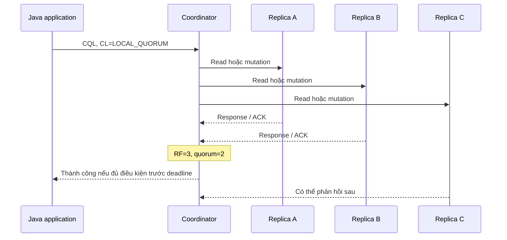
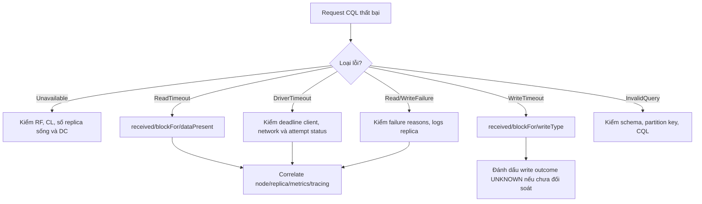
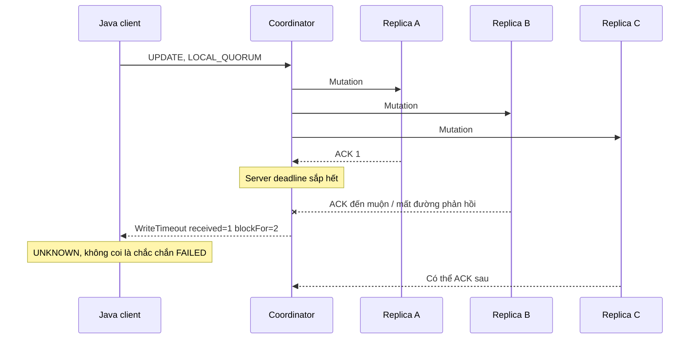
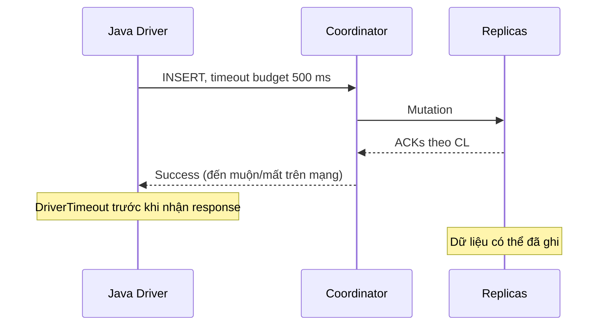
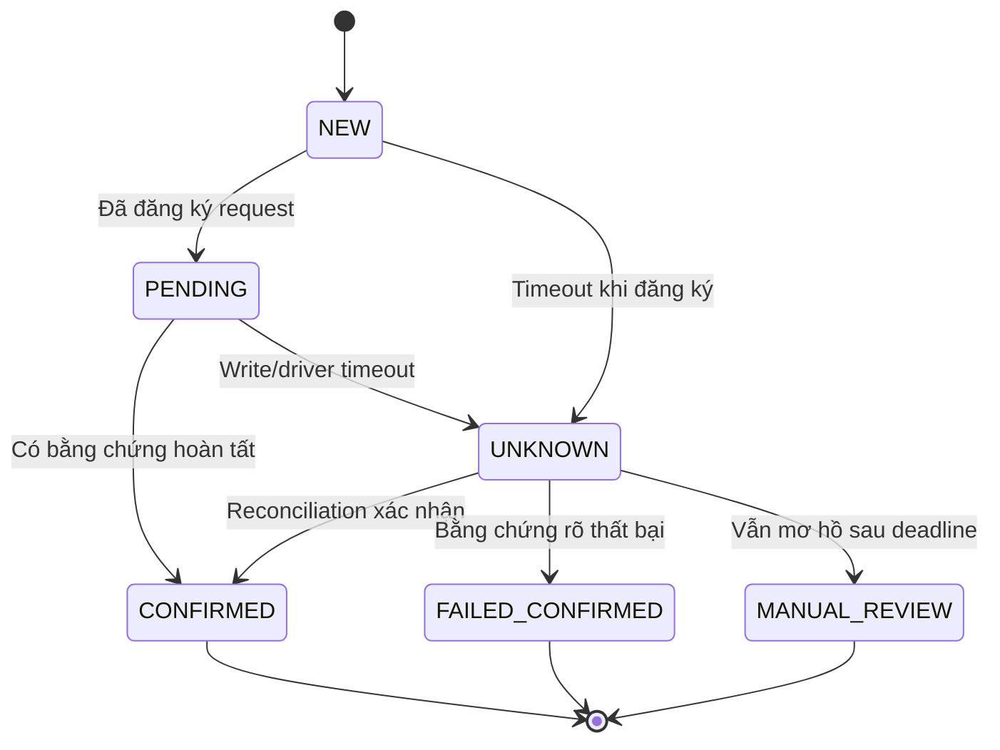

# ReadTimeout/WriteTimeout: kiểm tra write type, ACK và dữ liệu nhận được trong Apache Cassandra

## 1. Bối cảnh: timeout không đồng nghĩa dữ liệu không tồn tại hoặc chưa được ghi

Trong module **DATABASE_ENGINE_WIDE_COLUMN_CASSANDRA**, Apache Cassandra là cơ sở dữ liệu **wide-column phân tán**. Dữ liệu được phân bố theo **partition key**, nhân bản bằng **replication factor (RF)**, và các request đọc/ghi sử dụng **consistency level (CL)** để xác định số replica cần phản hồi. Ứng dụng Java sử dụng CQL thông qua Java Driver hoặc Spring Data Cassandra, nhưng nó không trực tiếp nhìn thấy tất cả trạng thái giữa coordinator, các replica, mạng và bộ nhớ/đĩa của server.

Khi một API gặp `ReadTimeout` hoặc `WriteTimeout`, phản ứng sai phổ biến là:

- “Không tìm thấy row” khi thực chất request đọc **không hoàn tất đúng hạn**.
- “Ghi chắc chắn thất bại” khi client chỉ biết **chưa nhận đủ xác nhận**.
- Tự động thử lại mọi mutation, làm tăng tải hoặc gây side effect lặp.
- Giảm `LOCAL_QUORUM` thành `ONE` mà không đánh giá hợp đồng nhất quán.
- Tăng timeout lên một giá trị rất lớn mà không tìm nguyên nhân replica, compaction, tombstone hay network.
- Xem `received` là số hàng trả về thay vì số phản hồi từ replica/coordinator theo protocol.

Bài **Xử lý sự cố** này tập trung vào chủ đề: **ReadTimeout/WriteTimeout và kiểm tra write type, ACK hoặc dữ liệu nhận được**.

### Sau bài học, bạn có thể

1. Vẽ được luồng coordinator–replica của một request ở RF=3, CL=`LOCAL_QUORUM`.
2. Phân biệt `ReadTimeoutException`, `WriteTimeoutException`, `UnavailableException`, `ReadFailureException/WriteFailureException` và timeout phía Java Driver.
3. Giải thích các trường **`received`, `blockFor`, `dataPresent`** trong đường đọc và **`writeType`** trong đường ghi.
4. Biết **cái gì có thể và không thể kết luận** từ ACK, kể cả khi response bị mất.
5. Thu log/metrics có cấu trúc qua Java Driver 4.x để xác định loại timeout.
6. Chẩn đoán bằng topology, RF/CL, `nodetool`, CQL tracing, metrics và trạng thái compaction/repair.
7. Xử lý write outcome **UNKNOWN** bằng idempotency key/read-back/reconciliation thay vì retry mù quáng.
8. Thiết kế một bài thử fault/load **trong môi trường cách ly** và runbook sự cố production có điểm dừng.
9. Tránh đánh tráo nguyên nhân “quá ít ACK” với “không có full data response” hoặc “batch ghi không nguyên tử”.

## 2. Một request Cassandra đi qua những đâu?

Ứng dụng không nói chuyện với mọi replica một cách thủ công. Java Driver chọn một **coordinator**, coordinator xác định replica dựa trên partition key, token ring, keyspace replication và topology.



Sơ đồ chỉ minh họa: Cassandra có nhiều tối ưu như chọn full-data replica, digest responses, speculative retries, request forwarding và write hints; đường thực tế tùy phiên bản, CL, loại query và trạng thái node.

Với RF=3 tại cùng một datacenter:

\[
\operatorname{quorum} = \left\lfloor\frac{RF}{2}\right\rfloor+1 = 2
\]

| CL trong DC | Số replica phản hồi cần về cơ bản | Ý nghĩa |
| --- | ---: | --- |
| `LOCAL_ONE` | 1 | Ưu tiên độ sẵn sàng/latency, có thể đọc replica chưa cập nhật |
| `LOCAL_QUORUM` | 2 khi RF DC=3 | Cần đa số replica trong local DC |
| `ALL` | 3 khi có 3 replica trong tập áp dụng | Nhạy với một replica chậm/không sẵn sàng |
| `LOCAL_SERIAL` | Đường thỏa thuận LWT, không thay cho CL thường | Dành cho pha serial/conditional operation |

**Lưu ý:** việc đặt RF=3 trong keyspace không tự tạo ba replica nếu lab chỉ có một node. Một test RF=1 với `LOCAL_QUORUM` chỉ yêu cầu **một** replica và không kiểm chứng hành vi RF=3 khi một node DOWN.

### 2.1. ACK là tín hiệu của một pha, không phải chứng nhận nghiệp vụ

**ACK ghi** là xác nhận trong giao thức Cassandra đối với pha ghi ở một replica/nhánh xử lý, được coordinator tổng hợp theo write type và CL. Nó không tự đảm bảo:

- Mọi replica đã nhận mutation.
- Mọi bản sao có cùng dữ liệu ngay lập tức.
- Một thao tác ngoài Cassandra (gửi email/trừ tiền) đã diễn ra chính xác một lần.
- Giao dịch đa bảng có semantics ACID giống SQL RDBMS.
- Không có write khác cùng partition đã thắng do timestamp/last-write-wins.

Với `durable_writes = true`, Cassandra dùng commit log và memtable theo cơ chế durability của engine, nhưng không nên hiểu **mỗi ACK là một bản backup riêng** hoặc mỗi replica đã fsync theo đúng điều kiện bạn tự giả định. Khi cần phân tích durability, phải xem commit-log sync settings, storage behavior và version Cassandra cụ thể.

**ACK đọc** cũng không phải “đã tìm thấy N hàng”. Coordinator có thể nhận **digest** hoặc **full-data response**; số phản hồi về và sự hiện diện của dữ liệu đầy đủ là hai chiều khác nhau.

## 3. Phân loại lỗi trước khi làm bất kỳ điều gì

| Lỗi / hiện tượng | Lớp phát sinh | Có thể suy ra | Không được suy ra |
| --- | --- | --- | --- |
| `ReadTimeoutException` | Coordinator/server-side response cho CQL đọc | Không hoàn tất đọc theo CL trước deadline server | Row không tồn tại |
| `WriteTimeoutException` | Coordinator/server-side response cho CQL ghi | Không đạt điều kiện ACK của pha ghi trong deadline | Mutation chắc chắn không áp dụng |
| `UnavailableException` | Coordinator đánh giá không đủ replica sống cho CL | Không đủ replica khả dụng để thực thi yêu cầu | Mọi replica đã mất dữ liệu |
| `ReadFailureException` / `WriteFailureException` | Lỗi/response failure từ replica trong xử lý | Có replica báo thất bại, không chỉ chậm | Nguyên nhân đã được xác định nếu không xem failure details |
| `DriverTimeoutException` | Deadline phía Java Driver | Client chưa nhận terminal response đúng hạn | Coordinator chưa nhận request; mutation không xảy ra |
| `AllNodesFailedException` | Driver thử các node khả dụng nhưng không có đường hoàn tất | Cần xem lỗi con theo node/attempt | Mọi node Cassandra chắc chắn DOWN |
| `InvalidQueryException` | Schema/CQL/query rules | Request bị từ chối do query/type/permission tương ứng | Thêm timeout sẽ sửa được schema |
| `Unavailable` khi RF/CL không khớp lab | Cấu hình/topology | Có thể thiếu replica theo CL | Cluster cần tăng heap trước tiên |

Với Java Driver, một ngoại lệ có thể được **bọc trong `CompletionException`** khi gọi async, hoặc xuất hiện trong lỗi tổng hợp theo các attempts. Không chỉ phân loại theo `exception.getMessage()` rồi bỏ qua **loại lỗi, CL, coordinator và các trường chẩn đoán**.

### 3.1. Câu hỏi phân loại nhanh



## 4. ReadTimeout: `received`, `blockFor` và `dataPresent`

`ReadTimeout` thường phản ánh việc coordinator **không tập hợp đủ điều kiện đọc theo consistency level trước timeout**. Driver 4.x cung cấp thông tin tương ứng để phân biệt thiếu response và thiếu full data.

### 4.1. `blockFor` là gì?

`blockFor` là số phản hồi cần thiết cho request theo đường consistency đang thực thi, tính theo quy tắc của coordinator/CL. Ví dụ `LOCAL_QUORUM` trong DC RF=3 thường cần **2**.

Nó không phải:

- Số row phải trả về.
- Số bytes cần đọc.
- Số node trong toàn bộ cluster.
- Một ngưỡng CPU hay số milliseconds.

### 4.2. `received` là gì?

`received` cho biết coordinator đã nhận được bao nhiêu phản hồi replica đủ điều kiện trong bối cảnh timeout này. Khi so với `blockFor`, bạn biết thiếu bao nhiêu phản hồi kịp thời.

Ví dụ giả định:

```text
ReadTimeout:
  consistency: LOCAL_QUORUM
  received: 1
  blockFor: 2
  dataPresent: false
```

Coordinator chưa nhận đủ hai phản hồi trước deadline. Cần xem **replica nào chậm**, coordinator có quá tải không, query có hot/wide partition hay quá nhiều tombstone không. **Không thể kết luận** hàng được tìm kiếm không tồn tại.

### 4.3. `dataPresent` là gì?

Trong read path, Cassandra có thể dùng **digest response** để so khớp replica và **full-data response** để cung cấp dữ liệu thực tế. `dataPresent` cho biết coordinator có nhận được dữ liệu đầy đủ theo ý nghĩa của giao thức hay không.

Hai ví dụ:

| received | blockFor | dataPresent | Diễn giải gợi ý |
| ---: | ---: | --- | --- |
| 1 | 2 | false | Chưa đủ response cho quorum; chưa có full data |
| 1 | 2 | true | Có full data từ một nơi nhưng chưa đủ quorum |
| 2 | 2 | false | Số phản hồi có thể đã đạt ngưỡng nhưng **chưa có full-data response cần thiết** |
| 2 | 2 | true | Thông thường đủ điều kiện để trả kết quả nếu không có lỗi/race khác; kiểm exception/version/timeline trước khi khái quát |

**Điểm then chốt:** `dataPresent=false` **không đồng nghĩa** “SELECT không có hàng”. Một `SELECT` thành công trả result set rỗng vẫn có thể đã nhận một full-data response hợp lệ. “Không tồn tại” là **kết quả hợp lệ của query**, còn “chưa có dữ liệu đáp ứng để hoàn tất giao thức” là **trạng thái timeout**.

### 4.4. Vì sao nhận đủ số phản hồi vẫn có ReadTimeout?

Một đường đọc có thể nhận đủ những phản hồi dạng **digest** hoặc response không cho coordinator dữ liệu hoàn chỉnh để trả về trước hạn. Vì vậy, khi `received >= blockFor` nhưng `dataPresent=false`, đừng giải thích đơn giản “Cassandra báo sai vì quorum đã đủ”. Cần xem full-data replica, tracing, server logs, speculated read và network behavior.

**Không suy quá mức từ ba field:** chúng là snapshot lúc timeout, không chứa danh sách chắc chắn replica nào có bản dữ liệu mới nhất hoặc row cuối cùng sẽ là gì.

## 5. WriteTimeout: `received`, `blockFor` và `writeType`

`WriteTimeoutException` là tín hiệu coordinator không nhận được số xác nhận theo **pha ghi** và CL đúng hạn. Quan trọng hơn: **write type** cho biết timeout xảy ra trong dạng thao tác/pha nào, vì thao tác ghi đơn, batch, counter và CAS có semantics khác nhau.

### 5.1. Ví dụ dễ đọc

Giả sử RF=3 trong DC `dc1`, `LOCAL_QUORUM`:

```text
WriteTimeout:
  consistency: LOCAL_QUORUM
  received: 1
  blockFor: 2
  writeType: SIMPLE
```

Ý nghĩa an toàn:

- Coordinator thấy **một ACK** liên quan đến yêu cầu ghi khi timeout.
- Yêu cầu **hai ACK** theo write CL trong bối cảnh này.
- Client không thể coi mutation đã thành công theo hợp đồng `LOCAL_QUORUM`.
- **Ít nhất một phần công việc có thể đã xảy ra** trên một replica; replica khác có thể cũng nhận mutation nhưng ACK chưa về.
- Kết quả cuối cần được phân loại **UNKNOWN** cho nghiệp vụ nếu không có bằng chứng xác nhận/ngăn trùng.

Không được kết luận “chỉ một replica chứa dữ liệu” vì ACK đến muộn hoặc mất mạng không đồng nghĩa mutation không được áp dụng. Tương tự, `received=0` không bảo đảm cả cluster không nhận write.

### 5.2. `writeType` là tín hiệu pha, không phải mã thành công

Các write types thường gặp ở các bản Cassandra/Driver tương thích:

| writeType | Thao tác/pha đại diện | Câu hỏi chẩn đoán |
| --- | --- | --- |
| `SIMPLE` | Mutation thông thường, không phải counter/đường batch đặc biệt | Replica nào không ACK, write path/commit log/memtable có chậm không? |
| `BATCH` | Giai đoạn áp dụng mutations của logged batch theo protocol | Batch chứa bao nhiêu partitions, mutation nào có thể đã chạy? |
| `UNLOGGED_BATCH` | Batch không ghi batch log | Đang gửi batch qua nhiều partition, tải coordinator/replica thế nào? |
| `BATCH_LOG` | Pha liên quan lưu batch log trong logged batch | Có batch log node/đường ghi log gặp lỗi? Không suy mọi mutation chắc chắn chưa diễn ra nếu chưa xác minh |
| `COUNTER` | Counter mutation | Retry có thể **cộng hai lần**, không tự xử lý như upsert giá trị cố định |
| `CAS` | Lightweight transaction / conditional write | Pha serial/conditional result có thể chưa rõ; phải đọc lại state/version |
| `VIEW` | Đường cập nhật liên quan materialized view khi phiên bản hỗ trợ | MV infrastructure và base table đồng bộ ra sao? |
| Kiểu khác theo phiên bản | Server/Driver có thể bổ sung giá trị hoặc logic | Ghi nguyên giá trị thực, tra tài liệu bản đang chạy |

**Lưu ý tương thích:** danh sách enum/write types và cách phân loại pha phụ thuộc Cassandra Server và Java Driver version. Không viết một switch Java giả định mọi bản có chính xác cùng danh sách và không có giá trị mới.

### 5.3. `BATCH_LOG` không giống `BATCH`

Một **logged batch** có thêm cơ chế batch log nhằm hỗ trợ khả năng hoàn thành eventual mutations trong điều kiện lỗi; nó **không biến nhiều bảng/partition thành giao dịch SQL ACID với isolation**.

Khi timeout:

- `BATCH_LOG` giúp định hướng chẩn đoán **pha lưu batch log**.
- `BATCH` hướng tới pha **mutations của batch**.
- `UNLOGGED_BATCH` cần xem nhiều mutations được gửi nhưng không có batch log.
- Mọi trường hợp đều phải xử lý state **chưa rõ** khi không nhận được xác nhận cuối.

**Không** chuyển một job bulk insert hàng nghìn partition vào một logged batch lớn chỉ vì thấy timeout; batch lớn làm tải coordinator/batch log/replica nặng hơn. Cassandra batch không phải công cụ bulk ingest tổng quát.

### 5.4. Vì sao `COUNTER` và `CAS` đặc biệt nhạy cảm?

Với counter:

```sql
UPDATE commerce.counters_by_id
SET view_count = view_count + 1
WHERE counter_id = ?;
```

Nếu timeout, tự retry có thể cộng thêm một lần. Bạn **không thể** dựa vào một read-back sau đó để phân biệt chắc chắn mỗi attempt khi có nhiều writer đồng thời nếu không có business ledger.

Với CAS/LWT:

```sql
UPDATE commerce.payments_by_id
SET state = 'COMMITTED'
WHERE payment_id = ?
IF state = 'PENDING';
```

Timeout có thể xảy ra khi quá trình điều kiện đang/đã được thực hiện. Cần đọc lại **state và version/request ID**, không mặc định CAS chưa áp dụng. `[applied]=false` là kết quả conditional write **được trả về thành công**, không phải chính nó là một `WriteTimeout`.

## 6. Hai timeline: kết quả coordinator và điều client nhìn thấy

### 6.1. Write có thể áp dụng nhưng client vẫn thấy timeout



Một **timeout response** không rollback các mutations đã gửi. Thời điểm coordinator quyết định timeout và thời điểm các replica xử lý mutation có thể khác nhau.

### 6.2. Client timeout trước khi thấy server response



Ở trường hợp này, Java Driver có thể báo **DriverTimeoutException** chứ không phải `WriteTimeoutException` từ coordinator. Không tự suy rằng coordinator phát sinh server-side timeout.

**Điểm chung:** application không có bằng chứng terminal success. Với thao tác nghiệp vụ có side effect, trạng thái phải là **UNKNOWN cần đối soát**, không phải “ghi lỗi nên an toàn gửi lại dưới ID mới”.

## 7. Ma trận xử lý nhanh theo lỗi và kiểu thao tác

| Nhận được | Read/write | Ưu tiên xác minh | Hành động an toàn trước mắt |
| --- | --- | --- | --- |
| ReadTimeout, received < blockFor | Read | Replica/network/queue, RF/CL | Bounded retry đọc idempotent nếu policy cho phép; quan sát overload |
| ReadTimeout, đủ count nhưng dataPresent=false | Read | Full-data response path, tracing | Kiểm coordinator/replica, không biến thành “not found” |
| WriteTimeout SIMPLE | Write | ACK/mutation status, node health | Đánh dấu UNKNOWN; đọc lại theo key và contract |
| WriteTimeout COUNTER | Write | Logical increment ID/ledger | Không retry counter mù quáng |
| WriteTimeout CAS | LWT | State/version, serial CL, contention | Đối soát điều kiện đã áp dụng hay chưa |
| WriteTimeout BATCH/BATCH_LOG | Batch | Các mutation, batch log, partial visibility | Kiểm từng invariant; không giả định SQL transaction |
| Unavailable | Read/write | Live replicas theo RF/DC/CL | Khôi phục topology trước, không spam retries |
| DriverTimeout | Read/write | Client queue, network, server có thấy request? | Đối soát write, kiểm timeout budget và attempts |
| ReadFailure/WriteFailure | Read/write | Failure details + server logs | Điều tra lỗi replica, không gộp vào timeout |

Một **read** không có side effect thường có thể retry với backoff và budget sau khi loại trừ overload, nhưng nếu workload có read repair, paging hoặc query cực nặng thì retry cũng làm tăng tải. Không đặt retry count vô hạn hoặc retry mọi node đồng thời khi cluster đã bão hòa.

## 8. Java Driver 4.x: trích trường chẩn đoán từ exception

Java Driver 4.x phân loại server errors theo class và cung cấp getters để lấy consistency level, responses và write type. Ví dụ sau sử dụng Java 11+ và các package API Driver 4.x phổ biến; khi tích hợp, đối chiếu với dependency version được pin.

### 8.1. Helper xử lý synchronous exception

```java
import java.util.concurrent.CompletionException;
import java.util.concurrent.ExecutionException;

import com.datastax.oss.driver.api.core.DriverTimeoutException;
import com.datastax.oss.driver.api.core.servererrors.ReadTimeoutException;
import com.datastax.oss.driver.api.core.servererrors.WriteTimeoutException;
import com.datastax.oss.driver.api.core.servererrors.UnavailableException;

public final class CassandraTimeoutDiagnostics {

    public static Throwable unwrap(Throwable error) {
        Throwable t = error;

        while ((t instanceof CompletionException
                || t instanceof ExecutionException)
                && t.getCause() != null) {
            t = t.getCause();
        }

        return t;
    }

    public static void inspect(Throwable failure) {
        Throwable error = unwrap(failure);

        if (error instanceof ReadTimeoutException) {
            ReadTimeoutException e =
                (ReadTimeoutException) error;

            System.err.printf(
                "kind=READ_TIMEOUT cl=%s received=%d " +
                "blockFor=%d dataPresent=%s%n",
                e.getConsistencyLevel(),
                e.getReceived(),
                e.getBlockFor(),
                e.wasDataPresent());

        } else if (error instanceof WriteTimeoutException) {
            WriteTimeoutException e =
                (WriteTimeoutException) error;

            System.err.printf(
                "kind=WRITE_TIMEOUT cl=%s received=%d " +
                "blockFor=%d writeType=%s%n",
                e.getConsistencyLevel(),
                e.getReceived(),
                e.getBlockFor(),
                e.getWriteType());

        } else if (error instanceof UnavailableException) {
            UnavailableException e =
                (UnavailableException) error;

            System.err.printf(
                "kind=UNAVAILABLE cl=%s%n",
                e.getConsistencyLevel());

        } else if (error instanceof DriverTimeoutException) {
            System.err.println(
                "kind=DRIVER_TIMEOUT; write outcome may be UNKNOWN");

        } else {
            System.err.printf(
                "kind=OTHER class=%s message=%s%n",
                error.getClass().getName(),
                error.getMessage());
        }
    }

    private CassandraTimeoutDiagnostics() { }
}
```

**Quan trọng về đoạn mã:**

- `e.getReceived()` phản ánh số phản hồi ở thời điểm lỗi, **không** phải số row.
- `e.wasDataPresent()` phản ánh full-data response condition, **không** chứng minh row tồn tại.
- `e.getWriteType()` hỗ trợ xác định **loại/pha ghi**, không xác nhận mutation đã/đã không áp dụng.
- `UnavailableException` cần thêm số replica alive/required nếu API version cung cấp; ví dụ in CL để tránh phụ thuộc getter ở bản cũ. Dùng observed topology để kết luận.
- `System.err` chỉ minh họa học tập; production phải dùng **structured logging/metrics với rate limiting**, tuyệt đối không log raw CQL bind chứa PII/secrets.
- Getter, enum và package có thể có khác biệt giữa các minor release hoặc các driver family; kiểm compile và reference Javadoc theo version đang khóa.
- Một số lỗi có thể được tổng hợp trong `AllNodesFailedException`; ví dụ này chưa duyệt lỗi theo từng node/attempt.

### 8.2. Ví dụ gọi CQL đồng bộ có deadline

```java
import java.time.Duration;
import java.util.UUID;

import com.datastax.oss.driver.api.core.CqlSession;
import com.datastax.oss.driver.api.core.DefaultConsistencyLevel;
import com.datastax.oss.driver.api.core.cql.PreparedStatement;
import com.datastax.oss.driver.api.core.cql.Row;

public class OrderReadService {

    private final CqlSession session;
    private final PreparedStatement select;

    public OrderReadService(CqlSession session) {
        this.session = session;
        this.select = session.prepare(
            "SELECT order_id, state FROM commerce.orders_by_id " +
            "WHERE order_id = ?");
    }

    public Row find(UUID orderId) {
        try {
            return session.execute(
                select.bind(orderId)
                    .setConsistencyLevel(
                        DefaultConsistencyLevel.LOCAL_QUORUM)
                    .setTimeout(Duration.ofSeconds(2))
                    .setIdempotent(true)).one();

        } catch (RuntimeException error) {
            CassandraTimeoutDiagnostics.inspect(error);
            throw error; // Không biến timeout thành "row not found".
        }
    }
}
```

Ở đây `LOCAL_QUORUM` là yêu cầu của ứng dụng ví dụ; phải bảo đảm keyspace RF/topology thực sự phù hợp. Không copy vào test một node RF=1 rồi suy cơ chế quorum giống production.

### 8.3. Bất đồng bộ: không bỏ mất cause

```java
import java.util.concurrent.CompletionStage;
import com.datastax.oss.driver.api.core.cql.AsyncResultSet;

CompletionStage<AsyncResultSet> stage =
    session.executeAsync(statement);

CompletionStage<AsyncResultSet> observed =
    stage.whenComplete((page, error) -> {
        if (error != null) {
            CassandraTimeoutDiagnostics.inspect(error);
        }
    });

// Trả observed cho caller tiếp tục xử lý.
// Không join() trên Netty/event-loop callback.
```

`session` và `statement` là các biến đã chuẩn bị trong service. Callback chỉ ghi thông tin nhẹ, không làm blocking I/O, không call `Thread.sleep` hoặc retry ngay trong driver callback. Để thực thi logic nghiệp vụ, caller phải tiếp tục **propagate error** và phân loại trạng thái; logging một lần không tự hoàn tất workflow.

### 8.4. Trường hợp nhiều lỗi node/attempt

Java Driver có thể thử nhiều coordinator theo policy/topology. Nếu gặp một exception tổng hợp, hãy ghi:

- Driver `AllNodesFailedException` và danh sách node/attempt errors theo API version.
- Thời điểm, coordinator được chọn, execution profile và CQL operation ID.
- Có retry/speculative execution hay không.
- Lỗi gốc theo từng attempt; một attempt có thể là network error, attempt khác là server timeout.
- Một logical write có thể có **nhiều attempts**, không được đếm mỗi attempt như một nghiệp vụ mới.

**Đừng** suy một `AllNodesFailedException` luôn chứa `WriteTimeoutException`; phải đọc đúng cause collection, không parse text theo regex quá mong manh.

## 9. Ghi log và metrics theo một chuẩn có thể điều tra

Một log sự cố hữu ích phải chứa **ngữ cảnh đủ để gắn lỗi với topology và CQL**, nhưng không chứa dữ liệu nhạy cảm.

```json
{
  "event": "cassandra_request_failed",
  "operation": "order-write",
  "logical_request_id": "synthetic-req-0031",
  "query_id": "update-order-state",
  "consistency": "LOCAL_QUORUM",
  "error_kind": "WRITE_TIMEOUT",
  "received": 1,
  "block_for": 2,
  "write_type": "SIMPLE",
  "driver_timeout_ms": 2000,
  "attempt_count_observed": 1,
  "partition_token_hash": "redacted-or-hashed",
  "coordinator_alias": "node-b",
  "outcome": "UNKNOWN",
  "time_utc": "2026-11-21T03:00:00Z"
}
```

Đây là **ví dụ minh họa**, không phải log thật của Cassandra. Hệ thống cần bảo đảm:

- `logical_request_id` không chứa ID khách hàng nhạy cảm.
- `attempt_count_observed` chỉ ghi khi có nguồn thực, không tự đoán.
- `partition_token_hash` không khiến thông tin nhạy cảm có thể đảo ngược dễ dàng.
- Timestamp có UTC và cơ chế đồng bộ đồng hồ khi so client/server logs.
- `outcome=UNKNOWN` được cập nhật khi reconciliation hoàn tất; không giữ UNKNOWN vô hạn mà không có owner.

### 9.1. Các metric tối thiểu

| Metric | Giá trị chẩn đoán | Lưu ý |
| --- | --- | --- |
| ReadTimeout count theo CL/query | Đường đọc bị timeout ở đâu | Tách `ReadFailure`/`Unavailable` |
| WriteTimeout count theo `writeType` | Pha ghi nào bị ảnh hưởng | Đếm logical request và attempts riêng |
| received/blockFor histogram | Thiếu bao nhiêu ACK/response | Cardinality thấp, không label theo user ID |
| dataPresent true/false | Thiếu full data response hay thiếu count | Không đồng nghĩa có/không có row |
| DriverTimeout count | Vấn đề phía client/network/deadline | Có thể xuất hiện không kèm server timeout |
| p50/p95/p99 và error rate | Tail latency vs failures | Cùng boundary đo, không bỏ timed-out requests |
| Per-node CPU/GC/disk/network | Bão hòa replica/coordinator | Node labels an toàn |
| Dropped messages/pending tasks | Queue overload/backpressure | Cần xem version/metric names |
| Compaction pending/active | SSTable/IO contention | Không tự ép compaction khi đang sự cố |
| Tombstone scanned/read | Read amplification | Theo query/table và server version |
| Hot partition/row size | Key distribution và wide partition | Không log partition keys thật vào public dashboard |
| Retry/speculative attempts | Load amplification | Bounded retry budget |
| UNKNOWN reconciliation age | Rủi ro sai trạng thái nghiệp vụ | SLO cho tiến trình đối soát |

Nếu p99 “đẹp” nhưng tỷ lệ `ReadTimeout` tăng, cách tính histogram có thể chỉ bao gồm **những request thành công**; cần biểu diễn đầy đủ **failure + timeout + queue wait**.

## 10. Kiểm RF/CL/topology trước khi tăng timeout

### 10.1. Lệnh quan sát node

Trên testbed hoặc production theo quyền vận hành **read-only**, đối chiếu từng node:

```bash
nodetool status
nodetool describecluster
nodetool info
nodetool tpstats
nodetool compactionstats
nodetool netstats
```

Một số phiên bản có cú pháp/nhãn metric khác; lưu command, server version, timestamp và node phát lệnh. `nodetool status` cho biết topology theo góc nhìn node đang hỏi, không phải kết luận mọi replica nhất trí tuyệt đối.

Với bảng cụ thể:

```bash
nodetool tablestats commerce.orders_by_id
nodetool tablehistograms commerce orders_by_id
```

Cần xem:

- Replica sống thực sự có đủ cho CL không?
- Datacenter driver chọn có đúng `local-datacenter` không?
- Disk usage, commit log, memtable, GC pause và dropped messages có bất thường?
- Có compaction/repair/streaming/backup chạy cùng cửa sổ timeout?
- Node nào làm coordinator và node nào là replica của partition?
- Có hot partition key hoặc partition quá lớn so với schema/query không?

### 10.2. CQL kiểm schema và replication

```sql
SELECT keyspace_name, replication, durable_writes
FROM system_schema.keyspaces
WHERE keyspace_name = 'commerce';

SELECT table_name, compaction, compression
FROM system_schema.tables
WHERE keyspace_name = 'commerce'
  AND table_name = 'orders_by_id';
```

Đây là truy vấn **kiểm metadata** trong Cassandra version hỗ trợ schema system tables tương ứng. Chỉ thấy `replication = {'dc1':'3'}` chưa đủ để khẳng định ba replica sống. Phải so với topology thực và consistency level request.

### 10.3. Suy luận theo ví dụ RF=3

| Tình huống | `LOCAL_QUORUM` cần | Kết quả có thể |
| --- | ---: | --- |
| 3 replica UP, ít tải | 2 | Thường thành công nếu đủ response kịp thời |
| 1 replica DOWN, 2 UP khỏe | 2 | Vẫn có thể thành công |
| 1 replica DOWN, 1 trong 2 UP chậm | 2 | Có thể ReadTimeout/WriteTimeout |
| Chỉ 1 replica được thấy UP | 2 | Thường `Unavailable` thay vì chờ timeout |
| 3 UP, compaction/GC/network làm 2 chậm | 2 | Có thể timeout dù status đều UP |

Một node có status **UN** (*Up/Normal*) không đảm bảo nó có thể trả lời mọi request trong deadline. Health topology là điều kiện cần, **không** phải chứng nhận latency.

## 11. Phân tích ReadTimeout: runbook theo dữ liệu nhận được

### Trường hợp A — `received < blockFor`

```text
read_timeout:
  CL: LOCAL_QUORUM
  RF in local DC: 3
  received: 1
  blockFor: 2
  dataPresent: true
```

**Diễn giải:** coordinator có thể đã nhận một full-data response, nhưng chưa đủ count cho quorum.

Kiểm theo thứ tự:

1. Xác định coordinator và replica set của **partition key**.
2. Xác nhận hai/ba replica có thể kết nối, không chỉ nhìn `UP`/`DOWN`.
3. Kiểm server read latency, thread-pool pending/dropped, GC pauses, network RTT.
4. Kiểm query shape: `WHERE` có đủ partition key/clustering ranges không?
5. Kiểm partition size, tombstones, SSTables per read, compaction và disk.
6. Kiểm driver retries làm nhân tải vào cùng replica set không.
7. Nếu chỉ một hot key bị lỗi, kiểm token/replica sở hữu hot key trước khi tăng số node.

**Không** trả HTTP 404 hay `Optional.empty()`; cần trả lỗi phù hợp hoặc áp retry policy bounded theo contract.

### Trường hợp B — `received >= blockFor` nhưng `dataPresent=false`

```text
read_timeout:
  CL: LOCAL_QUORUM
  received: 2
  blockFor: 2
  dataPresent: false
```

**Diễn giải:** đủ số phản hồi ở ngữ cảnh lỗi, nhưng coordinator chưa có dữ liệu đầy đủ để hoàn thành response.

Kiểm:

- Replica nào được chọn để trả **full data** và có timeout/network issue?
- Digest responses có về nhưng full-data response chậm?
- Speculative read/retry có làm timing phức tạp?
- Có read failure/tracing cho request tương tự không?
- Query paging, large partition, tombstone scans có làm full-data read chậm hơn digest path?

Đừng nói “row không tồn tại” chỉ vì `dataPresent=false`. Muốn xác minh row, phải thực hiện **một read thành công đúng CL** ở thời điểm sau hoặc dùng một workflow đối soát được định nghĩa.

### Trường hợp C — Query được phép nhưng rất đắt

Ví dụ:

```sql
-- Query theo partition key nhưng có thể tốn kém nếu partition rất rộng:
SELECT event_ts, payload
FROM commerce.events_by_device
WHERE device_id = ?
LIMIT 100;
```

Dù có `LIMIT 100`, Cassandra có thể cần quét qua nhiều tombstones để tìm đủ row sống. Việc đổi API `execute` sang `executeAsync` **không làm replica tự xử lý CQL nhanh hơn**. Cần sửa thiết kế partition/bucketing, retention hoặc query range, và đo kết quả trên cùng workload.

### Trường hợp D — Chỉ một DC bị timeout

Nếu `LOCAL_QUORUM` ở `dc1` nhưng Java Driver bị cấu hình `local-datacenter` sai, hoặc replica placement/CL không như dự kiến, hãy kiểm DC thực trong `system.local` và RF theo từng DC. Không dùng `EACH_QUORUM` hoặc `QUORUM` thay `LOCAL_QUORUM` mà không hiểu tác động cross-DC.

## 12. Phân tích WriteTimeout: runbook theo `writeType`

### 12.1. SIMPLE — một mutation thường

Ví dụ:

```sql
UPDATE commerce.orders_by_id
SET state = 'PAID'
WHERE order_id = ?;
```

Khi timeout:

1. Ghi `received`, `blockFor`, CL, coordinator, token/replicas.
2. Không đổi state nghiệp vụ thành `FAILED` chỉ vì chưa nhận đủ ACK.
3. Kiểm commit log/memtable/write latency, GC, disk/network và queue trên replicas.
4. Kiểm write có idempotent thật không: một giá trị cố định có thể replay an toàn hơn counter/append, nhưng concurrent writers, TTL và timestamp vẫn có thể tạo kết quả sai.
5. Nếu cần xác nhận trạng thái, **read-back theo partition key** và invariant, với CL đã được thiết kế.
6. Nếu chưa phân biệt được write cũ hay write mới, giữ `UNKNOWN` và đưa vào reconciler.

### 12.2. BATCH và BATCH_LOG — không coi batch là SQL transaction

Logged batch có cơ chế batch log phục vụ xử lý atomicity khi batch failures; các mutations ở nhiều partition **không được quan sát như một SQL transaction có isolation**.

Khi `writeType=BATCH_LOG`:

- Tập trung quan sát batch log path, các nodes liên quan, disk/network và coordinator.
- Không suy chắc mọi mutation chưa tồn tại nếu chưa đối soát.
- Kiểm batch size và số partition; tránh huge cross-partition batches.

Khi `writeType=BATCH` hoặc `UNLOGGED_BATCH`:

- Ghi danh sách logical mutations và keys dưới dạng synthetic/hashed.
- Kiểm từng bảng/partition mục tiêu sau khi request có kết quả chưa rõ.
- Bảo đảm workflow có thể sửa dữ liệu từng phần theo invariant.
- Không retry toàn batch vô điều kiện nếu một số mutation có side effect không idempotent.

**Không dùng batch lớn để tăng write throughput**. Thường tốt hơn dùng prepared async writes bounded theo partition/key strategy.

### 12.3. COUNTER — không retry mù

```sql
UPDATE commerce.counters_by_id
SET total = total + 1
WHERE id = ?;
```

Khi timeout, không có bằng chứng “đã cộng một lần hay chưa”, đặc biệt nhiều concurrent writers. Nếu cần exactly-once ở cấp nghiệp vụ, cân nhắc mô hình **event ledger/request ID + phép tổng hợp idempotent**; counter thuần không tự mang định danh từng lần cộng.

### 12.4. CAS — kiểm điều kiện và phiên bản

```sql
UPDATE commerce.payment_state_by_id
SET state = 'COMMITTED', version = 2
WHERE payment_id = ?
IF state = 'PENDING' AND version = 1;
```

Khi CAS timeout:

1. Không coi `[applied]` là false nếu chưa có response.
2. Đọc `state, version` từ bảng theo key/CL phù hợp.
3. Nếu trạng thái khớp expected effect **và request ID/version chứng minh thuộc operation này**, có thể đánh dấu đã áp dụng theo workflow.
4. Nếu phiên bản khác/có concurrent writer, phân loại conflict hoặc cần đối soát thêm.
5. Chỉ retry CAS theo **same logical operation** và policy đã chứng minh an toàn, không tạo payment event mới.
6. Kiểm contention/latency serial path, không tăng concurrency vô hạn khi CAS đang tranh chấp.

**Read-back chỉ nhìn `state='COMMITTED'` có thể chưa đủ** nếu nhiều actor cùng có thể đưa state thành COMMITTED. Cần request ID, version, transition history hoặc business ledger để quy kết đúng.

### 12.5. VIEW hoặc write path phụ thuộc thành phần khác

Nếu write type gợi ý đường ghi materialized view, kiểm cả trạng thái base table và view update theo khả năng quan sát/semantics phiên bản. Không coi `WriteTimeout` thành “base row không được ghi” khi một thành phần phụ của write path đang chậm. Cần đối soát dữ liệu và cấu hình view theo tài liệu Cassandra version cụ thể.

## 13. Sự khác nhau giữa data correctness và consistency level

### 13.1. R + W > RF là mô hình, không phải giấy bảo đảm tuyệt đối

Với RF=3, nhiều thiết kế dùng R=2/W=2, nên:

\[
R+W = 4 > RF = 3
\]

Điều này tạo giao nhau giữa tập replica tham gia các thao tác theo lý tưởng, nhưng **không tự loại bỏ** mọi vấn đề:

- Concurrent writes và timestamp ordering.
- TTL hoặc tombstone.
- Replica/network failure và delayed mutation.
- Quá trình read repair, hinted handoff, anti-entropy repair.
- LWT/serial consistency nếu nghiệp vụ cần conditional transition.
- Request đã timeout và kết quả chưa rõ.

Không diễn giải công thức thành “mọi read luôn tuyến tính hóa như một SQL transaction” khi thiết kế chưa có ràng buộc tương ứng.

### 13.2. Read-after-write và thời điểm đối soát

Một read-back sau WriteTimeout:

```sql
SELECT state, version, last_request_id
FROM commerce.payment_state_by_id
WHERE payment_id = ?;
```

**Chỉ mang ý nghĩa trong bối cảnh**:

- CL dùng cho read và write là gì?
- Schema/partition key đúng không?
- Có concurrent writers/TTL/delete không?
- Các field có đủ định danh operation không?
- Read có thành công và không bị timeout không?
- Thời điểm read so với các mutations/replica lag ra sao?

Nếu không tìm thấy expected state, vẫn **chưa chắc** mutation sẽ không xuất hiện sau do delay/hints hoặc một replica chưa hội tụ. Ngược lại, thấy state đúng có thể do operation khác nếu không có request/version chứng minh.

## 14. Thiết kế idempotency để xử lý write outcome UNKNOWN

Cách an toàn ở tầng nghiệp vụ là dùng **logical request ID ổn định** và trạng thái có thể đối soát. Ví dụ một quy trình thanh toán/ghi lệnh đặt hàng có thể dùng bảng ledger theo request:

```sql
CREATE KEYSPACE IF NOT EXISTS commerce
WITH replication = {
  'class': 'NetworkTopologyStrategy',
  'dc1': 3
};

CREATE TABLE IF NOT EXISTS commerce.operations_by_request (
    tenant_id uuid,
    request_id uuid,
    payload_hash text,
    status text,
    result_code text,
    updated_at timestamp,
    PRIMARY KEY ((tenant_id), request_id)
);
```

Schema trên chỉ là **minh họa**, phải thay RF/DC và thiết kế nghiệp vụ thật phù hợp. Mỗi request giữ `request_id` **không đổi qua retries**.

Đăng ký operation bằng conditional insert:

```sql
INSERT INTO commerce.operations_by_request (
    tenant_id, request_id, payload_hash, status, updated_at
) VALUES (?, ?, ?, 'PENDING', ?)
IF NOT EXISTS;
```

**Không đánh đồng LWT timeout với “chưa đăng ký”**. Khi không nhận `[applied]`, read-back để xác định đã có row/request/hash hay chưa, và phân biệt request trùng với payload khác.

### 14.1. State machine có UNKNOWN



**UNKNOWN** là trạng thái vận hành có thật: đừng đổi thành thất bại chỉ để API đơn giản. Reconciler có thể:

1. Đọc ledger theo `tenant_id, request_id`.
2. Kiểm `payload_hash` để ngăn reuse key với payload khác.
3. Đọc state/version của dữ liệu đích.
4. Với external provider, gọi API status lookup bằng **cùng provider idempotency key**, không tạo giao dịch mới.
5. Phân loại confirmed/duplicate/conflict/pending/manual review theo deadline.
6. Ghi số attempts và kết quả đối soát để audit.

### 14.2. Không phải cứ đọc lại là exactly-once

Một reconciliation workflow đáng tin phải xét race:

- Read có thể nhìn state cũ trong khi mutation đến sau.
- Một operation khác có thể tạo cùng state.
- Một counter increment không mang identity rõ.
- Các bảng denormalized cập nhật không cùng transaction.
- Kết quả từ hệ thống ngoài Cassandra có thể đến muộn/không nhất quán.

Khi cần tính đúng mạnh, dùng **dedupe ledger, CAS/version/fencing**, workflow outbox hoặc một nguồn sự thật có thể kiểm chứng. CQL read-after-write là **một bằng chứng**, không phải phép màu.

## 15. Kiểm tra từ phía Cassandra server: read path và write path

### 15.1. ReadTimeout liên quan những gì?

| Dấu hiệu | Tầng cần quan sát | Gợi ý nguyên nhân |
| --- | --- | --- |
| Chỉ một partition key bị chậm | Token replicas của key đó | Hot partition, wide partition |
| Nhiều tombstone warnings | Read path, compaction/SSTables | Xóa/TTL, read amplification |
| Nhiều SSTables per read | SSTable state/compaction | Data layout làm đọc tốn I/O |
| CPU/GC cao nhiều node | JVM GC, serialization | Large row/collection, allocation pressure |
| Pending read tasks/dropped | Thread pools/queue | Replica hoặc coordinator quá tải |
| Network RTT/loss cao | Network giữa coordinator/replica | ACK/digest/data response chậm |
| Một DC có lỗi | DC/rack/topology | Routing/CL/replica placement không phù hợp |

Không dùng `SELECT COUNT(*)` liên tục trên partition rất rộng để “kiểm tra số row”: đó có thể là một read đắt và làm tăng timeout. Dùng histogram/metadata và truy vấn diagnostic giới hạn.

### 15.2. WriteTimeout liên quan những gì?

| Dấu hiệu | Tầng cần quan sát | Gợi ý nguyên nhân |
| --- | --- | --- |
| `SIMPLE`, thiếu ACK | Memtable/commit log/write latency | Disk/commit log, GC, network |
| `BATCH_LOG` | Batch log nodes/coordinator | Batch log path hoặc network |
| `COUNTER` | Counter consistency/concurrency | Mutation semantics nhạy retry, contention |
| `CAS` | Paxos/LWT path | High contention, serial latency |
| Đột biến write timeout sau load tăng | Driver retries, in-flight, server queue | Overload/retry storm |
| Chỉ một node báo dropped mutations | Node resource/replica placement | Hot token hoặc node chậm |
| Ứng dụng ghi nhiều partitions trong một batch | Batch size/partition cardinality | Unnecessary batch overhead |

**Compaction/repair/GC** có thể làm cả đọc và ghi chậm cùng lúc. Kiểm timeline để xác định nguyên nhân trước khi thay concurrency, RF hoặc CL.

## 16. CQL tracing và cách dùng không gây thêm sự cố

Với một truy vấn test/synthetic được phép:

```sql
CONSISTENCY LOCAL_QUORUM;
TRACING ON;

SELECT order_id, state
FROM commerce.orders_by_id
WHERE order_id = 11111111-1111-1111-1111-111111111111;

TRACING OFF;
```

Đây là lệnh trong **cqlsh**, không dùng `?` bind marker ở cqlsh nếu không qua prepared statement API. Cần dùng keyspace/table tồn tại, PK synthetic và CL phù hợp RF/DC thật.

Traces có thể cho biết:

- Coordinator và replica path của query.
- Steps và các mốc xử lý/latency theo server version.
- SSTable/tombstone behaviors khi read.
- Vị trí request chậm so với network/replica.

Nhưng:

- Trace tạo **overhead** và metadata; không bật cho tất cả production traffic.
- Query bị timeout có thể thiếu trace events hoặc trace hoàn tất muộn.
- Trace không chứng minh một mutation chưa được áp dụng nếu không thấy event.
- Tracing có thể ghi CQL/values; áp quyền, redaction và retention.
- Kết quả trace có thể thay đổi format giữa các Cassandra versions; không assert exact text.

### 16.1. Chụp trạng thái trước–trong–sau lỗi

Ví dụ danh sách read-only:

```text
T-60s  topology / RF / CL / partition replicas
T-30s  node CPU/GC/disk/network and compaction
T0     request ID + coordinator + error class
T+5s   per-node queue, dropped messages, server logs
T+30s  correctness read-back / UNKNOWN reconcile
T+60s  confirm recovery, record retries and pending
```

Gắn mọi logs/metric vào `run_id`/UTC, đồng bộ đồng hồ nếu phải so giữa máy. Không cung cấp raw customer keys/passwords trong incident report.

## 17. Trình tự xử lý sự cố ReadTimeout trong production

### Pha 1 — Xác minh ảnh hưởng và bảo vệ hệ thống

1. Xác định ảnh hưởng: endpoint nào, tỷ lệ lỗi, p95/p99, read CL, keyspace/table, DC.
2. Kiểm có retry storm hay không; giảm concurrency/bulkhead/load shedding khi cần bảo vệ cluster.
3. Không trả `404 Not Found` cho timeout.
4. Không tăng timeout trên mọi query ngay; chỉ điều chỉnh theo SLO và hiểu nguồn chậm.
5. Xem node health của **replicas liên quan**, không chỉ coordinator.

### Pha 2 — Thu bằng chứng server/client

1. Ghi `received`, `blockFor`, `dataPresent` cho các lỗi được sampling.
2. Ghi driver timeout vs server ReadTimeout và error counts.
3. Kiểm RF/CL thực tế, số replica UP và cách driver chọn DC.
4. Kiểm read latency/server queue, disk I/O, GC, compaction, tombstone metrics.
5. Kiểm query predicate và partition key; tìm hot/wide partitions.
6. Nếu cần, trace một số query synthetic hợp lệ với thời gian giới hạn.

### Pha 3 — Khắc phục theo nguyên nhân

- Replica DOWN → khôi phục node/topology theo runbook được phê duyệt.
- Replica UP nhưng timeout → xem disk/GC/network/compaction, giới hạn tải.
- Tombstone-heavy → sửa TTL/delete/bucketing, không chỉ nâng threshold.
- Hot partition → cache/read routing/sharding được thiết kế, không tạo partition mới tùy tiện.
- Wide partition → bucket/range query và retention, tránh quét không giới hạn.
- Client saturation → giảm in-flight, bounded queue, không block driver event loop.

### Pha 4 — Xác nhận phục hồi

1. Tỷ lệ ReadTimeout giảm và error budget về ngưỡng.
2. p95/p99 trên **cùng workload** cải thiện.
3. Không còn pending queue/retry storm nghiêm trọng.
4. Query đúng kết quả theo CL/consistency contract.
5. Ghi root cause, tác động và follow-up test.

## 18. Trình tự xử lý sự cố WriteTimeout trong production

### Pha 1 — Không tạo write trùng

1. Xác định business operation ID và mức độ nhạy side effect.
2. Không tự động phát **một lệnh mới với request ID mới** khi outcome UNKNOWN.
3. Ghi `writeType`, `received`, `blockFor`, CL, coordinator, partition key hash.
4. Giảm retries/concurrency nếu đang overload, theo chính sách hệ thống.
5. Phân loại lỗi theo SIMPLE/COUNTER/CAS/BATCH/BATCH_LOG và fail/unknown.

### Pha 2 — Điều tra đủ ACK hay không

1. RF/DC/replica set đúng không?
2. Có ít hơn `blockFor` replica khả dụng hay chỉ chậm phản hồi?
3. Replica memtable/commit log/write latency, GC, disk và network thế nào?
4. Batch size/multi-partition/counter contention/LWT contention có bất thường?
5. Retry/speculative attempts có nhân tải vượt logical request count?
6. Có write hints/repair/catch-up đang diễn ra theo server behavior/version?

### Pha 3 — Đối soát kết quả

1. Đọc theo **primary key và CL** đã định nghĩa.
2. Kiểm request ID, version, payload hash và transition, không chỉ một field state.
3. Với counter, đối soát bằng ledger hoặc quy trình đặc thù.
4. Với batch, kiểm invariant trên **từng mutation/table**, không suy tất cả atomic/isolated.
5. Với external provider, kiểm provider status trước khi gửi lại.
6. Nếu không thể xác định, đưa vào `MANUAL_REVIEW` có owner và timeout policy.

### Pha 4 — Khôi phục và phòng ngừa

- Sửa bottleneck thực và giới hạn tải.
- Bổ sung metrics theo write type/ACK deficiency.
- Thiết kế retry budgets, request deduplication và reconciliation worker.
- Kiểm fault scenarios trong staging RF/CL tương đương.
- Cập nhật alert theo tỷ lệ UNKNOWN/age, không chỉ số WriteTimeout.

## 19. Phép thử tích hợp/fault injection để kiểm handler

**Chỉ sử dụng cluster thử nghiệm riêng, dữ liệu synthetic và tài nguyên giới hạn.** Không chủ động làm mất node trên production để “kiểm tra CL”.

### 19.1. Setup RF=3 cho lab nhiều node

Giả sử có ba node cùng DC `dc1`, mỗi node ở rack phù hợp:

```sql
CREATE KEYSPACE IF NOT EXISTS timeout_it
WITH replication = {
    'class': 'NetworkTopologyStrategy',
    'dc1': 3
};

CREATE TABLE IF NOT EXISTS timeout_it.orders_by_id (
    order_id uuid PRIMARY KEY,
    state text,
    version int,
    last_request_id uuid
);
```

Trên một node Testcontainers đơn lẻ, **không** sử dụng schema RF=3 này để thử `LOCAL_QUORUM`; thay RF cho bài mapping/CQL hoặc dựng testbed nhiều node để kiểm fault. DDL là ví dụ về môi trường giả định.

### 19.2. Kịch bản thử và điều kiện dừng

| Case | Setup | Fault trong lab | Expected investigation |
| --- | --- | --- | --- |
| B0 | RF=3, 3 UP, LOCAL_QUORUM | Không | Baseline success/p99 |
| R1 | Đọc một partition synthetic | Một replica chậm | Đủ 2 phản hồi có thể vẫn success; ghi actual received/dataPresent nếu lỗi |
| R2 | Đọc khi một replica DOWN, replica còn lại chậm | Lỗi có kiểm soát | Có thể ReadTimeout, quan sát count/dataPresent |
| W1 | Upsert constant state, RF=3 | Replica ACK chậm | Có thể WriteTimeout SIMPLE; read-back operation/version |
| W2 | CAS theo state/version | Tranh chấp phiên bản có giới hạn | Kiểm CAS timeout/conditional result |
| W3 | Counter ở bảng test | Mô phỏng timeout nhưng không auto retry | Chứng minh handler giữ UNKNOWN |
| B1 | Logged batch nhỏ, test-only | Giới hạn network/disk của testbed | Quan sát writeType thực, đối soát mutations |
| D1 | Client deadline ngắn trên test-only | Delay network có giới hạn | Phân biệt DriverTimeout với server timeout |

**Không bảo đảm mọi lần tiêm lỗi sẽ nhận cùng exception class.** Scheduler, coordinator selection, speculative execution, node state và deadline quyết định lỗi thực. Test phải assert **business invariant và phân loại đúng**, ghi actual exception, không cố ép mọi run trả chính xác `received=1`.

### 19.3. Kiểm retry handler đúng nghiệp vụ

Một test tốt sẽ xác nhận:

- ReadTimeout **không** biến thành empty result/HTTP 404.
- Retry đọc được **giới hạn**, có backoff/jitter và deadline chung.
- WriteTimeout khiến logical operation giữ **same request ID**.
- COUNTER/CAS không bị replay mù quáng.
- `UNKNOWN` có thể được đối soát thành CONFIRMED/FAILED_CONFIRMED/MANUAL_REVIEW.
- Không có số attempts vượt retry budget khi cluster overload.
- Khi bỏ fault, service phục hồi không cần reset/destroy dữ liệu thật.
- Logs/metrics chứa writeType/received/blockFor/dataPresent và không lộ PII.

## 20. Bài tập và tình huống phân tích

### Bài 1 — ReadTimeout thiếu ACK

Một SELECT có RF=3 trong `dc1`, CL=`LOCAL_QUORUM`, driver báo:

```text
received=1, blockFor=2, dataPresent=true
```

1. Số replica cần cho quorum là bao nhiêu?
2. Có thể nói row không tồn tại không?
3. `dataPresent=true` có giúp request thành công dù received=1 không?
4. Bạn sẽ kiểm ba chỉ số nào đầu tiên?

**Gợi ý:** cần 2; không suy row vắng; có full data nhưng vẫn thiếu consistency responses; kiểm replica latency/network/queue và query partition.

### Bài 2 — ReadTimeout đủ count, thiếu dữ liệu đầy đủ

```text
received=2, blockFor=2, dataPresent=false
```

1. Vì sao không thể kết luận query nên thành công?
2. Sự khác nhau giữa digest và full-data response?
3. Làm sao phân biệt “không có row” với “không có full-data response”?
4. Bạn sẽ lấy trace trong điều kiện an toàn thế nào?

**Gợi ý:** coordinator vẫn thiếu dữ liệu cần trả. Thử read **thành công** theo key/CL để xác nhận row; trace sample có redaction, không bật toàn traffic.

### Bài 3 — WriteTimeout SIMPLE

RF=3, CL `LOCAL_QUORUM`, `received=1`, `blockFor=2`, `writeType=SIMPLE`.

1. Đã có bao nhiêu ACK đúng hạn?
2. Có chắc chỉ một replica đã ghi không?
3. Nếu ứng dụng ghi `state='PAID'`, có nên tự động tạo payment mới?
4. Cách đối soát nào phân biệt operation ban đầu với write khác?

**Gợi ý:** chỉ biết ACK đã nhận, không biết mọi replica áp dụng; giữ UNKNOWN, dùng request ID + version/payload hash + provider status.

### Bài 4 — COUNTER timeout

Hai concurrent workers cùng chạy `view_count = view_count + 1`; một worker gặp WriteTimeout COUNTER.

1. Vì sao retry có thể tăng sai count?
2. Có thể suy từ `received=0` rằng không có replica nào tăng count không?
3. Business cần exactly-once count thì thiết kế lại thế nào?

**Gợi ý:** dùng ledger/dedup theo event ID và phép tổng hợp được kiểm soát, không coi counter mutation là idempotent.

### Bài 5 — CAS và outcome UNKNOWN

LWT:

```sql
UPDATE timeout_it.orders_by_id
SET state='SHIPPED', version=3
WHERE order_id=?
IF state='PAID' AND version=2;
```

Client timeout trước response.

1. Có thể ghi `[applied]=false` vào database nghiệp vụ không?
2. Vì sao đọc `state='SHIPPED'` chưa chắc chứng minh operation này thành công?
3. Nên lưu thêm field nào để đối soát?

**Gợi ý:** `last_request_id`/version/transition log và serial consistency contract; giữ UNKNOWN đến khi có bằng chứng.

### Bài 6 — Phân biệt Unavailable và WriteTimeout

Cluster DC có RF=3, CL `LOCAL_QUORUM`. Chỉ một replica được xem là alive trước request.

1. Vì sao có thể trả `Unavailable`?
2. Nếu có ba replica UP nhưng hai replica quá chậm thì lỗi nào có thể xảy ra?
3. `nodetool status` hiển thị UN có đảm bảo request thành công không?

**Gợi ý:** insufficient live replicas gây Unavailable; đủ replica “UP” nhưng thiếu response đúng hạn gây timeout. UP không đồng nghĩa kịp deadline.

### Bài 7 — DriverTimeout và timeout server

Một Java endpoint có timeout 500 ms; Cassandra có thể hoàn tất write sau 700 ms. Client báo DriverTimeout.

1. Có đủ bằng chứng server trả WriteTimeout không?
2. Có thể write đã áp dụng không?
3. Nếu middleware tự retry với request ID mới thì rủi ro gì?
4. Cần ghi metric/log gì để tương quan timeline?

**Gợi ý:** driver deadline không cho biết server status; giữ request ID và reconcile, log attempt/coordinator/CL/UTC.

### Bài 8 — Batch không phải transaction SQL

Một logged batch cập nhật hai partitions, client nhận `WriteTimeout(BATCH)`.

1. Có thể nói hai partitions chắc chắn chưa đổi không?
2. Kiểm những invariants nào sau timeout?
3. Vì sao không retry cả batch nếu một mutation là counter increment?
4. Có nên tăng batch size để cải thiện throughput?

**Gợi ý:** partial observation và retries cần xử lý, không có SQL isolation; batch lớn không phải bulk-insert optimization.

### Bài 9 — ReadTimeout do tombstones

Một partition có 100 row còn sống nhưng nhiều nghìn tombstones ở đầu clustering range. Query `LIMIT 10` timeout.

1. LIMIT 10 có bảo đảm chỉ phải đọc 10 physical cells không?
2. Metrics và tracing nào gợi ý tombstone read amplification?
3. Tăng timeout hoặc `tombstone_failure_threshold` có phải sửa gốc không?
4. Hãy đề xuất thay đổi partition/bucketing/retention để thử.

**Gợi ý:** LIMIT giới hạn row trả về, không tombstones scanned; sửa data model/delete/TTL path.

### Bài 10 — Viết báo cáo sự cố có thể tái hiện

Bạn được cho một dòng:

```text
"500 WriteTimeout trong 5 phút; đã giảm CL, thấy hết lỗi."
```

Hãy bổ sung tối thiểu:

- Server/Driver versions, RF/DC/rack/node health.
- Query type, writeType distribution, received/blockFor/CL.
- Error/timeout/p99, retries/attempts và logical operation counts.
- Schema partition key, hot/wide/tombstone/compaction state.
- Cách đối soát writes UNKNOWN và bảo vệ dữ liệu nghiệp vụ.
- Ảnh hưởng của việc **giảm CL** tới hợp đồng dữ liệu.
- Runbook rollback, metric phục hồi và test staging sau thay đổi.

**Gợi ý:** “hết timeout” không tự bằng “dữ liệu đúng”; thay CL là thay điều kiện xác nhận, cần có review và phục hồi cấu hình nếu trái yêu cầu nghiệp vụ.

## 21. Checklist production khi gặp ReadTimeout/WriteTimeout

- [ ] Phân biệt `ReadTimeout`, `WriteTimeout`, `Unavailable`, `Read/WriteFailure` và `DriverTimeout`.
- [ ] Biết keyspace RF, DC/rack, replica set và CL thực của request.
- [ ] Không suy RF=3 quorum từ một node RF=1.
- [ ] Log `received`, `blockFor`, `dataPresent` cho ReadTimeout.
- [ ] Không coi `dataPresent=false` là “row không tồn tại”.
- [ ] Log `received`, `blockFor`, `writeType` cho WriteTimeout.
- [ ] Hiểu `received` là phản hồi/ACK, không phải số hàng hay bằng chứng replica duy nhất đã ghi.
- [ ] Phân biệt `SIMPLE`, `COUNTER`, `CAS`, `BATCH`, `BATCH_LOG` và `UNLOGGED_BATCH`.
- [ ] Không coi logged batch là giao dịch SQL đa bảng với isolation.
- [ ] Không retry counter/list append/batch hoặc LWT mù quáng.
- [ ] Write timeout được phân loại **UNKNOWN** khi chưa có kết quả xác thực.
- [ ] Có logical request ID và idempotency/reconciliation nếu mutation ảnh hưởng nghiệp vụ.
- [ ] ReadTimeout không bị biến thành HTTP 404 hoặc `Optional.empty()`.
- [ ] Retry policy có budget, backoff/jitter và tổng deadline giới hạn.
- [ ] Không đặt `setIdempotent(true)` chỉ để Driver retry nhiều hơn.
- [ ] Đo p50/p95/p99, successful throughput, error/rejection và pending requests.
- [ ] Thu per-node CPU, GC, disk, network, dropped messages, queue và compaction state.
- [ ] Kiểm hot partition, large partition, tombstone scans và query predicate.
- [ ] Không tăng timeout hoặc hạ CL trước khi hiểu tác động và nguyên nhân.
- [ ] Tracing chỉ bật có chọn lọc, có redaction và giới hạn retention.
- [ ] Đồng bộ timestamp UTC giữa logs client/coordinator/replica.
- [ ] Sau WriteTimeout, đối soát theo partition key, request ID/version và business invariant.
- [ ] Có cảnh báo số request UNKNOWN lâu quá hạn và owner xử lý.
- [ ] Fault testing chỉ trên cluster thử nghiệm cô lập với stop/rollback gates.
- [ ] QA kiểm cả correctness của dữ liệu, không chỉ tỷ lệ timeout giảm.
- [ ] Ghi report root cause: version/config/CL, write type, ACK/response, dữ liệu và hành động phục hồi.

## 22. Nguồn tài liệu cần đối chiếu theo phiên bản

Các tài liệu hữu ích; trước khi dùng API, kiểm **exact version** của Cassandra Server và Java Driver trong dự án:

- [Apache Cassandra — Documentation](https://cassandra.apache.org/doc/latest/): kiến trúc, mức nhất quán, replication, read/write path, compaction và repair.
- [Apache Cassandra — CQL](https://cassandra.apache.org/doc/latest/cassandra/developing/cql/index.html): CL, conditional writes, batch, TTL và các nguyên tắc schema.
- [Apache Cassandra — nodetool](https://cassandra.apache.org/doc/latest/cassandra/managing/tools/nodetool/nodetool.html): kiểm node status, thread pools, compaction và table metrics.
- [Apache Cassandra Java Driver 4.x — Server errors](https://docs.datastax.com/en/drivers/java/4.17/com/datastax/oss/driver/api/core/servererrors/ReadTimeoutException.html): `ReadTimeoutException`, `WriteTimeoutException`, getters chẩn đoán theo phiên bản.
- [Apache Cassandra Java Driver — Query options](https://apache.github.io/cassandra-java-driver/4.18.1/core/query_options/): timeout, consistency, idempotence và page size per statement.
- [Apache Cassandra Java Driver — Request Tracker](https://apache.github.io/cassandra-java-driver/4.18.1/core/request_tracker/): ghi request attempts, success/failure và coordinator.
- [Apache Cassandra Java Driver — Retry policies](https://apache.github.io/cassandra-java-driver/4.18.1/core/retries/): policy, idempotence, retries và xử lý exceptions.
- [Apache Cassandra — Operations](https://cassandra.apache.org/doc/latest/cassandra/managing/operating/index.html): topology/repair/monitoring và vận hành theo server version.

**Kết luận:** `ReadTimeout` và `WriteTimeout` đều nói về **điều kiện phản hồi chưa hoàn tất đúng hạn**, chứ không trực tiếp nói dữ liệu có hay không hoặc mutation đã thất bại. Với đọc, phân biệt **`received/blockFor`** và **`dataPresent`**; với ghi, phân biệt **ACK count** và **`writeType`** để biết đang ở đường SIMPLE, batch, counter hay CAS. Sau đó đối chiếu RF/CL, token replicas, server metrics, CQL tracing và trạng thái compaction/repair. Trong Java, xử lý outcome của mutation thiếu xác nhận là **UNKNOWN có thể đối soát**, không retry bừa hoặc trả “FAILED” sai nghiệp vụ. Sửa nguyên nhân gốc và chứng minh dữ liệu đúng quan trọng hơn việc chỉ làm biểu đồ timeout giảm.
