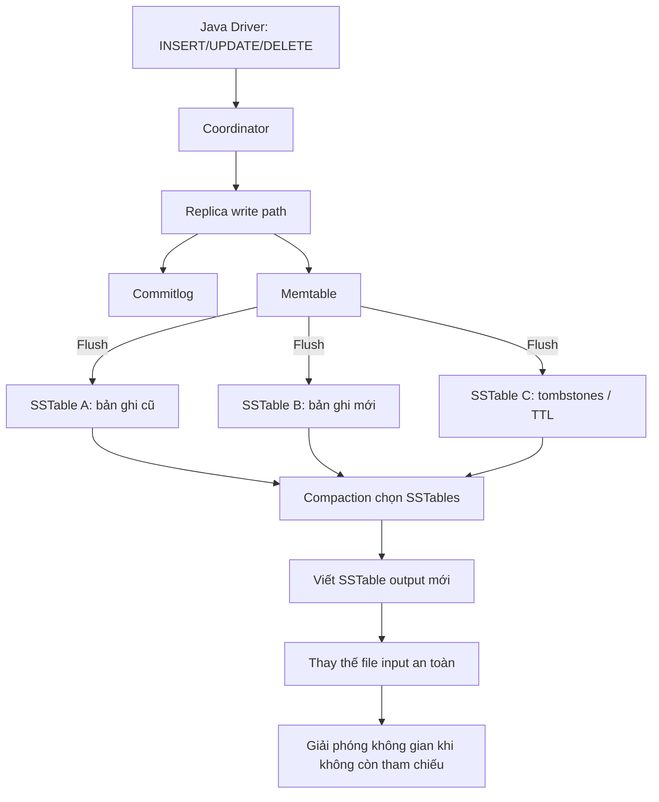
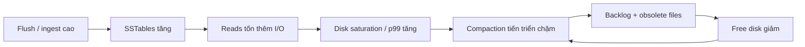
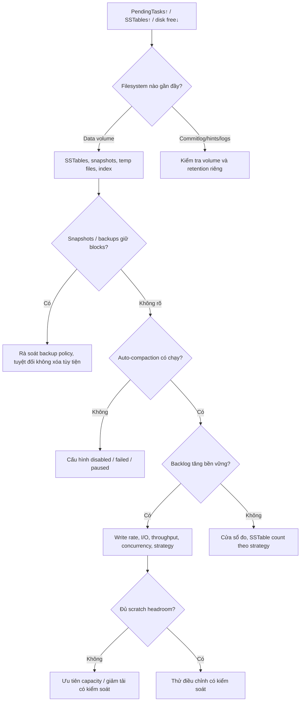
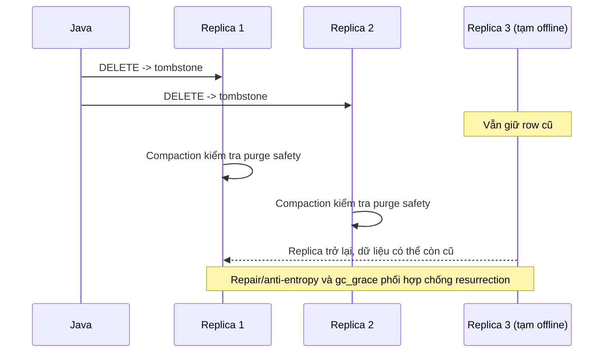

# Compaction backlog, nhiều SSTable và đĩa gần đầy

## 1. Tình huống: vừa ghi chậm, vừa đọc chậm, đĩa không còn chỗ

Trong một cụm Apache Cassandra, dịch vụ Java bắt đầu ghi nhận p99 của `SELECT ... WHERE partition_key = ?` tăng từ vài chục lên vài trăm mili giây. Dashboard cho thấy một số node có nhiều SSTable hơn bình thường; `nodetool compactionstats` báo số tác vụ compaction đang chờ tăng liên tục; dung lượng còn trống trên một volume chỉ còn vài phần trăm. Một số yêu cầu đọc/ghi tại `LOCAL_QUORUM` timeout, còn thao tác compaction dường như không giải phóng dung lượng như kỳ vọng.

Ba triệu chứng **compaction backlog**, **nhiều SSTable** và **đĩa gần đầy** thường đi cùng nhau nhưng **không đồng nghĩa**:

- **Backlog:** tốc độ tạo nhu cầu compaction cao hơn khả năng xử lý, hoặc một số compaction bị trì hoãn/chặn. Con số `PendingTasks` không phải số byte còn phải xử lý.
- **Nhiều SSTable:** có thể do flush nhanh, writes liên tục, compaction bị vô hiệu hóa, tombstones, hoặc do chính chiến lược/định dạng SSTable tạo nhiều file nhỏ. Không phải số lượng lớn nào cũng là lỗi.
- **Đĩa gần đầy:** có thể do SSTable sống, file tạm/obsolete, snapshots/hardlinks, incremental backups, commitlog, hints, index/repair/streaming hoặc thậm chí volume khác. Không được tự kết luận “compaction là nguồn chiếm đĩa” chỉ từ một tỷ lệ sử dụng filesystem.

**Nguyên tắc vận hành:** khi free space thấp, **không vội chạy major compaction, manual garbage collection, flush, repair lớn hoặc xóa trực tiếp file SSTable**. Compaction phải ghi file kết quả **trước khi** file đầu vào được giải phóng an toàn; càng thiếu headroom, càng dễ mắc vòng lặp “cần compact để lấy chỗ nhưng không có chỗ để compact”.

Bài thuộc chương **Xử lý sự cố** của mô-đun `DATABASE_ENGINE_WIDE_COLUMN_CASSANDRA`. Những yếu tố cần nối với nhau gồm kiến trúc phân tán/wide-column, partition key, bảng theo truy vấn, consistency đọc ghi, replication, write/read path, compaction, repair, xử lý lỗi và Java Driver. Không thể chữa một hot partition sai mô hình bằng cách tăng số compactors vô hạn.

### Mục tiêu học tập

Sau bài này, người học có thể:

1. Mô tả vòng đời memtable → flush → immutable SSTables → compaction → obsolete file cleanup; liên hệ tombstone/TTL/repair.
2. Đọc đúng các chỉ số `PendingTasks`, `BytesCompacted`, `LiveSSTableCount`, `LiveDiskSpaceUsed`, `TotalDiskSpaceUsed`, SSTables/read và filesystem free/inodes.
3. Chẩn đoán các nhóm nguyên nhân: ingestion vượt khả năng compact, compaction disabled/throttled, I/O/CPU contention, chiến lược không phù hợp, snapshots giữ dung lượng, streaming/repair/index/backups và dữ liệu hết hạn bị chặn purge.
4. Phân biệt STCS/LCS/TWCS trong Cassandra 4.1 với UCS được khuyến nghị cho nhiều workload từ Cassandra 5.0, tránh suy một cấu hình thắng mọi trường hợp.
5. Ưu tiên hành động khi gần đầy: giảm tốc độ sinh dữ liệu theo policy, bảo vệ headroom, tăng capacity phù hợp, khôi phục compaction có kiểm soát, kiểm chứng correctness/RF/CL.
6. Thiết kế lab và runbook có điều kiện dừng/rollback, thu thập bằng chứng trước–sau và không làm mất dữ liệu vì xử lý đĩa sai cách.

> **Phạm vi và an toàn:** ví dụ dùng Cassandra 4.1/5.x, Java Driver 4.x và Linux. Cấu hình, tên lệnh và metrics phụ thuộc release/distribution; kiểm tra trên môi trường đang chạy trước khi dùng. Mọi lệnh có thể thay đổi dữ liệu/cấu hình chỉ dùng trong **lab cô lập hoặc change đã được phê duyệt**. Bài không yêu cầu chạy một thao tác đầy đĩa thực trên production.

## 2. Mô hình LSM: vì sao compaction tồn tại?



Trong Cassandra, SSTables là các file **immutable** lưu dữ liệu theo token/partition/clustering order. Một UPDATE không sửa nội dung của SSTable cũ tại chỗ mà ghi phiên bản mới ở memtable rồi flush ra SSTable mới. DELETE thường tạo **tombstone**; TTL hết hạn cũng khiến dữ liệu được xem là hết hiệu lực và cần xử lý an toàn khi compact.

### Ba loại amplification

| Khái niệm | Hiện tượng | Liên hệ sự cố |
| --- | --- | --- |
| **Read amplification (RA)** | Một query phải đọc/kiểm tra nhiều SSTables, Bloom filters, index summaries hoặc tombstones | Nhiều SSTables/read, p95/p99 tăng |
| **Write amplification (WA)** | Một logical write tạo thêm bytes I/O do flush, compaction và maintenance | Disk await, CPU và network/storage budget cao |
| **Space amplification (SA)** | Dữ liệu mới, dữ liệu cũ, tombstones, file tạm và bản sao cùng tồn tại | Cần headroom trước khi file cũ được dọn |

**Compaction làm giảm một số chi phí, nhưng bản thân nó tiêu tốn CPU/đĩa.** Một hệ thống ghi quá nhanh có thể tạo ra SSTables nhanh hơn compaction hoàn tất; đọc bị chậm dần và càng khó phục hồi nếu disk headroom cạn.

### Vòng lặp xấu cần ngắt



Vòng lặp này **không phải** giải thích duy nhất. Ví dụ snapshots có thể giữ physical blocks dù backlog nhỏ; một volume commitlog riêng có thể đầy trong khi `LiveDiskSpaceUsed` của table ổn định. Bài học là **quan sát theo tầng trước khi sửa**.

## 3. Phân loại mức độ khẩn cấp

| Mức | Điều kiện mang tính ví dụ | Ưu tiên |
| --- | --- | --- |
| **Theo dõi** | Pending compaction dao động rồi trở lại baseline; dung lượng còn dư theo headroom plan | Xác minh xu hướng, không can thiệp vội |
| **Cảnh báo** | PendingTasks hoặc SSTables/read tăng nhiều cửa sổ; disk free giảm đều, p99 bắt đầu lệch SLO | Khoanh bảng/node, kiểm tra ingest/compaction/backup, lập change |
| **Nghiêm trọng** | Tốc độ tăng dung lượng khiến dự kiến hết headroom trước khi giải pháp có hiệu lực; errors tăng | Giới hạn tải có kiểm soát, bảo vệ write path, chuẩn bị capacity/failover |
| **Khẩn cấp** | OS báo `No space left on device`, flush/commitlog/SSTable write thất bại, node không phục vụ bình thường | Incident response, dừng tác động làm tình trạng tệ hơn, phục hồi capacity có chủ sở hữu |

**Không lấy mốc 80%/90% làm định luật chung.** Với volume 200 GiB, 10% free là 20 GiB; với volume 20 TiB, 10% free là 2 TiB. Headroom phải xét **kích thước compaction lớn nhất có thể chạy**, concurrent compactions, streaming/repair, tốc độ ghi và thời gian mở rộng storage. Đối với SSD nhiều volume, kiểm tra **từng filesystem** thay vì chỉ trung bình phần trăm toàn cluster.

### Hai câu hỏi cần trả lời trong phút đầu

1. **Nếu không làm gì, còn bao lâu sẽ chạm ngưỡng không thể ghi an toàn?** Dùng số byte free, tốc độ tiêu thụ ròng và safety margin, không chỉ %.
2. **Nhóm hoạt động nào đang làm đĩa tăng?** SSTables sống, compaction output/obsolete, snapshots, incremental backups, commitlogs, hints hay volume khác?

## 4. Sơ đồ phân nhánh chẩn đoán



Các nhánh là **thứ tự khảo sát**, không phải giấy phép thực thi các thao tác thay đổi cấu hình. Trước khi thử compaction throughput/concurrency, phải biết free space và I/O headroom.

## 5. Thu thập bằng chứng mà chưa thay đổi hệ thống

### 5.1. Các lệnh Cassandra *chỉ đọc*

```bash
# Chạy từ node / máy vận hành được phép truy cập JMX.
nodetool status
nodetool describecluster
nodetool compactionstats -H
nodetool compactionhistory
nodetool tpstats
nodetool tablestats -H
nodetool tablehistograms example_ks events_by_device_day
nodetool netstats
nodetool listsnapshots
nodetool getcompactionthroughput
nodetool statusautocompaction example_ks events_by_device_day
```

`example_ks.events_by_device_day` chỉ là tên lab; thay bằng bảng cần khảo sát. Một số lệnh/flags có thể khác giữa Cassandra 4.1, 5.x và bản của vendor; dùng `nodetool help <command>` của **chính release** để xác nhận. Các lệnh trên chủ yếu nhìn **node mà nodetool kết nối đến**, không đại diện tự động cho mọi node trong RF/cluster.

| Lệnh | Cần ghi gì | Không suy ra điều gì |
| --- | --- | --- |
| `compactionstats -H` | Active tasks, bytes progress, estimated remaining, pending tasks theo table | PendingTasks không phải số GiB còn phải compact |
| `compactionhistory` | Chiến lược/khối lượng các lần compaction gần đây khi khả dụng | Không thay baseline throughput dài hạn |
| `tablestats -H` | SSTable count, live/total/snapshot sizes, tombstones/latency | Không thay `df` để kết luận filesystem free |
| `tablehistograms` | SSTables/read và phân phối read/write latency, partition size | Không tự phản ánh toàn bộ end-to-end Java latency |
| `tpstats` | Thread pool active/pending/dropped | Pending compaction không phải mọi loại task pending |
| `netstats` | Streaming có đang diễn ra? | Không đo tốc độ compaction đầy đủ |
| `listsnapshots` | Snapshot tags/size theo Cassandra | Không chứng minh bản backup đã lưu trữ ngoài node |
| `getcompactionthroughput` | Giới hạn throughput hiện hành theo release | Giới hạn không đồng nghĩa throughput đạt được |
| `statusautocompaction` | Có bảng nào vô hiệu hóa auto-compaction? | Enabled không nghĩa luôn có tiến triển |

### 5.2. Hệ điều hành và volume

```bash
# Tham số thư mục phải thay bằng vị trí data/commitlog/snapshot thực của node.
df -h /var/lib/cassandra
df -i /var/lib/cassandra
lsblk -f
mount

# Quan sát disk utilization/latency nếu sysstat được cài:
iostat -x 1 5

# Đọc dung lượng top-level có thể tốn I/O; chỉ chạy có phạm vi/giới hạn:
du -sh /var/lib/cassandra/data
du -sh /var/lib/cassandra/commitlog

# Chỉ khi đội vận hành cần xem các file đã unlink nhưng vẫn còn process mở:
# lsof +L1
```

**Thận trọng với `du`, `find`, `lsof` và quét filesystem lớn:** có thể gây thêm metadata I/O ở node đang quá tải. Không chạy `du -a /` hoặc truy vấn JMX liên tục mỗi giây trong lúc incident. `df` cho biết free ở cấp filesystem, `du` ước tính space được gán cho cây thư mục; snapshots/hardlinks và open-but-deleted files khiến hai con số không luôn cộng khớp.

### 5.3. Nếu chạy trong Kubernetes

```bash
# Chỉ xem trạng thái đã được phân quyền trong namespace lab:
kubectl -n cassandra get pods -o wide
kubectl -n cassandra get pvc
kubectl -n cassandra describe pvc cassandra-data-example

# Cần biết volume mount thực trong Pod, không suy từ node root filesystem.
```

Dung lượng PVC công bố, filesystem trong container, storage class expansion và disk quota có thể khác nhau. Một Pod `Ready` không chứng nhận PVC còn đủ chỗ để **cả file output lẫn file SSTable input** cùng tồn tại khi compaction.

## 6. Đọc đúng `nodetool compactionstats`

Ví dụ output **minh họa**:

```text
pending tasks: 34
- example_ks.events_by_device_day: 30
- example_ks.users_by_id: 4
id         compaction type  keyspace    table                 completed   total       unit   progress
...        Compaction       example_ks  events_by_device_day  128000000   640000000   bytes  20.00%
Active compaction remaining time : 0h00m35s
```

Đừng suy “34 × 640 MB ≈ 21 GB compaction backlog”: một task có thể mang lượng dữ liệu khác nhau, giá trị `640000000` là **total bytes của active task cụ thể**, còn pending tasks là số lượng được ước lượng từ những công việc chưa chạy. Estimated remaining time thay đổi theo tốc độ và compaction type; nó không phải deadline SLA.

### Nhìn **xu hướng**, không chỉ một snapshot

| Mốc giả định | PendingTasks | SSTables live | Free data disk | Nhận xét |
| --- | ---: | ---: | ---: | --- |
| 09:00 | 14 | 180 | 420 GiB | Bắt đầu theo dõi |
| 09:10 | 31 | 225 | 360 GiB | Backlog và space pressure cùng tăng |
| 09:20 | 56 | 300 | 280 GiB | Compaction không theo kịp ingest |
| 09:30 | 48 | 270 | 300 GiB | Có cải thiện nhưng chưa có kết luận |

**Đây là số giả lập.** Nếu queue tăng trong 10 phút nhưng về 0 sau bulk import có kiểm soát thì có thể là hiện tượng tạm; nếu backlog và SSTables/read liên tục tăng qua các chu kỳ workload, cần tìm bottleneck.

### Những dấu hiệu cần ghép thêm

- `PendingTasks` tăng nhưng `BytesCompacted` không tăng: compaction bị disable, bị chặn bởi I/O/CPU/headroom, task selection hoặc lỗi.
- `PendingTasks` ít nhưng SSTables/read cao: chiến lược compaction, nhiều SSTables rải rác, large/wide partitions, tombstones, hoặc metrics không cùng scope.
- `PendingTasks` giảm nhưng free disk không tăng: snapshots/hardlinks, ongoing inserts, old/obsolete files, index/backup, hoặc compaction đang tạo output mới lớn.
- Một node xấu hơn nodes khác: token/RF placement, skew, hot partitions, PVC/SSD khác loại, local disk failure hoặc repair/streaming riêng.

## 7. Đọc JMX metrics không nhầm gauge với counter

Các metrics Cassandra thường được đưa ra qua Dropwizard/JMX hoặc hệ thống monitoring. **Tên có thể thay theo phiên bản**, nhưng các nhóm quan trọng gồm:

| Metric / ý nghĩa | Đơn vị và cách đọc | Lỗi suy diễn thường gặp |
| --- | --- | --- |
| `Compaction.PendingTasks` | Gauge số công việc dự kiến chờ | Không phải bytes đang chờ |
| `Compaction.BytesCompacted` | Counter số bytes đã compact từ lúc process khởi động | Không dùng giá trị tuyệt đối so hai node uptime khác nhau |
| `Compaction.CompletedTasks` | Số task hoàn tất theo thời gian | Nhiều task nhỏ không bằng một task lớn |
| `Compaction.PendingTasksByTableName` | Breakdown theo keyspace/table khi được expose | Không coi là số byte/ETA |
| `Table.LiveSSTableCount` | Số SSTables *live* của một table tại node | LCS/UCS có thể có nhiều files nhỏ hợp lệ |
| `Table.LiveDiskSpaceUsed` | Bytes dùng cho SSTables live của table | Không chứa toàn bộ snapshot/commitlog/OS |
| `Table.TotalDiskSpaceUsed` | SSTables live + obsolete đang chờ giải phóng | Không bằng disk used của toàn filesystem |
| `SSTablesPerReadHistogram` | Phân phối SSTables được tham khảo khi đọc | Phải so theo cùng query/workload |
| `TombstoneScannedHistogram` | Số tombstones gặp trên read, khi metric có mặt | Không tương đương tombstones đã purge |
| `ReadLatency/WriteLatency` | Timer/histogram tại node/table | Không tự bằng p99 end-to-end của Java |
| `PendingFlushes` | Flush đang chờ | Có thể cùng tăng với compaction do I/O nghẽn |

**Đếm bytes đúng cách:** dùng `rate(Compaction.BytesCompacted)` hoặc delta giữa hai timestamp trên cùng node còn sống; sau restart counter có thể reset. Khi đánh giá cost, nhớ rằng BytesCompacted đo khối lượng xử lý, **không** chứng minh từng byte được thu hồi trên filesystem.

### Phân biệt dung lượng *live*, *total*, *snapshot* và *filesystem*

```text
Filesystem used
  ├─ Live SSTables của các tables + indexes
  ├─ SSTable output đang ghi / obsolete còn tham chiếu
  ├─ Snapshot / incremental backups (có thể dùng hardlinks)
  ├─ Commitlog, hints, caches, logs (tùy thư mục/volume)
  ├─ Streaming / repair / temporary data
  └─ Dữ liệu của process/thành phần khác cùng filesystem
```

**Không cộng máy móc các số trong hình như những tập bytes hoàn toàn tách nhau:** hardlinks có thể chia sẻ physical blocks, và snapshots có thể **ngăn giải phóng** blocks của SSTable đã bị thay. Vì vậy `df` là quan sát cuối cùng về space vật lý, còn `nodetool listsnapshots`/`tablestats` giúp giải thích **vì sao**.

## 8. Công thức cảnh báo headroom và tốc độ hồi phục

### 8.1. Không dùng một % duy nhất

Với một filesystem, đặt:

- `F` = dung lượng trống thực đo tại thời điểm hiện tại.
- `S` = khoảng dự trữ không được phép xâm phạm, do đội vận hành chọn.
- `C` = estimate **peak extra bytes** của compaction có thể chạy đồng thời, trước khi file input được release.
- `I` = bytes dự kiến tăng do ingress, streaming, repair, index, backup trong cửa sổ xử lý.

Điều kiện thận trọng trước khi cho một hoạt động ghi nhiều bytes chạy:

\[
F \;>\; S + C + I
\]

Đây là **khung ước tính**, không phải định lý bảo đảm đủ space: có thể có nhiều data directories, compression ratio thay đổi, lỗi filesystem/quota/inodes và filesystem-level reserved blocks. Nếu không ước lượng được `C` với độ tin cậy hợp lý, **không khởi động thủ công compaction lớn** chỉ vì một con số % còn trống.

### 8.2. Ước lượng thời gian tới ngưỡng cạn

Nếu `g` là **tốc độ tăng bytes đã dùng ròng** (>0) trên cùng volume, thì:

\[
T_{\text{đến ngưỡng}} \approx \frac{F-S}{g}
\]

Ví dụ **minh họa**: còn 80 GiB, cần giữ 30 GiB dự phòng và disk used đang tăng 5 GiB/giờ; thời gian cảnh báo lý thuyết là `(80−30)/5 = 10 giờ`. Nhưng tốc độ tăng có thể thay đổi đột ngột khi flush/compaction/streaming; đo trên nhiều khoảng và thiết lập threshold thực tế có dự phòng.

### 8.3. Ước lượng thời gian rút backlog

Nếu đo được **compaction work còn lại** cùng đơn vị với tốc độ tạo work, áp dụng gần đúng:

\[
T_{\text{drain}} \approx \frac{\text{Backlog work}}{\text{Compaction service rate} - \text{New compaction work rate}}
\]

Chỉ có nghĩa khi hiệu số **dương** và hai tốc độ cùng đơn vị. Không thay trực tiếp `PendingTasks` bằng `GiB` rồi chia cho `BytesCompacted/s`; compactions khác kích thước và dữ liệu output cũng khác input. Khi work generation vượt service rate, tăng thời gian chờ không tự làm backlog giảm.

## 9. Các nhóm nguyên nhân compaction backlog

### 9.1. Tải ghi tăng đột biến hoặc kéo dài

Mỗi memtable flush tạo SSTable mới. Nếu client import/backfill gửi nhiều mutations cùng lúc, tốc độ flush có thể vượt năng lực compaction. Một node có token range nóng hoặc partition nhiều updates có thể tệ hơn các node khác dù tổng QPS cluster nhìn vẫn bình thường.

**Dấu hiệu:** `MemtableSwitchCount`/write rate tăng, `LiveSSTableCount` tăng, disk write bytes cao, `PendingTasks` tăng cùng thời điểm deploy/import. **Đừng nhầm** Cassandra đang ghi nhiều lần cùng một partition với việc “ít rows thì ít disk I/O”: immutable SSTables lưu nhiều versions/tombstones.

**Hướng xử lý:** nếu ingress ngoài khả năng chứa, ưu tiên throttle/backpressure **có dự báo RPO/lag**, giảm concurrency của import và kiểm tra backlog sẽ ngừng tăng. Không ngắt producer mà không có durable queue/checkpoint; trong Kafka/streaming phải phối hợp offsets, idempotence và lỗi write outcome.

### 9.2. Auto-compaction bị tắt hoặc bị ngăn tiến triển

Một maintenance job trước đó có thể đã chạy `nodetool disableautocompaction` rồi quên bật lại. Hoặc bảng có `compaction = {'class': '...', 'enabled': 'false'}`; một số task bị hoãn do lỗi disk/I/O/permission.

**Dấu hiệu:** `statusautocompaction` báo disabled, `BytesCompacted` không tăng qua nhiều cửa sổ, SSTables tiếp tục mọc. **Hướng xử lý:** kiểm tra change history/owner, hiểu mục đích ban đầu và chỉ bật lại sau khi **đủ headroom**. Nếu đĩa sắp đầy, bật lại có thể ngay lập tức tạo output lớn, khiến sự cố trầm trọng hơn.

### 9.3. Compaction throttling quá chặt

Trong Cassandra 4.x/5.x, `compaction_throughput` cấu hình giới hạn bytes/s (cách biểu diễn/đơn vị YAML khác theo version); công cụ `nodetool getcompactionthroughput` xem cap hiện tại. Nếu cap nhỏ hơn compaction work sinh ra bền vững, queue tăng.

**Không tự đặt throughput = 0** để “chạy nhanh”: với các release thông dụng, 0 nghĩa là bỏ giới hạn throttling. Khi disk đã bão hòa, tăng throughput/không giới hạn có thể giành I/O từ read/write requests, tăng p99 và làm commitlog/flush chậm.

### 9.4. Quá ít hoặc quá nhiều concurrent compactors

`concurrent_compactors` điều chỉnh số compaction đồng thời (khác validation phases của repair tùy phiên bản). Quá ít làm disk CPU/IOPS nhàn rỗi trong lúc backlog tăng; quá nhiều làm SSD I/O queue, CPU, memory/page cache cạnh tranh và **tăng nhu cầu scratch space cùng lúc**.

**Thứ tự hợp lý:** xem disk await, CPU, IOPS, throughput cap, cỡ task và free headroom trước; nếu còn năng lực thực sự, thử tăng từng bước ở lab/canary cùng load. Không có “giá trị tối ưu = số core” cho mọi workload và storage class.

### 9.5. Disk I/O chậm, lỗi filesystem hoặc volume quota

Compaction đọc/ghi nhiều SSTables. SSD bị throttled bởi provisioned IOPS, cloud EBS burst credits cạn, shared volume hoặc kernel I/O errors có thể khiến tốc độ giảm dù `PendingTasks` rất cao. Một process log/backup khác có thể tranh disk cùng Cassandra.

**Dấu hiệu:** `iostat -x` cho latency/await cao, util/queue liên tục lớn, logs I/O exception, host metrics hoặc storage provider báo throttling; `BytesCompacted/s` thấp. **Hướng xử lý:** phục hồi capacity/IOPS, giảm hoạt động nền theo policy, không tăng compactors mù.

### 9.6. SSTables tăng do chiến lược hoặc dữ liệu không phù hợp

STCS có thể tạo nhiều SSTables khi size buckets không phù hợp; LCS có nhiều SSTables nhỏ **theo thiết kế** và cần nhìn mức overlap, nhất là L0; TWCS có thể giữ nhiều cửa sổ cũ khi writes out-of-order hoặc dữ liệu chưa đủ điều kiện hết hạn; UCS có cơ chế sharding/level riêng.

**Không đánh giá chỉ bằng số file tuyệt đối.** So số SSTables/read, age, overlap, LCS levels, timestamps, compaction debt, p99 và disk bytes **trong cùng workload và version**.

### 9.7. Hậu quả của repair, streaming, bootstrap, node replacement hoặc index rebuild

Repair/streaming có thể thêm SSTables hoặc tiêu thụ I/O/đĩa; node replacement/scale-out đòi nhận data ở nhiều token ranges. Chỉ nhìn ingest của app có thể không giải thích disk growth khi hoạt động nền đang dùng chung filesystem.

**Hướng xử lý:** ghi timeline của `nodetool netstats`, repair sessions, compactionstats, snapshot/backup và changes. Nếu gần đầy, ngừng **lập lịch thêm** các hoạt động lớn chưa thiết yếu theo policy và xác định trạng thái các job đã chạy; không tùy tiện kill repair đang giữ consistency/correctness.

### 9.8. Snapshots, incremental backups hoặc obsolete SSTables giữ blocks

Cassandra snapshots thường là hardlinks đến các SSTables; sau khi compaction tạo SSTables mới, link từ snapshot có thể khiến **file cũ không giải phóng physical blocks**. Incremental backups cũng lưu/có link đến SSTables. Các obsolete file có thể còn open references trước khi được dọn.

**Dấu hiệu:** `LiveDiskSpaceUsed` không tăng tương xứng với `df used`; `nodetool listsnapshots` có nhiều snapshots/backup ages; `TotalDiskSpaceUsed` và filesystem khác nhau. **Không xóa snapshot tùy tiện**: đó có thể là restore point duy nhất hoặc yêu cầu compliance. Phải kiểm tra backup đã copy/verify off-node và retention policy, rồi mới duyệt cleanup.

### 9.9. TTL/tombstone không được purge vì chưa an toàn

TTL hết không đồng nghĩa SSTable được xóa ngay. Tombstones có `gc_grace_seconds`, anti-entropy/repair và điều kiện có thể cần bảo vệ trước khi xóa để tránh dữ liệu đã xóa **sống lại** từ một replica lạc hậu; một SSTable già có thể còn dữ liệu sống hoặc shadow dữ liệu trên SSTable khác nên không thể drop toàn file.

**Hướng xử lý:** xem lịch repair, TTL distribution, tombstone scanned metrics, SSTable age, strategy; không giảm `gc_grace_seconds` từ nhiều ngày xuống 0 chỉ để trống đĩa nếu không hiểu repair/replica liveness và ràng buộc correctness.

## 10. So sánh chiến lược compaction theo đúng phiên bản

| Strategy | Cơ chế chính | Khi nào có thể phù hợp | Dấu hiệu cần điều tra |
| --- | --- | --- | --- |
| **STCS** | Nhóm SSTables có kích thước tương đương thành compaction | Write-heavy/rate ổn định trên bản cũ | Size buckets khó ghép, nhiều SSTables/read, space headroom |
| **LCS** | Các level, SSTables không overlap trong mỗi level cao, L0 có thể overlap | SLA đọc nghiêm ngặt, read-heavy | L0→L1 chậm, write amp/disk I/O tăng |
| **TWCS** | Group theo time windows, phù hợp TTL/time-series | Append-mostly theo thời gian, TTL tương đồng | Late writes, overlapping windows, SSTables không hết hạn đồng loạt |
| **UCS** (Cassandra 5.x) | Tiered/leveled trade-off kết hợp sharding/levels | Được tài liệu Cassandra 5.0 khuyến nghị cho đa số workload | Sai scaling parameters, compaction debt, size/overlap; cần metrics riêng |

**Cảnh báo tương thích:** Cassandra 4.1 OSS không nên được coi có UCS mặc định. Từ Cassandra 5.0, tài liệu dự án khuyến nghị **Unified Compaction Strategy (UCS)** cho phần lớn workloads; nhưng điều đó **không** có nghĩa bảng đang dùng STCS/LCS/TWCS phải đổi strategy ngay giữa incident khi disk gần đầy.

### 10.1. STCS: min/max threshold không phải thuốc chữa mọi backlog

STCS chọn nhóm SSTables có size tương tự; các tham số `min_threshold`/`max_threshold` điều khiển tập SSTables để kích hoạt compaction theo version. Nếu ít hơn ngưỡng, một số file có thể được giữ lại theo thiết kế. Nếu có quá nhiều SSTables nhỏ sau burst, compaction có thể chậm do source files và I/O.

**Không hạ `min_threshold` bừa**: số lần rewrite có thể tăng, WA/space pressure tệ hơn. Tập trung vào tốc độ flush, bucket distribution, disk capacity và đồng bộ cấu hình giữa các nodes.

### 10.2. LCS: số SSTables có thể cao nhưng reads vẫn tốt

LCS tổ chức nhiều SSTables kích thước giới hạn thành levels; trong mỗi level trên L0, các files thường không overlap token ranges. Vì vậy `LiveSSTableCount=1.000` không tự chứng minh read amplification cao. Thay vào đó cần xem SSTables/read, L0 backlog, compaction throughput và p99.

Khi disk I/O bị nghẽn, L0 tích lũy tạo overlap, p99 có thể tăng. Nếu giảm throughput cap chỉ vì sợ disk I/O, L0 càng tăng; cần cân đối **cả foreground latency và background debt**, không tối ưu một chỉ số riêng.

### 10.3. TWCS: TTL hết nhưng file vẫn còn

TWCS hoạt động tốt khi SSTables có timestamps thuộc những time windows tương đối sạch. Nếu app ghi late events hoặc UPDATE dữ liệu cũ, một SSTable có thể trộn timestamps nhiều cửa sổ; tombstones chưa an toàn để xóa hoặc dữ liệu mới bị đưa vào window cũ.

**Kiểm tra:** time distribution thực (write timestamps, không chỉ cột business `event_time`), TTL distribution, `gc_grace_seconds`, repair cadence và blockers từ SSTables khác. Chỉ khi có thiết kế dữ liệu thời gian phù hợp mới cân nhắc TWCS hoặc cấu hình UCS có tính chất tương tự.

### 10.4. UCS trên Cassandra 5.x: lựa chọn có phiên bản, không phải lệnh cứu đĩa tức thì

UCS có sharding và khả năng điều chỉnh read/write amplification theo scaling parameters; tài liệu Cassandra khuyến nghị rộng. Tuy vậy chuyển đổi từ một chiến lược legacy có thể dẫn tới rewrite/compaction work và ảnh hưởng disk headroom; các tuning parameters phải được thử theo data volume/tải.

**Với incident disk gần đầy:** ưu tiên giải quyết capacity và xác định nguồn bytes trước; đánh giá đổi UCS trong **kế hoạch tối ưu dài hạn** sau khi ổn định, không coi `ALTER TABLE ... WITH compaction` là thao tác cleanup free-space tức thời.

## 11. Tombstones, TTL, repair và nguy cơ “data resurrection”

Một row bị xóa ở node A không có nghĩa tất cả replicas đã nhận tombstone ngay lập tức. Khi một replica lạc hậu còn bản ghi cũ, compaction nếu xóa tombstone **quá sớm** có thể cho phép dữ liệu cũ được tái đồng bộ, gây **resurrection**. `gc_grace_seconds` tồn tại để hỗ trợ an toàn xóa trong bối cảnh anti-entropy và replica outage.



Không diễn giải đơn giản rằng “chờ qua `gc_grace_seconds` thì Cassandra chắc chắn xóa tombstone”. Có thể còn blockers do SSTables chứa timestamps xung đột, snapshots, phiên bản/strategy, repair state, hoặc không có compaction đủ điều kiện.

### Những lựa chọn nguy hiểm khi thiếu đĩa

| Hành động hấp dẫn | Vì sao nguy hiểm |
| --- | --- |
| `ALTER TABLE ... WITH gc_grace_seconds = 0` | Có thể tăng rủi ro phục hồi dữ liệu đã xóa khi replicas/repair không bảo đảm |
| Ép tombstone compaction bất chấp kiểm tra | Có thể rewrite data mà **không** drop được tombstones, tốn thêm disk |
| Chạy `nodetool garbagecollect` tùy tiện | Thao tác thay đổi dữ liệu/SSTables, có điều kiện an toàn và headroom riêng |
| Cho rằng “đã hết TTL” tương đương “file có thể unlink” | SSTable có thể còn dữ liệu sống hoặc bị file khác chặn purge |
| Chạy offline SSTable tools khi Cassandra đang chạy | Rủi ro kết quả không nhất quán/hỏng thao tác |

**Đặc biệt:** `sstableexpiredblockers` là **offline tool**; tài liệu yêu cầu **dừng Cassandra trước khi chạy**, bản thân script không tự kiểm tra điều này. Không chạy nó trực tiếp trên node online chỉ vì tên nghe như công cụ “chỉ đọc”. Công cụ chỉ phù hợp maintenance window/lab được lên kế hoạch với version đúng.

## 12. Vì sao compaction hoàn tất mà filesystem không giảm?

Đây là tình huống phổ biến nhất khiến operator muốn xóa SSTables bằng tay.

| Khả năng | Dấu hiệu | Cách kiểm chứng không phá dữ liệu |
| --- | --- | --- |
| Output gần bằng input | `BytesCompacted` tăng nhưng không nhiều obsolete bytes | So live/total table bytes trước–sau |
| Dữ liệu mới đang đến cùng tốc độ | Free disk giữ nguyên dù compact | So ingest bytes/s, compaction bytes/s, FS growth |
| Snapshot hardlink giữ input | `listsnapshots` còn snapshots dài hạn | Đối chiếu backup retention và filesystem |
| Incremental backup giữ SSTables | Backup directory/metadata tăng | Kiểm tra off-node verification, retention |
| Output còn file temporary hoặc obsolete references | `TotalDiskSpaceUsed - LiveDiskSpaceUsed` tăng | Theo dõi sau khi compaction/reader references kết thúc |
| Tombstones chưa đủ điều kiện | TTL expired nhưng SSTables vẫn sống | Repair, gc_grace, timestamp overlap, TWCS windows |
| Stream/repair/index build cùng chạy | `netstats` và operation logs có activity | Ghép UTC timeline với disk growth |
| Volume khác gây đầy | `df` chỉ ra commitlog/hints/logs mount riêng | Kiểm tra `data_file_directories`/commitlog/hints |
| File đã xóa nhưng process vẫn giữ descriptor | `df` và `du` chênh, logs chỉ ra deleted-open file | Operator có quyền xem `lsof +L1` có phạm vi |
| inode quota hết | `df -i` gần 100%, bytes còn | Kiểm tra số lượng files/FS quotas |

**Không bao giờ dùng `rm -rf /var/lib/cassandra/data/...` hoặc xóa `*-Data.db` vì thấy đã có output mới.** SSTable gồm nhiều components (Data, Index, Statistics, Filter,...), các tham chiếu và tính an toàn xóa do Cassandra quản lý. Xóa sai có thể làm mất partition data, ảnh hưởng repair/replication và phá khả năng backup/restore.

### Snapshot retention là quyết định bảo vệ dữ liệu

`nodetool listsnapshots` dùng để **điều tra**, không cho phép xóa. `nodetool clearsnapshot` là thao tác **xóa dữ liệu backup local**, cần phê duyệt, xác minh snapshot đã lưu nơi khác/restore test, đối chiếu retention/compliance và dự báo reclaimed bytes thật. Hardlinks có thể khiến 100 GiB “snapshot size” **không tương đương** 100 GiB free sau khi xóa.

## 13. Khi đĩa sát ngưỡng: thứ tự ứng phó an toàn

### Pha A — Ngừng làm tình trạng xấu hơn, giữ bằng chứng

1. Mở incident, xác định **node, volume, keyspace/table**, RF/CL, các phụ thuộc và thời điểm bắt đầu.
2. Bật quan sát read-only với tần suất vừa phải; lưu `df`, `compactionstats`, `tablestats`, `listsnapshots`, `netstats` và logs liên quan.
3. Xác định còn đủ **filesystem free** để Cassandra tiếp tục ghi commitlog/SSTables và compaction đang chạy không.
4. Dừng **khởi tạo** các công việc không thiết yếu gây nhiều bytes như bulk import, index build, backfill, snapshot mới hoặc repair mới **theo runbook/owner**. Với job đang chạy, xem trạng thái và phương án cancel an toàn; không dùng kill bừa.
5. Nếu app là nguồn ingest lớn, giới hạn QPS/concurrency hoặc backpressure **có durable buffering**. Không ack/commit Kafka offset trước khi mutation được xử lý; nếu timeout ghi, ghi nhận **unknown outcome** thay vì giả thất bại.

**Không nên:** chạy `nodetool compact` major ngay, disable auto-compaction toàn bộ cluster, restart tất cả nodes, xóa `commitlog` hoặc giảm RF để “giảm số bản sao” khi chưa có chiến lược dữ liệu/repair. Tất cả đều có thể tăng rủi ro mất dữ liệu hoặc outage.

### Pha B — Bảo vệ capacity trước khi tối ưu

- Khi volume hỗ trợ **online expansion**, tăng dung lượng theo quy trình platform/storage, sau đó xác minh filesystem thực đã nhận capacity mới và alarms hoạt động.
- Nếu phải chuyển data directory/mở rộng storage topology, dùng **quy trình Cassandra/OS chính thức**, không tự `mv` SSTables khi node đang chạy. Với dữ liệu replica, kiểm tra rack/DC placement, backup, runbook và headroom của các node đích.
- Thêm node đôi khi tăng tổng cluster capacity **nhưng** có thể kích hoạt bootstrap/streaming/repair, **tạm tăng** I/O và dung lượng trước khi cleanup; không coi là hành động khẩn cấp luôn an toàn khi cả cluster đã sát full.
- Nếu có snapshot không còn cần theo policy, chỉ thực hiện cleanup khi owner xác nhận **backup off-node đã được kiểm tra khôi phục**, phạm vi chính xác và tác động đến data retention.

**Ưu tiên lựa chọn ít rủi ro nhất để lấy lại margin vật lý**. Bảo vệ tính đúng và khả năng phục hồi dữ liệu quan trọng hơn mục tiêu làm dashboard trở về màu xanh tức thì.

### Pha C — Khôi phục compaction có kiểm soát

Sau khi có headroom và xác định bottleneck:

1. Nếu auto-compaction disabled, điều tra vì sao; **bật lại theo phê duyệt** khi free space đủ, không “bật lại cả cluster” vô điều kiện.
2. Nếu compaction throughput cap quá thấp **và disk còn năng lực**, cân nhắc thử tăng giới hạn một bước, ghi lại trước/sau. Tránh giá trị 0 (bỏ throttle) khi chưa được phê duyệt.
3. Nếu CPU/disk IO nhàn rỗi còn nhiều, đánh giá `concurrent_compactors` theo version, cỡ tasks và scratch space.
4. Đợi ít nhất nhiều cửa sổ đo để xác minh **PendingTasks không tiếp tục tăng**, `BytesCompacted/s` có tiến triển và **free headroom vẫn đủ**.
5. Sau khi cluster ổn định, lập kế hoạch lâu dài cho compaction strategy, schema/TTL, hardware, dữ liệu nóng và ingestion budget.

**Quan hệ nhân–quả quan trọng:** tăng concurrency có thể làm PendingTasks giảm nhanh hơn nhưng cùng lúc nhiều SSTable outputs tạm tồn tại; với volume 5% free, quyết định này có thể đẩy node vào `ENOSPC`. Luôn gate theo **peak additional bytes**.

## 14. Thay đổi runtime và schema nào phải quản lý như một change?

| Đòn bẩy | Mục tiêu | Rủi ro | Điều kiện tiên quyết |
| --- | --- | --- | --- |
| Giảm ingest/backfill concurrency | Giảm tốc độ tạo work | Lag tăng, queue đầy, redelivery | Durable queue, retry/idempotency, SLA lag |
| Tăng storage/IOPS | Thêm headroom và tốc độ compaction | Costs, quotas, resize/volume restrictions | Platform approval, backup, verify capacity |
| Khôi phục auto-compaction | Cho Cassandra tiếp tục dọn SSTables | Peak scratch/output tăng | Hiểu lý do bị tắt; free disk đủ |
| Tăng `compaction_throughput` | Tăng tốc độ bytes compact | Foreground p99 xấu do tranh disk | Disk I/O dư, test canary, rollback |
| Tăng `concurrent_compactors` | Nhiều jobs chạy song song | CPU/IO/memory/scratch tăng | Metrics và headroom theo node |
| Đổi STCS ↔ LCS/TWCS/UCS | Đổi RA/WA/SA dài hạn | Có thể tạo rewrite/chuyển đổi tốn disk | Thử lab, plan bytes/time, version |
| Thay TTL/retention của dữ liệu **mới** | Giảm logical retention về sau | RPO/audit/legal và query semantics | Data contract, policy duyệt |
| Giảm `gc_grace_seconds` | Trông có vẻ purge tombstones sớm | Có thể resurrection/mất correctness | Không dùng như hotfix mặc định |
| Cleanup snapshots cũ | Giải phóng blocks được pin | Xóa backup/restore point | Off-node verification và retention approval |
| Scale-out/thay RF | Thêm capacity hoặc đổi replicas | Streaming, repair, imbalance, availability | Topology plan, disk headroom, rollback |

### Đơn vị throughput cần xác minh trên release thực

Tài liệu Cassandra 5.x dùng `compaction_throughput` trong cấu hình, trong khi các bản cũ có khác biệt tên và format của property; `nodetool getcompactionthroughput` cho biết cap hiện tại (MiB/s theo tài liệu nodetool 5.0). Khi sửa runtime bằng `nodetool setcompactionthroughput`, **xác nhận cú pháp và persistence** đúng Cassandra version: một giá trị runtime có thể bị reset bởi restart/config management. Không viết lệnh set với số tùy ý vào hướng dẫn chạy khẩn cấp.

### Điều gì cần theo dõi ngay sau thay đổi?

Ghi trạng thái **trước/canary/sau**: free GiB, disk await/IOPS, BytesCompacted rate, PendingTasks, SSTables/read, p95/p99 read/write, error rate, goodput, GC và stream/repair backlog. Nếu pending giảm nhưng latency/timeout tăng vượt guardrail, **rollback tuning** theo kế hoạch, không đợi đến khi hết đĩa.

## 15. Những thao tác **không** phải biện pháp cứu đĩa mặc định

| Thao tác | Hiểu đúng | Tại sao phải thận trọng |
| --- | --- | --- |
| `nodetool compact` / forced major | Ép compaction, có thể rewrite phần lớn SSTables | Tốn scratch bytes, I/O và thời gian; có thể ENOSPC |
| `nodetool garbagecollect` | Thao tác GC/compaction cho SSTables theo điều kiện | Cần hiểu tombstone safety, có thể không reclaim như mong đợi |
| `nodetool cleanup` | Dọn dữ liệu ranges node không còn sở hữu sau topology change | Không phải vacuum chung; có điều kiện token/ownership và headroom |
| `nodetool repair` | Anti-entropy đồng bộ replicas | Có thể tăng disk/stream/compaction load; không thay bằng xóa tombstone |
| `nodetool flush` | Ép memtables xuống SSTables | Có thể tạo thêm SSTables và tăng disk pressure |
| `nodetool upgradesstables` | Rewrite SSTables để nâng format | Có thể cần thêm nhiều bytes tạm |
| `nodetool clearsnapshot` | Xóa snapshot local theo tag/scope | **Xóa backup** nếu chưa được chuyển/kiểm chứng |
| Offline `sstableexpiredblockers` | Phân tích blockers SSTable hết hạn | **Cassandra phải dừng** theo tài liệu; không chạy online |
| OS `rm` trên thư mục data/commitlog/hints | Xóa file ngoài quản lý Cassandra | Rủi ro mất dữ liệu/không nhất quán nghiêm trọng |

**Một thao tác có tên “compact/cleanup/garbagecollect” không có nghĩa nó miễn phí, online an toàn hoặc giải phóng ngay một lượng GB xác định.** Trước mỗi thao tác thay đổi dữ liệu, phải có chủ sở hữu, xác minh health/backup/replication, free space, impact window, rollback và cách kiểm chứng sau đó.

## 16. Kế hoạch năng lực: logical data khác physical disk

Một mô hình thô để ước lượng dung lượng **cấp cluster**:

\[
D_{\text{replicas}} \approx D_{\text{logical compressed per replica}} \times RF
\]

Nhưng khi sizing **mỗi node**, cần chia theo token/replica placement không đều, nhiều data centers, strategy/partition hot spots và overhead. Các phần bắt buộc bổ sung gồm:

- **SSTables live** với versions/tombstones, compression metadata và secondary/SAI index data.
- **Space amplification** do compaction, obsolete files chưa unlink và peak concurrent output.
- **Snapshots/backup retention** và incremental backups giữ hardlinks, tính theo physical blocks thật.
- **Commitlog/hints/logs** ở volume tương ứng, repair/streaming/bootstrap scratch.
- **Growth** trong thời gian xin/mở rộng capacity và khoảng dự trữ sự cố.
- **Hardware failure cushion:** mất một node làm tải và replica responsibilities của các node còn lại thay đổi; scale-out thường cần streaming.

### Bài tập headroom mẫu (số giả định)

Node có volume data 2 TiB và đang dùng 1,78 TiB, còn khoảng 0,22 TiB. Dự kiến hai compaction tasks cùng lúc cần tổng **peak extra** 180 GiB, streaming dự kiến 70 GiB và reserve policy 100 GiB. **Không đủ headroom** để triển khai toàn bộ cùng lúc; dù `df` chưa báo 100%, không thể an toàn coi 220–230 GiB free là “dư cho mọi thao tác”.

**Cách quyết định:** giảm số operations đồng thời, dời streaming không thiết yếu, tăng capacity hoặc giới hạn ingest dưới policy có rollback trước khi compact thủ công. Các con số chỉ minh họa toán học, không phải mức scratch mặc định của STCS/LCS/UCS.

### Đừng lấy RF thấp để giảm disk mà bỏ qua quorum

RF3 ở một DC và CL `LOCAL_QUORUM` cần **2** responses; RF2 tại DC có quorum cũng là 2, nhưng chịu lỗi kém hơn và thay replication placement. Giảm RF để lấy dung lượng là một **thay đổi độ bền và availability**, không phải cách khắc phục compaction backlog tức thì. Khi thay RF còn phải xử lý synchronization/repair/cleanup tương ứng.

## 17. Chẩn đoán từ Java Driver 4.x: thấy lỗi query không có nghĩa “Cassandra hết đĩa”

Một error khi gọi `session.execute()` có thể là:

- `ReadTimeoutException`, `WriteTimeoutException`, `UnavailableException`: liên quan CL, coordinator/replicas, overload hoặc network; có thể bị ảnh hưởng gián tiếp khi compaction quá tải.
- `DriverTimeoutException`: phía driver hết request budget; không tự chứng minh compaction root cause.
- `OverloadedException`: quá tải tại server/coordinator trong những trường hợp/versions hỗ trợ.
- `AllNodesFailedException`: tập lỗi theo node; có thể do pool/connectivity/topology, không nhất thiết disk.
- `UnauthorizedException`/invalid CQL: permission/schema, không liên quan compaction.

**Kết luận phải dựa trên tương quan:** cùng cửa sổ thời gian, node nào có high disk await/compaction backlog, coordinator nào phục vụ query, RF/CL của request và dữ liệu partition nào bị đọc. Tránh bắt mọi timeout rồi log “disk full” khiến điều tra sai hướng.

### Một Java probe đọc đúng partition key

```java
import java.time.Duration;
import java.util.UUID;
import java.util.concurrent.CompletionStage;

import com.datastax.oss.driver.api.core.CqlSession;
import com.datastax.oss.driver.api.core.DefaultConsistencyLevel;
import com.datastax.oss.driver.api.core.cql.BoundStatement;
import com.datastax.oss.driver.api.core.cql.PreparedStatement;
import com.datastax.oss.driver.api.core.cql.Row;

public final class CassandraReadProbe {
    private final CqlSession session;
    private final PreparedStatement byDevice;

    public CassandraReadProbe(CqlSession session) {
        this.session = session; // Spring/app sở hữu session, repository không close.
        this.byDevice = session.prepare(
            "SELECT event_id, payload " +
            "FROM example_ks.events_by_device_day " +
            "WHERE device_id=? AND bucket_day=? LIMIT 20");
    }

    public CompletionStage<Boolean> check(
            UUID deviceId, java.time.LocalDate day) {
        BoundStatement stmt = byDevice.bind(deviceId, day)
            .setConsistencyLevel(DefaultConsistencyLevel.LOCAL_QUORUM)
            .setTimeout(Duration.ofSeconds(2))
            .setIdempotent(true);

        // Test chỉ hỏi có ít nhất một row trong fixture được tạo trước.
        return session.executeAsync(stmt)
            .thenApply(page -> {
                Row first = page.one();
                return first != null;
            });
    }
}
```

**Giới hạn snippet:** bảng `example_ks.events_by_device_day` phải có schema và fixture như phần lab bên dưới; code chỉ minh họa CL/timeout và query theo partition key, không đo đúng p99, không assert payload và không đo full multi-page result. Khi test latency, dùng đồng hồ monotonic và đo cả errors/bytes/achieved QPS. Với `LOCAL_QUORUM`, fixture cần RF/topology đủ đáp ứng, không chạy nguyên yêu cầu đó trên Cassandra container RF1 mà khẳng định quorum RF3 đã được kiểm chứng.

### Retry/unknown write outcome

Trong outage vì disk pressure, một write có thể đã được replica áp dụng dù client timeout. Nếu ứng dụng phát lại counter/list append hoặc side effect bên ngoài, có thể gây duplicate. Giới hạn retries, dùng operation ID/idempotent writes khi có thể, đối soát state sau phục hồi. **Không hạ CL từ `LOCAL_QUORUM` xuống `ONE` chỉ để biểu đồ error tốt lên** nếu hợp đồng bảo đảm không cho phép.

## 18. Khôi phục dịch vụ: không chỉ chờ PendingTasks về 0

Để kết luận sự cố đã được xử lý, đánh giá **cùng lúc**:

| Kiểm tra | Pass khi | Không đủ nếu |
| --- | --- | --- |
| Disk headroom | Free bytes/inodes vượt reserve + planned scratch, dự báo không giảm về 0 trước next expansion | Chỉ free % tăng 1 lần |
| Compaction progression | BytesCompacted rate hợp lý, PendingTasks ổn định/giảm qua nhiều cửa sổ | Một lần `compactionstats` báo 0 nhưng tiếp tục ingest |
| SSTables/read | Giảm hoặc trở về mức dự kiến theo strategy/workload | Chỉ SSTable count tuyệt đối giảm |
| Client correctness | Query theo partition key/CL và business oracle trả đúng | Chỉ `cqlsh SELECT system.local` thành công |
| Latency/goodput | p95/p99 và successful ops/s ở mức SLO dưới offered load thật | Chỉ p99 của số ít success đẹp |
| Errors | Timeout/unavailable/overloaded/FSWriteError không tăng | Chỉ hết “No space left on device” ở OS |
| Replicas/repair | RF/CL, nodes, repair/streaming và tombstone safety được đánh giá | Node `UN` không có nghĩa đã đồng bộ |
| Backup/retention | Snapshot/backup có restore path được xác minh, không mất điểm khôi phục ngoài kế hoạch | Đã xóa snapshot để thấy disk free |
| Operational rollback | Tham số throughput/concurrency/ingest changes được ghi và có cách hoàn nguyên | Chỉ sửa nóng trên một node không ghi lại |

**Không yêu cầu PendingTasks phải bằng 0 mọi lúc:** under steady write load, Cassandra liên tục có công việc compaction. Cần xu hướng bền vững, latency/error và đủ capacity cho traffic mục tiêu.

## 19. Lab CQL cô lập: quan sát SSTable, TTL và strategy

**Chỉ thực hiện trên Cassandra container/cluster lab được cấp phép**. Bài tập này tạo **một lượng nhỏ dữ liệu** để quan sát schema và read path, **không cố tình ghi đầy đĩa**.

### 19.1. Fixture một node với RF1

```sql
-- LAB SINGLE NODE ONLY: trong cluster RF1 này, quorum = 1.
CREATE KEYSPACE example_ks
WITH replication = {'class': 'SimpleStrategy', 'replication_factor': 1}
AND durable_writes = true;

CREATE TABLE example_ks.events_by_device_day (
    device_id uuid,
    bucket_day date,
    event_id timeuuid,
    payload text,
    PRIMARY KEY ((device_id, bucket_day), event_id)
) WITH CLUSTERING ORDER BY (event_id DESC)
  AND compaction = {
      'class': 'SizeTieredCompactionStrategy'
  };

INSERT INTO example_ks.events_by_device_day
    (device_id, bucket_day, event_id, payload)
VALUES (
    11111111-2222-4333-8444-555555555555,
    '2026-11-21', now(), 'synthetic-event-1'
);

INSERT INTO example_ks.events_by_device_day
    (device_id, bucket_day, event_id, payload)
VALUES (
    11111111-2222-4333-8444-555555555555,
    '2026-11-21', now(), 'synthetic-event-2'
) USING TTL 86400;

SELECT event_id, payload, TTL(payload)
FROM example_ks.events_by_device_day
WHERE device_id = 11111111-2222-4333-8444-555555555555
  AND bucket_day = '2026-11-21'
LIMIT 20;

SELECT keyspace_name, table_name, compaction, gc_grace_seconds
FROM system_schema.tables
WHERE keyspace_name = 'example_ks'
  AND table_name = 'events_by_device_day';
```

**Những điều cần nhận xét:**

1. `device_id, bucket_day` là composite partition key; truy vấn chỉ đọc đúng partition, không dùng `ALLOW FILTERING`.
2. `event_id timeuuid` tạo clustering order; bảng theo mô hình wide-column/timeseries.
3. TTL 86400 giây áp dụng cho dữ liệu của mutation ở row tương ứng, không có nghĩa disk usage giảm chính xác 24 giờ sau; phải đợi điều kiện purge/compaction.
4. RF1 chỉ đủ test chức năng, **không** chứng minh chịu lỗi replica hoặc `LOCAL_QUORUM` RF3. Với RF1, dù đặt LOCAL_QUORUM thì ngưỡng quorum địa phương vẫn chỉ là 1.
5. Query `system_schema.tables` đọc cấu hình compaction được khai báo, không cho biết ngay **các SSTables vật lý đã chuyển sang layout** mới sau thay đổi strategy.

### 19.2. Quan sát sau fixture

```bash
# Chỉ đọc, chạy trên node lab.
nodetool tablestats example_ks.events_by_device_day
nodetool tablehistograms example_ks events_by_device_day
nodetool compactionstats -H
nodetool statusautocompaction example_ks events_by_device_day
```

Vì chỉ có vài row, số SSTables có thể bằng 0 khi dữ liệu còn trong memtable và compaction pending bằng 0; đó **không phải** lỗi test. Không ép một loạt flush chỉ để “cho nhiều SSTable” trên hệ thống thật. Nếu muốn nghiên cứu flush/SSTables, dùng generator **có giới hạn write rate và bytes**, chỉ trong lab có headroom lớn, đo sau từng lô và đặt kill switch.

### 19.3. Thử compaction strategy bằng bảng khác, không đổi bảng đang tải

```sql
-- Cassandra 4.1/5.x LAB; ví dụ một bảng time-series TTL riêng.
CREATE TABLE example_ks.events_twcs_lab (
    device_id uuid,
    bucket_day date,
    event_id timeuuid,
    payload text,
    PRIMARY KEY ((device_id, bucket_day), event_id)
) WITH CLUSTERING ORDER BY (event_id DESC)
  AND compaction = {
      'class': 'TimeWindowCompactionStrategy',
      'compaction_window_unit': 'DAYS',
      'compaction_window_size': '1'
  };

-- Chỉ để đối chiếu cấu hình, không phải benchmark:
SELECT table_name, compaction
FROM system_schema.tables
WHERE keyspace_name = 'example_ks'
  AND table_name = 'events_twcs_lab';
```

Để so STCS/TWCS phải nạp **cùng logical data**, cùng write timestamps/TTL distribution, cùng offered load và dữ liệu đủ lớn trong **hai bảng riêng**; đo cả write latency, bytes compacted, SSTables/read, space reclaimed và p99. Bảng TWCS được tạo ở đây chỉ minh họa cú pháp, không đủ chứng minh hiệu năng chiến lược.

### 19.4. Quan sát thay vì tạo “disk full” thật

Mô phỏng cảnh báo bằng **bảng metric giả**:

```text
T0: free=380 GiB, PendingTasks=8,  SSTables/read p95=4
T1: free=260 GiB, PendingTasks=24, SSTables/read p95=7
T2: free=140 GiB, PendingTasks=51, SSTables/read p95=12
T3: free=100 GiB, PendingTasks=68, SSTables/read p95=15

Policy dự phòng theo ví dụ: 120 GiB
T3 đã vượt ngưỡng hành động trước khi filesystem=100%!
```

Yêu cầu người học chọn **containment** và giải thích tại sao cần đo compaction throughput, disk await, snapshots và streamed bytes trước khi bật thêm compactors. **Không** thực thi lệnh tạo file kích thước lớn hoặc tắt throttling để ép đạt điều kiện trên.

## 20. Tình huống Java/Spring Boot: lỗi timeout do IO cạnh tranh

Ứng dụng Spring Boot dùng một bean `CqlSession`, thực hiện đọc theo partition key với CL `LOCAL_QUORUM`. Trong cửa sổ 15 phút, dashboard có:

- Driver p99 read tăng từ baseline; error rate/driver timeouts tăng theo.
- Cassandra node A có `PendingTasks` tăng, disk await cao và nhiều SSTables/read.
- Node B/C bình thường hơn; cluster có RF3, local DC `dc1`.
- Một job backfill mới tăng write rate đến token ranges chứa partition nóng.

### Cách điều tra hợp lý

1. Kiểm tra row/query shape và CQL partition key; bảo đảm không có scan/`ALLOW FILTERING` bất ngờ.
2. Xác định coordinator và natural replicas của key đang chậm; **node A có thật là một replica hoặc bottleneck liên quan?**
3. Đối chiếu RF/CL, count lỗi `ReadTimeout/Unavailable`, retries, speculative attempts.
4. So `compactionstats`, `tablestats`, disk await và backfill start time trên **cùng UTC window**.
5. Nếu backfill là nguồn mới, thử hạn chế concurrency theo policy; theo dõi xem disk await và backlog có ngừng tăng, p99 có phục hồi.
6. Khi disk headroom đủ, cân nhắc tuning compaction ở những nodes/tables ảnh hưởng; xác nhận không làm tăng error rate.
7. Đọc lại business data với CL được yêu cầu; không lấy việc request nhanh hơn sau đổi sang CL ONE làm bằng chứng đã chữa xong.

### Các giả thuyết cần loại trừ

| Giả thuyết | Bằng chứng bác bỏ hoặc củng cố |
| --- | --- |
| Java mới tạo quá nhiều sessions | Driver connection count, startup/GC, pool metrics |
| DNS/port lỗi | Initial/session connectivity; không nhất thiết liên quan compaction |
| Cassandra node A disk bão hòa | Host disk await/queue, compaction throughput |
| Repair/streaming đang gây nhiễu | `netstats` và repair timeline |
| Hot partition sai schema | Partition size/token-aware query, sample trace |
| Quorum không đủ | Replica status/RF, `Unavailable` theo CL |
| Nhiều tombstones | Tombstone scan metrics, TTL/delete pattern |

**Đừng chỉ tăng `spring.cassandra.request.timeout`**. Nếu background compaction và foreground read tranh disk, tăng timeout có thể chỉ làm client chờ lâu hơn, giữ nhiều in-flight requests và tăng backlog.

## 21. Fault và load testing không phá storage

### 21.1. Ma trận kịch bản

| ID | Kịch bản lab | Assertion chính | Không được suy |
| --- | --- | --- | --- |
| L01 | Baseline point reads, no heavy compaction | Correctness + p50/p95/p99 | Một lần chạy đủ kết luận capacity |
| L02 | Burst inserts có giới hạn | Pending/flush/SSTable trend | Backlog cao = chắc disk lỗi |
| L03 | Continuous mixed read-write | Backlog có đạt steady state không? | PendingTasks luôn phải bằng 0 |
| L04 | Throttle write generator | Queue drain, free disk trend | Đã giải quyết vĩnh viễn nếu capacity thiếu |
| L05 | Giả lập snapshot giữ bytes qua metrics fixture | Reclamation không tương đương live data giảm | Được phép xóa backup thật |
| L06 | Cassandra lab auto-compaction disabled có kiểm soát | SSTables tăng, check status | Nên disable ở production |
| L07 | Khôi phục auto-compaction với headroom | Task progression, scratch peak, correctness | Bật lại an toàn khi disk 99% |
| L08 | Giả lập disk cap bằng metric/test model | Tính time-to-threshold, kill switch | Cần ép filesystem thật hết chỗ |
| L09 | So STCS với TWCS trên workload TTL | Disk/WA/RA, result oracle | TWCS luôn tốt hơn STCS |
| L10 | Stream/repair có kiểm soát ở RF3 lab | I/O debt, recovery, replicas đúng | RF1 container xác minh đa node |
| L11 | Hot partition | SSTables/read + p99 theo key | Tăng compactors giải được data model sai |
| L12 | Client timeout khi disk load cao | Unknown write outcome/idempotence | Timeout nghĩa “chưa ghi” |

### 21.2. Mức an toàn cho generator

- Chạy với một **giới hạn bytes viết và thời gian**, kiểm tra free space mỗi pha; đặt kill switch **trước** ngưỡng nguy hiểm.
- Dùng seed/UUID/partition distribution rõ, cùng RF/CL giữa các lần so.
- Log offered load, achieved load, successful business goodput, retries/errors và p99; closed-loop generator có thể che **coordinated omission** khi server chậm.
- Không đo trong lúc index build/backup/repair bất ngờ trừ khi đó chính là biến thí nghiệm.
- Không để generator tạo nhiều snapshots/huge tombstones không dọn; teardown qua cơ chế được phép của cluster lab.
- Với nhiều replicas, fault một node **chỉ khi** có kế hoạch khôi phục, CL/failure domain hợp lệ và dữ liệu synthetic.

### 21.3. Test recovery chứ không chỉ đo backlog

Sau khi giảm offered write rate hoặc sửa bottleneck, đo **bao lâu** để backlog ổn định, SSTables/read phục hồi, disk margin bền vững và p99 trở về SLO. Một bài test chỉ so số `PendingTasks` trước/sau 30 giây sẽ bỏ qua tail latency, no-space errors và khả năng read đúng khi replicas còn cần repair.

## 22. Runbook incident: 12 bước

### P0 — Khẳng định phạm vi

Xác định cluster, DC, nodes, keyspace/tables, volumes, version, workload, SLO/RPO/RTO. Phân biệt “disk full một volume data” với “commitlog volume đầy” và “snapshot retention cao”. Ghi mức tác động người dùng.

### P1 — Đóng băng thay đổi rủi ro

Không chạy major compaction/cleanup/repair mới hoặc thay strategy trong lúc chưa rõ headroom. Không xóa SSTables/commitlog/snapshots thủ công. Gán owner cho các job đang chạy và chuẩn bị fallback.

### P2 — Đo free bytes/inodes và tốc độ tăng

Từ đúng filesystem, đo `df -h`/`df -i` theo nhiều timestamp, ước tính time-to-threshold và minimum reserve. Lưu chú thích snapshots/hardlinks và mount points.

### P3 — Nhận dạng bảng/node đang gây backlog

Chạy `compactionstats -H`, `tablestats -H`, `tablehistograms`, `tpstats`, host disk metrics trên các nodes liên quan. Xem metric trend thay vì task count một lần.

### P4 — Kiểm tra hoạt động nền và snapshots

Quan sát `netstats`, repair history, compactionhistory, backup/snapshot jobs, `listsnapshots` và index builds. Không lấy snapshot-size báo cáo làm bằng chứng bytes sẽ free nếu xóa.

### P5 — Kiểm tra config/strategy

Xác nhận table compaction strategy thực, `statusautocompaction`, throughput cap, compactors, Cassandra version. Kiểm tra TTL/tombstones, hot partitions, LCS L0 hoặc TWCS late writes.

### P6 — Chọn containment

Ưu tiên giảm **nonessential ingestion/backfill** với durable buffering/ack đúng. Nếu cần, bổ sung capacity theo platform runbook. Không hạ CL/RF hoặc tắt TLS để làm error rate trông tốt.

### P7 — Khôi phục headroom

Nếu mở rộng volume: xác nhận đã tăng filesystem, không chỉ PVC quota. Nếu backup retention cần cleanup: kiểm tra off-node restore point đã được verify, chủ sở hữu và scope rõ trước khi thực hiện.

### P8 — Điều chỉnh có kiểm soát

Chỉ khi disk có headroom mới xem lại auto-compaction state, throughput cap/concurrency. Thử nhỏ, giám sát p99/IO/scratch; rollback nếu guardrail fail. Đừng dùng `0` để bỏ throttle vô điều kiện.

### P9 — Theo dõi hồi phục bền vững

Trong nhiều cửa sổ tải, đo rate(BytesCompacted), PendingTasks, SSTables/read, free disk, disk await, client errors/latency. Kiểm tra peak extra bytes của các compaction đồng thời.

### P10 — Kiểm chứng RF/CL và tính đúng

Kiểm tra nodes, RF/CL per DC, sample partitions, TTL/delete semantics và repair cần thiết; không coi node `UN` hay compaction queue 0 là bằng chứng đủ. Với timeout ghi, reconcile theo operation ID trước retry.

### P11 — Bàn giao và chống tái diễn

Lưu timeline root cause, số liệu before/after, config deltas, snapshots/backup status, capacity projection, kill switch và lịch kiểm tra. Nếu bottleneck do data model hoặc chiến lược compaction, tạo change riêng sau incident với load tests.

## 23. Ma trận troubleshooting nhanh

| Triệu chứng | Nhóm nguyên nhân ưu tiên | Hướng kiểm tra | Ưu tiên sửa |
| --- | --- | --- | --- |
| Pending↑, SSTables↑, writes↑ | Ingestion vượt throughput compaction | Write rate/flush, queue/disk | Throttle có kiểm soát + headroom |
| Pending↑, BytesCompacted không tăng | Disabled/error/resource/blocked | statusautocompaction, logs, I/O | Sửa blocker, không bật bừa khi disk thấp |
| Pending nhỏ, SSTables/read cao | Strategy/overlap/hot partition | tablehistograms, schema, read paths | Data model/compaction policy sau incident |
| LCS nhiều SSTables nhưng reads tốt | Files ở levels không overlap | SSTables/read, L0 state | Có thể bình thường |
| TWCS TTL hết vẫn không reclaim | Late writes, tombstone/grace/overlap | Timestamps, repair, snapshots | Sửa write-time pattern/recovery, không hạ grace mù |
| BytesCompacted↑, df free không tăng | Snapshots/ingest/output | listsnapshots, df/tablestats | Xác minh pinning và retention |
| df used tăng, LiveDiskSpaceUsed ổn | Backup, commitlog, hints, khác volume | df, mounts, scoped du | Xác định nguồn bytes thật |
| Disk await cao, compaction chậm | IOPS/throughput limit, shared I/O | iostat, storage metrics | Tăng IOPS/capacity, giảm cạnh tranh |
| One node xấu hơn | Token skew, hot partition, disk | Per-node/partition metrics | Sửa imbalance và node capacity |
| Repair vừa chạy thì free disk giảm | Streaming/anti-entropy tạo work | netstats, repair timeline | Quản lý job/capacity theo runbook |
| Flush fail với `ENOSPC` | Volume hết bytes/inodes | df -h/-i, logs | Incident capacity, không force flush |
| `ReadTimeout` tăng | I/O, replicas, CL, pool hoặc network | Coordinator/replica + disk metrics | Không chỉ tăng driver timeout |
| Snapshot cleanup không giải phóng space | Links còn dùng / data sống | df, backup metadata, open files | Không xóa tiếp mù |
| Sau tuning Pending giảm nhưng p99 tăng | Compaction tranh foreground I/O | Disk await, application latency | Rollback tuning hoặc nâng capacity |

## 24. Bộ câu hỏi khi nhận một ticket “disk gần đầy”

Một ticket đầy đủ cần có:

| Nhóm | Thông tin phải có |
| --- | --- |
| **Môi trường** | Cluster/DC/rack/node, Cassandra version, instance/storage class, OS/JVM/Driver versions |
| **Đường lưu trữ** | Data directories, commitlog, hints, snapshots, FS mounts/PVCs, free bytes và inodes |
| **Quy mô** | SSTable live/total bytes, table names, estimated partition sizes, RF/token ranges |
| **Compaction** | Strategy, enabled, throughput cap, concurrent_compactors, PendingTasks theo table, BytesCompacted rate |
| **Dữ liệu** | Write QPS/bytes, TTL/del/upsert pattern, hot partitions, replica/repair state |
| **Hoạt động nền** | Streaming, repair, index build, backfill, snapshot/backup, compaction migration |
| **Tác động** | Read/write p95/p99, timeout/error rate, goodput, dropped messages, latencies theo coordinator |
| **Thời gian** | UTC start, change/traffic timeline, time to threshold, dashboard windows |
| **Khôi phục** | Restore-point hợp lệ, change/rollback plan, headroom cần cho planned operations |

**Nếu chưa biết đĩa nào đầy**, không nên bắt đầu bằng `ALTER TABLE ... WITH compaction`. Ngay cả khi disk có vẻ là root cause, cần phân biệt **node/data volume** so với **container overlay** hoặc log partition trước khi chọn hành động.

### Điều tra “một node” khác “tất cả cluster”

Cassandra phân tán dữ liệu theo token và RF/placement, do đó:

- Mỗi node có thể nhận lượng SSTables và compaction debt khác nhau.
- Một partition nóng, hàng nhiều clustering rows hoặc nhiều tombstones có thể tập trung áp lực vào natural replicas của nó.
- RF và per-DC replication placement ảnh hưởng số node phải lưu cùng mutation; thay RF không chữa compaction backlog mà không có bài toán capacity.
- Một coordinator có thể là node khỏe nhưng các replicas đang bị disk I/O nghẽn; chỉ nhìn CPU coordinator sẽ bỏ sót.
- Các node có ổ SSD khác nhau, disk throttling/IOPS quota khác nhau sẽ cho cùng Java p99 hoàn toàn khác.

**Đối chiếu trên các replicas của khóa gây lỗi**, không chỉ dashboard tổng trung bình cluster. Dùng token-aware driver metadata/nodetool phù hợp phiên bản để xác định endpoint cho sample partition; không suy mọi bảng có cùng token range hoặc key set.

## 25. Bài tập tự kiểm tra

1. Vì sao Cassandra tạo thêm SSTables sau UPDATE/DELETE dù vẫn cùng primary key?
2. Compaction giảm read amplification bằng cách nào, và tại sao đồng thời có write amplification?
3. Điều gì xảy ra với SSTable input khi compaction tạo SSTable output mới? Tại sao cần scratch disk?
4. Khác nhau giữa `Compaction.PendingTasks` và `Compaction.BytesCompacted` là gì?
5. Một node có `PendingTasks=200`; có thể quy đổi ngay thành 200 GiB chưa xử lý không?
6. Vì sao `LiveSSTableCount=1000` có thể bình thường hơn trong một cấu hình LCS so với chiến lược khác?
7. Chỉ số SSTables/read trả lời câu hỏi gì mà số file tuyệt đối không trả lời?
8. Phân biệt `LiveDiskSpaceUsed`, `TotalDiskSpaceUsed` và `df used`.
9. Tại sao snapshot dùng hardlinks có thể khiến compaction hoàn tất nhưng `df free` không tăng?
10. Vì sao không dùng kích thước snapshot được báo cáo để ước lượng chính xác GiB sẽ free sau khi xóa?
11. Những đường dữ liệu nào ngoài SSTable có thể làm volume Cassandra đầy?
12. Vì sao cần kiểm tra cả `df -i` khi bytes còn trống?
13. Tại sao sử dụng `du -a` toàn filesystem trên node đang I/O nghẽn có thể làm incident xấu hơn?
14. Khi `BytesCompacted/s` thấp, làm sao phân biệt throughput cap quá nhỏ với disk I/O saturation?
15. Tăng `concurrent_compactors` khi chỉ còn ít free bytes có rủi ro gì?
16. Vì sao setting throughput bằng 0 ở các release thông dụng có thể tạo tải I/O không kiểm soát?
17. Khi `statusautocompaction` báo disabled, có nên bật ngay nếu filesystem 98% used không?
18. STCS, LCS, TWCS và UCS có trade-off khác nhau như thế nào?
19. Cassandra 4.1 và Cassandra 5.0 khác nhau thế nào về UCS availability/khuyến nghị?
20. Vì sao LCS level L0 có thể là nút nghẽn của read-heavy workload?
21. Vì sao TWCS không tự drop mọi SSTable chỉ vì một cột `event_time` cũ?
22. TTL hết hạn có phải lúc file SSTable được xóa ngay không? Vì sao?
23. Vì sao giảm `gc_grace_seconds` vô điều kiện có thể dẫn đến dữ liệu đã xóa sống lại?
24. `sstableexpiredblockers` có được chạy khi Cassandra vẫn online không?
25. Vì sao `nodetool compact` major không phải cách chữa an toàn khi disk gần đầy?
26. Điều gì cần kiểm tra trước khi duyệt `nodetool clearsnapshot`?
27. Khác nhau giữa startup `nodetool repair` và `nodetool cleanup` là gì, và tại sao không thay thế nhau?
28. Khi backfill tăng 10 lần, làm thế nào giảm ingest mà không làm mất Kafka events/ack sai?
29. Một node `UN` và `PendingTasks=0` có đủ để tuyên bố service phục hồi chưa?
30. Cần xác minh những thành phần nào khi p99 read xấu cùng disk pressure nhưng session Java vẫn kết nối tốt?
31. Với RF3/CL LOCAL_QUORUM, cần bao nhiêu replicas đáp ứng ở local DC, và tại sao không hạ CL để “chữa” compaction?
32. Thế nào là offered ops/s, achieved ops/s và goodput đúng business? Tại sao p99 chỉ tính successes dễ gây hiểu lầm?
33. Hãy xây dashboard cảnh báo time-to-full theo bytes chứ không chỉ %.
34. Nếu compaction throughput tăng nhưng disk space không giảm, nêu năm giả thuyết và bằng chứng cần lấy.
35. Nêu các điều kiện bắt buộc trước khi tăng compaction concurrency và cách rollback khi p99 xấu.
36. Trình bày cách kiểm tra hệ thống đã hồi phục sau disk incident, gồm data correctness và backup.

### Bài tổng hợp A — Disk cạn nhanh trong đợt backfill

Một cụm lab RF3 có ba node, tất cả `UN`, nhưng node A chỉ còn **90 GiB** free. Backfill dữ liệu theo partitions làm disk used tăng khoảng **12 GiB/giờ**; policy đòi giữ **50 GiB** reserve. `PendingTasks` của một bảng tăng từ 12 lên 65 trong 30 phút, disk await cao. Team định chạy `nodetool compact` để tiết kiệm chỗ.

Hãy hoàn thành:

- Ước lượng thời gian tới ngưỡng reserve theo tốc độ **giả định hiện tại**; giải thích kết quả có thể sai khi compaction tạo output lớn.
- Liệt kê năm lệnh/metrics chỉ đọc cần thu **trên node A** trước khi quyết định.
- Chọn một biện pháp giảm ingest/backfill mà **không mất checkpoint/ack**.
- Giải thích tại sao major compaction có thể thất bại vì scratch space.
- Lập phương án mở rộng volume hoặc khôi phục headroom theo platform runbook.
- Thiết kế canary điều chỉnh throughput/concurrency **chỉ sau khi free space đủ**.
- Định nghĩa điều kiện PASS: disk headroom, PendingTasks trend, SSTables/read, p99/goodput/error và correctness.

### Bài tổng hợp B — TTL hết nhưng disk không được thu hồi

Một bảng time-series dùng TWCS với TTL 30 ngày. Sau 45 ngày, nhiều SSTables vẫn còn, disk used tăng. App có late events, snapshot retention dài và một replica từng offline nhiều ngày:

- Chỉ ra ba nguyên nhân độc lập khiến dữ liệu không được reclaimed ngay.
- Phân biệt write timestamp/CQL TTL với business `event_time`.
- Nêu ý nghĩa `gc_grace_seconds` và repair schedule đối với xóa dữ liệu an toàn.
- Đọc `listsnapshots`/`tablestats`/`compactionstats`, chọn thêm metrics/metadata để xác nhận.
- Giải thích vì sao không chạy `sstableexpiredblockers` trên node Cassandra đang chạy.
- Xác định các bước cần approval trước khi thay retention hoặc cleanup snapshots.
- Nếu cần đổi strategy, lập benchmark riêng sau khi hết incident thay vì ALTER ngay lúc disk gần full.

### Bài tổng hợp C — LCS có hàng nghìn SSTable nhưng p99 vẫn tốt

Một operator nhìn số SSTables của bảng LCS tăng nhưng SSTables/read p95 ổn định, compaction backlog không tăng lâu dài, free capacity còn rộng và goodput đúng SLA:

- Giải thích vì sao chỉ số file count không đủ kết luận sự cố.
- Đề xuất thêm điều kiện nào khiến cần hành động (L0 overlap, pending trend, I/O, disk headroom).
- So sánh nguy cơ đổi LCS→STCS/UCS mà không kiểm tra migration cost.
- Viết đoạn báo cáo “không hành động ngay” có bằng chứng và điều kiện theo dõi.

## 26. Gợi ý mẫu báo cáo incident/capacity

```text
incident_id: cassandra-ops-lab-20261121-01
scope: lab dc1 / node-A / data filesystem
service: DATABASE_ENGINE_WIDE_COLUMN_CASSANDRA
cassandra_version: <actual>
compaction_strategy: <STCS|LCS|TWCS|UCS + options>
keyspace_table: <actual>
rf_and_cl: <per DC / per API>

time_utc: <start, baseline, action, verification>
free_disk_bytes: <actual time series>
free_inodes: <actual>
live_sstable_count: <per-table/node>
sstables_per_read_p95: <actual>
live_disk_space_used_bytes: <actual>
total_disk_space_used_bytes: <actual>
snapshot_retention_status: <verified>
compaction_pending_tasks: <trend>
compaction_bytes_rate: <actual interval delta>
compaction_throughput_cap: <actual>
concurrent_compactors: <actual>
repair_or_streaming_active: <yes/no/details>
offered_write_rate: <actual>
successful_read_write_goodput: <actual>
client_p99_ms_and_error_rate: <actual>
backup_restore_point_verified: <yes/no/evidence>

suspected_root_cause: <grounded by evidence>
containment: <what changed and why>
capacity_recovery: <plan and verification>
rollback: <criteria and owner>
data_correctness: PASS|FAIL|UNKNOWN
post_recovery_guardrails: PASS|FAIL|INCONCLUSIVE
```

Các giá trị trong mẫu là **placeholders**, không phải kết quả điều tra thực. Trong báo cáo thật, phải có timestamps UTC, phiên bản tool, người phê duyệt và link đến metrics/logs an toàn. Không ghi raw customer data, passwords hay đường dẫn backup nhạy cảm vào artifact công khai.

## 27. Tài liệu tham khảo

- [Apache Cassandra — Compaction overview](https://cassandra.apache.org/doc/stable/cassandra/managing/operating/compaction/overview.html): SSTable lifecycle, tombstones, compaction, read/space amplification, các thao tác có điều kiện.
- [Apache Cassandra — Monitoring metrics](https://cassandra.apache.org/doc/stable/cassandra/managing/operating/metrics.html): `Compaction.PendingTasks`, `BytesCompacted`, table-level `LiveSSTableCount`, disk metrics, read/tombstone histograms.
- [Apache Cassandra — Use Nodetool](https://cassandra.apache.org/doc/stable/cassandra/troubleshooting/use_nodetool.html): thu thập compactionstats/tpstats và xác định read/replica bottlenecks.
- [Apache Cassandra — compactionstats](https://cassandra.apache.org/doc/stable/cassandra/managing/tools/nodetool/compactionstats.html): active/pending tasks và units/flags theo release.
- [Apache Cassandra — tablestats](https://cassandra.apache.org/doc/stable/cassandra/managing/tools/nodetool/tablestats.html): live/total/snapshot disk usage, SSTable count và table metrics.
- [Apache Cassandra — statusautocompaction](https://cassandra.apache.org/doc/stable/cassandra/managing/tools/nodetool/statusautocompaction.html): quan sát auto-compaction state.
- [Apache Cassandra — listsnapshots](https://cassandra.apache.org/doc/stable/cassandra/managing/tools/nodetool/listsnapshots.html): snapshot sizes, retention implications.
- [Apache Cassandra — getcompactionthroughput](https://cassandra.apache.org/doc/stable/cassandra/managing/tools/nodetool/getcompactionthroughput.html): đọc throughput cap runtime.
- [Apache Cassandra — cassandra.yaml configuration](https://cassandra.apache.org/doc/stable/cassandra/managing/configuration/cass_yaml_file.html): `compaction_throughput`, `concurrent_compactors` và các tham số phiên bản.
- [Apache Cassandra — STCS](https://cassandra.apache.org/doc/stable/cassandra/managing/operating/compaction/stcs.html): size buckets và threshold.
- [Apache Cassandra — LCS](https://cassandra.apache.org/doc/stable/cassandra/managing/operating/compaction/lcs.html): levels, read/write amplification.
- [Apache Cassandra — TWCS](https://cassandra.apache.org/doc/stable/cassandra/managing/operating/compaction/twcs.html): time windows, TTL, out-of-order writes.
- [Apache Cassandra — UCS](https://cassandra.apache.org/doc/stable/cassandra/managing/operating/compaction/ucs.html): strategy được khuyến nghị từ Cassandra 5.0 và trade-offs của scaling parameters.
- [Apache Cassandra — sstableexpiredblockers](https://cassandra.apache.org/doc/stable/cassandra/managing/tools/sstable/sstableexpiredblockers.html): offline blockers diagnostic; **yêu cầu Cassandra dừng**.
- [Apache Cassandra — Nodetool index](https://cassandra.apache.org/doc/stable/cassandra/managing/tools/nodetool/nodetool.html): phân biệt `compact`, `garbagecollect`, `repair`, `cleanup`, `flush`, `clearsnapshot`.
- [Apache Cassandra Java Driver 4.x — Consistency](https://apache.github.io/cassandra-java-driver/4.18.1/core/consistency/): mức nhất quán của các request CQL từ Java.
- [Apache Cassandra Java Driver 4.x — Retry/Idempotence](https://apache.github.io/cassandra-java-driver/4.18.1/core/retries/): lỗi timeout, retry theo policy, các giới hạn khi write outcome chưa rõ.

**Kết luận:** Khi Cassandra có **compaction backlog, nhiều SSTables và đĩa gần đầy**, không bắt đầu bằng major compaction hoặc xóa dữ liệu. Hãy xác định **filesystem và bảng đang gây áp lực**, đọc xu hướng `PendingTasks/BytesCompacted/SSTables per read`, phân biệt **SSTables sống với snapshots/hardlinks và các nguồn bytes khác**, rồi bảo vệ headroom bằng giảm nguồn ingest và bổ sung capacity có kiểm soát. Chỉ sau khi đủ dung lượng mới cân nhắc điều chỉnh throughput/concurrency hoặc strategy theo phiên bản. Sự cố chỉ được coi là phục hồi khi **disk margin bền vững, compaction không tích lũy mất kiểm soát, đúng RF/CL, dữ liệu đọc ghi chính xác, p99/goodput/error đạt SLO và backup/repair vẫn an toàn**.
