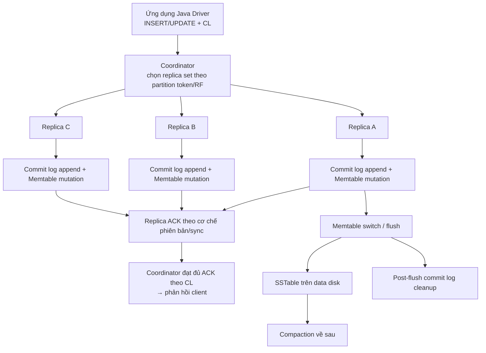
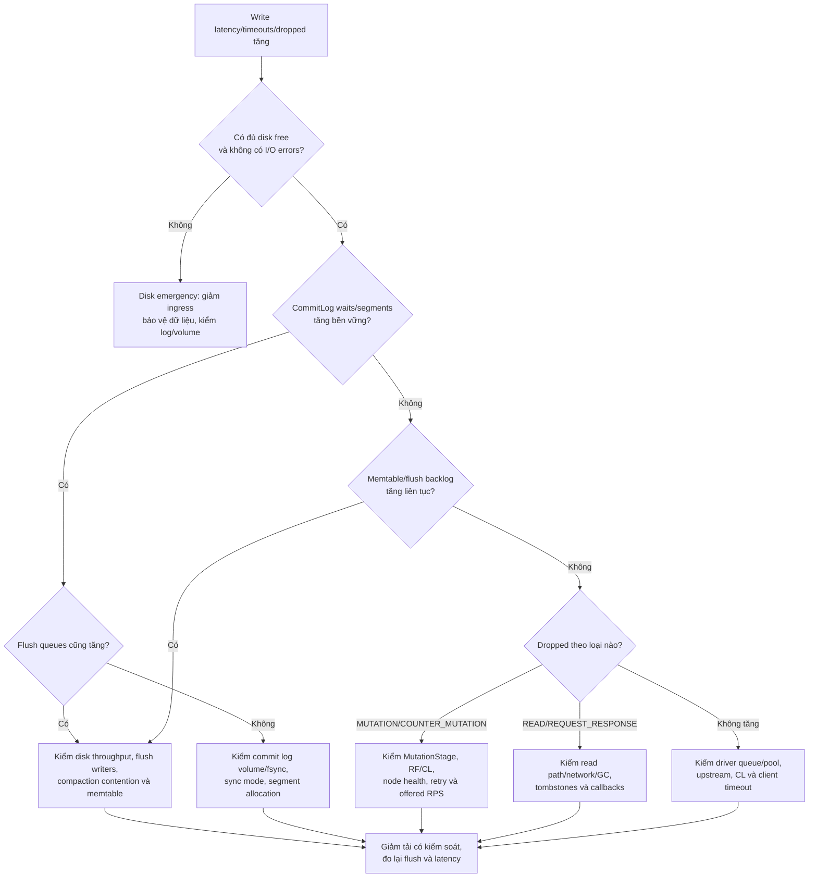
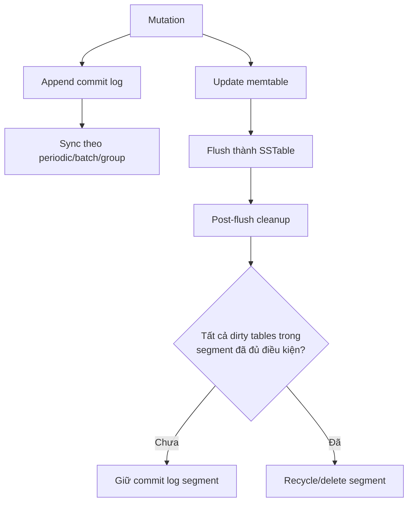

# Memtable/flush bị nghẽn, commit log pressure hoặc dropped message

**Chương:** Xử lý sự cố  
**Module:** `DATABASE_ENGINE_WIDE_COLUMN_CASSANDRA` — Apache Cassandra  
**Trọng tâm:** Phân tích đường ghi Cassandra, phân biệt memtable/flush, commit log và dropped messages; khoanh vùng nguyên nhân, giảm tải an toàn, khôi phục và kiểm tra tính đúng từ ứng dụng Java.

Một dịch vụ Java dùng Cassandra để ghi sự kiện thiết bị theo partition key. Trong 15 phút, p99 ghi từ 25 ms lên hơn 2 giây, một vài API trả timeout. Bảng điều khiển ghi nhận memtable lớn dần, `CommitLog.TotalCommitLogSize` tăng và `nodetool tpstats` cho thấy `MUTATION` bị dropped. Đây **không đủ để kết luận rằng Cassandra đã mất toàn bộ các bản ghi bị timeout**, nhưng rõ ràng là tín hiệu hệ thống đang có áp lực ở đường ghi hoặc hàng đợi thông điệp.

Ba nhóm dấu hiệu trong tiêu đề có liên quan nhưng **không đồng nghĩa**:

- **Memtable/flush nghẽn:** bộ nhớ dành cho dữ liệu chưa trở thành SSTable bị lấp đầy hoặc các tác vụ flush ra disk không theo kịp.
- **Commit log pressure:** commit log segments/đường fsync/segment allocation bị chậm hoặc giới hạn space gây yêu cầu flush, ảnh hưởng nhận write.
- **Dropped messages:** một loại thông điệp internode/intranode bị bỏ vì quá thời hạn hoặc điều kiện xử lý; cần xem **loại thông điệp, tốc độ tăng, lỗi request và replica state**, không tự dịch mọi dropped message thành một row đã mất.

Bài học xây quy trình **triệu chứng → số liệu xác nhận → nhánh giả thuyết → hành động ít rủi ro nhất → kiểm chứng hồi phục và dữ liệu**. Nội dung liên kết các khái niệm Cassandra wide-column, partition token, RF/CL, tombstone, compaction/repair, và kết nối Java Driver 4.x.

> **Phạm vi và nguyên tắc an toàn:** Nội dung hướng tới Apache Cassandra 4.1/5.x; tên tham số và MBean/`nodetool` có thể khác giữa phiên bản. Xác minh bằng tài liệu đúng phiên bản và cấu hình triển khai. Các lệnh quan sát là ví dụ cần chạy trên node **được cấp quyền**. **Không xóa thủ công file commit log/SSTable, tắt fsync, đổi `gc_grace_seconds`, ép major compaction, hạ consistency level hoặc restart hàng loạt nodes để “dọn hàng đợi”.** Mọi thao tác thay cấu hình/dữ liệu trên production cần incident owner, backup/RF/CL preflight và rollback. Các ví dụ lab chỉ dành cho cluster disposable.

## 1. Kết quả học tập

Sau bài, bạn có thể:

1. Vẽ đường ghi `client → coordinator → replica → commit log + memtable → flush SSTable` và phân biệt ACK ở consistency level với fsync/flush.
2. Nêu vì sao **memtable flush không phải compaction**, và commit log segments chỉ được tái sử dụng khi dữ liệu liên quan đã đủ điều kiện an toàn.
3. Đọc `nodetool tpstats`/`tablestats`/`compactionstats` cùng disk/GC metrics để tìm đoạn bị nghẽn.
4. Phân biệt metrics `MemtableOnHeapSize`, `AllMemtablesOnHeapSize`, `PendingFlushes`, `BytesFlushed` và các flush-related thread pools.
5. Diễn giải `CommitLog.TotalCommitLogSize`, `PendingTasks`, `WaitingOnCommit` và `WaitingOnSegmentAllocation`.
6. Hiểu `commitlog_total_space` có thể kích hoạt flush của những bảng vẫn còn dirty trong segment cũ; tăng giới hạn space không tự sửa disk nghẽn.
7. Phân biệt các dropped message types `MUTATION`, `READ`, `COUNTER_MUTATION`, `REQUEST_RESPONSE`, `HINT`, `READ_REPAIR`.
8. Phân loại `WriteTimeoutException`, `WriteFailureException`, `UnavailableException`, `DriverTimeoutException` và `RequestThrottlingException`.
9. Không kết luận “write timeout nghĩa là không ghi”, cũng không kết luận “dropped message nghĩa là mất dữ liệu chắc chắn”.
10. Giảm offered write rate/admission/concurrency có kiểm soát, tránh retry storm và bảo toàn business event IDs.
11. Phân biệt sự cố disk saturation, `ENOSPC`, GC pause, compaction contention, hot partitions, CDC/index/MV và network latency.
12. Thiết kế lab CQL + Java Driver đo write latency/timeout và quan sát flush mà không phá storage.
13. Dùng RF3/`LOCAL_QUORUM` để đặt câu hỏi đúng về replica availability, hint và repair sau khi một node chậm/quay lại.
14. Viết incident timeline, stop conditions và chứng cứ phục hồi bao gồm độ trễ, queue, disk, commit log và kiểm tra dữ liệu.
15. Lập kế hoạch điều chỉnh `memtable_*`, `commitlog_*`, flush writers hay disk layout **chỉ sau khi đã chứng minh nút thắt**.

## 2. Mô hình nền: Cassandra ACK write ở đâu?

### 2.1. Sơ đồ đường ghi rút gọn



Đây là **mô hình logic**, không xác định thứ tự tuyệt đối mọi bước thread/JVM hoặc đảm bảo flush xong trước ACK. Các writes của Cassandra thường được ghi vào **commit log** và cập nhật **memtable** ở replica; memtable được flush ra SSTable về sau khi thỏa điều kiện bộ nhớ/commit log, hoặc theo thao tác vận hành. **Compaction** là quá trình sau đó kết hợp/tổ chức các SSTables, không phải cùng một thao tác với flush.

Điểm cần nhớ:

- **ACK của client** phụ thuộc consistency level: với `NetworkTopologyStrategy` RF=3 một DC, `LOCAL_QUORUM` cần **hai** replica đáp ứng; không phải “mọi replica đã flush SSTable”.
- **Commit log sync mode** ảnh hưởng mốc fsync/durability. Ở mode `periodic`, Cassandra có thể ACK trước lần fsync định kỳ; ở mode `batch`/`group`, ACK có ràng buộc fsync khác. Cần đọc cấu hình và version thực tế.
- Một **write timeout** không cho biết chính xác mọi replica đã ghi đến đâu. Có thể một số replica đã áp dụng mutation, hoặc request đã hoàn tất nhưng response về client bị mất.
- Mọi node giữ **memtable và commit log cục bộ**. Một coordinator quá tải không chứng minh mọi replica cũng quá tải; phải đọc metrics trên từng node liên quan.

### 2.2. Cùng một partition key là cùng replica set

Cassandra dùng **partition key** để tính token, từ đó xác định replicas; clustering columns xác định thứ tự row trong partition, **không phân tán dữ liệu lên nhiều token**. Một tenant/bucket cực nóng có thể dồn mutations vào cùng replica set, khiến:

- một số nodes có memtable/commit log/write latency tăng mạnh, nodes khác vẫn rảnh;
- flush liên tục cho một vài tables;
- SSTables/tombstones và compaction backlog tăng;
- retry/speculative execution từ nhiều ứng dụng **đẩy thêm tải tới cùng replicas**.

Khi xác định hotspot, không chỉ thêm `memtable_heap_space` hoặc worker threads; cần xem thiết kế partition/bucket/shard theo **query patterns** và volume thực.

### 2.3. Flush, commit log và compaction khác nhau

| Hoạt động | Input | Output / điều kiện hoàn thành | Khi nghẽn |
| --- | --- | --- | --- |
| **Memtable flush** | Memtable chứa mutation | SSTable trên data disk, sau đó memtable có thể được reclaim | Memtable pressure và commit log segment giữ lâu |
| **Commit log append/sync** | Mutation để phục hồi sau crash | Commit log segments với semantics fsync theo `commitlog_sync` | Write latency, segment allocation/commit wait |
| **Post-flush cleanup** | Kết quả flush cho dữ liệu thuộc segments | Segment cũ đủ điều kiện được recycle/delete | `TotalCommitLogSize` khó giảm dù flush diễn ra |
| **SSTable compaction** | Các SSTables trên disk | SSTables được hợp nhất/điều chỉnh | Disk I/O, write amplification, reads chậm |
| **Repair** | Replica ranges, SSTable data/metadata | Dữ liệu được đối chiếu/đồng bộ giữa replicas theo loại repair | CPU/disk/network contention, backlog |
| **Hint replay** | Hints ghi cho replica không khả dụng, nếu có và đủ điều kiện | Mutation được giao lại | Thêm write pressure trên node phục hồi |

Một điểm dễ nhầm: **commit log segment chứa dữ liệu của nhiều tables**. Dù table nóng đã flush, nếu segment cũ còn mutation của table khác chưa flush, segment ấy có thể chưa reclaim được. `commitlog_total_space` nhỏ có thể khiến Cassandra phải flush **các tables ít hoạt động** chỉ để giải phóng segments cũ.

## 3. Nhận diện triệu chứng không vội quy nguyên nhân

### 3.1. Bảng phân loại nhanh

| Triệu chứng nhìn thấy | Tín hiệu cần đối chiếu | Chưa được phép suy |
| --- | --- | --- |
| `MemtableOnHeapSize` cao | `AllMemtables*`, flush queue, `BytesFlushed`, heap/GC | “Chắc chắn phải tăng heap” |
| `PendingFlushes` tăng | Per-disk flush writer pending/active, disk await, free space | “Tăng flush writers sẽ giải quyết” |
| `TotalCommitLogSize` tăng | `WaitingOnSegmentAllocation`, `WaitingOnCommit`, `PendingTasks`, segments/flush | “Xóa commit log là an toàn” |
| `MUTATION` dropped tăng | Write latency, `MutationStage` pending/blocked, RF/CL, retries/hints | “Tất cả writes đã mất vĩnh viễn” |
| `READ` dropped tăng | `ReadStage` pending, read latency, tombstones, SSTables | “Commit log có vấn đề” |
| `REQUEST_RESPONSE` dropped tăng | Coordinator response path/network/GC, in-flight callbacks | “Replica không nhận write” |
| `COUNTER_MUTATION` dropped tăng | Counter workload, retry logic, coordinator/replica health | “Có thể retry counter tùy ý” |
| App `DriverTimeoutException` | Driver queue/pool, coordinator/replica metrics, network | “Server chắc chắn không ghi” |
| App `UnavailableException` | Node status và replica availability theo CL | “Disk flush chậm là nguyên nhân duy nhất” |
| p99 tăng trên **một node** | Token/hot partition, disk/GC, node-local queue | “Phải nâng cấu hình cả cluster” |
| p99 tăng trên **mọi node** | Offered RPS, shared storage/network, compaction/GC, backpressure | “Thêm retries sẽ cải thiện” |

### 3.2. Cây quyết định sơ bộ



Không đi thẳng từ **một counter** đến thay `cassandra.yaml`. Cần có **ít nhất hai tín hiệu tương quan** (ví dụ flush queue tăng **cùng** disk await và commit log segments; hoặc `MUTATION` dropped tăng **cùng** `MutationStage.PendingTasks` và write timeout).

### 3.3. Mức độ ưu tiên xử lý

- **P0/P1:** Disk gần đầy, `ENOSPC`, commit log append/fsync errors, viết dữ liệu quan trọng thất bại, node bị loại khỏi ring, RF/CL không đủ, hoặc không đối soát được unknown outcomes.
- **P2:** Write p99 vượt SLO, dropped messages tăng liên tục, flush backlog tăng nhưng data vẫn đọc/ghi được.
- **P3:** Snapshot một counter cao sau một spike, không tăng thêm, latency và app success bình thường.

Đây là **khung phân loại**, không phải severity chuẩn của mọi tổ chức. Dùng SLO, loại dữ liệu và điều kiện vận hành thực tế để quyết định.

## 4. Thu thập bằng chứng trong 5–10 phút đầu

### 4.1. Giữ nguyên hiện trường và mốc thời gian

Trước khi đổi cấu hình, ghi:

```text
INCIDENT_ID:
UTC_START / UTC_NOW:
CASSANDRA_VERSION / JVM_VERSION:
AFFECTED_DC / NODES:
KEYSPACE / TABLES / PARTITION_KEYS:
RF / READ_CL / WRITE_CL:
APP_VERSIONS / DRIVER_VERSIONS:
OFFERED_WRITE_RPS / SUCCESS_RPS / TIMEOUT_RPS:
LAST_DEPLOY / SCHEMA_CHANGE / COMPACTION / REPAIR:
DISK_FREE / DISK_AWAIT / CPU / GC:
RETRY_POLICY / THROTTLER / CONCURRENT_REQUESTS:
WAS_THE_WRITE_IDEMPOTENT:
EVIDENCE_AND_LAST_GOOD_BASELINE:
```

Phải biết **node nào**, **table nào**, **khoảng thời gian nào**, **counter tích lũy hay tốc độ**. So sánh một ảnh chụp `Dropped=120000` với `Dropped=0` trên node vừa restart **không có nghĩa node mới đã khỏe**; nhiều counters được reset theo process.

### 4.2. Các lệnh quan sát tương đối an toàn

Chạy trên node/host đã được ủy quyền, tùy cách triển khai systemd/container/Kubernetes:

```bash
# Trạng thái cluster/định danh node:
nodetool status
nodetool info
nodetool describecluster

# Hàng đợi / dropped message theo thread pool:
nodetool tpstats

# Đọc thống kê table/cấp node:
nodetool tablestats <keyspace>.<table>
nodetool tablehistograms <keyspace> <table>

# Phân biệt compaction backlog và streaming:
nodetool compactionstats
nodetool netstats

# Lấy usage từ các filesystem có liên quan:
df -h
df -i
```

Các chuỗi `<keyspace>` và `<table>` trong code block là **placeholder**, không phải tên literal; thay bằng keyspace/table được giao. Lệnh `nodetool tablestats`/`tablehistograms` có cú pháp và định dạng phụ thuộc release; kiểm tra `nodetool help` theo phiên bản, nhất là Cassandra trong image của bạn.

### 4.3. Quan sát disk I/O và JVM

```bash
# Linux host/namespace; công cụ có thể chưa được cài:
iostat -xz 1 5
vmstat 1 5
free -h

# Nếu có quyền đọc logs, dùng cách quản lý dịch vụ hiện hành:
journalctl -u cassandra --since "15 minutes ago"

# Nếu deployment dùng file log:
# tail -n 300 /var/log/cassandra/system.log
```

**Cẩn thận:** `df` từ trong container có thể hiển thị filesystem khác với volume Cassandra thật; xác định đúng mount chứa `data_file_directories` và `commitlog_directory`. `iostat` cần được map tới device tương ứng; CPU iowait chỉ là một dấu hiệu, không phải bằng chứng duy nhất. Dùng read-only logs, không grep/thu thập tràn lan PII từ query.

### 4.4. Các đường dẫn cần xác định nhưng không tự đoán

Dựa trên cấu hình node:

- `data_file_directories` chứa SSTables/data.
- `commitlog_directory` chứa commit logs.
- `cdc_raw_directory` nếu CDC bật, có thể liên quan áp lực disk khác.
- Logs/JMX endpoint có thể khác theo distro/k8s operator.
- `saved_caches_directory` không phải commit log.
- `hints_directory` khác commit log; hints không được dùng làm backup thay thế.

Đừng áp dụng ví dụ đường dẫn mặc định như `/var/lib/cassandra/commitlog` cho mọi image/host, và **không xóa file theo đường dẫn mặc định**.

## 5. Metrics: phân biệt gauge, counter, timer và rate

### 5.1. Quy tắc trước khi đọc số

Cassandra công bố metrics qua JMX (có thể xuất qua exporters/virtual tables tùy phiên bản). Nhiều metrics có phạm vi **một node**. Không lấy metrics từ một coordinator rồi suy toàn cluster. Các loại thông dụng:

- **Gauge:** giá trị hiện thời; theo dõi mức và xu hướng.
- **Counter:** tích lũy từ lúc process bắt đầu/được tạo; theo dõi **delta/rate**, không chỉ absolute.
- **Meter:** tốc độ và tổng số sự kiện tùy exporter/metric.
- **Timer/Histogram:** latency distribution, count, p95/p99; cần xác minh đơn vị (ms/µs/nanos).
- **Task queue snapshot:** xem active/pending/blocked liên tục, kết hợp throughput hoàn thành.

Ví dụ `DroppedMessage.Dropped` là meter theo message type; `PendingFlushes` trong tài liệu có thể được mô tả là counter/estimated pending task. **Không gọi mọi metric có chữ “Pending” là gauge** hay áp `rate()` một cách tùy tiện — tham chiếu JMX/Prometheus exporter thật.

### 5.2. Table/memtable metrics đáng đo

| Metric trong tài liệu Cassandra | Vai trò | Cách diễn giải |
| --- | --- | --- |
| `MemtableOnHeapSize` | Dữ liệu memtable trên heap | Nếu tăng không giảm và flush không theo kịp, có pressure |
| `MemtableOffHeapSize` | Memtable ngoài heap | So với off-heap budget, direct memory |
| `MemtableLiveDataSize` | Dữ liệu sống | So với overhead và kiểu mutation |
| `AllMemtablesOnHeapSize` | Gồm memtables đang chờ flush và index liên quan | Có thể cao hơn memtable hiện hành |
| `AllMemtablesOffHeapSize` | Tổng off-heap các memtables | Phân biệt live vs pending |
| `MemtableSwitchCount` | Số lần đổi memtable khi flush | Rate tăng có thể do pressure hoặc workload |
| `PendingFlushes` | Ước lượng tác vụ flush chờ theo table | Theo dõi liên tục + stage queue, không dùng một điểm |
| `BytesFlushed` | Tổng bytes đã flush từ lần start | Lấy tốc độ delta theo thời gian |
| `PendingCompactions` | Compaction backlog table | Cạnh tranh disk/CPU với flush |
| `LiveSSTableCount` | SSTables còn hoạt động | Tăng mạnh có thể kéo theo read/compaction pressure |

MBean tên dạng `org.apache.cassandra.metrics:type=Table keyspace=<KS> scope=<TABLE> name=<MetricName>`, nhưng exporter có thể chuyển sang labels khác. Khi dùng `AllMemtables*`, nhớ nó bao gồm thêm memtables chờ flush/secondary indexes, không chỉ dữ liệu đang nhận writes hiện tại.

### 5.3. Thread pool metrics đáng theo dõi

Trong tài liệu metrics, các pools liên quan:

| Thread pool | Giúp trả lời |
| --- | --- |
| `MemtableFlushWriter` hoặc `PerDiskMemtableFlushWriter_<n>` | Flush ra data disk có bị chờ/đầy không? |
| `MemtablePostFlush` | Cleanup commit log sau flush có chậm không? |
| `MemtableReclaimMemory` | Bộ nhớ memtable đã giải phóng kịp chưa? |
| `MutationStage` | Các mutation thường có chất hàng không? |
| `CounterMutationStage` | Counter riêng có bị nghẽn không? |
| `ViewMutationStage` | Materialized views có thêm áp lực ghi không? |
| `Native-Transport-Requests` | Requests native protocol đang chờ? |
| `ReadStage` / `RequestResponseStage` | Có dropped/timeout do read/callback/network không? |
| `CompactionExecutor` | Compaction cùng cạnh tranh CPU/disk với flush? |

Tên có thể thay theo Cassandra version; `tpstats` là nơi xác nhận **stage thực sự hiện diện** trên node. Các metric chuẩn `ActiveTasks`, `PendingTasks`, `CompletedTasks`, `TotalBlockedTasks`, `CurrentlyBlockedTasks` giúp phân biệt thiếu throughput với chỉ có burst ngắn.

### 5.4. Commit log metrics đáng theo dõi

Các tên tài liệu chính thức thuộc phạm vi `org.apache.cassandra.metrics.CommitLog`:

| Metric | Ý nghĩa chẩn đoán |
| --- | --- |
| `TotalCommitLogSize` | Số bytes commit log segments hiện chiếm |
| `PendingTasks` | Messages chưa hoàn thành bước fsync/commit theo metric definition |
| `CompletedTasks` | Tổng messages được ghi; theo dõi delta/rate |
| `WaitingOnCommit` | Thời gian chờ commit log fsync; tăng nếu sync path chậm |
| `WaitingOnSegmentAllocation` | Thời gian chờ cấp segment; bình thường cần rất thấp/gần 0 |

**`TotalCommitLogSize` tăng không tự là lỗi:** nó có thể tăng theo write rate và giảm theo vòng đời segment. Đáng lo khi **đứng ở mức cao/tăng kéo dài đồng thời flush/segment allocation/commit wait và latency xấu đi**.

### 5.5. Dropped message metrics

Cassandra theo dõi `DroppedMessage.Dropped`, `InternalDroppedLatency`, `CrossNodeDroppedLatency` theo loại, ví dụ `MUTATION`, `READ`, `COUNTER_MUTATION`, `READ_REPAIR`, `REQUEST_RESPONSE`, `HINT` và các loại khác theo release.

Những câu hỏi trước khi kết luận:

1. Loại nào tăng? Một loại hay nhiều loại?
2. Tổng dropped tăng **bao nhiêu trong 1/5/15 phút**?
3. Request timeout/driver errors tương quan theo UTC không?
4. Node bị dropped là coordinator, replica, hay cả hai vai trò?
5. `MutationStage`/`ReadStage` có pending/blocked tasks không?
6. Disk/GC/network có tương quan không?
7. Cluster RF/CL, hints, replica health và số writes đã ACK thế nào?
8. Có một bulk load/repair/compaction hoặc deployment ngay trước spike không?

**Dropped ≠ chắc chắn mất logical row.** Một write đã được replica khác ACK có thể vẫn thành công ở `LOCAL_QUORUM`; một replica chậm có thể cần hints/repair. Ngược lại, dropped kéo dài có thể dẫn tới timeout và thiếu replica data. Không dùng một counter để khẳng định một trong hai.

## 6. Ưu tiên hành động ít rủi ro khi đang có sự cố

### 6.1. Tạm giảm tải ở nguồn

Khi bằng chứng cho thấy backlog tăng liên tục, **điều đầu tiên an toàn hơn thay disk/flush config thường là ngừng khuếch đại write traffic**:

- Hạn chế producer/concurrency ở API, queue consumers và batch jobs theo nguồn.
- Pause hoặc giảm tốc **non-critical ingestion** theo quyền vận hành; bảo đảm durable upstream queue/retention trước khi pause.
- Giảm retry ở gateway/app/Driver khi chúng đang tạo retry storm; không đổi policy bừa mà cần xác định idempotency.
- Tắt thử nghiệm speculative writes/over-parallel execution nếu đang bật và gây extra load.
- Ưu tiên mutation quan trọng; có cơ chế backpressure và HTTP 429/503 phù hợp.
- Thu lại offered RPS, completed RPS, queue depth, disk/flush/commit log trong vài cửa sổ để xác nhận backlog ngừng tăng.

**Không** dừng producer không có durable buffer rồi giả định mọi events đều giữ được. Với hàng đợi Kafka/queue khác, cần theo dõi lag, retention và khả năng replay có kiểm soát.

### 6.2. Không làm những việc sau trong P1

- Không `rm` hay `truncate` thủ công commit log segments: làm mất đường phục hồi sau crash; có thể mất dữ liệu.
- Không xóa SSTables, snapshot hoặc tombstones để lấy dung lượng ngay.
- Không chạy `nodetool flush` hàng loạt khi disk I/O đã bão hòa; có thể **tăng** pressure.
- Không chạy `nodetool compact`/major compaction để “giảm pending flush”; compaction có I/O amplification.
- Không tăng `memtable_heap_space` vô tội vạ: làm tăng memory pressure/GC, trì hoãn chứ chưa giải quyết disk throughput.
- Không tăng `commitlog_total_space` chỉ để số phần trăm thấp hơn; disk thật vẫn đầy và các segments cũ vẫn cần flush.
- Không hạ `LOCAL_QUORUM` xuống `ONE` mà bỏ qua yêu cầu consistency/durability.
- Không blind retry counter increment/list append/LWT/billing write khi outcome không rõ.
- Không restart hàng loạt nodes trước khi xác minh RF/CL, restore/repair plan và lưu hiện trường.
- Không bật `ALLOW FILTERING` cho các query/partition thiết kế sai gây quá tải.
- Không tắt fsync/commitlog sync vì p99 xấu mà chưa chấp nhận rủi ro mất dữ liệu khi crash.

### 6.3. Stop conditions cho hành động thử nghiệm

| Dấu hiệu | Dừng hoặc rollback |
| --- | --- |
| Disk free dưới mức bảo toàn/compaction của tổ chức | Dừng thử load và tăng số writes |
| Commit log append/fsync errors hoặc `ENOSPC` | Chuyển P1/incident commander, bảo vệ dữ liệu |
| ≥2 replicas không sẵn sàng ở RF3 khi cần `LOCAL_QUORUM` | Dừng thay đổi, ưu tiên khôi phục availability |
| Unknown write outcomes không đối soát được | Dừng mutation không idempotent và giữ evidence |
| GC pause/heap usage tăng mạnh sau tăng memtable budget | Rollback thay đổi và giảm ingress |
| Pending flushes/commit log waits tăng nhanh sau ép flush | Dừng thao tác flush bổ sung |
| Dropped `MUTATION`/timeouts tăng sau retry change | Rollback retry change; kiểm soát offered load |
| Node restart chưa `UN`/streaming chưa xong | Không restart node tiếp theo |
| Không còn out-of-band access tới node gặp lỗi | Dừng can thiệp, dùng quy trình recover hạ tầng |

Các ngưỡng thực tế phải đến từ capacity/SLO, không có một con số chung an toàn cho mọi cluster.

## 7. Chẩn đoán memtable/flush bị nghẽn

### 7.1. Flush trigger và memory backpressure

Memtable lưu những mutations chưa được đưa thành SSTable. Khi đạt ngưỡng bộ nhớ, có yêu cầu từ commit log cleanup hoặc thao tác vận hành, Cassandra **đổi memtable hiện tại** và đưa memtable cũ vào luồng flush. Dữ liệu vừa ghi có thể tiếp tục được nhận vào memtable mới nếu hệ thống còn headroom.

Khi số memtables đang chờ flush và tổng memory vượt khả năng reclaim, Cassandra có thể **chặn tiếp nhận writes** cho tới khi một flush giải phóng đủ memory. Vì vậy p99 tăng không chỉ từ fsync commit log; nó có thể tới từ **memtable allocation blocked** khi flush backlog không thoát.

Tín hiệu hữu ích là `MemtablePool.BlockedOnAllocation` (khi được expose theo bản Cassandra), các `AllMemtables*`, `PendingFlushes` và `MemtableFlushWriter`/`PerDiskMemtableFlushWriter_<n>` pending/active. Đối chiếu với disk await/throughput, JVM GC và nguồn ingress.

### 7.2. Mô hình backlog với đơn vị rõ ràng

Giả sử chỉ tính một node và một tập bảng đang ghi:

- `λ_in`: tốc độ **bytes/s** mutation đi vào memtable, đã tính được overhead gần đúng hoặc thu từ metrics.
- `μ_flush`: tốc độ **bytes/s** bytes được flush đủ điều kiện ra SSTables.
- `B(t)`: dữ liệu chờ flush quy đổi theo bytes, không phải hàng đợi task count.
- `T`: cửa sổ quan sát (giây).

Mô hình cân bằng đơn giản:

\[
B(t+T)\approx\max\left(0,\ B(t)+(\lambda_{in}-\mu_{flush})T\right)
\]

Nếu tốc độ vào dài hạn lớn hơn tốc độ flush, backlog có xu hướng tăng. Nếu một ổ disk có write throughput cao nhưng `iostat await` lớn vì compaction đang chiếm I/O, `μ_flush` vẫn có thể thấp. **Không** so raw CQL payload bytes với `BytesFlushed` 1-1: SSTable compression, metadata/index, write amplification và row updates làm số bytes khác; mô hình chỉ hướng tới **xu hướng**, không phải một phương trình kế toán chính xác.

Ví dụ giả định:

| Biến | Giá trị minh họa |
| --- | ---: |
| Mutations quy đổi vào memtable | 80 MiB/s |
| Flush hữu hiệu trong cửa sổ | 55 MiB/s |
| Chênh lệch | 25 MiB/s |
| Thời gian tiếp tục | 120 s |
| Backlog tăng lý thuyết | ~3.000 MiB |

Trong điều kiện thực tế có threshold/trigger, intake bị backpressure và tốc độ thay đổi theo thời gian. Mô hình giúp đặt câu hỏi **“nguồn vào vượt năng lực disk/flush trong bao lâu?”**, không dùng để suy Cassandra luôn có buffer vô hạn.

### 7.3. Những pattern thường gặp

**Pattern A — flush worker pending tăng, disk await tăng**

Giả thuyết: data disk đang tranh chấp I/O (flush, compaction, repair, snapshot copy, backup hoặc chính môi trường lưu trữ). Kiểm:

- `nodetool tpstats`: flush-related pools pending/blocked có tăng không?
- `nodetool compactionstats`: active/pending compactions có lớn bất thường?
- `iostat -xz`: đúng device chứa data directories có `await`/utilization xấu không?
- OS logs: filesystem errors, latency spikes, kernel I/O retries.
- `BytesFlushed` rate: có đang tăng đủ nhanh hay gần như đứng yên?
- `TotalDiskSpaceUsed`: obsolete SSTables/snapshots có làm disk chật?

**Pattern B — memtable memory lớn, flush worker không bận**

Có thể chưa đạt trigger, measurement là snapshot ngắn, hot partitions/index overhead, metric exporter sai, hoặc backpressure ở tầng trước. Không vội tăng flush threads nếu chưa chứng minh writer bị nghẽn.

**Pattern C — `MemtablePool.BlockedOnAllocation` tăng, flush vẫn chạy**

Cassandra phải chờ memory được giải phóng; có thể flush throughput thiếu, số memtables in-flight quá nhiều, GC/off-heap pressure hoặc disk contention. Ưu tiên giảm ingress rồi xác định tài nguyên giới hạn.

**Pattern D — nhiều flush nhỏ sau một thay đổi commit log**

Nếu `commitlog_total_space` quá nhỏ với tốc độ ghi và sự trộn tables trong segments, Cassandra có thể buộc flush những tables ít hoạt động để reclaim segment. Nhiều flush nhỏ kéo theo **nhiều SSTables** và áp lực compaction về sau. Kiểm với `MemtableSwitchCount`, `LiveSSTableCount`, `BytesFlushed`, `TotalCommitLogSize` và timeline thay config.

### 7.4. Vì sao “tăng memtable_flush_writers” không luôn tốt?

Theo cấu hình Cassandra, `memtable_flush_writers` kiểm soát mức song song flush theo layout disk và phiên bản. Tăng concurrency có thể giúp khi worker thiếu để tận dụng **disk còn dư headroom**, nhưng cũng có thể:

- Tạo nhiều flush nhỏ hơn, tăng SSTables/compaction work.
- Gây tranh chấp I/O/CPU với compaction và foreground reads.
- Không giải quyết vấn đề nếu device đã bão hòa hoặc filesystem lỗi.
- Tăng GC/direct-memory pressure gián tiếp nếu giới hạn khác bị vượt.

Đọc các tham số khác liên quan:

| Tham số | Mục đích | Cảnh báo |
| --- | --- | --- |
| `memtable_heap_space` | Memory budget memtables trên heap | Cạnh tranh JVM heap; tăng có thể làm GC xấu |
| `memtable_offheap_space` | Memory budget memtables off-heap | Cần tính tổng process/container memory |
| `memtable_flush_writers` | Mức song song flush | Nhiều hơn có thể gây compaction overhead |
| `memtable_cleanup_threshold` | Trigger cleanup/flush theo pressure | Được đánh dấu deprecated ở cấu hình hiện đại; không tùy tiện điều chỉnh |
| `memtable_allocation_type` / per-table `memtable` | Cách tổ chức memtable, version-dependent | 5.x có lựa chọn khác/nhạy hot partitions; không áp một config cho mọi version |
| `concurrent_compactors`, `compaction_throughput` | Công việc/giới hạn compaction | Tác động disk pressure và backlog, không phải flush trực tiếp |

Với Cassandra 5.x có các implementation memtable khác nhau (chẳng hạn kiểu trie và kiểu legacy theo version). Một lựa chọn hợp workload đều có thể tệ với **hot partition cực lệch**. Nếu incident trùng thời điểm upgrade/default thay đổi, đưa memtable implementation vào giả thuyết và đo A/B trên cluster thử, không đoán.

### 7.5. Hành động an toàn theo bằng chứng

1. Giảm offered write RPS/batch consumers để `λ_in` giảm có kiểm soát.
2. Nếu disk đã bão hòa: giảm hoặc dời tác vụ I/O cạnh tranh *theo quy trình* (backup copy, maintenance); không dừng repair/compaction mù.
3. Nếu disk còn headroom mà flush workers pending kéo dài: nghiên cứu sizing `memtable_flush_writers` theo phiên bản/disk layout, thử trên môi trường tương đương trước.
4. Nếu heap/GC là giới hạn: đánh giá phân bổ heap/off-heap/JVM/cgroup, hot partitions và kiểu mutation. Không tăng memtable budget vượt physical memory.
5. Kiểm tra storage throughput, ổ lỗi và dung lượng trống; mở rộng volume đúng quy trình nếu disk capacity thực sự thiếu.
6. Đo lại `PendingFlushes`, `BlockedOnAllocation`, `BytesFlushed`, `TotalCommitLogSize`, write p99 và error rate trong **ít nhất vài cửa sổ**.
7. Nếu backlog giảm nhưng p99 chưa phục hồi, xem compaction/SSTables tăng sau burst và các queue ở driver/server.

### 7.6. Không coi `nodetool flush` là nút “dọn bộ nhớ miễn phí”

`nodetool flush <keyspace> [table...]` buộc flush memtable của phạm vi được chỉ định **ra disk**. Nó không giảm write pressure do disk bão hòa; nếu đang có pending flush do I/O, ép thêm flush có thể làm tình trạng xấu hơn. Chỉ dùng nếu có chủ đích (ví dụ snapshot/safe maintenance, lab), đủ disk headroom và được owner duyệt. **Không** chạy blanket flush toàn cluster để xử lý một biểu đồ memtable cao.

## 8. Chẩn đoán commit log pressure

### 8.1. Vì sao commit log tồn tại?

Commit log là log append-only của mutations trên node, dùng để **phục hồi dữ liệu memtable chưa flush sau crash/restart** theo cấu hình sync/durability. Nó **không** phải bản sao backup đầy đủ để khôi phục mọi lịch sử từ đầu. Khi dữ liệu được flush an toàn thành SSTable và segment không còn mutations cần giữ, Cassandra có thể recycle/delete segment ấy.



**Chú ý:** Sơ đồ mô tả quan hệ phụ thuộc, không yêu cầu `append` và `memtable update` xảy ra tuần tự theo thứ tự hiển thị. Cassandra version có thể triển khai đường ghi theo cách khác; điều cần nắm là commit log và memtable **cùng bảo vệ một mutation trước khi flush SSTable**.

### 8.2. Commit log sync mode và ACK

Theo cấu hình Cassandra hiện đại, `commitlog_sync` có các chế độ `periodic`, `batch`, và `group` (theo phiên bản). Không dùng giá trị default không kiểm tra; đọc trực tiếp cấu hình node:

| Chế độ | Đặc điểm chính | Rủi ro khi disk sync chậm |
| --- | --- | --- |
| `periodic` | Commit log được fsync định kỳ; có thể ACK write trước lần fsync gần nhất | Commit wait/lag/block có thể phát sinh; crash có cửa sổ chưa durable trên local disk |
| `batch` | Write ACK gắn với log fsync của batch | Fsync latency có thể tăng write p99 |
| `group` | Nhóm writes trong một khoảng để fsync chung | Tuning group window thay latency/batching trade-off |

**Không** tự thay `batch` → `periodic` trong incident để giảm p99: nó đổi **durability trade-off** khi crash, cần approval và test. Tương tự không tăng `commitlog_sync_period` tùy ý nếu không chấp nhận cửa sổ rủi ro khi node mất điện đột ngột.

### 8.3. Commit log segment allocation khác fsync

Hai métrics quan trọng:

- `WaitingOnCommit` tăng: node đang đợi commit log commit/fsync, có thể do storage latency hoặc điều kiện sync.
- `WaitingOnSegmentAllocation` tăng: node chờ cấp/chuẩn bị segment mới; cần xem disk free, segment recycling/cleanup, log I/O và flush backlog.

`PendingTasks` cho commit log phải được hiểu theo MBean definition (messages đã ghi nhưng chưa fsync) và so cùng `WaitingOnCommit`, không đồng nhất với `PendingFlushes`.

### 8.4. `commitlog_total_space`: giới hạn kích hoạt flush, không phải chỗ xóa log

Nếu kích thước các segments vượt ngưỡng `commitlog_total_space`, Cassandra có thể phải flush những tables còn dirty trong segment cũ nhất để giải phóng nó. Hậu quả của một giới hạn quá thấp so với write rate/disk layout:

1. Segments quay nhanh.
2. Một table ít thay đổi nhưng có mutation trong segment cũ cũng bị yêu cầu flush.
3. Nhiều SSTables nhỏ được tạo ra.
4. Compaction tăng ở giai đoạn sau.
5. Disk I/O cạnh tranh với foreground writes.
6. p99/dropped messages có thể tăng theo.

Tăng `commitlog_total_space` chỉ có ý nghĩa khi **commit log disk còn capacity**, workload/segment reuse được hiểu rõ và nguyên nhân là giới hạn quá nhỏ. Nếu flush đã nghẽn vì data disk, tăng giới hạn chỉ trì hoãn áp lực và làm commit log chiếm thêm disk.

### 8.5. Điều tra commit log volume

Quan sát theo thứ tự:

1. Xác định volume thực của `commitlog_directory` trong cấu hình.
2. Xem `df -h`, inode usage, filesystem read-only/IO errors.
3. So `TotalCommitLogSize` với raw volume usage, nhớ `TotalCommitLogSize` không bằng tất cả files trên volume.
4. So `WaitingOnCommit`/`WaitingOnSegmentAllocation` với disk await/fsync latency và process CPU/GC.
5. So `PendingFlushes`/flush pool và `MemtablePostFlush`; nếu cleanup chậm, segments giữ lâu.
6. Kiểm tra commit log archive/CD C path nếu được bật: chúng có lifecycle khác và có thể chiếm disk.
7. Xem thay đổi `commitlog_sync`, `commitlog_total_space`, `commitlog_segment_size`, compression/encryption và storage layout gần đây.
8. Xác nhận node có thể tiếp tục flush/recover; nếu `ENOSPC` hoặc I/O error phải ưu tiên bảo vệ data/host.

### 8.6. CDC có thể là nhánh riêng

Nếu table bật **Change Data Capture**, `cdc_raw_directory`/`cdc_total_space` có thể gây write rejection/backpressure khi CDC consumer chưa dọn kịp. Không gọi mọi lỗi disk của CDC là “commit log đầy” rồi tăng `commitlog_total_space`. Phân biệt:

- Commit log path dùng cho recovery.
- CDC raw log space/consumer progress và `cdc_block_writes` theo version.
- Hints storage.
- SSTable data disks/snapshot space.

Với CDC, **không tắt cơ chế bảo vệ không gian rồi chấp nhận xóa sự kiện CDC cũ** nếu nghiệp vụ yêu cầu hoàn chỉnh change stream. Cần owner của pipeline CDC phối hợp.

### 8.7. Khi nào được thay cấu hình commit log?

Chỉ sau khi:

- Có số liệu chứng minh `WaitingOnCommit` hoặc `WaitingOnSegmentAllocation` là nút thắt chính.
- Đã đánh giá disk latency/capacity/IOPS và flush pressure.
- Hiểu chính sách durability được chấp nhận.
- Có test trên staging/disposable node cùng version.
- Có khả năng rollback và quy trình rolling changes an toàn.
- Không phải đang xử lý P0 vì disk I/O errors hoặc volume gần đầy.

Không đổi đồng thời `commitlog_sync_period`, `commitlog_total_space`, flush writers và compaction throughput rồi dùng biểu đồ sau đổi để kết luận nguyên nhân; quá nhiều biến khiến không truy vết được.

## 9. Dropped messages: loại thông điệp quan trọng hơn số tổng

### 9.1. Dropped là một tín hiệu chậm/queue, không phải verdict dữ liệu

Cassandra có giới hạn tuổi/thời gian cho những loại messages; message có thể bị bỏ khi quá trễ để xử lý còn hữu ích, hoặc xử lý đã mất deadline. `nodetool tpstats` và `DroppedMessage` metrics cho thấy counts theo type; cần xem **delta sau lần khởi động** và error/latency correlations.

Trong tài liệu chính thức có ghi chú **dropped writes có thể liên quan hinted handoff**. Nhưng hints **không phải lời hứa cứu mọi write**: còn phụ thuộc hint settings, RF/CL, replica state, time window, capacity, việc coordinator có nhận và giữ mutation hay không, và sau đó vẫn cần repair/anti-entropy theo lịch phù hợp. **Một write request timeout ở client có thể đã được vài replica nhận**; không coi mọi dropped là mất vĩnh viễn hay đã được recover chắc chắn.

### 9.2. Bảng phân biệt theo type

| Dropped type | Tầng/loại công việc | Nghi vấn cần điều tra |
| --- | --- | --- |
| `MUTATION` | Mutation ghi thông thường | MutationStage, replica write latency, disk/memtable/commitlog, hints, CL |
| `COUNTER_MUTATION` | Counter writes | CounterMutationStage, điều kiện đọc-ghi counter, non-idempotent retry |
| `READ` | Local/replica reads | ReadStage, SSTable/tombstones, CPU/GC/disk, read timeout |
| `READ_REPAIR` | Read repair work | Replica divergence, read repair load, disk/network |
| `REQUEST_RESPONSE` | Callback/response internode | Coordinator callback queue, network latency, GC, node health |
| `HINT` | Hinted handoff delivery | Hints queue/replay, replica vừa trở lại, network/disk |
| `BATCH_STORE`/`BATCH_REMOVE` | Batchlog maintenance | Logged batches, batchlog I/O, batch sizing |
| `PAGED_SLICE`/`RANGE_SLICE` | Paged/token range reads | Scan/range query, large partitions, read saturation |
| `_TRACE` hoặc type khác | Tracing/internal theo version | Tracing sampling và diagnostic overhead |

**Tên type có thể thay theo phiên bản.** Kiểm output `tpstats` và metric exporter thực tế. Nếu type là `READ` mà team vội tăng `memtable_flush_writers`, đó là can thiệp không có bằng chứng.

### 9.3. Cách tính tốc độ dropped

Giả sử số dropped `MUTATION` tích lũy của cùng node/process:

- Lúc 10:00: 4.200.
- Lúc 10:05: 4.350.

Thì:

\[
\Delta D=4{,}350-4{,}200=150\text{ messages trong 5 phút}
\]

\[
r_D=150/300=0.5\text{ messages/s}
\]

Nên so với tốc độ **mutations handled** của cùng loại nếu có phép đo đáng tin. Nhưng không gộp mọi message types hay so số `Dropped` của node vừa restart với node chạy vài tuần. Ghi timestamp/uptime, restart/reset, labels và đơn vị rate.

### 9.4. Phân biệt write failure và dropped mutation

Giả sử RF3 một DC và write `LOCAL_QUORUM`:

- Replica A ACK.
- Replica B ACK.
- Replica C xử lý chậm/dropped một mutation.

Coordinator có thể trả **success** cho client khi đạt hai ACK. Replica C có thể cần hints/repair để hội tụ; **thành công ở CL không có nghĩa C đã nhận hết**.

Ngược lại:

- Chỉ A ACK, B/C không đáp ứng trước deadline.
- Coordinator trả `WriteTimeoutException`.

Không thể khẳng định write chưa xuất hiện trên A, cũng không thể khẳng định client có thể retry một counter `+1` an toàn. Điều đúng là **unknown outcome** cần xử lý theo loại mutation và yêu cầu nghiệp vụ.

Với RF1 và CL1, node duy nhất quá tải/dropped khiến failure mode khác RF3. Gắn mọi kết luận với **RF/CL thật của keyspace**.

### 9.5. Dropped `REQUEST_RESPONSE` không đồng nghĩa “request chưa thực thi”

Một replica hoặc coordinator có thể đã thực thi việc cần làm nhưng callback/response về trễ, bị bỏ hoặc không tìm được requester đang chờ. Bởi vậy Java client có thể thấy timeout mà một phần hay toàn bộ work đã diễn ra. Triệu chứng này đòi xem **network RTT, dropped callbacks, GC pauses, coordinator stage, client timeout**, không chỉ disk flush.

### 9.6. Những việc không nên làm khi dropped tăng

- Không nâng read/write timeouts vô hạn: có thể làm hàng đợi tồn tại lâu hơn và che latency.
- Không tăng các thread pools vô điều kiện khi disk đã bão hòa.
- Không bật retry loop không giới hạn ở gateway/Java Driver/batch consumer.
- Không giảm consistency level để “giảm dropped” nếu data contract không cho phép.
- Không xem `nodetool tpstats` dropped ở một thời điểm là số rows bị mất.
- Không xóa hints/commit logs để “giảm pending” khi chưa hiểu khả năng khôi phục.
- Không chạy repair ngay khi node/disk đang P1 quá tải; repair có thể thêm I/O/network pressure.

## 10. Mối liên hệ với bottleneck ngoài memtable/commit log

### 10.1. Data disk bão hòa và compaction tranh I/O

Flush/compaction cùng cần disk I/O. Một table TTL nhiều, nhiều small SSTables hoặc backlog repair có thể làm disk chậm:

```text
Write rate cao → memtable flush nhiều → SSTables nhiều
                → compaction lớn → disk I/O cao
                → flush chậm → memtable allocation block
                → commit log segments khó reclaim
                → write latency/dropped MUTATION tăng
```

Đây là một **vòng lặp khả dĩ**, không phải mọi workload luôn theo chuỗi này. Chẩn đoán bằng đồng thời `BytesFlushed` rate, `PendingCompactions`, `LiveSSTableCount`, compactionstats và device I/O.

### 10.2. Hot partition hoặc phân bố token lệch

Nếu keyspace dùng bảng `PRIMARY KEY (tenant_id, event_ts)` và một tenant viết 10 triệu events/ngày, toàn bộ write có thể tập trung một partition cùng replica set. Cần đo:

- Top keys/partition distribution nếu có telemetry hợp lệ.
- `nodetool tablehistograms`/`tablestats` cho partition sizes.
- Per-node write latency/dropped/flush pressure.
- Keyspace/table có mutation patterns nóng không.
- TTL/tombstones và compaction strategy có phù hợp time-series không.

Giải pháp dài hạn thường là **thay partition design/bucketing/sharding** theo query, không phải tăng threads vô tận. Ví dụ `PRIMARY KEY ((tenant_id,bucket_day), event_ts, event_id)` tách theo ngày nhưng vẫn phải đo size của một tenant/ngày; dữ liệu cực lớn có thể cần bucket giờ hoặc shard.

### 10.3. Large mutation, batches, collection và index/MV

Các nguyên nhân tăng pressure:

- **Large partitions/mutations:** mỗi write tạo nhiều memory/commitlog bytes; một batch khổng lồ tiêu nhiều memory, network và latency.
- **Logged batches across partitions:** thêm batchlog work; **không** là giải pháp ghi throughput nhanh hơn.
- **Counter:** có đường ghi và semantics riêng; `COUNTER_MUTATION` dropped phải xử lý riêng.
- **Materialized views:** view mutations và write stages có thể tạo thêm công việc.
- **Legacy secondary index / SAI:** cần đánh giá overhead và compaction/flush behavior theo version.
- **Large collections:** collection updates/read-before-write có thể tăng chi phí và khó retry an toàn.
- **CDC:** consumer lag và CDC raw space có thể làm write rejection.

Đừng gộp mọi thay đổi của schema/index thành “commit log bug”. Khi incident trùng deploy query/schema/batch size, so khác biệt trước/sau.

### 10.4. GC/off-heap và OS pressure

GC pause kéo dài khiến cả các thread không trực tiếp flush cũng không phục vụ kịp request deadline. Off-heap/direct memory/container cgroup OOM có thể trông như disk pressure khi workers bị stall. Kiểm:

- Heap occupancy và GC pause frequency/duration theo JVM exporter.
- Direct/off-heap pool usage, `memtable_offheap_space`.
- Swap/thrashing, cgroup memory limits và OOMKilled events.
- CPU saturation, run queue và context switches.
- File descriptors và lỗi network.
- Sự thay đổi JVM/options gần đây.

Không tăng heap để xử lý vấn đề có nguyên nhân là EBS/network disk latency; không đổi GC với mọi dropped messages chưa phân loại.

### 10.5. Network latency và client overload

Một write timeout từ Java Driver có thể do:

- `CqlSession` không có coordinator reachable đúng DC.
- Connection pool/stream IDs cạn, `BusyConnectionException`.
- Request throttler queue đầy, `RequestThrottlingException`.
- Timeout khi chờ admission/queue trước khi request tới server.
- Network RTT/packet loss hoặc TLS connection churn.
- Coordinator callbacks chậm.
- Server memtable/commitlog/flush thật sự chậm.

Do đó cần **cả telemetry client và server**. Nếu server `MutationStage`/disk vẫn khỏe nhưng client `throttling.queue-size` tăng, sửa ingress/concurrency/session topology trước khi sửa `cassandra.yaml`.

## 11. Phân loại ngoại lệ Java Driver và điều không thể kết luận

### 11.1. Bảng lỗi cần phân biệt

| Exception/cơ chế | Có nghĩa gì ở mức client | Chưa chứng minh |
| --- | --- | --- |
| `WriteTimeoutException` | Coordinator không đạt write ACK đúng thời hạn/CL | Không có replica nào ghi |
| `WriteFailureException` | Server báo failures trong write path | Mọi replica đã rollback mutation |
| `UnavailableException` | Không đủ live replicas để thỏa CL tại thời điểm quyết định | Commit log đang đầy |
| `DriverTimeoutException` | Request-level deadline phía driver hết, có thể gồm queue wait | Server chưa thực thi mutation |
| `AllNodesFailedException` | Không có coordinator nào hoàn tất; có lỗi per node bên trong | Tất cả nodes đều Down |
| `RequestThrottlingException` | Driver không admission/queue được request | Cassandra server đã mất dữ liệu |
| `InvalidQueryException` | CQL/schema/query invalid | Disk hoặc flush bị nghẽn |
| `OverloadedException` | Server từ chối vì overload | Retry tức thì luôn tốt hơn |
| `BusyConnectionException` | Connection/pool stream resources không đủ (thường là nguyên nhân per-node) | Cần tăng memtable heap |
| LWT `[applied]=false` | Điều kiện không được áp dụng | Connection failure |

Với timeout write, lựa chọn retry phụ thuộc **idempotence thực tế**, consistency policy, event ID và khả năng reconciliation. `setIdempotent(true)` là khai báo để Driver xử lý chính sách retry/speculation, **không** làm một mutation không lũy đẳng trở nên an toàn.

### 11.2. Counter và list append đặc biệt nguy hiểm

```sql
-- Hai câu này KHÔNG phải idempotent dưới replay:
UPDATE lab_incident.counter_by_id
SET hits = hits + 1
WHERE counter_id = 00000000-0000-4000-8000-000000000001;

-- Nếu dùng list append ở bảng khác:
UPDATE lab_incident.history_by_id
SET steps = steps + ['PAID']
WHERE history_id = 00000000-0000-4000-8000-000000000001;
```

Hai statements chỉ là **ví dụ semantics**, các bảng `counter_by_id`/`history_by_id` không nằm trong lab DDL chính ở mục sau. Khi timeout đầu tiên, retry có thể làm counter tăng hai lần hoặc list có duplicate. **Đừng** gọi cùng CQL này trong incident trên dữ liệu thật chỉ để xem một timeout có xảy ra không.

### 11.3. Ghi trạng thái unknown outcome một cách minh bạch

```text
WRITE_STATUS:
  ACKED_AT_REQUIRED_CL
  DEFINITIVELY_REJECTED_BEFORE_SEND
  CONDITION_NOT_APPLIED
  UNKNOWN_OUTCOME_AFTER_TIMEOUT
  FAILED_INVALID_QUERY
  UNAVAILABLE_AT_REQUIRED_CL
  CLIENT_ADMISSION_REJECTED

RECOVERY_ACTION:
  if stable idempotent event ID:
      reconcile existing row / retry by reviewed policy
  if non-idempotent mutation:
      do not blind retry; investigate source of truth
  if application request was rejected before any send:
      may retry with total budget and backoff
```

“Unknown outcome” không có nghĩa luôn đã ghi. Nó nói **không có bằng chứng đủ để kết luận đã/không ghi** từ exception hiện có. Kiểm tra qua CL phù hợp và hệ thống nguồn sự thật, nhất là khi node còn Down, sửa chữa/chống duplicate có thể cần thời gian và các quy trình nghiệp vụ.

## 12. Java Driver 4.x: quan sát write mà không tự tạo retry storm

### 12.1. Điều kiện minh họa

Mã sau dành cho Java 17+, Apache Cassandra Java Driver 4.x, một `CqlSession` được dùng lại và bảng `lab_incident.events_by_device_day` sẽ tạo ở mục 13. Dùng **một primary key đầy đủ** cho mỗi event, id đã được sinh ổn định từ upstream. Chế độ `DefaultConsistencyLevel.ONE` trong lab RF1 **không phải** policy gợi ý cho production; khi RF3 và nghiệp vụ đòi quorum, dùng `LOCAL_QUORUM` sau khi đã xác minh topology.

Mục đích của probe:

- Đếm **attempt được ứng dụng cho phép**, không đoán successful ACK từ một timeout.
- Giới hạn số in-flight logical writes.
- Không blocking I/O thread với `join`/`Thread.sleep`.
- Phân loại **ACKED**, **REJECTED_BEFORE_SEND** và **UNKNOWN_OUTCOME**.
- Bảo toàn business event ID qua retry/reconciliation.
- Tránh vô tình speculative/retry mutation trước khi review idempotency.

### 12.2. Probe Java asynchronous có giới hạn

```java
import com.datastax.oss.driver.api.core.CqlSession;
import com.datastax.oss.driver.api.core.DefaultConsistencyLevel;
import com.datastax.oss.driver.api.core.ConsistencyLevel;
import com.datastax.oss.driver.api.core.cql.BoundStatement;
import com.datastax.oss.driver.api.core.cql.PreparedStatement;
import com.datastax.oss.driver.api.core.data.CqlDate;

import java.time.Duration;
import java.time.Instant;
import java.time.LocalDate;
import java.util.UUID;
import java.util.concurrent.CompletableFuture;
import java.util.concurrent.CompletionException;
import java.util.concurrent.CompletionStage;
import java.util.concurrent.Semaphore;
import java.util.concurrent.atomic.LongAdder;

public final class IncidentWriteProbe {

    public enum ResultKind {
        ACKED_AT_REQUESTED_CL,
        REJECTED_BY_APPLICATION_BEFORE_SEND,
        UNKNOWN_OUTCOME_AFTER_SUBMIT
    }

    public record WriteResult(
        UUID eventId,
        ResultKind kind,
        long elapsedMicros,
        String errorType
    ) {}

    private final CqlSession session;
    private final PreparedStatement insert;
    private final Semaphore inFlight;
    private final ConsistencyLevel writeCl;

    public final LongAdder acked = new LongAdder();
    public final LongAdder rejected = new LongAdder();
    public final LongAdder unknown = new LongAdder();

    public IncidentWriteProbe(
            CqlSession session,
            ConsistencyLevel writeCl,
            int maxInFlight) {
        if (maxInFlight <= 0) {
            throw new IllegalArgumentException("maxInFlight must be > 0");
        }
        this.session = session;
        this.writeCl = writeCl;
        this.inFlight = new Semaphore(maxInFlight);
        this.insert = session.prepare(
            "INSERT INTO lab_incident.events_by_device_day " +
            "(device_id,bucket_day,event_ts,event_id,kind,payload) " +
            "VALUES (?,?,?,?,?,?)"
        );
    }

    public CompletionStage<WriteResult> submit(
            UUID deviceId,
            LocalDate bucketDay,
            Instant eventTs,
            UUID stableEventId,
            String eventType,
            String payload) {

        // App admission riêng: không block khi quá tải.
        if (!inFlight.tryAcquire()) {
            rejected.increment();
            return CompletableFuture.completedFuture(
                new WriteResult(
                    stableEventId,
                    ResultKind.REJECTED_BY_APPLICATION_BEFORE_SEND,
                    0,
                    "APPLICATION_IN_FLIGHT_LIMIT")
            );
        }

        final long startedNanos = System.nanoTime();

        try {
            // CQL date dùng CqlDate trong Driver 4.x.
            CqlDate cqlDay = CqlDate.fromDaysSinceEpoch(
                (int) bucketDay.toEpochDay());

            BoundStatement statement = insert.bind(
                deviceId,
                cqlDay,
                eventTs,
                stableEventId,
                eventType,
                payload
            ).setConsistencyLevel(writeCl)
             .setTimeout(Duration.ofMillis(1500))
             // Bảo thủ: không cho driver tự phát lại khi
             // chưa review semantics và retry policy.
             .setIdempotent(false);

            return session.executeAsync(statement)
                .handle((result, failure) -> {
                    inFlight.release();
                    long micros =
                        (System.nanoTime() - startedNanos) / 1_000;

                    if (failure != null) {
                        unknown.increment();
                        Throwable root = unwrap(failure);
                        return new WriteResult(
                            stableEventId,
                            ResultKind.UNKNOWN_OUTCOME_AFTER_SUBMIT,
                            micros,
                            root.getClass().getSimpleName());
                    }

                    acked.increment();
                    return new WriteResult(
                        stableEventId,
                        ResultKind.ACKED_AT_REQUESTED_CL,
                        micros,
                        "");
                });
        } catch (RuntimeException ex) {
            inFlight.release();
            unknown.increment();
            long micros =
                (System.nanoTime() - startedNanos) / 1_000;
            return CompletableFuture.completedFuture(
                new WriteResult(
                    stableEventId,
                    ResultKind.UNKNOWN_OUTCOME_AFTER_SUBMIT,
                    micros,
                    ex.getClass().getSimpleName())
            );
        }
    }

    private static Throwable unwrap(Throwable throwable) {
        Throwable current = throwable;
        while (current instanceof CompletionException &&
               current.getCause() != null) {
            current = current.getCause();
        }
        return current;
    }
}
```

**Giới hạn chủ động của ví dụ:**

- Lỗi sau khi gọi `executeAsync` được gắn nhãn **UNKNOWN_OUTCOME_AFTER_SUBMIT** để không bao giờ cho phép blind retry từ một exception tổng quát. Production có thể phân biệt kỹ hơn lỗi server **definitively rejected** như `InvalidQueryException`; phải có test riêng cho classifier ấy.
- `.setIdempotent(false)` ở đây **bảo thủ**, không phải vì mọi `INSERT` cùng full PK đều không lũy đẳng. Với stable PK/payload và không có thay đổi timestamp/TTL ngoài ý muốn, một INSERT có thể được phân loại idempotent sau review; hãy bật policy phù hợp và đo amplification.
- `UNKNOWN_OUTCOME` **không phải khẳng định server đã ghi**: chỉ nói caller chưa đủ bằng chứng.
- `ACKED_AT_REQUESTED_CL` nói driver nhận phản hồi thành công theo CL, **không nói tất cả replicas đã flush SSTable** hay fsync trong mode `periodic`.
- `Semaphore` giới hạn **một instance** probe; 10 pods mỗi pod `maxInFlight=16` có thể cho 160 accepted requests đồng thời. Phải tính tổng session/consumer.
- Rejected trước send có thể được retry ở tầng upstream theo chính sách/backoff, nhưng phải tránh trùng request và xác định tổng attempt budget.
- Callback không thực hiện logging payload, blocking reconcilation hay gọi thêm CQL; giữ nó ngắn để không làm xấu latency.
- Không giữ danh sách `CompletableFuture` vô hạn; load generator phải có finite queue/backpressure/timeout.
- Error names là thông tin chẩn đoán; không tự suy data loss từ tên class.

### 12.3. Khởi tạo session cho lab

Một `CqlSession` nên tồn tại theo lifecycle ứng dụng/test harness, không tạo mỗi request. Ví dụ:

```java
import com.datastax.oss.driver.api.core.CqlSession;
import com.datastax.oss.driver.api.core.DefaultConsistencyLevel;

import java.net.InetSocketAddress;

try (CqlSession session = CqlSession.builder()
        .addContactPoint(
            new InetSocketAddress("127.0.0.1", 9042))
        .withLocalDatacenter("datacenter1")
        .build()) {

    IncidentWriteProbe probe = new IncidentWriteProbe(
        session,
        DefaultConsistencyLevel.ONE, // CHỈ cho lab RF1
        16);

    // Tạo IDs trước khi phát event, ghi vào durable source nếu cần.
    // Scheduler có giới hạn tốc độ và số pending futures:
    // probe.submit(deviceId, day, ts, eventId, "PING", "lab");
    //
    // Sau cửa sổ thử, dừng arrival mới và chờ những
    // CompletionStage còn in-flight trong deadline hữu hạn.
}
```

Ở Testcontainers hoặc Docker remote host, **không hardcode `127.0.0.1:9042`**; lấy contact points/mapped port và local DC thực tế. Với Cassandra RF3, dùng nhiều contact points, kiểm tra RF/DC và CL trước khi gửi workload.

### 12.4. Không biến metrics của probe thành hệ thống đối soát

Một `LongAdder unknown` tăng chỉ nêu số lỗi **caller không biết kết quả**. Để đối soát event:

1. Giữ `deviceId`, `bucketDay`, `eventTs`, `stableEventId` như **full primary key**.
2. Khi cluster khỏe và replica convergence đủ, đọc lại theo full PK ở CL được nghiệp vụ phê duyệt.
3. Xem payload/timestamp/TTL và business event source; một read null **ngay sau timeout** không chứng minh write chưa đến node nào.
4. Nếu upstream có durable queue, xem offset/ack status và event ID, tránh double publish/side effect.
5. Với counter/list append hoặc LWT có điều kiện, dùng nguồn facts/reconciliation riêng; không lấy hai HTTP attempts làm một transaction.
6. Ghi rõ các events vẫn `UNRESOLVED` trong incident report, không tự chuyển thành “LOST” hoặc “SUCCESS”.

## 13. Lab CQL và quan sát trên Cassandra disposable

### 13.1. Mục tiêu lab an toàn

Lab này giúp thấy **đường ghi, memtable/flush metrics và phân biệt error handling**. Không cố tình làm đầy disk, xóa commit log, ngắt fsync, disable GC hoặc tạo dropped message thật bằng overload. Việc không tái hiện được dropped messages trong một lab nhẹ **không phải test thất bại**; dropped đòi scenario fault/pressure riêng trên cluster thử.

Chuẩn bị:

- Một Cassandra 4.1/5.x disposable node hoặc Testcontainers, data directory riêng.
- DC được xác nhận qua `system.local`; giả định ví dụ là `datacenter1`.
- Disk/RAM đủ, không trỏ sang production.
- Quyền dùng `cqlsh`/`nodetool` và metrics exporter/JMX.
- Ghi server version, JVM settings, `commitlog_sync`, memtable budget.
- Mỗi run dùng key riêng hoặc tạo container/keyspace mới; không dùng `TRUNCATE` trên bảng test chia sẻ.
- Đối chiếu các lệnh theo version, không sao chép config lên production.

### 13.2. DDL cho lab một node RF1

```sql
CREATE KEYSPACE IF NOT EXISTS lab_incident
WITH replication = {
    'class': 'NetworkTopologyStrategy',
    'datacenter1': 1
}
AND durable_writes = true;

CREATE TABLE IF NOT EXISTS lab_incident.events_by_device_day (
    device_id uuid,
    bucket_day date,
    event_ts timestamp,
    event_id uuid,
    kind text,
    payload text,
    PRIMARY KEY ((device_id, bucket_day), event_ts, event_id)
) WITH CLUSTERING ORDER BY (event_ts DESC, event_id ASC);

CREATE TABLE IF NOT EXISTS lab_incident.status_by_device (
    device_id uuid PRIMARY KEY,
    state text,
    updated_at timestamp
);
```

**Vì sao RF1?** Chỉ cần quan sát CQL/memtable/commit log/flush trên một node. RF1/`ONE` **không thể kiểm chứng** hinted handoff, replica divergence hoặc `LOCAL_QUORUM` chịu được một node Down. Những việc đó thuộc mục RF3 sau.

### 13.3. CQL smoke test với full partition key

```sql
CONSISTENCY ONE;

INSERT INTO lab_incident.events_by_device_day (
    device_id, bucket_day, event_ts, event_id, kind, payload
) VALUES (
    10000000-0000-4000-8000-000000000101,
    '2026-11-21',
    '2026-11-21T10:00:00Z',
    20000000-0000-4000-8000-000000000101,
    'ONLINE', 'lab-only'
);

INSERT INTO lab_incident.events_by_device_day (
    device_id, bucket_day, event_ts, event_id, kind, payload
) VALUES (
    10000000-0000-4000-8000-000000000101,
    '2026-11-21',
    '2026-11-21T10:02:00Z',
    20000000-0000-4000-8000-000000000102,
    'HEARTBEAT', 'lab-only'
);

SELECT event_ts, event_id, kind
FROM lab_incident.events_by_device_day
WHERE device_id = 10000000-0000-4000-8000-000000000101
  AND bucket_day = '2026-11-21'
LIMIT 10;
```

Kỳ vọng hai events cùng partition, hàng 10:02 xuất hiện trước 10:00 do clustering `DESC`. Không cần `ALLOW FILTERING` hoặc scan toàn cluster.

### 13.4. Thu baseline trước phát tải

```bash
# Chạy trên lab node:
nodetool status
nodetool tpstats
nodetool tablestats lab_incident.events_by_device_day
nodetool compactionstats
df -h
```

Ngoài những lệnh text, nếu có JMX exporter, lấy một vài cửa sổ 1 phút cho:

- Table `MemtableOnHeapSize`, `AllMemtablesOnHeapSize`, `PendingFlushes`, `BytesFlushed`.
- Flush-related pool `ActiveTasks`/`PendingTasks`/`TotalBlockedTasks`.
- `CommitLog.TotalCommitLogSize`, `WaitingOnCommit`, `WaitingOnSegmentAllocation`.
- `DroppedMessage.Dropped` theo type.
- OS disk await/throughput, GC pause, write p95/p99.

Không so các counters khác uptime mà không tính rate.

### 13.5. Tạo tải nhẹ, hữu hạn

Một harness Java dùng `IncidentWriteProbe` nên:

1. Dùng một danh sách `deviceId` deterministic có nhiều keys để tránh một hot partition giả.
2. Tạo `eventId` ổn định **một lần** trước submit.
3. Giữ in-flight trong cap (ví dụ 16) và offered RPS không vượt khả năng node theo baseline.
4. Chạy số lượng hữu hạn, ví dụ **100–500 writes** trong lab nhỏ; không kỳ vọng số này đủ làm memtable flush tự nhiên.
5. Đếm ACKED, rejected admission và unknown outcomes; không gộp chúng vào một success rate.
6. Quan sát metrics trước/sau trong vài cửa sổ.
7. Không tự retry ngay tất cả unknown outcomes; đọc lại theo full PK khi cluster khỏe.
8. Dừng khi write p99/GC/disk vượt guardrails được lab owner đặt.

**Chú ý:** Một số lượng mutations nhỏ có thể không làm memtable đủ lớn để trigger flush. Đó là bình thường; đừng tăng tải vô hạn chỉ để thấy dropped messages.

### 13.6. Flush có chủ đích chỉ sau baseline lab

Nếu mục tiêu là quan sát flush lifecycle trên **một disposable node còn nhiều disk free**, có thể chạy một lần sau khi đã dừng producer:

```bash
# CHỈ trên lab disposable, sau khi bảo đảm đủ disk headroom:
nodetool flush lab_incident events_by_device_day

# Quan sát vài cửa sổ tiếp theo:
nodetool tpstats
nodetool tablestats lab_incident.events_by_device_day
nodetool compactionstats
```

Kỳ vọng memtable switch/bytes flushed thay đổi theo trạng thái. `TotalCommitLogSize` **không nhất thiết giảm ngay** vì segment còn chứa mutations của tables khác, hoặc cleanup/recycling có tiến độ riêng. Không gọi manual flush là “cách fix” nếu P1 đang nghẽn disk.

### 13.7. Checklist lab đạt

- [ ] CQL schema đúng composite partition key và clustering order.
- [ ] Một `CqlSession` đủ, không tạo session mỗi write.
- [ ] Write ACK và đọc lại bằng full PK đạt ở RF1/`ONE`.
- [ ] Metrics trước/sau được lưu cùng timestamp và version.
- [ ] Đã quan sát được ít nhất một memtable/commitlog metric có ý nghĩa, không cần gây dropped.
- [ ] Nếu chạy manual flush, chỉ trên disposable node có disk headroom.
- [ ] Không xóa thủ công commit log/SSTable hoặc gây ENOSPC.
- [ ] Phân biệt application admission rejection với server dropped.
- [ ] Có kế hoạch kết thúc và cleanup container/keyspace theo quyền.
- [ ] Báo rõ **RF3/repair/hints chưa được thử**.

## 14. Khi liên quan RF3, CL, hints hoặc replica recovery

### 14.1. Chỉ thử trên cụm nhiều node

Để đánh giá dropped `MUTATION` và data convergence, cần một **cluster Cassandra disposable** có các nodes cùng ring và `NetworkTopologyStrategy` RF phù hợp, thường RF3 một DC. Ba containers độc lập không tự hợp thành cluster RF3; phải cấu hình seeds, snitch, DC/rack, network và đợi bootstrap hoàn thành.

Preflight:

```bash
nodetool status
nodetool describecluster
nodetool netstats
```

Xác minh ba nodes `UN`, host IDs khác nhau, đúng DC, schema agreement, disk headroom và không có repair đang chạy bất thường. Với cluster RF3 một DC, `LOCAL_QUORUM=2`.

### 14.2. Một replica bị chậm và được khôi phục

Một kịch bản có kiểm soát:

1. Tạo keyspace/test table riêng RF3 và xác minh schema.
2. Ghi baseline với ba replicas khỏe, full PK và stable event IDs.
3. Làm một replica bị Down/chậm **trong lab**, không đụng production.
4. Giữ write `LOCAL_QUORUM` có giới hạn, biết hai replicas còn khỏe có thể đáp ứng.
5. Thu `MUTATION` dropped rate, write timeout/client exceptions và hints metrics; không kết luận data loss chỉ từ một counter.
6. Khôi phục replica, quan sát `netstats`, hint replay, disk/GC và service latency.
7. Kiểm tra dữ liệu từ các coordinator/CL thích hợp; không chỉ một read `ONE` để chứng minh hội tụ.
8. Theo quy trình phiên bản, lập kế hoạch repair nếu replica downtime/hints không đủ để đồng bộ.
9. Lưu timeline từng node, mutation IDs đã ACK và unknown outcomes.

Nếu một write `LOCAL_QUORUM` trả success khi một node Down, **hai replicas ACK** theo hợp đồng, không phải tất cả replica đã có row. Ngược lại, nếu `LOCAL_QUORUM` thất bại khi chỉ còn một replica, không tự hạ xuống `ONE` để đánh dấu kiểm thử xanh.

### 14.3. Hinted handoff không thay repair

Hints hữu ích cho một số mutations mà replica tạm unavailable; chúng có giới hạn thời gian/dung lượng/chính sách và có thể không bao phủ tất cả lỗi. Cần theo dõi `HintsSucceeded`, `HintsFailed`, `HintsTimedOut` và các đo lường delivery delay theo version. **Repair** đối chiếu dữ liệu replica, phục vụ đảm bảo hội tụ trong thiết kế vận hành; không dùng hints như một lời hứa tuyệt đối.

Không chạy repair đồng loạt ngay khi nodes vừa hồi phục nhưng disk vẫn bão hòa. Đặt lịch/phạm vi/range phù hợp, theo dõi network/disk và tính đúng dữ liệu. Nếu cần restore, kiểm backup/RPO/RTO chứ không “reset” dữ liệu từ commit log thủ công.

### 14.4. Vì sao một read thành công chưa chứng minh mọi write đã phục hồi?

- Read `ONE` có thể truy cập replica khỏe và không thấy replica lỗi.
- Read `LOCAL_QUORUM` ở RF3 xác nhận đủ phản hồi cho query cụ thể; không thay toàn bộ anti-entropy proof.
- Một write timeout có thể vẫn đang tiến hành khi client đã hết deadline.
- Tombstones, TTL và last-write-wins timestamps có thể khiến giá trị mới/old xuất hiện khác mong đợi.
- Nếu event IDs thay đổi giữa retries, duplicate business events không được phát hiện chỉ bằng kiểm primary key.
- Các read models khác (ví dụ bảng projection) có thể chưa đồng bộ vì dual write failure.

Kết luận phục hồi phải kết hợp **metrics queues/hints, snapshot so dữ liệu theo partitions/keys và workload nghiệp vụ**, không chỉ “không còn exception”.

## 15. Các ngưỡng quan sát và dashboard khuyến nghị

### 15.1. Không có một ngưỡng memtable/dropped chung cho mọi cluster

Trong write-heavy workload, memtable size và commit log size tăng/giảm theo chu kỳ là bình thường. Alerts nên dựa trên:

- **Trend kéo dài** của backlog/blocked time.
- **Write p95/p99** và success/error rate.
- **Disk free/IOPS/await** ở đúng volume.
- **Per-node skew** (một replica quá tải hơn nhiều so với peers).
- **Rate dropped messages** theo type, không chỉ cumulative.
- **Commit log wait/segment allocation latency**.
- **Thời gian phục hồi** sau khi giảm ingress.
- **Dữ liệu nghiệp vụ chưa đối soát**, không biến nó thành “0 lỗi” nếu chưa xác minh.

Các ví dụ dưới đây chỉ là **khung alert**, không phải ngưỡng production.

### 15.2. Bảng dashboard theo lớp

| Panel | Mức tổng hợp | Cách xem |
| --- | --- | --- |
| App offered/admitted/completed write RPS | Service/pod & toàn hệ | Phân biệt retry amplification và ingress thực |
| App write p50/p95/p99/error classes | Endpoint/statement | Phân loại `DriverTimeout` vs `Unavailable` |
| `MutationStage`/`CounterMutationStage` pending/dropped | Node/stage | Tìm queue chính |
| Memtable OnHeap/OffHeap + BlockedOnAllocation | Node/table | Dữ liệu đang tích/đang bị chặn |
| `PendingFlushes`/`BytesFlushed` | Node/table | Flush backlog vs throughput |
| Flush/post-flush thread pools | Node/pool | Writer pending/blocked/cleanup |
| CommitLog TotalSize/WaitOnCommit/SegmentAllocation | Node | Commitlog pressure thực |
| Disk `await`/IOPS/throughput/free | Physical volume/node | Xác định data disk vs commitlog disk |
| Compaction PendingTasks/bytes written | Node/table | Work cạnh tranh disk |
| DroppedMessage rate theo type | Node/message type | Định vị mutation/read/callback |
| JMX/JVM GC pause/heap/off-heap | Node/JVM | Loại trừ stop-the-world/memory pressure |
| Hints delivery/backlog | Node/peer | Kiểm phục hồi replica |
| Nodetool status/latency/repair | Cluster/DC | Gắn lỗi với topology RF/CL |

### 15.3. Tương quan theo cửa sổ thay vì nhìn một biểu đồ

Giả sử trong cùng 10 phút:

```text
10:00  Write p99=35ms; MutationStage.Pending=0
       MemtablePool.BlockedOnAllocation=0
       CommitLog.WaitingOnSegmentAllocation gần 0

10:04  Producer tăng từ 2k/s lên 10k/s
10:05  Disk await tăng, flush writer pending tăng
10:06  AllMemtablesOnHeapSize tăng, BlockedOnAllocation tăng
10:07  TotalCommitLogSize cao, WaitingOnSegmentAllocation tăng
10:08  MUTATION dropped rate tăng, WriteTimeout tăng

10:09  Admission cap ở producer giảm offered rate
10:11  Flush queue giảm, commit log waits hạ
10:15  p99 trở lại baseline; backlog giảm dần
```

**Đây là minh họa, không phải log đã thu.** Nó gợi ý disk/flush throughput không theo kịp burst và cascade sang commitlog/mutation dropped. Nhưng nếu `WaitingOnCommit` tăng **trước** flush queue mà disk commitlog độc lập với data disk, có thể gốc ở fsync/commitlog volume. Đừng đảo nguyên nhân-hậu quả chỉ dựa vào đồ thị cùng tăng.

### 15.4. Sai lầm khi tính alert từ counters

Một Prometheus exporter có thể xuất một counter/meter dưới nhiều tên/labels. Ví dụ pseudocode:

```promql
# Ý TƯỞNG - sửa tên metric/labels theo exporter thực tế:
rate(cassandra_dropped_message_total{type="MUTATION"}[5m])

# So với server write timeouts cùng khoảng:
rate(cassandra_client_request_timeouts_total{scope="Write"}[5m])
```

Không copy nguyên tên vào dashboard nếu exporter không có; **metric names ở đây chỉ minh họa**. Không áp `rate()` lên gauge như `TotalCommitLogSize`; với gauge dùng mức, slope/derivative phù hợp và bối cảnh capacity. Với counters sau restart, cần công cụ tính rate xử lý reset.

### 15.5. Alert theo nhiều điều kiện

Ví dụ logic thay vì threshold tuyệt đối:

```text
IF (
  write_timeout_rate > baseline + error_budget
  AND dropped_MUTATION_rate > baseline
  AND (flush_pending_sustained OR commitlog_wait_p99_high)
) FOR multiple windows
THEN alert "write-path pressure"

IF (
  commitlog_disk_free_below_safe_budget
  OR ENOSPC/commitlog fsync errors
)
THEN critical page immediately

IF (
  memtable_size_high
  BUT blocked_on_allocation=0
  AND flush/commitlog waits healthy
  AND write SLO healthy
)
THEN observe trend, do not auto-restart
```

Không dùng `nodetool flush` hoặc restart tự động như remediation khi alert đa điều kiện bật, nếu chưa có kiểm chứng/approval.

## 16. Tình huống thực tế và cách chẩn đoán

### A. `PendingFlushes` tăng, `BytesFlushed` gần như đứng yên

**Giả thuyết:** Flush bị chặn ở disk I/O, filesystem error hoặc worker không tiến triển.

**Bằng chứng cần:** Flush pool `ActiveTasks/PendingTasks`, `iostat` đúng volume, `df -h/df -i`, kernel/system logs, `MemtablePool.BlockedOnAllocation`, compactionstats.

**Ưu tiên:** Giảm ingress; kiểm disk capacity/health và tác vụ I/O cạnh tranh; không ép `nodetool flush` hàng loạt. Nếu disk fail/`ENOSPC`, đưa vào P1 và recovery plan.

### B. `TotalCommitLogSize` cao nhưng write p99 vẫn bình thường

**Giả thuyết:** Commit log đang hoạt động bình thường theo vòng đời segment; chưa có pressure thực.

**Bằng chứng cần:** `WaitingOnCommit`/`WaitingOnSegmentAllocation`, TotalSize trend, disk free, segment lifecycle, memtable flush.

**Ưu tiên:** Quan sát vài cửa sổ và capacity; không xóa log hoặc đổi `commitlog_total_space` chỉ vì một gauge cao.

### C. `WaitingOnCommit` tăng, flush queue bình thường

**Giả thuyết:** Fsync/commit log volume chậm, `commitlog_sync` mode hoặc I/O contention riêng.

**Bằng chứng cần:** Disk path của commit log, mode `periodic`/`batch`/`group`, per-volume await, commit log PendingTasks, JVM pause.

**Ưu tiên:** Bảo vệ log disk và giảm ingress; xem storage issue/IOPS/durability trade-off, **không tự chuyển mode sync** trong incident.

### D. `WaitingOnSegmentAllocation` tăng cùng `PendingFlushes`

**Giả thuyết:** Segment không được giải phóng nhanh do memtables dirty chưa flush, hoặc commit log/data disk bị nghẽn.

**Bằng chứng cần:** `TotalCommitLogSize`, `MemtablePostFlush`, flush queue, `BytesFlushed`, segment/snapshot/CDC disk usage và compaction.

**Ưu tiên:** Giảm writes, xác định table dirty/flush bottleneck. Tăng commitlog space chỉ sau capacity/reclaim analysis.

### E. Dropped `MUTATION` tăng nhưng client `LOCAL_QUORUM` vẫn ACK

**Giả thuyết:** Một số replica xử lý chậm; coordinator còn đủ ACK từ hai replicas RF3.

**Bằng chứng cần:** RF/CL, per-node dropped/`MutationStage`, hints metrics, write latency, replica UN, read outcomes.

**Ưu tiên:** Khôi phục node nghẽn, theo dõi hints/repair plan, không tuyên bố mất tất cả data hay đã hội tụ ngay.

### F. Dropped `READ` tăng nhưng `MUTATION` gần 0

**Giả thuyết:** Read path/tombstones/wide partition/compaction hơn là write commit log.

**Bằng chứng cần:** `ReadStage`, `SSTablesPerReadHistogram`, tombstone scanned, tablehistograms, read p99, disk.

**Ưu tiên:** Điều tra query patterns, hot partitions/TTL, compaction/read repair; không tăng flush threads không có căn cứ.

### G. Dropped `REQUEST_RESPONSE` tăng cùng JVM GC pause

**Giả thuyết:** Callbacks/responses bị trễ khi GC hoặc queue/network bất thường.

**Bằng chứng cần:** Per-node GC metrics/logs, callback stage queue, network RTT/loss, driver timeout categories.

**Ưu tiên:** Giảm concurrency, tối ưu memory/GC theo root cause, kiểm response path; không kết luận mutation chưa áp dụng.

### H. Dropped `COUNTER_MUTATION` và app auto retry

**Giả thuyết:** Counter +1 bị phát lại khiến số đếm không chính xác.

**Bằng chứng cần:** Retry policy, `setIdempotent` effective, request/event IDs, counter values, upstream redelivery và logs.

**Ưu tiên:** Dừng blind retry cho counter; đối soát source facts, thiết kế aggregation/idempotent event log nếu cần chính xác.

### I. Burst xuất hiện sau deploy tăng số consumers

**Giả thuyết:** Tổng offered RPS/in-flight tăng vượt flush/disk capacity, đặc biệt khi nhiều pods cùng cấu hình concurrency.

**Bằng chứng cần:** Number of pods, sessions, per-pod in-flight, queue lag, ingress write rate, per-node CPU/IO/flush backlog.

**Ưu tiên:** Giảm consumers/admission theo tổng fleet; không giải bằng tăng retries. Sau đó capacity plan và canary rollout.

### J. Sau thay `commitlog_total_space`, SSTable count tăng nhanh

**Giả thuyết:** Giới hạn quá nhỏ hoặc cách thay config tạo flush liên tục ở tables ít nóng.

**Bằng chứng cần:** Commit log segment size/TotalSize, `MemtableSwitchCount`, `BytesFlushed`, `LiveSSTableCount`, compaction backlog.

**Ưu tiên:** Đánh giá rollback config theo change plan, đảm bảo disk free và không đồng thời đổi nhiều knobs. Nếu đã có nhiều SSTables, compaction có thể cần thời gian hồi phục.

### K. Disk free vẫn còn nhưng commit log fsync báo I/O error

**Giả thuyết:** Storage device/path/mount issue, permissions, filesystem error, hoặc cloud volume latency/throttle.

**Bằng chứng cần:** Kernel/system logs, path/volume mapping, filesystem read-only, `iostat`, JMX waits, Cassandra system.log.

**Ưu tiên:** P1 storage; không xóa log, không tự restart; phối hợp hạ tầng và recovery owner để đảm bảo khả năng phục hồi.

### L. `MemtableOnHeapSize` cao nhưng `AllMemtables*` và `BlockedOnAllocation` bình thường

**Giả thuyết:** Một đợt write bình thường đang chờ flush trigger; chưa có stall.

**Bằng chứng cần:** Write SLO, heap/GC, memtable switch/bytes flushed trong nhiều cửa sổ.

**Ưu tiên:** Theo dõi, không thay memory knobs chỉ dựa vào snapshot.

### M. Hot partition theo tenant làm ba replicas quá tải

**Giả thuyết:** Partition key quá rộng, cùng một token replica set nhận phần lớn writes, compaction/read amplification tăng.

**Bằng chứng cần:** Partition/key sampling được phép, per-node skew, bảng/query shape, `tablehistograms`, events/partition.

**Ưu tiên:** Giảm rate cho tenant hot, xem bucketing/sharding theo queries, migration bảng mới có backfill/cutover; không đổi PK trên bảng cũ bằng Java annotation.

### N. CDC-enabled tables fail, tables khác vẫn ghi được

**Giả thuyết:** CDC raw disk/consumer backlog, `cdc_total_space` hoặc `cdc_block_writes` chứ không chỉ commit log chung.

**Bằng chứng cần:** CDC enabled tables, raw directory disk, CDC consumer progress/errors, commit log metrics, app error classes.

**Ưu tiên:** Tập trung xử lý CDC pipeline/capacity theo retention contract; không tắt bảo vệ và xóa CDC data nếu cần audit/stream completeness.

### O. Compaction backlog rất cao sau burst ghi, dù flush đã hồi phục

**Giả thuyết:** Flush tạo nhiều SSTables và compaction không theo kịp, gây read latency kéo dài.

**Bằng chứng cần:** `compactionstats`, `PendingCompactions`, `LiveSSTableCount`, disk await/CPU, read p99.

**Ưu tiên:** Giữ load vừa phải đến khi disk/compaction ổn định, nghiên cứu strategy theo TTL/time series, không ép major compaction khi disk thiếu headroom.

### P. Client timeouts tăng, server dropped/flush/commit log bình thường

**Giả thuyết:** Driver throttler, pool stream IDs, contact points/local DC, network hoặc upstream timeouts.

**Bằng chứng cần:** Driver `throttling.*`, `pool.available-streams`, per-node errors trong `AllNodesFailedException`, app queues, network RTT.

**Ưu tiên:** Giảm ingress/điều chỉnh admission và client configuration theo evidence; không tăng memtable memory vô cớ.

### Q. Một node được restart liên tục để “xóa pending tasks”

**Rủi ro:** Restart làm mất observability counters, commit log replay cần I/O, gossip/bootstrap có thể kéo dài, RF/CL bị suy yếu. Nếu restart thêm node trước khi node trước `UN`, có thể gây unavailable.

**Ưu tiên:** Dừng vòng restart, lập trạng thái cluster/RF, phân tích nguyên nhân và recovery plan. Nếu cần rolling restart, theo quy trình có backup/flush/drain khi đủ điều kiện và không làm khi disk bão hòa.

### R. Chuyển `LOCAL_QUORUM` xuống `ONE` làm timeout giảm

**Rủi ro:** Có thể trả ACK từ một replica, không còn cùng đảm bảo consistency/freshness. Hệ thống có thể “xanh” trên biểu đồ nhưng sai business contract.

**Ưu tiên:** Giữ CL theo yêu cầu, tăng capacity/giảm ingress/khôi phục replicas. Nếu business chấp nhận degrade, phải có phê duyệt, giới hạn thời gian và telemetry riêng, không thay ngầm.

### S. Hints backlog tăng khi node quay lại

**Giả thuyết:** Replica phục hồi đang nhận replay, có thể cùng lúc flush/compaction/disk cao.

**Bằng chứng cần:** Hints succeeded/failed/timed out, netstats, disk/GC, write p99, RF/CL, thời gian node Down.

**Ưu tiên:** Cho replay có capacity headroom, tránh thêm fault/repair nặng cùng lúc; đánh giá yêu cầu repair nếu hints không đủ; không xóa hints để làm metric giảm.

### T. `PendingFlushes` giảm nhưng hàng loạt requests vẫn chậm

**Giả thuyết:** Flush đã thông nhưng các tầng khác còn backlog: compaction, native transport, pool, GC, client admission, hinted handoff.

**Bằng chứng cần:** So các panel cùng timestamp; latency/queue/capacity của cả ứng dụng và từng node.

**Ưu tiên:** Không kết luận incident resolved chỉ vì một metric về 0. Kiểm SLO, unknown outcomes và data correctness trước khi đóng sự cố.

## 17. Case study giả định: từ write timeout đến root cause

### 17.1. Bối cảnh

Một cụm Cassandra RF3 ở DC `dc1` phục vụ dịch vụ Java ghi trạng thái thiết bị và events. API có `LOCAL_QUORUM`, client timeout 2 giây, nhiều Kafka consumers gửi events. Workload từng ổn định ở 2.000 writes/s, sau thay đổi consumer concurrency lên cao hơn, write p99 tăng. Dữ liệu mẫu chứa tenant/device IDs, event timestamps và stable event IDs.

Thông tin dưới đây **hoàn toàn giả định**, dùng để tập cách diễn giải evidence.

### 17.2. Timeline

| Giờ UTC | Quan sát | Ý nghĩa sơ bộ |
| --- | --- | --- |
| 09:00 | 3 nodes `UN`, p99=40 ms, dropped gần 0 | Baseline khỏe |
| 09:10 | Deploy tăng consumers, ingress từ 2k lên 7k writes/s | Có tác nhân thay đổi |
| 09:13 | Disk await trên hai replica nodes tăng rõ | Disk path có thể nghẽn |
| 09:14 | Flush worker pending và `BlockedOnAllocation` tăng | Memtables chờ reclaim |
| 09:15 | `TotalCommitLogSize` và `WaitingOnSegmentAllocation` tăng | Commit log segment pressure liên quan |
| 09:16 | `MUTATION` dropped rate, `WriteTimeoutException` tăng | Ảnh hưởng client/replica |
| 09:18 | App retry policy và Kafka redelivery làm offered attempts tăng thêm | Có thể khuếch đại sự cố |
| 09:20 | Incident owner giới hạn consumers, dừng retry không an toàn | Cắt vòng phản hồi |
| 09:23 | Flush backlog giảm, commit log waits giảm | Tín hiệu phục hồi |
| 09:28 | Write p99=50 ms, timeout rate trở lại baseline | Đường ghi ổn định |
| 09:35 | Đối soát các event IDs có unknown outcome, kiểm hints/repair plan | Không bỏ qua tính đúng |

### 17.3. Phân tích nguyên nhân có căn cứ

Có thể kết luận **khả năng cao**: ingress vượt flush/storage throughput, làm memtable allocation bị chặn và commit log segments khó reclaim; các attempts/retries tăng tải thêm. Nhưng cần chứng cứ:

1. Thay đổi consumers xảy ra **trước** khi disk/queue tăng.
2. Disk await, flush pending và `BlockedOnAllocation` tăng theo cùng thời điểm.
3. `WaitingOnSegmentAllocation` tăng **sau** flush backlog, phù hợp cascade.
4. Giảm ingress làm queue/latency hồi phục mà không cần thay config storage.
5. Không có filesystem errors, thiếu free space, hoặc GC pause đủ giải thích độc lập.
6. Không có tác vụ repair/compaction mới trùng thời điểm mà chưa được ghi nhận.

Nếu log cho thấy commit log volume bị cloud throttling từ trước deploy, phải đánh giá lại root cause. Timeline tương quan **không đủ** để chứng minh nhân quả tuyệt đối; cần loại trừ các giả thuyết mạnh khác.

### 17.4. Điều không được tuyên bố

- “Có 2.000 `MUTATION` dropped nên chắc chắn mất đúng 2.000 rows.”
- “Write timeout nghĩa là Kafka retry chắc chắn an toàn.”
- “Do `PendingFlushes` giảm, mọi replica đã đồng bộ.”
- “Tăng `commitlog_total_space` là fix vì metric commit log cao.”
- “Lần này p99 phục hồi nên không cần xem data correctness.”

### 17.5. Hành động phòng ngừa

- Tính tổng arrival capacity theo số consumers/pods/session, thêm bounded admission và backpressure.
- Thiết lập alert multi-signal: write p99 + dropped mutation rate + flush queue/commitlog wait/disk.
- Giữ stable event IDs và reconciliation pipeline cho timeout/unknown outcomes.
- Test load trên cluster disposable RF3 với cùng partition distribution trước deploy.
- Review index/MV/CDC và compaction strategy theo write workload.
- Lập disk capacity/IOPS plan, theo dõi hardware throttling và headroom.
- Không cấu hình tự động retry non-idempotent operations.
- Có kế hoạch hints/repair/restore và xác nhận từ DBA/SRE.

## 18. Runbook P0–P10: xử lý có kiểm soát

### P0 — Bảo vệ dữ liệu và kiểm soát phạm vi

Xác nhận production/staging, affected DC/nodes, business impact, loại write và SLO. Có incident owner và communication channel. Dừng mọi thay đổi đồng thời (deployment, compaction/repair ad hoc, schema change) nếu chúng gây nhiễu. Bảo vệ upstream durable queue và ghi trạng thái event IDs.

### P1 — Chụp cấu hình và hiện trường

Lưu `nodetool status/info/tpstats/tablestats/compactionstats`, server/driver versions, RF/CL, p99/error classes, JVM/disk stats và logs cùng UTC. **Không restart** trước khi có baseline nếu không có lý do an toàn buộc phải làm.

### P2 — Phân loại loại pressure

Theo cây quyết định:

- `PendingFlushes`/`BlockedOnAllocation` cao → nhánh memtable/flush.
- `WaitingOnCommit`/`WaitingOnSegmentAllocation` cao → nhánh commitlog.
- Dropped `MUTATION`/`COUNTER_MUTATION` → nhánh write stages/replicas.
- Dropped `READ`/`REQUEST_RESPONSE` → read/callback/network/GC.
- App request timeout nhưng server healthy → driver queue/pool/upstream.

Ghi hai hoặc nhiều tín hiệu tương quan và đặt giả thuyết có thể bác bỏ.

### P3 — Dừng khuếch đại tải

Giảm non-critical producers/consumers, cap in-flight/queue, giảm retry storm ở gateway/Driver/job, tắt load test hoặc maintenance I/O không thiết yếu theo quyền. Không mất data upstream; nếu pause consumer phải bảo đảm retention và lag monitoring.

### P4 — Kiểm disk/memtable/commitlog

Xác định data/commitlog/CDC mount, free space, inode, I/O error, `iostat`, GC. Phân biệt fsync wait với flush backlog và compaction contention. Không xóa logs/SSTables hoặc tăng memory không kiểm chứng.

### P5 — Khôi phục đường ghi có ưu tiên

Nếu disk I/O error/capacity: xử lý với storage owner, mở rộng/khôi phục volume theo quy trình. Nếu flush backlog do load: giữ ingress thấp đến khi memory reclaim và commit log recycle. Nếu client-side bottleneck: điều chỉnh admission/pool theo bằng chứng và không gây overload server.

### P6 — Xem RF/CL và replica state

Xác minh đủ healthy replicas theo CL, không hạ CL ngầm. Nếu một node Down, khôi phục từng node có kiểm soát. Theo dõi hints/streaming/schema agreement và không restart node tiếp theo trước khi đủ quorum.

### P7 — Kiểm tra data correctness

Đối soát event IDs/PK đã ACK, các writes unknown outcome, TTL/counter/list/LWT nếu có. Read lại theo CL phù hợp, không dùng một `ONE` read làm bằng chứng mọi replica đồng nhất. Nếu thiếu dữ liệu, dùng repair/restore theo plan, không replay mù mutation không lũy đẳng.

### P8 — Xác nhận phục hồi bằng nhiều chỉ số

Điều kiện tối thiểu:

- SLO latency/error rate trở lại baseline trong nhiều cửa sổ.
- Flush queue/`BlockedOnAllocation` giảm, `BytesFlushed` tiến triển.
- Commit log wait/segment allocation về mức bình thường, disk còn headroom.
- Dropped message rates ngừng tăng bất thường theo type.
- Không có node/kết nối/repair backlog chưa được xử lý.
- App ingress/retry amplification trong budget; unknown outcomes được theo dõi tới resolution.
- Không còn CDC/hints/compaction work chưa được biết có thể gây tái phát.

### P9 — Quyết định reopen traffic

Tăng producers/concurrency từng bước theo canary; theo dõi disk/flush/commitlog/dropped/p99 và dừng khi có dấu hiệu lặp lại. Nếu throughput cũ không thể duy trì bền vững, không “mở hết” chỉ vì hết timeout lúc giảm tải: cần capacity/data-modeling plan.

### P10 — Báo cáo và ngăn tái phát

Viết postmortem với timeline, root cause/độ tin cậy, các biến chưa kiểm chứng, ảnh hưởng dữ liệu, remediation, rollback, follow-ups và owner. Thử cải tiến trên cluster disposable rồi mới thay Cassandra config/Java Driver policy ở production.

### 18.1. Mẫu báo cáo incident

```text
INCIDENT_ID:
SEVERITY_AND_BUSINESS_IMPACT:
UTC_START / DETECTED / MITIGATED / RESOLVED:
CASSANDRA_VERSION / JVM:
CLUSTER / DC / AFFECTED_NODE_IDS:
KEYSPACE / TABLE / PARTITION_KEY_MODEL:
RF / READ_CL / WRITE_CL / SERIAL_CL:
APP_VERSION / JAVA_DRIVER_VERSION:
LAST_DEPLOY_OR_CAPACITY_CHANGE:
BASELINE_OFFERED_RPS / CURRENT_OFFERED_RPS:
APP_SUCCESS_RATE / P50 / P95 / P99:
ERROR_CLASSES_AND_COUNTS:
RETRY_COUNTS / THROTTLER_COUNTS / APP_REJECTIONS:
TPSTATS_STAGE_PENDING / BLOCKED / DROPPED_DELTA:
DROPPED_MESSAGE_TYPES_AND_RATE:
TABLE_MEMTABLE_ONHEAP_OFFHEAP:
ALL_MEMTABLES / BLOCKED_ON_ALLOCATION:
PENDING_FLUSHES / BYTES_FLUSHED_RATE:
COMMITLOG_TOTAL_SIZE / WAIT_ON_COMMIT:
WAIT_ON_SEGMENT_ALLOCATION / COMMITLOG_PENDING:
DATA_DISK_FREE_AWAIT / COMMITLOG_DISK_FREE_AWAIT:
GC_PAUSES / CPU / OFFHEAP:
ACTIVE_COMPACTION_REPAIR_HINTS:
ROOT_CAUSE_HYPOTHESES_AND_EVIDENCE:
IMMEDIATE_ACTIONS_AND_TIMESTAMPS:
DATA_CORRECTNESS / UNKNOWN_OUTCOME_IDS:
REPLICA_CONVERGENCE_CHECK:
RESTORE_OR_REPAIR_ACTIONS_IF_ANY:
ROLLBACK_AND_FAULT_CLEANUP:
RECOVERY_GATES:
LONG_TERM_ACTIONS_WITH_OWNER:
KNOWN_LIMITATIONS:
POSTMORTEM_REVIEWER:
```

Không điền “zero data loss” nếu chưa có reconciliation/backup/repair evidence phù hợp. Những điều không đo được phải ghi `NOT_MEASURED`, không ghi `0`.

## 19. Bài tập thực hành và tình huống phỏng vấn

### Bài A — Sự khác biệt giữa ACK và flush

Một write ở `LOCAL_QUORUM` trả success trong RF3, nhưng `nodetool tablestats` vẫn cho thấy memtable có dữ liệu chưa flush. Điều này có mâu thuẫn không? Giải thích đường ghi, commit log và điều kiện ACK.

### Bài B — Memtable backlog

Trong 2 phút, tốc độ vào memtable khoảng 70 MiB/s, flush hữu hiệu 45 MiB/s. Ước lượng backlog theo mô hình đơn giản. Kể ba nguyên nhân khiến con số thực tế khác ước tính.

### Bài C — Commit log segment không reclaim

Một segment chứa mutation của ba tables, trong đó hai tables đã flush, table thứ ba chưa. Vì sao segment vẫn có thể phải giữ? `commitlog_total_space` quá nhỏ có thể tạo cascade như thế nào?

### Bài D — `WaitingOnCommit` và `WaitingOnSegmentAllocation`

Hai metrics tăng vào những thời điểm khác nhau. Hãy nêu giả thuyết riêng cho fsync path và segment allocation/recycle, cùng ba metrics/OS tools cần để phân biệt.

### Bài E — Dropped `MUTATION` khi LQ vẫn thành công

RF3 một DC: A/B ACK, C xử lý chậm. Client nhận success. Có thể kết luận C có row không? Hints/repair có vai trò gì, và vì sao không được tuyên bố mất dữ liệu chắc chắn?

### Bài F — Dropped `READ`

Chỉ `READ` dropped tăng, write latency bình thường, memtable queue bằng 0. Bạn sẽ ưu tiên những metrics/query patterns nào thay vì tăng memtable flush writers?

### Bài G — Driver timeout và counter

Một counter `+1` timeout ở client. API gateway tự retry ba lần. Hãy giải thích rủi ro và thiết kế event facts/dedup/reconciliation. Đánh dấu mọi outcome còn chưa biết.

### Bài H — CDC ảnh hưởng write

Table CDC-enabled không ghi được, table khác hoạt động bình thường. Những đường dẫn/metrics nào cần xem, và vì sao không tự xóa CDC raw files?

### Bài I — Tránh lỗi khi restart

Một node đang Down trong RF3; người vận hành muốn restart thêm một node vì dropped mutations. Với `LOCAL_QUORUM=2`, tình huống có thể dẫn đến điều gì? Viết stop condition và lựa chọn khác.

### Bài J — Lệnh `nodetool flush`

Khi data disk `await` tăng, `PendingFlushes` cao, có nên chạy `nodetool flush` trên toàn cluster để “giảm memtable” không? Đề xuất hành động thay thế và điều kiện duy nhất có thể cân nhắc manual flush.

### Bài K — Phân biệt cumulative và rate

Node A có `Dropped MUTATION=50.000` sau 40 ngày uptime, node B có `Dropped MUTATION=3.000` sau một giờ. Từ hai số này node nào đang gặp vấn đề hơn? Bạn cần thêm dữ liệu nào?

### Bài L — Hot partition

Một bảng dùng `PRIMARY KEY (tenant_id, event_ts)`, tenant lớn ghi hàng triệu events/ngày. Hãy thiết kế lại partition/bucket để phân bố tốt hơn, không phá query pattern. Cần test migration gì?

### Bài M — Retry storm nhiều tầng

Driver có retry, API gateway có retry, Kafka consumer redeliver. Khi timeout tăng, inbound logical events giữ nguyên nhưng server coordinator attempts tăng mạnh. Hãy đề xuất total retry budget, cap in-flight và evidence xác minh.

### Bài N — False recovery

Sau khi giảm load, `PendingFlushes` về 0 nhưng p99 vẫn cao và compaction backlog lớn. Incident có được đóng chưa? Cần những recovery gates nào?

### Bài O — Thay commit log sync mode

DBA muốn đổi `commitlog_sync=batch` sang `periodic` trong incident. Bạn phải xác minh gì về durability/RPO/latency và vì sao đây không phải remediation “miễn phí”?

### Bài P — Differential diagnosis

Cho ba snapshots:

```text
Snapshot 1:
  Flush pending ↑; disk data await ↑; commit log wait later ↑
Snapshot 2:
  Flush pending ~0; commit log WaitingOnCommit ↑; commitlog disk await ↑
Snapshot 3:
  Server metrics bình thường; driver throttling.queue-size ↑,
  pool.available-streams ↓; app timeout ↑
```

Hãy nêu giả thuyết chủ đạo cho từng snapshot, biện pháp giảm tải và một test có thể bác bỏ giả thuyết đó.

## 20. Câu hỏi tự kiểm tra

1. Memtable, commit log và SSTable lần lượt làm gì trong Cassandra write path?
2. Tại sao ACK write không đồng nghĩa memtable đã flush ra SSTable?
3. `LOCAL_QUORUM` ở RF3 một DC cần mấy ACK?
4. `commitlog_sync=periodic` và `batch` khác nhau ở điều kiện fsync/ACK thế nào?
5. Vì sao không tự thay `commitlog_sync` để giảm p99 mà chưa review RPO?
6. Khi nào Cassandra phải đổi/flush memtable?
7. Điều gì khiến một write bị chặn bởi memtable allocation pressure?
8. `MemtablePool.BlockedOnAllocation` giúp chẩn đoán gì?
9. `MemtableOnHeapSize` khác `AllMemtablesOnHeapSize` như thế nào?
10. `PendingFlushes` và `BytesFlushed` nên được xem cùng nhau ra sao?
11. Vì sao tăng `memtable_flush_writers` có thể làm nhiều SSTables nhỏ hơn?
12. Vì sao tăng memtable heap space có thể khiến GC xấu đi?
13. `memtable_cleanup_threshold` trong cấu hình hiện đại có cảnh báo gì?
14. Flush khác compaction như thế nào?
15. Compaction/repair có thể làm flush chậm bằng cách nào?
16. Một commit log segment có mutations của nhiều tables, khi nào có thể reclaim?
17. `commitlog_total_space` quá thấp gây flush dây chuyền ra sao?
18. `TotalCommitLogSize` cao có luôn là sự cố không?
19. `WaitingOnCommit` và `WaitingOnSegmentAllocation` khác nhau ra sao?
20. Khi commit log fsync thất bại, tại sao không xóa log files?
21. `data_file_directories` và `commitlog_directory` có thể nằm trên volumes nào?
22. Vì sao cần kiểm `df`/`iostat` đúng mount thay vì chỉ trong container root?
23. Dropped `MUTATION` khác dropped `READ` như thế nào?
24. `REQUEST_RESPONSE` dropped có chứng minh mutation chưa áp dụng không?
25. `COUNTER_MUTATION` dropped ảnh hưởng chiến lược retry ra sao?
26. Vì sao dropped count tích lũy phải chuyển thành rate/delta?
27. Một message bị dropped có bằng đúng một logical row bị mất không?
28. Hinted handoff có bảo đảm phục hồi mọi write không?
29. Repair khác hinted handoff trong phạm vi nào?
30. `WriteTimeoutException` có cho biết chắc chắn write chưa xảy ra không?
31. `DriverTimeoutException` có thể đến từ throttler queue không?
32. `UnavailableException` nói gì về CL/replica availability?
33. Tại sao không tự hạ `LOCAL_QUORUM` xuống `ONE` để giảm timeouts?
34. `setIdempotent(true)` có làm counter increment thành idempotent không?
35. Tại sao key/event ID ổn định quan trọng trong reconciliation?
36. Vì sao không dùng `TRUNCATE` hay xóa SSTable để sửa flush pressure?
37. Hot partition ảnh hưởng sự phân bố write trên replica set thế nào?
38. CDC raw space có thể gây write rejection riêng ra sao?
39. Vì sao load sau deploy tăng số pods có thể làm commit log pressure tăng?
40. Các chỉ số nào phân biệt driver queue bottleneck với server write-path bottleneck?
41. Thứ tự an toàn khi xử lý P1 có disk I/O error là gì?
42. Một read `ONE` sau recovery đủ chứng minh toàn bộ replicas hội tụ chưa?
43. Những recovery gates nào phải đạt trước khi reopen producers?
44. Một incident report có thể tuyên bố “zero data loss” trong điều kiện nào?
45. Nêu một ví dụ vì sao `PendingFlushes` về 0 chưa đồng nghĩa toàn hệ thống khỏe.

### Checklist trước khi đánh dấu bài điều tra đạt

- [ ] Đã chốt cluster/DC/nodes, keyspace/table, RF/CL và impact/SLO.
- [ ] Đã lưu UTC timeline, version Cassandra/JVM/Driver và deploy gần nhất.
- [ ] Không kết luận ACK write = mọi replica đã flush SSTable.
- [ ] Đã phân biệt memtable, commit log, flush, post-flush và compaction.
- [ ] Đã đọc `nodetool status` trên các nodes liên quan.
- [ ] Đã so `tpstats` pending/blocked/dropped theo type và thời gian.
- [ ] Đã đo `MemtableOnHeapSize`/`AllMemtables*`/`BlockedOnAllocation`.
- [ ] Đã đo `PendingFlushes`, `BytesFlushed` và flush writer queues.
- [ ] Đã đo `CommitLog.TotalCommitLogSize`/`WaitingOnCommit`/`WaitingOnSegmentAllocation`.
- [ ] Đã xác định đúng commitlog/data/CDC volumes và I/O health.
- [ ] Đã kiểm disk free/inodes và filesystem errors trên từng node.
- [ ] Đã đọc compactionstats/repair/hints và các workload I/O cạnh tranh.
- [ ] Không suy mất dữ liệu từ dropped `MUTATION` count.
- [ ] Đã chuyển cumulative dropped counts thành delta/rate có uptime.
- [ ] Đã phân loại dropped `READ`/`MUTATION`/`REQUEST_RESPONSE` và các loại khác.
- [ ] Đã đối chiếu server issues với Java Driver timeouts/throttler/pool errors.
- [ ] Đã ghi rõ unknown outcomes và quy trình đối soát.
- [ ] Không blind retry counter/list append/LWT hoặc business side effects.
- [ ] Đã giảm offered load/retry amplification có kiểm soát khi backlog tăng.
- [ ] Đã giữ consistency level theo hợp đồng nghiệp vụ.
- [ ] Không xóa commit log/SSTable/hints, không hạ GC grace để “dọn” pressure.
- [ ] Không ép manual flush/major compaction trên data disk bão hòa.
- [ ] Không tự tăng heap/flush writers/commitlog space khi chưa đo bottleneck.
- [ ] Đã kiểm CDC/index/MV/hot partition/batch nếu thay đổi gần incident.
- [ ] Nếu RF3 liên quan, đã kiểm node `UN`/hints/repair cần thiết.
- [ ] Có recovery gates cho write p99, errors, flush/commitlog queues, disk và data.
- [ ] Có canary reopen producers, stop conditions và rollback plan.
- [ ] Có postmortem kèm root cause evidence, unknowns và owner follow-up.
- [ ] Các ví dụ chỉ chạy trên lab/staging được cấp phép, không fault inject production.
- [ ] Đã ghi rõ phần chưa QA/thử trên Cassandra thật.

**Ghi nhớ:** **Memtable/flush bị nghẽn, commit log pressure và dropped messages là các dấu hiệu của đường ghi có thể nối tiếp nhau, không phải ba cách gọi cùng một lỗi.** Để xử lý an toàn, hãy **đo đúng node/table/message type và từng bước trong đường ghi**, giảm nguồn gây quá tải, bảo vệ commit log/SSTables và giữ nguyên RF/CL, sau đó kiểm tra hints/repair và từng unknown write outcome. Bất kỳ “fix” nào chỉ làm p99 đẹp hơn mà không đảm bảo dữ liệu nghiệp vụ đều chưa phải hoàn thành incident.

## Tài liệu kỹ thuật tham khảo

- [Apache Cassandra — Storage Engine: CommitLog, Memtable, Flush, SSTable](https://cassandra.apache.org/doc/stable/cassandra/architecture/storage-engine.html).
- [Apache Cassandra — Monitoring Metrics: Table, ThreadPools, CommitLog, DroppedMessage](https://cassandra.apache.org/doc/stable/cassandra/managing/operating/metrics.html).
- [Apache Cassandra — cassandra.yaml configuration](https://cassandra.apache.org/doc/stable/cassandra/managing/configuration/cass_yaml_file.html).
- [Apache Cassandra — Use nodetool for troubleshooting](https://cassandra.apache.org/doc/stable/cassandra/troubleshooting/use_nodetool.html).
- [Apache Cassandra — nodetool flush reference](https://cassandra.apache.org/doc/stable/cassandra/managing/tools/nodetool/flush.html).
- [Apache Cassandra — nodetool tpstats reference](https://cassandra.apache.org/doc/stable/cassandra/managing/tools/nodetool/tpstats.html).
- [Apache Cassandra — CQL Data Definition](https://cassandra.apache.org/doc/stable/cassandra/developing/cql/ddl.html).
- [Apache Cassandra — CQL Data Manipulation and Consistency](https://cassandra.apache.org/doc/stable/cassandra/developing/cql/dml.html).
- [Apache Cassandra — Hinted Handoff](https://cassandra.apache.org/doc/stable/cassandra/managing/operating/hints.html).
- [Apache Cassandra Java Driver 4.18.1 — Retries](https://apache.github.io/cassandra-java-driver/4.18.1/core/retries/).
- [Apache Cassandra Java Driver 4.18.1 — Idempotence](https://apache.github.io/cassandra-java-driver/4.18.1/core/idempotence/).
- [Apache Cassandra Java Driver 4.18.1 — Request throttling](https://apache.github.io/cassandra-java-driver/4.18.1/core/throttling/).
- [Apache Cassandra Java Driver 4.18.1 — Metrics](https://apache.github.io/cassandra-java-driver/4.18.1/core/metrics/).

**Lưu ý:** Các câu chuyện, số liệu, cấu hình, đường dẫn và lệnh trong bài là **ví dụ phục vụ học tập**, không phải kết quả đã kiểm tra trên cluster của người học. Khi triển khai thật, hãy đối chiếu chính xác phiên bản Cassandra/Java Driver, hạ tầng và quyền thao tác; lưu evidence trước/sau thay đổi và thực thi trên cluster cô lập trước. Việc QA chuyên môn và kiểm thử bài học thực tế thuộc STEP 6 sau khi các thành phần đánh giá liên quan được hoàn thành.
