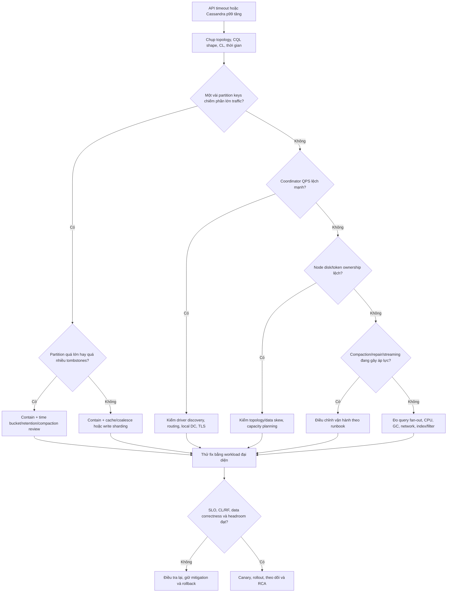

# Hot partition, coordinator quá tải hoặc phân bố dữ liệu lệch

> **Chương:** Xử lý sự cố  
> **Hệ thống:** Apache Cassandra — cơ sở dữ liệu phân tán wide-column với partition key, token ring, replication, consistency level, read/write path, compaction, repair — được truy cập từ ứng dụng Java, đặc biệt Cassandra Java Driver 4.x.
>
> **Mục tiêu học tập:** Phân biệt **partition nóng (hot partition)**, **partition quá lớn (large partition)**, **coordinator quá tải**, **node/replica quá tải** và **token/dung lượng lệch**; đọc đúng bằng chứng từ driver và Cassandra; điều tra theo mức độ ảnh hưởng; khống chế tải mà không làm mất dữ liệu; chọn giải pháp query-first như time bucketing/sharding khi thật sự cần; xác minh cải thiện bằng workload phân bố khóa đại diện; lập runbook tránh việc “thêm node nhưng hot key vẫn nóng”.

## 1. Tình huống mở đầu: một node CPU cao và API p99 tăng

Ứng dụng Java có API:

```text
GET /customers/{customerId}/events?day=2026-11-21

Java service -> Cassandra Java Driver -> Cassandra cluster
```

Sau một đợt marketing, một khách hàng/tenant tạo lượng request gấp 100 lần bình thường. Triệu chứng:

```text
API success p99:           45 ms -> 1.800 ms
Timeout/error:             0,1% -> 12%
Cassandra node-2 CPU:      35% -> 95%
Cassandra node-1 CPU:      40%
Cassandra node-3 CPU:      43%
Một số request:            coordinator node-2
Repair/compaction:         vẫn chạy nền
```

Kỹ sư thấy node-2 nóng và đề xuất:

- Tăng số node Cassandra.
- Chạy `nodetool cleanup` để giảm tải.
- Đổi `LOCAL_QUORUM` thành `LOCAL_ONE`.
- Chia nhỏ batch hoặc tăng connection pool.
- Thêm một secondary index vào bảng.

Những thay đổi này **có thể không giải quyết nguyên nhân gốc**, thậm chí làm mất headroom hoặc thay đổi consistency contract. Nếu toàn bộ traffic dồn vào **một partition key**, Cassandra vẫn đặt các bản sao của partition đó trên **tập replica theo token**. Thêm node không tự chia một partition thành nhiều partition.

**Bước đầu đúng là xác định node nóng vì vai trò gì, partition nào gây tải, request nào tạo ra nó và workload có đổi ra sao.**

## 2. Năm hiện tượng cần phân biệt

| Hiện tượng | Bản chất | Dấu hiệu nổi bật | Hướng xử lý chính |
| --- | --- | --- | --- |
| **Hot partition** | Một partition key bị đọc/ghi quá nhiều | Một số keys gánh phần lớn QPS, vài replica chịu tải cao | Giảm hot-key traffic, cache/bucket/shard theo truy vấn |
| **Large partition** | Một partition có quá nhiều rows/cells/bytes | p99 cao khi quét partition, heap/disk/tombstone ảnh hưởng | Giới hạn kích thước partition theo time bucket/data model |
| **Coordinator hotspot** | Một node điều phối quá nhiều client requests | ClientRequest/request rate cao ở một node, replica load có thể khác | Sửa client routing/discovery/connection topology |
| **Replica/storage hotspot** | Một hoặc vài node phải đọc/ghi nhiều dữ liệu hoặc làm compaction | Disk await, SSTables, pending stages cao trên replicas | Giảm fan-out, data skew, sửa partition/access pattern |
| **Token/disk skew** | Token ownership hoặc dung lượng partitions phân bố lệch | Dung lượng node khác biệt kéo dài, token/rack/RF bất thường | Điều tra ownership, topology, data distribution trước khi move |

**Một hệ thống có thể gặp nhiều hiện tượng đồng thời.** Ví dụ hot partition vừa tạo replica hotspot vừa làm coordinator trên replica đó nóng.

## 3. Cassandra phân phối dữ liệu theo partition key, không theo row count

Ví dụ CQL:

```cql
CREATE TABLE IF NOT EXISTS activity.events_by_customer_day (
    tenant_id text,
    customer_id uuid,
    bucket_day date,
    event_time timestamp,
    event_id uuid,
    payload text,
    PRIMARY KEY (
        (tenant_id, customer_id, bucket_day),
        event_time,
        event_id
    )
) WITH CLUSTERING ORDER BY (
    event_time DESC,
    event_id ASC
);
```

Giả sử bảng và keyspace đã tồn tại đúng schema. Một partition được xác định bằng:

```text
(tenant_id, customer_id, bucket_day)
```

Nhiều `event_time` và `event_id` khác nhau nhưng cùng partition key vẫn nằm **trong cùng Cassandra partition**. Clustering key quyết định trật tự rows trong partition; nó **không** phân phối rows sang token khác.

### Vì sao partition key quan trọng?

Đường đi:

```text
CQL request + bound partition key
                  |
                  v
          Compute partition token
                  |
                  v
       Locate replicas by token/RF/DC
                  |
                  v
      Coordinator communicates with replicas
                  |
                  v
          Memtable/SSTables/commit log
```

Token selection phụ thuộc partitioner và serialization của partition key. Trong nhiều cluster Cassandra, `Murmur3Partitioner` là cấu hình phổ biến; **không mặc định mọi distribution đều dùng cùng partitioner**.

Một partition được phục vụ bởi những replicas theo token/replication strategy. Dù có hàng triệu clustering rows, chúng không tự được băm thành hàng triệu partitions.

## 4. Hot partition khác large partition

### Hot partition

Một partition có thể chỉ chứa **20 rows**, nhưng bị truy cập 15.000 lần/giây. Nó là **hot** vì request rate, không vì size.

### Large partition

Một partition có thể chứa hàng triệu clustering rows hoặc nhiều GB dữ liệu, nhưng ít được đọc. Nó là **large**; ảnh hưởng read/compaction/repair/backups khi có truy cập, nhưng không mặc nhiên là hot.

### Vừa hot vừa large

Đây thường là tình huống tệ nhất:

- Một token/nhóm replicas nhận QPS cao.
- SELECT phải đọc nhiều SSTables/cells/tombstones.
- Mỗi request tốn nhiều CPU/disk.
- Trong lúc compaction, latency tăng mạnh.
- Driver retry/speculative execution có thể nhân thêm tải.

| Số request | Partition size | Chẩn đoán |
| ---: | --- | --- |
| Rất cao | Nhỏ | Hot key/hot partition; xem caching, rate, concurrent reads |
| Thấp | Rất lớn | Large partition; xem scan, tombstones, bucketing |
| Rất cao | Rất lớn | Hot + large; ưu tiên containment và remodel |
| Phân đều | Nhỏ | Có thể là coordinator/client routing hotspot |
| Phân đều | Node disk lệch | Token/ownership/data distribution hoặc compaction skew |

**Chỉ nhìn disk size không xác định được hot partition. Chỉ nhìn QPS không xác định được large partition.**

## 5. Token ring, vnodes và giới hạn của việc thêm node

Một token ring chia không gian token cho các nodes; với virtual nodes (*vnodes*), mỗi node có thể sở hữu nhiều token ranges.

```text
Partition Key P -> token T -> replica set {N1, N2, N3}

100.000 reads đến P:
  -> vẫn liên quan cùng replica set

Thêm node N4:
  -> có thể thay phân bố nhiều token ranges khác
  -> không tự chia nội dung P thành hai partitions
```

Việc thêm node có thể:

- Cân bằng nhiều **partitions khác nhau**.
- Giảm dung lượng trung bình mỗi node khi data distribution phù hợp.
- Thay đổi token ownership và replica placement theo topology.
- Tạo streaming load trong bootstrap/topology change.

Nhưng nó **không** bảo đảm chia tải của **một partition key duy nhất** theo số node mới. Nếu một khách hàng chiếm phần lớn traffic, vẫn có một giới hạn nóng tại replica set phục vụ key đó.

**Không bootstrap/decommission/move token để chữa hot key trước khi chứng minh lệch là do ownership thay vì một key duy nhất.**

## 6. Coordinator khác replica ở điểm nào?

Cassandra không có một master cố định cho mọi truy vấn. **Coordinator** là node nhận CQL request từ client và điều phối replicas cho request đó. **Replica** là node lưu dữ liệu tương ứng partition key.

Một node có thể là:

- Coordinator nhưng **không** nằm trong replica set cho partition.
- Coordinator **và** replica của partition.
- Replica bị nhiều coordinator khác gửi request đến.
- Cả coordinator hotspot lẫn replica hotspot.

Ví dụ:

```text
            Application clients
                  |
                  v
                Node A (coordinator)
                  |
         +--------+--------+
         |        |        |
         v        v        v
       Node B   Node C   Node D (replicas)
```

Nếu mọi clients gửi qua A, A có thể nóng vì xử lý nhiều **coordinator requests**, dù dữ liệu được phân phối đều trên B/C/D.

Ngược lại, với hot partition P, **B/C/D** là tập replica bị hỏi liên tục; đổi coordinator không nhất thiết giảm đủ tải trên replicas.

### Bằng chứng cần tách

| Chỉ số | Gợi ý vai trò |
| --- | --- |
| Client request/latency ở node A cao | A đang điều phối nhiều CQL |
| Replica/internal request processing ở B/C/D cao | Các nodes này đang phục vụ nhiều dữ liệu |
| Disk await/SSTable reads cao ở B/C/D | Replica/storage bottleneck |
| Java Driver chọn A gần như mọi request | Routing/discovery hoặc hot-token behavior |
| Hot key P chiếm phần lớn logical requests | Key distribution skew |
| Dung lượng on-disk A vượt trội | Disk/data skew, không nhất thiết QPS skew |

Tên metrics/JMX cụ thể phụ thuộc server release và exporter; diễn giải theo semantics được xác minh.

## 7. Triệu chứng thường thấy ở ứng dụng Java

Một service có thể bắt gặp:

- `DriverTimeoutException`, server read/write timeout hoặc unavailable.
- p95/p99 tăng, đặc biệt một vài query templates.
- Thread/future backlog, semaphore permits cạn, request rejections.
- Retries và speculative executions tăng.
- Một hoặc vài Cassandra hosts trong `ExecutionInfo` xuất hiện thường xuyên.
- Paging mất nhiều thời gian, API đọc ngày dài bị timeout.
- Nhiều requests gắn cùng tenant/account/customer key.
- Tracing/driver errors cho thấy dropped/unavailable host hoặc unprepared query.

### Không gộp mọi exception thành “Cassandra chậm”

| Exception/response | Điều có thể chỉ ra | Lưu ý |
| --- | --- | --- |
| Client-side timeout | Deadline client hết | Server vẫn có thể làm việc |
| Server read timeout | Không nhận đủ dữ liệu/response theo CL trong thời gian | Không tự suy disk là nguyên nhân |
| Server write timeout | Không đủ ACK theo CL | Mutation vẫn có thể đã áp dụng trên vài replicas |
| Unavailable | Không đủ replica sống theo CL | Không tự chữa bằng hạ CL |
| Overloaded/rejected | Server hoặc driver limits | Xem rate, queues, backpressure |
| Invalid query/schema | Sai CQL/data model | Retry thường không sửa được |
| TLS/auth failure | Đường kết nối/quyền | Không phải hot partition |

Một lỗi timeout ở một query shape **chưa** chứng minh hot partition nếu chưa nhìn phân bố keys và node roles.

## 8. Quy trình điều tra từ rộng đến hẹp

```text
API p99 / timeout tăng
        |
        v
Xác định phạm vi: endpoints, CQL template, tenant/DC
        |
        v
Bảo vệ hệ thống: giới hạn retries/in-flight, ghi evidence
        |
        v
Phân biệt coordinator load và replica/storage load
        |
        v
Đối chiếu distribution keys/partition sizes/topology
        |
        +--> Hot key?         -> rate/cache/shard/bucket
        |
        +--> Large partition? -> partition-size redesign
        |
        +--> Coordinator?     -> driver routing/discovery
        |
        +--> Token/disk skew? -> examine ownership/topology
        |
        +--> Background load? -> compaction/repair/resource
        |
        v
Thử fix trong staging với workload đại diện
        |
        v
Canary/rollout có rollback và đo lại
```

Không thay đổi schema, repair schedule, CL, driver policy và topology **cùng lúc**; nếu mọi thứ đều đổi, rất khó biết yếu tố nào cải thiện hoặc làm xấu kết quả.

## 9. Lập hồ sơ sự cố trước khi tối ưu

Ghi ít nhất:

```yaml
incident:
  id: "cassandra-hotspot-example"
  time_window_utc: "<observed>"
  application_version: "<deployment-id>"
  driver_artifact: "<resolved>"
  cassandra_release: "<observed-per-node>"
  cluster: "<observed>"
  keyspace: "activity"
  local_dc: "dc1"
  replication_by_dc: {dc1: 3}
  read_cl: "LOCAL_QUORUM"
  write_cl: "LOCAL_QUORUM"
  affected_query: "events-by-customer-day"
  symptoms:
    api_p99_ms: "<observed>"
    timeout_rate: "<observed>"
    affected_coordinators: "<observed>"
    affected_replicas: "<observed>"
  recent_changes:
    schema: "<revision>"
    traffic: "<change>"
    compaction_or_repair: "<state>"
```

Đây là mẫu điều tra, **không phải cú pháp cấu hình Cassandra**. Các placeholder phải lấy từ hệ thống thật; không tự điền số để chứng minh một giả thuyết.

### Vì sao cần mốc thời gian?

Một node CPU cao có thể do:

- Một tenant đột ngột tăng QPS.
- Repair được lập lịch bắt đầu cùng thời điểm.
- Deploy ứng dụng đổi query hoặc retry profile.
- Node vừa bootstrap và đang streaming.
- TLS/certificate/config thay đổi khiến routing bị lệch.
- Compaction backlog đang thu hồi tombstones.

**Cùng triệu chứng nhưng nguyên nhân khác thì cách xử lý khác.**

## 10. Kiểm tra sức khỏe và topology trước khi đọc bảng

Một bộ lệnh thường dùng ở môi trường được cấp quyền:

```bash
nodetool status
nodetool describecluster
nodetool info
nodetool version
```

### `nodetool status` cho biết gì?

Tùy release/distribution, output có node state/status, DC/rack, tokens, ownership/load ước lượng và địa chỉ. Đây là **ảnh chụp topology/dung lượng**, không phải bản đồ QPS của từng partition.

Đừng mắc ba lỗi:

1. “Node có dung lượng thấp ⇒ không thể CPU cao.” Sai; coordinator hotspot có thể không liên quan disk bytes.
2. “Ownership 30% ⇒ node phục vụ 30% logical queries.” Sai nếu key requests bị skew.
3. “Tất cả nodes UN ⇒ không có timeouts.” Sai; CPU/disk/GC/stages vẫn có thể nghẽn.

**Đối chiếu trạng thái tất cả nodes/DC**. Một lần `nodetool status` từ một host không đủ để chứng minh mọi metrics đều đồng bộ và khỏe.

## 11. Kiểm tra thread pools, queues và dropped work

```bash
nodetool tpstats
```

Ở các release Cassandra, `tpstats` cung cấp thông tin các stages/thread pools và dropped messages theo cơ chế tương ứng.

Có thể kiểm:

- Read mutation/request stages có pending tăng không?
- Mutation/write-related stages có pending cao không?
- Dropped messages hoặc timeouts tăng theo thời gian?
- Dữ liệu queue có chỉ một node nóng hay toàn cụm?
- Khi traffic giảm, pending có quay về baseline không?

### Những điều không được suy trực tiếp

- Một counter `dropped` tăng không tự cho biết CQL key nào gây ra.
- Một snapshot pending thấp có thể bỏ lỡ spike 10 giây.
- Tên stages thay đổi giữa releases; không copy mù ngưỡng từ tài liệu cũ.
- Không nên gọi một queue đang pending là “mất dữ liệu”; phải xem request/CL/outcome.

Kết hợp `tpstats` với metrics theo thời gian và logs cho cùng khoảng sự cố.

## 12. Kiểm tra hoạt động streaming, repair và compaction

```bash
nodetool compactionstats
nodetool netstats
```

Một node có thể nóng vì **background work**:

- Compaction của nhiều SSTables.
- Streaming lúc bootstrap/decommission/rebuild.
- Repair với nhiều ranges, digest/data transfer.
- Snapshot/backup chạy cùng thời điểm.
- Flush/commit log/disk pressure.

Quan sát:

| Triệu chứng | Cần kiểm |
| --- | --- |
| Disk await cao, compaction tasks nhiều | Compaction backlog, SSTables, write rate |
| Network throughput cao, streaming active | Topology/repair/streaming job |
| GC pause dài | Heap pressure, large partitions, collection memory |
| CPU cao, disk không quá tải | Coordinator processing, codec, compression hoặc CPU-heavy query |
| Pending reads cao chỉ một node | Replica hotspot/query skew hoặc local bottleneck |

Không **hủy repair** hoặc **bật major compaction** để làm số đo tạm đẹp khi chưa đánh giá rủi ro. Repair ảnh hưởng an toàn tombstone reclamation và replica convergence.

## 13. Xác định bảng nào có dấu hiệu partition lớn

Ở nhiều Cassandra releases, các công cụ phù hợp gồm:

```bash
nodetool tablestats activity.events_by_customer_day
nodetool tablehistograms activity events_by_customer_day
```

**Cú pháp/đối số cụ thể và tên metric thay đổi theo release.** Khi áp dụng thật, xem `nodetool help tablestats`/`nodetool help tablehistograms` trên đúng server, thay vì giả định mọi bản nhận cùng format.

Các nhóm chỉ số cần quan tâm:

- Partition size distribution, đặc biệt upper percentiles/max estimate.
- Cell count per partition/rows per partition theo khả năng exporter.
- SSTables per read, tombstone scanned per read.
- Read/write latency và số operations.
- Space used, compression, compaction backlog.
- Average vs max partition size.
- Tỷ lệ read tombstone warning/failure nếu bật phù hợp.

### Cảnh báo về `system.size_estimates`

Ở một số release, `system.size_estimates` cung cấp thống kê ước lượng theo token range/table. Nó **không phải danh sách chính xác mọi partition key** và không bảo đảm cập nhật real-time.

Không dùng một size estimate để tuyên bố đã tìm ra `customer_id` gây hotspot.

## 14. Tìm hot keys theo cách có kiểm soát

Một số Cassandra releases cung cấp công cụ lấy mẫu như `nodetool toppartitions` hoặc khả năng tương tự qua metrics/exporter. **Cách gọi, mức overhead, khoảng lấy mẫu và quyền truy cập thay đổi theo phiên bản**.

Bắt đầu an toàn bằng:

```bash
nodetool help toppartitions
```

Nếu server hỗ trợ, chạy lấy mẫu **ngắn, có giới hạn**, theo keyspace/table và duration được duyệt. Ghi:

- Sampling duration và start/end.
- Read-hot vs write-hot, nếu công cụ tách được.
- Cardinality/candidate coverage và giới hạn sai số của sampler.
- Node nào được sample: một node **không** đại diện mọi replicas/coordinators.
- Key có được ẩn danh không?
- Có thể xuất metrics/top keys an toàn mà không làm lộ partition key chứa PII không?

**Không chạy sampler hoặc tracing nặng vô thời hạn trong peak incident.** Công cụ quan sát cũng tiêu tốn CPU/memory/disk và có thể làm p99 tệ hơn.

### Không có `toppartitions`?

Ta vẫn có thể kiểm từ application workload sample theo `CQL template + hashed partition key`, đối chiếu với node-level per-role metrics. Không cần đo mọi key để có hướng chẩn đoán ban đầu, nhưng phải nêu rõ phần mẫu và độ tin cậy.

## 15. Lấy mẫu CQL tracing đúng mục đích

Cassandra CQL tracing có thể giúp phân biệt:

- Coordinator nhận request lúc nào.
- Replica nào được hỏi.
- Các bước đọc từ memtable/SSTables/merge/filter.
- Thời gian chờ giữa các stages.

Ví dụ trong `cqlsh`:

```cql
TRACING ON;

SELECT event_time, event_id
FROM activity.events_by_customer_day
WHERE tenant_id = 'tenant-test'
  AND customer_id = 11111111-1111-4111-8111-111111111111
  AND bucket_day = '2026-11-21'
LIMIT 25;

TRACING OFF;
```

**Đây là khóa dữ liệu giả định**, không phải lệnh nên chạy trực tiếp trên production.

### Cảnh báo tracing

- Tracing tăng overhead và dữ liệu được ghi/thu thập; chỉ bật khi có mục tiêu, ít request và phạm vi được phép.
- Tracing output có thể chứa keyspace, table, key values/endpoint metadata nhạy cảm.
- Một trace là **một request cụ thể**, không phải bằng chứng cả cluster hay p99.
- Phải đối chiếu với actual CL và driver query path; `cqlsh` có thể chọn coordinator khác Java driver.
- Không công bố production bind values/traces trong issue công khai.

Nếu tracing cho thấy số row/tombstone scan lớn, cần quay lại schema/TTL/partition size, không chỉ tăng timeout.

## 16. Kiểm tra routing của Cassandra Java Driver

Một hiểu nhầm thường gặp: **contact point** là node được khai khi mở session, **không nhất thiết là coordinator cho mọi request** khi driver có metadata và load balancing/routing hoạt động đúng.

Những nguyên nhân khiến coordinator load lệch:

- Driver không khám phá được peers do DNS/NAT/advertised addresses.
- Một số nodes bị đánh dấu down, không đủ host để load balance.
- Local DC cấu hình sai/không khớp topology.
- Client tự tạo load balancing policy hoặc pinned endpoint không phù hợp.
- Routing key không tính được, token-aware placement không hiệu quả.
- Không dùng prepared statement/bind partition key đúng.
- Truy vấn thường xuyên nhắm đúng một hot token; token-aware routing hợp lý nhưng workload vẫn lệch.
- Mạng/gateway chỉ expose một endpoint, trong khi driver discovery không reach được peers.
- Một số nodes có client connection/pool bị lỗi TLS/auth.

**Trước khi “sửa” token-aware policy**, cần xác minh coordinator thực được chọn và tỷ lệ query-key. Một coordinator xuất hiện nhiều có thể là **đúng** nếu node đó nằm trong replica set của hot token.

## 17. Lấy coordinator thật từ Java Driver 4.x

Ví dụ diagnostic read, cần sửa theo keyspace/table thực:

```java
import java.util.UUID;

import com.datastax.oss.driver.api.core.CqlSession;
import com.datastax.oss.driver.api.core.DefaultConsistencyLevel;
import com.datastax.oss.driver.api.core.cql.BoundStatement;
import com.datastax.oss.driver.api.core.cql.PreparedStatement;
import com.datastax.oss.driver.api.core.cql.ResultSet;
import com.datastax.oss.driver.api.core.metadata.Node;

public final class CoordinatorProbe {

    private final CqlSession session;
    private final PreparedStatement select;

    public CoordinatorProbe(CqlSession session) {
        this.session = session;
        select = session.prepare(
            "SELECT event_time, event_id " +
            "FROM activity.events_by_customer_day " +
            "WHERE tenant_id = ? AND customer_id = ? " +
            "AND bucket_day = ? LIMIT 25"
        );
    }

    public void sample(
        String tenant,
        UUID customerId,
        java.time.LocalDate day
    ) {
        BoundStatement bound = select
            .bind(tenant, customerId, day)
            .setConsistencyLevel(
                DefaultConsistencyLevel.LOCAL_QUORUM)
            .setIdempotent(true);

        long started = System.nanoTime();
        ResultSet result = session.execute(bound);
        long latencyNanos = System.nanoTime() - started;

        Node coordinator =
            result.getExecutionInfo().getCoordinator();

        String nodeRef = coordinator == null
            ? "unknown"
            : String.valueOf(coordinator.getHostId());

        // Dùng metric aggregator có giới hạn labels;
        // không log raw tenant/customer ID vào time-series.
        System.out.printf(
            "coordinator=%s latencyMs=%.2f%n",
            nodeRef, latencyNanos / 1_000_000.0
        );

        // Truy vấn có LIMIT 25; nếu muốn đo đọc toàn bộ
        // pages, phải ghi cả thời gian fetchNextPage().
    }
}
```

### Điều sample chứng minh

- Với **một execution cụ thể**, driver báo coordinator trong `ExecutionInfo`.
- Dùng nhiều samples qua các keys/query templates có thể xây distribution coordinator ở client.
- Không cần đoán coordinator chỉ từ contact points.

### Giới hạn

- Đây là ví dụ **sync diagnostic**, không phải logger để bật mỗi request tại production QPS cao.
- `System.out.printf` có overhead; thực tế chỉ sample một tỷ lệ nhỏ và aggregate metrics.
- Mỗi page/retry/speculative attempt có thể có execution info khác. Một `getExecutionInfo()` không liệt kê toàn bộ replica RPC.
- Một coordinator khác không nhất thiết là replica khác.
- Java Driver release/distribution có thể thay đổi API/observability; xác minh dependency/runtime thực.
- Không tạo `CqlSession` cho mỗi request chỉ để lấy coordinator.

**Không dùng output của một sample để khẳng định toàn bộ phân bố traffic.**

## 18. Đọc thông tin node/driver metadata

Cần xác nhận driver nhìn thấy **đủ các nodes expected**. Trong Java Driver 4.x, `CqlSession.getMetadata().getNodes()` có thể được dùng để kiểm tra danh sách nodes và local DC theo API của release.

Pseudocode:

```java
var metadata = session.getMetadata();

for (var entry : metadata.getNodes().entrySet()) {
    var node = entry.getValue();
    // Chỉ log hostId/datacenter/rack/state được duyệt.
    System.out.println(
        node.getHostId() + " dc=" +
        node.getDatacenter() + " rack=" +
        node.getRack()
    );
}
```

Nếu application chỉ biết 1/6 nodes, nguyên nhân có thể là discovery/network/TLS, chứ không phải token skew. Xác minh ở **process đang chạy thật**, không suy từ file HOCON khai báo.

### Local DC là gì?

Driver local DC điều khiển routing đến endpoints phù hợp với client locality. Keyspace RF theo DC điều khiển **replica placement**. Hai khái niệm khác nhau.

Không đổi `withLocalDatacenter("dc1")` thành tên DC ngẫu nhiên để phân tán load: điều đó có thể đưa traffic qua WAN hoặc khiến driver không tìm được host phù hợp.

## 19. Gắn nhãn truy vấn để tìm nguồn hot traffic

Một request cần các nhãn **cardinality thấp**:

```text
application = orders-service
operation   = list-customer-events
cql_table   = events_by_customer_day
consistency = LOCAL_QUORUM
local_dc    = dc1
outcome     = success/timeout/error
```

Để tìm hot partition, có thể cần **key reference riêng** trong sampled diagnostic logs, nhưng **không** đưa hàng triệu raw tenant/customer IDs vào metric labels.

Chiến lược:

1. Tạo một `query_shape_id` cho từng CQL template.
2. Với sampling có giới hạn, tính opaque HMAC của partition key canonical.
3. Đếm candidate hot keys bằng bounded heavy-hitter sketch/top-K.
4. Báo tỷ lệ QPS của top keys, mức sai số lấy mẫu.
5. Chỉ dùng mapping từ opaque ID ↔ entity trong môi trường RBAC được phép.
6. Xoá/hạn chế lưu key references theo retention policy.

**Hash không secret của email/user ID dễ bị brute-force**. Nếu partition key có thông tin nhạy cảm, cân nhắc HMAC với secret quản lý an toàn và không xuất raw values ra log.

## 20. Tại sao high-cardinality metric labels nguy hiểm?

Sai:

```text
cassandra_query_latency_seconds{
  customer_id="11111111-1111-...",
  partition_key="tenant-a:customer-111:2026-11-21"
}
```

Nếu hệ có hàng triệu customers, exporter/Prometheus có thể tạo hàng triệu series, gây memory và query performance incident **ngay khi đang điều tra Cassandra incident**.

Tốt hơn:

```text
cassandra_query_latency_seconds{
  operation="list-customer-events",
  dc="dc1",
  coordinator_node="node-2"
}
```

và một **bounded top-K log/sketch** riêng cho hot keys đã ẩn danh.

### Bounded heavy hitters không phải dữ liệu đầy đủ

Một top-50 sampler có thể bỏ sót các keys xếp thứ 51 trở đi. Khi lấy mẫu, cần báo duration, sampling rate, per-worker coverage và errors. Không tuyên bố “không có hot key” chỉ vì một sampler ngắn không phát hiện.

## 21. Phân biệt load do QPS và load do query cost

Một query template có thể chiếm 10% QPS nhưng 80% CPU/disk nếu đọc quá nhiều cells/tombstones.

Ví dụ:

```cql
SELECT event_time, event_id, payload
FROM activity.events_by_customer_day
WHERE tenant_id = ?
  AND customer_id = ?
  AND bucket_day = ?
LIMIT 100;
```

Cần đo cùng lúc:

- Logical request QPS theo CQL shape.
- Tỷ lệ keys/partitions được đọc.
- Rows/cells returned so với rows/tombstones scanned.
- Page size/LIMIT và number of pages.
- SSTables per read và cache hit rate.
- Per-node CPU/disk/GC.
- Timeout/error rate và retry/speculation amplification.
- Số lượng writes/deletes/TTL churn ở cùng partition.

**`LIMIT 100` giới hạn rows trả về, không nhất thiết giới hạn bằng 100 cells được đọc/scanned trong tất cả trường hợp.**

## 22. Bảng quyết định chẩn đoán nhanh

| Bằng chứng | Giả thuyết ưu tiên | Cần xác minh thêm |
| --- | --- | --- |
| Top-1 key chiếm 60% reads, replica set nóng | Hot partition | Partition size/query cost |
| Top-1 key chỉ 0,1% reads, coordinator node-1 80% | Client routing hotspot | Driver host discovery/CL |
| Disk node-3 gấp 3 node khác, requests phân bố đều | Token/data size skew | Ownership, table growth, compaction |
| Key size p99 rất lớn, scans đụng nhiều tombstones | Large partition | TTL/gc_grace/TWCS/query path |
| Latency tăng cùng repair và network throughput | Background I/O | Repair/streaming schedules |
| CPU nodes đều cao, complete QPS không tăng | Cluster saturation | Backpressure, workload growth |
| Một tenant nhiều concurrent LWT vào cùng key | Paxos contention/hot LWT | CAS retry/serial CL |
| Một bảng dùng `ALLOW FILTERING` ở API hot path | Query design mismatch | Data model/key conditions |
| Driver only sees one endpoint | Coordinator bottleneck | Advertised peer addresses, TLS |
| Hot tenant keys được băm sang nhiều partitions nhưng vẫn nóng một node | Shard distribution/routing issue | Stable shard hash, RF/token ownership |

**Mỗi hàng là điểm bắt đầu điều tra, không phải chẩn đoán chắc chắn.**

## 23. Minh họa thiết kế bảng khiến partition quá nóng

Bảng ban đầu:

```cql
CREATE TABLE IF NOT EXISTS activity.events_by_customer (
    tenant_id text,
    customer_id uuid,
    event_time timestamp,
    event_id uuid,
    payload text,
    PRIMARY KEY ((tenant_id, customer_id),
                 event_time, event_id)
) WITH CLUSTERING ORDER BY (event_time DESC);
```

Một customer hoạt động vài năm:

```text
Partition key: (tenant-a, customer-42)
Clustering rows: 20 triệu
Writes: 1.000/s tại giờ cao điểm
Reads: 3.000/s yêu cầu "20 events mới nhất"
TTL/Delete: thường xuyên
```

Dù query chỉ `LIMIT 20`, partition có thể chứa nhiều SSTables/tombstones, compaction phức tạp. Mỗi request vẫn tập trung trên tập replica của một partition.

Thêm clustering columns không chia token. Thiết kế bảng cần được sửa theo truy vấn và kích thước partition dự tính.

## 24. Cải thiện bằng time bucketing

Một bước thường gặp:

```cql
CREATE TABLE IF NOT EXISTS activity.events_by_customer_day (
    tenant_id text,
    customer_id uuid,
    bucket_day date,
    event_time timestamp,
    event_id uuid,
    payload text,
    PRIMARY KEY (
        (tenant_id, customer_id, bucket_day),
        event_time,
        event_id
    )
) WITH CLUSTERING ORDER BY (
    event_time DESC, event_id ASC
);
```

Thay vì một partition cho cả đời customer, mỗi ngày có partition riêng.

### Lợi ích

- Giới hạn số rows và SSTable read effort của một partition theo time window.
- Hỗ trợ retention/TTL có cấu trúc, nếu data model và compaction phù hợp.
- Đọc theo customer + day là query đúng partition.
- Dữ liệu được phân phối trên nhiều token theo bucket_day.

### Giới hạn

Nếu một customer ghi **100.000 events trong một giờ**, partition “hôm nay” vẫn có thể nóng. Time bucket xử lý **kích thước theo thời gian**, không bảo đảm xử lý **request rate cực lớn trong bucket hiện tại**.

**Bucket granularity phải dựa trên rate/size/retention**, không chọn “ngày” vì nhìn gọn.

## 25. Chọn độ rộng bucket bằng số liệu

Đặt:

- \(r\): tốc độ event trung bình hoặc peak của một entity (events/s).
- \(s\): kích thước row ước lượng (bytes, gồm overhead).
- \(T\): độ dài bucket (seconds).
- \(E\): số events dự kiến trong bucket.

Xấp xỉ:

\[
E \approx rT
\]

\[
\text{bucket bytes} \approx E \times s
\]

Ví dụ **minh họa**:

```text
Peak r = 50 events/s
Row size estimate = 800 bytes
Time bucket = 1 hour = 3.600 seconds

Expected events at sustained peak = 180.000
Estimated raw payload bytes = 144 MB
```

Con số 144 MB **chưa** gồm storage overhead, compression, tombstones, SSTable index, RF hay write amplification. Nếu peak không kéo dài cả giờ, actual size thấp hơn. Không lấy estimate này làm universal safe partition size.

### Cần dữ liệu gì trước khi chốt T?

- Peak per-key event rate, không chỉ QPS toàn service.
- p50/p95/p99 và max partition sizes theo workload.
- Row/cell sizes và collection/blob distribution.
- TTL/DELETE churn, read/write mix.
- Clustering order và query LIMIT/page size.
- Thời gian retention và compaction strategy.
- Mức partition count tăng khi T nhỏ.
- Cost của việc query nhiều buckets.

**Bucket nhỏ hơn không phải lúc nào cũng tốt**: quá nhiều buckets có thể làm reads fan-out và metadata/index/operational cost tăng.

## 26. Khi time bucketing chưa đủ: sharding trong bucket

Có thể thêm một **shard_id** có số lượng hữu hạn:

```cql
CREATE TABLE IF NOT EXISTS activity.events_by_customer_day_shard (
    tenant_id text,
    customer_id uuid,
    bucket_day date,
    shard_id smallint,
    event_time timestamp,
    event_id uuid,
    payload text,
    PRIMARY KEY (
        (tenant_id, customer_id, bucket_day, shard_id),
        event_time, event_id
    )
) WITH CLUSTERING ORDER BY (
    event_time DESC, event_id ASC
);
```

Nếu shard count `S=8`, một hot customer/day được chia thành tối đa tám Cassandra partitions theo shard ID.

```text
tenant-a/customer-42/2026-11-21:
   shard 0 -> token A -> replica set A
   shard 1 -> token B -> replica set B
   shard 2 -> token C -> replica set C
   ...
   shard 7 -> token H -> replica set H
```

**Điều kiện:** shard IDs phải được phân phối đủ đều và token ownership trên cluster phù hợp. Các shards có thể vẫn có replica sets chồng lấn, nhất là cluster nhỏ.

### Đánh đổi lớn

Đọc “20 events mới nhất của customer hôm nay” không còn một partition query duy nhất. Application phải:

1. Đọc nhiều shards (bounded concurrency).
2. Trộn kết quả theo event_time + event_id.
3. Trả đúng LIMIT và paging semantics.
4. Quản lý retry/partial shard failures.
5. Chi trả network fan-out.

**Sharding giảm hotspot write/partition size nhưng tăng chi phí read và độ phức tạp ứng dụng.**

## 27. Chọn shard bằng hàm băm ổn định

Đối với write, có thể tính:

```text
shard_id = stable_hash(event_id) mod shard_count
```

Quan trọng:

- Hash phải ổn định giữa Java versions/services/ngôn ngữ nếu cùng data model.
- Dùng `Math.floorMod` thay vì modulo âm gây shard ID âm.
- Không thay `shard_count` tại runtime mà không có kế hoạch migration.
- Tránh random shard nếu cần tìm event cụ thể mà không lưu shard location.
- Dùng stable event ID để retry cùng event vào cùng partition.
- Phân bố phải được đo: hash tốt trên UUID không giúp nếu input IDs rất lệch/không random theo cách dự kiến.

### Java 17: hash shard từ UUID

```java
import java.nio.ByteBuffer;
import java.security.MessageDigest;
import java.security.NoSuchAlgorithmException;
import java.util.UUID;

public final class StableShard {

    public static int fromEventId(UUID eventId, int shards) {
        if (shards <= 0 || shards > Short.MAX_VALUE) {
            throw new IllegalArgumentException("Invalid shard count");
        }

        ByteBuffer input = ByteBuffer.allocate(16);
        input.putLong(eventId.getMostSignificantBits());
        input.putLong(eventId.getLeastSignificantBits());

        try {
            byte[] digest = MessageDigest
                .getInstance("SHA-256")
                .digest(input.array());

            int prefix = ByteBuffer.wrap(digest).getInt();
            return Math.floorMod(prefix, shards);
        } catch (NoSuchAlgorithmException e) {
            throw new IllegalStateException(
                "SHA-256 unavailable", e);
        }
    }
}
```

Đây là **ví dụ deterministic hash**, không tự động phân tích load tối ưu. Nếu hash algorithm/shard count thay đổi, cần biết **schema/index version** để đọc cả dữ liệu cũ. Test phải bảo đảm cùng `event_id` luôn cùng shard trên mọi application instances.

## 28. Shard count đổi không phải một ALTER TABLE đơn giản

Giả sử hệ dùng `shards=8`, sau đó đổi sang 16. Nếu query theo từng event tính lại `hash(eventId) % 16` thì **nhiều event cũ đã lưu dưới shard của modulo 8**, ứng dụng có thể không tìm thấy.

Phải chọn chiến lược:

- **Versioned shard mapping:** lưu `layout_version` và biết từng version sử dụng S nào.
- **Time-based cutover:** ngày mới dùng S=16; ngày cũ vẫn S=8 theo bucket date.
- **Dual-read/dual-write có kế hoạch** trong migration window.
- **Backfill** những rows cũ sang bảng/layout mới, có kiểm tra và rollback.
- **Lookup table/index** cho event ID nếu truy vấn cần định vị trực tiếp.
- Version hóa paging cursors/DTO để không dùng cursor của layout cũ sau cutover.

Đừng giảm partition size bằng việc thay hash ngay trên production rồi đợi Cassandra “tự chuyển rows”. Cassandra không tự re-partition primary keys khi ứng dụng đổi cách tạo key.

## 29. Query nhiều shards: tránh fan-out không giới hạn

Với một bucket có tám shards, muốn lấy 20 events mới nhất:

```text
Read shard 0 -> latest rows
Read shard 1 -> latest rows
...
Read shard 7 -> latest rows

Merge 8 sorted streams by event_time DESC, event_id ASC
Return global top 20
```

Đúng thứ tự toàn cục cần xử lý tie-break và pagination. Không chỉ nối danh sách từng shard rồi LIMIT.

**Vấn đề cần thiết kế:**

- Bounded max in-flight cho shard reads.
- Per-shard page size/LIMIT.
- Deadline cho toàn logical query, không cho mỗi shard deadline không giới hạn.
- Nếu một shard timeout, API trả partial/timeout/retry theo contract rõ.
- Cursor cần lưu per-shard state hoặc một phương pháp continuation hợp lệ, không dùng paging state của một shard cho shards khác.
- Tổng network/CPU overhead tăng khi shard count tăng.
- Nếu sharding hot keys có ít request mà mỗi request fan-out S shards, có thể chuyển **write hotspot** thành **read amplification** lớn hơn.

### Không giảm hot partition bằng cách phá contract đọc

Nếu API yêu cầu **trạng thái nhất quán một cách nguyên tử giữa mọi shards**, sharding sang nhiều partitions không duy trì tính nguyên tử một partition của mutation cũ. Phải đánh giá lại business invariant/CL/LWT và có thể cần kho transaction khác.

## 30. Một partition hot vì đọc: caching có giải quyết không?

Nếu một key được đọc lặp nhiều và dữ liệu ít thay đổi, **application cache** có thể giảm request trực tiếp tới Cassandra.

Phù hợp khi:

- Nội dung ít thay đổi hoặc chấp nhận TTL cache.
- Có invalidation/versioning khi write.
- Cache key gắn đúng tenant/permissions.
- Có TTL và memory budget.
- Tránh cache stampede khi nhiều clients miss cùng key.

### Cache stampede

```text
10.000 requests cho key K
       |
       +--> cache entry vừa hết hạn
       |
       +--> 10.000 concurrent Cassandra reads
```

Cần single-flight/request coalescing, bounded refresh concurrency, jitter TTL và stale-while-revalidate **chỉ khi product contract cho phép**.

Không cache dữ liệu nhạy cảm không được bảo vệ; không dùng cache làm “bằng chứng” Cassandra tự xử lý tốt hot partition. Báo cả cache hit ratio và origin Cassandra QPS.

## 31. Một partition hot vì ghi: tại sao cache không đủ?

Write hotspots thường cần giải pháp khác:

- Giảm số mutations vô ích: coalesce, deduplicate, batch per-partition có kiểm soát.
- Time bucket và bounded sharding theo event ID.
- Điều tiết ingress theo tenant/key.
- Kiểm tra cùng key có contention LWT không.
- Cân nhắc event-driven buffer với idempotent consumer, nhưng queue backlog/latency/SLO phải minh bạch.
- Tránh counter increments như phương án throughput nếu exactly-once là yêu cầu.
- Đối soát projection/aggregate thay vì cập nhật một singleton row theo mọi event.

**Cassandra BATCH không chia một hot partition thành nhiều replica sets**, và một logged cross-partition batch không tự tạo snapshot transaction.

## 32. Hotspot do LWT hoặc counter singleton

Ví dụ:

```cql
UPDATE activity.tenant_config
SET version = 10, state = 'ACTIVE'
WHERE tenant_id = 'tenant-a'
IF version = 9;
```

Một tenant có 1.000 updates/giây tới **cùng row** bằng LWT có thể gây Paxos contention, latency tăng và retries.

Tương tự, một counter singleton bị tăng liên tục có thể trở thành hot partition, với non-idempotent retries nguy hiểm.

### Không chữa bằng cách tăng retry vô hạn

Cần:

- Giới hạn concurrency trên **business key**.
- Gom/đệm updates khi semantics cho phép.
- Thay singleton mutation bằng event partitions rồi aggregate có kiểm soát.
- Sử dụng read model/materialized projections theo phiên bản nếu phù hợp.
- Mô tả semantics mất/đúp/ordering của queue/consumer.
- Chỉ dùng LWT khi thật sự cần điều kiện, test contention riêng.

Giảm contention bằng nhiều shards có thể phá invariant `IF version=n` vốn chỉ nằm một partition. Phải thiết kế lại invariant chứ không chỉ phân tán event writes.

## 33. Một partition lớn vì TTL/tombstones

TTL và DELETE tạo tombstones; với churn lớn trong một partition:

- Read path có thể scan nhiều dead cells.
- SSTables chứa dữ liệu nhiều thời điểm.
- Compaction không thể luôn loại tombstones ngay, do overlap và an toàn replica.
- `gc_grace_seconds` liên quan rủi ro zombie data khi replica bỏ lỡ xóa.
- Truy vấn `LIMIT 20` vẫn có thể tốn công lọc tombstones.

Đối chiếu:

```text
High TTL churn
      |
      v
Many tombstones + overlapping SSTables
      |
      v
More reads/scans/compaction pressure
      |
      v
p99 and disk/CPU increase
```

### Biện pháp

- Thiết kế buckets sao cho dữ liệu có retention tương đồng.
- Xem compaction strategy có phù hợp workload; TWCS có thể hợp workload time-series TTL đồng nhất theo các điều kiện nhất định.
- Tránh trộn TTL rất ngắn và rất dài trong cùng partition/SSTable khi không cần thiết.
- Hạn chế huge collections, delete/rewrite nguyên collection liên tục.
- Đảm bảo repair schedule phù hợp trước khi cân nhắc retention/tombstone GC.
- Không hạ `gc_grace_seconds` chỉ để làm dashboard sạch.

**Chỉ đổi compaction strategy không làm một partition key ít hot hơn về số request.** Nó thay đường storage và cần benchmark/migration vận hành phù hợp.

## 34. Hotspot do index query, filtering hoặc thiếu partition key

Một API gọi:

```cql
-- Anti-pattern minh họa cho bảng rất lớn:
SELECT *
FROM activity.events_by_customer
WHERE payload = 'ERROR'
ALLOW FILTERING;
```

Nếu CQL không phục vụ query theo partition key, Cassandra có thể phải truy cập nhiều partitions/replicas hoặc scan dữ liệu rộng, tạo coordinator và replica pressure.

Secondary index hoặc SAI (Storage-Attached Index) có thể hỗ trợ **những loại truy vấn phù hợp ở Cassandra release cụ thể**, nhưng không tự thay mọi design query-first, không biến join/scan lớn thành miễn phí.

### Cách xác định

- Xem query template và `WHERE` conditions.
- Truy vấn có bound đủ partition key?
- Nếu index query, index selectivity và cardinality thế nào?
- Một coordinator phải fan-out bao nhiêu nodes?
- Result pages và tombstone count?
- Có thể tạo bảng denormalized theo access pattern thay vì filtering không?

Không thêm index vào production trong lúc incident mà chưa kiểm storage cost/rollout, vì index build có thể tăng tài nguyên.

## 35. Hotspot do driver contact points hoặc load balancing

Một cấu hình sai:

```text
All Java instances -> one proxy/contact endpoint
Proxy -> Node A only
Driver cannot discover/reach Nodes B/C/D
```

Hệ quả: Node A nhận phần lớn coordinator requests dù data phân tán đều.

Các nguyên nhân cần xem:

- `system.local`, peers/peers_v2 metadata và advertised native transport addresses.
- Driver host discovery/health/connectivity logs.
- Firewall/TLS SAN/hostname verification cho peers.
- Local DC name trên server và trong driver.
- Query routing key availability.
- Proxy/LB trước Cassandra có thực sự hỗ trợ driver topology-aware routing không.
- Custom policies/pinned hosts có tạo skew không.
- Lỗi DNS khiến peer addresses không reach được từ app cluster.

### Cẩn thận với “chỉ thêm contact points”

Thêm vài contact points giúp bootstrap/failover discovery khi đúng môi trường, nhưng **không tự chữa lỗi peer discovery** nếu server quảng bá địa chỉ không thể truy cập.

Không tắt hostname verification/TLS để driver “thấy đủ nodes”. Sửa endpoint/certificates theo bảo mật đã duyệt.

## 36. Token/data skew và cách xác minh

Token ownership và phân bố bytes là một vấn đề khác hot-key QPS.

Có thể kiểm:

```bash
nodetool status
nodetool ring
nodetool tablestats
```

Cú pháp `tablestats`/`ring` theo release cần đối chiếu với `nodetool help`. Đối chiếu:

- Số nodes/DC/racks thực, RF và replication strategy.
- Tokens/vnodes ownership; effective ownership nếu tool hỗ trợ.
- Disk used/load theo node, phân bố bảng lớn.
- SSTable/compaction/repair trạng thái.
- Node topology changes gần đây.
- Keyspace/table phát sinh phần lớn bytes.
- Partition key có cardinality thấp khiến dữ liệu nhiều tập trung không.

### Tại sao disk bytes lệch dù token ownership tương đối đều?

- Một token range chứa vài partition khổng lồ.
- Data growth theo một tập tenants nóng.
- Compression ratio khác giữa các bảng/dữ liệu.
- Repair/streaming hoặc compaction tạo temporary storage.
- Disk load phản ánh cả dữ liệu/metadata/snapshots tùy metric.
- Replica placement thay đổi hoặc cluster chưa hoàn tất topology operation.

**Không chạy `nodetool cleanup`/`move` tự phát.** Những lệnh vận hành ảnh hưởng dữ liệu, streaming, disk, thời gian; cần runbook/approval của SRE/DBA và xác nhận nguyên nhân gốc.

## 37. Phân biệt coordinator QPS và replica work bằng experiment

Một phép kiểm soát:

1. Chọn query template và partition-key distribution đại diện.
2. Chạy ở fixed offered logical QPS, có max in-flight.
3. Ghi coordinator distribution qua driver.
4. Ghi per-node client request rate.
5. Ghi read/write/disk/CPU/GC ở replicas.
6. Chuyển **chỉ một biến**: input key distribution hoặc query routing.
7. So p95/p99, failures, requests, per-node resource.
8. Không tự đổi CL hoặc RF giữa hai runs.

### Hai kịch bản so sánh

| Experiment | Input keys | Dự đoán |
| --- | --- | --- |
| Uniform 100.000 keys | Phân đều theo hashes | Coordinator/replica work phân tán hơn nếu topology cân bằng |
| Hot one key chiếm 70% reads | Heavily skewed | Replica set của hot key có thể bão hòa dù node count không đổi |

Nếu routing đúng mà uniform test phân tán còn hot-key test lệch rõ, ưu tiên **data access distribution**. Nếu cả uniform test vẫn tập trung một coordinator, ưu tiên **driver/network configuration**.

## 38. Load test: phải đo offered, dispatched, completed

Một benchmark closed-loop có thể tự giảm QPS khi Cassandra chậm, che hiện tượng hotspot:

```text
Client sends request -> waits response -> sends next
```

Khi server p99 tăng 10 lần, arrival rate có thể giảm theo; biểu đồ “completed p99” không phản ánh nhu cầu production vẫn đến liên tục.

Đo tối thiểu:

- Planned/offered arrivals.
- Dispatched requests.
- Locally rejected/missed schedules.
- Completed successes/errors/timeouts.
- Outstanding at end of test.
- In-flight concurrency và queue wait.
- Query template/key distribution.
- Retry/speculation amplification.
- Generator CPU/GC/network và Cassandra CPU/disk/GC.

**Không tuyên bố đạt 5.000 QPS nếu bộ phát tải chỉ dispatch 1.200 QPS.** Dùng open-loop có kiểm soát và bounded in-flight nếu yêu cầu thật là fixed arrival rate.

## 39. Retry/speculative execution có thể làm hot key nóng hơn

Ví dụ:

```text
Logical reads: 1.000 req/s, 70% cùng key K

Driver retry rate: 15%
Speculative extra attempts: 10%
Coordinator and replica work > logical requests
```

Nếu các retries/speculation lại nhắm vào replica set của K, server càng chậm và sinh thêm retries: vòng lặp khuếch đại.

Biện pháp:

- Kiểm tra driver execution profiles và retry policy của bản release.
- Chỉ đánh dấu idempotent khi statement và **business operation** thực sự an toàn.
- Giới hạn retry budgets ở mọi tầng (API, queue, driver).
- Không speculative execute LWT/counters/non-idempotent mutations tùy tiện.
- Dùng backoff/jitter/circuit breaker có giới hạn.
- Đo per-operation logical requests và physical attempts.

**Giảm retry storm có thể khôi phục headroom nhanh hơn tăng connection pool**, nhưng phải đánh giá availability và API semantics.

## 40. Bảo vệ cluster trước khi sửa data model

Trong incident, không thể chuyển partition key trong vài phút mà không migration. Các biện pháp giảm hại tạm thời:

1. Rate limit per tenant/hot key tại application/gateway.
2. Coalesce identical reads và chống cache stampede.
3. Cache hot read nếu staleness/invalidations cho phép.
4. Bounded in-flight và queue/deadline.
5. Hạ offered load hoặc tạm dừng noncritical batch consumers nếu được phép.
6. Giảm retry/speculation amplification theo change control.
7. Tách workloads nặng ra execution profiles/lanes có quota.
8. Giữ quorum/CL đúng business contract; không hạ nhất quán chỉ vì timeout.
9. Theo dõi repair/compaction, không hủy bừa.
10. Có rollback, feature flag và owner chấp thuận.

### Không tự chặn traffic im lặng

Rate limiter phải báo `429`/`503`/retry-after hoặc contract phù hợp; nếu giảm throughput bằng cách bỏ request âm thầm, symptom có thể chuyển từ timeout sang mất nghiệp vụ.

## 41. Per-tenant fairness và bulkheads

Một tenant gửi 80% tải có thể ảnh hưởng tenants khác. Cần cơ chế **fairness** trước Cassandra:

```text
Tenant A -> queue/permit budget A ----+
                                      |
Tenant B -> queue/permit budget B ----+--> shared DB in-flight budget
                                      |
Tenant C -> queue/permit budget C ----+
```

Giữ:

- Quota per tenant hoặc nhóm ưu tiên.
- Shared global concurrency cap để bảo vệ DB.
- Bounded queues và deadline.
- Weighted fair scheduling nếu phù hợp.
- Monitoring rejections theo tenant **ở hệ metadata an toàn**, không đẩy high-cardinality labels vào toàn bộ time-series.
- Không để tenants dùng nhiều shard/multiplexing bypass quota.
- Business-critical operations có ngân sách riêng khi được duyệt.

**QoS ở application không giải quyết vĩnh viễn partition quá lớn**, nhưng giúp ngăn một tenant làm cả cluster quá tải.

## 42. Khi nào bucket/shard thay vì thêm node?

| Tình huống | Bucket/shard có ích? | Lưu ý |
| --- | --- | --- |
| Một partition grows theo nhiều năm | **Time bucketing** | Giới hạn size theo time window |
| Một hot day có write rate quá cao | **Time + hash sharding** | Tradeoff read fan-out |
| Một customer rất hot về reads, dữ liệu ít đổi | **Cache/coalescing** trước | Không nhất thiết cần shard |
| Nhiều partitions đã phân đều nhưng node disk thiếu | **Capacity/topology planning** | Xem thêm nodes + ownership |
| Coordinator quá tải vì driver chỉ tới một endpoint | **Sửa routing** | Bucket không chữa discovery |
| LWT singleton key bị contention | **Thiết kế lại invariant/workflow** | Shard phá CAS global |
| Query dùng ALLOW FILTERING trên bảng lớn | **Table-by-query redesign** | Shard không thay index đúng |
| Disk I/O cao do compaction/repair | **Resource/schedule tuning** | Không đổi PK nếu không cần |
| Hot partition nhiều tombstones | **Retention/bucketing/compaction review** | Repair safety là ràng buộc |

**Không dùng một phương án cho mọi biểu đồ CPU cao.**

## 43. Chi phí và rủi ro khi chuyển primary key

Chuyển từ:

```text
PRIMARY KEY ((tenant_id, customer_id), event_time, event_id)
```

sang:

```text
PRIMARY KEY ((tenant_id, customer_id, bucket_day, shard_id),
             event_time, event_id)
```

thường là **thiết kế bảng mới và migration dữ liệu**, không phải thay đổi đơn giản có thể `ALTER PRIMARY KEY` trên bảng hiện có.

Checklist:

- Bảng mới và access patterns mới.
- Dual-write hoặc CDC/backfill strategy được đánh giá.
- Idempotent migration trên event ID.
- Count/hash/sampling reconciliation theo key.
- Handling deletes/TTL/tombstones và same retention.
- Phân tách write/read paths theo rollout version.
- Paging cursor/schema versions.
- Query limit và sorting across shards.
- Tài nguyên streaming/backfill/compaction.
- Rollback khi old/new tables tạm lệch.
- Không double-charge business side effects trong dual-write.

**Chỉ redirect traffic sang bảng mới sau khi read correctness và performance đạt**, không suy đúng từ việc backfill job “finished”.

## 44. RF/DC/CL khiến cùng workload có cost khác nhau

Một query cùng key partition có thể khác tải khi:

- RF đổi từ 1 sang 3.
- `LOCAL_ONE` đổi thành `LOCAL_QUORUM`.
- Có multi-DC replication.
- Driver local DC sai.
- Replica set phải đi qua mạng WAN.
- Node đang repair/stream.
- Speculative retry phía server/driver được bật.

Với RF3 local, `LOCAL_QUORUM` thường cần hai replica local phản hồi; với RF1 chỉ cần một. Đặt CL là một phần **correctness contract**, không chỉ tuning parameter.

**Không benchmark cách khắc phục hotspot với RF1/ONE rồi suy production RF3/QUORUM sẽ có cùng p99.**

## 45. Cảnh báo về speculative retry phía server

Cassandra có thể thực hiện speculative retry ở read path theo chính sách server/table/release. Java Driver cũng có speculative execution của **client request**.

Hai cơ chế **không đồng nhất**:

```text
Java Driver speculation:
  CQL logical read -> another coordinator attempt

Cassandra server speculative retry:
  Coordinator -> extra replica request khi replica chậm
```

Trong một hot partition, cả hai cơ chế có thể góp phần làm tăng replica work khi lag cao.

Cần thu:

- Driver attempt metrics.
- Coordinator read attempts.
- Replica/internal request metrics.
- Server speculative retry metrics nếu exporter hỗ trợ.
- Consistency level, table policy, per-node latency.
- Error/retry budget theo request.

**Không đơn giản tắt mọi speculative behavior mà không đo availability/tail latency**, và cũng không bật vô hạn vì có vẻ giảm p99 ban đầu.

## 46. Cảnh báo về compaction và repair khi node nóng

Compaction/repair không chỉ là background “thấp ưu tiên”; chúng tiêu thụ:

- CPU/heap và off-heap.
- Disk reads/writes.
- Network cho streaming/repair.
- Task queues và filesystem cache.
- I/O headroom mà client requests cần.

Nếu node đang CPU 95%, thay đổi repair throughput hoặc compaction concurrency có thể làm p99 biến động. Nhưng dừng repair có rủi ro với replica convergence và tombstone safety.

### Quy trình an toàn

1. Xác định job nào thực sự trùng thời gian incident.
2. Xem pending/throughput, duration và disk headroom.
3. Kiểm tra thời hạn repair liên quan `gc_grace_seconds`/retention.
4. Thay scheduling/throughput theo runbook đã duyệt.
5. Theo dõi query SLO và tiến độ repair sau thay đổi.
6. Có rollback nếu giảm repair quá mức.
7. Không hạ `gc_grace_seconds` hoặc xóa SSTables thủ công.

Không gán mọi dấu hiệu compaction cao là root cause: **hot writes chính là yếu tố có thể sinh ra compaction backlog**.

## 47. Observability dashboard cần những nhóm nào?

| Nhóm | Chỉ số quan trọng |
| --- | --- |
| API | Offered/completed QPS, error/timeout, p95/p99, per endpoint |
| Driver | In-flight, queue, pool saturation, retries/speculation, per-coordinator |
| Key distribution | Top-K hashed keys, share of QPS/bytes, sample coverage |
| Node coordinator | Client request rate, coordinator latency, errors |
| Replica | Internal read/write work, pending/dropped stages |
| Storage | SSTables per read, tombstones, partition size, disk await |
| Background | Compaction/repair/streaming, flush/commit log |
| JVM | CPU, GC pauses, heap/offheap, thread pools |
| Topology | RF/DC/rack, token ownership, node state |
| Data correctness | Readback mismatches, duplicate events, TTL/repair |

Không tạo metric label cho mọi raw partition key. Cần separate secure diagnostic store khi phải tìm heavy hitters.

## 48. Tối thiểu hóa dữ liệu thu thập để không lộ khách hàng

Một dashboard công khai trong công ty vẫn có thể làm lộ:

- UUID gắn với customer.
- Tenant identifier.
- Email/phone nằm trong partition key.
- Query bind values, payload.
- IP/certificate/role details.

Nguyên tắc:

1. Aggregate theo query shape/node/DC.
2. HMAC key references bằng secret được quản lý để giữ khả năng đối soát.
3. Không log raw CQL parameters khi không cần.
4. Giới hạn retention của samples.
5. Phân quyền truy cập top-K mappings.
6. Tránh cardinality explosion trong metrics.
7. Redact traces trước khi chia sẻ.
8. Kiểm tra instrumentation overhead.

**Dữ liệu cần thiết để điều tra hot key phải được bảo vệ giống dữ liệu nghiệp vụ**, không coi là log vô hại.

## 49. Ma trận kịch bản: thay đổi gì để kiểm giả thuyết?

Một thử nghiệm tốt không chỉ đo “trước và sau” mà còn thiết kế **counterfactual**: nếu giả thuyết đúng, số liệu nào phải thay đổi?

| Giả thuyết | Phép thử có kiểm soát | Nếu đúng, kỳ vọng |
| --- | --- | --- |
| Một hot partition | Giữ QPS, đổi hot-key skew thành uniform keys | Replica hotspot giảm đáng kể |
| Partition quá lớn | Đọc cùng số rows từ bucket nhỏ, cùng CL | Rows/tombstones scanned, p99 giảm |
| Coordinator bị pin | Sửa client discovery/routing trong staging, giữ workload | Coordinator QPS phân bố lại |
| Disk/token skew | Đo ownership/space theo nodes và token ranges | Load disk tương quan ownership/data skew |
| Retry storm | Giảm retry amplification có kiểm soát | Attempts/QPS giảm, CPU/timeout có thể cải thiện |
| Cache stampede | Bật single-flight/TTL jitter | Origin Cassandra QPS đỉnh giảm |
| Compaction backlog | Đo trước/trong/sau compaction, workload giữ nguyên | Disk await và read p99 liên quan nền I/O |
| LWT contention | Chia traffic theo independent entity keys, giữ tổng QPS | Contention giảm nếu cùng-key CAS là nguyên nhân |
| Query full scan/index | Thay bằng bảng query-first cho cùng logical result | Fan-out và scanned rows giảm |

**Không làm các thử nghiệm destructive trên production khi chưa được duyệt.** Một số phép thử cần staging riêng và dataset synthetic.

## 50. Sự cố A: chỉ một coordinator nóng vì driver không khám phá đủ nodes

### Triệu chứng

```text
Cassandra node-1: coordinator read 8.000 req/s
Cassandra node-2: coordinator read 1.000 req/s
Cassandra node-3: coordinator read 1.000 req/s

Key distribution: tương đối đều
Disk/node:       gần nhau
Java driver:     chỉ thấy node-1 ở một nhóm app instances
```

### Điều tra

1. Xác minh `CqlSession.getMetadata().getNodes()` trên các instances bị ảnh hưởng.
2. So danh sách nodes với `nodetool status`/topology đang chạy.
3. Kiểm driver local DC và TLS/auth/peer endpoints.
4. Kiểm advertised native transport addresses, DNS/NAT/network ACL.
5. Xem custom LB policy hoặc single-host deployment config.
6. Lấy mẫu coordinator qua `ExecutionInfo` theo nhiều partition keys.
7. Xem vài nodes có bị driver đánh dấu down do reachability hay certificate không.
8. Không suy từ một contact point rằng driver đã kết nối được mọi peer.
9. Kiểm thử cấu hình sửa trên staging ở **cùng key distribution**.
10. Rollout có canary, đo coordinator QPS/p99/error.

### Không nên làm

- Tắt TLS hostname verification để driver connect.
- Đổi CL xuống ONE chỉ để giảm latency.
- Tăng connection pool trên node-1 mà không sửa discovery.
- Migrate table thành sharded nếu nguyên nhân chỉ là client routing.

**Kết luận RCA mẫu:** coordinator imbalance do **client topology discovery**, không do token skew.

## 51. Sự cố B: một hot customer/day ghi quá nhiều events

### Triệu chứng

```text
Key:       (tenant-a, customer-42, 2026-11-21)
Reads:     4.000/s
Writes:    1.200/s
Partition: lớn dần trong ngày
Replica:   một nhóm nodes nóng rõ rệt
```

### Điều tra

1. Đo top-K hashed keys; xác minh key đó chiếm bao nhiêu QPS.
2. Kiểm partition size và số clustering rows ở bảng liên quan.
3. Đo read latencies, SSTable/tombstone scan và disk await.
4. Kiểm API có repeatedly scan cùng partition không.
5. Kiểm retries/speculation amplification theo hot key.
6. Xem cache hit rate và thói quen cache refresh.
7. Kiểm consistency level và replica placement.

### Containment

- Rate limit theo tenant/customer, không bỏ request im lặng.
- Bounded concurrency và chống duplicate reads.
- Cache/coalesce nếu logic chấp nhận staleness.
- Tách hot read path và writes/compaction nếu có cơ chế vận hành phù hợp.
- Có circuit breaker/deadline tránh retry storm.

### Sửa lâu dài

- Tính partition growth với peak event rate.
- Chuyển sang time bucket nhỏ hơn nếu size là vấn đề.
- Bổ sung deterministic bounded shards nếu write load vẫn quá cao trong bucket.
- Thiết kế query fan-out/merge và cursor migration.
- Backfill, dual-read/dual-write, đối soát trước rollout.
- Đo p99 trên **hot-key distribution**, không chỉ uniform baseline.

**Kết luận:** time bucketing và sharding xử lý các bài toán khác nhau; có thể cần cả hai, nhưng phải giữ contract đọc.

## 52. Sự cố C: large partition + TTL tombstone scan

### Triệu chứng

- Row count lớn trong một partition nhiều ngày/tháng.
- TTL và DELETE churn cao.
- `LIMIT 20` vẫn chậm.
- `tablehistograms`/metrics cho thấy SSTable reads hoặc tombstones scanned tăng.
- Compaction backlog và disk latency trùng peak.

### Điều tra và xử lý

1. Xác minh partition size và số rows thực/ước lượng theo đúng release.
2. Kiểm query shape, clustering order và LIMIT/page size.
3. Lấy tracing sample nhỏ với khóa synthetic/được phép.
4. Đánh giá TTL đồng nhất hay trộn nhiều thời hạn.
5. Kiểm compaction strategy và SSTables overlap.
6. Rà repair schedule và `gc_grace_seconds` trước khi bàn tombstone GC.
7. Dùng schema mới time buckets/retention cohorts khi đúng access pattern.
8. Thử đọc page đầu/cuối và tombstone-heavy cases trong staging.
9. Đo recovery sau backfill và compaction theo đúng điều kiện production.
10. Không chạy major compaction thủ công trên toàn cluster trong incident.

**Không kết luận một partition scan tốn chi phí chỉ vì “số row lớn” nếu trace/metrics chứng minh vấn đề nằm ở tombstones hoặc SSTable overlap.**

## 53. Sự cố D: node disk cao do ownership/data skew

### Triệu chứng

```text
Node A: 3,2 TB used
Node B: 1,1 TB used
Node C: 1,2 TB used

Coordinator request counts: gần nhau
Top-key QPS: không nổi bật
```

### Điều tra

- Xác minh `nodetool status` ownership/load và topology changes.
- Kiểm node mới/đang bootstrap, streaming/cleanup status.
- Kiểm distribution của một vài bảng lớn.
- Phân biệt active data, snapshots và temporary compaction space theo metrics được dùng.
- Đối chiếu token ranges/vnodes với partition size distribution.
- Kiểm RF/rack/DC placement đúng.
- Xem có một tập partitions rất lớn vô tình nằm cùng token ranges không.

### Hướng xử lý

Nếu là **capacity/token ownership issue**, DBA/SRE lập kế hoạch thêm nodes/topology rebalance theo đường nâng cấp được hỗ trợ, với capacity cho streaming/repair và có rollback.

Nếu là **data model gây một vài partitions khổng lồ**, thêm nodes không tự chia chúng; cần schema/key redesign.

**Không dùng `cleanup`, `move`, `decommission` như nút “rebalance ngay” khi chưa xác nhận hậu quả.**

## 54. Sự cố E: LWT liên tục tranh một singleton key

### Triệu chứng

- `INSERT/UPDATE ... IF` cùng partition key ở tốc độ cao.
- LWT timeout/contention tăng, regular reads ở bảng khác vẫn khỏe.
- CAS retries gây nhiều attempts hơn logical operations.
- Cùng partition được các instances tranh cập nhật liên tục.

### Điều tra

1. Xác minh hot key/same expectedVersion.
2. Ghi ratio `[applied]=true/false`, timeouts và contention.
3. Kiểm serial CL/regular CL, RF/DC.
4. Kiểm retry/idempotency trên business operation.
5. Thử workload với nhiều independent keys để phân biệt cluster-wide vs same-key contention.

### Hướng xử lý

- Serialize/coalesce operations per business entity khi được phép.
- Đổi workflow từ “update một singleton row mỗi event” sang event log + derived state có idempotency/ordering.
- Giữ CAS tại canonical source nếu invariant cần; đừng tách thành shards rồi giả rằng CAS toàn cục vẫn nguyên vẹn.
- Kiểm thử concurrency/fault recovery và unknown outcomes.

**Không tối ưu LWT contention bằng cách bỏ điều kiện `IF` nếu domain thực sự cần ngăn lost updates.**

## 55. Sự cố F: hot coordinator vì truy vấn phân tán thay vì một hot key

### Triệu chứng

- Một API dùng query không có đầy đủ partition key.
- Truy vấn chỉ dựa vào regular column/index hoặc `ALLOW FILTERING`.
- Coordinator fan-out sang nhiều replicas/ranges.
- Top-K key sampling không có một hot partition rõ.
- CPU/network coordinator cao, các nodes cùng chịu scan work.

### Điều tra

1. Liệt kê CQL templates của endpoint đó.
2. Kiểm `WHERE` có đủ partition key không.
3. Xác minh index type và selectivity theo release.
4. Kiểm number of pages/rows scanned/returned.
5. Ghi coordinator fan-out và per-node replica work.
6. Tạo bảng theo query phục vụ access path, không đổi sang một index bất kỳ.
7. Thử query mới với dataset lớn và production-like distribution.

**Không ép một hệ quản trị wide-column làm global scan tùy ý rồi chỉ giải quyết bằng tăng timeout.**

## 56. Sự cố G: cache stampede khiến hot read tăng đột ngột

### Triệu chứng

```text
Cache TTL 60s cho key K
Mỗi 60s: 20.000 requests đến K trong vài giây
Cassandra đọc key K tăng đột biến
API p99 spike theo chu kỳ TTL expiry
```

### Hướng xử lý

- Single-flight: một refresh origin cho một key trong phạm vi process/distributed mechanism phù hợp.
- TTL jitter để không hết hạn đồng thời mọi cache keys.
- Warm hot keys trước expiry nếu business/security contract cho phép.
- Stale-while-revalidate có giới hạn khi chấp nhận stale data.
- Bounded max concurrent cache misses.
- Đo cache-hit, origin-QPS và latency, tránh báo cache p99 thay thế Cassandra p99.

**Cache không thay replica consistency**: với dữ liệu nhạy cảm, phải thiết kế invalidation/versioning và tenant permission.

## 57. Sự cố H: compaction/repair đè lên workload nóng

### Triệu chứng

- p99 tăng đúng lúc repair/streaming hoặc compaction backlog.
- Per-node disk await và CPU tăng.
- Hot partitions vẫn tồn tại nhưng spike lớn hơn khi background work chạy.
- `nodetool tpstats`/`compactionstats` cho thấy pending/active work.

### Hướng xử lý

1. Tách contribution từ query heat và background work.
2. Có metrics time series trước/trong/sau job.
3. Kiểm repair deadline với tombstone safety.
4. Điều chỉnh scheduling/throughput **theo runbook được phê duyệt**.
5. Có đủ disk/network headroom cho repair/streaming.
6. Không bỏ repair mãi để “sửa” p99.
7. Sau containment, sửa hot-key/write amplification hoặc schema.
8. Đo lại workload khi repair hoạt động ở mức bình thường.

**Giảm tài nguyên background có thể giúp tạm thời, không tự giải quyết partition design.**

## 58. Ma trận kiểm thử và chẩn đoán

| Case | Môi trường/đầu vào | Assertion hoặc bằng chứng |
| --- | --- | --- |
| T1 | Uniform keys, steady QPS | Coordinator/replica distribution baseline |
| T2 | Một key nhận 70% reads | Replica hot set được xác định |
| T3 | Một key nhỏ nhưng read-heavy | Hot ≠ large partition |
| T4 | Một key lớn nhưng ít reads | Large ≠ QPS hotspot |
| T5 | Hot key + many tombstones | p99, scanned cells, disk await |
| T6 | RF1/LOCAL_ONE | Chỉ claim one-node semantics |
| T7 | RF3/LOCAL_QUORUM | Quorum cost/per-node metrics |
| T8 | Multi-DC local CL | Local routing, remote replication |
| T9 | Driver thấy thiếu nodes | Metadata/host health failure |
| T10 | Driver phát tới 1 endpoint | Coordinator distribution bất thường |
| T11 | Driver token-aware theo prepared key | Coordinator/replica path quan sát |
| T12 | Simple statement thiếu routing key | Query plan/load khác |
| T13 | Java metrics sample coordinator | Đúng ExecutionInfo, no raw PII |
| T14 | Cache hit 95% | DB origin QPS có giảm |
| T15 | Cache TTL expiry stampede | Single-flight giảm burst |
| T16 | Key hotspot bị tenant rate limit | Reject/correctness accounting rõ |
| T17 | maxInFlight thấp | Không nhầm app rejection với DB timeout |
| T18 | Retry policy bật | Attempts amplification được đo |
| T19 | Speculation bật trên read | Physical work tăng được đo |
| T20 | LWT cùng key | Contention/timeout vs CAS semantics |
| T21 | LWT nhiều independent keys | So contention với hot singleton |
| T22 | Time bucket theo ngày | Partition growth thay đổi |
| T23 | Peak customer vẫn hot trong ngày | Time bucket chưa đủ |
| T24 | 8 deterministic shards | Heat phân bố, cost fan-out |
| T25 | Shard count 8 → 16 | Old rows vẫn tìm được theo layout version |
| T26 | Same event retry | Cùng shard, idempotent write |
| T27 | Read top 20 từ 8 shards | Global order và tie-break đúng |
| T28 | Một shard timeout | API partial/failure contract đúng |
| T29 | Cursor layout migration | Không dùng stale cursor sai |
| T30 | Compaction window | Workload p99 và background resource |
| T31 | Repair chạy khi hot | Headroom và repair progress |
| T32 | Disk ownership lệch | Không kết luận QPS skew từ bytes |
| T33 | Thêm node với one hot key | Key không tự split thành nhiều partitions |
| T34 | Index/ALLOW FILTERING hot query | Query fan-out cost |
| T35 | TTL heavy with LIMIT 20 | Read cost không chỉ số rows trả |
| T36 | Batch chứa nhiều partitions | Không coi batch làm throttle |
| T37 | Multi-client same partition | Actual coordinator và replica overlap |
| T38 | Generator không đạt target | Không claim Cassandra capacity |
| T39 | Collector dùng high-cardinality key label | Detect memory/series explosion |
| T40 | Sampled hashed top-K | Ẩn danh/coverage/accuracy công bố |
| T41 | Rollback schema migration | Reads/writes không mất business data |
| T42 | Quorum unavailable trong fault | Không hạ CL âm thầm |
| T43 | Hot write cùng event ID | Dedup/idempotency đúng |
| T44 | Two tables dual-write | Projection reconciliation khi lỗi |
| T45 | Node disk gần đầy | Có safety stop/streaming budget |
| T46 | Traffic skew sau deploy | Diff query template/params/retry profile |
| T47 | p99 successful-only thấp, timeout cao | Báo lỗi và rejected fraction |
| T48 | Background job hạ throughput | Phân biệt symptom vs root cause |
| T49 | Read path paged | Đếm page requests/fan-out |
| T50 | Incident replay synthetic | Fix cải thiện cả SLO/correctness |

**Một test chỉ chạy một container không thay thế multi-node tests**, dù chỉ số p99 đẹp.

## 59. Khi nào một phương án được phép rollout?

Một thay đổi để giảm hotspot phải chứng minh **bốn điều**:

1. **Đúng nguyên nhân:** metrics key heat/coordinator/replica/disk cho thấy sự cải thiện đúng tầng.
2. **Đúng nghiệp vụ:** dữ liệu không mất/nhân đôi, reads/ordering/paging/CL semantics vẫn hợp lệ.
3. **Đúng vận hành:** không tạo compaction/streaming/repair overload hoặc resource contention mới.
4. **Có đường lui:** canary, rollback code/schema, backfill audit và version compatibility.

Một số chỉ số go/no-go mẫu (threshold do SLO thực quyết định):

| Tiêu chí | Cần đo |
| --- | --- |
| Origin Cassandra QPS | Đã giảm ở hot key hay chỉ chuyển sang API cache? |
| Per-node p99 | Node nóng có bớt tail latency? |
| Hot key share | Tỷ lệ request/bytes trên top partitions |
| Retry amplification | Attempts/logical request |
| Replica disk/CPU/GC | Headroom khi peak và repair |
| Read correctness | Same logical results, global sorting và paging |
| Write correctness | Stable event ID, idempotency, no lost/duplicate rows |
| CL/DC contract | Không bị hạ consistency hoặc định tuyến sai |
| Migration recovery | Backfill/dual-write faults được xử lý |
| Rollback readiness | Có thể quay lại đường đọc/ghi an toàn |

**Không lấy “CPU trung bình giảm” làm đủ bằng chứng** nếu một shard mới trở thành hot hoặc read fan-out tăng tổng chi phí.

## 60. Runbook trong 15 phút đầu incident

### Mục tiêu: ngăn lan rộng, giữ bằng chứng

1. Xác nhận alert p99/timeout/error, phạm vi endpoints/tenants.
2. Ghi start time, deployment/driver versions và topology RF/DC.
3. Bật sample/aggregate có giới hạn, không bật tracing toàn traffic.
4. Xem per-node CPU/disk/GC, coordinator request rate, replica work.
5. Kiểm `nodetool status` và `tpstats` theo runbook/cấp quyền.
6. Kiểm có repair/compaction/streaming vừa bắt đầu không.
7. Giới hạn retries/circuit breakers nếu amplification nguy hiểm và được phép.
8. Kích hoạt per-tenant fairness/bounded in-flight.
9. Đặt stop conditions nếu disk/GC/timeout vượt ngưỡng.
10. Không thay đổi CL, RF hay chạy topology commands tự phát.
11. Ghi mọi mitigation vào incident timeline.
12. Cập nhật downstream teams về degraded/error/timeout semantics.

**Không cam kết giải quyết ngay bằng việc thêm nodes** khi chưa phân biệt hot partition với coordinator skew.

## 61. Runbook điều tra nguyên nhân gốc

1. Liệt kê top CQL/query shapes theo request rate và latency.
2. Xem key distribution: top-K hashed partitions và coverage.
3. Chọn vài hot keys synthetic/được phép để kiểm schema/partition cardinality.
4. So per-node coordinator metrics với replica/storage metrics.
5. Lấy mẫu `ExecutionInfo.getCoordinator()` từ driver ở affected service.
6. Đối chiếu driver known nodes/local DC với cluster topology.
7. Kiểm tablehistograms/tablestats/tombstone/SSTable read cost.
8. Kiểm `nodetool compactionstats`/`netstats` và repair history.
9. So trước/sau deploy, traffic campaigns, TTL churn hoặc config change.
10. Viết ít nhất hai giả thuyết thay thế và phép đo phân biệt.
11. Không đổi nhiều biến trong một lần thử.
12. Ghi kết luận loại vấn đề: partition heat/size, coordinator, replica, token/disk hay background.

### RCA một đoạn nên trả lời được

> Traffic tăng cho CQL shape nào? Key nào chiếm tải? Coordinator nào nhận request, replicas nào phục vụ token? Node nào thực sự hết tài nguyên? Vì sao các biện pháp hiện tại không hấp thụ được tải? Hướng sửa nào giải quyết **bottleneck thực**, với ảnh hưởng gì lên consistency, latency và data correctness?

## 62. Runbook sửa ngắn hạn và trung hạn

### Ngắn hạn

1. Bảo vệ cluster bằng caps/quotas và đo rejected requests.
2. Cache/coalesce read hot keys nếu semantics cho phép.
3. Loại bỏ retry storm hoặc duplicate work.
4. Sửa driver discovery/endpoint/TLS nếu coordinator bị pin.
5. Tách workload nặng và query paths để bảo vệ SLA quan trọng.
6. Điều chỉnh background schedule có phê duyệt.
7. Canh p99/error/repair backlog và dữ liệu đúng.

### Trung hạn

8. Sửa CQL query-first schema nếu thiếu PK hoặc lạm dụng filtering.
9. Tính partition growth từ peak per-key workload.
10. Chọn time bucket hoặc time + stable hash shard phù hợp.
11. Thiết kế fan-out, sort merge, cursor và deadline.
12. Version hóa schema/shard mapping.
13. Backfill/dual-write với idempotency keys.
14. Đối soát bằng test data + readback, không chỉ count rows.
15. Chạy hot-key skew load tests và fault tests.
16. Triển khai canary, giữ khả năng rollback.

### Dài hạn

17. Xây per-tenant fairness và hotspot detection.
18. Thiết lập alert cho partition size/tombstones và coordinator skew.
19. Đo workload distributions trước những đợt campaign lớn.
20. Theo dõi repair/compaction/capacity trends; có kế hoạch node expansion.
21. Rà retry/speculation policy khi nâng driver/server.
22. Cập nhật runbook mỗi khi data model hoặc CL/RF/DC thay đổi.

## 63. Mẫu quyết định sự cố bằng sơ đồ



Sơ đồ là hướng điều tra; thực tế có thể đồng thời có nhiều nhánh đúng. Nếu disk gần đầy hoặc CPU/GC vượt safety budget, containment là ưu tiên trước mọi experiment.

## 64. Những ngộ nhận phổ biến

**“Node CPU 95% ⇒ partition key phân bố sai.”** Không đủ; node có thể quá tải vì coordinator work, repair hoặc compaction.

**“Node disk nhiều nhất chắc chắn nhận nhiều QPS nhất.”** Sai; bytes/ownership không tương đương heat.

**“Thêm clustering key giúp tản dữ liệu sang token khác.”** Sai; token dựa vào partition key.

**“Thêm node sẽ tự chia một hot partition.”** Sai; nó không tự split một Cassandra partition thành nhiều keys.

**“Một partition hot chắc chắn có dung lượng lớn.”** Sai; key nhỏ có thể bị gọi hàng nghìn lần/giây.

**“Một partition lớn chắc chắn nóng.”** Sai; ít request vẫn có thể tạo disk skew nhưng không đồng nghĩa traffic skew.

**“Một Cassandra contact point nghĩa mọi query đi qua node đó.”** Không luôn; driver topology-aware có thể chọn nodes khác.

**“Driver nhìn đủ contact points nghĩa peer discovery luôn đúng.”** Không chắc; phải kiểm runtime host metadata/connectivity.

**“Token-aware routing lúc nào cũng là load balancer đều QPS.”** Sai; workload key distribution quyết định nhiều.

**“`nodetool status` LOAD thể hiện live request rate.”** Sai; nó không phải live QPS của partitions.

**“`toppartitions` luôn có cùng cú pháp và chính xác tuyệt đối.”** Không; release/sampling/coverage khác nhau.

**“Bật tracing cho mọi request để thấy hot key.”** Nguy hiểm; tracing có overhead và privacy risk.

**“LIMIT 20 nghĩa server chỉ đọc 20 cells.”** Không luôn; tombstones/SSTables có thể tăng work.

**“Nếu cache p99 đẹp thì Cassandra đã được tối ưu.”** Không; cache có thể chỉ che origin bottleneck.

**“Time bucket theo ngày luôn đủ chia hot write.”** Không; ngày hiện tại vẫn có thể quá hot.

**“Thêm 16 shard làm tốc độ tăng gấp 16.”** Không; RF/replica overlap, node capacity, read fan-out và coordinator constraints vẫn tồn tại.

**“Đổi shard count không cần migration.”** Sai; location của events cũ có thể không khớp hash mới.

**“Có shard thì lấy toàn bộ events mới nhất chỉ bằng một SELECT.”** Sai; nhiều shards đòi merge/pagination.

**“BATCH là một công cụ phân tán hot key.”** Sai; batch không thay primary key placement.

**“Tăng retry sẽ giúp hot partition recover.”** Có thể làm cluster càng bão hòa.

**“Tắt LWT để giảm contention luôn an toàn.”** Sai nếu ứng dụng cần CAS invariant.

**“Hạ LOCAL_QUORUM xuống LOCAL_ONE là performance tuning vô hại.”** Sai; đó là thay consistency contract.

**“Hạ gc_grace_seconds là cách nhanh để làm tombstones biến mất.”** Có thể gây rủi ro dữ liệu và vi phạm an toàn repair.

**“Chạy major compaction để giải quyết mọi read p99.”** Không đúng; nó tạo thêm I/O và chưa giải quyết root cause.

**“Cassandra index luôn cứu mọi query không có PK.”** Sai; index feature và selectivity có giới hạn.

**“Benchmark uniform keys chứng minh hot-tenant workload ổn.”** Sai; phải thử cả distribution skew.

**“Một trace đủ khẳng định lỗi của cả cluster.”** Sai; cần samples/metrics theo thời gian.

**“Một container RF1 kiểm thử đúng production RF3/LOCAL_QUORUM.”** Sai; số replica và fan-out khác.

**“Dùng hash partition key làm Prometheus label là an toàn.”** Không hẳn; high cardinality vẫn gây quá tải và unsalted hash có thể lộ PII.

**“Chỉ cần giảm CPU trung bình là RCA xong.”** Không; cần SLO, errors, data correctness và root-cause evidence.

## 65. Bài tập tự luyện

1. Phân biệt hot partition với large partition bằng hai ví dụ.
2. Điều gì làm coordinator khác một replica?
3. Một coordinator có thể không lưu partition nó đang đọc không?
4. Cassandra dựa vào phần nào của primary key để tính token?
5. Thêm một clustering column có phân tán dữ liệu sang token khác không?
6. Vì sao thêm node không tự chia một hot partition?
7. Khi nào adding nodes giúp giải quyết dung lượng nhiều partitions?
8. Dựa vào `nodetool status` LOAD có suy ra QPS không?
9. `nodetool tpstats` giúp phân biệt những loại nghẽn nào?
10. Cần theo dõi gì từ `nodetool compactionstats` và `netstats`?
11. Vì sao `system.size_estimates` không phải danh sách chính xác hot keys?
12. Những hạn chế của `nodetool toppartitions` là gì?
13. Tại sao không bật CQL tracing cho mọi request?
14. Làm sao lấy coordinator của một query từ Java Driver 4.x?
15. Hai `CqlSession` có nhất thiết chọn hai coordinators khác nhau không?
16. Contact point và coordinator khác nhau ở đâu?
17. Driver không khám phá peers có thể tạo hotspot ra sao?
18. Local datacenter của driver khác RF trong keyspace thế nào?
19. Tại sao token-aware routing không bảo đảm QPS đều?
20. Phải thu dữ liệu nào để tìm một hot customer/tenant?
21. Vì sao partition key không nên dùng làm metric label?
22. HMAC key reference giải quyết rủi ro gì và chưa giải quyết gì?
23. Khi nào 20 rows cũng là hot partition?
24. Khi nào một partition lớn nhưng không nóng?
25. Vì sao `LIMIT 20` vẫn có thể chậm vì tombstones?
26. Chỉ số nào giúp đo chi phí đọc SSTables?
27. Làm sao biết một partition đang chịu cả read và write heat?
28. Nếu tỷ lệ QPS của một key là 70%, cần kiểm thêm replica placement gì?
29. Với 50 events/s, 800 bytes/row, bucket 1 giờ, dự đoán raw bytes bao nhiêu?
30. Vì sao peak sustained và average khác nhau khi chọn bucket?
31. Time bucket theo ngày có bảo đảm mỗi partition nhỏ không?
32. Khi nào cần thêm hash shard?
33. Shard count đổi từ 8 sang 16 có ảnh hưởng rows cũ không?
34. Vì sao phải dùng stable hash cho event IDs?
35. Nếu một shard fail, query top-N phải xử lý gì?
36. Đọc top-20 across 8 shards cần làm gì để giữ global order?
37. Khi nào cache/coalescing tốt hơn thay đổi schema?
38. Cache stampede diễn ra như thế nào?
39. Vì sao LWT cùng key có thể gây contention?
40. Có thể bỏ `IF version` để cải thiện p99 mà không đổi correctness không?
41. Retry/speculative execution khuếch đại tải hot key thế nào?
42. Vì sao driver speculative execution khác server speculative retry?
43. Khi RF3, LOCAL_QUORUM cần mấy local replica acknowledgments?
44. Tại sao test RF1 không đủ cho production RF3?
45. Với workload dùng `ALLOW FILTERING`, cần kiểm gì về query fan-out?
46. Disk ownership lệch có đồng nghĩa token ownership lệch không?
47. Repair/compaction có thể tạo symptom giống hotspot thế nào?
48. Có nên ngừng repair không thời hạn để làm giảm p99 không?
49. Một plan migration từ single partition sang bucket+shard cần những bước gì?
50. Dual-write phải kiểm duplicate/lost events thế nào?
51. Vì sao phải benchmark cả uniform và Zipfian/hot-key distributions?
52. Một benchmark generator không đạt offered QPS có kết luận Cassandra capacity được không?
53. Tại sao p99 success-only không đủ khi timeouts tăng?
54. Per-tenant rate limit có làm mất business operations nếu không báo rejection không?
55. Thiết kế một playbook để phân biệt coordinator routing lỗi với hot partition thực.
56. Thiết kế một playbook khi repair và hot write diễn ra đồng thời.
57. Đề xuất 5 chỉ số go/no-go cho schema sharding mới.
58. Vì sao một query read cải thiện nhưng tổng server cost có thể tăng sau sharding?
59. Làm sao bảo đảm không sửa production data ngoài phạm vi khi điều tra?
60. Khi nào nên kết luận incident là do ứng dụng thay vì Cassandra storage?

## 66. Runbook checklist thực địa

### Trước khi có sự cố

- [ ] Ghi Cassandra server/driver releases và topology RF/DC/rack.
- [ ] Có dashboard coordinator/replica per-node metrics.
- [ ] Có histogram partition sizes và tombstone scans.
- [ ] Có hot-key sample theo opaque IDs với privacy policy.
- [ ] Có giới hạn driver retries/speculation và API concurrency.
- [ ] Có query-shape inventory và performance budgets.
- [ ] Có lịch compaction/repair/streaming và disk headroom.
- [ ] Có staging dataset chứa hot-tenant/large-partition cases.
- [ ] Có runbook cho rate limit, cache, rollback và key migrations.
- [ ] Có owner phê duyệt topology/schema/CL changes.

### Khi sự cố diễn ra

- [ ] Chốt incident timestamp và phạm vi endpoint/tenant/DC.
- [ ] Phân loại coordinator, replica, disk, key heat và background pressure.
- [ ] Đo actual QPS, errors/timeouts/rejections và p95/p99.
- [ ] Giới hạn tracing/toppartition sampling có kiểm soát.
- [ ] Ghi biến động retries/speculation và driver known nodes.
- [ ] Bật mitigation bảo vệ hệ, có rollback và feature flags.
- [ ] Không tự hạ CL/GC grace hoặc chạy topology/compaction commands.
- [ ] Giữ logs redacted, không lộ partition keys nhạy cảm.
- [ ] Cập nhật incident timeline và liên lạc nhóm liên quan.

### Sau sự cố

- [ ] Lưu số liệu trước/trong/sau mitigation.
- [ ] Viết root cause có evidence, không chỉ symptom.
- [ ] Kiểm query/data distribution với workload đã thay đổi.
- [ ] Chạy lại benchmarks chứa hot-key/large-partition cases.
- [ ] Kiểm data correctness/migration/rollback nếu sửa schema.
- [ ] Cập nhật capacity, repair schedule và operational guardrails.
- [ ] Cải thiện alert cho coordinator skew/hot partitions.
- [ ] Ghi limitations và follow-up owner/deadline.

## 67. Kết luận

**Hot partition, coordinator quá tải và phân bố dữ liệu lệch có thể cùng biểu hiện CPU cao, timeout và p99 xấu, nhưng không cùng nguyên nhân.**

- **Hot partition** là sự tập trung request vào một partition key, không nhất thiết là partition lớn.
- **Large partition** là vấn đề kích thước/scan/retention; có thể không nhiều QPS nhưng gây SSTable/tombstone cost cao.
- **Coordinator hotspot** có thể đến từ driver discovery/routing hoặc đúng tập replica của hot token; phải lấy coordinator thực và đối chiếu replica work.
- **Token/disk skew** liên quan ownership/dữ liệu/snapshot/compaction; không thể suy từ live request traffic một cách đơn giản.
- **Time bucketing** giúp kiểm kích thước theo thời gian; **hash sharding** chia một hot bucket thành nhiều partitions nhưng trả giá bằng fan-out, sorting, paging và migration.
- **Cache/coalescing, per-tenant fairness, bounded concurrency và retry budgets** thường hữu ích để containment trước khi thay schema.
- **RF/DC/CL, compaction, repair và tombstone safety** là ràng buộc không được bỏ qua để tạo biểu đồ đẹp.
- Mọi khắc phục cần chứng minh cải thiện **đúng bottleneck, đúng dữ liệu, đúng SLO, có rollback** trong một workload phân bố keys đại diện.

**Ghi nhớ:** **Đầu tiên hãy xác định request nóng ở đâu — coordinator, replica, token hay chính partition key — rồi mới quyết định sửa routing, giảm tải hay thiết kế lại khóa phân vùng.** Thêm node, tăng timeout hoặc đổi consistency level không thay thế được việc tìm đúng nguyên nhân.
