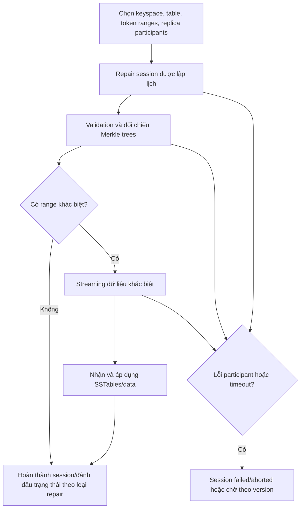
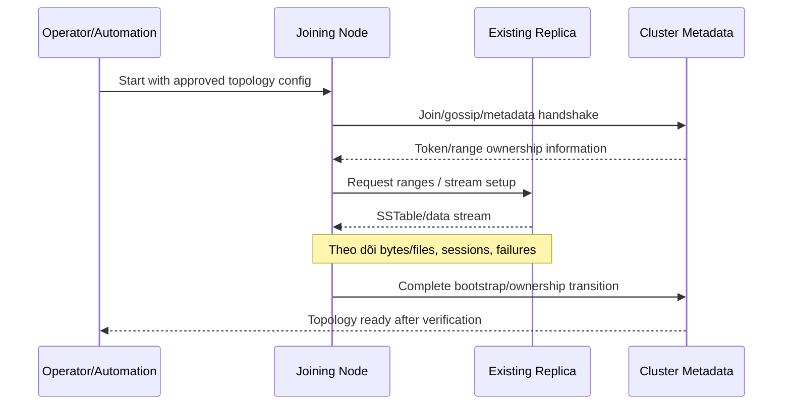
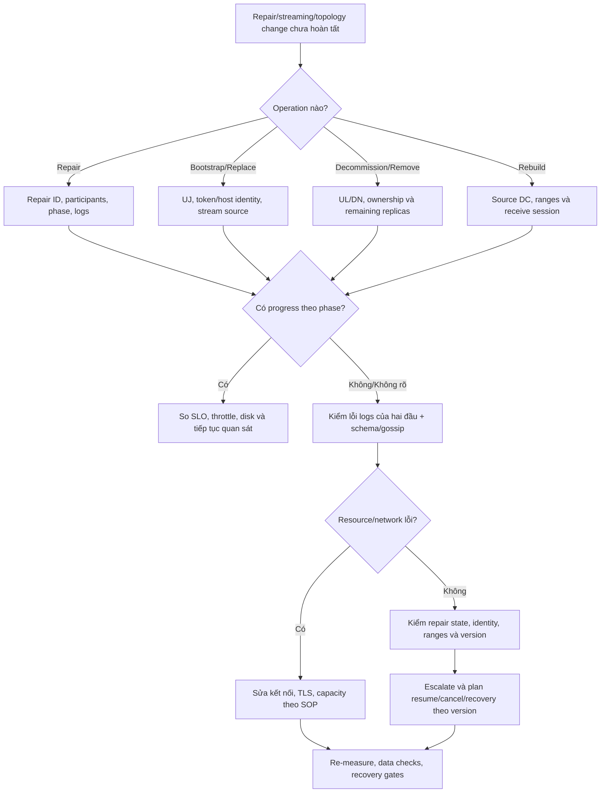

# Repair/streaming bị kẹt và lỗi thay đổi topology trong Apache Cassandra

## 1. Vì sao “repair bị treo” không thể xử lý bằng một lệnh thử lại?

Trong module **DATABASE_ENGINE_WIDE_COLUMN_CASSANDRA**, Apache Cassandra là cơ sở dữ liệu **wide-column phân tán**. **Partition key** quyết định token của partition; **replication factor (RF)** cùng chiến lược placement quyết định replica nào sở hữu dữ liệu; **consistency level (CL)** quy định số phản hồi cần thiết cho từng request. Khi thêm, thay thế hay loại bỏ node, hệ thống phải điều chỉnh **token ownership** và di chuyển dữ liệu. Khi replica có khác biệt do ghi chậm, node từng gián đoạn hay repair chưa hoàn tất, Cassandra cần cơ chế **anti-entropy repair** để đồng bộ chúng.

Một sự cố thường được mô tả ngắn gọn như sau:

> “Node mới đang JOINING hơn hai giờ, `nodetool netstats` không nhúc nhích. Hôm qua repair cũng kẹt; chúng ta có nên hủy repair, chạy `cleanup` hoặc xóa node hỏng?”

Câu trả lời không thể dựa vào một thông báo “kẹt”:

- Có thể **repair chưa vào pha stream** và `netstats` chưa có transfer.
- Có thể đang **validation/Merkle tree building**, đọc đĩa và compaction tranh chấp I/O.
- Có thể thực sự có stream session dừng tiến độ do network/TLS/port, disk hoặc một node chậm.
- Có thể node đang `JOINING` nhưng **schema/gossip/topology** chưa hội tụ nên không bắt đầu stream.
- Có thể một thao tác khác (`decommission`, `replace`, `removenode`, `rebuild`) đang cạnh tranh cùng token range.
- Có thể RF/DC/rack/snitch sai, khiến node không thể nhận đúng replica ranges.
- Có thể thao tác đã lỗi, log có thông tin nguyên nhân, nhưng công cụ hiển thị trạng thái cũ.

**Chạy bừa `repair`, `cleanup`, `removenode` hoặc khởi động lại mọi node có thể làm dữ liệu thiếu replica, tăng tải hoặc tạo sự cố lớn hơn.** Mục tiêu bài **Xử lý sự cố** này là nhận diện pha bị kẹt, kiểm tra bằng chứng từ nhiều node, rồi lựa chọn hành động khôi phục an toàn.

### Mục tiêu học tập

Sau bài học, bạn có thể:

1. Phân biệt **repair**, **streaming**, **bootstrap**, **decommission**, **remove node**, **replace** và **rebuild**.
2. Đọc các trạng thái `UN/UJ/UL/UM/DN` từ `nodetool status` trong bối cảnh topology cụ thể.
3. Đánh giá “không có tiến độ” từ **nhiều lần đo có timestamp**, không chỉ một ảnh `netstats`.
4. Kết hợp `nodetool status/netstats/tpstats/compactionstats/tablestats`, schema, log và node metrics để xác định bottleneck.
5. Phân tích RF/CL, token/replica placement, DC/rack/snitch, internode networking/TLS và disk headroom.
6. Xử lý repair session thất bại/còn dang dở theo version mà không phá trạng thái repaired data hoặc tombstone safety.
7. Chọn runbook theo thao tác topology đang xảy ra và xác minh dữ liệu trước khi `cleanup` hoặc loại node.
8. Dùng Java Driver 4.x kiểm metadata/schema/readiness theo cách **read-only** và có giới hạn.
9. Viết báo cáo sự cố, tái hiện trong testbed nhiều node và đặt các điểm dừng/điều kiện rollback.

**Giới hạn:** Tên subcommand, các pha repair, hệ thống streaming và thông số config thay đổi theo Cassandra 3.x/4.x/5.x và bản phân phối. Trong bài, lệnh quan sát là ví dụ thông dụng; lệnh **làm thay đổi dữ liệu/topology** chỉ được đề cập như thao tác có điều kiện và phải kiểm hướng dẫn chính xác cho version đang chạy.

## 2. Bảy thao tác dễ bị gọi nhầm là “repair”

| Thao tác | Mục đích | Có thể stream dữ liệu? | Thay đổi topology? |
| --- | --- | --- | --- |
| **Anti-entropy repair** | So sánh dữ liệu replica ở những range chung, đồng bộ khác biệt | Có, khi cần chuyển dữ liệu sai khác | Thông thường không |
| **Bootstrap** | Node mới gia nhập, nhận các range mà nó sẽ sở hữu | Có | Có |
| **Decommission** | Node khỏe rời cluster có kiểm soát, phân phối range sang owner còn lại | Có | Có |
| **Remove node / removenode** | Loại metadata của một node chết và khôi phục dữ liệu cần thiết từ các replica khác | Có thể, theo đường khôi phục | Có |
| **Replace node** | Node thay thế một node hỏng/tại token ownership tương ứng | Có | Có |
| **Rebuild** | Nạp lại dữ liệu từ replica/nguồn phù hợp (ví dụ xây dữ liệu tại DC) | Có | Không nhất thiết thay đổi token ownership |
| **Cleanup** | Loại bỏ range mà node không còn sở hữu sau thay đổi topology đã hoàn tất | Không nhằm phân phối dữ liệu | Không; xóa local data ngoài ownership |

Cần hiểu hai ý nghĩa “repair” khác nhau trong hội thoại vận hành:

- **Anti-entropy repair** (`nodetool repair` và cơ chế tương ứng): phối hợp validation và đồng bộ replicas.
- **Khắc phục cluster** nói chung: có thể bao gồm bootstrap, streaming, node replacement, schema agreement, networking hoặc repair; không phải mọi tình huống đều giải quyết bằng `nodetool repair`.

### 2.1. Repair không thay thế bootstrap

Khi thêm node, nhiệm vụ chính là **thay đổi ownership và stream token ranges**. Một `nodetool repair` chạy lúc bootstrap chưa ổn định có thể tạo tải cạnh tranh, không tự hoàn thành đúng luồng bootstrap bị kẹt. Khôi phục phải bắt đầu từ **trạng thái joining, peer metadata, range assignment và stream session**.

### 2.2. Cleanup không phải bước “giải phóng disk” tùy ý

Sau topology change đã **hoàn tất và kiểm chứng**, node có thể giữ SSTables của token ranges không còn thuộc ownership mới. `cleanup` giúp loại local data ngoài phạm vi đó. Nhưng **cleanup trước khi stream/replica migration hoàn tất có thể loại bỏ những bản sao vẫn cần thiết để khôi phục dữ liệu**.

Không dùng `cleanup` làm phản ứng đầu tiên khi thấy disk gần đầy trong bootstrap. Nếu không đủ disk để an toàn, cần **dừng/điều tiết kế hoạch và bổ sung headroom**, không xóa dữ liệu cũ theo cảm tính.

## 3. Mô hình luồng: coordinator, replica, repair và topology

### 3.1. Mô hình token ownership

Giả sử keyspace `commerce` dùng `NetworkTopologyStrategy`, RF=3 tại DC `dc1`. Một partition có partition key `customer_id=C1` sẽ hash thành token T. Một nhóm replica được chọn theo token ring/snitch/DC/rack và placement strategy.

```text
Partition key C1 --> token T
                  |
                  +--> replica A (dc1/rack1)
                  +--> replica B (dc1/rack2)
                  +--> replica C (dc1/rack3)

Read/Write CL=LOCAL_QUORUM => 2 responses theo cấu hình RF=3
Repair range chứa T      => so sánh/sửa sai khác giữa replicas
Bootstrap/replace        => có thể thay đổi nơi sở hữu T
```

Sơ đồ là đơn giản hóa; với **vnodes**, mỗi node thường sở hữu nhiều token ranges. Đừng suy placement chỉ từ thứ tự tên node hoặc IP.

### 3.2. Repair gồm nhiều pha



**Không có active streams không chứng minh repair đã treo.** Nếu đang validation với lượng SSTable lớn, có thể **chưa có gì để stream** hoặc không có dữ liệu khác biệt. Xem repair session/log cùng CPU/disk/compaction để biết pha hiện tại.

### 3.3. Streaming khi topology thay đổi



Đường thực tế thay đổi theo Cassandra version và thao tác `bootstrap/replace/decommission`. Không dùng sơ đồ này để đoán thời điểm **an toàn xóa dữ liệu trên owner cũ**; cần kiểm mọi điều kiện hoàn tất và RF/placement.

## 4. “Bị kẹt” nghĩa là gì về mặt đo lường?

Một câu nói “`nodetool netstats` vẫn là 60%” không đủ. Hãy xác định:

- **Không tiến triển nhưng vẫn hoạt động:** bytes không đổi trong 3 phút, trong khi validation/flush đang xử lý I/O và phase chưa đổi.
- **Thực sự stalled:** cùng session, cùng bytes/files, không có transition và logs không có progress; một peer/network/disk resource bị lỗi.
- **Failed/aborted:** session đã phát thông báo lỗi, công cụ snapshot khác chưa được cập nhật.
- **Completed nhưng chưa ổn định:** stream xong, nhưng node vẫn JOINING vì gossip/schema/bootstrap finalization, hoặc repair success không bao phủ mọi phạm vi.
- **Công cụ quan sát sai:** chạy `netstats` trên node không tham gia session hoặc chỉ nhìn outbound trong khi dữ liệu ở inbound phía peer.

### 4.1. Lập chuỗi mẫu thay vì chụp một lần

Ví dụ **số liệu giả định**:

| Time (UTC) | Node | Session | Incoming | Outgoing | Active streams | Logs |
| --- | --- | --- | ---: | ---: | ---: | --- |
| 10:00 | node-new | stream-X | 12 GiB/20 GiB | 0 | 2 | Receiving |
| 10:05 | node-new | stream-X | 12,1 GiB/20 GiB | 0 | 2 | Retry/slow disk |
| 10:10 | node-new | stream-X | 12,1 GiB/20 GiB | 0 | 2 | Connection reset |
| 10:15 | node-new | stream-X | 12,1 GiB/20 GiB | 0 | 0 | Session failed |

Không được gọi đây là “stalled 15 phút” chỉ dựa vào 12,1 GiB; cần thấy **cùng session**, phase, logs và phản ứng phía source node. Ngược lại, một stream rate thấp nhưng bytes vẫn tăng và không vi phạm SLO có thể chỉ là **throttling có chủ đích**.

### 4.2. Các đại lượng cần ghi

- Bytes/files **planned**, **sent**, **received**, **remaining** theo session/peer và node.
- Tốc độ byte thực qua một cửa sổ đo nhất quán.
- Số active/pending/failed sessions, chuyển pha theo thời gian.
- Disk free/used, IOPS/latency/throughput, compaction và write amplification.
- CPU, JVM heap, GC pause, thread pools/dropped messages.
- Network RTT/loss/retransmits, kết nối internode/TLS.
- Repair validation progress, repair IDs, success/failure theo range/table.
- Số replicas alive, node state và schema agreement.
- Client ReadTimeout/WriteTimeout/Unavailable, p95/p99 và retry load.

**Đừng quy nguyên nhân chỉ từ một metric:** `netstats` thấp có thể do mạng chậm, disk chậm, ít dữ liệu khác biệt hoặc phase validation, trong khi `compactionstats`/log mới cho biết hoạt động thực.

## 5. Quy tắc an toàn và “đóng băng thay đổi” khi có sự cố

Trước khi xem lệnh khôi phục:

1. **Ngừng phát sinh topology change mới.** Không thêm node khác, decommission/removenode khác hoặc thay RF trong lúc thao tác hiện tại chưa phân loại.
2. **Xác nhận tác vụ đang chạy**: bootstrap, replace, decommission, removenode, rebuild, repair hay cleanup.
3. **Đóng băng migration CQL và sửa DC/rack/snitch** trừ khi đã chứng minh đó là nguyên nhân và có kế hoạch đổi được duyệt.
4. Giữ bản sao dữ liệu/backup/snapshot có thể restore theo runbook; không coi snapshot thay cho replica đang healthy.
5. Kiểm dung lượng disk và nguồn dữ liệu còn lại, đặc biệt trước thao tác có thể xóa local SSTables.
6. Giảm workload/retries ở ứng dụng nếu hệ thống đang bão hòa; tránh tăng request storm khi replica placement chưa ổn.
7. Bổ nhiệm incident owner, ghi timeline UTC, version và phương án dừng/rollback theo SOP.
8. Nếu vấn đề vượt khả năng recovery nội bộ, **escalate DBA/on-call/vender support**; không thử những lệnh phá topology để “xem điều gì xảy ra”.

**Không chạy các lệnh có tác động dữ liệu/topology (`decommission`, `removenode`, `assassinate`, `cleanup`, `repair` diện rộng) chỉ để thử sửa trạng thái.** Bài chỉ hướng dẫn các bước quan sát an toàn và điều kiện quyết định, không phải giấy phép thao tác trên production.

## 6. Bộ lệnh chẩn đoán chỉ đọc ban đầu

Trên **mỗi node liên quan**, thu output với timestamp/hostname/version. Ví dụ:

```bash
# Node membership và trạng thái:
nodetool status
nodetool describecluster
nodetool info

# Tiến độ stream ở node nhận/gửi:
nodetool netstats

# Tài nguyên xử lý nền:
nodetool tpstats
nodetool compactionstats

# Chỉ khi cần đối chiếu gossip/token và có kiểm soát log volume:
nodetool gossipinfo
nodetool ring

# Thống kê bảng liên quan:
nodetool tablestats commerce.orders_by_customer
```

`nodetool` là công cụ quản trị qua JMX; quyền truy cập/port cần cấu hình an toàn. Một số subcommands, output fields và số liệu có khác biệt giữa Cassandra versions. Nếu command không được hỗ trợ, dùng `nodetool help`/tài liệu phiên bản, **không thay bằng command có tác động phá hủy**.

### 6.1. Hiểu trạng thái ở `nodetool status`

| Trạng thái thường gặp | Ý nghĩa khái quát | Hướng kiểm |
| --- | --- | --- |
| `UN` | Up / Normal | Có thể nhận traffic nhưng không chứng minh streaming, repair hay data consistency xong |
| `UJ` | Up / Joining | Node đang gia nhập/bootstrap | Streaming, gossip/schema, token ranges, peer connectivity |
| `UL` | Up / Leaving | Node đang rời cluster | Decommission data handoff, remaining replicas, completion |
| `UM` | Up / Moving | Node đang chuyển token ownership nếu version/operation hỗ trợ | Movement/session/progress |
| `DN` | Down / Normal | Node thường trong ring nhưng được thấy DOWN | Node lỗi hay mạng/JMX/gossip, replica availability |
| `DL`/khác | Down kết hợp trạng thái topology khác (nếu hiển thị) | Xem exact version, logs và peer views |

`nodetool status` thể hiện **góc nhìn membership** tại một thời điểm. Không có nghĩa:

- `UN` chứng minh dữ liệu đầy đủ trên node đó.
- `UJ` chắc chắn đang nhận bytes ở chính khoảnh khắc chụp.
- `DN` chứng minh disk đã hỏng; có thể là network/gossip.
- Cả ba node nhìn topology hoàn toàn giống nhau.

### 6.2. `nodetool netstats`: inbound, outbound và mode

Trên cả **source** và **destination**:

```text
Node A (source): outbound streams to node-new
Node-new (destination): inbound streams from Node A
```

Kiểm:

- Có đúng peer dự kiến không, hay stream tới một IP/host ID cũ?
- Có active streams/file progress không?
- Phần completed/remaining thay đổi theo thời gian không?
- Có failure/log error trong khi netstats vẫn giữ con số cũ không?
- Streaming có bị giới hạn bởi config/băng thông hay source/destination disk?
- Có nhiều streams cùng lúc tranh chấp disk/network?
- Có thể thiếu stream vì validation, metadata hoặc schema đang chờ hay không?

Nếu `netstats` không có stream ở mọi node, chưa thể kết luận network không hoạt động; **repair có thể đang validation**, hoặc bootstrap chưa đến streaming phase.

### 6.3. `nodetool tpstats` và `compactionstats`

`tpstats` giúp xem active/pending/completed/dropped tasks theo pool. `compactionstats` cho biết hoạt động compaction/validation-like tasks tùy version và backlog.

Kiểm:

- Pending tasks có tăng liên tục trong khi completed không tăng?
- Pool liên quan repair/streaming có stuck hoặc dropped work không?
- Compaction đang chiếm disk throughput và cạnh tranh với stream?
- Disk latency tăng đồng thời GC pauses?
- Một node có tải lệch do hot partition/big partition?

**Không suy “compaction pending lớn” là nguyên nhân duy nhất**: nó có thể là hậu quả của ingest/streaming. Cần đối chiếu timeline và metrics CPU/disk/network.

## 7. Chụp phiên bản, schema, replication và topology thực

Repair/streaming phụ thuộc vào metadata cluster. Trước khi sửa lệnh, đối chiếu **thực tế**, không chỉ YAML đã dự định deploy.

### 7.1. CQL kiểm keyspace/server

```sql
SELECT keyspace_name, replication, durable_writes
FROM system_schema.keyspaces
WHERE keyspace_name = 'commerce';

SELECT host_id, cluster_name, data_center, rack, release_version
FROM system.local;
```

`system.local` trả về thông tin **node đang trả lời query**, không tự đại diện cho tất cả peers. Với Cassandra 4.x có metadata bảng peer như `system.peers_v2`; với bản khác có thể dùng `system.peers`. **Không dựa vào một bản system table để kết luận mọi node đã đồng bộ metadata**; lấy thêm peer views hoặc hệ thống quản trị cluster.

### 7.2. Các trường cấu hình phải so

| Trường | Vì sao quan trọng |
| --- | --- |
| Cassandra Server exact version/build từng node | Sự khác biệt protocol/repair/streaming trong mixed-version cluster |
| Host ID, token ranges, num_tokens | Replica placement và thao tác replace |
| Cluster name, seeds, snitch | Gossip discovery và chọn DC/rack |
| Datacenter/rack thực tế | NTS chọn replica theo topology |
| Keyspace RF theo DC | Đủ replica source/destination và CL |
| Internode listen/broadcast addresses | Peer-to-peer reachability |
| Internode encryption/TLS/certificates | Handshake và stream connection |
| Storage port/SSL port thực tế | Không nhầm native client port 9042 với internode traffic |
| Stream bandwidth/throttle config | Stream progress và cạnh tranh workload |
| Disk volume/capacity/data directories | Chỗ chứa incoming SSTables/compaction |
| Commit log/cache/heap/JVM flags | Resource pressure và stalls |
| Repair history/session state | Full/incremental/pending repair semantics |

**Không thay hostname/IP/seed/snitch giữa lúc bootstrap chỉ vì gossip không thấy node.** Thay identity/topology có thể làm cluster nhìn thấy một node “mới” thay cho node cũ; cần SOP của version để giữ đúng host ID/token ownership.

### 7.3. Schema agreement khác với đủ dữ liệu

Khi `nodetool describecluster` hoặc Driver cho biết schema agreement, điều đó nghĩa là **schema metadata đã hội tụ theo cơ chế kiểm tra**, không nghĩa là:

- Node mới đã nhận mọi SSTable cần thiết.
- Repair đã chạy qua mọi range.
- Read ở `LOCAL_QUORUM` nhất thiết đọc dữ liệu mới nhất nếu có concurrent writes/migration.
- Compaction đã xong hoặc tombstones đã an toàn để purge.

Sau topology change, cần **data readiness checks riêng**.

## 8. Bằng chứng về replica placement và phạm vi lỗi

Một topology operation có thể chỉ liên quan tới một phần token ranges. Để biết nguồn stream có hợp lý:

1. Xác định **keyspace RF per DC**.
2. Xác định **token ranges/ownership trước thay đổi** và ownership dự kiến sau thay đổi.
3. Xác định source/destination của stream theo session logs và metadata.
4. Xác định liệu node bị lỗi có thuộc **tập replica của range/partition** đang kiểm không.
5. So sánh các peer views; nếu không thống nhất, xử lý gossip/schema/topology trước khi kết luận về dữ liệu.
6. Kiểm node cũ có còn là source **duy nhất** cho một phạm vi không; tuyệt đối không xóa nó theo cảm tính.

Ví dụ một partition:

```text
partition:
  keyspace: commerce
  table: orders_by_customer
  partition_key: customer_id=synthetic-UUID
  token: T
  prior_replicas: [A, B, C]
  planned_replicas: [A, B, D]
  receiving_node: D
  expected_sources: [B, C]
  observed_stream_peer: B
```

Đây là **ví dụ giả định** để minh họa thông tin cần thu, không phải bằng chứng placement trên một cluster thật.

Với Cassandra có vnodes, một node có nhiều ranges; `nodetool ring` có thể rất dài. Có thể dùng metadata API/management tools phù hợp để lấy token map và **sample representative partitions**, thay vì chụp vô hạn output không có cấu trúc.

## 9. Phân loại gốc lỗi theo biểu hiện repair/streaming

| Biểu hiện | Giả thuyết có thể | Bằng chứng cần |
| --- | --- | --- |
| Repair đứng trước lúc có stream | Validation/Merkle building, scheduling, node resource pressure | Repair logs/phase, compactionstats, I/O, heap |
| `netstats` có session nhưng bytes đứng lâu | Network stall, peer reset, disk bottleneck, throttle | Logs hai đầu, network retransmits, disk I/O |
| Một peer luôn bị timeout | Internode route/firewall/TLS/certificate hoặc node quá tải | Peer logs và port/TLS handshake đúng |
| Node mới `UJ` dù streams không còn | Gossip/bootstrap finalization/schema/remaining range | Boot logs, ownership/mode, peer status |
| `UL` kéo dài, disk gần đầy | Decommission stream/compaction backlog | Netstats, capacity of destination, RF headroom |
| `UN` nhưng data missing sau replace | Stream incomplete, ownership/repair gap, sai source | RF/CL read-back, range mapping, logs |
| Repair lặp lại thất bại cùng table | Corrupt SSTable, huge partition, disk error, GC | Logs corruption/validation, disk, partition metrics |
| Repair báo success nhanh bất thường | Không khác biệt, phạm vi không đúng, bỏ qua range | Repair scope/table/ranges, session status |
| Node mới không kết nối seed/peer | Config cluster/DC/rack, listen/broadcast, ACL, TLS | Gossip logs, reachability, identity |
| Sau tăng RF reads không nhất quán | RF metadata đổi nhưng dữ liệu chưa được phân phối/repair đúng | NTS, repair plan, replica placement, read verification |
| Streaming hoàn thành nhưng p99 tăng | Compaction/cache/repair/backlog hoặc load distribution khác | Before/after metrics và data model |

**Không có một biểu hiện nào tự xác nhận root cause.** Hãy kiểm bằng chứng có timestamp từ nhiều phía: source, destination, coordinator và client.

## 10. Root cause nhóm A: network, internode TLS và địa chỉ

Streaming Cassandra dùng đường **node-to-node**, khác native CQL port của ứng dụng Java. Một ứng dụng vẫn `SELECT` được qua 9042 **không chứng minh** peer streaming hoạt động.

### 10.1. Checklist kết nối

- Node source có thể kết nối tới **internode address/port** mà destination quảng bá?
- Destination có nhận được kết nối source và trả dữ liệu?
- `listen_address`/`broadcast_address` và endpoint NAT/container/Kubernetes có nhất quán?
- Các mạng/rack/DC có ACL/firewall/route phù hợp không?
- Nếu bật internode TLS, certificate chain, expiration, SAN/hostname, keystore/truststore và auth có đúng?
- Có packet loss/retransmission/RST hoặc connection timeouts trong đúng cửa sổ session?
- MTU/network path khác nhau giữa source và destination?
- Throttle stream có quá thấp so với lượng dữ liệu/time budget?

Cassandra phiên bản triển khai có thể dùng các port internode khác nhau, ví dụ `storage_port`/`ssl_storage_port` theo cấu hình. **Không mở cổng hoặc tắt TLS tùy tiện** để làm benchmark nhanh hơn; mọi sửa đổi mạng/certificate cần có approval.

### 10.2. Dấu hiệu phân biệt server và network

Nếu source log báo đã gửi nhưng destination không nhận, điều tra network/stream receiver. Nếu destination log báo nhận chậm hoặc disk write liên tục bị nghẽn, điều tra I/O. Nếu cả hai chỉ chờ validation, đừng mở firewall rồi kết luận đã sửa vì hiện chưa có stream request.

### 10.3. Không làm thay đổi host identity giữa sự cố

Trong Cassandra, node có **host ID/token ownership** và cấu hình gossip. Khi thay VM/container:

- Không sao chép data directory/system metadata của node cũ sang node khác tùy tiện.
- Không dùng cùng identity cho hai node cùng lúc.
- Không để node cũ khởi động lại giữa replace nếu runbook yêu cầu nó phải DOWN và đã chuyển identity.
- Không sửa seed list như một cách xóa host ID khỏi ring; seed giúp discovery, không phải thao tác remove node.
- Mọi replace phải dùng đúng procedure/version để không tạo hai owners tranh chấp cùng token range.

## 11. Root cause nhóm B: disk, SSTables, compaction và resource pressure

Streaming chuyển dữ liệu vật lý; repair so sánh/dò dữ liệu giữa replicas. Các thao tác này có thể đòi thêm I/O và disk headroom.

### 11.1. Disk gần đầy

Kiểm:

- Disk free trên **destination**, không chỉ source.
- Incoming SSTable files, compaction temporary space, data directories, commit log, log files và snapshot usage.
- Disk IOPS/latency và filesystem errors.
- Dung lượng dữ liệu theo keyspace/table và kích thước compaction backlog.
- Các tác vụ khác đang dùng disk, ví dụ backup/restore, snapshot hoặc streaming khác.

**Đừng áp một tỷ lệ 2× disk cố định** như chân lý: headroom cần phụ thuộc data size, compaction strategy, số streams và storage layout. Nhưng nếu không đủ headroom cho incoming data cộng compaction/temp, phải **dừng kế hoạch mở rộng/khôi phục và thêm tài nguyên** trước khi tiếp tục.

### 11.2. Disk rảnh nhưng I/O bão hòa

Một node có nhiều disk free vẫn có thể đọc/ghi rất chậm do:

- Compaction tích lũy, read amplification.
- Repair validation quét SSTables lớn.
- Streaming nhiều sessions cùng lúc.
- Large/hot partitions, tombstone-heavy reads.
- Volume có IOPS/bandwidth quota thấp hoặc noisy neighbors.
- GC pauses, CPU throttling hay heap pressure trên node.

Dùng **time series**: disk latency, util, CPU/iowait, GC, `tpstats`, `compactionstats`, stream bytes/s. Nếu nhiều node đều chậm vào cùng thời điểm, kiểm shared network/storage trước khi tăng repair parallelism.

### 11.3. Throttle và concurrency

Giảm stream throughput có thể giúp foreground reads/writes giữ SLO, nhưng làm bootstrap lâu hơn. Tăng stream throughput/concurrency có thể phản tác dụng khi disk/GC đang bão hòa.

Phải ghi:

- Config stream throughput/outbound/inter-DC throttle **theo version**.
- Repair concurrency/parallelism và validation concurrency.
- Số công việc compaction đồng thời.
- Ứng dụng QPS/in-flight/retry budgets.
- Độ lệch throughput giữa source và destination.

**Không đổi nhiều tham số đồng thời** rồi kết luận một config đã sửa lỗi. Thay từng biến khi có testbed/canary và metric trước–sau.

## 12. Root cause nhóm C: repair sessions và trạng thái “repaired data”

Repair không phải một lệnh “chạy lại cho chắc” khi đang có session lỗi. Cassandra có các phân biệt **full repair**, **incremental repair**, trạng thái **repaired/unrepaired SSTables** và trong một số version có **pending repair sessions**.

### 12.1. Full và incremental khác nhau

| Loại | Ý tưởng | Cần kiểm |
| --- | --- | --- |
| **Full repair** | So sánh phạm vi được chọn không chỉ giới hạn dữ liệu chưa repaired | IO/stream volume, phạm vi token/table, tương thích với lịch repair |
| **Incremental repair** | Tối ưu bằng cách xử lý dữ liệu chưa marked repaired theo cơ chế phiên bản | State của pending sessions, repaired/unrepaired SSTables, failures |
| **Primary-range repair (`-pr` khi được hỗ trợ)** | Giới hạn ranges node được chọn chịu trách nhiệm theo plan | Coverage của toàn cluster, tránh bỏ sót ranges |
| **Subrange/keyspace/table repair** | Giới hạn scope | Không nhầm “một bảng thành công” thành “toàn cluster đã repair” |
| **Preview repair** (nếu version hỗ trợ) | Đánh giá range/difference mà không làm repair đầy đủ theo giao thức | Không coi preview như hoàn tất repair |

Một số version dùng incremental repair theo mặc định, một số khác/option thay đổi. **Luôn đọc `nodetool help repair` theo phiên bản trước khi lên lịch.** Không copy `-full`/`-pr` từ tài liệu khác mà không biết phạm vi cần đảm bảo.

### 12.2. Lệnh quan sát trạng thái repair

Với Cassandra version có repair administration:

```bash
# Xem cách dùng của phiên bản đang chạy trước:
nodetool help repair
nodetool help repair_admin

# Ví dụ khi phiên bản hỗ trợ:
nodetool repair_admin list
```

Có môi trường không có `repair_admin` hoặc interface khác. Nếu lệnh không tồn tại, tra documentation/version và server repair logs. **Không chạy `repair_admin cancel` hoặc lệnh hủy session theo suy đoán**: hủy có thể để lại pending data/metadata cần xử lý theo procedure và có thể cạnh tranh với task khác.

### 12.3. Trước khi quyết định hủy hay chạy lại repair

1. Xác định **repair session ID, initiator, participants, keyspace/table/ranges**.
2. Xác định **pha hiện tại**: validation, Merkle compare, streaming hay finalize.
3. Thu **logs của mọi participant**, không chỉ initiator.
4. Kiểm còn progress, pending tasks và I/O hoạt động hay thực sự failed.
5. Xem repair có phải incremental với **pending repair state** không.
6. Kiểm mọi node/replica đủ khỏe để xử lý khôi phục.
7. Xem phiên bản cung cấp quy trình **cancellation/cleanup pending repair** nào.
8. Chỉ hủy/rerun theo runbook được review; ghi session IDs và kết quả.
9. Khi hoàn tất, kiểm phạm vi đã covered và replication/data correctness ở sample partitions.

**Đừng xóa SSTables hoặc system metadata bằng tay để “giải phóng repair”.** Làm vậy có thể phá tracking repaired state và loại dữ liệu không thể tái tạo từ nguồn hiện có.

### 12.4. Repair không thay thế repair schedule

Một lần repair hoàn tất trên một node/bảng không chứng minh cluster an toàn vĩnh viễn. Cần:

- Lịch repair thường xuyên, có coverage rõ theo token ranges/DC.
- Theo dõi failure rate và duration.
- Tôn trọng `gc_grace_seconds`/tombstone safety và dữ liệu replicas.
- Kiểm full vs incremental policy và repair history.
- Đối soát những ranges bị skip/participant down.

**Không hạ `gc_grace_seconds` xuống 0** để “giúp repair xóa tombstones”, vì có thể tạo nguy cơ dữ liệu đã xóa tái xuất hiện khi một replica bỏ lỡ delete và chưa repair đúng.

## 13. Root cause nhóm D: bootstrap kẹt ở JOINING

### 13.1. Quy trình chẩn đoán `UJ`

Một node `UJ` kéo dài cần trả lời tuần tự:

1. Node có cấu hình **cluster name, DC/rack/snitch, seeds, listen/broadcast address** đúng không?
2. Có kết nối gossip/schema với peers và được nhìn thấy ở `nodetool status` từ nhiều node không?
3. Token/num_tokens/host ID có hợp lệ với operation đang chạy không?
4. Node có đủ disk/heap/CPU và có lỗi I/O/TLS/network trong log không?
5. `nodetool netstats` có incoming streams, source nào đang gửi, bytes có tăng không?
6. Nếu không có streams, node đang chờ **range selection/schema agreement** hay session thất bại?
7. Sau khi stream xong, có completion/finalization/metadata issue nào giữ trạng thái JOINING?
8. Các read/write client có bị ảnh hưởng do replica ownership chuyển tiếp hoặc driver topology refresh không?

### 13.2. Các lỗi thường gặp

| Dấu hiệu | Nguyên nhân có thể | Cách xác minh |
| --- | --- | --- |
| New node không được peers thấy | Seeds/gossip/network/TLS | Logs connect/handshake, peer status |
| Host ID/token conflict | Identity/data directory tái sử dụng sai | Node metadata/logs, config của node cũ |
| Có stream nhưng disk destination đầy | Không đủ headroom | Disk metrics/data directories/SSTables |
| Stream vào rất chậm | Peer/disk/network throttle | netstats + I/O/network hai đầu |
| Stream hoàn tất nhưng vẫn `UJ` | Bootstrap finalization/schema/gossip | Node logs/peer views |
| Schema mismatch | DDL chưa hội tụ/khác version | describecluster/schema metadata |
| Sai DC/rack | Placement sai/số replica không như dự kiến | system.local/peers, snitch config |

### 13.3. Có thể “resume bootstrap” không?

Một số Cassandra version hỗ trợ cơ chế **resume bootstrap**. Nhưng việc áp dụng phụ thuộc:

- Bootstrap đã dừng ở pha nào.
- Process/node identity và data directory còn nguyên đúng không.
- Có ongoing streams/failed sessions cần recovery không.
- Cluster version và tham số bootstrap/resume được hỗ trợ.
- Mọi participant đã ổn định, đủ disk/network.

**Không đưa ra `nodetool bootstrap resume` như lệnh chung để chạy khi gặp `UJ`.** Kiểm `nodetool help bootstrap` và runbook exact version; chỉ thực hiện khi đã phân loại lỗi, có kế hoạch dừng/rollback.

### 13.4. Không chạy cleanup khi node mới chưa được xác nhận

Sau khi node mới đã nhận đầy đủ ranges, topology ổn định và ownership được kiểm, old nodes có thể cần cleanup theo kế hoạch. Trước thời điểm đó, **dữ liệu trên node cũ có thể vẫn là bản sao quan trọng để khôi phục**. Không xóa SSTables để tiết kiệm đĩa giữa bootstrap.

## 14. Decommission kéo dài: node khỏe đang rời cluster

`Decommission` là đường **planned leave** cho một node còn khỏe và có thể stream/hand off dữ liệu. Dấu hiệu `UL` hoặc logs decommission không hoàn tất cần kiểm:

- Node rời có vẫn sống/đọc được dữ liệu nguồn không?
- Các receiving replicas có đủ disk/bandwidth và đúng DC/rack không?
- RF/placement sau khi rời có còn được đáp ứng bằng số node còn lại không?
- Có compaction/repair/streaming khác cạnh tranh không?
- Có writes mới vẫn đến node rời theo topology cache cũ không?
- Một stream session đã fail hoặc bị network partition chưa?

**Không thay `decommission` đang dang dở bằng `removenode` tùy tiện.** Hai thao tác có giả định khác nhau về trạng thái node và khả năng handoff. Chọn đường recovery phải dựa trên identity và trạng thái hiện tại, dưới review DBA/on-call.

### 14.1. Nếu node hết dung lượng khi decommission

Không tự xóa local data trên node leaving vì nó có thể vẫn là source của những token ranges chưa hand off. Thay vì thế:

1. Dừng các thao tác mới cạnh tranh nguồn lực.
2. Giảm foreground load nếu cần và được phép.
3. Kiểm receiving nodes đủ dung lượng.
4. Thêm capacity hoặc điều chỉnh lịch theo runbook.
5. Chỉ kết thúc decommission khi stream và ownership đã hội tụ.

## 15. Node chết: removenode, replace và rebuild không tương đương

### 15.1. `removenode`

Dùng để loại metadata của một node không còn khả dụng trong điều kiện được hỗ trợ, và cluster cần khôi phục độ phủ replica từ các nguồn còn lại. Rủi ro:

- Node bị xem là DOWN thực ra còn sống và có thể quay lại.
- RF/source replicas không đủ dữ liệu để tái tạo tất cả ranges.
- Removenode ảnh hưởng placement và cần dữ liệu được stream phục hồi.
- Một thao tác khác đang chạy có thể tạo trạng thái không tương thích.
- Removing một node khi thiếu quorum/nguồn dữ liệu có thể làm hệ thống khó khôi phục hơn.

**Không chạy `removenode` theo một Host ID đọc được từ log cũ nếu chưa đối chiếu host ID/token/peer views hiện tại.**

### 15.2. `replace`

Node mới nhận role/token ownership của node hỏng theo runbook. Cần kiểm:

- Node cũ thực sự không đồng thời hoạt động với identity/token được thay.
- Node mới có đúng config DC/rack/seeds/network/TLS/data directories.
- Host ID và replacement semantics theo version được hiểu đúng.
- Các replica source khác có đủ dữ liệu để stream.
- Có thể khởi động lại node cũ sau khi replace hay không? **Không tự cho phép** nếu đã thay identity.

Một replacement sai có thể tạo **hai node tin mình sở hữu cùng vị trí** hoặc làm stream lấy dữ liệu từ sai source. Đây là thao tác có mức rủi ro cao hơn repair thông thường.

### 15.3. `rebuild`

`Rebuild` thường dùng để nạp lại dữ liệu từ các nguồn phù hợp theo DC/replica layout, không đồng nghĩa “join node mới”. Nếu `rebuild` bị kẹt, quan sát stream sources, RF/DC, network, disk và logs tương tự. Không lặp lại rebuild vào node đang có data/operation state khác mà chưa kiểm tác động.

### 15.4. Các thao tác cuối cùng

Các cơ chế can thiệp mạnh vào gossip/token metadata (ví dụ `assassinate` trên các bản có hỗ trợ) **không phải lựa chọn troubleshooting thông thường**. Chúng chỉ thuộc runbook chuyên gia trong điều kiện nghiêm ngặt. Bài này không cung cấp hướng dẫn thực thi các lệnh đó để tránh cổ vũ sửa lỗi bằng phá membership.

## 16. Khi RF hoặc DC/rack thay đổi, cần kiểm gì?

Một số sự cố streaming xuất hiện sau `ALTER KEYSPACE` tăng RF hoặc đổi topology. Ví dụ từ RF=2 sang RF=3:

```sql
-- CHỈ MẪU: không chạy trên production khi chưa có kế hoạch migration.
ALTER KEYSPACE commerce
WITH replication = {
    'class': 'NetworkTopologyStrategy',
    'dc1': 3
};
```

**Thay đổi replication metadata không đồng nghĩa dữ liệu đã được stream đầy đủ tới replica mới.** Cần theo quy trình Cassandra version để bảo đảm repair/rebuild/placement sau thay đổi RF, theo dõi progress và xác minh dữ liệu.

Các điểm dễ sai:

- `dc1` trong keyspace khác tên datacenter thực của node.
- Số node/rack không đủ phù hợp placement dự kiến.
- Nâng RF rồi ngay lập tức nâng CL khiến request thiếu replica sẵn sàng.
- Không lập kế hoạch repair/rebuild range sau đổi RF.
- Dùng một node RF=1 test để chứng minh RF=3 production.
- Di chuyển node sang DC/rack khác bằng sửa `cassandra-rackdc.properties` không theo runbook.
- Mixed-version cluster với schema/protocol thay đổi chưa hoàn tất.

### 16.1. RF/CL và availability trong lúc chuyển topology

Với RF=3 và `LOCAL_QUORUM`, cần hai replicas phản hồi. Trong khi một node đang JOINING/LEAVING hoặc replica bị quá tải, client có thể thấy `Unavailable`/`ReadTimeout`/`WriteTimeout`. Không tự suy:

- `Unavailable` nghĩa là mất dữ liệu vĩnh viễn.
- `WriteTimeout` nghĩa là mutation chưa áp dụng.
- `ReadTimeout` nghĩa là row không tồn tại.
- Các lỗi biến mất sau khi hạ CL nghĩa là placement/repair đã hoàn tất.

**Hạ CL để che timeout là thay hợp đồng nhất quán**, cần review và kế hoạch phục hồi, không phải biện pháp sửa topology mặc định.

## 17. Kết hợp Java Driver 4.x để kiểm readiness và CQL thật

`nodetool` cung cấp góc nhìn cluster; ứng dụng Java cần xác nhận **đường truy vấn thực của chính nó** không bị ảnh hưởng ngoài mức chấp nhận được.

### 17.1. Không dùng health endpoint chỉ kiểm TCP

Một kết nối TCP hoặc `CqlSession` bootstrap thành công không chứng minh:

- Keyspace/table đã schema agreement.
- Replica ownership đã ổn định.
- Partition quan trọng có dữ liệu ở đúng CL.
- Không còn timeout hoặc retry amplification.
- Streaming/repair đã hoàn tất.

Dùng readiness contract cụ thể: session + schema + bounded CQL read theo **synthetic key** + SLO/metrics + topology/repair gates từ quản trị.

### 17.2. Java Driver 4.x: lấy node metadata read-only

Ví dụ JDK 11+ với Java Driver 4.x:

```java
import java.net.InetSocketAddress;
import java.util.Map;
import java.util.UUID;

import com.datastax.oss.driver.api.core.CqlSession;
import com.datastax.oss.driver.api.core.metadata.Node;

public final class CassandraTopologySnapshot {

    public static void main(String[] args) {
        try (CqlSession session = CqlSession.builder()
                .addContactPoint(
                    new InetSocketAddress("127.0.0.1", 9042))
                .withLocalDatacenter("dc1")
                .build()) {

            boolean agreed = session.checkSchemaAgreement();
            System.out.println("schemaAgreement=" + agreed);

            Map<UUID, Node> nodes =
                session.getMetadata().getNodes();

            for (Map.Entry<UUID, Node> entry : nodes.entrySet()) {
                Node node = entry.getValue();

                System.out.printf(
                    "hostId=%s endpoint=%s dc=%s rack=%s state=%s%n",
                    entry.getKey(),
                    node.getEndPoint(),
                    node.getDatacenter(),
                    node.getRack(),
                    node.getState());
            }
        }
    }

    private CassandraTopologySnapshot() { }
}
```

**Giới hạn:**

- Kết nối `127.0.0.1:9042` và `dc1` là **placeholder cho lab**. Đổi theo contact point/DC thực, không chạy tool vào production tùy tiện.
- `getMetadata().getNodes()` là view client Driver đang có; event propagation/refresh có thể chậm hơn topology thực. Không coi nó là nguồn sự thật duy nhất.
- `checkSchemaAgreement()` không xác nhận streaming/repair data hoàn tất.
- Node metadata/state API có thể khác theo Java Driver version đã pin; xác nhận bằng compile/Javadoc của đúng 4.x release.
- Một lần chụp không phản ánh toàn bộ progress. Lấy snapshots có giới hạn, kèm UTC time; **không tạo CqlSession mỗi 100 ms**.
- Logging node host IDs/endpoints cần tuân thủ chính sách nội bộ; công bố ra ngoài phải ẩn thông tin.

### 17.3. CQL đọc kiểm một partition synthetic ở CL mong muốn

Giả sử đã seed bảng `commerce.orders_by_id`:

```java
import java.time.Duration;
import java.util.UUID;

import com.datastax.oss.driver.api.core.CqlSession;
import com.datastax.oss.driver.api.core.DefaultConsistencyLevel;
import com.datastax.oss.driver.api.core.cql.PreparedStatement;
import com.datastax.oss.driver.api.core.cql.Row;

public final class CassandraReadinessProbe {

    private final CqlSession session;
    private final PreparedStatement query;

    public CassandraReadinessProbe(CqlSession session) {
        this.session = session;
        this.query = session.prepare(
            "SELECT order_id, state, version " +
            "FROM commerce.orders_by_id WHERE order_id = ?");
    }

    public boolean verify(UUID syntheticOrderId) {
        try {
            Row row = session.execute(
                query.bind(syntheticOrderId)
                    .setConsistencyLevel(
                        DefaultConsistencyLevel.LOCAL_QUORUM)
                    .setTimeout(Duration.ofSeconds(2))
                    .setIdempotent(true))
                .one();

            return row != null
                && syntheticOrderId.equals(row.getUuid("order_id"))
                && row.getString("state") != null;

        } catch (RuntimeException error) {
            // Ghi structured metric/error, không biến timeout thành "not found".
            return false;
        }
    }
}
```

Probe này chỉ xác minh **một đường đọc theo một key đã biết** và phải được rate-limit. Để đảm bảo phù hợp RF/DC, dùng cluster RF=3 hoặc môi trường với CL thực tương ứng. Không tạo/inject dữ liệu thật trong mỗi lần readiness probe; dùng synthetic fixture có lifecycle, privacy và owner rõ.

**Không biến `SELECT COUNT(*)` toàn keyspace hoặc `nodetool repair` thành health check tự động.** Những thao tác đó có thể tạo thêm tải đúng lúc cluster đang yếu.

### 17.4. Kết quả ghi trong lúc streaming có thể chưa rõ

Khi Java Driver báo `WriteTimeout` hoặc `DriverTimeout` trong topology change, mutation **có thể đã được áp dụng** dù ứng dụng không nhận ACK. Nếu có retry:

- Giữ **logical request ID** ổn định.
- Không retry counter/list append hoặc side effect ngoài Cassandra một cách vô điều kiện.
- Đối soát request ID, version và business invariants sau recovery.
- Không tự coi timeout là kết quả “write không tồn tại” để tạo transaction mới.
- Theo dõi count và tuổi của những requests `UNKNOWN`.

Readiness success của synthetic key không giải quyết toàn bộ dữ liệu chưa xác nhận; cần **reconciliation riêng**.

## 18. Decision tree: chọn hướng điều tra thay vì thử lệnh mạnh



**Điểm phân nhánh quan trọng:** quyết định dừng/hủy/rerun thuộc runbook của đúng Cassandra version và operation; không nên tự động thực hiện từ dashboard alert.

### 18.1. Thứ tự can thiệp ít rủi ro trước

1. **Quan sát:** thu logs/metrics/versions/topology/schema.
2. **Giảm tải:** hạn chế retries/in-flight, tránh tác vụ nền không cần thiết.
3. **Khôi phục resource:** network/TLS, disk headroom, CPU/memory/quota theo quy trình.
4. **Đánh giá progress:** cùng phase/session có tiến triển không?
5. **Kế hoạch recovery:** resume/cancel/re-run theo version với owner/approval.
6. **Đổi topology destructive** chỉ nếu đã chứng minh tính cần thiết và biết hậu quả dữ liệu.

Nếu cluster có nguy cơ thiếu replica/source, **dừng ở bước 1–3 và escalate** thay vì thử các lệnh cuối.

## 19. Các “điều kiện hoàn tất” khác nhau

Một thao tác không thể coi là thành công chỉ vì command/process trả exit 0 hoặc `netstats` trống.

### 19.1. Repair hoàn tất

- Repair session IDs trả trạng thái terminal **success** cho đúng scope.
- Không có participant failure/pending sessions chưa xử lý theo version.
- Các ranges/keyspaces/tables trong repair plan đã được covered.
- Node health và compaction backlog trong ngưỡng.
- Thử read consistency trên synthetic partitions có thể xác nhận.
- Repair schedule/history được cập nhật; không tuyên bố toàn cluster repaired nếu mới chạy một node/range.

### 19.2. Bootstrap hoàn tất

- Node chuyển từ `UJ` sang `UN` và peer views thống nhất trong thời gian hợp lý.
- Expected token/range ownership và host identity đúng.
- Streaming sessions cần thiết đã complete, không còn errors/pending.
- Schema metadata và keyspace RF/DC phù hợp.
- Dữ liệu theo representative partitions có thể đọc ở CL dự kiến.
- No unexpected load imbalance, CPU/GC/disk/compaction backlog vượt gate.

### 19.3. Decommission/removenode hoàn tất

- Leaving/dead node đã được xử lý theo metadata/gossip theo procedure.
- Không còn source/destination stream thất bại hoặc chưa hoàn thành.
- Remaining replicas/ranges đáp ứng RF/placement plan.
- Queries nghiệp vụ/synthetic pass theo CL dự kiến.
- Không chạy cleanup trên old nodes cho tới khi ownership/data safety đã kiểm đầy đủ.
- Backup/snapshot và incident/recovery artifacts được giữ.

### 19.4. Rebuild hoàn tất

- Dữ liệu cần nạp từ source/DC đã stream và áp dụng xong.
- Các source/target không còn pending sessions bất thường.
- Cluster schema/topology ổn định.
- Sampled row correctness và application CL checks pass.
- Không tồn tại lỗi chưa được đối soát; rebuild một table/keyspace không chứng minh mọi table khác sẵn sàng.

## 20. Kịch bản thực hành an toàn trong cluster lab

**Chỉ chạy trên testbed nhiều node dành riêng, không phải production.** Mục đích là quan sát và diễn giải, không cố phá hỏng dữ liệu thật.

### 20.1. Chuẩn bị

- Cluster test có ít nhất ba node ở cùng DC để học RF=3, `LOCAL_QUORUM`; tên DC/rack hợp lệ.
- Dữ liệu synthetic với keys và số rows/partition đã biết.
- Cấu hình Java Driver version đã pin, test application có bounded concurrency.
- Thống kê baseline: `nodetool status`, `netstats`, `tpstats`, `compactionstats`, disk/network/GC, CQL success rate.
- Ngưỡng stop: disk free dưới mức tối thiểu, error/timeout rate hoặc latency vượt gate, unexpected node DOWN.
- Snapshot/backup hoặc khả năng **recreate toàn bộ lab** nếu cần.
- Chỉ **một topology operation** mỗi lần thử.

### 20.2. Thí nghiệm A — thêm node khi cluster khỏe

1. Dùng automation/bootstrap procedure của Cassandra version trong lab.
2. Ghi UTC start, host identity, token/range plan và expected owners.
3. Thu `nodetool status` + `netstats` mỗi khoảng cố định **có giới hạn**, trên source và destination.
4. Kiểm disk/network/compaction và log stream phases.
5. Khi node `UN`, đối chiếu ownership và sample read CL.
6. Không chạy cleanup trong khi còn `UJ`/pending streams.
7. Sau xác minh, thực hiện cleanup **chỉ nếu** runbook/version yêu cầu và đã review, không dùng nó như bước bắt buộc không điều kiện.

### 20.3. Thí nghiệm B — giả lập stream chậm, không mất dữ liệu

Trên lab với **fault injector có allowlist và rollback**:

1. Chuẩn bị baseline healthy và đủ disk.
2. Giới hạn một kết nối mạng/throughput **của riêng testbed** hoặc dùng workload synthetic làm source disk chậm trong cửa sổ ngắn.
3. Ghi active streams/bytes, network/disk metrics và logs hai đầu.
4. Kiểm “bytes không đổi” có trùng với validation, throttling hay error message không.
5. Bỏ fault theo timer, xác nhận stream tự phục hồi hoặc thao tác cần recovery theo SOP.
6. Đánh giá data/CL correctness, tránh retries gây mất kiểm soát.
7. Cleanup các fault rules, lưu artifacts.

Không đưa ra lệnh block firewall/kill process trực tiếp vào production từ bài học này.

### 20.4. Thí nghiệm C — repair có khác biệt dữ liệu

Tạo dữ liệu synthetic ở testbed với version/CL/trạng thái replicas đã được kiểm soát và cho phép. Chạy repair **chỉ trong lab theo SOP** để quan sát:

- validation/Merkle tree phase;
- khi có khác biệt thì streaming;
- repaired-state tracking theo full/incremental của version;
- `netstats` có thể rỗng trong validation;
- kết quả sau repair được đối chiếu theo một số key synthetic.

**Không cố ý làm mất writes hoặc xóa SSTables bằng tay để tạo inconsistency** nếu không có test design được review. Có thể dùng dữ liệu/fixture và fault tooling của cluster lab, tránh tạo bài học bằng cách gây corrupt state không thể khôi phục.

## 21. Bài tập tình huống và gợi ý đáp án

### Bài 1 — “Không có stream nên repair bị treo”

Repair session vừa bắt đầu 5 phút. `nodetool netstats` không hiển thị active streaming. `compactionstats` cho thấy validation-related work và disk read throughput đang tăng.

1. Có đủ bằng chứng repair bị kẹt không?
2. Nên xem thêm session phase, logs và metrics nào?
3. Vì sao Merkle validation có thể không xuất hiện dưới dạng active stream?
4. Điều kiện nào khiến bạn chuyển từ “đang chạy chậm” sang “cần can thiệp”?

**Gợi ý:** chưa đủ. Có thể đang validation và chưa có khác biệt để stream; cần chuỗi thời gian và repair ID/participant logs. Chỉ can thiệp khi quá gate không tiến triển hoặc có terminal error/resource risk.

### Bài 2 — `UJ` và incoming bytes đứng im

Node mới `UJ` trong 45 phút, incoming 15/20 GiB không đổi từ 10 phút. Source log có connection reset; destination disk gần đầy.

1. Những giả thuyết nào có bằng chứng mạnh nhất?
2. Vì sao tăng stream concurrency lúc này nguy hiểm?
3. Có thể chạy `cleanup` trên source để giải phóng dung lượng ngay không?
4. Bạn cần thu những artifacts nào trước khi khôi phục?

**Gợi ý:** network reset và disk shortage; tăng concurrency làm I/O/disk pressure nặng hơn. Cleanup trước ownership verification có nguy cơ mất dữ liệu. Thu logs, disk, netstats hai đầu, token/replica map, version.

### Bài 3 — Decommission đổi thành removenode giữa chừng

Một node `UL` đang decommission; stream đạt 80% thì máy bị mất kết nối. Team muốn chạy `removenode` ngay vì thấy node DOWN.

1. Vì sao đây là quyết định nguy hiểm?
2. Cần phân biệt state nào của node và các receivers?
3. Điều kiện tối thiểu trước khi DBA chọn recovery path?
4. Vì sao phải giữ bản dữ liệu trên node cũ nếu có thể?

**Gợi ý:** decommission và removenode có semantics/assumptions khác; phải biết ownership, completed streams, remaining replicas và metadata. Không xóa source còn cần cho các ranges.

### Bài 4 — Tăng RF nhưng không tăng dữ liệu thật

Cluster có ba node; keyspace trước dùng RF=1, sau `ALTER KEYSPACE` thành RF=3. Team thấy `nodetool status` đều `UN` và cho rằng mọi replica đã có đủ dữ liệu.

1. Metadata RF=3 có tự chuyển dữ liệu ngay lập tức không?
2. Cần kế hoạch repair/rebuild theo version thế nào?
3. Vì sao tăng CL lên `LOCAL_QUORUM` ngay có thể gây lỗi?
4. Bằng chứng dữ liệu sẵn sàng cần gì?

**Gợi ý:** RF metadata chưa đồng nghĩa data populated; cần procedure repair/range sync, sample reads và health. CL yêu cầu số replica ACK phù hợp nhưng data/placement có thể đang chuyển.

### Bài 5 — `repair_admin list` hiển thị pending session

Một incremental repair thất bại; trên bản Cassandra có repair administration, repair session vẫn còn pending. Team định xóa file SSTable bằng tay vì nghĩ đã có bản sao khác.

1. Vì sao không được làm vậy?
2. Cần ghi những gì về session ID, participants, ranges và state?
3. Khi nào chọn cancel/cleanup pending session?
4. Làm sao đảm bảo repair coverage cuối cùng?

**Gợi ý:** repaired/pending SSTable state ảnh hưởng correctness và repair future; chỉ dùng version-specific recovery procedure có review, kiểm terminal status và coverage.

### Bài 6 — Node `UN` nhưng query chưa sẵn sàng

Node vừa replace xong, `nodetool status` hiển thị `UN`. `LOCAL_QUORUM` reads trên một số synthetic IDs timeout.

1. Vì sao `UN` không chứng minh dữ liệu đã ổn?
2. Cần kiểm replica/token placement và streaming status ra sao?
3. Có nên giảm CL để health endpoint xanh không?
4. Quy định readiness phải có những gates nào?

**Gợi ý:** membership khác data readiness; kiểm ownership/CL/timeouts/read-back, source/destination logs, schema and resource queues. Không hạ CL tùy tiện.

### Bài 7 — “Netstats 100% nhưng vẫn kẹt”

Một session stream báo file complete, nhưng node vẫn `UJ`, peer metadata không thống nhất và logs có schema disagreement.

1. Vấn đề chắc chắn còn ở bytes transfer không?
2. Pha nào sau streaming còn phải kiểm?
3. Vì sao việc chạy lại toàn bộ repair không giải quyết đúng gốc?
4. Khi nào có thể coi bootstrap hoàn tất?

**Gợi ý:** kiểm gossip/schema/finalization và identity; data transfer xong chưa đủ. Cần `UN`, agreement, token ownership và sample read readiness.

### Bài 8 — Kẹt vì TLS/port nhưng CQL vẫn chạy

Ứng dụng đọc bình thường qua port 9042 nhưng node mới không thể bootstrap. Source logs ghi internode TLS handshake failures.

1. Vì sao ứng dụng CQL thành công không chứng minh stream path thông?
2. Cần đối chiếu addresses, certificate, port và peer settings nào?
3. Có nên tắt TLS trên production để thử?
4. Khi sửa certificate, cần kiểm recovery thế nào?

**Gợi ý:** native protocol và internode streaming khác đường; kiểm allowlisted network/TLS theo đúng config, không hạ bảo mật tùy tiện; verify stream resumed/ownership/readiness.

### Bài 9 — Disk và compaction làm stream chậm

Hai node đều `UN` và transfer bytes tăng rất chậm. Destination disk util gần 100%, compaction backlog lớn, foreground p99 tăng.

1. Có thể chỉ là network bottleneck không?
2. Bước nào ít rủi ro hơn tăng stream throughput?
3. Vì sao không chạy forced compaction ngay trên production?
4. Nêu metrics/gate để quyết định tiếp tục hay tạm dừng operation.

**Gợi ý:** I/O/compaction pressure, giảm tải hoặc cấp thêm headroom theo SOP. Forced compaction tạo thêm I/O/temp disk và không đảm bảo giảm latency.

### Bài 10 — Test một node và kết luận sai về recovery

Testcontainers một node RF=1 chạy repair không lỗi; team kết luận production RF=3 có thể chịu mất một node trong lúc bootstrap.

1. Kết luận này có hợp lệ không?
2. Những điều lab RF=1 chứng minh được?
3. Thiết kế testbed nào phù hợp để kiểm RF=3 và node failure?
4. Những fields cần ghi để tái hiện lỗi?

**Gợi ý:** RF=1 không kiểm failover/quorum nhiều replica; cần multi-node RF=3, DC/rack/token/source placement, fault timeline và data/CL checks.

### Bài 11 — Lỗi do chọn sai phương án recovery

Node cũ không còn sống; node mới đã được tạo để replace nhưng đồng thời automation chạy `removenode` trên host ID cũ.

1. Vì sao hai operation có thể xung đột?
2. Cần freeze những automation gì?
3. Những metadata nào phải xác minh trước khi hành động tiếp?
4. Vì sao không thử “restart node cũ” ngay?

**Gợi ý:** host ID/token ownership và recovery path phải nhất quán. Freeze các topology mutations, thu peer/range/session evidence, escalate, tránh làm xuất hiện hai owners cùng identity.

### Bài 12 — Viết báo cáo incident

Bạn nhận thông tin:

```text
“Repair bị kẹt 90 phút. Chạy lại một lần thì hết.”
```

Hãy viết một incident record có:

- Server exact versions, topology, RF/DC/rack/token placement.
- Operation type, session ID, keyspace/table/ranges, full/incremental.
- Phases, start/end time, snapshots của `netstats`/`compactionstats`.
- Network/disk/GC/queue và logs hai đầu.
- Có hay không pending repair data/SSTables.
- Hành động trước khi rerun, điều kiện dừng và approval.
- Dữ liệu/read CL correctness sau recovery.
- Kết luận **có bằng chứng** và những điều chưa xác minh.

**Gợi ý:** “chạy lại thì hết” là kết quả quan sát, **không tự chứng minh root cause**. Một session đã không chạy vì network, source fail hay schema mismatch phải được xác minh qua logs và time series.

## 22. Checklist kiểm tra trước khi tuyên bố đã phục hồi

- [ ] Đã xác định đúng operation: repair, bootstrap, decommission, removenode, replace, rebuild hoặc cleanup.
- [ ] Biết Cassandra exact version từng node và có/không mixed-version upgrade.
- [ ] Có owner/runbook và đã tạm dừng topology changes cạnh tranh.
- [ ] Chưa chạy lệnh phá membership/dữ liệu để “thử sửa” trong production.
- [ ] Đã thu `nodetool status` từ nhiều node, không kết luận từ một snapshot.
- [ ] Đã đối chiếu DC/rack/snitch, RF, CL, host IDs, tokens/ranges và replica placement.
- [ ] Đã xác nhận schema agreement nhưng không coi nó là data readiness.
- [ ] Có repair/session IDs, phase, participants, keyspace/table/ranges.
- [ ] Đã phân biệt repair validation/Merkle và stream transfer.
- [ ] Có snapshots `netstats`/logs của **cả source và destination** theo thời gian.
- [ ] Đã kiểm network internode, addresses/ports, TLS/certificates và peer reachability.
- [ ] Đã kiểm disk headroom, IOPS/latency, GC, CPU, queue, compaction và repair contention.
- [ ] Không tăng throughput/concurrency khi chưa biết bottleneck.
- [ ] Không thay seeds/broadcast address/host ID một cách tùy tiện.
- [ ] Repair full/incremental/pending-state được xử lý theo version.
- [ ] Không xóa SSTables/system metadata để hủy repair bằng tay.
- [ ] Không hạ `gc_grace_seconds` để ép tombstone purge.
- [ ] Không chạy cleanup trước khi ownership/data transfer được xác minh hoàn tất.
- [ ] Không chuyển decommission sang removenode hoặc replace tùy tiện.
- [ ] Không khởi động node cũ cùng identity/token ownership sau replace nếu SOP cấm.
- [ ] Khi đổi RF, đã lên kế hoạch phân phối dữ liệu/repair phù hợp version.
- [ ] Java Driver metadata và bounded synthetic CQL checks đã được thực hiện.
- [ ] ReadTimeout/WriteTimeout không bị nhầm thành “row không tồn tại”/“write chưa xảy ra”.
- [ ] Các writes outcome UNKNOWN có request IDs và reconciliation owner.
- [ ] Node state cuối cùng đúng (ví dụ `UN`), peer views/topology ổn định.
- [ ] Đúng streaming/repair scope hoàn tất, không còn failed/pending sessions chưa xử lý.
- [ ] Replica coverage và data correctness được kiểm ở CL dự kiến trên nhiều partitions mẫu.
- [ ] Client error rate, p95/p99, retries và server resource queues trở về ngưỡng ổn định.
- [ ] Đã lưu logs, timeline UTC, snapshots, thông số version và hành động đã được duyệt.
- [ ] Không tuyên bố đã xử lý root cause nếu chỉ biết việc rerun thành công.

## 23. Mẫu báo cáo sự cố repair/streaming

```yaml
incident_id: "cassandra-streaming-stall-001"
environment: "isolated-test-cluster"
start_time_utc: "<timestamp>"
end_time_utc: "<timestamp-or-open>"

versions:
  cassandra_server_per_node: "<exact versions>"
  driver: "<exact Java Driver version>"
  topology_tool: "<tool/version>"

topology:
  datacenters: ["dc1"]
  rack_placement: "<validated>"
  replication_by_keyspace: "<NTS RF values>"
  node_status_before: "<artifact>"
  node_status_after: "<artifact>"
  token_ranges_and_replicas: "<redacted artifact>"

operation:
  type: "bootstrap"
  initiator: "node-new"
  target: "node-new"
  keyspaces_tables: ["commerce.orders_by_customer"]
  repair_session_id: null
  stream_session_ids: ["<observed>"]
  current_phase: "<observed>"
  planned_bytes: "<observed>"
  completed_bytes: "<observed>"

diagnostics:
  netstats_snapshots: "<artifact path>"
  compaction_and_tpstats: "<artifact path>"
  source_and_destination_logs: "<redacted artifact>"
  disk_network_gc_metrics: "<artifact path>"
  schema_agreement: "<observed>"
  suspected_cause: "<hypothesis with evidence>"

actions:
  - time_utc: "<timestamp>"
    owner: "<on-call>"
    action: "<approved non-destructive step>"
    observed_effect: "<measured>"

recovery:
  stream_sessions_terminal: "<success/failure/pending>"
  node_membership: "<UN/UJ/UL/...>"
  token_coverage_verified: false
  sampled_cl_reads_verified: false
  unknown_write_reconciliations: 0
  client_error_rate_after: null
  decision: "IN_PROGRESS"
  remaining_risks: ["<explicit>"]
```

Đây là **mẫu báo cáo**, không phải dữ liệu đo thật. Ghi `IN_PROGRESS`/`INCONCLUSIVE` khi thiếu bằng chứng; không đánh dấu PASS chỉ vì không còn alert. Không công bố IP nội bộ, credential, certificate material hoặc dữ liệu khách hàng thật.

## 24. Tài liệu tham khảo theo phiên bản

Trước khi thực hiện thao tác có thể làm mất dữ liệu, đọc tài liệu **đúng Cassandra Server version** và quy trình quản trị cluster nội bộ:

- [Apache Cassandra — Documentation](https://cassandra.apache.org/doc/latest/): kiến trúc phân tán, replication, compaction, repair, streaming và cluster management.
- [Apache Cassandra — Repair](https://cassandra.apache.org/doc/latest/cassandra/managing/operating/repair.html): anti-entropy repair, lịch repair, giới hạn theo version.
- [Apache Cassandra — Adding/Removing Nodes](https://cassandra.apache.org/doc/latest/cassandra/managing/operating/topo_changes.html): thao tác topology theo version (xác minh link/tên tài liệu của bản đang dùng).
- [Apache Cassandra — nodetool](https://cassandra.apache.org/doc/latest/cassandra/managing/tools/nodetool/nodetool.html): `status`, `netstats`, `tpstats`, `compactionstats` và các lệnh quản trị.
- [Apache Cassandra — CQL](https://cassandra.apache.org/doc/latest/cassandra/developing/cql/index.html): replication, keyspace, CL, bảng theo partition key.
- [Apache Cassandra Java Driver — Metadata](https://apache.github.io/cassandra-java-driver/4.18.1/core/metadata/): topology/schema metadata từ client; không thay thế nodetool.
- [Apache Cassandra Java Driver — Query Options](https://apache.github.io/cassandra-java-driver/4.18.1/core/query_options/): CL, timeout, page size, idempotence để kiểm readiness/ứng dụng đúng.
- [Apache Cassandra Java Driver — Retry Policies](https://apache.github.io/cassandra-java-driver/4.18.1/core/retries/): phân loại retry/idempotency và giới hạn retries khi node/topology không ổn.

## 25. Tổng kết

**Repair/streaming bị kẹt và lỗi thay đổi topology** không phải một tình huống duy nhất. Cần bắt đầu bằng câu hỏi **“đang thực hiện thao tác gì và đang ở pha nào?”**: repair có validation/Merkle trước streaming; bootstrap/replace/decommission/removenode/rebuild có giả định khác nhau về token ownership, source replica và membership. Tiếp theo, dùng **chuỗi thời gian** của `nodetool status/netstats/tpstats/compactionstats`, logs hai đầu, RF/CL, DC/rack, host identity, mạng/TLS, disk và I/O để phân biệt tiến độ chậm với stalled/failure.

Trước khi hủy session, rerun repair, resume bootstrap, cleanup hoặc loại node, phải **xác minh dữ liệu nguồn, replica placement và rủi ro lost data**, đồng thời có approval/runbook của đúng Cassandra version. Trạng thái `UN` và schema agreement chỉ là một phần của điều kiện hoàn tất: cần xác nhận **stream/repair scope, token coverage, sampled reads theo CL, client error rates và những writes UNKNOWN**. Cách xử lý an toàn là khôi phục bằng chứng và trạng thái dữ liệu trước, không “chạy một lệnh mạnh cho hết báo đỏ”.
