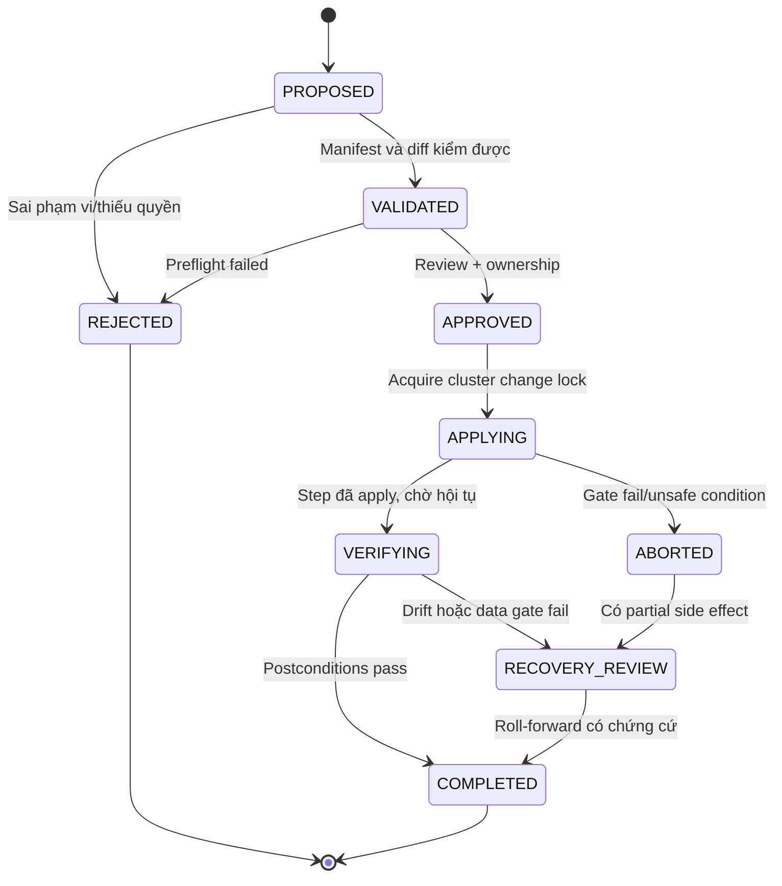
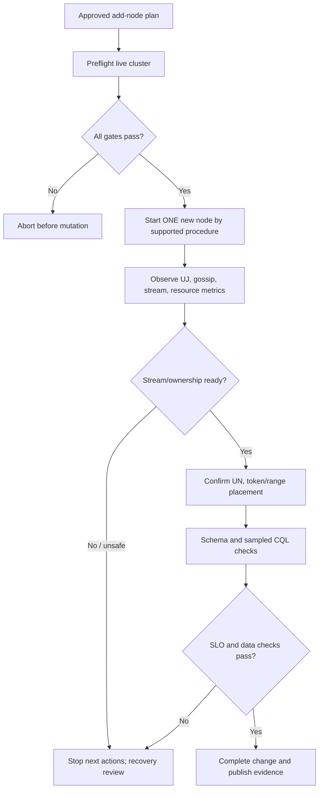
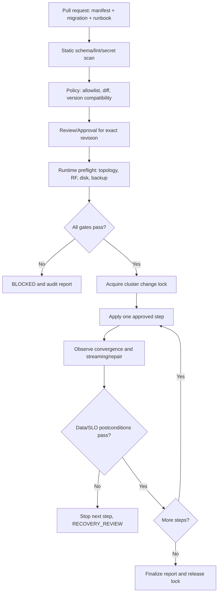

# Quản lý cấu hình, topology và thay đổi bằng quy trình có thể kiểm tra trong Apache Cassandra

## 1. Vấn đề: một dòng cấu hình có thể làm thay đổi cả cụm

Trong module **DATABASE_ENGINE_WIDE_COLUMN_CASSANDRA**, Apache Cassandra được nghiên cứu như hệ quản trị **wide-column phân tán**: **partition key** xác định token và nhóm replica lưu dữ liệu; bảng được thiết kế theo truy vấn; **replication factor (RF)** và **consistency level (CL)** ảnh hưởng đến điều kiện đọc/ghi. Các thao tác **compaction, repair, streaming và thay đổi topology** tương tác với nhau. Từ ứng dụng Java, Java Driver phải biết datacenter, coordinator, schema và chính sách timeout/retry phù hợp.

Một lỗi vận hành đôi khi bắt đầu từ thay đổi tưởng rất nhỏ:

- Đổi datacenter hoặc rack trong cấu hình snitch mà không dự báo replica placement.
- Chuyển `NetworkTopologyStrategy` từ RF=2 sang RF=3 rồi nghĩ dữ liệu lập tức được sao chép đủ.
- Thêm node nhưng broadcast address/certificate internode không đúng, khiến bootstrap/streaming đứng.
- Tăng số stream/compaction tasks khi disk đã bão hòa, khiến p99 tăng mạnh.
- Tăng Java Driver retries để “giảm lỗi” và vô tình tạo retry storm khi một replica chậm.
- Chạy `cleanup` trên node cũ trước khi xác nhận stream và ownership hoàn tất.
- Một người sửa `cassandra.yaml` bằng SSH trong khi hệ thống IaC vẫn giữ giá trị khác; lần deploy sau trả lại cấu hình cũ.

Vì vậy, **tự động hóa vận hành** không đơn giản là chuyển lệnh `nodetool` vào một script. Nó là việc tạo **quy trình thay đổi có thể kiểm tra, có điều kiện dừng, có bằng chứng, có người chịu trách nhiệm và có khả năng khôi phục thích hợp**.

### Mục tiêu học tập

Sau bài, bạn có thể:

1. Phân loại **cấu hình node**, **metadata topology/keyspace**, **schema CQL** và **cấu hình client Java Driver**.
2. Dùng Git/IaC làm nguồn sự thật, lưu manifest, biến môi trường và secret theo phạm vi thích hợp.
3. Viết **preflight checks** cho version, node health, DC/rack, RF/CL, token ownership, disk, repair và stream sessions.
4. Thiết kế change plan theo các trạng thái **PROPOSED → VALIDATED → APPROVED → APPLYING → VERIFYING → COMPLETED/ABORTED**.
5. Thực hiện thay đổi nhỏ theo từng bước/canary, có **gates** dựa trên metrics và dữ liệu.
6. Phân biệt rollback file cấu hình với **roll-forward/topology recovery** khi dữ liệu đã stream.
7. Kiểm schema/replication và điều kiện đọc/ghi bằng CQL/Java Driver, không chỉ kiểm port hoạt động.
8. Thu đủ artifacts (diff, logs, metric snapshots, approvals, audit trail) để review và tái hiện.
9. Biết khi nào **không được tự động hóa** hành động destructive hoặc cần DBA/on-call phê duyệt.
10. Lập bài tập và checklist cho một pipeline thay đổi Cassandra an toàn.

**Phạm vi:** các ví dụ là **mô hình và lab**, không phải một script có quyền tự thay đổi production. Cú pháp cấu hình, hành vi restart/dynamic update, lệnh `nodetool` và thuật toán repair/streaming có thể thay đổi giữa Cassandra 3.x, 4.x, 5.x hoặc bản phân phối. Khi thao tác thực tế phải đối chiếu **exact server version**, topology hiện có và SOP của đội vận hành.

## 2. Bốn lớp cấu hình: đừng dùng một tệp YAML để giải thích mọi thứ

| Lớp | Nơi lưu / công cụ thường gặp | Ví dụ | Rủi ro nếu thay sai |
| --- | --- | --- | --- |
| **Node/process** | `cassandra.yaml`, `cassandra-rackdc.properties`, JVM flags, cert/secret, service unit | `cluster_name`, seeds, listen/broadcast addresses, snitch, data paths | Node không gossip/stream được; identity sai, disk hoặc memory bão hòa |
| **Cluster/topology** | Token ring/gossip/metadata, nodetool và orchestration đã được hỗ trợ | Add/replace/decommission/remove/rebuild, host IDs, node states | Dữ liệu chưa đủ replica, range ownership xung đột |
| **Keyspace/schema** | Versioned CQL migrations | `NetworkTopologyStrategy` RF per DC, bảng, partition key, compaction/TTL | Read/write CL không được đáp ứng, bảng sai theo truy vấn, dữ liệu không được đồng bộ |
| **Client/service** | Spring Boot/Java Driver config, deployment descriptors | Local DC, CL, timeout, retry, page size, pool | Retry storm, routing sai DC, contract consistency thay đổi |

**Không đồng nhất “config đã apply” với “hệ thống đã hội tụ”.** Sửa YAML của node chỉ là **một bước**; ring membership, replication, SSTable placement, schema agreement và read correctness có thể cần thời gian/quy trình khác.

### 2.1. Giá trị mong muốn, giá trị đã áp và giá trị quan sát

Một workflow cần ghi ba cột:

| Trạng thái | Ví dụ | Bằng chứng |
| --- | --- | --- |
| **Desired** | Node mới thuộc `dc1/rack3`, RF keyspace=3 | Git manifest đã review |
| **Applied** | Service config đã được deploy, migration CQL đã trả success | Deployment log và change ID |
| **Observed** | `system.local` trả `dc1/rack3`, token ranges/replicas đúng, `nodetool status` hiển thị `UN` | CQL, nodetool, metrics từ nhiều node |

Sự khác biệt giữa các cột chính là **configuration drift**, hoặc thay đổi vẫn đang trong giai đoạn hội tụ. Automation phải phân biệt hai trường hợp, không đánh dấu COMPLETED chỉ vì API apply trả HTTP 200.

## 3. Nguồn sự thật: GitOps/IaC với cấu hình bất biến theo version

### 3.1. Những gì nên đưa vào Git

- Tên cluster và môi trường: lab/staging/production.
- Server version/image **digest**, số node dự kiến, DC/rack plan và tài nguyên.
- Template node config (không chứa mật khẩu hay khóa riêng).
- Keyspace/schema migrations và trạng thái phiên bản migration.
- Query/CL contract ứng dụng và Java Driver profiles.
- Các threshold vận hành: disk headroom, latency, timeout, repair/stream readiness.
- Change workflow, preflight logic và postcondition checks.
- Backup/snapshot/restore SOP và owner của dữ liệu.
- Checklist phê duyệt, rollback/roll-forward plan.
- Metadata của sự kiện thay đổi: change ID, commit SHA, ticket, operator, timestamps.

### 3.2. Những gì không được đưa vào Git dưới dạng plaintext

- Cassandra account passwords/token, private keys, keystore passwords.
- TLS private keys, secret environment variables, service credentials.
- Synthetic test data đã bị trộn dữ liệu khách hàng thật, payment tokens.
- Full config dump từ production nếu chứa secret hoặc internal IP bị giới hạn chia sẻ.

Dùng secret manager/config injection theo hệ thống đang có, chỉ giữ **reference/secret version**, không log giá trị. Không dùng bản mã hóa base64 làm “bảo vệ” secret.

### 3.3. Một thay đổi gồm những artifact nào?

```text
Change request CR-CASS-2026-041
  Git commit SHA             → desired state
  Reviewed diff              → what changes
  Validation report          → preflight checks
  Operator approval          → who authorized
  Deployment step logs       → when/where applied
  Topology/replica snapshots → observed state
  CQL correctness checks     → data invariants
  SLO/error metrics          → service impact
  Recovery record            → rolled forward/aborted
```

Một bảng quản lý thay đổi bên ngoài Git có thể lưu approval và audit, nhưng phải **liên kết được** tới commit và artifact cụ thể. Tránh một ticket “change RF” mà không có phiên bản config/schema đã triển khai.

## 4. Những bất biến cần giữ trước, trong và sau thay đổi

### 4.1. Bất biến về dữ liệu

1. Mỗi partition có **replica placement** tương ứng với RF, DC/rack plan sau khi topology ổn định.
2. Không loại bỏ **bản sao cuối cùng** của một token range trước khi stream/recovery xác nhận đầy đủ.
3. Không đổi primary key của bảng bằng cách sửa annotation rồi giả định SSTables tự được phân vùng lại.
4. Không giảm `gc_grace_seconds` hoặc xóa tombstones chỉ để tăng tốc migration khi không có chứng minh repair safety.
5. Những write có timeout phải được coi **UNKNOWN** khi chưa đối soát; không làm mất logical request IDs.
6. Schema migration không được đánh dấu đã hoàn tất khi chỉ chạy một phần DDL.

### 4.2. Bất biến về topology

- Node có **host identity** và token assignment nhất quán; không có hai node cùng được quản lý như một identity có quyền sở hữu ranges tương tự.
- Trước mỗi thay đổi destructive, kiểm **node thực** và views của nhiều peers, không chỉ IP/tên trong inventory.
- Một topology mutation đang chạy phải được quản lý như **operation có state**, không khởi động mutation thứ hai ngẫu nhiên.
- RF và số node/placement có thể đáp ứng yêu cầu nhất quán của ứng dụng.
- Không thay DC/rack/snitch khi chưa có **migration plan** cho replica placement.
- Không giảm capacity dưới mức an toàn khi decommission.

### 4.3. Bất biến về dịch vụ

- SLO p95/p99, error/timeout rate và retry amplification không vượt change gate quá lâu.
- Application traffic không tăng quá khả năng xử lý khi bootstrap/repair/streaming đang chạy.
- Java Driver `local-datacenter` và execution profiles khớp DC thực.
- Các health checks phải thực hiện query synthetic, giới hạn tần suất và không phát tải phá hoại.
- Nếu cần giảm CL, đó là **thay đổi hợp đồng consistency** phải review riêng; không là “tự chữa lỗi” mặc định.

## 5. Mẫu manifest thay đổi dùng cho review, không phải script tự chạy

Một change request có thể được lưu dưới dạng YAML như sau:

```yaml
apiVersion: ops.example.org/v1
kind: CassandraChangeRequest
metadata:
  changeId: CR-CASS-2026-041
  environment: isolated-lab
  gitCommit: "<full-sha>"
  requestedBy: "<team-or-operator>"
  approvedBy: []
  requestedAtUtc: "2026-11-21T02:00:00Z"

scope:
  clusterId: cassandra-lab-dc1
  keyspaces:
    - commerce
  operations:
    - bootstrap_one_node
  maxConcurrentTopologyChanges: 1

desired:
  cassandraImageDigest: "<pinned-digest>"
  datacenter: dc1
  rack: rack3
  expectedNodeCountBefore: 3
  expectedNodeCountAfter: 4
  keyspaceReplication:
    class: NetworkTopologyStrategy
    dc1: 3
  clientConsistency:
    reads: LOCAL_QUORUM
    writes: LOCAL_QUORUM

preflight:
  requireSchemaAgreement: true
  requireNoRunningTopologyOperation: true
  requireNoFailedRepairSessions: true
  requireDiskHeadroomFraction: 0.30
  requireAllExpectedNodesUp: true
  requireBackupReadinessEvidence: true
  maxClientErrorRate: 0.01

execution:
  strategy: one_node_at_a_time
  canaryNodeAlias: node-new-04
  maxChangeDurationMinutes: 120
  abortOnUnexpectedNodeDown: true
  abortOnReplicaCoverageRegression: true
  logEveryStep: true

postconditions:
  nodeState: UN
  expectedSchemaVersion: "<migration-version>"
  requireReplicaPlacementVerified: true
  requireNoFailedStreams: true
  requireSyntheticCqlReadAtPlannedCL: true
  requireSloWithinBudget: true

recovery:
  kind: operator_reviewed_roll_forward
  ticket: "<runbook-or-incident-id>"
  destructiveRollbackAllowed: false
```

Đây là **mẫu hợp đồng học tập**, **không phải Kubernetes CRD hoặc công cụ Cassandra tự nhận**. Một controller/pipeline muốn dùng nó phải tự định nghĩa schema validation, policy, authentication, secret handling, state transitions và logic thực thi **cho đúng server version**. Không copy `maxClientErrorRate: 0.01` như ngưỡng production mặc định: đây chỉ là giá trị minh họa, phải chọn theo error budget ứng dụng.

**Phân biệt các trường:**

- `desired`: trạng thái muốn đạt.
- `preflight`: điều kiện để **được phép** bắt đầu.
- `execution`: thứ tự triển khai và điều kiện dừng.
- `postconditions`: bằng chứng để **công nhận** hoàn tất.
- `recovery`: đường xử lý nếu có lỗi. Đối với topology data movement, thường cần **roll-forward/recovery**, không có nút “undo” an toàn.

## 6. Phân loại thay đổi: có thể reload, cần restart hay thay đổi dữ liệu?

Không phải mọi tham số Cassandra có thể thay qua runtime và không phải mọi thay đổi cần restart. Đừng dùng bảng chung cho tất cả phiên bản.

| Loại thay đổi | Ví dụ | Cách tiếp cận |
| --- | --- | --- |
| Cấu hình process cần restart | Một số listen/broadcast/TLS/JVM hoặc storage options tùy version | Rolling restart có kiểm tra từng node |
| Tham số runtime có API tương ứng | Một số throughput/throttling settings theo version | Xác minh API hỗ trợ, capture before/after |
| Schema CQL | `CREATE TABLE`, `ALTER TABLE`, table options | Versioned migration; kiểm schema agreement và query contract |
| Replication metadata | `ALTER KEYSPACE ... replication` | Dự án migration dữ liệu/replica riêng, không coi DDL success là data moved |
| Topology mutation | Add/replace/decommission/remove/rebuild | SOP phiên bản, token/range/state tracking, stream verification |
| Java Driver config | CL, timeout, retry, pool, local DC | Canary service rollout, theo dõi request attempts và errors |
| Secret/certificate rotation | Internode/client TLS, auth | Quy trình overlap/compatibility kiểm soát handshake |
| Repair schedule | Full/incremental repair coverage | Chạy theo phạm vi/lịch có gate, kiểm history và tombstone safety |

**Luôn kiểm reference configuration và administrative commands của bản đang chạy.** Một setting được hỗ trợ runtime trên một bản không mặc nhiên có thể thay không restart trên bản khác.

### 6.1. Ví dụ node configuration dưới dạng template

Đoạn sau **chỉ minh họa các trường có thể gặp** trong `cassandra.yaml`/rackdc config, không phải file hoàn chỉnh:

```yaml
# cassandra.yaml — chỉ các giá trị khái niệm cần audit
cluster_name: "cassandra-lab-dc1"
num_tokens: 16
endpoint_snitch: GossipingPropertyFileSnitch

listen_address: "10.0.0.11"
rpc_address: "0.0.0.0"

seed_provider:
  - class_name: org.apache.cassandra.locator.SimpleSeedProvider
    parameters:
      - seeds: "10.0.0.11,10.0.0.12"

# data_file_directories, commitlog_directory, encryption_options,
# authenticator, authorizer và các limits phải được khai báo phù hợp
# theo version và environment; đừng dựa vào snippet này để khởi động node.
```

Ví dụ `cassandra-rackdc.properties`:

```properties
dc=dc1
rack=rack1
```

**Các lưu ý bảo vệ:**

- Giá trị `listen_address`/broadcast, seeds, snitch và DC/rack phải được quản lý **theo node**; không lấy cùng một static file chứa IP node A triển khai cho mọi node.
- `seeds` giúp gossip discovery; **không phải** danh sách mọi replica hoặc cách xóa node ra khỏi ring.
- `rpc_address=0.0.0.0` là dạng bind-all trên môi trường có kiểm soát, không được coi là quyết định public exposure an toàn.
- `num_tokens` không được đổi tùy tiện trên một node hiện hữu; token ownership thuộc quy trình topology/data migration.
- Giá trị mặc định/JVM flags/`endpoint_snitch` và cơ chế metadata khác theo phiên bản; ghi **observed** sau deploy.
- Không ghi credentials/TLS private keys vào config mẫu hoặc Git.

## 7. Keyspace replication và CQL schema là cấu hình có ảnh hưởng đến dữ liệu

### 7.1. Mẫu keyspace RF=3 cho testbed nhiều node

Giả sử testbed có **ít nhất ba replica-capable nodes** tại `dc1`:

```sql
CREATE KEYSPACE IF NOT EXISTS commerce
WITH replication = {
    'class': 'NetworkTopologyStrategy',
    'dc1': 3
}
AND durable_writes = true;
```

Với RF(dc1)=3, `LOCAL_QUORUM` cần hai phản hồi replica theo ngữ nghĩa của CL trong local DC:

\[
\left\lfloor\frac{3}{2}\right\rfloor+1=2
\]

Trên **một node RF=1** để thử Java/CQL, `LOCAL_QUORUM` chỉ cần một replica; **không thể kết luận** nó chịu được một node DOWN như RF=3.

### 7.2. Thay RF không đồng nghĩa dữ liệu tự chuyển ngay

Giả sử đổi RF từ 2 lên 3:

```sql
-- Chỉ minh họa DDL, KHÔNG chạy trong production
-- nếu chưa có migration/recovery plan và approval.
ALTER KEYSPACE commerce
WITH replication = {
    'class': 'NetworkTopologyStrategy',
    'dc1': 3
};
```

Sau `ALTER KEYSPACE`, metadata replication thay đổi; **dữ liệu cần bổ sung trên các replica mới phải được phân phối/repair/rebuild theo quy trình phiên bản**. Không đánh dấu hoàn tất chỉ vì câu DDL trả success.

Quy trình đúng cần ghi:

1. RF, node/DC/rack và ownership **trước** đổi.
2. Dung lượng và nguồn dữ liệu phục vụ RF mới.
3. Kế hoạch repair/range sync được hỗ trợ trong server version.
4. Giới hạn tài nguyên trong quá trình thực hiện.
5. Trạng thái dữ liệu/repair sau đổi.
6. Số replica đủ đáp ứng CL ứng dụng và các query kiểm chứng.
7. Khi nào rollout client CL mới được phép áp dụng.

**Giảm RF** thậm chí nhạy cảm hơn: thao tác cleanup/loại bản sao phải có chứng minh an toàn và chính sách backup/restore, không dùng một lệnh “xóa dữ liệu dư thừa” khi chưa có coverage.

### 7.3. Bảng CQL được thiết kế theo truy vấn

Ví dụ service cần đọc đơn hàng bằng ID và liệt kê theo khách:

```sql
CREATE TABLE IF NOT EXISTS commerce.orders_by_id (
    order_id uuid PRIMARY KEY,
    customer_id uuid,
    state text,
    total_minor bigint,
    created_at timestamp
);

CREATE TABLE IF NOT EXISTS commerce.orders_by_customer (
    customer_id uuid,
    created_at timestamp,
    order_id uuid,
    state text,
    total_minor bigint,
    PRIMARY KEY ((customer_id), created_at, order_id)
) WITH CLUSTERING ORDER BY (created_at DESC, order_id ASC);
```

Một thay đổi primary key không thể “sửa” bằng cách đổi `@PrimaryKeyColumn` trong Java. Nó có thể đòi **bảng mới, dual write, backfill, validation, cutover và cleanup có điều kiện**.

**Không dùng `ALLOW FILTERING` trong repository như lối tắt cho migration dữ liệu.** Một truy vấn “pass” với ít rows trong lab không chứng minh ổn định ở partition lớn/hot key.

## 8. Topology baseline: những gì phải đo trước mọi operation

Trước khi tăng/giảm node hoặc thay RF, thu snapshot **từ nhiều node**:

```bash
nodetool status
nodetool describecluster
nodetool info
nodetool netstats
nodetool tpstats
nodetool compactionstats
nodetool gossipinfo
```

Khi cần biết bảng cụ thể:

```bash
nodetool tablestats commerce.orders_by_id
nodetool tablehistograms commerce orders_by_id
```

Tên lệnh/định dạng có thể khác theo version. Các lệnh này là **quan sát**, nhưng cũng có chi phí JMX/log/output; không polling cực nhanh từ mọi node khi cluster quá tải.

### 8.1. Kiểm schema và metadata bằng CQL

```sql
SELECT keyspace_name, replication, durable_writes
FROM system_schema.keyspaces
WHERE keyspace_name = 'commerce';

SELECT table_name, compaction, compression
FROM system_schema.tables
WHERE keyspace_name = 'commerce';

SELECT host_id, cluster_name, data_center, rack, release_version
FROM system.local;
```

`system.local` phản ánh **node đang kết nối**, không chứng minh toàn cluster cùng version/DC. Thu thêm views/metrics theo từng node; không giả định `system.peers`/`system.peers_v2` giống nhau giữa các release.

### 8.2. Các bất biến khi đánh giá baseline

| Kiểm tra | Câu hỏi | Không được kết luận vội |
| --- | --- | --- |
| Membership | Mọi node expected đều `UN`? | `UN` không chứng minh mọi replica có đủ data |
| Schema | Các node thống nhất schema? | Schema agreement không có nghĩa streaming đã xong |
| RF/CL | RF keyspace/DC và CL service đúng? | CQL success không chứng minh RF đủ khi một node DOWN |
| Token ranges | Planned replicas/ownership rõ? | Không suy từ IP order hoặc host name |
| Network | Internode path/TLS ổn? | Client port 9042 hoạt động không chứng minh streaming |
| Disk | Source và destination có headroom? | Disk “còn 10%” không phải ngưỡng an toàn chung |
| Background work | Không có topology/repair conflict? | Một snapshot `netstats` rỗng có thể đang repair validation |
| Application | Error rate, p95/p99, retries hợp SLO? | Không chỉ xem success percentage |

### 8.3. Khi baseline không đạt

Automation nên **fail closed** trước thay đổi destructive nếu:

- Có node DOWN ngoài kế hoạch hoặc peer views bất đồng đáng kể.
- Có topology mutation/repair session đang failed/pending mà chưa xử lý.
- Không thể xác định nguồn replica cho ranges bị ảnh hưởng.
- Disk/network quá tải hoặc không đủ headroom để stream/compaction.
- RF/CL và DC/rack không hợp lệ cho mục tiêu.
- Backup/restore readiness evidence bắt buộc bị thiếu.
- Migration state/schema drift không thể giải thích.
- Application error budget đã gần cạn, khiến một thay đổi nữa có rủi ro cao.

“Fail closed” nghĩa là **không bắt đầu thao tác tiếp theo**, không có nghĩa hệ thống hiện tại phải tự động shutdown.

## 9. Một thay đổi là state machine có kiểm tra, không phải một shell script



### 9.1. Trạng thái và bằng chứng tương ứng

| State | Đã có gì? | Hành động được phép |
| --- | --- | --- |
| `PROPOSED` | Intent, diff, scope | Validate; chưa thay topology |
| `VALIDATED` | Static checks, preflight plan | Request approval |
| `APPROVED` | Authorization, runbook, change window | Acquire lock và apply step đầu |
| `APPLYING` | Một thao tác có state chạy | Poll bounded, stop khi gate fail |
| `VERIFYING` | Apply response đã có, chờ observed convergence | Read-only checks, semantic validation |
| `COMPLETED` | Evidence đủ cho postconditions | Release lock/report |
| `ABORTED` | Dừng áp các bước mới | Khoanh vùng partial effects |
| `RECOVERY_REVIEW` | Chưa biết safe rollback | DBA/on-call quyết định recovery/version-specific |

**Không** đổi `ABORTED` thành “ROLLBACK COMPLETE” vì file config đã được revert. Nếu có data movement/repair/metadata changes, phải chứng minh data ownership và client correctness.

### 9.2. Idempotency của automation

Một pipeline có thể bị chạy lại khi API caller timeout. Điều kiện:

- Mỗi change có **unique change ID** và immutable commit SHA.
- Trước mỗi bước, kiểm **observed state**: nếu đã đạt postcondition, không chạy lại destructive command.
- Không tự phát lại `decommission`/`removenode`/`replace` khi outcome của lần đầu chưa rõ.
- Persist step status và external operation/session IDs trước khi chuyển state.
- Dùng một cluster-scoped lock có lease/fencing chống hai controller cùng thao tác topology.
- Khi worker/controller crash, **reconcile state trước** thay vì thực hiện step kế tiếp theo log cũ.

**Idempotent API call** không tự bảo đảm cluster-level operation idempotent nếu command có side effect mà hệ thống chưa xác nhận.

## 10. Preflight checks: policy nhiều lớp

Một change pipeline nên áp các lớp kiểm tra riêng:

### 10.1. Static validation

- YAML/JSON hợp schema; required fields đầy đủ, unknown fields bị từ chối.
- Environment ID và cluster target đúng allowlist.
- Version/image digest được pin; không dùng latest.
- Config values hợp lệ về kiểu/miền giá trị.
- Các biến template đã resolve; không còn placeholder hoặc secret plaintext.
- Diff chỉ đổi những trường được duyệt; phát hiện unrelated edits.
- Manifest `desired RF` tương thích số node/DC/rack có trong plan.
- Runbook và approval present nếu thao tác có thể xóa/move data.

### 10.2. Runtime validation

- Đọc node version/DC/rack/status/token ownership.
- Đọc replication/schema observed; đối chiếu expected.
- Xác nhận **không có** topology change khác hoặc pending repair không được giải thích.
- Kiểm disk free **trên cả source và destination**, network internode/TLS, CPU/GC.
- Kiểm application errors và retries trước thay đổi.
- Xác minh backup/restore procedure và data safety evidence.
- Xác định range/partition nào bị ảnh hưởng, ai đang sở hữu và dự kiến ai nhận.
- Xác nhận cùng một clock/timestamp UTC đủ chính xác để audit.

### 10.3. Dynamic gate khi apply

Trong từng bước, định kỳ kiểm:

```text
If unexpected node DOWN:
    STOP scheduling new topology actions
    record incident + peer views
    enter RECOVERY_REVIEW

If disk headroom below approved threshold:
    STOP scaling/decommission operation as appropriate
    do not cleanup data blindly
    request capacity mitigation

If stream/repair progress stalled beyond time budget:
    inspect phase and source/destination logs
    do not auto rerun destructive command

If p99/error budget violated:
    reduce nonessential load/traffic according to SOP
    block next step and request operator decision
```

Đây là **policy pseudocode**, không phải lệnh điều khiển thật. Những hoạt động đã chạy cần xử lý an toàn; STOP scheduling **không đồng nghĩa** giết tiến trình Cassandra hay hủy streaming tùy tiện.

## 11. Approval và quyền tối thiểu theo loại thay đổi

| Mức độ rủi ro | Ví dụ | Phê duyệt / quyền khuyến nghị |
| --- | --- | --- |
| Thấp, quan sát | Snapshot metrics, đọc config/schema | Read-only operator/service account |
| Trung bình, có thể revert config | Điều chỉnh query timeout/profile sau canary | Service owner + on-call, rollback test |
| Cao, cần data movement | Add node, tăng RF, rebuild, migration table | DBA/platform owner, capacity và recovery review |
| Rất cao, destructive | Decommission/removenode/replace/cleanup, giảm RF | Approval đa bên, manual gate, bảo vệ source data |
| Khẩn cấp | Recovery khi mất replica/network | Incident commander, documented break-glass, audit |

CQL permissions/JMX/system privileges phải được giới hạn đúng mục đích. Không cấp superuser Cassandra và root SSH cho mọi CI job chỉ để nó “có thể chạy tất cả”. Một pipeline chỉ cần thu metric thì **không** nên có quyền `DROP KEYSPACE`.

### 11.1. Four-eyes principle và separation of duties

Một người có thể đề xuất change; người khác review thực trạng/capacity/recovery plan. Trong môi trường nghiêm ngặt, pipeline thực thi dưới service account, nhưng destructive step cần **manual gate với identity được ghi lại**.

Approval nên tham chiếu exact commit SHA/manifest checksum. Nếu plan đổi sau approval, phải kiểm lại phần được ảnh hưởng; không cho “approve một lần, deploy file khác”.

## 12. Kịch bản A: thêm một node (bootstrap) có kiểm soát

### 12.1. Điều kiện trước khi thêm node

Giả sử cluster 3 node ở `dc1`, RF=3, muốn thêm node thứ 4 để cải thiện capacity. Bước mới **không** thay RF mặc định và không làm mọi partition có 4 replicas.

Preflight:

1. Dự kiến DC/rack, IP identity, tokens/vnodes và storage capacity của node mới.
2. Node hiện hữu đều đủ khỏe để phục vụ streaming source.
3. Có **disk/network headroom** trên source và destination; ước lượng bytes/range.
4. Không có failed/pending topology/repair sessions chưa xử lý.
5. Seeds và internode TLS cho phép node mới gossip/stream.
6. Node mới dùng version/config phù hợp cluster; không triển khai mixed-version ngoài kế hoạch.
7. Có baseline application errors/p99, RF/CL và replica placement hiện tại.
8. Dự kiến gating/stop conditions, backup/restore và incident owner.

### 12.2. Apply theo từng bước



Trong lúc node `UJ`:

- `nodetool netstats` quan sát incoming/outgoing streams tại **cả source và destination**.
- `nodetool tpstats/compactionstats` kiểm queue/I/O pressure.
- Node logs phân biệt bootstrap phase, gossip/schema và stream completion.
- Cluster metrics cho thấy p95/p99, dropped messages, GC và disk.
- Automation **không** thêm node thứ hai trước khi có postcondition node thứ nhất.

### 12.3. Điều kiện hoàn tất

- Node mới `UN` trong multiple peer views phù hợp version.
- Expected token/range ownership và RF placement đúng.
- Không còn failed/incomplete stream sessions liên quan.
- Schema/client metadata đã hội tụ.
- Sample CQL reads/writes synthetic ở CL production contract thành công.
- Application latency/error rate trở về giới hạn.
- Không có unknown writes chưa được xử lý từ cửa sổ thao tác.

**Không chạy `cleanup` trước khi hoàn tất verification.** Cleanup là hoạt động loại local data ngoài ownership, phải thực hiện theo plan sau khi dữ liệu an toàn và chỉ ở node phù hợp.

## 13. Kịch bản B: decommission node nhưng không làm thiếu replica

### 13.1. Tại sao decommission rủi ro hơn giảm số replicas trên giấy?

Decommission một node khỏe đòi hỏi các ranges nó sở hữu được hand off phù hợp. Khi còn RF=3 trong DC chỉ còn **hai node**, không thể đáp ứng ba bản sao trên ba node khác nhau theo mục tiêu đã nêu. Vì vậy, trước khi scale down, phải kiểm node count/capacity sau thay đổi.

Ví dụ cluster bốn node DC1 RF=3 muốn giảm còn ba node:

1. Kiểm ba node còn lại có đủ capacity/rack constraints.
2. Ghi token/range placement trước và dự kiến sau.
3. Kiểm bản sao hiện có, source data, disk headroom của receivers.
4. Đảm bảo node rời còn khỏe và có thể stream.
5. Bảo vệ client availability/SLO trong giai đoạn rời.
6. Chỉ lên lịch **một decommission** mỗi lần.

### 13.2. Decommission là thay đổi có pha

- Thấy `UL` không chứng minh thất bại.
- `netstats` có thể vẫn đang gửi streams.
- Khi stream hoàn tất, metadata cần hội tụ và kiểm data placement.
- Một node đang leaving bị DOWN giữa chừng cần **recovery path được review**, không tự đổi sang removenode.
- Không “giải phóng disk” bằng xóa source SSTables trong khi ranges chưa được hand off.

### 13.3. Không có rollback một bước

Nếu decommission đã phân phối data và thay đổi ring metadata, revert một dòng trong inventory không tự đưa node về cùng topology cũ. Có thể cần **roll-forward** hoàn tất decommission hoặc một operation mới để bootstrap/rejoin node theo SOP; đó là change khác, có rủi ro và phải kiểm dữ liệu.

## 14. Kịch bản C: replace hoặc remove node lỗi

### 14.1. Phân biệt trạng thái cần chứng minh

| Tình huống | Thao tác có thể phù hợp | Điều kiện cần xác minh |
| --- | --- | --- |
| Node DOWN tạm thời, có thể hồi phục | Sửa network/disk/process theo runbook | Không coi nó mất vĩnh viễn |
| Node hỏng cần thay thế | Replace được hỗ trợ theo version | Host identity/token semantics, old node không hoạt động đồng thời |
| Node đã chết cần xóa khỏi ring | Removenode theo SOP | Còn đủ replica/source để tái tạo range |
| Node ở DC mới cần nhận dữ liệu | Rebuild theo plan | Source DC/ranges, RF và stream readiness |
| Node khỏe, rời có kế hoạch | Decommission | Có data handoff và capacity |

**Không tự động chọn `removenode` chỉ vì `nodetool status` hiển thị `DN` trong vài phút.** Gossip/network có thể đang partition; node có thể còn sống và chứa bản sao quan trọng.

### 14.2. Bảo vệ identity và ownership

- Dùng **host ID/token/peer metadata** xác định node, không chỉ IP.
- Không khởi động old node sau khi replacement identity được áp dụng nếu SOP yêu cầu nó phải ở trạng thái tắt.
- Không copy nguyên system keyspace/data directory sang node mới ngoài quy trình chuẩn.
- Không chạy hai controller cùng replace/remove một node.
- Không lệnh “assassinate”/metadata force remove như phản ứng tự động với một alert.
- Cần data verification và repair coverage sau topology recovery.

### 14.3. State của pipeline sau lỗi

Một workflow gặp sự cố khi replace không nên tự động chuyển sang `FAILED_CLEAN`. Nó có thể ở `RECOVERY_REVIEW` vì đã có một phần stream hoặc metadata change. Khi không thể chứng minh safe rollback, ghi **partial state, session IDs, hiện trạng replica và owner** rồi escalate.

## 15. Kịch bản D: thay DC/rack hoặc replication strategy

Đổi rack/DC của một node không đơn thuần là đổi nhãn. `NetworkTopologyStrategy` chọn replicas theo DC/rack placement; nếu plan không kiểm token ring/replica, dữ liệu có thể đặt sai và ảnh hưởng CL.

### 15.1. Các câu hỏi cần trả lời

1. Vì sao cần đổi DC/rack? Chuyển hạ tầng hay bổ sung một DC?
2. Cassandra Server version hỗ trợ procedure nào?
3. Có cần rebuild/migration dữ liệu từ DC cũ sang DC mới?
4. RF theo DC sau thay đổi là bao nhiêu; số nodes/racks có phù hợp?
5. Java Driver `local-datacenter` và traffic routing có thay không?
6. Phải thay secrets/certificates/network paths giữa DC như thế nào?
7. Trình tự thay RF, dữ liệu, client CL và cutover là gì?
8. Có rollback/roll-forward plan khi một DC mới chưa đầy đủ dữ liệu không?

**Không chỉ sửa `dc=dc2` trong `cassandra-rackdc.properties` của node đang phục vụ rồi restart** để coi node đã chuyển DC an toàn. Đây là migration topology/data có kế hoạch.

### 15.2. Read/Write CL và rollout

Với multi-DC:

- `LOCAL_QUORUM` phụ thuộc RF của **local DC** ứng dụng dùng.
- `QUORUM` có phạm vi khác và có thể chịu cross-DC latency.
- `EACH_QUORUM` có điều kiện từng DC.
- `LOCAL_ONE` là consistency contract khác `LOCAL_QUORUM`.

Khi thêm một DC, không bật production reads ở DC mới trước khi dữ liệu sẵn sàng và đã kiểm. Dùng synthetic correctness probes, metrics và request routing canary.

## 16. Kịch bản E: schema migration có thể kiểm tra

### 16.1. Migration không đồng nghĩa rollback transaction

Cassandra DDL như `CREATE TABLE`, `ALTER TABLE` và `ALTER KEYSPACE` **không phải một transaction đa statement tự rollback**. Nếu migration thứ ba lỗi, hai bước trước có thể đã được áp dụng.

Một migration runner phải ghi:

- Version/thứ tự migration và **checksum**.
- Từng câu DDL đã submit và terminal result.
- Schema agreement, expected table/column/primary key sau khi apply.
- Version registry/ledger và trạng thái **IN_PROGRESS / COMPLETED / FAILED**.
- Quy trình **forward-fix** khi đã thay đổi schema một phần.
- Read compatibility giữa ứng dụng cũ/mới trong rollout.

### 16.2. `IF NOT EXISTS` không bảo vệ schema drift

```sql
CREATE TABLE IF NOT EXISTS commerce.orders_by_id (
    order_id uuid PRIMARY KEY,
    state text
);
```

Nếu bảng tồn tại nhưng schema khác, `IF NOT EXISTS` có thể bỏ qua lỗi trùng tên mà **không xác nhận cột/primary key đúng**. Chạy expected-schema checks hoặc sample prepared statements. Với schema deployment, xem **observed state** thay vì dựa vào exit code.

### 16.3. Expand–migrate–contract cho data model

Ví dụ muốn đổi từ bảng `orders_by_id` sang bảng mới có key khác:

1. **Expand:** tạo bảng mới và thêm reader/writer compatibility trong app.
2. **Migrate:** backfill dữ liệu có cursor/checkpoints, bounded concurrency, idempotent writes, metrics.
3. **Dual-write hoặc projection:** duy trì hai bảng trong cửa sổ cutover, có reconciliation cho partial failures.
4. **Validate:** so counts theo partitions/IDs, query semantics và sample full rows; không chỉ tổng count.
5. **Cutover:** bật reader mới theo canary, đo p99/error và correctness.
6. **Contract:** chỉ ngừng dùng/drop bảng cũ sau retention/backup/owner approval và chứng minh không còn consumer.
7. **Document:** schema versions, request IDs, exceptions và rollback/roll-forward boundaries.

Không dùng `ALLOW FILTERING` để tránh migration khi query mới không phù hợp partition key.

## 17. Java Driver: config ứng dụng cũng phải qua change pipeline

### 17.1. Những tham số ảnh hưởng độ sẵn sàng

| Tham số | Kiểm soát cần có |
| --- | --- |
| `local-datacenter` | Khớp DC thực và topology strategy |
| Contact points | Đủ để bootstrap/discovery; không hardcode node đã bị remove |
| Request timeout | Theo SLO và phân biệt server-side/driver timeout |
| Consistency | Theo yêu cầu nghiệp vụ và RF từng DC |
| Serial consistency | Có trong LWT/CAS contract |
| Retry policy | Bounded attempts, backoff/jitter, tránh retry storm |
| Speculative execution | Chỉ với idempotent operations và performance evidence |
| Page size | Không đánh đồng với `LIMIT` hoặc số rows trong partition |
| Pool/in-flight limits | Bảo vệ driver/network/server khi topology không ổn |
| Prepared statements/schema metadata | Refresh sau migration/cutover khi phù hợp |
| TLS/auth | Không tắt xác thực để “sửa” connection errors |

### 17.2. Ví dụ service sử dụng CL và timeout rõ ràng

```java
import java.time.Duration;
import java.util.UUID;

import com.datastax.oss.driver.api.core.CqlSession;
import com.datastax.oss.driver.api.core.DefaultConsistencyLevel;
import com.datastax.oss.driver.api.core.cql.PreparedStatement;
import com.datastax.oss.driver.api.core.cql.Row;

public final class OrderProbe {

    private final CqlSession session;
    private final PreparedStatement select;

    public OrderProbe(CqlSession session) {
        this.session = session;
        this.select = session.prepare(
            "SELECT order_id, state FROM commerce.orders_by_id " +
            "WHERE order_id = ?");
    }

    public boolean check(UUID syntheticOrderId) {
        try {
            Row row = session.execute(
                select.bind(syntheticOrderId)
                    .setConsistencyLevel(
                        DefaultConsistencyLevel.LOCAL_QUORUM)
                    .setTimeout(Duration.ofSeconds(2))
                    .setIdempotent(true))
                .one();

            return row != null
                && syntheticOrderId.equals(row.getUuid("order_id"))
                && row.getString("state") != null;

        } catch (RuntimeException error) {
            // Production: structured metrics / alert classification.
            // Timeout là lỗi, không tự đổi thành "row không tồn tại".
            return false;
        }
    }
}
```

Đoạn code giả định bảng `commerce.orders_by_id` đã có và `syntheticOrderId` tương ứng fixture an toàn. `LOCAL_QUORUM` phù hợp **chỉ khi RF/topology/contract đúng**. Probe này cần rate-limit và không được dùng cùng một key nếu muốn xác minh token ranges trên nhiều replicas.

**Một probe pass không chứng minh toàn cluster khỏe.** Cần kiểm nhiều representative ranges và thêm cluster-level repair/stream readiness gates.

### 17.3. Java Driver metadata để đối chiếu topology

```java
import java.util.Map;
import java.util.UUID;

import com.datastax.oss.driver.api.core.CqlSession;
import com.datastax.oss.driver.api.core.metadata.Node;

public final class TopologyReadback {

    public static void print(CqlSession session) {
        boolean schemaAgreed = session.checkSchemaAgreement();
        System.out.println("schemaAgreement=" + schemaAgreed);

        Map<UUID, Node> nodes =
            session.getMetadata().getNodes();

        for (Map.Entry<UUID, Node> entry : nodes.entrySet()) {
            Node node = entry.getValue();

            System.out.printf(
                "id=%s dc=%s rack=%s state=%s endpoint=%s%n",
                entry.getKey(),
                node.getDatacenter(),
                node.getRack(),
                node.getState(),
                node.getEndPoint());
        }
    }
}
```

**Driver metadata là client-side view**, có thể đang refresh hoặc chậm hơn ring thật. Nó không thay thế `nodetool`/server logs/observed replica placement. Việc gọi `checkSchemaAgreement()` cũng **không** kiểm SSTables đã stream đầy đủ.

### 17.4. Readiness đối chiếu đa tầng

```text
1. TCP/native protocol reachable?
2. CqlSession can establish local-DC session?
3. Metadata/schema expected and agreed?
4. Synthetic partition-key CQL read at planned CL passes?
5. Token/replica coverage and stream/repair status healthy?
6. Error rate, p95/p99, retry amplification back in bounds?
7. Outstanding UNKNOWN writes reconciled or tracked?
```

Chỉ khi các gate **cần thiết cho loại change** đều pass mới ghi COMPLETED. Không biến `SELECT COUNT(*)` trên bảng rộng thành health probe hoặc tự chạy repair mỗi lần readiness fail.

## 18. Kiểm tra configuration drift: desired vs observed

### 18.1. Ba loại drift

1. **File drift:** file runtime khác template Git; một người sửa SSH hoặc IaC rollout bị lỗi.
2. **Runtime drift:** file giống nhưng process đang dùng config cũ, environment override, flag hoặc cached state.
3. **Semantic drift:** config/DDL được áp nhưng topology/replication/data state chưa đúng mong đợi.

Ví dụ:

```text
Git desired:
  keyspace RF dc1=3

Observed CQL:
  keyspace RF dc1=3

Observed topology:
  only 2 replica-capable nodes in dc1

Conclusion:
  Config value matches.
  Replica readiness/placement invariant FAIL.
  Change status cannot be COMPLETED.
```

Một công cụ chỉ `diff cassandra.yaml` sẽ không phát hiện trường hợp này.

### 18.2. Quy trình drift detection

- Thu desired snapshot từ **commit SHA đã review**.
- Thu applied snapshot từ deployment controller và runtime process.
- Thu observed từ Cassandra metadata, nodetool và CQL readback.
- Chuẩn hóa các trường có tính thứ tự (map/set), không normalize bỏ các thông tin bảo mật quan trọng.
- So theo allowlist và schema của từng server version.
- Phân loại drift: **expected during rollout**, **unknown**, **unsafe**.
- Không tự động “heal” bằng restart/node replacement nếu drift là membership/data movement chưa hoàn tất.
- Escalate khi topology diverges; self-heal chỉ với những trường an toàn và idempotent đã được chứng minh.

### 18.3. Fingerprints và artifacts

Có thể hash canonical config đã redacted/không chứa secrets để biết artifact có thay đổi ngoài ý muốn. **Checksum không xác nhận correctness**: file đúng bytes nhưng keyspace RF không đáp ứng số nodes vẫn là cấu hình sai.

## 19. Backup, repair, compaction và resource gates trong change workflow

### 19.1. Backup readiness

Trước topology data movement hoặc destructive operation:

- Có backup/snapshot plan và **restore đã được kiểm chứng** theo RPO/RTO.
- Biết backup không tự đảm bảo consistency đa bảng/toàn cluster.
- Không ngầm dùng snapshot của một node làm bản sao đầy đủ toàn cluster.
- Có nguồn dữ liệu để phục hồi token ranges liên quan khi một node không khả dụng.
- Có quota/retention/credential đối với backup, không đè lên snapshots của operation khác.
- Có người chịu trách nhiệm khôi phục nếu thao tác thất bại.

**Một nút “backup completed” không đủ** nếu chưa kiểm khả năng restore dữ liệu/DDL/metadata tương ứng.

### 19.2. Repair readiness

- Biết full/incremental repair policy theo Cassandra version.
- Không có pending/failed sessions không được giải thích.
- Biết scope: keyspace/table/ranges/participants, không gọi “all repaired” khi chỉ một scope xong.
- Có repair window trước tombstone grace safety khi phù hợp.
- Không tự hạ `gc_grace_seconds` để xóa tombstones.
- Không chạy repair diện rộng cạnh tranh bootstrap/decommission khi cluster thiếu I/O.
- Không xóa SSTables/system metadata thủ công để “giải phóng” repair.

### 19.3. Compaction và disk gates

- Kiểm `nodetool compactionstats`, disk utilization/latency, temporary headroom.
- Tính incoming SSTables và compaction space theo data model/strategy.
- Không dùng một ngưỡng disk cố định cho mọi cluster; có policy được duyệt theo workload.
- Không gọi `nodetool compact` như cách mặc định để “sửa” stream chậm.
- Không tăng compaction/stream throughput khi I/O bão hòa mà không có evidence.

## 20. Bounded automation: pseudocode cho controller an toàn

Một controller đúng không nên gọi destructive commands từ chuỗi input trực tiếp. Nó cần **policy validation, lock, observed state checks và human gate**.

```text
function reconcileChange(change):
    require change.environment in APPROVED_ENVIRONMENTS
    require immutable(change.git_commit, change.manifest_checksum)
    require manifestSchemaValid(change)
    require approvalMatchesExactRevision(change)

    lock = acquireClusterScopedLease(change.cluster_id)
    if not lock:
        return WAITING_FOR_LOCK

    try:
        observed = readOnlySnapshotFromMultipleNodes()
        if not staticPolicyPasses(change):
            return REJECTED
        if not runtimePreflightPasses(change, observed):
            return BLOCKED_WITH_EVIDENCE

        for step in change.approved_steps:
            observed = readOnlySnapshotFromMultipleNodes()
            if step.postconditionAlreadySatisfied(observed):
                audit("already applied", step)
                continue

            if not step.preconditionPasses(observed):
                return RECOVERY_REVIEW

            if step.isDestructiveOrTopologyMutation:
                requireManualGateForThisStep(change, step)

            operationId = executeApprovedVersionSpecificStep(step)
            persist(operationId, step, UTC_TIMESTAMP)

            result = waitForBoundedObservedPostconditions(
                step, operationId, change.stop_conditions)

            if result.notSafe:
                blockAllFurtherMutations()
                auditAndEscalate(result)
                return RECOVERY_REVIEW

        if not dataAndSloVerificationPasses():
            return RECOVERY_REVIEW

        return COMPLETED_WITH_EVIDENCE

    finally:
        releaseLeaseIfOwner(lock)
```

**Pseudocode này không phải runnable automation** và cố ý không đưa lệnh `removenode`/`decommission` vào một vòng lặp tự thực thi. Khi áp dụng thật, controller còn cần:

- Lease/fencing semantics để không có hai controllers được quyền thay cluster đồng thời.
- Authorization/audit/secret management.
- Crash recovery và reconciliation từ operation ID.
- API return errors, timeouts, idempotency decisions.
- Quotas/timeout budgets và không làm quá tải nodetool/JMX.
- Kế hoạch rollback/roll-forward **theo loại thao tác** và server version.
- Review đối với các bước có thể gây mất dữ liệu.

### 20.1. Vì sao cần `operationId`?

Một apply call có thể timeout dù cluster đã bắt đầu streaming. Nếu controller chỉ thấy timeout rồi phát lại change, nó có thể tạo **hai topology operations chồng nhau**. Lưu operation/session ID, quan sát từ cluster và **reconcile** trước khi thử lại.

## 21. Guard đối với chạy song song và tính tuần tự

Không có gì đảm bảo hai pipeline độc lập sẽ tự tránh nhau:

- Pipeline A đang bootstrap node mới.
- Pipeline B đang giảm RF hoặc decommission node.
- Pipeline C chạy repair full.
- Pipeline D deploy app đổi CL.

Dù từng pipeline có preflight pass tại thời điểm riêng, khi chạy cùng lúc chúng có thể tạo điều kiện khác hẳn thiết kế.

### 21.1. Lock và scheduling

- Có **cluster-scoped lock** cho topology mutations.
- Cho phép schema/app changes độc lập chỉ sau khi kiểm compatibility và không vi phạm freeze policy.
- Nếu một change đang `VERIFYING`, không giải phóng lock sớm chỉ vì lệnh apply trả success.
- Nếu controller mất lock/lease, **không tiếp tục thực thi** bước destructive.
- Một repair/streaming task chạy nền phải được tính vào capacity budget ngay cả khi không giữ cùng lock.

### 21.2. Không tự động retry mọi lỗi

| Thất bại | Có thể thử lại? | Điều kiện |
| --- | --- | --- |
| Read-only `nodetool status` timeout | Thường có thể | Bounded retries + backoff, không flood JMX |
| Health query synthetic read | Có điều kiện | Idempotent, rate limited, không đổi semantics |
| Apply config qua deployment API timeout | Phải reconcile | Kiểm desired/applied runtime trước retry |
| CQL `ALTER KEYSPACE` timeout | Không retry mù | Kiểm observed replication metadata/schema trước |
| Bootstrap/decommission/removenode timeout | Không retry mù | Operation/host ID/stream state cần đánh giá |
| Repair session failed | Theo SOP phiên bản | Xác định full/incremental/pending session/ranges |
| Cleanup interrupted | Theo SOP dữ liệu | Kiểm ownership và SSTable safety trước |
| WriteTimeout từ application | Unknown outcome | Logical request ID, idempotency/reconciliation |

Retries của automation **khác** retries của Java Driver. Cả hai có thể khuếch đại tải nếu phối hợp kém.

## 22. Phân biệt rollback, abort, roll-forward và restore

### 22.1. Bốn khái niệm

| Hành động | Ý nghĩa | Ví dụ |
| --- | --- | --- |
| **Abort before apply** | Chưa có side effects; có thể dừng an toàn | Preflight fail vì disk thiếu |
| **Config rollback** | Trả một setting về version cũ (nếu có thể) | Revert timeout config sau canary |
| **Roll-forward recovery** | Hoàn thành hoặc sửa trạng thái partial theo SOP | Bootstrap đã stream một phần cần recovery |
| **Restore from backup** | Khôi phục dữ liệu từ artifact có thể restore | Sau lỗi mất/không thể rebuild dữ liệu nguồn |

Trong Cassandra, **data movement không phải transaction**. Rollback manifest không tự reverse SSTables đã chuyển, token ownership đã đổi hay DDL đã áp.

### 22.2. Khi nào phải dừng tự động hóa?

Dừng trước mutation tiếp theo và escalate nếu:

- Không rõ source replica nào còn giữ dữ liệu cần thiết.
- Host identity/token ownership không nhất quán.
- Một node chưa xong replace nhưng node cũ có nguy cơ quay lại.
- Repair incremental để lại pending session theo version chưa xử lý.
- Disk/source không đủ phục vụ recovery.
- Lỗi timeout không thể phân biệt apply đã bắt đầu hay chưa.
- Data correctness read-back không đạt ở CL contract.
- Các bước recovery yêu cầu delete/drop/removenode ngoài approved scope.

**Không thực hiện lệnh nguy hiểm “để xem hệ thống có tự trở lại”**; khi thiếu bằng chứng, báo `RECOVERY_REVIEW` và giữ artifacts.

## 23. Git diff, policy-as-code và kiểm “chỉ thay đổi gì?”

### 23.1. Một diff minh họa

```diff
- max_client_requests_in_flight: 256
+ max_client_requests_in_flight: 128
```

Đây là **field minh họa trong manifest nội bộ**, không phải tên tham số `cassandra.yaml` hoặc Java Driver chính thức. Reviewer cần biết:

- Đây là cap của load generator, app hay Driver pool?
- Có thay SLO hoặc error budget không?
- Có làm request queue/timeouts tăng lên không?
- Có test trước trên representative workload không?
- Có revert plan rõ ràng không?

**Không review bằng cách nhìn diff số học** mà bỏ qua nơi setting được áp và semantics.

### 23.2. Policy kiểm thay đổi ngoài ý muốn

```yaml
policy:
  allowedChangeKinds:
    - java_driver_timeout
    - schema_add_nullable_column
    - bootstrap_one_node

  destructiveKindsRequireHumanApproval:
    - decommission_node
    - removenode
    - replace_node
    - drop_keyspace
    - cleanup_data
    - reduce_replication_factor

  rejectIf:
    - environment_not_allowlisted
    - git_revision_changed_after_approval
    - schema_drift_unexplained
    - topology_mutation_already_running
    - replica_coverage_not_proven
    - no_recovery_plan
```

Đây là **mẫu policy**, không có engine tự hiểu các keys. Khi dùng OPA/Gatekeeper/pipeline code hay hệ thống nội bộ, phải định nghĩa rõ input schema và cách lấy observed state. Không để một field `approvedBy: []` được diễn giải thành “đã được phê duyệt”.

## 24. Một pipeline triển khai gồm những job nào?



### 24.1. Phân tách CI và CD

- **CI:** validate manifest/migration/policy, test compatibility, lint, dry-run plan, kiểm integration tests trên Cassandra ephemeral.
- **CD:** kiểm observed cluster, lấy lock, approval, apply bước đã duyệt, đo actual outcome, giữ audit.
- **Fault/integration tests:** cluster nhiều node staging khi cần RF/quorum/stream/repair, không tuyên bố một container RF=1 thay thế.
- **Production:** không auto-inject fault để chứng minh release; dùng canary, progressive delivery và rollback/roll-forward SOP.

### 24.2. Không để công cụ tự tạo kết luận từ desired state

Một CD job có thể in `Deployment successful` khi automation API trả success; đó là **apply success**, không tự chứng minh Cassandra cluster đạt postconditions. Job nên có trạng thái `VERIFYING` cho đến khi observed data/topology/client gates đạt.

## 25. Quan sát trước/trong/sau: số nào bắt buộc báo cáo?

| Nhóm | Snapshot / metric | Ý nghĩa |
| --- | --- | --- |
| Membership | `nodetool status` các node, topology mode `UN/UJ/UL/DN` | Membership thay đổi theo plan? |
| Schema | Schema agreement, expected tables/keys | Code/migration có đúng không? |
| Replication | Keyspace NTS RF per DC, replica placement | Data coverage có đúng? |
| Streaming | `netstats` in/out, failures, bytes/files | Data movement có tiến độ? |
| Repair | Session ID, ranges, full/incremental/pending | Replicas có được đối soát? |
| Resource | CPU, heap/GC, disk free/IOPS/latency, network | Có đủ headroom? |
| Client | p50/p95/p99, timeout, retries, errors, rejected | SLO có bị phá? |
| Data correctness | Sample synthetic reads/writes theo CL | Contract truy vấn có còn đúng? |
| UNKNOWN writes | Logical operations chưa có outcome xác nhận | Có rủi ro trùng/mất effect? |
| Automation | Change ID, step states, operator, approvals, times | Có thể audit/tái hiện? |

### 25.1. Một lần chụp không đủ

Nếu `netstats` hiển thị 75% ở T0 và 75% ở T+1 phút, có thể vẫn đang chờ validation/compaction hoặc throttling. Thu **nhiều samples**, xác định cùng session/phase, đối chiếu logs hai đầu, disk/network và deadline. Không kết luận “stalled” từ phần trăm đơn lẻ.

### 25.2. Goodput và latency khi cluster đang chuyển

- Đếm **logical operations** riêng với retry/speculative attempts.
- Báo **successful goodput** và error/timeout ratio; không chỉ request attempts/s.
- Không chỉ tính p99 của successes rồi bỏ timeout.
- Cùng boundary đo: HTTP endpoint vs Driver request vs coordinator response.
- Ghi page size, read/write CL và request mix giống trước/sau.
- Khi change thêm node làm token placement thay đổi, so workload có cùng phân phối partition keys/hot keys.

## 26. Nhật ký thay đổi và ví dụ báo cáo audit

```yaml
changeId: CR-CASS-2026-041
environment: "isolated-lab"
sourceGitCommit: "<immutable-sha>"
manifestChecksum: "<sha256>"
operator: "<authorized-id>"

timeline:
  proposedAtUtc: "2026-11-21T02:00:00Z"
  approvedAtUtc: "<observed>"
  preflightAtUtc: "<observed>"
  applyStartedAtUtc: "<observed>"
  applyFinishedAtUtc: "<observed>"
  verificationFinishedAtUtc: "<observed>"

planned:
  kind: "bootstrap_one_node"
  targetNodeAlias: "node-new-04"
  targetDc: dc1
  targetRack: rack3

observedBefore:
  nodeCount: 3
  rfDc1: 3
  schemaAgreed: true
  failedStreamSessions: 0
  diskHeadroomFractionMin: "<measured>"

applied:
  deploymentOperationId: "<opaque-id>"
  serverVersion: "<pinned-version>"
  stepCount: 1
  failedSteps: 0

observedAfter:
  nodeCount: 4
  targetNodeState: "UN"
  schemaAgreed: true
  replicaPlacementVerified: "<boolean>"
  streamingComplete: "<boolean>"
  syntheticCqlChecksPass: "<boolean>"
  appErrorRate: "<measured>"
  appP99Ms: "<measured>"

decision:
  status: "VERIFYING"
  reason: "Waiting for final data checks"
  recoveryOwner: "<on-call>"
  artifacts:
    - "preflight.json"
    - "nodetool-before.txt"
    - "nodetool-after.txt"
    - "netstats-timeline.jsonl"
    - "metrics-histograms.json"
    - "data-probe-results.json"
```

Các giá trị `<...>` và thời gian là **placeholder của mẫu tài liệu**, không phải số liệu đã đo. `status: VERIFYING` là đúng khi còn trường postcondition chưa xác minh; không điền `COMPLETED` vì node đã `UN` mà chưa có data/SLO evidence.

**Artifact cần bảo vệ:** hostname/IP nội bộ, credential, sample data và audit identity. Với public report, dùng aliases/hash phù hợp nhưng giữ mapping nội bộ phục vụ incident review.

## 27. Case study: IaC ghi đúng nhưng RF/data vẫn sai

### 27.1. Bối cảnh

Một cluster có ba node tại `dc1`, keyspace `commerce` trước RF=2. Team mở PR thay RF=3. Automation chạy câu `ALTER KEYSPACE`, nhận success và ghi `COMPLETED`. Sau đó một node bị downtime, application `LOCAL_QUORUM` có timeout và dữ liệu một số partitions chưa đúng kỳ vọng.

### 27.2. Những bước bị thiếu

- Không kiểm source replicas và dung lượng trước khi tăng RF.
- Không có kế hoạch repair/stream dữ liệu đến replica mới.
- Không verify token/range data coverage.
- Đánh dấu completed dựa trên CQL DDL success.
- Thay CL ở client trước khi observed data đủ.
- Không có postcondition read-back theo partitions.

### 27.3. Quy trình đúng

1. Review RF/topology plan với DBA, xác định source/target ranges và data migration.
2. Tạo manifest immutable, cho phép `ALTER KEYSPACE` khi preflight pass.
3. Ghi DDL thành công nhưng giữ state `APPLYING/VERIFYING`.
4. Chạy repair/data sync **theo hướng dẫn exact server version**; ghi session IDs và scope.
5. Kiểm RF metadata + replica placement + data correctness theo CL.
6. Chỉ triển khai client CL mới khi postconditions pass.
7. Theo dõi p99/timeouts/retry budget trong cửa sổ canary.
8. Ghi báo cáo và cho phép change complete.

### 27.4. Bài học

**Cassandra replication là trạng thái vật lý có thời gian hội tụ.** Một YAML desired state có thể đúng nhưng cluster chưa đạt data placement tương ứng. Chính **postcondition dựa trên bằng chứng** mới làm tự động hóa đáng tin.

## 28. Case study: hai automation cùng sửa topology

### 28.1. Bối cảnh

Job A đang bootstrap node D vào cluster. Job B thấy node C `DN` và định `removenode` C. Job C đang full repair. Cả ba preflight riêng lẻ cách nhau vài phút.

### 28.2. Rủi ro

- Bootstrap cần dữ liệu từ C nhưng removenode loại identity/source.
- Repair đang validation/streaming cạnh tranh I/O với bootstrap.
- Ring metadata chuyển dưới chân cả ba controllers.
- RF/CL và app error rate có thể thay đổi ngoài dự báo.
- Nếu controller A timeout, tự retry bootstrap có thể tạo operation chồng lấn.

### 28.3. Cách xử lý qua policy

- Cluster-scoped lock cho topology mutations; chỉ một operation trong trạng thái APPLYING/VERIFYING.
- Preflight live ngay trước từng step, không tin kết quả cũ.
- Repair schedule kiểm capacity và operation conflicts.
- Khi C `DN`, phân loại network/gossip và xác minh node trước khi chọn removenode/replace.
- Nếu A đang streaming một phần, chỉ dừng **bước mới** và chuyển `RECOVERY_REVIEW`; không tự hủy/giết Cassandra.
- Lưu per-step IDs, logs và observed placement để DBA có thể chọn recovery.

## 29. Runbook mẫu: áp một thay đổi cấu hình an toàn

### Pha A — Đề xuất

1. Mô tả **business reason**, query/load impact và kỳ vọng.
2. Chọn target cluster/keyspace/nodes chính xác; có allowlist.
3. Tạo PR manifest + config diff + versioned migrations nếu có.
4. Đính kèm before-state, capacity, backup/recovery evidence.
5. Phân loại impact: restart, CQL schema, RF change hay topology mutation.
6. Chỉ rõ những dữ liệu/key ranges có thể bị tác động.
7. Định nghĩa abort gates và postconditions trước khi apply.

### Pha B — Phê duyệt và chuẩn bị

1. Lint/schema validate; secret scan và resolved dependency/config check.
2. Review approval trên exact commit SHA và immutable manifest.
3. Snapshot node versions/host IDs/DC/rack/token ownership.
4. Kiểm RF/CL, schema agreement, repair/stream state và application SLO.
5. Kiểm disk/network/CPU/GC headroom ở source/destination.
6. Kiểm rollback/roll-forward SOP, không hứa “revert YAML là xong”.
7. Acquire cluster change lock; từ chối operations cạnh tranh.

### Pha C — Áp từng bước

1. Thực hiện **một** step có phạm vi được duyệt.
2. Lưu operation/session ID và timestamp UTC.
3. Poll có giới hạn, thu observed state từ nhiều node.
4. Theo dõi stream/repair progress, membership, compaction và app metrics.
5. Nếu gate fail, **ngừng lên lịch step tiếp theo** và chuyển review.
6. Không tự làm destructive operation khác để sửa step đã lỗi.

### Pha D — Xác minh sau thay đổi

1. Đối chiếu desired/applied/observed config.
2. Schema + replication + token/replica placement đúng.
3. Không còn failed/incomplete streaming/repair sessions liên quan.
4. Representative synthetic CQL checks pass tại CL đúng.
5. p95/p99, errors/retries và foreground service load trong gate.
6. UNKNOWN writes có owner/reconciler.
7. Chỉ khi đủ evidence mới ghi COMPLETED.

### Pha E — Audit và phòng ngừa

- Lưu manifest SHA, diff, approvals, logs/metrics/time series.
- Ghi versions/node IDs đã được redacted đúng phạm vi.
- Nêu kế hoạch khôi phục đã dùng hoặc lý do không cần.
- Cập nhật automation tests và runbook khi gặp failure mode mới.
- Không xóa ngay artifacts lỗi chỉ vì change về xanh.

## 30. Bài tập tình huống và gợi ý giải

### Bài 1 — Đổi RF và dừng quá sớm

Keyspace có RF=2, team thay YAML thành RF=3 rồi `ALTER KEYSPACE` thành công. Automation ghi COMPLETED.

1. Những bằng chứng nào còn thiếu?
2. Vì sao RF metadata không chứng minh replica mới đã có dữ liệu?
3. Cần gate nào trước khi chuyển client `LOCAL_QUORUM`?
4. Nếu repair session chưa xong, trạng thái workflow đúng là gì?

**Gợi ý:** cần data sync/repair theo version, token placement, stream/repair history, read-back CL và SLO. Giữ VERIFYING/RECOVERY_REVIEW.

### Bài 2 — Thêm node trong lúc disk gần đầy

Cluster ba node RF=3 cần thêm node thứ tư. Source node còn 8% disk free, đang compaction lớn. Manifest đặt max concurrency một node.

1. Có nên cho bootstrap bắt đầu không?
2. Điều kiện disk/compaction nào phải kiểm?
3. Vì sao tăng stream throughput có thể phản tác dụng?
4. Khi chặn, automation cần tạo artifact gì?

**Gợi ý:** preflight fail closed hoặc đánh giá capacity theo runbook; lưu observed disk, compaction backlog, projected bytes, blocked reason.

### Bài 3 — Hai pipeline tranh nhau thay ring

Pipeline A đang bootstrap; pipeline B muốn decommission node cũ vì thấy `DN`.

1. Cần loại lock nào?
2. Có nên cho B thực thi vì nó đã được phê duyệt từ hôm qua?
3. Nếu A timeout, có nên chạy lại bootstrap step ngay?
4. Trạng thái nào phù hợp nếu ring đang partial?

**Gợi ý:** cluster-scoped lock/fencing, live preflight, reconcile operation IDs, RECOVERY_REVIEW khi chưa rõ.

### Bài 4 — Sửa `dc` trên node production

Một người chuyển node từ `dc1` sang `dc2` bằng cách sửa `cassandra-rackdc.properties` và restart.

1. Điều gì có thể thay đổi về placement/CL?
2. Tại sao driver `local-datacenter` cần được xem xét?
3. Cần migration plan nào?
4. Vì sao config rollback có thể không đủ?

**Gợi ý:** DC/rack affects NTS replica placement; cần data movement/rebuild procedure và client routing rollout theo version.

### Bài 5 — Tưởng `UN` là mọi thứ đã xong

Node mới chuyển `UJ` sang `UN`, nhưng `netstats` còn failed session log và một số synthetic reads timeout.

1. Pipeline có thể ghi COMPLETED không?
2. Bằng chứng data readiness nào thiếu?
3. Sự khác nhau giữa membership và replica correctness?
4. Nếu CL tạm hạ `LOCAL_ONE` làm probes xanh thì đã sửa xong chưa?

**Gợi ý:** chưa; cần verify failed streams, RF placement, CL contract, timeouts. Hạ CL thay contract không chữa source issue.

### Bài 6 — App Driver retries thay đổi

Một PR tăng retries và speculation; sau canary, số HTTP errors giảm nhưng Cassandra dropped messages tăng gấp ba và p99 tăng.

1. Số logical requests và CQL attempts khác nhau thế nào?
2. Vì sao kết quả error rate đơn lẻ có thể đánh lừa?
3. Abort gate và recovery plan nào phù hợp?
4. Có nên đánh dấu mọi write là idempotent để retry được không?

**Gợi ý:** attempts amplify load; cần budget, logs/tracker, per-operation idempotence, không retry write mù quáng.

### Bài 7 — Sửa file bằng SSH ngoài Git

Một node có `cassandra.yaml` khác desired Git. CI tự reapply và restart ngay trong lúc node đang streaming.

1. Đây là loại drift gì?
2. Tại sao auto-heal kiểu này nguy hiểm?
3. Cần kiểm observed state nào?
4. Policy nào phân biệt drift an toàn với drift cần manual review?

**Gợi ý:** file/runtime/semantic drift, streaming/topology lock, restart phase gate.

### Bài 8 — Decommission giảm capacity

Cluster bốn node RF=3 ở DC1; team muốn giảm còn hai node và vẫn giữ RF=3.

1. Plan có hợp lệ theo yêu cầu ba replica độc lập không?
2. Tại sao cần capacity/replica check trước step?
3. Kịch bản “chỉ decommission một node mỗi lần” có tự giải quyết sai RF không?
4. Automation nên xử lý plan ra sao?

**Gợi ý:** không đủ node cho RF=3; reject plan trước apply hoặc yêu cầu thay kiến trúc/contract có review.

### Bài 9 — CQL migration chỉ áp một nửa

Migration V014 gồm tạo bảng mới, thêm cột và chạy backfill. Step thứ ba lỗi sau khi hai step đầu thành công.

1. Có transaction rollback tự động không?
2. Vì sao revert Git commit chưa phục hồi cluster?
3. Runner cần lưu trạng thái từng step gì?
4. Đường forward-fix an toàn gồm gì?

**Gợi ý:** no multi-statement DDL rollback; persist migration state/checksum, inspect observed schema/data, idempotent repair/backfill and reconcile.

### Bài 10 — Một kết quả probe chưa chứng minh quorum

Một container RF=1 kiểm `LOCAL_QUORUM` pass. Team khẳng định production RF=3 chịu mất một replica.

1. Kết luận có căn cứ không?
2. Cần môi trường/replica count nào?
3. Những gì probe hiện tại chứng minh được?
4. Có thể dùng mock repository thay bài kiểm phân tán không?

**Gợi ý:** RF=1 quorum khác RF=3; multi-node RF=3 lab/staging và fault testing có kiểm soát.

### Bài 11 — Hạ CL để che lỗi

Trong bootstrap, `LOCAL_QUORUM` writes timeout. Automation tự đổi sang `LOCAL_ONE` và ghi rollout success.

1. Đây có phải cấu hình “self-heal” an toàn không?
2. Nó thay đổi điều kiện xác nhận thế nào?
3. Cần approval và postconditions gì nếu business thực sự cho phép downgrade tạm?
4. Sau recovery có kế hoạch đưa CL về trạng thái nào?

**Gợi ý:** CL là consistency contract; không downgrade tự động. Dùng controlled incident decision, log risk, expiry/revert, reconciliation.

### Bài 12 — Viết change manifest và báo cáo audit

Bạn được giao thay một node bị lỗi trong cluster RF=3. Hãy viết:

- Change ID/commit SHA, target host ID và operation kind.
- Version/DC/rack/token ownership trước khi replace.
- Replica source availability, disk/network/TLS readiness.
- Human approval/lock, recovery/rollback giới hạn.
- Stream/session IDs, status samples, errors/retries.
- Data correctness read-back và client p99/error metrics.
- Evidence để đánh dấu COMPLETED hoặc RECOVERY_REVIEW.

**Gợi ý:** tuyệt đối không chỉ điền `nodeState=UN`; cần data/replica coverage, no failed streams, same business query semantics và audit trail.

## 31. Checklist vận hành trước khi merge/deploy change

- [ ] Đã xác định change là config process, schema, replication, topology hay client.
- [ ] Manifest có change ID, môi trường, exact commit SHA và immutable checksum.
- [ ] Server/image/Driver/JDK versions được pin và tương thích.
- [ ] Có Git review, secret scan và config/schema validation.
- [ ] Không đưa password/TLS private key/bind values nhạy cảm vào Git/log.
- [ ] Desired/applied/observed state được phân biệt.
- [ ] Cluster/node/DC/rack/token/replica placement đã được đọc thực từ nhiều nguồn.
- [ ] RF và consistency levels đúng với application contract.
- [ ] Node/host ID được xác minh; không thay bằng cách đoán IP.
- [ ] Có disk/network/GC/compaction/repair headroom phù hợp.
- [ ] Không còn topology mutation/repair session conflict chưa được phân loại.
- [ ] Backup/restore và dữ liệu nguồn đã được kiểm chứng trước destructive operations.
- [ ] Có incident owner, approval exact revision và manual gate cho thao tác rủi ro.
- [ ] Có cluster-scoped lock/lease/fencing chống hai controllers đồng thời.
- [ ] Preflight fail closed; không dùng observed state cũ để quyết định step mới.
- [ ] Apply theo từng bước, có step IDs/session IDs và timestamps UTC.
- [ ] Không tự retry bootstrap/decommission/removenode khi outcome chưa rõ.
- [ ] Không chạy cleanup trước khi data movement/ownership được xác minh.
- [ ] Không sửa DC/rack/snitch/num_tokens như đổi biến môi trường thông thường.
- [ ] Không coi `ALTER KEYSPACE` thành công là dữ liệu đã được replicate.
- [ ] Schema migration có version/checksum và forward-fix khi partial state.
- [ ] Application config CL/retries/page size/timeout có canary và SLO checks.
- [ ] Có synthetic CQL probes tại đúng CL với query theo partition key.
- [ ] Không suy data readiness chỉ từ `UN` hoặc schema agreement.
- [ ] Stream/repair scope và token coverage đã được đối chiếu.
- [ ] Client p95/p99, errors/retries, server disk/GC/queue trong gate sau thay đổi.
- [ ] UNKNOWN writes có logical request ID, reconciliation và owner.
- [ ] Đã phân biệt abort/config rollback/roll-forward/restore from backup.
- [ ] Nếu thiếu postcondition hoặc có partial effects, state là RECOVERY_REVIEW.
- [ ] Lưu audit artifacts/diff/logs/metric snapshots, redacted phù hợp.
- [ ] Không tự động fault-inject hoặc destructive operations trên production.
- [ ] Có kế hoạch QA/monitoring sau change và ghi bài học khi sự cố xảy ra.

## 32. Nguồn tham khảo theo phiên bản

Khi thực hiện thay đổi thật, tra tài liệu tương ứng với **exact server/driver release**, vì tên config và lệnh thay đổi:

- [Apache Cassandra — Documentation](https://cassandra.apache.org/doc/latest/): kiến trúc phân tán, cấu hình, replication, compaction, repair và vận hành.
- [Apache Cassandra — CQL reference](https://cassandra.apache.org/doc/latest/cassandra/developing/cql/index.html): keyspace/schema, `NetworkTopologyStrategy`, partition/clustering keys và CL.
- [Apache Cassandra — nodetool](https://cassandra.apache.org/doc/latest/cassandra/managing/tools/nodetool/nodetool.html): topology, status, netstats, compactionstats, repair và công cụ quan sát.
- [Apache Cassandra — Operations](https://cassandra.apache.org/doc/latest/cassandra/managing/operating/index.html): bootstrap/decommission/repair và topology changes theo version.
- [Apache Cassandra Java Driver — Metadata](https://apache.github.io/cassandra-java-driver/4.18.1/core/metadata/): schema/topology metadata trong client.
- [Apache Cassandra Java Driver — Query Options](https://apache.github.io/cassandra-java-driver/4.18.1/core/query_options/): consistency, timeout, paging, idempotency per statement.
- [Apache Cassandra Java Driver — Retry Policies](https://apache.github.io/cassandra-java-driver/4.18.1/core/retries/): retries và impact khi lỗi replica/CL.
- [Spring Boot — Cassandra and NoSQL](https://docs.spring.io/spring-boot/reference/data/nosql.html): cấu hình Cassandra ở ứng dụng Spring Boot theo version.

## 33. Tổng kết

**Quản lý cấu hình, topology và thay đổi bằng quy trình có thể kiểm tra** nghĩa là nhiều hơn “mọi file YAML đều nằm trong Git”. Cassandra có **trạng thái vật lý và phân tán**: token ownership, replica placement, SSTables, streaming, repair và dữ liệu nhận được theo CL. Vì vậy, thay đổi phải có **nguồn sự thật, diff đã review, preflight live, approval, một thao tác mỗi lần, progress gates và postconditions dựa trên bằng chứng**.

Quy trình an toàn là:

**Đề xuất → Validate → Phê duyệt → Kiểm cluster thực → Apply từng bước → Quan sát hội tụ → Xác minh dữ liệu/CL/SLO → Audit**, hoặc dừng tại **RECOVERY_REVIEW** khi không thể chứng minh tính an toàn.

Một file cấu hình được revert không tự rollback data movement; một câu `ALTER KEYSPACE` thành công không tự hoàn thành replication; node `UN` không chứng minh mọi dữ liệu đã repair. Tự động hóa tốt phải biết **khi nào không nên tiếp tục**, bảo vệ nguồn replica và chuyển quyền quyết định cho DBA/on-call trong trường hợp destructive hoặc trạng thái chưa rõ. Đó là cách vận hành Apache Cassandra ổn định, có thể kiểm tra và có thể giải thích — kể cả khi kết nối từ Java hoặc quy mô cluster thay đổi.
