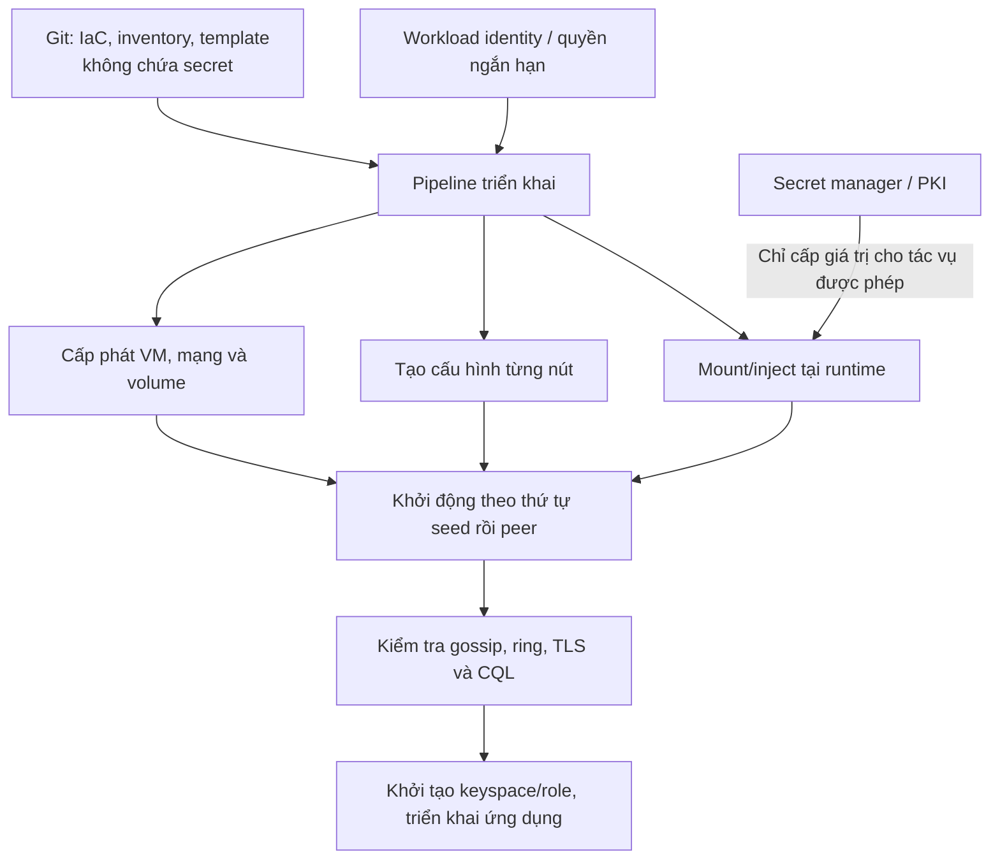

# Khởi tạo cụm Cassandra tự động và tách bí mật khỏi cấu hình lưu trong mã nguồn

## 1. Bài toán vận hành

Apache Cassandra là cơ sở dữ liệu phân tán theo mô hình **wide-column**, không có nút chủ duy nhất. Mỗi nút tham gia một vòng phân phối dữ liệu theo *partition key*; số bản sao và vị trí đặt bản sao phụ thuộc vào chiến lược replication, datacenter (DC) và rack. Vì vậy, tự động khởi tạo cụm không chỉ là cài dịch vụ trên nhiều máy: hệ thống triển khai phải tạo ra **cùng một cấu hình logic**, **danh tính mạng riêng cho từng nút**, **thứ tự tham gia cụm an toàn** và **các điều kiện kiểm tra có thể lặp lại**.

Trong chương **Tự động hóa vận hành**, bài học này tập trung vào hai mục tiêu liên quan chặt chẽ:

1. Từ cấu hình được quản lý bằng mã nguồn, có thể cấp phát và đưa một cụm Cassandra mới vào hoạt động, sau đó triển khai hoặc mở rộng có kiểm soát.
2. Mật khẩu CQL, khóa riêng TLS, token truy cập và khóa sao lưu được cấp từ hệ thống quản lý bí mật (*secret manager*) tại thời điểm chạy; chúng không xuất hiện trong repository, image, bản kê cấu hình công khai hoặc nhật ký pipeline.

Đích đến là một quy trình **khai báo được, chạy lại được, quan sát được và có cổng kiểm tra**. Tự động hóa không có nghĩa là khởi động đồng loạt mọi nút hoặc bỏ qua trạng thái dữ liệu hiện có.

### Kết quả cần đạt

Sau bài học, bạn có thể xác định cấu hình nào được đưa vào Git, cấu hình nào phải cấp từ kho bí mật; thiết kế thứ tự bootstrap cụm mới; đọc kết quả `nodetool`; giải thích tại sao seed, DC/rack, replication và consistency ảnh hưởng đến độ sẵn sàng; và phác thảo pipeline an toàn cho ứng dụng Java kết nối Cassandra.

## 2. Mô hình ví dụ và những điểm phải cố định trước khi triển khai

Giả sử cần triển khai cụm `orders-prod` gồm ba nút Cassandra cùng phiên bản tương thích, chạy trên ba máy Linux ở datacenter `dc1`. Ví dụ này minh họa một cụm mới, chưa chứa dữ liệu, trong mạng riêng. Môi trường production nên phân bố nút theo các miền lỗi vật lý phù hợp; nếu yêu cầu chịu lỗi cả datacenter thì phải thiết kế nhiều DC và replication tương ứng.

| Nút | Địa chỉ nội bộ | DC | Rack | Vai trò seed ban đầu |
| --- | --- | --- | --- | --- |
| `cass-1` | `10.20.0.11` | `dc1` | `rack1` | Có |
| `cass-2` | `10.20.0.12` | `dc1` | `rack2` | Có |
| `cass-3` | `10.20.0.13` | `dc1` | `rack3` | Không |

**Seed là địa chỉ giúp nút mới khám phá các thành viên của cụm, không phải nút chủ, cũng không phải vị trí duy nhất lưu dữ liệu.** Một hoặc vài seed ổn định cho mỗi DC thường đủ; không cần gán mọi nút làm seed. Danh sách seed phải có thể truy cập qua mạng từ những nút cần gia nhập.

Các quyết định nền tảng nên được xác lập trước khi tạo máy:

- **Phiên bản và phương thức triển khai:** cố định phiên bản Cassandra/JDK, gói cài đặt hoặc image đã được kiểm thử; không âm thầm nhận bản `latest` trong lần chạy sau. Cú pháp tham số giữa các phiên bản có thể khác nhau.
- **Topology:** đặt `cluster_name`, DC, rack, snitch và địa chỉ quảng bá phù hợp môi trường. Thông tin rack phải phản ánh miền lỗi thực tế; gán ba rack ảo trên cùng một máy chủ vật lý không tạo khả năng chịu lỗi rack.
- **Lưu trữ:** ổ dữ liệu bền vững, tách biệt khỏi vòng đời của VM/container; biết vị trí `data_file_directories`, `commitlog_directory` và dung lượng cần thiết. Không xóa volume chỉ để “sửa” một lần bootstrap lỗi.
- **Mạng:** đảm bảo liên lạc nội bộ giữa các nút và CQL từ máy khách được cấp quyền. Các cổng thường gặp là `7000`/`7001` cho giao tiếp liên nút tùy cấu hình mã hóa, `9042` cho CQL, `7199` cho JMX; phải kiểm tra lại theo phiên bản và cấu hình TLS thực tế. Không mở JMX, gossip hoặc native transport ra Internet.
- **Bảo mật:** chuẩn bị CA/chứng chỉ, kho bí mật, quyền truy cập và cơ chế luân chuyển credential trước khi ứng dụng ghi dữ liệu.
- **Vòng đời:** phân biệt rõ **tạo cụm mới**, **thêm nút**, **thay nút hỏng** và **khôi phục dữ liệu**. Các tác vụ này không được dùng chung một nhánh script khởi tạo đĩa.

## 3. Ranh giới giữa cấu hình và bí mật

Đưa **tham chiếu** và **quy tắc** vào repository; cấp **giá trị bí mật** cho đúng dịch vụ, đúng thời điểm bằng danh tính máy/pipeline có quyền tối thiểu.

| Loại thông tin | Ví dụ | Vị trí phù hợp |
| --- | --- | --- |
| Cấu hình không bí mật | Phiên bản, tên cụm, danh sách seed, DC/rack, `num_tokens`, dung lượng ổ, giới hạn tài nguyên | Git: Terraform/Ansible/Helm, inventory và template |
| Tham chiếu bí mật | `secret://prod/cassandra/admin`, tên khóa trong secret manager, tên certificate mount | Git; chỉ chứa định danh, không chứa giá trị |
| Bí mật xác thực | Mật khẩu role CQL, token quản trị, credential backup/object storage | Vault, AWS Secrets Manager, Azure Key Vault, GCP Secret Manager hoặc hệ thống tương đương |
| Khóa và chứng chỉ nhạy cảm | Private key của TLS liên nút/CQL/JMX, mật khẩu keystore, khóa mã hóa | Secret manager/PKI; chỉ gắn vào máy đích ở runtime với quyền đọc giới hạn |
| Dữ liệu trạng thái | SSTable, commit log, metadata của nút, snapshot | Volume bền vững và hệ thống sao lưu; không thuộc Git hay secret manager |

`Secret` của Kubernetes chỉ mã hóa Base64 khi hiển thị trong manifest; Base64 **không phải mã hóa bảo mật**. Nếu dùng Kubernetes, hãy kiểm soát RBAC, mã hóa bí mật khi lưu trên control plane, khả năng truy cập của pod và đồng bộ từ kho bí mật bên ngoài. Nếu dùng VM, có thể dùng Vault Agent, cơ chế identity của cloud hoặc dịch vụ tương tự để ghi tệp bảo mật vào vùng runtime được bảo vệ.



Một nguyên tắc cần giữ: **bí mật không xuất hiện trong kết quả `terraform plan`, `ansible -vvv`, log CI, shell history, đối số dòng lệnh, ảnh container hoặc thông báo lỗi**. Với Ansible, dùng `no_log: true` cho tác vụ có giá trị nhạy cảm; với Terraform, cần hiểu rằng đánh dấu `sensitive` chỉ ẩn một số kết quả hiển thị, chưa loại bỏ bí mật khỏi state. Tránh để giá trị bí mật đi qua state; bảo vệ và giới hạn truy cập state nếu công cụ buộc phải lưu dữ liệu nhạy cảm.

## 4. Khởi tạo cụm theo từng pha

### Pha A — Khai báo và kiểm tra điều kiện đầu vào

Repository có thể lưu inventory không chứa mật khẩu như sau:

```ini
# inventory.ini — dữ liệu topology, không chứa credential
[cassandra]
cass-1 ansible_host=10.20.0.11 rack=rack1
cass-2 ansible_host=10.20.0.12 rack=rack2
cass-3 ansible_host=10.20.0.13 rack=rack3

[cassandra:vars]
cassandra_dc=dc1
cassandra_cluster_name=orders-prod
cassandra_seed_ips=10.20.0.11,10.20.0.12
```

Pipeline kiểm tra có đúng ba máy mong đợi, hostname/IP không trùng nhau, phiên bản đồng nhất, quyền truy cập volume và danh tính pipeline lấy được secret cần thiết. Một job đang tạo cụm mới phải **dừng** nếu phát hiện data directory đã chứa dữ liệu hoặc nút đã thuộc một cụm khác; không tự xóa trạng thái để chạy tiếp.

### Pha B — Cấp phát và render cấu hình riêng cho từng nút

Hạ tầng dưới dạng mã (*Infrastructure as Code*) cấp phát mạng, máy, volume, chính sách firewall và thông số hệ điều hành. Công cụ quản lý cấu hình cài đặt cùng phiên bản Cassandra, thiết lập thời gian, file descriptor, JVM/heap phù hợp và render cấu hình theo biến của từng host.

Ví dụ **trích đoạn** các khóa trong `cassandra.yaml` dành cho `cass-1`, với cú pháp minh họa kiểu Cassandra 4.1; đây **không phải toàn bộ file cấu hình**. Giữ các cấu hình nền do bản phân phối cung cấp và xác nhận tên tùy chọn theo phiên bản được khóa:

```yaml
cluster_name: 'orders-prod'
num_tokens: 16
listen_address: 10.20.0.11
rpc_address: 0.0.0.0
broadcast_rpc_address: 10.20.0.11
endpoint_snitch: GossipingPropertyFileSnitch

seed_provider:
  - class_name: org.apache.cassandra.locator.SimpleSeedProvider
    parameters:
      - seeds: '10.20.0.11,10.20.0.12'

authenticator: PasswordAuthenticator
authorizer: CassandraAuthorizer
```

Ở `cass-2` và `cass-3`, phải thay `listen_address`/`broadcast_rpc_address` bằng IP riêng của từng nút, nhưng giữ cùng `cluster_name` và danh sách seed. Khi `rpc_address: 0.0.0.0`, phải khai báo địa chỉ `broadcast_rpc_address` có thể truy cập được từ client, đồng thời hạn chế truy cập bằng firewall và TLS. Không sao chép nguyên cấu hình địa chỉ nút thứ nhất sang cả cụm.

Với `GossipingPropertyFileSnitch`, cấu hình rack/DC của `cass-1` trong `cassandra-rackdc.properties` là:

```properties
dc=dc1
rack=rack1
```

Các nút khác dùng rack tương ứng trong bảng topology. Snitch và topology phải đúng **trước khi tạo keyspace có replication theo DC**; thay đổi DC/rack trong cụm có dữ liệu đòi hỏi kế hoạch di chuyển và kiểm tra replica, không chỉ sửa một chuỗi trong file.

Chú ý rằng `num_tokens` quyết định số token ảo cấp cho nút khi bootstrap. Việc thay đổi cấu hình này về sau không đồng nghĩa tự động phân phối lại dữ liệu trên nút đã tồn tại. Nếu dùng token thủ công hoặc quy tắc phân phối khác, cần cơ chế lập kế hoạch phù hợp.

### Pha C — Đưa các nút vào ring bằng thứ tự có kiểm soát

Với **cụm hoàn toàn mới và volume rỗng**, quy trình đơn giản là:

1. Khởi động `cass-1` (seed đầu tiên); đợi dịch vụ hoạt động và kiểm tra `nodetool status` cho thấy nút ở trạng thái `UN` (*Up/Normal*).
2. Khởi động `cass-2`, bảo đảm nó tìm được seed và hoàn tất bootstrap; kiểm tra cả hai nút đều `UN`.
3. Khởi động `cass-3`, tiếp tục chờ đến khi cả ba nút đều `UN`, không còn stream/bootstrap bất thường và schema được đồng bộ.
4. Chỉ sau khi ring ổn định mới tạo keyspace theo replication dự kiến, cấp role ứng dụng và mở lưu lượng của ứng dụng.

Chạy tuần tự giúp dễ khoanh vùng lỗi discovery, cấu hình mạng và TLS. Với cụm đang có dữ liệu, thêm nút phải dùng quy trình bootstrap dữ liệu của Cassandra và theo dõi streaming; **không tắt `auto_bootstrap` để ép nút gia nhập một ring đang hoạt động**. Thay thế nút hỏng và phục hồi snapshot là hai quy trình khác, yêu cầu xác định node ID, dữ liệu trên đĩa và trạng thái token trước khi thao tác.

Ví dụ thao tác kiểm tra từ máy quản trị được phép truy cập vào nút:

```bash
nodetool status
nodetool describecluster
nodetool netstats
```

`nodetool status` cho biết trạng thái `UN`/`DN`, DC, rack và thông tin phân phối token; `describecluster` cung cấp thông tin cụm/schema; `netstats` giúp xem các hoạt động streaming còn diễn ra. **Chỉ kiểm tra cổng TCP mở là chưa đủ**: dịch vụ có thể nghe cổng nhưng chưa tham gia ring hoặc đang chuyển dữ liệu.

### Pha D — Thiết lập TLS, tài khoản quản trị và quyền ứng dụng

Cấu hình `PasswordAuthenticator`/`CassandraAuthorizer` là một phần của chính sách bảo mật CQL. Với bản cài Cassandra sử dụng tài khoản superuser mặc định, việc kích hoạt xác thực có thể đi kèm credential khởi tạo đã biết; cần **giới hạn mạng ngay từ đầu và đổi credential này trong bước bootstrap an toàn**, trước khi cấp quyền truy cập cho ứng dụng. Quy trình chi tiết phụ thuộc bản phân phối và phiên bản; không giả định mật khẩu mặc định an toàn.

Tách ba lớp truy cập: **TLS liên nút**, **TLS CQL giữa client và nút**, và **xác thực/phân quyền role CQL**. Password authentication không thay thế TLS; nếu kết nối CQL không mã hóa, credential và dữ liệu có nguy cơ bị lộ trên đường truyền. Private key, truststore, mật khẩu keystore và credential CQL phải được cấp từ hệ thống quản lý bí mật theo đúng cơ chế TLS của phiên bản đang sử dụng.

Một job đặc quyền có thể lấy credential bằng workload identity, dùng nó trong một phiên CQL được mã hóa và xóa tệp tạm sau khi chạy. Đoạn Ansible dưới đây chỉ minh họa **cách ghi tệp xác thực ngắn hạn**; biến `bootstrap_password` phải được inject từ secret manager vào runner, không khai báo trong inventory, Git hay lệnh `--extra-vars` chứa giá trị rõ:

```yaml
- name: Tạo thư mục runtime chỉ dành cho quản trị
  ansible.builtin.file:
    path: /run/cassandra-bootstrap
    state: directory
    owner: cassandra
    group: cassandra
    mode: '0700'

- name: Tạo cqlshrc tạm cho phiên bootstrap
  ansible.builtin.copy:
    dest: /run/cassandra-bootstrap/cqlshrc
    owner: cassandra
    group: cassandra
    mode: '0600'
    content: |
      [authentication]
      username = {{ bootstrap_username }}
      password = {{ bootstrap_password }}
  no_log: true
```

Job chạy `cqlsh` có TLS, trỏ tới tệp cấu hình tạm thông qua cơ chế được hỗ trợ bởi phiên bản đang dùng, sau đó xóa tệp trong khối `always`/`finally`, kể cả khi lệnh thất bại. Không truyền mật khẩu thẳng qua `-p`/`--password` hoặc nhúng vào dòng lệnh CQL vì có thể bị ghi vào danh sách tiến trình hoặc log. Quyền `0600` là lớp bảo vệ bổ sung; runner và máy đích vẫn cần giới hạn quyền, tránh debug log và quản lý vòng đời file tạm.

Ví dụ các câu CQL mà bước đặc quyền cần thực hiện, sau khi secret được đưa vào một phiên kết nối bảo mật:

```sql
-- Giá trị trong dấu <...> là chỗ thay thế lúc chạy, không commit giá trị thật.
ALTER ROLE cassandra WITH PASSWORD = '<new-bootstrap-secret>';

CREATE KEYSPACE IF NOT EXISTS orders
WITH replication = {'class': 'NetworkTopologyStrategy', 'dc1': 3};

CREATE ROLE app_orders
WITH LOGIN = true AND PASSWORD = '<app-secret>';

GRANT SELECT ON KEYSPACE orders TO app_orders;
GRANT MODIFY ON KEYSPACE orders TO app_orders;
```

Ở đây `NetworkTopologyStrategy` đặt **replication factor (RF) = 3 trong `dc1`**; cả ba nút phải có mặt và sẵn sàng để đạt bố trí mong đợi. Mẫu role trên dành cho ứng dụng đọc/ghi trong một keyspace: không dùng superuser `cassandra` làm tài khoản ứng dụng. Tùy nhu cầu, tách role chỉ đọc, role ghi và role chạy migration. Giá trị CQL chứa mật khẩu phải được tạo/escape đúng cách và truyền qua kênh bảo mật; tắt logging nhạy cảm ở bước khởi tạo.

### Pha E — Kiểm tra end-to-end trước khi mở lưu lượng

Để đánh dấu triển khai thành công, pipeline phải đạt cả kiểm tra hạ tầng, topology, bảo mật và dữ liệu:

| Cổng kiểm tra | Tiêu chí chấp nhận | Hành động khi không đạt |
| --- | --- | --- |
| Host và tiến trình | Đúng ba host, đúng phiên bản, volume được mount bền vững, dịch vụ sống | Dừng rollout, kiểm tra node cụ thể |
| Ring/gossip | Tất cả nút mong đợi `UN`, đúng DC/rack, nhìn thấy cùng cụm | Dừng mở lưu lượng; kiểm tra seed, IP và kết nối liên nút |
| Bootstrap/streaming | Không còn bootstrap hoặc streaming bất thường, schema nhất quán | Chờ/điều tra; không chạy migration sớm |
| Bảo mật | CQL có TLS đúng CA, tài khoản mặc định đã được đổi, role ứng dụng có quyền tối thiểu | Chặn client; sửa cấu hình và luân chuyển bí mật |
| CQL và replication | Tạo keyspace RF đúng; thử ghi/đọc qua client và consistency đã định | Điều tra schema, RF, trạng thái replica và quyền |
| Phục hồi vận hành | Có backup, thử đường khôi phục và lịch repair phù hợp | Chưa kết luận môi trường production đã sẵn sàng |

Với RF = 3 và mức nhất quán `QUORUM`, mỗi thao tác đọc/ghi cần nhận đủ phản hồi theo quy tắc quorum (thông thường **hai trong ba replica** đối với một DC có RF = 3). Trong giai đoạn một hoặc hai nút đầu tiên vừa lên, không dùng yêu cầu `QUORUM` để suy ra toàn bộ dịch vụ đã sẵn sàng. Khi thiết kế nhiều DC, cân nhắc `LOCAL_QUORUM` và cách đặt replication theo từng DC, không máy móc sao chép RF từ ví dụ một DC.

## 5. Tích hợp ứng dụng Java mà không cứng hóa credential

Ứng dụng Java nên lấy thông tin endpoint không bí mật từ cấu hình triển khai và nhận username/password, truststore hoặc token từ secret manager tại runtime. Với Java Driver 4.x, ý tưởng kết nối là:

```java
// secretProvider và tlsContext được thiết lập ở lớp cấu hình lúc chạy.
try (CqlSession session = CqlSession.builder()
        .addContactPoint(new InetSocketAddress("10.20.0.11", 9042))
        .withLocalDatacenter("dc1")
        .withAuthCredentials(
                secretProvider.username(),
                secretProvider.password())
        .withSslContext(tlsContext)
        .build()) {
    // Dùng prepared statement và chính sách retry/timeout được kiểm soát.
}
```

Đây là **đoạn minh họa tích hợp**, cần các import và phần hiện thực của `secretProvider`, `tlsContext` phù hợp dự án trước khi chạy. Không ghi mật khẩu vào `application.yml`, hằng Java hoặc log debug. Cấu hình `localDatacenter` phải khớp với DC do snitch báo về. Trong thực tế nên cung cấp nhiều contact point thích hợp và để driver khám phá các nút trong cụm; một contact point ở ví dụ không phải thiết kế dự phòng hoàn chỉnh.

Việc luân chuyển mật khẩu ứng dụng cần phối hợp secret manager, Cassandra role và các instance Java: có thể tạo credential/role kế tiếp, phân phối và chuyển dần ứng dụng, kiểm tra mọi kết nối, rồi thu hồi credential cũ. Thay trực tiếp mật khẩu duy nhất trong lúc ứng dụng đang giữ session cũ có thể gây lỗi tái kết nối.

## 6. Chạy lại pipeline, mở rộng cụm và xử lý sự cố

Một pipeline có tính **idempotent** không tạo lại keyspace/role không cần thiết, không thay IP hay danh tính nút ngoài ý muốn, không tái định dạng volume và không restart đồng loạt toàn cụm chỉ vì chạy lại playbook. Mỗi thay đổi cấu hình cần so sánh phiên bản hiện hành, áp dụng theo đợt và chỉ tiếp tục khi nút trước đã quay lại trạng thái đủ khỏe.

| Hiện tượng | Khả năng nguyên nhân | Hướng xử lý an toàn |
| --- | --- | --- |
| Nút mới không thấy peer | Seed sai, firewall hoặc DNS/IP quảng bá sai, TLS liên nút lỗi | So khớp `seed_provider`, `listen_address`, `broadcast_address`, log và đường mạng |
| Nút hiển thị sai DC/rack | File snitch/rackdc render sai | Dừng triển khai và kiểm tra topology trước khi tạo dữ liệu/đổi replication |
| Service chạy nhưng trạng thái `UJ` hoặc chưa `UN` | Đang join/streaming hoặc có lỗi bootstrap | Kiểm tra `nodetool netstats`, log và dung lượng đĩa; không ép bỏ bước streaming |
| Client kết nối được nhưng xác thực thất bại | Role thiếu quyền, credential đã rotate, TLS/truststore sai | Phân biệt lỗi TLS, xác thực, phân quyền; đối chiếu phiên bản secret hiện hành |
| Ghi `QUORUM` thất bại | Không đủ replica khả dụng, RF không khớp hoặc mạng phân hoạch | Kiểm tra RF và node thực tế; không tự động hạ consistency để che lỗi |
| Pipeline chạy lại làm nút trông như nút mới | Volume không gắn bền vững hoặc tool xóa dữ liệu | Chặn rollout, xác minh danh tính và dữ liệu; dùng quy trình thay nút/khôi phục chuẩn |
| Có secret trong log hoặc repository | Debug output, biến CI in ra, tệp tạm bị commit | Thu hồi/luân chuyển secret, xóa nguồn lộ và lịch sử khi cần, siết quyền và kiểm tra log |

Sau khởi tạo, tự động hóa vận hành còn phải có **backup/restore đã diễn tập**, giám sát độ trễ đọc/ghi, heap/GC, dung lượng SSTable/commit log, disk pressure, pending compactions và lịch **repair** theo topology cùng chu kỳ `gc_grace_seconds`. Compaction là công việc nền do Cassandra điều phối; không tự động chạy major compaction trên mọi nút khi vừa tạo cụm. Repair cần lập lịch có giới hạn tải, tránh chạy đồng loạt gây bão I/O hoặc mạng. Những hoạt động này bổ sung cho bootstrap, không thể thay thế kiểm tra ban đầu.

## 7. Checklist thực hành

Hãy xem một lần triển khai thành công khi có bằng chứng cho toàn bộ các câu hỏi sau:

- [ ] Git chỉ có topology, phiên bản, template, tham chiếu secret và migration CQL không chứa credential thật.
- [ ] Pipeline sử dụng identity được cấp quyền tối thiểu để lấy secret; không có secret trong tham số lệnh, output, artifact, state hoặc log dễ truy cập.
- [ ] Mỗi nút có IP, DC/rack, ổ dữ liệu và danh tính riêng; hai seed trong ví dụ truy cập được từ các nút cần gia nhập.
- [ ] Các nút được bootstrap theo thứ tự có kiểm tra; `nodetool status` thể hiện đủ ba nút `UN` đúng topology.
- [ ] TLS và xác thực CQL hoạt động; credential mặc định đã được đổi; ứng dụng dùng role riêng với quyền tối thiểu.
- [ ] Keyspace `orders` có `NetworkTopologyStrategy`/RF đúng, thao tác CQL ở consistency dự kiến thành công, ứng dụng Java kết nối bằng secret runtime.
- [ ] Chạy lại pipeline không làm mất dữ liệu, không tạo nút mới ngoài ý muốn; đã có phương án rolling update, backup/restore và repair.

### Câu hỏi tự kiểm tra

1. Vì sao khai báo cả ba nút làm seed không giúp Cassandra có “ba nút chủ”? Seed khác replica ở điểm nào?
2. Nếu một nút được render nhầm `rack1` thay vì `rack3`, rủi ro đối với phân bố bản sao là gì?
3. Điều gì có thể bị lộ dù một biến Terraform được đánh dấu `sensitive`? Bạn sẽ sửa đường đi của secret thế nào?
4. Khi `cass-3` chưa `UN`, tại sao không nên mở client production với giả định RF = 3 đã đủ khả dụng?
5. Bạn sẽ luân chuyển mật khẩu role Java ra sao để những instance đang chạy không đồng loạt mất khả năng kết nối lại?

**Ghi nhớ:** Một cụm Cassandra có thể tự động khởi động nhưng vẫn chưa đủ điều kiện phục vụ dữ liệu. Giá trị của tự động hóa nằm ở việc cấu hình đúng topology, bảo vệ bí mật, xác minh đủ replica và giữ được trạng thái dữ liệu qua mọi lần triển khai tiếp theo.
