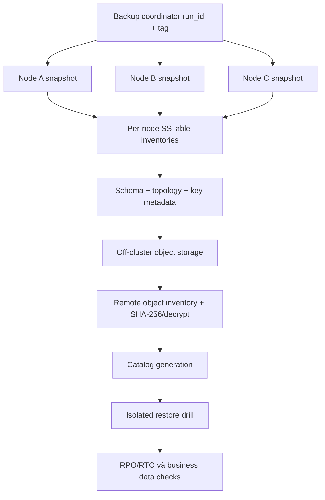
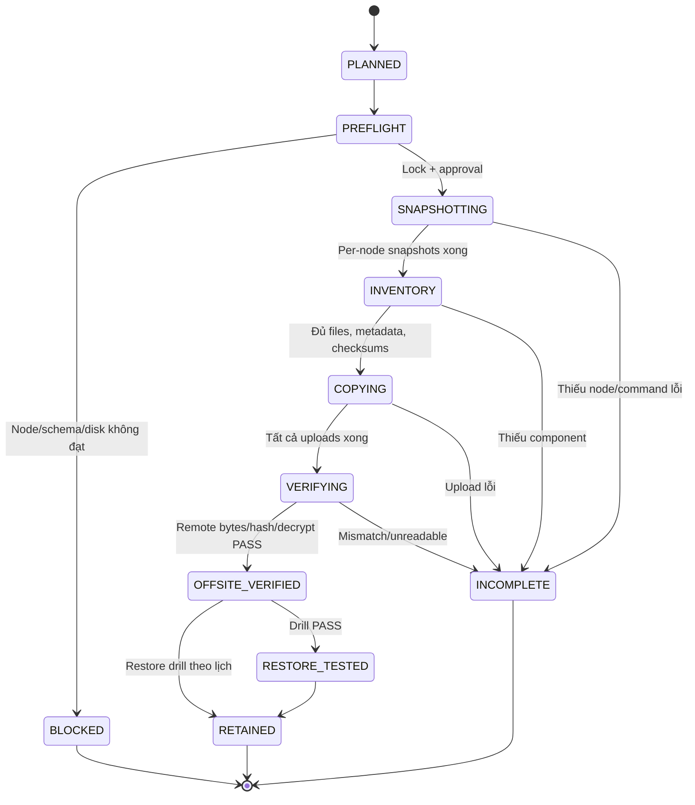
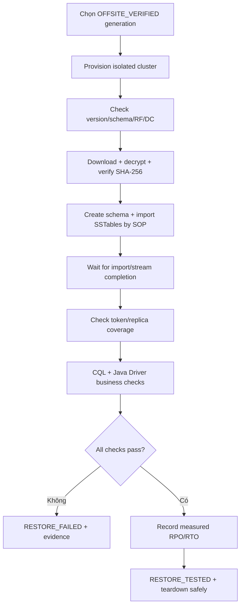

# Tự động snapshot/backup, kiểm kê và kiểm tra bản sao ngoài cụm trong Apache Cassandra

## 1. Snapshot thành công chưa phải backup có thể khôi phục

Trong module **DATABASE_ENGINE_WIDE_COLUMN_CASSANDRA**, Apache Cassandra là cơ sở dữ liệu **wide-column phân tán**: **partition key** xác định token và nhóm replica; bảng được thiết kế theo truy vấn; **replication factor (RF)** cùng **consistency level (CL)** chi phối xác nhận đọc/ghi. Cassandra sử dụng SSTables, memtable, commit log, compaction, repair và streaming. Java Driver/Spring Data chỉ nhìn thấy các kết quả CQL theo contract của ứng dụng, không tự đảm bảo có điểm khôi phục dữ liệu an toàn.

Một job hằng đêm có thể in:

```text
nodetool snapshot: completed
backup status: SUCCESS
```

Nhưng khi cần khôi phục sau sự cố, đội vận hành phát hiện:

- Snapshot mới tạo trên **một node** dù cụm có nhiều node/DC.
- Tập SSTable vẫn nằm trong chính ổ đĩa Cassandra đã hỏng.
- Chỉ copy một phần components hoặc thiếu schema/table IDs.
- Remote storage có file nhưng chưa kiểm bytes sau tải xuống.
- Không còn KMS key hay quyền giải mã của bản sao cũ.
- Snapshot của hai bảng được chụp vào hai thời điểm khác nhau, khiến dữ liệu nghiệp vụ lệch trạng thái.
- Không có restore drill nên không ai biết thời gian thực tế để dịch vụ hoạt động trở lại.

**Tạo snapshot**, **chuyển bytes ra ngoài cụm**, **kiểm đủ/đúng dữ liệu**, và **khôi phục được nghiệp vụ** là bốn việc khác nhau. Bài thuộc chương **Tự động hóa vận hành** này giải quyết trực tiếp chủ đề **Tự động snapshot/backup, kiểm kê và kiểm tra bản sao ngoài cụm**.

### Mục tiêu học tập

Sau bài, bạn có thể:

1. Phân biệt **replication, repair, snapshot, incremental backup, commit-log archiving, restore**.
2. Hiểu snapshot `nodetool snapshot` giữ hard links của SSTables **theo từng node**, không tự tạo atomic snapshot toàn cụm.
3. Thiết kế pipeline **preflight → snapshot → kiểm kê → offsite copy → integrity verify → restore drill → retention**.
4. Lưu **schema, UDT, table IDs, node host IDs, DC/rack, token ranges, RF/CL và versions**.
5. Tạo manifest có size/hash cho mọi SSTable component và xác minh remote GET.
6. Định nghĩa thế nào là bản backup **OFFSITE_VERIFIED** so với chỉ **SNAPSHOTTED**.
7. Đo RPO/RTO thực tế, kiểm data correctness qua CQL và Java Driver.
8. Lập lịch backup có lock, bounds, quota, key management và điều kiện dừng.
9. Khôi phục trong cluster **cô lập**, không trộn SSTables cũ với production live.
10. Viết checklist, runbook và báo cáo audit có thể kiểm chứng.

**Giới hạn phiên bản:** cú pháp `nodetool`, thành phần SSTable, tên thư mục, incremental/commit-log archiving và thủ tục restore thay đổi theo Cassandra 3.x/4.x/5.x hoặc bản phân phối. Các lệnh phải được đối chiếu với **exact server version**, không được copy nguyên vào production mà bỏ qua runbook.

## 2. Replication và repair không thay thế backup

| Cơ chế | Chức năng chính | Có thể khôi phục sau xóa nhầm toàn cụm? |
| --- | --- | --- |
| RF / replication | Duy trì bản sao để đáp ứng availability và CL | Không; xóa nhầm hợp lệ có thể lan tới replicas |
| Anti-entropy repair | Đối soát replica khác biệt trong các ranges | Không tạo điểm khôi phục độc lập |
| Hinted handoff | Giúp chuyển mutation bỏ lỡ theo một số điều kiện | Không phải backup log toàn vẹn |
| Snapshot local | Giữ SSTables tại mốc trên một node | Chỉ là thành phần của backup |
| Incremental backup | Giữ thêm SSTables mới được flush theo cấu hình | Cần base/coverage; không tự là full backup |
| Commit-log archiving | Lưu log segments bổ sung theo procedure | Có thể hỗ trợ recovery gần mốc, nhưng phải thử replay |
| Verified off-cluster copy | Bản sao trong failure domain độc lập | Có tiềm năng khôi phục nếu có metadata/keys |
| Restore drill | Kiểm thử thật khôi phục dữ liệu và ứng dụng | Bằng chứng có thể phục hồi |

RF=3 không bảo vệ trước mọi rủi ro: ứng dụng ghi sai payload, chạy `DELETE`/`DROP` nhầm, TTL cấu hình sai, tài khoản quản trị bị xâm nhập, lỗi đồng thời trong cùng vùng hạ tầng hoặc mất KMS key.

### 2.1. Bốn câu hỏi trước khi chọn lịch backup

1. **Bảo vệ cái gì?** Cluster, keyspace, tables, UDT, indexes, roles, data trong bao nhiêu DC và logical operations nào?
2. **Chống lỗi nào?** Một node hỏng, xóa nhầm, disaster cả region, ransomware, lỗi application?
3. **Mốc cần khôi phục?** RPO theo phút/giờ và RTO theo giờ/ngày?
4. **Bằng chứng gì?** Node coverage, file inventory, checksum, remote GET/decrypt test, restore drill và correctness checks?

Nếu RPO yêu cầu 15 phút, một snapshot mỗi ngày không đáp ứng dù cả năm job đều thành công.

## 3. Snapshot nằm trên node, không phải atomic cluster checkpoint

### 3.1. Một snapshot chụp những gì?

Ở nhiều phiên bản Cassandra, `nodetool snapshot` trên một node giữ các **hard links** tới SSTable components bất biến, thường dưới `snapshots/<tag>` ở từng thư mục bảng. Thông thường snapshot flush memtables tương ứng trước khi tạo liên kết, **trừ khi option/cấu hình thay đổi**. Xác minh bằng `nodetool help snapshot` của server version.

```text
/var/lib/cassandra/data/
  commerce/
    orders_by_id-<table-id>/
      <live-sstable-components>
      snapshots/
        bk-20261121T010000Z-a1b2/
          <snapshot-sstable-components>
          <manifest-or-schema-artifacts-if-produced>
```

Đây là **sơ đồ**, không phải layout bắt buộc mọi phiên bản. Tên file components và metadata có thể khác giữa SSTable formats.

Hard link có hệ quả:

- Tạo snapshot thường không sao chép toàn bộ bytes ngay lập tức.
- Nó vẫn nằm trên **filesystem/source node**; mất volume có thể mất snapshot.
- Compaction có thể tạo SSTable mới, nhưng SSTables cũ còn được snapshot giữ liên kết nên disk space không được giải phóng.
- Không thể coi `ln` tới filesystem khác là backup offsite.
- Không tự xóa file snapshot/SSTable thủ công khi chưa có metadata và recovery plan.

### 3.2. Cần snapshot từng node trong phạm vi bảo vệ



**Một tag giống nhau trên nhiều node không làm các lần snapshot xảy ra đồng thời.** Ví dụ A chụp 01:00:01, B chụp 01:00:08, C chụp 01:00:15. Trong khoảng đó ứng dụng vẫn có thể ghi dữ liệu; dữ liệu ở các replicas và các bảng có thể khác về mốc.

### 3.3. Snapshot không có SQL transaction semantics đa bảng

Giả sử workflow:

```text
T0: orders_by_id.state = PAID
T1: payments_by_request.status = CONFIRMED
T2: orders_by_customer.state = PAID
```

Backup chụp các bảng ở những thời điểm khác nhau có thể tạo **business state không đồng nhất** sau restore. Để có consistent cut tốt hơn:

- Quiesce writers/stop new mutations và xác nhận in-flight operations đã có terminal outcome.
- Lưu logical checkpoint/sequence ID và invariant tại tầng ứng dụng.
- Dùng event log/outbox/CDC đã có hợp đồng replay được kiểm chứng.
- Ghi start/end timestamps mỗi node/table và giới hạn độ bất định của mốc khôi phục.
- Với hệ thống luôn ghi, công bố **không có cluster-wide atomic cut** nếu chưa có cách chứng minh.

Tăng CL lên `ALL` trong cửa sổ snapshot **không** biến các ghi đa bảng thành distributed ACID transaction. Không bao giờ dùng `TRUNCATE` để “làm sạch” dữ liệu trước snapshot.

## 4. Snapshot, incremental backups và commit logs

### 4.1. Base snapshot và các tập tăng dần

```text
Base B001 (Sunday 01:00)
    + I001 SSTables (Monday)
    + I002 SSTables (Tuesday)
    + I003 SSTables (Wednesday)
Base B002 (next Sunday)
```

Base snapshot là tập SSTable files được giữ tại mốc của từng node. Incremental backup trong Cassandra (khi bật theo phiên bản) thường giữ hard links tới những SSTables mới khi flush. **Incremental riêng lẻ không đủ để khôi phục toàn bộ bảng**.

Không suy rằng một bản incremental liên tục theo từng write; cần xét:

- Flush cadence và SSTable generation.
- Collector/upload của file tăng dần có đạt không?
- Base dependencies được giữ đủ không?
- File identity và coverage across nodes/DC có đầy đủ không?
- Compaction, repair, bootstrap có làm tập SSTable thay đổi không?
- RPO được đo từ logical recovery point nào, không chỉ timestamp collector?

### 4.2. Commit-log archiving và PITR

Cassandra có cơ chế commit-log archiving tùy phiên bản/cấu hình. Để có **point-in-time recovery** đáng tin, cần:

1. Base snapshot hợp lệ cùng schema/topology.
2. Các commit-log segments đầy đủ, không có gap không được giải thích.
3. Mốc cắt/replay policy được kiểm và phù hợp write timestamps/TTL.
4. Quy trình import/replay tương thích đúng Cassandra Server version.
5. Phép thử khôi phục logical events, xử lý out-of-order data và tombstones.
6. Reconciliation đa bảng/ngoài Cassandra khi nghiệp vụ cần.

**Không nói “bật commit log archiving là tự có PITR từng giây”.** Nếu hệ thống chưa chứng minh replay, công bố RPO dựa trên những snapshots/incrementals thực sự restore được.

### 4.3. Ma trận lựa chọn

| Mục tiêu | Công cụ có thể dùng | Kiểm chứng bắt buộc |
| --- | --- | --- |
| Khôi phục một bảng về mốc ngày | Snapshot + schema + offsite copy | Restore và query đúng |
| RPO vài giờ | Nhiều snapshots hoặc verified incremental chain | Không thiếu base/files |
| RPO rất ngắn | Snapshot + log/CDC/event workflow | Replay và logical consistency |
| Chống mất cả DC | Ngoài region/account/failure domain | Restore IAM/KMS/RTO |
| Availability khi một replica DOWN | RF/repair | Không thay bản backup |
| Xóa nhầm do admin | Immutable historical backups | Retention, legal hold, restore earlier state |

## 5. Bảo vệ đầy đủ: file data và metadata

Một `*.db` file chưa nói hết cách restore dữ liệu Cassandra. Theo backup scope, phải giữ:

- Keyspace DDL, `NetworkTopologyStrategy` RF per DC, `durable_writes`.
- Table names/IDs, partition/clustering keys, column types.
- UDT definitions và thứ tự tạo schema phụ thuộc.
- Compaction/compression options, TTL, `gc_grace_seconds`.
- Index/SAI/MV metadata và procedure kiểm/rebuild theo version.
- Cassandra Server exact version và SSTable format compatibility.
- Node host IDs, DC/rack, tokens và replica placement trong thời gian snapshot.
- Backup generation/tag, timestamp start/end từng node.
- Schema migration version và commit SHA của source.
- Roles/permissions được xuất theo quy trình có kiểm soát.
- Reference tới secrets/KMS keys, **không** lưu private keys plaintext.
- Logical business checkpoint, expected synthetic fixture IDs/values.
- Trạng thái các dòng incremental/log archive liên quan.

**Table ID đặc biệt quan trọng:** Cassandra thường dùng thư mục table với tên và ID. Bảng bị drop/recreate cùng tên có thể có ID khác; backup không thể suy schema đúng chỉ từ chuỗi `orders_by_id`.

### 5.1. Scope và tenant

```yaml
backup_scope:
  environment: isolated-lab
  cluster: cassandra-lab
  datacenters: [dc1, dc2]
  keyspaces:
    commerce: [orders_by_id, orders_by_customer]
  include_schema: true
  include_udts: true
  roles_permissions: "controlled-export"
  include_topology_metadata: true
```

Đây là **manifest minh họa**, không phải cấu hình Cassandra tự thực thi. Nếu nhiều tenants dùng chung một bảng, chụp toàn SSTable **không phải** backup chỉ một tenant. Restore riêng tenant cần data-export/query/authorization workflow khác, không tùy tiện chia sẻ toàn bộ SSTables.

## 6. Preflight: cluster scope phải được chốt

Trước mỗi generation, controller xác nhận:

1. Tập **expected nodes** từ inventory đã duyệt, kể cả node đang DOWN (không chỉ nodes hiện đang UP).
2. Host IDs, DC/rack, token ownership, schema versions và RF/CL.
3. Không có topology mutation `UJ/UL`, bootstrap/replace/decommission hoặc repair/streaming có nguy cơ xung đột mà chưa được đánh giá.
4. Disk headroom khi snapshot giữ SSTables cũ qua compaction.
5. CPU/GC/disk I/O/network và foreground SLO có đủ ngân sách.
6. Object store quota/retention/IAM/KMS key còn hoạt động.
7. Không có backup generation trùng scope/tag, acquire **cluster-scoped backup lock**.
8. Snapshot scope phù hợp keyspace/tables thực, đã xác nhận owner/approval.
9. Có thời gian để upload, verify và đạt RPO trước deadline.
10. Có rollback/incident escalation nếu một node snapshot thất bại.

### 6.1. Lệnh quan sát phiên bản phổ biến

```bash
nodetool status
nodetool describecluster
nodetool info
nodetool netstats
nodetool tpstats
nodetool compactionstats
nodetool listsnapshots
```

Chạy trên **các node liên quan** và lưu mỗi output kèm node ID, timestamp UTC, exact server version. Tên/định dạng lệnh thay đổi theo release. Các lệnh này không xác nhận toàn bộ data đã consistent; chỉ góp phần xác định điều kiện trước backup.

### 6.2. Topology đang thay đổi

Nếu node `JOINING` hoặc `LEAVING`, snapshot có thể không phủ đúng token ranges như ở trước/sau migration. Chọn:

- **BLOCKED:** hoãn generation tới khi topology ổn định theo policy.
- **INCOMPLETE/NEEDS_REVIEW:** thu bản degraded có ghi coverage thiếu và rủi ro, **không** coi đã full-cluster verified.
- Đối với disaster cấp bách, owner có thể quyết định bản degraded vẫn có ích nhưng phải công bố giới hạn.

**RF=3 không chứng minh có thể bỏ qua bất kỳ node nào trong backup** nếu chưa phân tích coverage, timestamps, changed ranges và trạng thái replica.

## 7. Backup generation là state machine



**OFFSITE_VERIFIED và RESTORE_TESTED không đồng nghĩa.** Một generation có integrity verification pass nhưng chưa từng được thử khôi phục phải ghi đúng hai sự thật ấy.

### 7.1. Run ID và snapshot tag

```text
cluster_id: cassandra-lab-a
generation_id: 2026-11-21T010000Z_6e8b4c2a
snapshot_tag: bk-20261121T010000Z-6e8b4c2a
scope: commerce
attempt: 1
created_at_utc: 2026-11-21T01:00:00Z
```

Tag phải có format đã validate, không dùng dấu phân cách/path traversal. Khi một command timeout, **đọc lại snapshot state cùng tag** trước khi retry; không tự xóa và chụp lại bằng tag mới khi những node khác đã thành công.

### 7.2. Coverage matrix

| Node | DC | Snapshot tag | SSTable inventory | Upload | Remote hash |
| --- | --- | --- | ---: | --- | --- |
| A | dc1 | Có | 214 files | PASS | PASS |
| B | dc1 | Có | 207 files | PASS | PASS |
| C | dc1 | Có | 198 files | PASS | PASS |
| D | dc2 | Thiếu | — | — | — |

Đây là số liệu **giả định**. Generation đang **INCOMPLETE** vì D thiếu ngoài trừ trường hợp có exception policy và chứng minh coverage riêng được phê duyệt. Không “làm đẹp” tỷ lệ bằng cách loại D khỏi denominator sau khi nó DOWN.

## 8. Tạo snapshot bằng `nodetool` đúng phiên bản

Trước thao tác trên node được phép:

```bash
nodetool help snapshot
nodetool help listsnapshots
nodetool help clearsnapshot
```

Lệnh mẫu thường dùng:

```bash
# Trên từng node, sau khi controller kiểm scope/cluster identity.
nodetool snapshot -t bk-20261121T010000Z-6e8b4c2a commerce

# Xem snapshot ở chính node mà JMX đang kết nối.
nodetool listsnapshots
```

- `-t` là option tag trong nhiều Cassandra versions, xác nhận bằng `help` đúng bản.
- Snapshot chỉ chạy tại node JMX tương ứng, **không tự fan-out toàn cluster**.
- Snapshot có thể flush memtables và làm tăng I/O.
- Không dùng `--skip-flush` tùy tiện nếu muốn bao phủ dữ liệu memtable.
- Exit code 0 **không** chứng minh file offsite đã tồn tại.
- Không đưa `clearsnapshot` vào cùng bước khi chưa verify bản ngoài cụm.

### 8.1. Bash shell minh họa trên node lab

```bash
#!/usr/bin/env bash
set -euo pipefail

# CHỈ chạy trong một cluster LAB đã được allowlist.
EXPECTED_CLUSTER="cassandra-backup-lab"
KEYSPACE="commerce"
TAG="bk-20261121T010000Z-6e8b4c2a"

if [[ ! "$TAG" =~ ^[A-Za-z0-9_-]+$ ]]; then
  echo "Unsafe snapshot tag" >&2
  exit 2
fi

# Quan sát (KHÔNG tự verify EXPECTED_CLUSTER).
# Controller thực phải kiểm identity/host ID/disk/lock trước bước tiếp.
nodetool info
nodetool status

nodetool snapshot -t "$TAG" "$KEYSPACE"
nodetool listsnapshots

echo "SNAPSHOT_COMMAND_COMPLETED, offsite NOT VERIFIED"
```

Script **cố ý không runnable như production orchestrator**: nó chưa tự kiểm `EXPECTED_CLUSTER`, các nodes khác, disk, snapshots của table IDs hoặc upload. Không copy nguyên vào cron production.

## 9. SSTable components: inventory phải đủ

Một SSTable có nhiều components, tùy version/format:

```text
...-Data.db
...-Index.db
...-Filter.db
...-Statistics.db
...-CompressionInfo.db
...-TOC.txt
...-Digest.crc32
...-Summary.db
...-Partitions.db / additional index components (nếu có)
```

Đây là **ví dụ**, không phải danh sách bất biến. Automation phải lưu **tất cả files thực** trong snapshot directory đúng table ID/version (và metadata tương ứng). Chỉ copy `*-Data.db` có thể khiến bản restore không thể nạp.

### 9.1. Mẫu file inventory

| Trường | Mục đích |
| --- | --- |
| `generation_id` | Kết nối thế hệ backup |
| `node_host_id`, DC/rack | Biết node/failure domain |
| `keyspace`, `table`, `table_id` | Khớp schema và đường dẫn thật |
| `relative_path` | Không mất component/nhầm directory |
| `size_bytes` | Kiểm đầy đủ bytes |
| `sha256` | Integrity của file nguồn |
| `snapshot_start/end_utc` | Mốc thời gian per node |
| `data_directory_alias` | Phân biệt các volumes |
| `remote_object_uri/version_id` | Xác minh object remote |
| `upload_status/verify_status` | Trạng thái từng file |

### 9.2. Bash inventory **chỉ đọc** một thư mục snapshot đã kiểm

```bash
#!/usr/bin/env bash
set -euo pipefail

# Chỉ định sau khi xác minh cluster, host ID, tag và table ID.
SNAPSHOT_DIR="/var/lib/cassandra/data/commerce/orders_by_id-TABLE_ID/snapshots/bk-20261121T010000Z-6e8b4c2a"

if [[ ! -d "$SNAPSHOT_DIR" ]]; then
  echo "Missing snapshot" >&2
  exit 3
fi

# Skeleton TSV cho lab. Production phải dùng JSON/CSV
# escaping chuẩn, realpath allowlist, không tin path đầu vào.
printf "relative_path\tbytes\tsha256\n"

while IFS= read -r -d '' file; do
  relative="$(realpath --relative-to="$SNAPSHOT_DIR" -- "$file")"
  bytes="$(stat -c %s -- "$file")"
  digest="$(sha256sum -- "$file" | cut -d ' ' -f 1)"
  printf "%s\t%s\t%s\n" "$relative" "$bytes" "$digest"
done < <(find "$SNAPSHOT_DIR" -type f -print0)
```

Điểm an toàn:

- Cần kiểm snapshot path thuộc **allowlisted data directory** và đúng table IDs.
- `sha256sum` đọc file lớn, cần I/O budget; không hash đồng thời 500 SSTables làm disk quá tải.
- Nếu có nhiều data directories, phải inventory tất cả.
- Không biến absolute source path do người dùng điều khiển thành object key, tránh path traversal.
- Không tự thay permissions hoặc xóa SSTables để script đọc được.
- TSV minh họa không an toàn cho filenames chứa tab/newline; dùng serialization chuẩn trong production.
- ETag của object store không luôn là content hash, đặc biệt multipart/encryption.

## 10. Manifest một generation: planned khác observed

```yaml
schema_version: 1
generation_id: "2026-11-21T010000Z_6e8b4c2a"
cluster_id: "cassandra-backup-lab"
snapshot_tag: "bk-20261121T010000Z-6e8b4c2a"
status: "COPYING"
created_at_utc: "2026-11-21T01:00:00Z"

versions:
  cassandra_server_by_node:
    node_a: "<exact-build>"
    node_b: "<exact-build>"
    node_c: "<exact-build>"
  sstable_format: "<observed>"
  backup_agent_version: "<exact-version>"
  backup_agent_commit: "<git-sha>"
  java_driver_version: "<verification-version>"

topology:
  expected_nodes: [node_a, node_b, node_c]
  observed_nodes: [node_a, node_b, node_c]
  dc_rack_map: "metadata/nodes.json"
  rf_by_keyspace: "metadata/replication.json"
  token_replica_map: "metadata/token-ranges.json"

scope:
  keyspaces: [commerce]
  tables: [orders_by_id, orders_by_customer]
  schema_artifact: "metadata/schema.cql"
  table_ids_artifact: "metadata/table-ids.json"
  include_udts: true
  roles_permissions: "separate-encrypted-export"

consistency:
  snapshot_mode: "per-node-sstables"
  global_atomic_cut: false
  writers_quiesced: false
  logical_checkpoint: null
  node_snapshot_times: "metadata/timestamps.json"

inventories:
  node_a: "files/node_a.jsonl"
  node_b: "files/node_b.jsonl"
  node_c: "files/node_c.jsonl"
  source_manifest_sha256: "<trusted-hash>"
  expected_files: null
  expected_total_bytes: null

offsite:
  provider: "<object-store>"
  account_alias: "<isolated-backup-account>"
  bucket_alias: "<backup-bucket>"
  prefix: "cassandra/lab/generation/"
  encryption: "kms-envelope"
  kms_key_reference: "<non-secret-key-id>"
  immutable_policy: "<reviewed-retention>"
  region_redundancy: "<approved-plan>"

validation:
  expected_node_coverage: null
  files_uploaded: null
  remote_get_sha256_pass: null
  decrypt_test_pass: null
  schema_metadata_complete: null
  restore_drill_id: null
  restore_drill_result: "NOT_RUN"

retention:
  classification: "daily"
  earliest_deletion_utc: "<calculated>"
  legal_hold: false
  min_verified_generations: 2
```

Đây là **mẫu contract**, không phải file cấu hình Cassandra/cloud nhận trực tiếp. `status: COPYING` không thể được ghi thành VERIFIED khi các trường validation còn `null`.

### 10.1. Điều kiện trước khi công bố `OFFSITE_VERIFIED`

- Các nodes/DC/tables cần được bảo vệ đã có snapshot.
- Snapshot tag, source paths, schema và table IDs đối chiếu hợp lệ.
- Mọi SSTable components/metadata có bản remote tương ứng.
- Remote objects đúng bytes/hash và có version IDs nếu dùng versioning.
- Thử giải mã bằng KMS/restore role đã đạt.
- Không có upload thất bại hoặc thiếu file bị bỏ qua.
- Catalog chỉ được commit khi đã có **trusted inventory** và validation evidence.
- Restore test status được ghi **riêng biệt**, không giả tạo rằng đã thử restore.

## 11. Ngoài cụm: tách failure domain thật sự

| Nơi lưu | Bảo vệ được | Rủi ro còn lại |
| --- | --- | --- |
| Local snapshot trên node | Một số thao tác local SSTable | Mất host/volume |
| NAS cùng rack | Một số lỗi disk node | Rack/network/shared credential |
| Object store cùng account/region | Tách khỏi Cassandra servers | Account compromise, region failure |
| Account riêng + immutable retention | Chống delete/ransomware tốt hơn | KMS/access/region dependencies |
| Region/account độc lập + restore test | Thêm DR readiness | Latency/cost/permissions |

Không chỉ nhìn URI `s3://` rồi gọi là “offsite an toàn” nếu admin tài khoản Cassandra cũng có quyền xóa tất cả object versions/retention.

### 11.1. Quy tắc copy

- Object key deterministic theo cluster/generation/node/table ID/file.
- Credentials ngắn hạn, quyền ghi đúng prefix, không lưu secrets/log bind values.
- TLS và encryption at rest; ghi KMS key reference/version.
- Multipart upload có checkpoint, retry bounded theo **same object identity**.
- Không dùng `sync --delete` lên backup bucket.
- Không overwrite generation đã VERIFIED.
- Object-lock/legal-hold phải được xác minh trên object versions thực.
- Upload metadata/manifest và commit catalog sau khi files được kiểm.
- Với object store có listing semantics riêng, dùng HEAD/GET theo **inventory**, không chỉ tin LIST.

### 11.2. Một lệnh copy minh họa

```bash
#!/usr/bin/env bash
set -euo pipefail

SOURCE="/backups/staged/host-a/commerce/orders_by_id/snapshot"
DEST="s3://isolated-backup-bucket/cassandra/lab/gen-001/host-a/orders_by_id/"
KEY_REF="alias/cassandra-backup-lab"

# CHỈ khi source/destination đã allowlist + inventory.
# Cú pháp AWS CLI và KMS permissions cần kiểm theo môi trường.
aws s3 cp "$SOURCE" "$DEST" \
  --recursive \
  --sse aws:kms \
  --sse-kms-key-id "$KEY_REF"

echo "COPY_SENT; not remote content VERIFIED"
```

`aws s3 cp` exit 0 **không** chứng minh đã remote GET/hash hoặc có object lock. Không copy đoạn lệnh này vào production khi chưa có credential isolation, retention/overwrite policy và quota.

## 12. Kiểm ngoài cụm theo ba cấp bằng chứng

| Cấp | Kiểm | Bắt được | Chưa chứng minh |
| --- | --- | --- | --- |
| L1 — Inventory | HEAD/LIST per expected object; count, size, version | Thiếu file/incomplete upload | Silent corruption |
| L2 — Content integrity | Remote GET và SHA-256 hoặc checksum provider đảm bảo semantics | Đọc lại bytes khác/không giải mã được | SSTable/schema compatibility |
| L3 — Restore drill | Cluster mới, import và CQL read-back | Có thể khôi phục dữ liệu phục vụ nghiệp vụ | Bảo đảm mọi tương lai không lỗi |

**L1 không thay L2; L2 không thay L3.**

### 12.1. Không dùng ETag như hash end-to-end mặc định

Trong multipart uploads, nhiều cơ chế encryption hoặc provider khác nhau, ETag không nhất thiết bằng MD5/SHA của file gốc. Dùng:

- Trusted source SHA-256.
- Remote object version ID.
- Remote GET/decrypt bằng restore role trong môi trường test.
- So byte count và SHA-256 của nội dung đã đọc về.
- Hoặc provider checksum API có thuật toán và semantics đã được xác minh.

Checksum file **không chứng minh** business correctness nếu SSTables thiếu schema, table ID hoặc import sai.

## 13. Java 11: verifier SHA-256 cho bản sao đã tải về

```java
import java.io.InputStream;
import java.nio.file.Files;
import java.nio.file.Path;
import java.security.MessageDigest;
import java.util.Locale;

public final class BackupFileVerifier {

    public static String sha256(Path path) throws Exception {
        MessageDigest digest =
            MessageDigest.getInstance("SHA-256");

        try (InputStream input = Files.newInputStream(path)) {
            byte[] buffer = new byte[64 * 1024];
            int count;

            while ((count = input.read(buffer)) >= 0) {
                if (count > 0) {
                    digest.update(buffer, 0, count);
                }
            }
        }

        byte[] bytes = digest.digest();
        StringBuilder hex = new StringBuilder(bytes.length * 2);

        for (byte value : bytes) {
            hex.append(String.format(
                Locale.ROOT, "%02x", value & 0xff));
        }
        return hex.toString();
    }

    public static void verify(
            Path downloadedFile,
            long expectedBytes,
            String expectedSha256) throws Exception {

        if (Files.size(downloadedFile) != expectedBytes) {
            throw new IllegalStateException(
                "Backup bytes mismatch: " + downloadedFile);
        }

        if (!sha256(downloadedFile)
                .equalsIgnoreCase(expectedSha256)) {
            throw new IllegalStateException(
                "Backup SHA-256 mismatch: " + downloadedFile);
        }
    }

    private BackupFileVerifier() { }
}
```

Điều kiện:

- `expectedSha256` phải lấy từ **trusted/signed manifest**, không từ cùng object mà attacker sửa được cả file lẫn checksum.
- `downloadedFile` phải nằm trong restore staging allowlist, không là symlink/traversal do untrusted metadata.
- Hash streaming không đưa cả file SSTable vào JVM heap.
- Đọc toàn file có chi phí IO: giới hạn concurrency và throughput.
- Java code trên kiểm bytes, **không tự xác thực Cassandra SSTable format**.

### 13.1. Evidence mỗi remote object

```json
{
  "generation_id": "gen-001",
  "node_host_alias": "node-a",
  "object_key": "cassandra/lab/gen-001/node-a/orders_by_id/part-Data.db",
  "version_id": "<object-version>",
  "expected_bytes": 73400320,
  "received_bytes": 73400320,
  "expected_sha256": "<64-hex-chars>",
  "received_sha256": "<64-hex-chars>",
  "decrypt_test": "PASS",
  "result": "PASS",
  "checked_utc": "2026-11-21T03:15:00Z"
}
```

Chỉ khi **hai hash thật khớp và bytes đủ** mới ghi PASS. Chuỗi placeholder không phải hash hợp lệ; không dùng JSON minh họa này làm kết quả đo.

## 14. Backup catalog: quản lý generation theo phụ thuộc

Một catalog không chỉ là danh sách tags. Nó cần biết:

- Generation ID, trạng thái và backup scope.
- Nodes/DC/rack/tables/table IDs được bảo vệ.
- Snapshot start/end theo node, logical checkpoint.
- Base generation và incremental/log chain dependencies.
- File/object counts, total bytes, verified fraction.
- Remote failure domains, bucket/version IDs và KMS references.
- Immutable retention, legal holds, earliest delete time.
- Restore drill gần nhất, RPO/RTO đã đo.
- Jobs/operator/approval, failed steps và audit evidence.

Một dashboard phải trả lời:

1. “Bản **OFFSITE_VERIFIED** gần nhất của commerce ở đâu?”
2. “Có node/table nào thiếu trong generation mới nhất?”
3. “Restore về mốc T cần base + incrementals/log segments nào?”
4. “Bản nào hết retention nhưng vẫn là dependency?”
5. “KMS key K disable thì những generations nào mất khả năng giải mã?”
6. “Lần cuối restore drill PASS sau khi nâng Cassandra là khi nào?”
7. “Một object có trong remote nhưng không xuất hiện trong inventory có cần điều tra không?”
8. “Last verified point đã vượt RPO target bao nhiêu?”

**Catalog không đủ nếu remote objects bị xóa sau đó.** Cần periodic remote inventory audit và test restore. Nên giữ bản manifest được bảo vệ độc lập để phục hồi catalog khi catalog service mất.

## 15. Retention: không xóa bản gốc khi chuỗi khôi phục còn phụ thuộc

### 15.1. Base và incrementals là một đồ thị phụ thuộc

```text
B001 (base Sunday)
  + I001 (Monday)
  + I002 (Tuesday)
  + I003 (Wednesday)

B002 (new base next Sunday)
```

Nếu điểm khôi phục thứ Ba cần `B001 + I001 + I002`, xóa `B001` trước khi hết thời gian hỗ trợ restore sẽ làm chuỗi bị đứt. Xóa `I001` cũng có thể gây khoảng trống. Không thiết kế retention chỉ bằng “xóa mọi object cũ hơn 30 ngày” nếu không xem dependencies.

Các điều kiện để xóa một generation remote:

1. Đã qua mốc retention theo policy và không có **legal hold**.
2. Không còn restore point được hỗ trợ phụ thuộc generation đó.
3. Số **independent verified generations** còn lại đáp ứng chính sách.
4. Không có incident/reconciliation/restore job đang cần nó.
5. Object versions và immutable retention cho phép xóa.
6. Chủ dữ liệu hoặc automation có quyền đã approved exact generation ID.
7. Có dry-run inventory, số object/bytes dự kiến, audit record.
8. Quy trình không thể xóa nhầm prefix khác khi tag/generation metadata sai.

### 15.2. Điều kiện xóa snapshot local

Có thể xem xét `nodetool clearsnapshot` **chỉ sau khi**:

- Bản offsite đã đầy đủ **OFFSITE_VERIFIED**.
- Không còn uploader/hasher/restore worker đọc snapshot local.
- Schema, UDT, table IDs, manifests và checksums đã bảo vệ.
- Ít nhất số bản verified theo chính sách còn hiệu lực.
- Không có pháp lý/incident hold.
- Không đang bootstrap, repair hoặc topology recovery cần source local data.
- Tag/keyspace/node target đã xác nhận bằng người hoặc controller có guard.
- Có log từng thao tác và điều kiện dừng.

Tham khảo cú pháp:

```bash
# Xem chính xác version:
nodetool help clearsnapshot

# MINH HỌA — Không chạy trước khi đủ gates:
# nodetool clearsnapshot -t bk-20261121T010000Z-6e8b4c2a commerce
```

**Không gọi `clearsnapshot` không có tag một cách máy móc**. Một số cú pháp/flags có thể xóa **nhiều** snapshots hơn mong muốn. Không thay bằng `rm -rf` trực tiếp trong Cassandra data directory.

### 15.3. Immutable retention và key management

Một thế hệ backup immutable đáng tin cần:

- Object versioning/lock/retention ở đúng storage service.
- Tách role upload với role bypass/delete; service account Cassandra không có quyền bypass.
- Legal hold checks trước lifecycle transitions.
- KMS key còn tồn tại và được phép decrypt đến hết thời gian lưu.
- Audit khi IAM/key/policy thay đổi.
- Thử decryption bằng **restore role**, không chỉ superadmin.
- Giám sát unusual delete/bypass attempts.

Bản backup có bytes và checksum đúng nhưng KMS key bị thu hồi là **không thể khôi phục**, phải báo tình trạng nghiêm trọng.

## 16. RPO: điểm khôi phục hợp lệ, không phải giờ upload xong

\[
\mathrm{RPO} =
\text{thời điểm xảy ra lỗi}
-
\text{thời điểm dữ liệu khôi phục đáng tin gần nhất}
\]

Ví dụ:

```text
Snapshot node A      01:00:01 UTC
Snapshot node B      01:00:07 UTC
Snapshot node C      01:00:12 UTC
Remote verify done   02:10:00 UTC
Disaster occurred    08:00:00 UTC
```

Nếu không có incremental/log replay có thể kiểm chứng, đừng lấy **02:10** là điểm dữ liệu để tính RPO. Đó chỉ là **giờ xác nhận bản sao**. Recovery point phụ thuộc snapshot logical cut và ứng dụng writes trong khoảng 01:00:01–01:00:12.

Khi không có cluster-wide consistent checkpoint, phải nêu **RPO estimate/uncertainty** và phương pháp đối soát nhiều bảng. Nếu business cần RPO 15 phút nhưng chỉ có snapshot ngày một lần, report **SLO GAP**, không điền “RPO 15 phút” theo mong muốn.

### 16.1. Phân biệt backup freshness và recoverable freshness

- `last_snapshot_started_at`: node bắt đầu snapshot.
- `last_snapshot_completed_at`: node kết thúc.
- `last_offsite_verified_at`: remote files/hash/decrypt pass.
- `last_log_archived_at`: có thể là log upload, chưa chứng minh replay.
- `last_restore_tested_at`: lần thử khôi phục.
- `last_recoverable_checkpoint`: mốc dữ liệu đã được chứng minh recoverable theo hợp đồng.

Dashboard cần hiển thị **mốc recoverable** chứ không chỉ giờ cron gần nhất chạy.

## 17. RTO: thời gian dịch vụ thật sự sẵn sàng

\[
\mathrm{RTO} =
\text{thời điểm dịch vụ đạt readiness}
-
\text{thời điểm bắt đầu/kích hoạt recovery}
\]

Một restore drill cần tính:

1. Phê duyệt recovery và lấy credentials/backup generation.
2. Provision cluster mới trong network cách ly.
3. Cấu hình Cassandra versions, DC/rack, RF/CL, KMS/TLS/auth.
4. Khôi phục schema/UDT và metadata cần thiết.
5. Download/decrypt và verify SSTable files.
6. Import/stream bằng procedure tương thích.
7. Kiểm bootstrap/repair/replica coverage/compaction nếu cần.
8. Khôi phục service roles/app config/Java Driver endpoints.
9. Chạy CQL correctness probes, business invariants và endpoint smoke.
10. Đo p95/p99/error; xác nhận có thể mở traffic.

RTO **không phải** chỉ là thời gian copy file hoặc thời gian `cqlsh` mở kết nối.

### 17.1. SLO mẫu (chỉ để minh họa)

| Mục | Ví dụ | Cách chứng minh |
| --- | --- | --- |
| Target RPO | ≤ 4 giờ | Last recoverable logical checkpoint |
| Target RTO | ≤ 6 giờ | Full restore + readiness + correctness |
| Full snapshot | Hằng ngày | Per-node coverage records |
| Remote integrity | 100% SSTable files/bytes | Remote GET/hash/decrypt |
| Restore drill | Mỗi tháng | Drill report signed |
| Độc lập vùng | Hai failure domains | Storage accounts/region metadata |
| Local disk safety | Theo capacity policy | Disk headroom + snapshot retention |
| Key recoverability | Key lifecycle ≥ retention | KMS decrypt test |

Không dùng những giá trị ví dụ này như policy mặc định. RPO/RTO do yêu cầu nghiệp vụ và ngân sách vận hành quyết định.

## 18. Restore drill: khôi phục vào cluster riêng

Restore drill có giá trị khi nó tái hiện **đường khôi phục dữ liệu thật** nhưng **không ảnh hưởng production**.

### 18.1. Chuẩn bị môi trường đích

- Cluster Cassandra mới/cô lập, không dùng cùng data dirs với production live.
- Server version/SSTable format đã được xác nhận tương thích.
- DC/rack/snitch, RF, token plan phù hợp procedure.
- Keyspace/table/UDT/schema migration được tạo đúng thứ tự.
- IAM/KMS/TLS/auth cho restore role được cấp theo least privilege.
- Có đủ CPU, disk, network, temp space và thời gian để nạp SSTables.
- Chọn một generation đã **OFFSITE_VERIFIED**, các incrementals/log segments cần thiết.
- Xác nhận application logical watermarks và expected synthetic data.

### 18.2. Hai chiến lược import không được nhầm

| Phương thức | Khi nào xét | Điều kiện |
| --- | --- | --- |
| Restore SSTables offline theo procedure | Khôi phục node/table đúng layout/version/topology | Table IDs, file permissions, node stop/start, format compatibility |
| `sstableloader` hoặc streaming import phù hợp version | Nạp SSTables vào cluster mới qua cơ chế streaming | Schema đã tạo, DC/RF, source files, version và network phù hợp |

Các công cụ `sstableloader`, `nodetool refresh` và copy SSTables offline có tiền điều kiện rất khác nhau. **Không có lệnh universal** restore mọi version an toàn. Tránh copy hot files vào live cluster hoặc sửa system keyspaces thủ công. Dùng runbook/version được review.

### 18.3. Restore flow



**Không lấy checkpoint của một file từ node A làm trạng thái toàn cluster** nếu không có logical checkpoint/coverage.

## 19. Correctness: phải kiểm query theo partition key và dữ liệu nghiệp vụ

Giả sử backup chứa hai bảng được thiết kế theo truy vấn:

```sql
CREATE TABLE commerce.orders_by_id (
    order_id uuid PRIMARY KEY,
    customer_id uuid,
    state text,
    total_minor bigint,
    updated_at timestamp
);

CREATE TABLE commerce.orders_by_customer (
    customer_id uuid,
    created_at timestamp,
    order_id uuid,
    state text,
    total_minor bigint,
    PRIMARY KEY ((customer_id), created_at, order_id)
);
```

Sau restore, cần kiểm:

- `order_id` tra được đúng entity, type, trạng thái và amount.
- `orders_by_customer` cho cùng tập đơn tương ứng với logical checkpoint (không chỉ count).
- Phân phối partition keys/wide partitions có được phục hồi đúng?
- UDT/collection/enum custom mapping vẫn đọc được bằng Java Driver/Spring Data?
- TTL/tombstones có dẫn đến kết quả hợp lệ theo **restore time**, không kỳ vọng row hết TTL tự sống lại.
- Denormalized projections có bị lệch giữa các tables?
- Có unknown writes trước backup cần đối soát theo request ID/ledger?
- Synthetic fixtures đã định nghĩa trước có thể được tìm thấy theo đúng CL?

Một `SELECT COUNT(*)` toàn bảng không thay correctness test. Nó có thể rất đắt và vẫn không chứng minh row identities/field values đúng.

### 19.1. Java Driver 4.x: sample restore probe

```java
import java.time.Duration;
import java.util.List;
import java.util.UUID;

import com.datastax.oss.driver.api.core.CqlSession;
import com.datastax.oss.driver.api.core.DefaultConsistencyLevel;
import com.datastax.oss.driver.api.core.cql.PreparedStatement;
import com.datastax.oss.driver.api.core.cql.Row;

public final class RestoredOrdersVerifier {

    private final CqlSession session;
    private final PreparedStatement select;

    public RestoredOrdersVerifier(CqlSession session) {
        this.session = session;
        this.select = session.prepare(
            "SELECT order_id, customer_id, state, total_minor " +
            "FROM commerce.orders_by_id WHERE order_id = ?");
    }

    public void verify(List<UUID> syntheticOrderIds) {
        for (UUID id : syntheticOrderIds) {
            Row row = session.execute(
                select.bind(id)
                    .setConsistencyLevel(
                        DefaultConsistencyLevel.LOCAL_QUORUM)
                    .setTimeout(Duration.ofSeconds(3))
                    .setIdempotent(true))
                .one();

            if (row == null
                    || !id.equals(row.getUuid("order_id"))
                    || row.getString("state") == null) {
                throw new IllegalStateException(
                    "Restore data check failed");
            }
        }
    }
}
```

**Giới hạn:** đây là test **read-only cho synthetic keys**; không tuyên bố kiểm hết dữ liệu. `LOCAL_QUORUM` chỉ mang semantics RF=3 nếu restore cluster thực có RF=3 trong local DC. Khi test trên RF=1, nó không thể chứng minh quorum ba replica. Cần kiểm **expected field values**, không chỉ presence, ở bộ test business riêng.

### 19.2. Restore table IDs, UDTs và secondary structures

Nếu table bị drop/recreate với cùng tên nhưng ID khác, đường dẫn SSTables có thể không trùng target. Index/SAI/MV/UDT cũng có compatibility/rebuild considerations. Lưu đủ schema snapshots và đọc exact release docs. Không dùng bản SSTable của một Cassandra major version để khẳng định nâng cấp ba major versions là được hỗ trợ.

## 20. TTL, tombstones và write timestamps khi khôi phục

### 20.1. TTL không đóng băng trong snapshot

Với TTL=24 giờ, row được snapshot lúc 01:00 và restore sau một tháng vẫn có thể **hết hạn**. Phải kiểm backup timestamp, TTL policy và thời gian server khi restore. Snapshot giữ SSTable bytes; nó không thay đồng hồ logical expiry của Cassandra.

### 20.2. Tombstone và grace period

Tombstones hỗ trợ ngữ nghĩa delete phân tán. Không tự ý hạ `gc_grace_seconds`, xóa tombstones hoặc ép compaction để “sửa backup”. Nếu restore một tập snapshot không đầy đủ trong lúc dữ liệu sống/xóa nằm trên các replicas khác, có nguy cơ **resurrection** hoặc trạng thái sai do LWW/tombstones.

### 20.3. Last-write-wins trên cluster đã có data

Nếu import SSTables cũ vào cluster đang chạy với mutations mới hơn, write timestamps có thể khiến dữ liệu cũ **không thắng**. Ngược lại, các mutations lỗi thời có timestamp khác dự kiến có thể gây tác dụng không mong muốn.

Đó là lý do restore drill mặc định dùng **cluster đích trống/cô lập**, sau đó thực hiện controlled cutover hoặc reconciliation; không trộn old backup SSTables thẳng vào production live.

### 20.4. Counter và side effects

Counters và các operation có semantics đặc biệt phải có runbook/verifier tương ứng; không suy từ `rows restored count` rằng mọi increment nghiệp vụ đã đúng. Những effect ngoài Cassandra (thanh toán, email, queue) cần business ledger/checkpoint độc lập khi khôi phục.

## 21. Tự động hóa lịch chạy: bounded và audit được

### 21.1. Scheduler không chỉ có cron

Một cron/Kubernetes CronJob/workflow engine có thể gọi backup coordinator, nhưng cần:

- Một **cluster-scoped backup lease** cho cùng generation/scope.
- Lock có fencing để worker cũ không tiếp tục cập nhật catalog khi lease hết.
- Unique run ID/tag và immutable manifest.
- Timeout budget của snapshot, hashing, upload và verification.
- Retry **per-object** theo checkpoint, không gọi lại destructive/local cleanup mù quáng.
- Quota và priority để không cạnh tranh foreground reads/writes, repair và bootstrap.
- Alert khi last offsite verified vượt RPO/SLO.
- Không xóa source snapshot theo lịch nếu remote copy chưa pass.
- Lưu từng step outcome/attempt, timestamp UTC và phiên bản tool.

### 21.2. Pseudocode controller an toàn

```text
function reconcileBackup(generation):
    require immutable_manifest(generation)
    require allowed_cluster_and_scope(generation)

    lock = acquire_cluster_backup_lease(generation.scope)
    if lock is absent:
        return WAITING_FOR_LOCK

    try:
        current = read_cluster_and_storage_state()
        if not preflight_pass(current):
            record(BLOCKED, current)
            return

        for node in generation.expected_nodes:
            if verified_same_tag_on_node(node):
                continue
            snapshot_once_with_approved_tag(node)
            verify_local_snapshot_files(node)

        for node_and_table in generation.scope:
            produce_versioned_source_inventory_and_hashes()

        for file in generation.expected_files:
            if remote_object_already_matches(file):
                continue
            upload_same_object_identity_with_bounded_retry(file)

        verify_all_remote_objects_and_decrypt()
        verify_schema_and_topology_artifacts()
        commit_generation(OFFSITE_VERIFIED)

        schedule_restore_drill()
        evaluate_retention_without_unsafe_deletion()

    on error:
        persist(INCOMPLETE, failed_step, evidence)
        alert_backup_owner()
        # Do not delete local snapshots blindly.

    finally:
        release_lease_if_owner(lock)
```

Đây là **pseudocode**, không là command Cassandra chính thức. `verified_same_tag_on_node` phải kiểm đúng node identity/table paths, không chỉ sự tồn tại của thư mục. `remote_object_already_matches` cần checksum semantics đáng tin, không chỉ HTTP 200.

### 21.3. Retry theo loại lỗi

| Lỗi | Cách xử lý | Tránh |
| --- | --- | --- |
| `nodetool` timeout | Readback snapshot tag/status trước khi retry | Xóa/chụp lại toàn cluster ngay |
| Node DOWN | Đánh dấu thiếu coverage, điều tra | Bỏ node khỏi expected scope cho PASS |
| Disk không đủ | Block + capacity alert | `clearsnapshot` wildcard |
| Upload timeout | HEAD/GET checkpoint + retry per object | Overwrite VERIFIED generation |
| SHA mismatch | Quarantine, giữ evidence và retry theo policy | Size/ETag pass là đủ |
| KMS fail | Block OFFSITE_VERIFIED | Tắt encryption để nhanh |
| Restore drill fail | Giữ generation và mở incident | Xóa backup để “dọn lỗi” |
| Catalog unreachable | Fail closed với retention | Xóa source theo cron |
| Backup vượt RPO | Alert/capacity/schedule review | Backdate timestamp thành PASS |

## 22. Tải vận hành và chi phí

Snapshot hardlinks có thể khiến local SSTable data cũ **không được reclaim** sau compaction, làm disk usage tăng dù số row logic ổn định.

Giám sát:

- Disk free trên **tất cả** data volumes.
- Compaction pending/running và SSTables retained bởi snapshots.
- Incremental backup directory size.
- Read/hash I/O, upload network throughput, application p95/p99.
- Object storage bytes, request costs, cross-region transfer và restore egress.
- KMS quotas/cost và retention lock.
- Retry backlog, unfinished multipart uploads và catalog growth.

Không chọn “hash tất cả SSTables song song” nếu disk đang nghẽn; cần bounded concurrency/rate limiting. Nếu dời backup vì cluster quá tải, phải **ghi rõ deferred/overdue và alert RPO risk**, không im lặng bỏ đợt.

## 23. Bảo mật: bản backup là dữ liệu nhạy cảm

### 23.1. Tách role

| Role | Quyền nên có | Không nên có |
| --- | --- | --- |
| Snapshot agent | Snapshot/list trên scope được phép, đọc file theo policy | Xóa keyspace/table |
| Upload agent | Ghi prefix generation mới | Xóa immutable generations/bypass retention |
| Verifier | GET/HEAD/decrypt copy thử, ghi verification report | Sửa SSTables nguồn |
| Retention agent | Xóa objects đúng điều kiện, approval | Quyền tự thay retention/legal hold không audit |
| Restore agent | Đọc backup + dựng cluster allowlisted | Ghi đè production live |
| Auditor | Đọc evidence/version/checksum | Đổi kết quả PASS/FAIL |

Không dùng cùng admin credentials cho Cassandra, object storage, KMS và xóa bản backup. Xóa nhầm hoặc compromised account có thể phá cả dữ liệu lẫn khả năng phục hồi.

### 23.2. Rotation KMS

- Giữ key references/versions, không plaintext secret.
- Key lifecycle phải bao phủ backup retention cần thiết.
- Kiểm mỗi generation cũ còn decrypt được sau rotation.
- Có break-glass restore access/approval trong disaster.
- Audit key disabled/deleted hoặc role policy changes.
- Không để “server-side encryption enabled” thay bằng chứng thực sự giải mã được.

## 24. Dashboard backup health và alert

| Metric | Ý nghĩa | Điều kiện cần xem |
| --- | --- | --- |
| Last local snapshot time | Có file chụp trên node | Không đủ làm health |
| Last OFFSITE_VERIFIED | Lần gần nhất offsite files/hashes pass | Quá mục tiêu RPO |
| Node coverage | Verified expected nodes / expected total | Thiếu bất kỳ node ngoài approved degraded plan |
| File/component coverage | Verified files/bytes / expected | Không đạt 100% scope |
| Checksum failures | Remote content khác | Integrity alert |
| Restore drill age | Bao lâu chưa thử restore | Quá cadence policy |
| Last measured RPO/RTO | Mức thực đạt | Vượt business target |
| Local snapshot disk pressure | SSTables hardlinks giữ dung lượng | Dưới headroom gate |
| KMS decrypt test age | Quyền giải mã còn hoạt động? | Key policy/rotation changes |
| Catalog/remote drift | Catalog và object state không khớp | Missing objects/metadata |
| Immutable policy violations | Retention/hold không đạt | Ransomware/deletion exposure |

**Không xây dashboard chỉ với trạng thái “cron SUCCESS”.** Cần per-node coverage, verified recoverable point và drill status.

## 25. Runbook end-to-end có điều kiện dừng

### Pha A — Xác định hợp đồng

1. Chốt dữ liệu, bảng/keyspaces và DC/nodes cần bảo vệ.
2. Đặt RPO/RTO, disaster scenarios và failure domains.
3. Chọn snapshot cadence, incrementals/log mechanism đã test nếu có.
4. Duyệt encryption, immutable retention, IAM/KMS và đối tượng có quyền restore.
5. Chọn backup catalog/storage và manifest version.
6. Định nghĩa test data/invariants cho restore drill.

### Pha B — Preflight

1. Đối chiếu versions/node IDs/DC/rack/token/replication/schema.
2. Kiểm expected nodes đang tham gia và topology không có conflict.
3. Kiểm `netstats/tpstats/compactionstats`, disk/network/GC.
4. Kiểm object-store quota, KMS decrypt và quyền của upload/verifier.
5. Acquire lock, tag/run ID bất biến và audit start timestamp.
6. Nếu thiếu node/disk/headroom, giữ trạng thái BLOCKED/NEEDS_REVIEW.

### Pha C — Snapshot và inventory

1. Chạy `nodetool snapshot -t ...` trên mỗi node scope.
2. Ghi thời điểm thực, exit code và `listsnapshots` readback.
3. Thu keyspace/table ID/schema/UDT/option metadata.
4. Inventory mọi component ở mọi data directories.
5. Hash files theo I/O budget, ký/trust manifest.
6. Kiểm expected coverage trước upload.

### Pha D — Offsite và integrity

1. Upload với object key deterministic, retries bounded.
2. Đối chiếu HEAD/GET per inventory item.
3. Xác minh SHA-256/bytes và object versions.
4. Thử decrypt qua restore role và kiểm retention lock.
5. Đánh dấu mỗi file/node PASS/FAIL; generation chỉ VERIFIED nếu tất cả required checks đạt.
6. Commit catalog và alert khi RPO/coverage thiếu.

### Pha E — Restore drill và retention

1. Provision cluster tách production và kiểm SSTable compatibility.
2. Download/decrypt/check manifest và data files.
3. Restore schema và import theo version runbook.
4. Kiểm CQL/synthetic data/mapping/consistency CL.
5. Đo RPO/RTO và ghi report.
6. Nếu fail, giữ artifacts, gán owner và không tuyên bố “restore tested”.
7. Chỉ xem xét cleanup local/remote theo dependencies, policy, legal hold và approval.
8. Đánh giá root cause và điều chỉnh cadence/capacity.

## 26. Bài tập và đáp án gợi ý

### Bài 1 — Snapshot ở một node

Cluster ba node RF=3; cron chạy snapshot chỉ trên A, ghi SUCCESS.

1. Có thể gọi là full cluster backup không?
2. Nếu disk A mất, snapshot còn không?
3. Cần bổ sung coverage/schema/remote evidence gì?

**Gợi ý:** node-local snapshot; cần bản sao trên các nodes scope, offsite verified và restore procedure.

### Bài 2 — Snapshot làm disk tăng

Sau bảy ngày snapshot mỗi đêm, logical row count không tăng nhưng disk usage tăng nhiều.

1. Hard links giữ SSTables cũ qua compaction ra sao?
2. Kiểm `nodetool listsnapshots` và disk/compaction metrics thế nào?
3. Khi nào mới được xóa local snapshots?

**Gợi ý:** sau OFFSITE_VERIFIED và retention/source/hold checks, không `rm -rf` thủ công.

### Bài 3 — ETag không khớp MD5

Multipart upload 20 GiB lên object store; ETag khác MD5.

1. Có chắc dữ liệu corrupt không?
2. Nên so hash theo cách nào?
3. Vì sao HEAD size vẫn chưa đủ?

**Gợi ý:** ETag khác content hash trong một số trường hợp; GET/decrypt và SHA-256 theo trusted manifest.

### Bài 4 — Tính RPO

Snapshot ngày 01:00, remote verified 03:00, sự cố 18:00; không có incremental/log replay.

1. Có thể mất dữ liệu bao lâu?
2. Vì sao không tính RPO từ 03:00?
3. Nếu snapshot nhiều node lệch 15 giây, cần ghi giới hạn gì?

**Gợi ý:** gần 17 giờ tính từ recoverable logical point, không từ giờ upload xong; nhiều bảng/node không atomic.

### Bài 5 — Thiếu các SSTable components

Bản backup chỉ có `*-Data.db` và schema cũ; bảng đích cùng tên nhưng table ID mới.

1. Vì sao không copy nóng Data.db vào directory mới?
2. Cần những artifacts nào để restore?
3. Chọn loader hay offline restore theo tiêu chí gì?

**Gợi ý:** cần full SSTable set, table IDs, schema/version đúng và SOP cho import.

### Bài 6 — Incremental mất base

Collector lưu incremental files hai ngày nhưng retention đã xóa base snapshot mà chúng phụ thuộc.

1. Có chắc restore được full dataset không?
2. Catalog cần lưu dependency graph thế nào?
3. Policy nào nên chặn xóa base?

**Gợi ý:** không; giữ base tới khi mọi supported restore points dùng nó hết hạn/được thay.

### Bài 7 — KMS key bị revoke

Tất cả remote objects tồn tại và size đúng, nhưng restore drill không decrypt được.

1. Generation có đạt VERIFIED/RESTORE_TESTED không?
2. Rotation/khoá lưu cùng retention cần nguyên tắc gì?
3. Tại sao phải thử bằng restore role?

**Gợi ý:** bản backup không recoverable; giữ quyền/keys cho đến hết nhu cầu restore và audit access.

### Bài 8 — Snapshot đa bảng không đồng bộ

Payment CONFIRMED nhưng order PAID được snapshot ở những mốc khác nhau.

1. Tại sao một tag không tạo distributed transaction?
2. Thiết kế quiesce/checkpoint nào?
3. Cần những business invariants nào khi restore?

**Gợi ý:** application logical watermark, ledger/outbox/reconciliation, multi-table correctness.

### Bài 9 — Bootstrap đang JOINING

Cụm đang thêm node D; A/B/C snapshot thành công, D chưa xong streaming.

1. Có thể ghi backup đầy đủ không?
2. Manifest cần lưu topology/coverage thế nào?
3. Nếu backup degraded, phải công bố rủi ro gì?

**Gợi ý:** INCOMPLETE/NEEDS_REVIEW hoặc BLOCKED, không bỏ D khỏi denominator tùy ý.

### Bài 10 — Xóa local ngay sau upload

Một script chạy `clearsnapshot` ngay sau `aws s3 cp` exit 0, chưa GET/hash.

1. Bước chứng minh nào thiếu?
2. Nếu một file remote bị corrupt thì sao?
3. Đặt gate nào trước khi cleanup?

**Gợi ý:** remote complete inventory+size+checksum+decrypt, retention/hold và source safety.

### Bài 11 — Restore drill chỉ kiểm TCP

Lab mới `cqlsh` connect được nên team ghi RTO 8 phút, dù chưa import SSTables.

1. RTO này có hợp lệ không?
2. Bước nào cần thêm?
3. Java Driver test phải kiểm gì?

**Gợi ý:** chưa; cần schema/data import, CQL correctness, CL/replica readiness và app endpoint.

### Bài 12 — TTL và counter tables

Snapshot có TTL 24 giờ, restore sau một tháng; trong đó có counter data.

1. Row hết TTL có còn được kỳ vọng đọc thấy không?
2. Counter restore cần policy gì?
3. Vì sao không nạp old SSTables vào production đang ghi?

**Gợi ý:** TTL tiếp tục tính thời gian thực; counter/old timestamps cần SOP và kiểm tra semantics.

### Bài 13 — Thiết kế backup dashboard

Chọn schema catalog để trả lời: last verified per keyspace, node/component coverage, restore drill age, RPO/RTO, KMS availability và retention dependencies.

**Gợi ý:** các khóa chính logical `generation_id/node_host_id/table_id/relative_path`; trạng thái các cấp SNAPSHOTTED, OFFSITE_VERIFIED, RESTORE_TESTED riêng.

### Bài 14 — Thảm họa cả DC

Toàn DC mất, chỉ còn object backups ở account/region khác.

1. Thu metadata/version/credentials nào?
2. Các bước schema → download → import → read verification → cutover?
3. Khi nào cần repair/stream theo topology mới?
4. Nếu chưa từng drill, báo uncertainty RPO/RTO ra sao?

**Gợi ý:** triển khai isolated restore, kiểm sources/keys/versions/replication, nêu rõ chưa có bằng chứng nếu chưa thử thật.

## 27. Checklist trước khi công nhận backup

- [ ] Backup scope gồm đúng cluster, DC/nodes, keyspaces/tables.
- [ ] RPO/RTO do chủ dữ liệu duyệt, có tiêu chí đo.
- [ ] Unique generation ID và snapshot tag, backup lock/fencing.
- [ ] Cassandra/SSTable versions, schema migration và application build được ghi.
- [ ] Expected node IDs, DC/rack/token/replica coverage được xác minh.
- [ ] Preflight kiểm topology, disk/IO, repair/stream và quota.
- [ ] `nodetool snapshot` được chạy **theo node**, không coi một lệnh là cluster backup.
- [ ] Có actual start/end timestamps **mỗi node**, không tự khẳng định atomic cut.
- [ ] Snapshot flush behavior, in-flight writes và logical checkpoint được ghi.
- [ ] Toàn bộ data directories/table IDs và SSTable components được inventory.
- [ ] Schema/UDT/index/MV/TTL/compaction/RF được lưu.
- [ ] Roles/permissions/secrets recovery có chính sách riêng, không plaintext.
- [ ] Incremental chain có base/dependency metadata và coverage.
- [ ] PITR chỉ được tuyên bố khi commit-log/CDC replay đã kiểm thử.
- [ ] Manifest có source SHA-256, file size, remote object version IDs.
- [ ] Offsite trong failure domain độc lập, least-privilege IAM và encryption.
- [ ] Object upload retries bounded; không overwrite generation verified.
- [ ] Remote GET/hash/decrypt pass đầy đủ, không dựa vào ETag.
- [ ] Object lock/immutable retention và legal hold được kiểm thật.
- [ ] KMS key lifecycle ≥ thời hạn restore cần thiết; decrypt test pass.
- [ ] OFFSITE_VERIFIED chỉ set khi **mọi node/file/metadata** hợp lệ.
- [ ] Catalog quản lý generation/base/incremental dependencies và retention.
- [ ] Không cleanup local khi bản remote chưa verified hoặc backup đang cần source.
- [ ] Restore drill trên cluster cách ly, SSTable/schema/version compatible.
- [ ] Raw CQL và Java Driver checks xác minh data/CL/mapping.
- [ ] RPO/RTO measured gồm provisioning, download, import, validation và readiness.
- [ ] Audit manifest/checksums/operator/job/version/time được giữ.
- [ ] Missing node, checksum mismatch, KMS fail hoặc restore fail có owner/alert.
- [ ] Dashboard hiển thị last offsite verified + last restore tested.
- [ ] Backup job không làm trầm trọng compaction/repair/streaming khi cluster yếu.

## 28. Các sai lầm thường gặp

| Sai lầm | Rủi ro | Cách sửa |
| --- | --- | --- |
| “RF=3 nên không cần backup” | Delete/corrupt lan tới replicas | Offsite verified backup |
| Snapshot một node gọi là full backup | Thiếu token ranges/tables | Per-node coverage |
| Snapshot vẫn lưu trên node | Mất disk là mất bản | Independent failure domain |
| Chỉ upload Data.db | Missing components | Inventory full snapshot |
| Không lưu schema/table ID | Không nhập đúng table | Schema/version metadata |
| ETag là checksum end-to-end | Mismatch multipart/encryption | GET/SHA-256 |
| Dùng upload time làm checkpoint | RPO sai | Recoverable logical watermark |
| Incremental không có base | Chain broken | Dependency-aware retention |
| TTL được kỳ vọng sống lại | Expired rows | TTL-aware validation |
| Cùng role có quyền xóa backup | Ransomware/admin blast radius | Separate IAM + immutability |
| Không test KMS key | Không thể giải mã | Periodic decrypt drill |
| Backup khi topology đang đổi | Coverage không rõ | Block/NEEDS_REVIEW |
| Cleanup ngay sau copy | Không còn source để retry | Cleanup sau offsite verify |
| Restore SSTables vào live cluster | LWW/tombstone conflicts | Isolated restore first |
| Chỉ kiểm cqlsh connect | Dữ liệu chưa sẵn | Prepared CQL + invariants |
| RTO chỉ tính download | Thiếu service readiness | Full restore drill |

## 29. Nguồn tham khảo cần đối chiếu theo phiên bản

- [Apache Cassandra — Documentation](https://cassandra.apache.org/doc/latest/): snapshot, incremental backup, restore, compaction, repair và topology.
- [Apache Cassandra — nodetool](https://cassandra.apache.org/doc/latest/cassandra/managing/tools/nodetool/nodetool.html): `snapshot`, `listsnapshots`, `clearsnapshot`, lệnh quan sát; kiểm `nodetool help` theo release.
- [Apache Cassandra — CQL](https://cassandra.apache.org/doc/latest/cassandra/developing/cql/index.html): keyspace replication, table schema, TTL và consistency.
- [Apache Cassandra — Operations](https://cassandra.apache.org/doc/latest/cassandra/managing/operating/index.html): backup/recovery, incremental, SSTable import và runbook version-specific.
- [Apache Cassandra — Management Tools](https://cassandra.apache.org/doc/latest/cassandra/managing/tools/index.html): SSTable tools, schema và công cụ khôi phục theo phiên bản.
- [Apache Cassandra Java Driver — Metadata](https://apache.github.io/cassandra-java-driver/4.18.1/core/metadata/): schema/topology checks ở restore cluster.
- [Apache Cassandra Java Driver — Query Options](https://apache.github.io/cassandra-java-driver/4.18.1/core/query_options/): CL, timeout, paging, idempotency cho probes.
- Tài liệu chính thức của **object store/KMS đang dùng**: remote checksums, multipart, object lock, IAM, encryption và key rotation.

## 30. Tổng kết

**Tự động snapshot/backup, kiểm kê và kiểm tra bản sao ngoài cụm** là bài toán **chứng minh khả năng phục hồi**, không phải chỉ chạy `nodetool snapshot` theo cron.

Pipeline đúng đi qua:

**Xác nhận scope/topology → Snapshot từng node → Kiểm kê SSTable components/schema/table IDs → Upload ra failure domain khác → Remote GET/hash/decrypt → Catalog generation → Restore drill → RPO/RTO evidence → Retention an toàn**.

RF/repair hỗ trợ tính sẵn sàng và hội tụ replica, **không thay thế backup**. Snapshot local dùng hard links SSTable, **không tạo cluster-wide hoặc multi-table atomic cut**. Incremental backups và commit-log archiving có thể giúp giảm RPO nhưng cần **base/chain/replay đã kiểm chứng**.

Trạng thái quan trọng không phải `SNAPSHOT_COMPLETED`, mà là **`OFFSITE_VERIFIED` và `RESTORE_TESTED`**, với **RPO/RTO đo thật và correctness checks**. Chỉ khi đó bản sao ngoài cụm mới là một công cụ khôi phục đáng tin cho Apache Cassandra và các ứng dụng Java dựa vào dữ liệu của nó.
