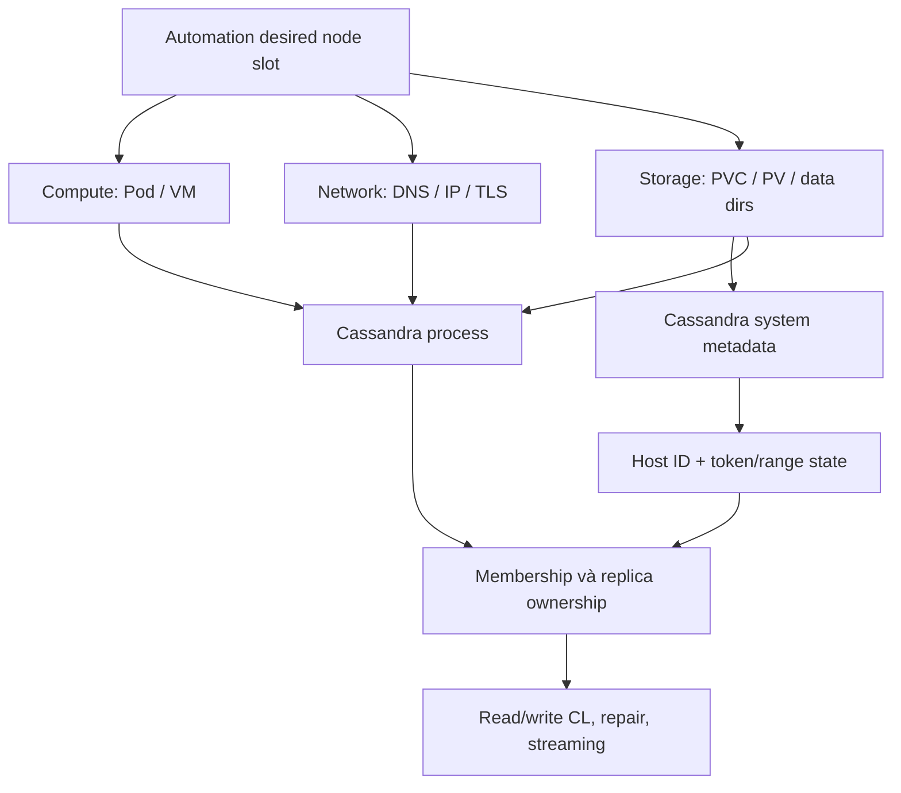
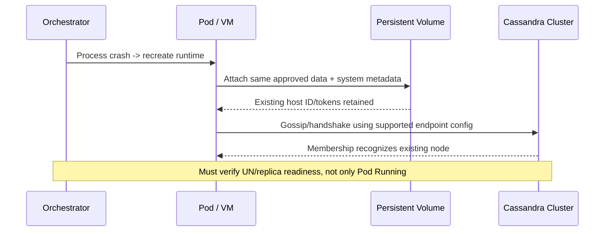
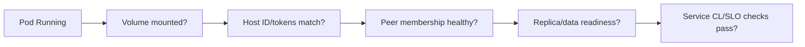
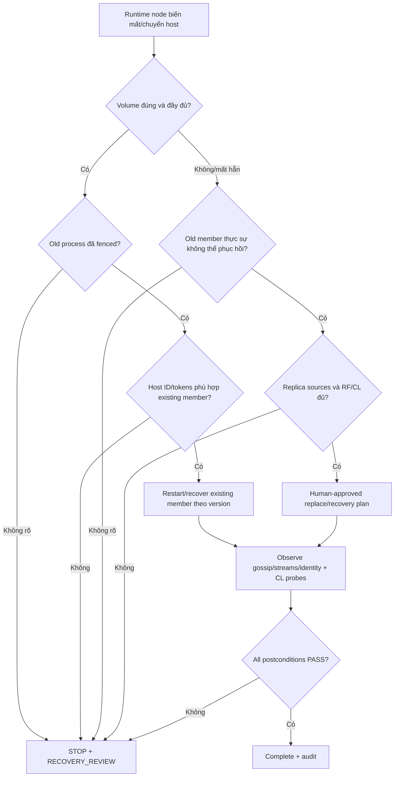
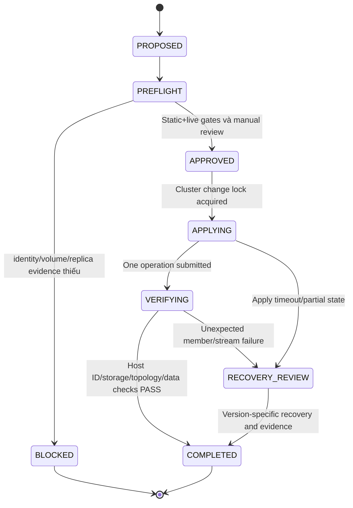

# Tách vòng đời nút, địa chỉ, volume và định danh trong tự động hóa Apache Cassandra

## 1. Vì sao “pod đã chạy lại” không đồng nghĩa “node Cassandra đã khôi phục”?

Trong module **DATABASE_ENGINE_WIDE_COLUMN_CASSANDRA**, Apache Cassandra là cơ sở dữ liệu **wide-column phân tán**. **Partition key** ánh xạ thành token; token/range cùng **replication factor (RF)**, datacenter/rack và cơ chế placement xác định những replica giữ dữ liệu. Các đường đọc/ghi theo **consistency level (CL)**, còn compaction, repair, streaming và bootstrap quyết định dữ liệu được lưu và di chuyển ra sao. Ứng dụng Java truy cập qua CQL/Java Driver, nhưng process Java của ứng dụng không quyết định danh tính các Cassandra replicas.

Một hệ thống tự động hóa có thể tạo lại máy ảo hoặc Kubernetes Pod trong vài giây. Điều đó **không chứng minh** node Cassandra tương ứng đã quay lại với đúng identity, token ownership và dữ liệu:

- Pod mới có thể nhận một **IP mới** nhưng mount **đúng persistent volume** chứa dữ liệu và metadata node trước đó.
- Pod giữ cùng tên và IP nhưng mount **volume trống**, gây khác biệt nghiêm trọng giữa kỳ vọng của automation và trạng thái Cassandra.
- Volume chứa SSTables vẫn còn, nhưng một hoặc nhiều data directories/commit log directories không được mount.
- Node cũ chưa chết thực sự; automation tạo node thay thế với identity/token ownership cạnh tranh.
- StatefulSet được scale down xong, nhưng Cassandra chưa **decommission** và stream dữ liệu tới replicas còn lại.
- DNS record/seed mới hợp lệ, song internode TLS hoặc broadcast address làm node không gossip/stream được.
- Mọi Pod đều `Running`, nhưng `nodetool status` còn `UJ`/`DN`, hoặc ứng dụng gặp `Unavailable`/`ReadTimeout`.

Vấn đề trọng tâm của bài **“Tách vòng đời nút, địa chỉ, volume và định danh trong tự động hóa”** là: **một thay đổi ở tầng compute/network/storage không được tự động hiểu là một thay đổi hợp lệ của Cassandra logical node**.

### Mục tiêu học tập

Sau bài, bạn có thể:

1. Phân biệt logical **Cassandra node/host ID**, token/range ownership, process/Pod/VM, network endpoint và persistent volume.
2. Giải thích vì sao **IP, hostname, Kubernetes ordinal và seed address không phải bản thân Cassandra identity**.
3. Xây inventory liên kết node ID, datacenter/rack, token placement, endpoint, disk/PVC và phiên bản chạy.
4. Chọn đúng quy trình khi **restart cùng node**, **đổi địa chỉ**, **mất volume**, **replace node hỏng**, **bootstrap node mới** hoặc **decommission node khỏe**.
5. Thiết kế controller có state machine, preflight, lock, approval, postcondition và **fail closed** khi identity không rõ.
6. Ngăn volume clone/duplicate host identity, reattachment sai, split-brain và các thao tác destructive thiếu replica coverage.
7. Kiểm actual state qua `nodetool`, CQL và Java Driver 4.x.
8. Ứng dụng vào Kubernetes StatefulSet/PVC hoặc VM/cloud disk mà không coi “Pod Ready” là “data Ready”.
9. Đọc được các case thực tế về IP rotation, volume loss, zone migration và topology changes.
10. Lập runbook và checklist để triển khai an toàn, đối soát writes UNKNOWN và kiểm dữ liệu theo CL.

**Giới hạn:** ví dụ thể hiện kiến trúc và các quan sát phổ biến; tên cấu hình, lệnh replace/bootstrap, giao thức metadata và điều kiện recovery thay đổi giữa Cassandra 3.x, 4.x, 5.x và bản phân phối. Trước thao tác production phải kiểm exact version, tài liệu chính thức và SOP nội bộ. Bài không chủ trương tự chạy lệnh phá membership hoặc di chuyển dữ liệu mà không có review.

## 2. Năm danh tính/vòng đời phải tách biệt

| Lớp | Ví dụ | Nó mô tả gì? | Không được suy ra |
| --- | --- | --- | --- |
| **Logical Cassandra node** | Host ID, metadata membership, token assignments, DC/rack | Thành viên cụm và trách nhiệm lưu replica | IP hoặc tên Pod chính là host ID |
| **Compute runtime** | VM, bare-metal host, container, Kubernetes Pod, process PID | Chỗ tiến trình Cassandra đang chạy | Process được restart nghĩa là data/ownership được phục hồi |
| **Network endpoint** | Internode listen/broadcast, native CQL endpoint, DNS, TLS identity | Đường các node/client kết nối | Endpoint cũ có thể tự ý gán cho một data directory mới |
| **Persistent storage** | PV/PVC, block volume, filesystem, Cassandra data directories | SSTables, system metadata, commit log và trạng thái lưu trữ | Volume là “ổ đĩa trống có thể đổi tùy ý” |
| **Orchestrator identity** | StatefulSet ordinal, instance ID, cloud resource ID, label | Đối tượng automation muốn quản lý | Ordinal/label luôn trùng Cassandra host ID |

Các thành phần có thể **thay đổi hoặc được bảo toàn độc lập**:

- Pod process chết và khởi động lại, còn **PVC + host ID + tokens** vẫn giữ.
- IP node đổi do reschedule, trong khi data directory và identity vẫn giữ.
- VM instance ID đổi khi rebuild host nhưng disk đúng có thể vẫn chứa Cassandra identity cũ; phải theo runbook đổi địa chỉ/host.
- Volume mất hoàn toàn, nhưng hostname/ordinal được giữ; đây **không phải** restart bình thường của cùng Cassandra replica.
- Cassandra node được **replace** theo procedure: token coverage có thể được chuyển sang một logical member mới, không phải bắt buộc giữ nguyên host ID cũ.
- Metadata membership có thể vẫn lưu một node đã DOWN dù compute instance của nó đã bị xóa.

### 2.1. Một sơ đồ quan hệ



**Điểm kiểm soát:** controller chỉ được đánh dấu một slot đã ổn khi liên kết **compute ↔ network ↔ volume ↔ host ID/tokens ↔ cluster membership** đúng với operation đang thực hiện.

## 3. Logical node: host ID, token ranges và datacenter/rack

### 3.1. Host ID không phải IP

Cassandra có **host ID** để nhận diện node trong cluster metadata. Ở các phiên bản thông dụng, node lưu identity/metadata bền vững trong local system keyspace (ví dụ `system.local`); peers nhìn thấy node qua gossip/system peer metadata. **Địa chỉ mạng là một thuộc tính liên lạc**, có thể thay đổi dưới điều kiện được hỗ trợ, không nên dùng làm khóa chính duy nhất của inventory.

Trên một node, CQL quan sát read-only:

```sql
SELECT host_id, cluster_name, data_center, rack, release_version, tokens
FROM system.local;
```

**Quan trọng:**

- `system.local` đại diện node/coordinator trả lời truy vấn, **không tự kiểm tất cả nodes trong cluster**.
- Token set có thể rất dài khi dùng **vnodes**; lưu qua artifact/hash và đối chiếu metadata.
- Một cluster version có thể có metadata/model placement mới; điều khiển bằng procedure đúng version, không áp suy luận cứng từ cấu trúc on-disk ở bản khác.
- Khi khôi phục trên node khác, không được tự viết/sửa `system.local` để “ép” một host ID mong muốn.

### 3.2. Tokens và replica placement là dữ liệu vận hành, không phải label

Với `NetworkTopologyStrategy` RF=3 trong `dc1`, một partition có token T được đặt vào những replicas theo token ranges, DC/rack/snitch placement. Một node có thể sở hữu nhiều ranges khi dùng vnodes.

```text
partition key = (customer_id, order_day)
             |
             v
           token T
             |
          RF(dc1)=3
          /   |   \
      node A node B node C

Host IDs và token ownership: Cassandra cluster metadata
IP/DNS: endpoints để kết nối tới A/B/C
PVC: nơi giữ SSTables và system metadata của A/B/C
```

Nếu thay Pod/IP của B nhưng giữ đúng volume/identity, mục tiêu thường là **B quay lại**, không phải thêm node D. Nếu B mất volume và được **replace** theo SOP, cluster có thể đưa owner mới vào range của B; đó là topology/recovery operation **khác**.

### 3.3. DC/rack cũng không phải nhãn tùy ý

Datacenter và rack ảnh hưởng placement. Đổi `dc=dc1` thành `dc=dc2` hoặc rack theo một cloud-zone mới bằng edit file đơn thuần **không tự di chuyển dữ liệu đúng**. Muốn đổi vùng lỗi, phải có migration/rebuild/replace plan được hỗ trợ và điều kiện RF/CL.

### 3.4. Node ID, process ID, provider instance ID

| Trường | Scope | Độ bền mong đợi |
| --- | --- | --- |
| Cassandra host ID | Logical cluster membership | Giữ khi restart cùng node/data identity |
| Token assignments | Ownership của dữ liệu | Chỉ đổi theo topology operation được hỗ trợ |
| OS process PID | Một lần process chạy | Đổi mỗi lần restart |
| Kubernetes Pod UID | Một thể hiện Pod | Đổi khi Pod được recreate |
| StatefulSet Pod name/ordinal | Slot theo controller | Có thể ổn định qua Pod recreate |
| Cloud VM instance ID | Compute resource | Đổi khi thay VM |
| IP address | Endpoint | Có thể đổi theo mạng/placement |
| PVC/PV UID hoặc disk UUID | Persistent volume resource | Cần đúng binding và nội dung thực |
| Node hostname | Network/inventory label | Không nên dùng làm đại diện duy nhất cho host ID |

## 4. Vòng đời compute khác vòng đời dữ liệu

### 4.1. Restart cùng node

Một lần restart hợp lệ của cùng Cassandra logical node thường dựa trên:

- Data directories và system metadata **đúng, đầy đủ và nguyên trạng**.
- Không có process Cassandra thứ hai đang sử dụng cùng volume/identity.
- Host ID/tokens và DC/rack không bị reset hay thay sai.
- Disk và commit log paths được mount đúng.
- Phiên bản server/config tương thích với on-disk data.
- Endpoint networking được quản lý theo procedure nếu có đổi IP.
- Peers vẫn nhận diện đó là **cùng logical member**, không phải thêm một member khác.

**Pod mới** là runtime mới, nhưng **logical node** không cần mới nếu identity được bảo toàn. Tuy nhiên **đổi IP** không phải luôn là thao tác vô hại: peer discovery/broadcast, TLS SAN và các lệnh đổi địa chỉ có giới hạn phiên bản.

### 4.2. Node mới

Bootstrap một node mới nghĩa là cluster nhận **một member mới** với identity/token/range responsibilities mới theo procedure, và có thể stream dữ liệu từ existing replicas. Không đơn giản là chạy một process Cassandra trỏ vào volume trống mà dùng IP/hostname của node cũ.

### 4.3. Node hỏng và replacement

Khi node cũ chết và không thể phục hồi volume/identity, automation phải chọn **replacement hoặc recovery path** theo exact Cassandra version, với nguồn replicas còn khỏe, RF/CL và token placement được kiểm. Không tự tạo volume trống rồi giả vờ đó là cùng node cũ chỉ vì StatefulSet ordinal giống.

### 4.4. Node khỏe muốn rời

Decommission cần xử lý **data handoff/streaming và metadata topology**, rồi mới thu hồi compute/volume theo policy. Xóa Pod hoặc VM trước khi decommission có thể khiến node bị thấy DOWN mà ring vẫn kỳ vọng nó là replica.

### 4.5. Timeline độc lập



## 5. Vòng đời địa chỉ: client, gossip và streaming không dùng một endpoint duy nhất

### 5.1. Nhóm địa chỉ cần kiểm

| Khái niệm | Dùng ở đâu | Lưu ý |
| --- | --- | --- |
| `listen_address` / interface listen | Địa chỉ node bind cho internode traffic | Có thể khác advertised endpoint |
| `broadcast_address` | Địa chỉ node quảng bá cho peers | Phải reachable từ peers, có semantics theo version |
| `rpc_address` | Địa chỉ native protocol bind | Có thể là wildcard trong mạng đã bảo vệ |
| `broadcast_rpc_address` | Native/CQL endpoint quảng bá cho clients | Phải reachable với driver/topology |
| Seeds | Các contact points để gossip discovery | **Không** là danh sách membership hay replica |
| DNS | Ánh xạ tên thành IP | DNS ổn không bảo đảm TLS/gossip/identity đúng |
| Internode TLS certificates | Xác thực/encrypt traffic peer-to-peer | Cert names/trust/expiry có thể bị ảnh hưởng khi đổi IP/DNS |
| Java Driver contact points | Đường bootstrap/discovery của client | Không nhất thiết là danh sách mọi node |

Một driver có thể kết nối thành công tới port native protocol mà **streaming node-to-node** vẫn hỏng vì internode address/port/TLS sai.

### 5.2. IP thay đổi không đồng nghĩa thay host ID

Tình huống: pod `cassandra-1` được reschedule sang worker khác, PVC vẫn đúng, Pod IP đổi từ A sang B.

Controller cần hỏi:

1. Bản Cassandra đang chạy có hỗ trợ/đòi procedure đổi **advertised endpoint** hay không?
2. `listen/broadcast/rpc` có được tạo lại theo node mới không?
3. Peers có còn lưu endpoint cũ trong gossip/system peer metadata không?
4. DNS headless service và driver discovery đã cập nhật và nhìn thấy đúng host ID chưa?
5. TLS certificate SAN/identity phù hợp endpoint mới không?
6. Một process khác có đang chiếm endpoint cũ/volume cũ không?
7. Sau khi start, node có về `UN`, token ownership và CQL checks có đúng không?

Nếu không có câu trả lời, **không tự đổi volume/host ID** để “hợp với IP mới”. Quy trình thay IP một existing Cassandra node có khác biệt theo release và hệ điều hành/container network.

### 5.3. DNS không phải source of truth của node ownership

Một bản ghi DNS `cassandra-1.svc` có thể cập nhật khi Pod recreate. DNS chỉ định địa chỉ kết nối; Cassandra cần identity/token consistency ở tầng metadata.

**Không định nghĩa “node B tồn tại” chỉ bằng DNS trả một IP.** Kiểm host ID/replicas/peer views và native/internode connectivity.

## 6. Vòng đời volume: binding đúng quan trọng hơn mount thành công

### 6.1. Những đường dẫn lưu trạng thái

| Dữ liệu | Vai trò |
| --- | --- |
| `data_file_directories` | SSTables, dữ liệu keyspaces, bao gồm system keyspace/metadata theo layout version |
| `commitlog_directory` | Commit log phục vụ đường write/recovery |
| `hints_directory` | Hints khi replica tạm không khả dụng, theo cơ chế phiên bản |
| `saved_caches_directory` | Cached state (không là nguồn duy nhất của dữ liệu), theo version |
| Snapshot/incremental paths | Bản SSTables đã giữ, có thể là hard links trên volume |
| Config/TLS/secret mounts | Runtime config/credentials; lifecycle riêng với data |

**Không** mặc định tất cả thuộc cùng một PVC. Một cluster có thể dùng nhiều volumes; nếu chỉ gắn một trong nhiều `data_file_directories`, node có thể thiếu SSTables hoặc trạng thái hệ thống. Phải xác minh **toàn bộ mount set** theo inventory.

### 6.2. Persistent volume có hai phần identity

1. **Resource identity:** PV/PVC/disk ID, storage class, availability zone, attachment, filesystem UUID.
2. **Content identity:** Cassandra system metadata, host ID, tokens, SSTables/commit log và đúng generation dữ liệu.

PVC có tên `data-cassandra-1` **không đảm bảo** còn chính volume và bytes hôm qua. Một disk mới được provision dưới tên PVC tương tự vẫn là volume nội dung khác.

### 6.3. Volume clone và split-brain

Nếu snapshot/clone disk A sang một VM B rồi chạy **cùng lúc** với node A:

- Có thể xuất hiện **host identity trùng**, node endpoints/metadata xung đột.
- Tokens và replica ownership có thể bị nhân bản sai.
- Các write/commit log không còn đại diện một lịch sử duy nhất.
- Repair/streaming và peers không thể coi hai processes là hai replicas độc lập.
- Lệnh “sửa” bằng xóa system keyspace trên một clone không phải recovery procedure an toàn.

**Không gắn cùng một Cassandra data volume cho hai live processes** (kể cả storage hỗ trợ multi-attach/RWX). Node identity phải được bảo vệ bằng **exclusive attachment + fencing**; backup clone chỉ được khởi tạo qua quy trình restore/replacement cô lập đúng version.

### 6.4. Cross-zone volume movement

Cloud disk/PV có thể bị giới hạn vào một availability zone. Nếu Pod/VM reschedule sang zone khác mà volume không thể attach:

- Pod có thể `Pending` hoặc volume attach fail; **không tự provision disk trống để chạy cho xong**.
- Nếu sử dụng restore từ snapshot/block copy, phải xác định việc này là **identity-preserving recovery hay new-node replacement**, không pha trộn.
- Chuyển DC/rack/zone có thể thay replica placement và fail-domain guarantees.
- Cần stop/fence process nguồn và kiểm đầy đủ disk/metadata trước khi start đích.

### 6.5. Disk mất hoàn toàn

Một volume trống + cùng Pod name/IP **không có đủ điều kiện để coi là cùng Cassandra node**. Khi mất data/host identity, vận hành phải đánh giá khả năng rebuild từ surviving replicas, backup và runbook replacement. Duy trì cùng hostname để “đánh lừa” cluster có thể dẫn đến trạng thái khó khôi phục hơn.

## 7. Ma trận: thay một thành phần thì quy trình nào phù hợp?

| Biến cố | Compute | Address | Storage | Cassandra logical operation |
| --- | --- | --- | --- | --- |
| Process crash, volume còn | Process mới | Có thể giữ | Cùng đúng volume | Restart existing member, kiểm metadata/readiness |
| Pod recreated, IP đổi | Pod UID mới | IP mới | Cùng PVC/content | Existing member với endpoint-change procedure nếu version yêu cầu |
| VM hỏng, disk nguyên vẹn | VM mới | Có thể đổi | Disk cũ nguyên vẹn | Recover existing member theo SOP và fencing |
| Volume mất, node cũ chết | VM/Pod mới | Có thể tái dùng | Disk mới/blank | **Replacement/bootstrap recovery** theo version, không giả làm restart |
| Thêm capacity | New VM/Pod | New endpoint | New empty volume | Bootstrap **new member**, stream data |
| Giảm capacity có kế hoạch | VM/Pod rời | Endpoint nghỉ | Retire volume cuối | Decommission trước khi delete compute/storage |
| Node chết cần loại metadata | Dead process | Endpoint cũ | Có thể không đọc | Removenode theo high-risk SOP/source coverage |
| Di chuyển DC/rack | Có thể giữ/thay | Có thể đổi | Có thể giữ/thay | Topology/data migration, không edit label đơn thuần |
| Storage snapshot restore | New compute | New endpoint | Clone of old data | Isolated restore/recovery plan, không tạo duplicate live host ID |
| IP bị tái dùng cho volume khác | Same network address | Same | **Khác** | **BLOCK** cho tới khi xác minh node identity |

Ma trận là **công cụ triage**, không phải lời đảm bảo mỗi thao tác có một lệnh universal. Một trường hợp có hai thành phần thay đổi phải được review theo semantics của Cassandra exact version.

## 8. Identity registry: nguồn sự thật có lịch sử

Chỉ dùng tên Pod/VM để liên kết dữ liệu và Cassandra membership là thiếu. Nên có một **registry versioned/auditable**:

```yaml
schema_version: 1
cluster_id: "cassandra-lab-a"
cassandra_server_version: "<exact-version>"
observation_time_utc: "2026-11-21T09:00:00Z"

nodes:
  - slot_id: "cassandra-1"
    orchestration_kind: "kubernetes-statefulset"
    pod_name_expected: "cassandra-1"
    pod_uid_observed: "<actual-pod-uid>"
    instance_id_observed: "<worker-or-vm-id>"

    cassandra_host_id_expected: "<uuid>"
    cassandra_host_id_observed: "<uuid>"
    token_map_artifact: "topology/host1-tokens.json"
    membership_state: "UN"

    dc_expected: "dc1"
    rack_expected: "rack2"
    internode_broadcast_endpoint: "<dns-or-ip>"
    native_broadcast_endpoint: "<dns-or-ip>"
    tls_identity_reference: "<nonsecret-cert-ref>"

    pvc_name: "data-cassandra-1"
    pvc_uid_observed: "<uid>"
    pv_uid_observed: "<uid>"
    backing_disk_id: "<provider-disk-id>"
    filesystem_uuid: "<fs-uuid>"
    data_dirs:
      - "/var/lib/cassandra/data"
    commitlog_dir: "/var/lib/cassandra/commitlog"
    mount_integrity_verified: null

    lifecycle_intent: "restart-existing-member"
    replacement_operation_id: null
    approved_change_id: "<approval-id>"
    reconciliation_status: "VERIFYING"
```

Đây là **manifest nội bộ minh họa**, không phải schema Cassandra/Kubernetes tự hiểu.

### 8.1. Registry có ba cột logic

- **Expected:** planned node/slot identity, token/rack, volume binding.
- **Observed:** host ID từ Cassandra, PVC/PV ID và runtime endpoints thực.
- **Operation intent:** restart, endpoint migration, replacement, bootstrap hay decommission.

Nếu `expected_host_id != observed_host_id` khi intent là **restart existing member**, controller phải **BLOCK / RECOVERY_REVIEW**, không sửa registry mong đợi để che lệch.

### 8.2. Không ghi secrets vào inventory

Registry có thể chứa nội bộ IP/host ID/token; phân quyền thích hợp. Lưu TLS certificate references, không lưu private keys. Đừng xuất toàn bộ topology/endpoint thô công khai nếu chính sách bảo mật không cho phép.

## 9. Kubernetes StatefulSet: ổn định slot không đồng nghĩa ổn định Cassandra identity

### 9.1. StatefulSet hỗ trợ những gì?

StatefulSet cung cấp mô hình stable Pod names/ordinals và persistent volume claims theo từng ordinal khi cấu hình đúng. Tuy nhiên:

- **Pod UID** thay khi recreate.
- **Pod IP** có thể thay.
- **PVC** có thể giữ tên nhưng phải kiểm UID/PV/content; retention policy ảnh hưởng PVC khi scale/delete.
- **Headless Service/DNS** giúp stable naming, không kiểm token ownership.
- Readiness/liveness probes không tự hiểu repair/streaming, RF và CL.
- StatefulSet replicas count **không là Cassandra cluster membership count** tại mọi thời điểm.

### 9.2. Đọc một đoạn manifest như ý định, không phải giải pháp đủ

```yaml
# Chỉ là trích đoạn ý tưởng, KHÔNG phải StatefulSet đầy đủ.
apiVersion: apps/v1
kind: StatefulSet
metadata:
  name: cassandra
spec:
  serviceName: cassandra-headless
  replicas: 3
  podManagementPolicy: OrderedReady
  volumeClaimTemplates:
    - metadata:
        name: data
      spec:
        accessModes: ["ReadWriteOnce"]
        resources:
          requests:
            storage: 200Gi
```

Đoạn YAML **thiếu** selector, template, image, runtime security, storage class, resources, topology spread/affinity, probes, init config, TLS và nhiều thứ khác nên **không triển khai trực tiếp**. Nó chỉ minh họa mối quan hệ ordinal và PVC.

Các cảnh báo:

- `ReadWriteOnce` là quyền mount thuộc storage/Kubernetes semantics; không thay thế **process-level fencing** nếu storage/provider cho phép nhiều process truy cập.
- `OrderedReady` không thay Cassandra-aware bootstrap, replacement, decommission và recovery gates.
- StatefulSet scale up không tự bảo đảm new Pod đã stream đủ dữ liệu.
- StatefulSet scale down không tự chạy `decommission` đúng procedure.
- Pod deletion không đồng nghĩa PVC bị xóa (tùy StatefulSet PVC retention policy và Kubernetes version).
- PVC deletion hoặc dynamic provisioning lại có thể làm mất data identity dù ordinal giữ nguyên.

### 9.3. Những điều kiện trước khi restart Pod

1. Host ID expected và volume/PV UID được lưu.
2. Đảm bảo không có process Cassandra còn sống trên volume.
3. Data directories/commit log, filesystem và permissions hợp lệ.
4. Version/image/config được pin.
5. Endpoint advertisement và TLS phù hợp nếu Pod IP đổi.
6. Node chỉ là **existing member** nếu có bằng chứng; không tự động bootstrap với empty disk.
7. Liveness không kill node chỉ vì bootstrap/streaming kéo dài mà vẫn có progress.
8. Readiness phải được định nghĩa theo contract service, không chỉ TCP open.
9. Sau restart đối chiếu host ID/tokens/node state và CQL probes.
10. Mọi anomaly chuyển `RECOVERY_REVIEW`, không loop restart vô hạn.

## 10. Node readiness: ba tín hiệu khác nhau



| Kiểm tra | Chứng minh | Chưa chứng minh |
| --- | --- | --- |
| Pod Running | Container process đang chạy | Cassandra đã JOIN cluster |
| TCP 9042 mở | Native protocol listener reachable | Peers gossip/stream hoặc RF đúng |
| PVC Bound | Storage claim được gắn resource | Volume có dữ liệu và host ID đúng |
| `nodetool status = UN` | Node được thấy Up/Normal | Mọi token range đã có đủ data/repair |
| Driver schema agreement | Schema views đã hội tụ theo cơ chế driver | Streaming/compaction/repair hoàn tất |
| Synthetic read `LOCAL_QUORUM` pass | Một vài partition/query theo CL thành công | Toàn bộ dataset đã đầy đủ |
| Stream/repair terminal success | Đường data movement theo scope hoàn tất | Nghiệp vụ đa bảng luôn consistent |

Vì vậy liveness nên tránh gây **restart loop** trên node đang làm việc dài hợp lệ; readiness/canary phải được định nghĩa riêng. Đừng biến `SELECT COUNT(*)` trên toàn bảng hoặc `nodetool repair` thành health probe định kỳ.

## 11. Tách service lifecycle và node lifecycle trong controller

Một controller Cassandra-aware nên có trạng thái riêng cho từng tầng:

```text
compute_state: PodPending / Running / Terminating / Gone
storage_state: ClaimPending / Bound / Mounted / Missing / WrongBinding
network_state: EndpointPending / Reachable / Advertised / Mismatch
identity_state: Unverified / Match / Mismatch / ReplacementApproved
cluster_state: DN / UJ / UN / UL / Unknown
operation_state: Proposed / Preflight / Applying / Verifying /
                 RecoveryReview / Completed
```

Không collapse tất cả vào một boolean `healthy=true`.

### 11.1. Quy tắc reconcile cơ bản

- **Compute restart + same volume identity:** kiểm existing-member lifecycle.
- **Endpoint đổi:** kiểm network/metadata update path, không đụng storage identity.
- **Volume identity đổi:** dừng và yêu cầu xác định restart hay replacement.
- **Host ID đổi khi không có replacement approval:** dừng.
- **Cluster state = UJ/UL:** chờ đúng operation and stream phases, không đánh dấu ready bằng TCP alone.
- **Old member vẫn UP khi replacement đang tính chạy:** ngăn duplicate owner; verify fencing.
- **Cluster metadata chưa hội tụ:** không tự xóa Pod/PVC/host ID.
- **Data readiness không đạt sau apply:** giữ VERIFYING/RECOVERY_REVIEW thay vì force-green.

## 12. Cảnh báo về “self-healing” quá mạnh

Một automation thấy Pod crash và tự tạo node mới với empty PVC có thể mang tên “self-healing”, nhưng đối với Cassandra có thể là **data/identity mutation**.

Không nên:

- Tự xóa PVC vì node không qua liveness.
- Tự tạo blank disk cho cùng ordinal khi PV attach fail.
- Tự dùng `replace_address`/bootstrap parameters khi chưa biết trạng thái old member.
- Tự chạy `removenode` khi peer report `DN` vài phút.
- Tự sửa `system.local` hoặc xóa system keyspace để tránh host ID mismatch.
- Tự chạy `cleanup` nhằm giải phóng disk giữa topology move.
- Tự scale StatefulSet xuống khi RF/capacity không còn phù hợp.
- Tự copy entire data directory từ node khác và chạy đồng thời hai replicas.
- Tự giảm CL để liveness xanh mà không đánh giá consistency contract.
- Tự restart tất cả Cassandra processes để giải quyết gossip disagreement.

**Self-healing đúng:** dừng bước tiếp theo, bảo toàn dữ liệu, thu evidence và kích hoạt quy trình đã chứng minh **idempotent và an toàn**. Đôi khi hành động tự động tốt nhất là **BLOCK** và escalate.

## 13. Sơ đồ chọn đường hồi phục theo bằng chứng



Sơ đồ không cung cấp lệnh thực thi replacement vì exact version/rack/DC/storage state quyết định procedure, và thao tác sai có nguy cơ mất dữ liệu.

## 14. Preflight của một operation thay đổi compute/address/storage

| Nhóm | Điều kiện bắt buộc trước apply |
| --- | --- |
| Version | Exact Cassandra Server build từng node và compatibility matrix |
| Cluster | Cluster ID/name, expected nodes, DC/rack/snitch, RF/CL |
| Identity | Expected host ID/tokens vs observed local/peer metadata |
| Compute | Old process fenced, không có hai nodes truy cập cùng identity |
| Network | Listen/broadcast, DNS, internode TLS/ports, native client endpoints |
| Storage | PVC/PV/disk UID, filesystem, data dirs, commit log, capacity, exclusive attach |
| Topology | Không có bootstrap/replace/decommission/removenode đang cạnh tranh |
| Data safety | Replica coverage, source availability, backup/restore readiness |
| Resource | Disk/IOPS/CPU/network headroom cho stream/compaction |
| Service | Client p95/p99, error rate, retry budget, UNKNOWN write reconciliation |
| Workflow | Change ID, immutable manifest, approval, cluster lock, rollback/roll-forward plan |

### 14.1. Preflight không phải chỉ kiểm từng mục bằng regex

- IP trùng manifest chưa chứng minh volume đúng.
- Volume Bound chưa chứng minh host ID đúng.
- Host ID đúng trong filesystem chưa chứng minh old process đã được fenced.
- Node `UN` chưa chứng minh tất cả ranges/data/CL đã ổn.
- `nodetool status` có thể khác nhau theo peer views trong khoảng hội tụ.
- Một backup đã chụp chưa chắc khôi phục được; cần verified off-cluster/restore evidence.
- Một pod đang Pending có thể là vấn đề storage, **không** phải Cassandra cluster mất metadata.

## 15. Thu bằng chứng bằng lệnh read-only

Chạy trên **các node liên quan**, gắn timestamp/host alias, không chỉ một coordinator:

```bash
nodetool version
nodetool status
nodetool describecluster
nodetool info
nodetool netstats
nodetool tpstats
nodetool compactionstats
nodetool gossipinfo
```

Các lệnh thường là quan sát qua JMX; vẫn cần phân quyền và tránh polling quá dày trên cluster đang quá tải.

CQL tại node đang được kiểm:

```sql
SELECT host_id, cluster_name, data_center, rack, release_version, tokens
FROM system.local;

SELECT keyspace_name, replication, durable_writes
FROM system_schema.keyspaces
WHERE keyspace_name = 'commerce';
```

Trên Cassandra releases có `system.peers_v2`, có thể đối chiếu peer metadata; phiên bản khác có thể dùng `system.peers` hoặc interface metadata riêng. **Đừng giả định một peer table trả đủ mọi host ID/tokens đúng thời gian thực**. Thêm log/join state/range ownership từ quản trị cluster.

### 15.1. Đọc trạng thái membership

| Trạng thái thường thấy | Ý nghĩa | Không được suy |
| --- | --- | --- |
| `UN` | Up / Normal | Dữ liệu mọi range đã hoàn tất stream/repair |
| `UJ` | Up / Joining | Bootstrap/chuyển hội viên đang diễn ra | Có thể tự xóa volume vì chờ lâu |
| `UL` | Up / Leaving | Node đang rời cluster | Có thể kill process và xóa disk ngay |
| `UM` | Up / Moving, theo version/operation | Token movement cần xem procedure | Bắt buộc supported ở mọi release |
| `DN` | Down / Normal theo peer view | Node không available qua gossip | Node chết vĩnh viễn hoặc disk đã mất |

## 16. Quan sát volume và process phải tách quyền với node metadata

Trên VM/Kubernetes, storage agent có thể thu **read-only metadata**:

```text
runtime:
  pod_uid / instance_id / container_id
  process_start_time
  image_digest
network:
  pod_ip / advertised_internode_endpoint / native_endpoint
storage:
  pvc_uid / pv_uid / disk_id
  filesystem_uuid / mountpoint / mount_readonly
  data_dir_and_commitlog_dir_checks
cassandra:
  host_id / tokens / dc / rack / membership
```

**Đừng** viết một script production dùng tên PV làm bằng chứng duy nhất: PV có thể được rebind hoặc phục hồi từ snapshot khác. Cần kiểm **content identity** khi có thể và audit thao tác restore.

### 16.1. Ví dụ lệnh chỉ đọc ở Kubernetes

```bash
# Trong môi trường đã được cấp quyền xem đúng namespace.
kubectl get pod cassandra-1 -n cassandra-lab -o wide
kubectl get pvc data-cassandra-1 -n cassandra-lab -o yaml
kubectl describe pod cassandra-1 -n cassandra-lab
```

Lệnh chỉ minh họa cho lab. `kubectl describe` có thể chứa địa chỉ/tên node/internal annotations; cần redaction trước chia sẻ. **Không** lấy `kubectl delete pod/pvc` như một bước sửa lỗi mặc định.

### 16.2. Read-only chẩn đoán mount trong Linux

```bash
# Trên node/container được cho phép; không ghi/xóa data.
findmnt /var/lib/cassandra/data
findmnt /var/lib/cassandra/commitlog
df -h /var/lib/cassandra/data
df -h /var/lib/cassandra/commitlog
```

Kết quả mount phải được đối chiếu với inventory/UID và số thư mục được cấu hình. Một `df` trả capacity đúng không chứng minh SSTables/system keyspace tồn tại hoặc đúng.

## 17. Thao tác A — Restart existing Cassandra node với đúng persistent volume

Đây là đường có mức rủi ro thấp hơn một topology mutation **khi mọi điều kiện identity đều đúng**.

### 17.1. Trước khi restart

1. Ghi change/run ID và điều kiện giới hạn tác động.
2. Xác nhận cluster/node expected: host ID, token set, DC/rack, peer views.
3. Đọc PV/PVC/disk ID và kiểm data directories/commitlog path.
4. Bảo đảm **process cũ đã dừng/fenced**; không có duplicate attachment.
5. Xác định Cassandra image/JDK/config/version trùng hoặc thuộc rolling-upgrade plan được phép.
6. Nếu IP có thể đổi, kiểm liệu procedure đổi endpoint trên version hiện tại đã được duyệt hay chưa.
7. Kiểm replicas và application CL có đủ bảo đảm khi node tạm unavailable.
8. Chốt các gate p95/p99, ReadTimeout/WriteTimeout/Unavailable, pending stream/compaction và disk.

### 17.2. Sau khi restart

- Kiểm **same Cassandra host ID** trên node.
- Đối chiếu token/range assignment với baseline (trừ change có chủ đích).
- DC/rack/snitch/cluster name đúng.
- Node về membership state được mong đợi, thường `UN` khi ổn định.
- Không có bootstrap/replace bất ngờ trong server logs.
- Không có duplicate host ID, old endpoint vẫn được nhận sai hoặc peer metadata bất nhất.
- CQL probes theo synthetic partition keys và CL thật đạt.
- Client p99/error rate/retries trở về ngưỡng; repair/hints/backlog được theo dõi nếu cần.
- Nếu có write outcome UNKNOWN khi node unavailable, đã có reconciliation workflow.

**Nếu volume mount sai hoặc host ID khác**, dừng trước khi đưa node phục vụ traffic; không tự xóa system keyspace để “tạo lại đúng”. Trường hợp này phải đánh giá lại thành **replacement/recovery**, không cố ép restart thành công.

### 17.3. Trạng thái thất bại

| Quan sát | Hướng điều tra | Không làm |
| --- | --- | --- |
| Pod Running, Cassandra process crash loop | Config/version, permissions, storage, logs | Xóa PVC |
| Cassandra chạy nhưng host ID mới | Volume/content identity mismatch | Override expected ID |
| Host ID đúng, peer thấy endpoint cũ | Gossip/broadcast DNS/TLS version-specific | Xóa cluster membership bằng tay |
| Mount đủ nhưng data dirs thiếu | Partial disk attachment/restore | Cho qua vì disk còn dung lượng |
| Node `UJ` bất ngờ sau restart | Boot flags/identity/bootstrap procedure | Coi đó là restart bình thường |
| `UN` nhưng quorum reads timeout | Replica/data/resource readiness | Tự hạ CL |

## 18. Thao tác B — Address/DNS rotation mà không thay storage identity

Mục tiêu là làm **network endpoint** đổi mà không nhầm với **thay logical member**.

### 18.1. Change plan

```yaml
change_id: "CR-CASS-NET-042"
kind: "existing_node_endpoint_rotation"
cluster_id: "cassandra-lab-a"

identity:
  expected_host_id: "<uuid>"
  expected_token_fingerprint: "<sha256>"
  expected_pvc_uid: "<uid>"

network_before:
  internode_broadcast: "node-a.internal.old"
  native_broadcast: "node-a-client.old"

network_after:
  internode_broadcast: "node-a.internal.new"
  native_broadcast: "node-a-client.new"

preflight:
  old_process_fenced: false
  dc_rack_unchanged: true
  tls_new_endpoint_validated: false
  peer_reachability_validated: false
  server_version_support_reviewed: false

decision: "BLOCKED"
```

Biểu mẫu cố ý `BLOCKED` vì chưa chứng minh fencing, TLS và khả năng hỗ trợ đổi endpoint. Không biến nó thành RUNNABLE config chỉ bằng đổi `decision=APPROVED`.

### 18.2. Những thành phần phải thay/đối chiếu

- Internode listen/broadcast endpoint và native protocol endpoint không nhất thiết giống nhau.
- TLS cert SAN/trust chain/key rotation được thực hiện theo policy.
- Peers nhìn được endpoint mới và không còn routing tới endpoint cũ ngoài transition hợp lệ.
- Seeds/contact points là bootstrap/discovery; không dùng sửa seed list để “đổi host ID”.
- Java Driver topology refresh và connection pool có thể giữ stale endpoints trong một khoảng, cần theo dõi retry/timeout.
- DNS TTL/negative caching là một phần thời gian hội tụ của ứng dụng.
- Khi dùng Kubernetes Service, endpoint slice/readiness nên đúng Pod; nhưng service IP khỏe không chứng minh internode traffic khỏe.
- Phải kiểm replica ownership/host ID trước và sau.

### 18.3. Điều không được kết luận

`ping` trả lời, DNS resolves hoặc port 9042 mở **không chứng minh** Cassandra peers đã chấp nhận endpoint mới, cũng không chứng minh streaming/repair hoạt động. Đối chiếu server peer views, logs internode TLS và CQL metrics.

**Cảnh báo phiên bản:** không có một thao tác đổi IP existing member phù hợp cho mọi Cassandra release/deployment. Một số tình huống cần một quy trình thay node thay vì sửa endpoint trực tiếp. Nếu tài liệu phiên bản/SOP không xác nhận an toàn, chọn `RECOVERY_REVIEW`.

## 19. Thao tác C — VM chết nhưng disk còn nguyên

Một nền tảng cloud có thể cho gắn persistent disk từ VM cũ sang VM mới. Đây có thể là **recovery existing member** với điều kiện **không có hai processes chạy song song**, volume nội dung còn nguyên và phiên bản hỗ trợ endpoint migration.

### 19.1. Quy trình có bằng chứng

1. Xác nhận old VM đã tắt/fenced ở tầng provider, không chỉ “SSH không vào được”.
2. Kiểm disk ID, volume snapshot/generation, filesystem và expected data directories.
3. Bảo toàn mapping của toàn bộ data directories/commitlog, không chỉ main data volume.
4. Kiểm khả năng attach disk vào zone/host đích và không làm hỏng filesystem.
5. Chốt old host ID/tokens/DC/rack từ pre-failure evidence và disk metadata.
6. Kiểm version Cassandra/JDK/OS compatibility với volume.
7. Nếu endpoint thay đổi, dùng version-specific procedure, không tự chỉnh `system.local`.
8. Start có kiểm soát và quan sát cluster membership, log và driver metadata.
9. Thực hiện CQL synthetic read và sampling trên token ranges.
10. Chỉ kết thúc khi dữ liệu/readiness và CL/SLO đạt gate.

### 19.2. Khi nào không được làm?

- Old VM chưa được fencing, vẫn có khả năng boot và nhận writes.
- Cloud disk copy/snapshot không đầy đủ hoặc commit log/data dirs mất.
- New host thuộc DC/rack khác mà quy trình hiện tại không cho phép.
- On-disk data format không tương thích với server mới.
- Host ID/tokens không trùng expected hoặc có duplicate member.
- Cluster đã hoàn thành replacement/removenode cho old member; không thể đơn giản đưa old identity quay lại.
- Chưa có owner và phương án rollback/roll-forward.

**Tái gắn old disk sau khi cluster đã replace node có thể là lỗi nghiêm trọng**: ownership đã chuyển và old node không được phép hoạt động như cũ nếu chưa có procedure của chính phiên bản ấy.

## 20. Thao tác D — Mất volume: không “tự chữa” bằng blank disk

Một cảnh báo `MountFailed` có thể do quota/zone, không phải mất data. Trước hết cần phân biệt:

1. PV/PVC chưa bind do scheduler/storage issue; bytes **có thể còn đầy đủ**.
2. Disk bị detach tạm, vẫn có thể reattach sau fencing.
3. Disk bị lỗi một phần/corrupt; nguồn dữ liệu có thể không nhất quán.
4. Disk bị xóa hoặc không thể phục hồi; Cassandra local data/system metadata **thực sự mất**.
5. Chỉ một trong nhiều volumes mất, cần phân loại partial local state.
6. Cụm đã có backup offsite hoặc surviving replicas đủ cho recovery?

### 20.1. Ma trận quyết định

| Tình trạng | Điều kiện | Quy trình |
| --- | --- | --- |
| Attach tạm lỗi, disk intact | Storage provider chứng minh disk tồn tại | Sửa attach/network; existing-member recovery |
| Disk intact, old compute dead | Old fenced, identity verified | Recover existing member nếu được version hỗ trợ |
| Một volume trong nhiều volumes mất | Partial data/system state | Stop, DBA review, đánh giá recovery; không fake same member |
| Disk đã mất hoàn toàn | Có replica sources và replacement procedure | Replace/rebootstrap theo version, approval |
| Không đủ replica/source | RF/CL coverage không rõ | Stop và phục hồi từ backup/incident plan |
| PV mới tự provision cùng PVC name | Content identity khác | BLOCK nếu intent là restart existing member |

Không chạy logic kiểu:

```text
if pod crash:
    delete pvc
    recreate pod
    mark node recovered
```

Đây là anti-pattern có thể phá khả năng khôi phục dữ liệu. Nếu disk mất hoàn toàn, **đây là một sự cố dữ liệu**, không còn là lỗi container đơn thuần.

### 20.2. Khi replacement thực sự cần thiết

Cần:

- Old node death/absence được xác minh, identity không được active đồng thời.
- Đúng logical operation cho Cassandra Server version, ví dụ replacement procedure hỗ trợ token transfer.
- Surviving replicas và RF/data ranges đủ làm nguồn.
- New node config DC/rack/network/TLS đúng.
- New disk đủ dung lượng và định dạng phù hợp.
- Observed stream progress và terminal completion.
- Repair/data correctness checks, đặc biệt những writes UNKNOWN trước sự cố.
- Khóa thay đổi topology và approval manual khi destructive.

**Không giả định “replace giữ nguyên host ID cũ”.** Tùy procedure Cassandra, replacement member có thể có **host ID mới** với kế hoạch kế thừa token/range ownership. Phân biệt **mục tiêu token coverage** với **identity của member mới**.

## 21. Thao tác E — Scale up: thêm một logical member đúng nghĩa

Scale up Cassandra là một **bootstrap** có thể stream SSTables theo token/range, không phải chỉ tăng một số `replicas` của StatefulSet.

### 21.1. Quy trình

1. Đọc RF/DC/rack và node count hiện có.
2. Chọn rack/failure domain để đảm bảo replica placement.
3. Provision new compute, endpoint và **volume mới trống đúng chủ đích** cho member mới.
4. Không dùng data directory clone từ một member đang live.
5. Chạy bootstrap theo exact Cassandra version/orchestrator procedure.
6. Theo dõi `UJ`/gossip, `nodetool netstats`, disk/compaction và stream errors.
7. Chờ node đạt `UN` và expected token/range ownership.
8. Kiểm schema, CQL synthetic probes tại CL ứng dụng và SLO.
9. Lưu new host ID + volume identity + endpoints vào registry **sau xác minh**.
10. Cleanup local data ở existing nodes **chỉ sau khi data movement hoàn tất và SOP cho phép**.

### 21.2. Vì sao không gọi scale up để sửa partition nóng ngay?

Thêm node thay đổi phân bố token ranges nhưng một **hot partition key vẫn gắn với nhóm replicas** theo token; Cassandra không tự chia một partition quá lớn thành nhiều partition keys. Cần thiết kế table theo truy vấn, bucketing/sharding hợp lý và đo read/write workload.

### 21.3. RF không tự tăng khi node count tăng

Một cluster thêm node thứ tư nhưng keyspace RF=3 vẫn có **ba replicas theo keyspace placement** cho mỗi partition, không tự biến thành RF=4. Thay RF là migration riêng có kế hoạch và data synchronization.

## 22. Thao tác F — Scale down: decommission trước khi bỏ slot

### 22.1. StatefulSet scale down khác Cassandra decommission

Một lệnh giảm `spec.replicas` của StatefulSet có thể xóa Pod theo ordinal. Nó **không** bảo đảm:

- Node đã hoàn thành handoff SSTables.
- Cluster đã cập nhật token ownership an toàn.
- Remaining nodes đáp ứng RF/CL.
- Các peer views đều ổn định.
- PVC cũ được giữ/xóa theo retention policy mong muốn.

**Điều cần làm:** thực hiện decommission/leave workflow theo SOP khi node còn khỏe, kiểm stream/ownership terminal, sau đó mới thu hồi compute. Không giảm Pod count trước để “bắt Cassandra tự xử lý”.

### 22.2. Ví dụ năng lực replica

Cluster có 4 nodes ở `dc1`, RF=3, muốn giảm còn 3 nodes: có thể lập kế hoạch kiểm capacity/placement/stream với đủ replicas còn lại.

Muốn giảm tiếp còn 2 nodes **mà vẫn giữ RF=3**: plan không thể bảo đảm ba replicas độc lập trên hai nodes. Controller phải **REJECT/BLOCK trước apply**, không chạy từng decommission rồi xem cluster có tự chỉnh RF không.

### 22.3. Decommission đang dang dở

- Node `UL` có thể đang stream, không được tự xóa volume.
- Nếu source/target có disk/network/GC bottleneck, cần xử lý resource và theo dõi progress.
- Nếu node leaving đột ngột DOWN, phải phân biệt repair/recovery/decommission state theo version.
- Không đổi sang `removenode` chỉ vì một alert; hai procedure có giả định và rủi ro khác nhau.
- Không chạy `cleanup` hoặc xóa local SSTables khi chưa xác nhận remaining replicas đủ data.

## 23. Thao tác G — Chuyển zone/rack/DC không phải reschedule Pod thông thường

Một platform có thể muốn dời compute khỏi availability zone. Nhưng Cassandra rack/DC là **failure domains trong replica placement**.

### 23.1. Vì sao cần runbook riêng?

- Persistent volumes có zone affinity, không phải disk nào cũng move cross-zone được.
- Vị trí rack mới thay placement expectations.
- Internode TLS/routes/addresses có thể đổi.
- Replica copy count và sự phân tán across failure domains có thể đổi.
- Application local DC, network latency và CL có thể bị ảnh hưởng.
- Có thể phải dùng replacement/rebuild/decommission/bootstrap **theo version**, không chỉ sửa `rack=zoneB`.

### 23.2. Kế hoạch staged

1. Snapshot topology/RF và per-range replica placement.
2. Xác định node(s)/rack(s) cần dời và mục tiêu fail-domain.
3. Kiểm nguồn replicas còn đủ khi một node tạm unavailable.
4. Định nghĩa order of operations để không thay nhiều replicas của cùng range cùng lúc.
5. Review storage movement: disk có thể move hay cần new volume+stream?
6. Review network/TLS/driver local DC và capacity.
7. Chạy **một node mỗi lần** theo procedure được hỗ trợ.
8. Xác minh host ID/token semantics đúng cho intent recovery/replacement.
9. Kiểm stream/repair/CL và application SLO.
10. Cập nhật registry/Git desired state và audit.

**Không coi topology spread constraint là data migration tool.** Nó chỉ ảnh hưởng pod placement trong Kubernetes, không tự thay Cassandra replicas.

## 24. Java Driver 4.x: nhận diện node không theo IP đơn thuần

### 24.1. Metadata đọc tại client

Java Driver 4.x có metadata về nodes và schema, nhưng đây là **view của client** có thể lag hoặc cần refresh. Nó nên được dùng như **cross-check**, không thay cho server nodetool/identity registry.

```java
import java.net.InetSocketAddress;
import java.util.Map;
import java.util.UUID;

import com.datastax.oss.driver.api.core.CqlSession;
import com.datastax.oss.driver.api.core.metadata.Node;

public final class CassandraNodeIdentityReadback {

    public static void main(String[] args) {
        try (CqlSession session = CqlSession.builder()
                .addContactPoint(
                    new InetSocketAddress("127.0.0.1", 9042))
                .withLocalDatacenter("dc1")
                .build()) {

            boolean schemaAgreed = session.checkSchemaAgreement();
            System.out.println("schemaAgreement=" + schemaAgreed);

            Map<UUID, Node> nodes = session.getMetadata().getNodes();

            for (Map.Entry<UUID, Node> item : nodes.entrySet()) {
                Node node = item.getValue();
                System.out.printf(
                    "hostId=%s endpoint=%s dc=%s rack=%s state=%s%n",
                    item.getKey(),
                    node.getEndPoint(),
                    node.getDatacenter(),
                    node.getRack(),
                    node.getState());
            }
        }
    }

    private CassandraNodeIdentityReadback() { }
}
```

Ví dụ JDK 11+ với Java Driver 4.x API thông dụng:

- `127.0.0.1:9042` và `dc1` là **placeholder testbed**.
- Driver metadata key là host ID trong API này; **đối chiếu observed host ID với registry**, không chọn node dựa trên string IP.
- `getEndPoint()` là đường client kết nối, **không chứng minh internode broadcast endpoint**.
- `checkSchemaAgreement()` không chứng minh bootstrap/repair/stream đã hoàn tất.
- Thực hiện readback có giới hạn; không tạo CqlSession cho từng health tick.
- Validate getter/package với exact Driver version/dependency được pin.

### 24.2. Readiness CQL bằng synthetic key

Một bảng test chuẩn:

```sql
CREATE KEYSPACE IF NOT EXISTS lab_it
WITH replication = {
    'class': 'NetworkTopologyStrategy',
    'dc1': 3
};

CREATE TABLE IF NOT EXISTS lab_it.synthetic_orders (
    order_id uuid PRIMARY KEY,
    state text,
    generation int,
    logical_request_id uuid
);
```

**RF=3 và CL `LOCAL_QUORUM` trong ví dụ chỉ có ý nghĩa multi-node lab với ít nhất ba replicas tại dc1**. Trên một node, phải dùng topology và CL phù hợp, và không tuyên bố đã kiểm failover/quorum RF=3.

```java
import java.time.Duration;
import java.util.UUID;

import com.datastax.oss.driver.api.core.CqlSession;
import com.datastax.oss.driver.api.core.DefaultConsistencyLevel;
import com.datastax.oss.driver.api.core.cql.PreparedStatement;
import com.datastax.oss.driver.api.core.cql.Row;

public final class SyntheticCassandraProbe {

    private final CqlSession session;
    private final PreparedStatement select;

    public SyntheticCassandraProbe(CqlSession session) {
        this.session = session;
        this.select = session.prepare(
            "SELECT order_id, state, generation " +
            "FROM lab_it.synthetic_orders WHERE order_id = ?");
    }

    public boolean verify(UUID syntheticOrderId, int expectedGeneration) {
        try {
            Row row = session.execute(
                select.bind(syntheticOrderId)
                    .setConsistencyLevel(
                        DefaultConsistencyLevel.LOCAL_QUORUM)
                    .setTimeout(Duration.ofSeconds(2))
                    .setIdempotent(true))
                .one();

            return row != null
                && syntheticOrderId.equals(row.getUuid("order_id"))
                && "READY".equals(row.getString("state"))
                && row.getInt("generation") == expectedGeneration;
        } catch (RuntimeException ex) {
            // Production: structured diagnostic by exception type,
            // not fake "row not found" for timeouts.
            return false;
        }
    }
}
```

Probe này kiểm **một key đã seed**. Nó không đảm bảo tất cả token ranges đúng; nên có bộ synthetic keys trải trên nhiều ranges, được kiểm và chạy với giới hạn tần suất/concurrency.

**Không dùng `ALLOW FILTERING` hoặc `COUNT(*)` trên wide partition** làm readiness probe. Không biến một probe PASS thành dữ liệu multi-table consistency guaranteed.

## 25. Auto-reconciliation phải nhận biết thao tác đã chạy một phần

### 25.1. State machine



### 25.2. Vì sao command timeout nguy hiểm?

Một operator/controller gọi thao tác replacement/leave, nhưng API trả timeout. Thao tác có thể đã bắt đầu đổi topology. **Retry command ngay** có thể tạo một operation xung đột. Cần:

- Unique change ID và immutable operation intent.
- Persist step/external session ID nếu có.
- Readback cluster state trước retry.
- Cluster-scoped lease/lock có fencing.
- Không tự bỏ lock khi state vẫn `VERIFYING` chỉ vì apply response trả success.
- Nếu lease mất, worker cũ dừng mọi mutation.
- Chỉ tiếp tục khi đã xác định idempotent, expected state và source data coverage.

### 25.3. Pseudocode Cassandra-aware

```text
function reconcileNodeSlot(intent):
    require intent.cluster in APPROVED_CLUSTERS
    require immutable(intent.git_revision, intent.manifest_checksum)
    require approval_for_exact_operation(intent)

    lease = acquire_cluster_topology_lease(intent.cluster)
    if lease is absent:
        return WAITING_FOR_LOCK

    try:
        actual = observe_compute_network_storage_cassandra()

        if not version_policy_supported(intent, actual):
            return BLOCKED

        if exists_conflicting_topology_operation(actual):
            return BLOCKED

        if intent.kind == RESTART_EXISTING:
            require old_process_fenced(actual)
            require same_content_volume_identity(actual)
            require same_cassandra_host_id_and_tokens(actual)

        if intent.kind == REPLACE_LOST:
            require confirmed_old_member_not_running(actual)
            require surviving_replicas_and_backup_evidence(actual)
            require manual_approval_for_replacement(intent)

        if intent.kind == DECOMMISSION:
            require target_node_healthy_and_owned(actual)
            require destination_replica_capacity(actual)
            require manual_approval_for_data_handoff(intent)

        stepId = execute_exact_version_specific_approved_step(intent)
        persist(stepId, current_utc_time())

        result = observe_bounded_postconditions(
            host_id, token_coverage, stream_status, CL_probes, SLO)

        if not result.verified:
            prohibit_new_mutations()
            record(RECOVERY_REVIEW, result)
            return RECOVERY_REVIEW

        return COMPLETED

    finally:
        release_lease_if_owner(lease)
```

**Pseudocode cố ý không triển khai thực thi các lệnh nguy hiểm.** Nó là thiết kế policy cho controller; không chạy bằng Python/Bash/Java thật nếu chưa định nghĩa trạng thái, version và permissions.

## 26. Không chạy hai vòng đời trên cùng node cùng lúc

Các xung đột cần chặn:

| Operation A | Operation B | Rủi ro |
| --- | --- | --- |
| Restart existing member | Replace same member | Hai đường recovery cạnh tranh identity/ownership |
| Pod reschedule | PVC delete/recreate | Volume content identity mất |
| Decommission | Scale down Pod ngay | Stream chưa handoff, source mất |
| Bootstrap | Removenode source replica | Nguồn data thay đổi giữa streaming |
| Replace | Old VM auto-restart | Duplicate ownership hoặc endpoint conflict |
| DC/rack migration | RF giảm | Replica placement/CL thiếu phủ |
| Repair incremental | Node replace/decommission không phối hợp | Pending repair/stream load và phạm vi khác |
| Snapshot backup | Volume cleanup | Mất nguồn khôi phục hoặc khó đối soát |
| KMS/cert rotation | Endpoint/IP change | Handshake lỗi cả client và internode |

Một lock cần bao phủ **toàn bộ giai đoạn APPLYING → VERIFYING**, không chỉ vài giây gửi lệnh. Repair/backup cần capacity coordination dù không phải luôn giữ cùng topology lock.

### 26.1. Một thao tác tại một thời điểm không đủ nếu plan sai

Nếu cluster chỉ còn hai nodes ở dc1 mà keyspace đòi RF=3, việc “thực hiện từng bước” không biến plan thành hợp lệ. **Static checks phải từ chối** topology/replication không đáp ứng mục tiêu trước khi động tới node.

## 27. Kết quả chưa rõ: Cassandra write timeout trong lúc đổi node

Khi một node mất kết nối hoặc đang stream, Java Driver có thể báo:

- `UnavailableException` nếu thiếu replicas khả dụng theo CL.
- `ReadTimeoutException` nếu chưa đủ phản hồi/data đúng hạn.
- `WriteTimeoutException` nếu chưa đủ ACK.
- `DriverTimeoutException` nếu deadline ở client hết.
- `AllNodesFailedException` với những lỗi attempt/node khác nhau.

**WriteTimeout/DriverTimeout không chứng minh mutation đã không áp dụng.** Không đổi request nghiệp vụ thành FAILED rồi tạo request mới ngay.

Một workflow cần:

1. Giữ `logical_request_id` ổn định.
2. Đếm retries/attempts riêng với successful operations.
3. Dùng idempotent mutation thật sự hoặc business dedupe ledger khi có external side effect.
4. Read-back theo partition key/CL phù hợp, kiểm request ID/version, không chỉ state value.
5. Với counter/CAS, không retry mù quáng.
6. Giữ `UNKNOWN` và reconciler owner đến khi có bằng chứng.
7. Nếu topology transition làm giảm availability, giới hạn retry/in-flight, không tạo retry storm.
8. Alert theo số/tuổi UNKNOWN, không chỉ tỷ lệ timeout.

### 27.1. Ví dụ idempotency ledger

```sql
CREATE TABLE IF NOT EXISTS lab_it.operations_by_request (
    tenant_id uuid,
    request_id uuid,
    payload_hash text,
    status text,
    generation int,
    PRIMARY KEY ((tenant_id), request_id)
);
```

Khái niệm: nếu một request write timeout, reconcile bằng **request_id + payload_hash + generation/expected effect**. Một `SELECT` thấy state đúng chưa đủ nếu operation khác có thể tạo cùng state. Dùng ledger/version/conditional write theo nghiệp vụ và serial consistency contract khi cần.

## 28. Manifest change tổng hợp: bốn lifecycle và các gates

```yaml
api_version: "ops.example/v1"
kind: "CassandraNodeLifecycleChange"

metadata:
  change_id: "CR-CASS-NODE-088"
  source_commit: "<immutable-git-sha>"
  environment: "isolated-lab"
  approved_by: []
  created_at_utc: "2026-11-21T09:30:00Z"

intent:
  operation: "restart_existing_member"
  target_slot: "cassandra-1"
  target_host_id: "<uuid>"
  reason: "planned JVM restart"
  expected_token_fingerprint: "<sha256>"
  expected_dc: "dc1"
  expected_rack: "rack2"

compute:
  expected_state_before: "StoppedOrFenced"
  old_pod_uid: "<observed>"
  new_pod_uid: null
  image_digest: "<pinned-sha256>"

network:
  existing_internode_endpoint: "<dns>"
  desired_internode_endpoint: "<dns>"
  existing_native_endpoint: "<dns>"
  desired_native_endpoint: "<dns>"
  tls_cert_reference: "<nonsecret-id>"
  endpoint_change_requires_version_review: true

storage:
  pvc_name: "data-cassandra-1"
  expected_pvc_uid: "<uid>"
  expected_pv_uid: "<uid>"
  expected_disk_id: "<provider-id>"
  expected_filesystem_uuid: "<fs-uuid>"
  expected_data_dirs: ["/var/lib/cassandra/data"]
  expected_commitlog_dir: "/var/lib/cassandra/commitlog"
  allow_blank_volume: false
  require_exclusive_attachment: true

cluster:
  cassandra_server_version: "<exact-version>"
  datacenter: "dc1"
  keyspace_rf_manifest: "evidence/replication.json"
  token_map_artifact: "evidence/tokens-before.json"
  expected_node_count: 3
  require_no_conflicting_topology_change: true
  require_replica_coverage_check: true

preflight_observed:
  old_process_fenced: null
  host_id_matches: null
  volume_content_matches: null
  storage_mount_complete: null
  internode_tls_reachable: null
  schema_agreement: null

postconditions:
  expected_membership: "UN"
  host_id_unchanged: true
  token_fingerprint_unchanged: true
  data_readiness_probe: "synthetic-keys-local-quorum"
  max_client_error_rate: "<approved>"
  require_unknown_writes_reconciled_or_tracked: true

recovery:
  allowed_automatic_actions: ["read_state", "retry_read_only_checks"]
  destructive_actions_require_manual_gate: true
  operation_abort_policy: "stop_new_mutations_and_escalate"
  rollback_strategy: "version-specific"

status: "PROPOSED"
```

**Đây là mẫu để review, không là Kubernetes CRD hoặc Cassandra operator tự hiểu.** Các trường placeholder phải được resolve và kiểm, không thay một quyết định manual bằng cách sửa `approved_by` trong file local. Ngưỡng SLO phải xuất phát từ hợp đồng service.

### 28.1. Những điểm đổi theo operation intent

| Intent | Host ID | Volume | Token ownership | Human gate |
| --- | --- | --- | --- | --- |
| Restart existing | Phải giữ expected | Phải đúng content identity | Không đổi ngoài chủ đích | Theo policy |
| Change address existing | Giữ expected nếu version/SOP hỗ trợ | Giữ đúng | Không tự đổi | Review endpoint + version |
| Bootstrap new | Member mới | New empty volume | Được gán/stream theo cluster | Đã duyệt add-node |
| Replace lost | Theo replacement semantics version, có thể member mới | New/recovered volume theo plan | Chuyển ownership có kiểm soát | **Bắt buộc** |
| Decommission healthy | Member sẽ rời | Retire sau verification | Handoff ranges trước | **Bắt buộc** |
| Recover old VM/disk | Nếu hợp lệ, giữ expected | Existing disk nguyên vẹn | Giữ đúng | Theo risk |
| Move DC/rack | Tùy topology migration | Tùy plan | Có thể thay | **Bắt buộc** |

## 29. Phân tích drift theo loại

### 29.1. Compute drift

```text
Desired: pod cassandra-1 running on worker-A
Observed: pod recreated on worker-B
Storage: same PV/content, host ID unchanged
Interpretation: compute placement drift, NOT automatically node replacement
```

Cần check version/network/zone/PV before declaring ready. Nếu policy yêu cầu rack/zone cố định thì drift có thể vẫn là **unsafe**, không chỉ “pod đã lên”.

### 29.2. Network drift

```text
Desired: internode endpoint host-A
Observed: advertised endpoint host-B
Host ID/PVC: unchanged
Interpretation: network endpoint drift, investigate supported migration
```

Không dùng thao tác removenode để sửa một DNS record sai khi old member vẫn khỏe.

### 29.3. Storage drift

```text
Desired: PVC UID 111, disk ID old-disk
Observed: PVC UID 222, disk ID new-empty-disk
Host ID: new or missing
Interpretation: content identity mismatch — STOP
```

Không thay expected volume UID thành UID mới trong Git để CI pass nếu operation là **restart existing node**.

### 29.4. Cassandra membership drift

```text
Desired: host ID B expected UN
Observed: peer sees DN B and UJ C on same slot
Interpretation: topology identity divergence
```

Controller phải giữ registry, thu peer views và operation history, **không** tự xóa B để C lên `UN`.

## 30. Audit trail và phiên bản phải lưu

Một incident/change record gồm:

- Exact Cassandra Server version/build của từng node.
- Java Driver/JDK/app version có liên quan.
- Image digest, config SHA, schema migration version.
- Cluster, DC/rack/snitch, keyspace RF/CL.
- Host ID/token fingerprints trước/sau.
- Pod UID/VM instance ID, expected vs observed.
- IP/DNS/broadcast/native endpoint, TLS cert reference.
- PVC/PV UID/disk ID/filesystem UUID, mount data directories và commit log.
- Phân loại action (restart, replace, add, decommission, IP rotation).
- Approval, automation operation/session IDs, timestamps UTC.
- `nodetool status/netstats/compactionstats` snapshots và logs hai đầu.
- Data readiness CQL at CL + sampled partitions/rows.
- p95/p99/error rate, retries và UNKNOWN write reconciliation.
- Outcome `COMPLETED/BLOCKED/RECOVERY_REVIEW` và lý do.

Không đưa passwords, TLS private keys, raw customer values hoặc internal endpoint details vào report công khai. Lưu aliases và metadata cần thiết trong kho bảo mật.

### 30.1. Bảng audit ví dụ

| Time UTC | Step | Before | After | Decision |
| --- | --- | --- | --- | --- |
| 09:00 | Preflight | Host B DN, disk UID=X | Old VM confirmed fenced | Continue review |
| 09:02 | Storage verify | PVC UID=X, fs UUID=F | All data dirs present | PASS |
| 09:04 | Endpoint review | IP A old | IP B new, TLS validated | PASS per version SOP |
| 09:10 | Start process | B not responding | Host ID B, expected tokens | VERIFYING |
| 09:17 | Cluster data checks | UJ/peer refresh | UN, synthetic read CL pass | COMPLETED |

**Bảng giả định**, không phải sự kiện thật. Nếu bước endpoint review không pass, không được đi tiếp dù disk và host ID đúng.

## 31. Thực hành trên môi trường lab: ba ca độc lập

### 31.1. Lab A — Recreate Pod, giữ PVC

**Mục tiêu:** phân biệt Pod UID thay đổi và Cassandra identity giữ nguyên.

1. Tạo multi-node lab có RF/CL phù hợp, ghi host IDs/tokens/PVC UIDs.
2. Seed synthetic fixtures và query qua prepared statements.
3. Dùng cơ chế restart **được duyệt trong testbed** cho một Pod.
4. Theo dõi Pod UID/IP trước/sau, PVC/PV ID và Cassandra host ID.
5. Ghi logs gossip/stream, `nodetool status`, synthetic read CL và p99.
6. Kết luận member có giữ identity không; nếu host ID thay ngoài chủ đích, test FAIL.
7. Không xóa PVC hoặc dùng fake host ID để làm test pass.

**Kỳ vọng:** runtime ID đổi; persistent contents/host ID/token semantics được bảo toàn khi đúng recovery procedure.

### 31.2. Lab B — Mô phỏng volume không attach

**Mục tiêu:** controller **không tự tạo disk trắng** khi PVC mount fail.

1. Dùng testbed có storage fault simulator được allowlist.
2. Tạo lỗi attach tạm/zone mismatch có rollback, không xóa data thật.
3. Controller quan sát PVC Pending/Attach error.
4. Kiểm status phải là BLOCKED, giữ identity metadata và audit.
5. Gỡ fault, reattach đúng volume theo procedure.
6. Kiểm host ID và data/query correctness sau recovery.

**Kỳ vọng:** không có logic “replace data volume” tự động chỉ vì lỗi mount tạm.

### 31.3. Lab C — Node loss và replacement (chỉ dưới supervision)

**Mục tiêu:** kiểm đường recovery bằng replicas, không minh họa destructive commands trực tiếp.

1. Multi-node Cassandra testbed, snapshot/restore readiness rõ.
2. Seed synthetic data trải nhiều token ranges.
3. Dùng fault tool cô lập làm một node **không khả dụng**; ghi owner/fencing evidence.
4. Đọc RF/CL và xác minh surviving replica coverage.
5. Theo **version-specific runbook** thay thế node bằng node mới.
6. Ghi replacement operation/session IDs và stream progress.
7. Kiểm node/range ownership sau, test CQL correctness/CL.
8. Xác nhận old member không quay lại song song; cleanup lab.
9. Review mọi lỗi UNKNOWN nếu có writes trong thời gian fault.

**Không chạy các thao tác `removenode`/`assassinate` lên production để học**; lab phải cho phép recreate an toàn.

## 32. Bài tập tình huống và gợi ý đáp án

### Bài 1 — Pod UID đổi, PVC giữ nguyên

Pod `cassandra-1` được recreate. Pod UID và IP đổi, PVC/PV UID vẫn như cũ; `system.local.host_id` giữ nguyên.

1. Đây có phải new Cassandra member không?
2. Cần kiểm những gì về endpoints/TLS và tokens?
3. Khi nào được ghi COMPLETED?
4. `Pod Running` có đủ không?

**Gợi ý:** có thể là existing node restart/reschedule; kiểm address migration theo version, peer views/UN/token data và CL. Pod Running không đủ.

### Bài 2 — Pod name giữ, volume mới

StatefulSet ordinal `1` giữ tên, nhưng PVC bị recreate và dữ liệu trống; Pod start tạo host ID khác.

1. Có thể gọi đây là restart node cũ không?
2. Controller nên làm gì?
3. Nếu node cũ còn trong ring ở trạng thái DN, có thể xóa metadata ngay không?
4. Quy trình nào cần khi dữ liệu thực sự mất?

**Gợi ý:** không; storage/content identity sai, BLOCK và chọn replacement/recovery theo exact version, kiểm RF/source.

### Bài 3 — Cloud VM IP đổi, disk còn

VM cũ hỏng, disk intact; VM mới ở zone tương thích, IP khác.

1. Điều kiện fencing nào phải chứng minh?
2. Host ID/token semantics cần giữ gì?
3. Có thể chỉ sửa DNS rồi khởi động không?
4. Nếu Cassandra version không hỗ trợ change endpoint theo kế hoạch, phải làm gì?

**Gợi ý:** xác minh old fenced, đúng disk/content, dùng version-specific address or replacement procedure; không tự đổi system tables.

### Bài 4 — Clone volume để scale up

Một đội copy block volume của node A thành disk cho node D rồi chạy cả hai.

1. Rủi ro host ID/token ownership là gì?
2. Tại sao không có “hai replicas” hợp lệ?
3. Scale up đúng nghĩa cần gì?

**Gợi ý:** duplicate identity, stream/repair corruption risk; node D phải bootstrap với **member identity mới** và new empty volume theo SOP.

### Bài 5 — StatefulSet scale down

Cụm 4 nodes RF=3, team giảm replicas còn 3 không chạy decommission.

1. Cassandra có tự handoff data khi Kubernetes xóa Pod không?
2. Có thể xảy ra trạng thái nào ở `nodetool status`?
3. Pipeline phải làm gì trước khi giảm compute?
4. Khi nào được retire PVC?

**Gợi ý:** Kubernetes không thực hiện Cassandra data migration; decommission/handoff/coverage rồi mới compute deletion và PVC retention.

### Bài 6 — Chỉ còn hai nodes nhưng RF=3

Một pipeline định tiếp tục scale down còn 2 nodes ở DC1 với RF=3.

1. Có thể duy trì ba replicas độc lập trên hai nodes không?
2. Static preflight nên trả gì?
3. Vì sao “one node at a time” không đủ bảo vệ?

**Gợi ý:** không; REJECT/BLOCK plan trước mutation dù từng bước nhỏ.

### Bài 7 — DNS pass, streaming fail

Pod mới được phân giải qua DNS; Java clients connect port 9042, nhưng `nodetool netstats` và logs có internode TLS handshake error.

1. Vì sao client success không chứng minh peer streaming?
2. Cần kiểm địa chỉ và TLS nào?
3. Có nên tắt TLS để thử trên production?

**Gợi ý:** native protocol và internode khác đường; kiểm cert SAN/trust, advertised endpoints và ports, không downgrade bảo mật tùy tiện.

### Bài 8 — PVC attach được nhưng thiếu data directory phụ

Data PVC mount bình thường, nhưng commit-log volume và một data directory thứ hai mất.

1. Có thể coi volume readiness PASS không?
2. Metadata nào cần inventory?
3. Vì sao không tự mount volume trống thay?

**Gợi ý:** cần toàn bộ data dirs và commitlog path, content IDs, no automatic blank replacement.

### Bài 9 — Bỏ node qua removenode theo alert

Node A bị network partition 5 phút; peers báo DN; automation lập tức muốn removenode.

1. Có đủ bằng chứng node chết vĩnh viễn không?
2. Nguy cơ khi A vẫn còn nhận writes/đang sống là gì?
3. Các bước safe triage?

**Gợi ý:** network partition ≠ dead; fencing, RF/replica, peer views, repair/incident owner và high-risk approval.

### Bài 10 — Replace xong, old VM tự khởi động

Node B đã được thay theo SOP. Một automation recovery khác reboot old VM B với old disk.

1. Vì sao đây có thể là sự cố identity nghiêm trọng?
2. Cần lock/fencing ở tầng compute và Cassandra nào?
3. Trạng thái phù hợp của automation khi phát hiện?

**Gợi ý:** block old identity rejoin, stop further mutation, collect evidence và RECOVERY_REVIEW.

### Bài 11 — Rack migration bằng sửa label

Cluster có NTS RF=3, platform đổi rack label của node từ rack1 sang rack3 mà không chuyển dữ liệu.

1. Vì sao đây không chỉ là cosmetic label?
2. Cần replica placement/range checks gì?
3. Khi nào phải chạy migration/rebuild/replace procedure theo version?

**Gợi ý:** DC/rack ảnh hưởng placement/failure domain; cần plan thay topology/data và CL checks.

### Bài 12 — Java Driver thấy hai endpoints

Driver client metadata vẫn thấy endpoint cũ sau pod restart, dù `system.local.host_id` không đổi.

1. Đây là identity drift hay endpoint/refresh lag?
2. Thu bằng chứng nào để phân biệt?
3. Có nên tự đổi host ID để “xóa old endpoint”?

**Gợi ý:** so host ID/token/peer views/driver refresh, TLS/network; không sửa host ID theo IP.

### Bài 13 — Read timeout sau restart

Node đã `UN` nhưng application `LOCAL_QUORUM` reads timeout ở một số keys.

1. Vì sao `UN` không đủ?
2. Kiểm token ownership và source replicas thế nào?
3. Có nên hạ CL tự động không?
4. Cần metrics và business checks gì?

**Gợi ý:** node health ≠ replica/data readiness; kiểm per-range CQL, queue/compaction/stream, không downgrade CL không review.

### Bài 14 — Viết change manifest kiểm được

Bạn được giao thay VM nhưng **giữ nguyên Cassandra identity bằng old disk**.

Hãy điền:

- Change ID, exact versions, source/target compute IDs.
- Old process fencing evidence.
- PVC/PV/disk/filesystem UUID và toàn bộ data dirs.
- Expected Cassandra host ID/tokens/DC/rack.
- Old/new internode/native endpoints và TLS plan.
- Preflight RF/CL, replica coverage, backup readiness.
- Operation approval/lease và các điều kiện dừng.
- Readback host ID, `UN`, CQL probes, p99/errors và UNKNOWN write reconciliation.

**Gợi ý:** không đánh dấu `COMPLETED` nếu chỉ có VM chạy, cần observed Cassandra state.

## 33. Checklist vận hành trước khi tự động hóa node lifecycle

- [ ] Đã phân biệt Cassandra logical member và VM/Pod instance.
- [ ] Có unique change ID, immutable manifest/commit và approved operation intent.
- [ ] Cluster/node/DC/rack/RF/CL được xác nhận từ runtime.
- [ ] Expected/observed Cassandra host IDs và token fingerprints được lưu.
- [ ] Không dùng IP, hostname, ordinal hoặc seed address làm Cassandra identity duy nhất.
- [ ] Cấu hình internode listen/broadcast và native endpoints được đối chiếu riêng.
- [ ] DNS/TLS cert/port reachability và version-specific address migration được review.
- [ ] PVC/PV/disk IDs, filesystem UUID, all data dirs/commitlog path được xác minh.
- [ ] Volume **content identity** khớp expected; không suy chỉ từ PVC name.
- [ ] Có exclusive attach/fencing; không chạy hai processes cùng identity/volume.
- [ ] Không clone live Cassandra data dir để tạo new cluster member.
- [ ] Không tự xóa PVC nếu Pod crash hoặc storage attach lỗi.
- [ ] Không tự tạo empty disk cho intent restart existing member.
- [ ] Không sửa `system.local`/host ID/tokens thủ công để qua preflight.
- [ ] Không coi `Pod Running`/`PVC Bound`/`TCP 9042 open` là data readiness.
- [ ] Có cluster-scoped topology lock và guard cho mutations cạnh tranh.
- [ ] Bootstrap/replace/decommission/removenode dùng exact version SOP.
- [ ] Old node được fencing trước recovery; không để old process tự quay lại sau replace.
- [ ] Scale up là bootstrap new member, không chỉ tăng StatefulSet replicas.
- [ ] Scale down thực hiện data handoff/decommission trước retire compute/volume.
- [ ] DC/rack migration có token/replica placement và data movement plan.
- [ ] Không giảm capacity dưới RF và yêu cầu failure domain.
- [ ] Chỉ cleanup khi ownership/data transfer đã được chứng minh an toàn.
- [ ] Không dùng lệnh force metadata/removenode chỉ vì node DN ngắn hạn.
- [ ] Preflight resource headroom: disk/IOPS/CPU/GC/network, repair/stream status.
- [ ] Backup/restore readiness và surviving replica coverage có evidence.
- [ ] Sau restart/recovery, đối chiếu host ID/tokens, membership, peer views.
- [ ] Có CQL synthetic probes theo partition key/CL và representative ranges.
- [ ] Driver metadata chỉ là cross-check; schema agreement không đồng nghĩa data ready.
- [ ] Client p95/p99/error/retry budgets đạt, UNKNOWN writes có reconciliation owner.
- [ ] Khi apply timeout/partial state, đọc lại trước khi retry operation.
- [ ] Nếu không đủ bằng chứng hoặc có mismatch, BLOCK/RECOVERY_REVIEW, không self-heal destructive.
- [ ] Lưu audit versions, endpoints, storage mapping, logs, snapshots và approval.
- [ ] Chỉ chạy fault/replacement drills trên cluster lab cách ly.

## 34. Tài liệu tham khảo theo phiên bản

Trước thao tác production, tham khảo tài liệu **đúng Cassandra Server, Java Driver, Kubernetes/storage provider version**, vì tên config và semantics có thể thay đổi:

- [Apache Cassandra — Documentation](https://cassandra.apache.org/doc/latest/): kiến trúc phân tán, replication, token placement, gossip, storage và cluster lifecycle.
- [Apache Cassandra — Configuration](https://cassandra.apache.org/doc/latest/cassandra/configuration/cass_yaml_file.html): `listen_address`, `broadcast_address`, `rpc_address` và data directories theo exact version.
- [Apache Cassandra — Operations](https://cassandra.apache.org/doc/latest/cassandra/managing/operating/index.html): bootstrap, decommission, replace, repair, topology changes.
- [Apache Cassandra — nodetool](https://cassandra.apache.org/doc/latest/cassandra/managing/tools/nodetool/nodetool.html): `status`, `netstats`, `gossipinfo`, `compactionstats` và commands có sẵn.
- [Apache Cassandra — CQL](https://cassandra.apache.org/doc/latest/cassandra/developing/cql/index.html): keyspace NTS RF, partition keys, CL, schema.
- [Apache Cassandra Java Driver — Metadata](https://apache.github.io/cassandra-java-driver/4.18.1/core/metadata/): client host ID/endpoint/DC/rack view.
- [Apache Cassandra Java Driver — Query Options](https://apache.github.io/cassandra-java-driver/4.18.1/core/query_options/): CL, request timeout, idempotency, per-statement properties.
- [Kubernetes — StatefulSet](https://kubernetes.io/docs/concepts/workloads/controllers/statefulset/): stable network identity/ordinal/PVC lifecycle (không thay Cassandra operator).
- [Kubernetes — Persistent Volumes](https://kubernetes.io/docs/concepts/storage/persistent-volumes/): PVC/PV binding, retention, access modes, topology/zone constraints.
- Tài liệu **cloud block-storage, internode TLS, Cassandra operator** đang chạy để xác minh fencing, PV recovery, host replacement và upgrade paths.

## 35. Tổng kết

**Tách vòng đời nút, địa chỉ, volume và định danh** nghĩa là không còn đánh đồng “Pod mới”, “IP mới”, “disk mới” và “Cassandra replica mới”.

Cassandra **host ID/token ownership** thuộc lifecycle logical cluster; Pod/VM là compute runtime, IP/DNS là network endpoint, còn persistent volume giữ SSTables và metadata của member. Một lần restart đúng cần **bảo toàn identity và volume content**, nhưng IP đổi vẫn có thể cần procedure phiên bản. Một volume mất không thể được che bằng Pod mới cùng tên; một replacement phải đảm bảo old member được fencing và surviving replicas có dữ liệu để khôi phục. Scale up/down/DC migration là **topology/data movement operations**, không đơn thuần là thay `replicas` hoặc rack label trong Kubernetes.

Automation đáng tin phải vận hành theo chuỗi:

**Intent có version/approval → Preflight host ID + token + network + storage → Fencing/lock → Một operation được hỗ trợ → Theo dõi membership/stream → Kiểm dữ liệu theo CL/SLO → Audit**, hoặc giữ **BLOCK/RECOVERY_REVIEW** khi thông tin chưa đủ.

Chìa khóa là **kiểm thực tế sau thay đổi**, không chỉ xem VM chạy hay PVC Bound. Khi không chắc state của Cassandra hoặc dữ liệu gốc, **dừng thao tác mới và bảo vệ replica nguồn** an toàn hơn bất kỳ vòng lặp “self-heal” destructive nào.
