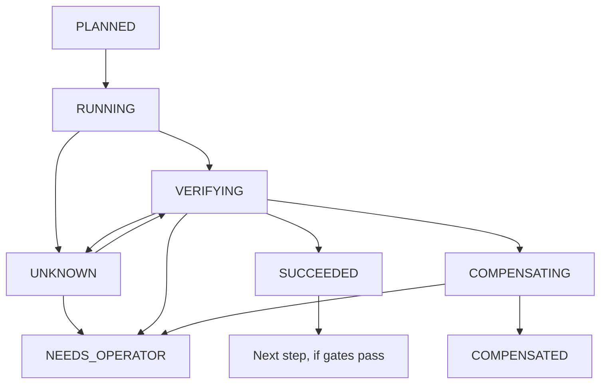

# Kiểm chứng quy trình có thể tiếp tục hoặc quay lui sau lỗi từng phần

> **Chương:** Tự động hóa vận hành  
> **Phạm vi:** `DATABASE_ENGINE_WIDE_COLUMN_CASSANDRA` — vận hành Apache Cassandra phân tán, từ thiết kế dữ liệu theo khóa phân vùng và truy vấn đến CQL, replication, mức nhất quán đọc/ghi, compaction, repair, xử lý lỗi và kết nối từ ứng dụng Java.

Một quy trình vận hành Cassandra có thể thực hiện thành công trên một số node rồi thất bại trên node tiếp theo. Nguy hiểm nhất là trường hợp lệnh đã tạo tác động thật nhưng công cụ điều phối bị mất kết nối trước khi ghi nhận kết quả. Khi đó, thông báo «timeout» không chứng minh rằng thao tác đã thất bại, còn việc chạy lại toàn bộ quy trình có thể làm gián đoạn thêm các replica hoặc lặp một thao tác không an toàn.

Bài này hướng dẫn **thiết kế và kiểm chứng** một quy trình có thể **tiếp tục từ điểm kiểm soát** (resume), **hoàn tác một thay đổi thực sự đảo ngược được** (rollback), hoặc **thực hiện bước bù trừ** (compensation) khi lỗi chỉ xảy ra ở một phần hệ thống. Trọng tâm là kiểm chứng bằng trạng thái quan sát được của Cassandra, không dựa đơn thuần vào mã thoát của script.

## 1. Mục tiêu học tập và các khái niệm

Sau bài này, người học có thể:

1. Phân biệt lỗi ở tác nhân điều phối, lỗi kết nối, lỗi lệnh, lỗi node và trạng thái cluster chưa hội tụ.
2. Xác định đơn vị công việc, tiền điều kiện, hậu điều kiện và điểm lưu tiến độ cho từng bước.
3. Giải thích vì sao cơ chế retry, ghi log và khóa điều phối chưa đủ để bảo đảm thao tác chỉ xảy ra một lần.
4. Thiết kế quy tắc **resume / retry / rollback / compensation / dừng can thiệp** cho thay đổi cấu hình, rolling restart và repair.
5. Thử nghiệm lỗi tại các ranh giới của quy trình, thu thập bằng chứng và quyết định kết quả PASS/FAIL.

Các thuật ngữ cần phân biệt:

| Thuật ngữ | Ý nghĩa trong quy trình Cassandra |
| --- | --- |
| **Checkpoint** | Bản ghi bền vững về bước, trạng thái, lần thử và bằng chứng đã xác minh; cho phép khôi phục sau khi worker chết. |
| **Resume** | Đọc checkpoint, đối chiếu trạng thái cluster thực tế rồi tiếp tục ở bước còn thiếu. |
| **Retry** | Thực hiện lại một thao tác; chỉ an toàn nếu thao tác có tính lặp lại an toàn hoặc đã xác minh lần trước chưa tạo tác động. |
| **Rollback** | Đưa một thay đổi *có thể đảo ngược* về cấu hình/trạng thái trước đó, sau khi kiểm tra điều kiện đảo ngược. |
| **Compensation** | Thực hiện thao tác bù để đạt trạng thái chấp nhận được; không nhất thiết khôi phục chính xác từng byte như ban đầu. |
| **Roll-forward** | Tiếp tục bằng thay đổi sửa chữa phù hợp khi đảo ngược không khả thi, ví dụ hoàn thành đồng bộ replica sau thay đổi replication factor. |
| **Reconciliation** | Đối chiếu trạng thái đã lưu với node, schema, dữ liệu và hoạt động đang chạy để quyết định bước tiếp theo. |

**Nguyên tắc cốt lõi:** một checkpoint `SUCCEEDED` phải có **bằng chứng về hậu điều kiện**. Một trạng thái `UNKNOWN` phải được điều tra trước khi retry. «Rollback» chỉ là phương án nếu có thao tác ngược đã định nghĩa, điều kiện tiên quyết còn đúng và đã kiểm thử.

## 2. Vì sao lỗi từng phần đặc biệt khó trong Cassandra?

Cassandra không có một tiến trình duy nhất đại diện cho mọi trạng thái của cluster. Dữ liệu được phân bổ theo **partition key** đến các token range và lưu trên nhiều replica theo cấu hình replication. Các node có thể nhìn thấy trạng thái khác nhau trong một khoảng thời gian; một thao tác tác động lên node A không đồng nghĩa toàn cluster đã đạt trạng thái mục tiêu.

Ví dụ, trong một datacenter có replication factor `RF = 3`, thao tác bảo trì một node vẫn có thể cho phép truy vấn `LOCAL_QUORUM` thành công nếu còn đủ replica phù hợp. Nhưng điều này **không cấp phép** tắt tiếp node thứ hai; phải xác minh mức sẵn sàng của từng tập replica, lỗi ứng dụng và tình trạng cluster trước khi sang bước khác. Với `RF = 3`, quorum cần `floor(3/2) + 1 = 2` phản hồi; tình trạng ở các datacenter khác và mức nhất quán cụ thể cũng phải được xét riêng.

Các điểm dễ gặp lỗi từng phần:

| Thời điểm xảy ra lỗi | Điều có thể đã xảy ra | Việc cần kiểm chứng trước khi hành động |
| --- | --- | --- |
| Trước khi phát lệnh | Chưa có thay đổi nào, nhưng worker đã ghi ý định thực hiện | Có worker cũ hoặc tác vụ tương đương nào đang chạy không? |
| Sau khi gửi lệnh, trước khi nhận phản hồi | Lệnh có thể chưa chạy, đang chạy, đã thành công hoặc đã thất bại | Hoạt động còn tồn tại không? Trạng thái quan sát có thỏa hậu điều kiện không? |
| Sau khi lệnh thành công, trước khi ghi checkpoint | Cassandra đã đổi trạng thái nhưng nhật ký vẫn ghi `RUNNING` | Có thể chứng minh thành công từ node/cluster và cập nhật checkpoint mà không lặp lệnh không? |
| Sau khi xử lý một số node | Cluster ở trạng thái triển khai hỗn hợp | Node nào đã đạt chuẩn, node nào cần sửa và còn đủ replica cho lưu lượng ứng dụng không? |
| Trong repair hoặc compaction | Có thể đã có SSTable mới hoặc dữ liệu đã được stream một phần | Tác vụ cũ còn chạy không; tác động hiện tại có an toàn để chờ, khởi động lại hay cần can thiệp không? |
| Khi kho checkpoint cũng không truy cập được | Không xác định chắc chắn bước nào đã hoàn tất | Ngừng phát lệnh mới, khôi phục quyền truy cập nhật ký và tái dựng trạng thái qua bằng chứng độc lập. |

Một lỗi `read timeout` hoặc `write timeout` từ ứng dụng Java cũng không nhất thiết có nghĩa thao tác dữ liệu chưa xảy ra. Ví dụ, một write có thể đã đến một số replica nhưng coordinator không nhận đủ xác nhận đúng hạn. Retry thiếu kiểm soát đặc biệt nguy hiểm đối với counter, hành động bên ngoài Cassandra hoặc cập nhật dùng timestamp mới có thể thay đổi thứ tự ghi.

## 3. Bất biến an toàn trước khi cho phép tiếp tục

**Bất biến (invariant)** là điều kiện luôn phải đúng trong suốt quy trình, không chỉ ở kết thúc:

- **Không vượt ngân sách lỗi:** không bảo trì thêm node nếu điều đó làm mất số replica cần thiết cho mức nhất quán đọc/ghi của các workload quan trọng.
- **Một quyền điều phối hợp lệ:** chỉ một tác nhân được phép phát lệnh thay đổi cho cùng đối tượng và giai đoạn. Lease hết hạn không tự làm một lệnh `nodetool` cũ dừng lại; cần khóa có phiên bản/fencing và bước kiểm tra thao tác đang chạy.
- **Không bỏ qua checkpoint chưa xác minh:** một bước được coi là xong chỉ khi hậu điều kiện của bước đã đo được và bằng chứng được lưu.
- **Không chạy chồng thao tác nặng:** không tự khởi chạy repair hoặc compaction trùng phạm vi khi chưa biết trạng thái lần chạy cũ và khả năng chịu tải I/O, mạng, đĩa.
- **Không «rollback» dữ liệu theo suy đoán:** thay đổi schema, dữ liệu, replica hoặc SSTable chỉ được đảo ngược khi có kế hoạch khôi phục rõ ràng, backup phù hợp và kiểm chứng tính nhất quán.
- **Dừng theo tín hiệu sức khỏe:** lỗi client, latency, dropped messages, đĩa, pending compactions hoặc replica không sẵn sàng vượt ngưỡng đã thỏa thuận phải chặn bước kế tiếp.

Đặt **tiền điều kiện** và **hậu điều kiện** ở mức quan sát được. Ví dụ:

| Bước | Tiền điều kiện tối thiểu | Hậu điều kiện phải chứng minh |
| --- | --- | --- |
| Chỉnh cấu hình node N và restart | Các replica khác khỏe; cấu hình cũ được lưu; tham số tương thích phiên bản; có đường khôi phục | N quay lại trạng thái `UN`, cấu hình đích được nạp, không có lỗi ứng dụng vượt ngưỡng |
| Thay đổi schema bằng CQL | Đã đánh giá tương thích ứng dụng, phiên bản và schema hiện tại; có kế hoạch triển khai | Schema agreement đạt và truy vấn đại diện hoạt động với schema mới |
| Tăng replication factor | Kiểm tra topology/datacenter, dung lượng và kế hoạch đồng bộ dữ liệu | Keyspace nhận cấu hình RF mới **và** các range liên quan đã được sửa chữa/đồng bộ theo kế hoạch |
| Repair một phạm vi | Các replica liên quan sẵn sàng, còn dung lượng và băng thông, không trùng repair đang chạy | Phiên repair kết thúc thành công theo bằng chứng phiên chạy, không chỉ vì shell trả về |
| Tạo snapshot phục vụ khôi phục | Đủ dung lượng, xác định keyspace/table/node và tag duy nhất | Snapshot hiện diện trên các node cần thiết, manifest/metadata được lưu và bản sao backup có thể dùng để restore |

`nodetool status` giúp quan sát membership và trạng thái `UN`/`DN`, nhưng **không tự nó chứng minh** đọc/ghi ở consistency level mục tiêu hoạt động. Cần thêm probe CQL/canary từ ứng dụng, metrics, log và những kiểm tra thích hợp với tác vụ.

## 4. Thiết kế quy trình như một state machine có checkpoint bền vững

Mỗi lần chạy phải có `run_id` riêng; mọi bước có `step_id` cố định, mục tiêu rõ, phiên bản kế hoạch (`plan_hash`), chủ sở hữu thao tác và thông tin đánh dấu lần thử. Trạng thái tối thiểu:



- `PLANNED`: chưa được phép coi là đã thực hiện. Lưu dự kiến và kiểm tra tiền điều kiện.
- `RUNNING`: đã ghi ý định **trước** khi phát lệnh. Timeout hoặc worker chết phải chuyển sang nhánh chưa biết, không mặc định lỗi.
- `VERIFYING`: thu thập bằng chứng; đối chiếu hậu điều kiện và kiểm tra liệu thao tác vẫn đang chạy.
- `SUCCEEDED`: hậu điều kiện đã đúng, bằng chứng được lưu; mới được xét bước kế tiếp.
- `UNKNOWN`: tác động chưa xác định; chỉ chuyển về `VERIFYING` khi đã có cách kiểm tra an toàn.
- `COMPENSATING` / `COMPENSATED`: đã chọn và xác minh bước bù trừ cụ thể.
- `NEEDS_OPERATOR`: không đủ bằng chứng hoặc thao tác ngược quá rủi ro; workflow dừng để điều tra.

Một checkpoint nên ghi ít nhất:

```json
{
  "run_id": "3a55b06e-f0db-42de-83e8-f65208e9e13b",
  "plan_hash": "sha256:<digest-of-approved-plan>",
  "step_id": "restart-node-b",
  "target": "node-b",
  "state": "UNKNOWN",
  "attempt": 1,
  "owner": "ops-runner-2",
  "fencing_token": 17,
  "expected": ["node-b=UN", "schema_agreed", "canary_reads_writes=PASS"],
  "observed": ["restart_dispatched", "control_channel_timeout"],
  "operation_ref": "change-2026-11-21-042",
  "checked_at": "2026-11-21T08:20:00Z"
}
```

Các trường nêu trên là **mẫu dữ liệu điều phối**, không phải schema hệ thống có sẵn của Cassandra. Nên lưu cả lệnh/phiên bản lệnh, node/DC/keyspace/token range, thời gian, stdout/stderr đã rút gọn, metrics, log tham chiếu, ID phiên repair nếu có, người phê duyệt và lý do chuyển trạng thái. Một bản ghi `SUCCEEDED` không có bằng chứng xác minh cần bị coi là chưa đạt chuẩn kiểm toán.

**Độ bền của kho checkpoint:** nếu automation phải cứu cluster khi Cassandra đang mất quorum, đừng đặt *bản sao duy nhất* của trạng thái điều phối vào chính cluster đó. Dùng kho điều phối độc lập, có sao lưu và cơ chế đồng bộ/compare-and-set thích hợp. Khi chọn lưu checkpoint bằng CQL, phải xác định rõ consistency level, tính sẵn sàng khi lỗi và giới hạn của lightweight transaction (LWT): điều kiện `IF` bảo vệ phép đổi trạng thái của hàng liên quan, **không** tạo giao dịch nguyên tử giữa CQL và một lệnh `nodetool`.

**Khóa và fencing:** lưu khóa theo phạm vi cụ thể, chẳng hạn `(cluster, change_id)` hoặc `(cluster, node, operation_type)`. Worker mới chỉ nhận quyền sau khi kiểm tra lease/token và chứng minh worker cũ không còn tác vụ bất định. Token fencing chỉ hữu ích nếu nơi thực thi có thể từ chối lệnh từ chủ cũ; một lệnh `nodetool` đã gửi thường không tự kiểm tra token của ứng dụng điều phối. Vì thế vẫn phải **reconcile** hoạt động thực tế.

## 5. Quy tắc quyết định khi khởi động lại workflow

Không dùng quy tắc «status khác `SUCCEEDED` thì chạy lại». Mỗi lần resume nên lần lượt:

1. Nạp checkpoint theo `run_id`, kiểm tra `plan_hash`, chủ sở hữu và phiên bản thao tác. Nếu kế hoạch thay đổi, cần quy trình chuyển kế hoạch riêng.
2. Kiểm tra các tiền điều kiện toàn cluster: topology, replica, consistency level được dùng, sức khỏe ứng dụng, tài nguyên và hoạt động vận hành đang diễn ra.
3. **Quan sát trạng thái đích trước khi hành động:** lệnh đã đạt hậu điều kiện chưa, còn tiến trình hoặc phiên sửa chữa nào đang chạy không?
4. Nếu hậu điều kiện đã đúng, lưu bằng chứng rồi đánh dấu `SUCCEEDED`, kể cả khi checkpoint cũ là `RUNNING` hoặc `UNKNOWN`.
5. Nếu thao tác còn chạy hoặc không phân biệt được «đang chạy» với «đã ngừng», giữ `UNKNOWN`, dừng phát lệnh trùng và báo người vận hành.
6. Chỉ retry nếu biết chắc không có thao tác cũ xung đột **và** retry an toàn đối với trạng thái quan sát; giới hạn số lần và áp dụng backoff.
7. Nếu không thể đạt mục tiêu, đánh giá rollback/compensation dựa trên tiền điều kiện và ảnh hưởng tới các bước đã thành công; nếu không đủ an toàn thì `NEEDS_OPERATOR`.
8. Trước khi mở khóa bước tiếp, kiểm tra lại các bất biến ở mục 3 và lưu toàn bộ kết quả.

Giả mã một bộ phân xử, không phải script sẵn sàng chạy production:

```python
def reconcile_step(step, checkpoint, cluster):
    actual = step.observe(cluster)            # trạng thái thực, kèm bằng chứng

    if step.postcondition(actual):
        checkpoint.record_verified_success(step.id, actual)
        return "CONTINUE"

    if step.operation_still_running(actual) or step.ambiguous(actual):
        checkpoint.record_unknown(step.id, actual)
        return "STOP_AND_INVESTIGATE"

    if not step.cluster_guards_hold(cluster):
        return "STOP_UNSAFE"

    if step.retry_is_proven_safe(checkpoint, actual):
        return "RETRY_WITH_NEW_ATTEMPT"

    if step.compensation_is_proven_safe(checkpoint, actual):
        return "COMPENSATE_AND_VERIFY"

    return "NEEDS_OPERATOR"
```

Giả mã cố ý **không** tự phát lại lệnh dựa trên timestamp hoặc mã lỗi. Hàm `retry_is_proven_safe` phải đặc thù theo loại thao tác: chạy lại một phép đọc khác với chạy lại thao tác thay đổi schema, thay thế node, truncate table hoặc khởi động compaction thủ công.

## 6. Tình huống thực hành: rolling restart lỗi ở node thứ hai

Giả sử một datacenter Cassandra có ba node `A`, `B`, `C`, keyspace sản xuất có `RF=3`, ứng dụng Java dùng `LOCAL_QUORUM`. Nhiệm vụ là thay đổi **một tham số cấu hình được tài liệu phiên bản xác nhận có thể khôi phục**, rồi rolling restart từng node. Đây là mô hình minh họa: trong hệ thống thật phải kiểm tra từng datacenter, replica placement, cấu hình driver và mức tải; không thể suy ra «an toàn» từ ba node hoặc RF một cách máy móc.

### 6.1. Runbook chuẩn bị

- Chốt `run_id`, danh sách node, thứ tự thực hiện, phiên bản Cassandra, cấu hình cũ/mới (kèm checksum), thời hạn và ngưỡng dừng.
- Sao lưu file cấu hình gốc **riêng cho từng node**; xác minh cách khôi phục và tính tương thích giữa node đang dùng hai phiên bản cấu hình.
- Đọc `nodetool status` và `nodetool describecluster`; kiểm tra schema agreement, tài nguyên đĩa, pending compactions, client errors và canary CQL theo consistency level cần giữ.
- Bảo đảm không có thay đổi topology, repair nặng hoặc rolling maintenance khác đang xung đột. Dành đủ thời gian cho node trở lại ổn định.
- Chỉ đánh dấu node xong khi node phục hồi `UN`, cấu hình đích được nạp, schema ở trạng thái kỳ vọng và canary đọc/ghi thành công; theo dõi thêm một cửa sổ ổn định.

Những lệnh quan sát thường dùng (tham số địa chỉ, JMX, xác thực và cách vận hành phải theo môi trường/phiên bản):

```bash
nodetool status
nodetool describecluster
nodetool netstats
nodetool compactionstats
```

Không suy diễn `netstats` rỗng hoặc `compactionstats` rỗng là toàn bộ ứng dụng khỏe. Mỗi lệnh cung cấp một góc nhìn khác nhau.

### 6.2. Lỗi mô phỏng và cách xử lý

| Bước | Kết quả đã quan sát | Checkpoint đáng tin |
| --- | --- | --- |
| Áp cấu hình và restart A | A trở lại `UN`; canary PASS | `A = SUCCEEDED` |
| Áp cấu hình và restart B | Kênh điều khiển timeout; chưa có xác nhận ổn định | `B = UNKNOWN` |
| Áp cấu hình và restart C | **Chưa được phép chạy** | `C = PLANNED` |

Khi worker mới khởi động, **không restart B lần nữa và không chạm C ngay**:

1. Kiểm tra có còn quá trình restart hoặc tác vụ bảo trì trên B hay không; đối chiếu dịch vụ, log, cấu hình đang nạp, `nodetool status` và canary.
2. Nếu B đã `UN` và qua đầy đủ hậu điều kiện, chuyển `B` sang `SUCCEEDED` cùng bằng chứng; đánh giá sức khỏe cluster rồi mới sang C.
3. Nếu B không hồi phục do cấu hình mới và bản cấu hình cũ đã được xác minh tương thích, khôi phục **cấu hình của B**, restart B theo runbook và kiểm chứng B khỏe trước khi ra quyết định tiếp tục hay rollback A.
4. Nếu chủ động rollback toàn bộ, đưa A về cấu hình cũ **chỉ sau khi** B và các replica còn lại đáp ứng điều kiện an toàn; kiểm chứng từng node như một quy trình mới có checkpoint.
5. Nếu B chưa rõ nguyên nhân, các replica khác thiếu khả dụng hoặc khả năng đảo ngược không được chứng minh: giữ `NEEDS_OPERATOR`. Không mở khóa C.

Thứ tự khôi phục ở đây phụ thuộc trạng thái sống của replica; không có quy tắc cố định «luôn rollback A trước B». **Một bước bù trừ cũng là một bước vận hành có thể lỗi từng phần** nên phải có hậu điều kiện, checkpoint và kiểm chứng riêng.

### 6.3. Tiêu chí đạt

Quy trình đạt khi các node thuộc phạm vi thay đổi đều ở trạng thái đích **hoặc** trạng thái khôi phục đã phê duyệt; không có thao tác không rõ chủ sở hữu; ứng dụng tiếp tục đáp ứng ngưỡng; nhật ký giải thích được A/B/C đã qua bước nào. Nếu chỉ thấy «script exit 0» mà không có kiểm chứng B và canary, kết luận là **FAIL**.

## 7. Trường hợp Cassandra không thể rollback theo nghĩa thông thường

### 7.1. Repair là đồng bộ dữ liệu, không phải phép đảo ngược

`nodetool repair` đối chiếu dữ liệu trên các replica thuộc token range và đồng bộ khác biệt. Theo tài liệu Cassandra, repair mặc định là **incremental**; `nodetool repair --full` xử lý toàn bộ dữ liệu thuộc phạm vi repair. Incremental và full có mục tiêu khác nhau; lịch chạy và lựa chọn phải phù hợp phiên bản, dữ liệu đã được đánh dấu repaired và mức chịu tải.

Ví dụ một kế hoạch repair theo node:

```text
Run R
  - node A, keyspace orders: VERIFIED
  - node B, keyspace orders: UNKNOWN (mất kết nối điều phối)
  - node C, keyspace orders: PLANNED
```

Trước khi xử lý B, kiểm tra `nodetool netstats`, log Cassandra, các chỉ số repair/streaming, tình trạng node tham gia và mã phiên repair nếu có. Phân biệt: repair **còn chạy**, **đã hoàn tất nhưng chưa ghi checkpoint**, **đã dừng có lỗi**, hay **chưa biết**. Không khởi chạy thêm một repair trên cùng phạm vi chỉ vì worker cũ biến mất.

Lệnh minh họa trong tài liệu Cassandra:

```bash
# Incremental repair (mặc định theo tài liệu Cassandra hiện hành):
nodetool repair orders

# Full repair khi kế hoạch yêu cầu:
nodetool repair --full orders

# Giới hạn ở primary ranges của node; lập kế hoạch bao phủ toàn cluster:
nodetool repair -pr orders
```

`-pr` không đồng nghĩa một lệnh ở một node đã sửa xong toàn cluster. Phải lập bản đồ node/datacenter và phạm vi cần chạy, tránh công việc trùng lặp; tài liệu chính thức hướng dẫn chạy trên các node ở từng datacenter để bao phủ toàn cluster. Khi retry một lệnh repair đã dừng, phải xác nhận không còn phiên xung đột, đủ tài nguyên và tiến độ cần đối chiếu. Không tự nhận phần trăm tiến độ có thể tiếp tục chính xác từ byte cuối nếu công cụ không cung cấp bảo đảm đó.

Repair đã tạo tác động đồng bộ dữ liệu không có lệnh «undo repair». Một bước sai cần được đánh giá để **sửa tiến** hoặc khôi phục dữ liệu từ bản backup hợp lệ theo quy trình riêng.

### 7.2. Compaction, schema và thay đổi topology

| Thao tác | Điều có thể tiếp tục | Điều không nên coi là rollback tự động |
| --- | --- | --- |
| **Compaction** | Theo dõi tác vụ, tài nguyên và xác nhận hệ thống ổn định trước khi đổi bước | Không có thao tác nghịch đảo đơn giản để khôi phục đúng tập SSTable trước compaction. |
| **ALTER TABLE / thay đổi schema** | Xác nhận schema agreement, kiểm tra tương thích ứng dụng và áp dụng migration kế tiếp | Đảo DDL không nhất thiết trả lại dữ liệu đã mất; `DROP` và thay đổi không tương thích đòi hỏi chiến lược backup/restore. |
| **Tăng replication factor** | Kiểm tra RF đích và hoàn tất kế hoạch repair/streaming để replica mới có dữ liệu | Chỉ sửa lại RF không bảo đảm dữ liệu và các bước đồng bộ đã «trở về» trạng thái cũ. |
| **Decommission / replace node** | Kiểm tra topology, bootstrap/streaming, node membership và kế hoạch phục hồi chuyên biệt | Không tự động đưa node cũ trở lại ring như thể lệnh chưa từng chạy; có nguy cơ ownership/token và dữ liệu không nhất quán. |
| **TRUNCATE / DELETE dữ liệu** | Khôi phục theo backup và yêu cầu nghiệp vụ được xác minh | Phát lệnh «ngược» không thể tự tái tạo giá trị cũ hay lịch sử timestamp/TTL. |

Các tác vụ có thể gây tác động dữ liệu không đảo ngược phải có **cổng phê duyệt**, kế hoạch khôi phục và thử nghiệm restore phù hợp. Thay đổi compaction strategy cũng không «đảo» các compaction đã hoàn tất.

### 7.3. Snapshot và backup không tự động là rollback của cluster

Cassandra tạo snapshot từ các SSTable trên node; bản snapshot chứa thông tin schema liên quan. Đây là một phần quan trọng của backup, nhưng **snapshot trên từng node không mặc nhiên là điểm khôi phục nhất quán tại cùng một thời điểm trên toàn cluster**. Khi cần bảo đảm khôi phục, phải xác định bản snapshot nào thuộc tập node cần thiết, cách lưu bản sao ra nơi độc lập, commit log/incremental backups nếu áp dụng, phiên bản schema và quy trình restore đã kiểm thử.

Các công cụ restore được tài liệu mô tả gồm `sstableloader` và `nodetool refresh`, với tiền điều kiện riêng về schema, phiên bản, nội dung SSTable và node đích. **Không chạy restore như một bước bù tự động** nếu chưa có kế hoạch kiểm tra tính đúng đắn của dữ liệu và ảnh hưởng truy vấn.

## 8. Retry ở mức CQL và ứng dụng Java

Tư duy resume của runbook cũng áp dụng khi ứng dụng Java gọi Cassandra:

- **Tách lỗi transport khỏi kết quả nghiệp vụ.** Một write timeout có thể xảy ra sau khi một hoặc nhiều replica đã nhận ghi; truy vấn lại theo khóa phân vùng và mức nhất quán phù hợp khi có thể xác minh an toàn.
- **Khóa tác vụ bằng định danh bền vững.** Các thao tác nghiệp vụ lặp lại nên có `operation_id` ổn định, khóa phân vùng và thiết kế bảng theo truy vấn; tránh suy ra «đã làm» bằng cách quét toàn bảng.
- **Chỉ đánh dấu statement idempotent trong driver nếu thao tác thực sự idempotent.** Đọc dữ liệu hoặc ghi cùng giá trị/khóa với cùng ngữ nghĩa có thể retry an toàn trong một số điều kiện; cập nhật counter, side effect bên ngoài hoặc ghi dùng timestamp mới khi có tranh chấp thì không thể mặc định.
- **Cân nhắc LWT `IF NOT EXISTS` / `IF ...`** khi cần bảo vệ một điều kiện ghi trong phạm vi hàng/partition. Phải kiểm tra kết quả `[applied]` và tải của Paxos; LWT không khiến nhiều thao tác trên node, hệ thống ngoài hoặc nhiều partition trở thành một transaction duy nhất.
- **Đánh giá consistency level theo datacenter và RF.** `LOCAL_QUORUM` bảo đảm điều kiện phản hồi theo quorum trong DC địa phương, nhưng không tự giải quyết mọi tình huống cạnh tranh, latency, retry hoặc lỗi toàn DC.

Ví dụ CQL cho một dấu mốc idempotency **ở mức một khóa nghiệp vụ** (giả sử keyspace `app_control` đã tồn tại và sẵn sàng):

```sql
CREATE TABLE IF NOT EXISTS app_control.operations_by_id (
    operation_id uuid PRIMARY KEY,
    operation_type text,
    payload_hash text,
    created_at timestamp
);

INSERT INTO app_control.operations_by_id
    (operation_id, operation_type, payload_hash, created_at)
VALUES (
    3a55b06e-f0db-42de-83e8-f65208e9e13b,
    'reindex-customer',
    'sha256:example',
    toTimestamp(now())
)
IF NOT EXISTS;
```

Nếu `[applied] = false`, ứng dụng phải đọc và so sánh `payload_hash`/định nghĩa công việc, không coi mọi trùng ID là thành công. Mẫu trên chỉ tạo dấu mốc ghi có điều kiện; để quản lý vòng đời một công việc còn cần state machine, compare-and-set, đối chiếu hậu điều kiện và cách xử lý lỗi giữa «ghi dấu mốc» và «thực hiện tác động». Không dùng bảng này làm kho checkpoint duy nhất của automation cứu hộ chính cluster khi cluster có thể mất quorum.

## 9. Kịch bản fault injection để chứng minh khả năng phục hồi

Việc «chạy một lần bình thường thành công» không chứng minh khả năng resume/rollback. Cần cố tình gây lỗi tại các ranh giới và kiểm tra sau khi khởi động lại tác nhân điều phối. Thực hiện trên **lab/staging** có topology, RF, consistency level và tải đại diện; không chủ động làm lỗi node production để thử.

| Thử nghiệm | Cách gây lỗi trong môi trường thử | Điều kiện PASS |
| --- | --- | --- |
| F1 — Chết trước dispatch | Dừng worker sau khi lưu `RUNNING` nhưng trước khi gọi executor | Không có side effect; khôi phục xác định được có thể chạy bước đó một cách an toàn. |
| F2 — Mất phản hồi | Cho executor thực hiện xong, cắt kênh trả kết quả | Worker mới **probe** và ghi `SUCCEEDED`; không lặp side effect. |
| F3 — Chết trước commit checkpoint | Cho tác vụ đạt hậu điều kiện, dừng worker trước khi lưu kết quả | Resume nhận ra hậu điều kiện đã đúng và tiếp tục đúng bước. |
| F4 — Lệnh thực sự thất bại | Mô phỏng cấu hình không hợp lệ trên node B | C chưa chạy; B được sửa/khôi phục an toàn hoặc vào `NEEDS_OPERATOR`. |
| F5 — Worker chạy trùng | Khởi động hai orchestrator cho cùng `run_id` | Chỉ chủ hợp lệ phát lệnh; không có hai tác vụ xung đột. |
| F6 — Repair còn chạy | Mất kết nối điều phối trong khi repair đang streaming | Tác vụ không bị gọi trùng; trạng thái `UNKNOWN` được giữ đến khi đủ chứng cứ. |
| F7 — Hết quorum/kho journal lỗi | Chặn truy cập checkpoint hoặc làm thiếu replica trong lab | Không phát hành bước vận hành mới khi không thể xác nhận quyền điều phối và tiến độ. |
| F8 — Rollback lỗi giữa chừng | Cho bước khôi phục B thành công, bước khôi phục A lỗi | Checkpoint phản ánh trạng thái hỗn hợp; không tuyên bố rollback xong. |
| F9 — Đổi kế hoạch khi resume | Thay cấu hình đích hoặc thứ tự node nhưng giữ `run_id` | `plan_hash` không khớp làm workflow dừng, không dùng lại checkpoint sai kế hoạch. |

Đối với mỗi test, cần thu thập: timeline của lệnh và checkpoint; snapshot các trạng thái node/schema; đầu ra canary ở consistency level mục tiêu; metrics latency/errors; tác vụ repair/streaming/compaction đang chạy; quyết định của bộ phân xử; bằng chứng về số lần side effect thực sự diễn ra.

Quy trình test nên được chạy lại tại **từng ranh giới**: trước ghi ý định, sau ghi ý định, trước dispatch, sau dispatch, trước xác minh, sau xác minh và trước đánh dấu hoàn thành. Kiểm tra rằng thứ tự sự kiện bất lợi vẫn giữ các bất biến an toàn.

## 10. Mẫu tiêu chuẩn nghiệm thu runbook

Một runbook đủ điều kiện tự động tiếp tục hoặc quay lui nên trả lời được:

| Câu hỏi nghiệm thu | Bằng chứng cần có |
| --- | --- |
| Phạm vi có rõ không? | `run_id`, node/DC/keyspace/token range, phiên bản và checksum kế hoạch |
| Mỗi bước có thể xác minh độc lập không? | Tiền điều kiện, hậu điều kiện định lượng được, probe và cửa sổ ổn định |
| Lỗi sau khi lệnh có tác động được xử lý thế nào? | Nhánh `UNKNOWN → VERIFYING`, không tự retry theo timeout |
| Có ai còn điều khiển cùng tài nguyên không? | Lease/fencing, lịch sử ownership, kiểm tra tác vụ còn chạy |
| Có bảo vệ tính sẵn sàng và dữ liệu không? | RF, consistency level, replica health, schema agreement, metrics và stop gates |
| Khi nào retry? | Điều kiện idempotency theo thao tác, lịch sử attempt, giới hạn số lần |
| Khi nào rollback hoặc roll-forward? | Bảng phân loại thao tác đảo ngược được; backup/restore và bước bù đã thử |
| Cần dừng để con người quyết định khi nào? | Trạng thái mơ hồ, mất checkpoint, vi phạm ngưỡng sức khỏe hoặc khôi phục không chứng minh được |
| Kết quả cuối có kiểm toán được không? | Checkpoint sau readback, log/metrics tham chiếu, canary PASS và tổng kết từng node |

**Định nghĩa hoàn thành:** mọi bước đã đạt hậu điều kiện hoặc được bù trừ theo phương án được chấp thuận; không còn trạng thái `UNKNOWN` chưa xử lý; không có hoạt động xung đột; dữ liệu và ứng dụng qua các kiểm tra phù hợp; nhật ký bền vững cho phép người khác tái dựng toàn bộ quyết định.

## 11. Bài tập tình huống và câu hỏi tự kiểm tra

**Bài tập:** Một quy trình sửa cấu hình Cassandra gồm A → B → C. A đã `SUCCEEDED`. Sau khi gửi restart cho B, worker timeout. `nodetool status` ở thời điểm đầu cho thấy B là `DN`; 40 giây sau B lên `UN`. Probe CQL `LOCAL_QUORUM` thành công, nhưng canary ghi vẫn có lỗi vượt ngưỡng. C đang `PLANNED`.

Hãy quyết định:

1. Có nên gửi restart B thêm lần nữa chỉ vì timeout?
2. Có được chuyển ngay sang C sau khi B đổi thành `UN`?
3. Nếu phải rollback, điều kiện nào phải đạt trước khi khôi phục cấu hình A?
4. Nếu lỗi từ bước repair hoặc compaction thay vì restart, có thể áp dụng cùng lệnh rollback không?

**Gợi ý đáp án:** (1) Không; phải kiểm tra tác vụ và hậu điều kiện thực tế. (2) Không; canary còn vi phạm ngưỡng, workflow phải dừng ở B để điều tra. (3) B và các replica cần thiết phải khỏe, cấu hình cũ đã xác minh tương thích, còn ngân sách lỗi, và từng bước rollback phải có checkpoint. (4) Không; repair/compaction không có phép đảo đơn giản, cần đánh giá tiếp tục/sửa tiến/restore theo loại tác động.

**Câu hỏi mở rộng:** Vì sao một CAS hoặc LWT thành công trên hàng checkpoint vẫn chưa chứng minh rằng lệnh `nodetool` tương ứng chỉ chạy một lần? Hãy mô tả «cửa sổ lỗi» giữa hai hệ thống và thiết kế phép quan sát để đóng cửa sổ đó bằng reconciliation.

## 12. Tài liệu tham khảo

- Apache Cassandra Documentation — [Repair](https://cassandra.apache.org/doc/stable/cassandra/managing/operating/repair.html): full/incremental repair, phạm vi node, primary ranges, cách lập lịch.
- Apache Cassandra Documentation — [nodetool repair](https://cassandra.apache.org/doc/latest/cassandra/managing/tools/nodetool/repair.html): cú pháp và tùy chọn lệnh theo tài liệu phát hành.
- Apache Cassandra Documentation — [Backups](https://cassandra.apache.org/doc/latest/cassandra/managing/operating/backups.html): snapshot, incremental backup và các con đường restore.
- Apache Cassandra Documentation — [Compaction overview](https://cassandra.apache.org/doc/stable/cassandra/managing/operating/compaction/overview.html): chiến lược và tác vụ compaction.

> **Lưu ý phiên bản:** tùy chọn `nodetool`, hành vi repair, compaction và điều kiện nâng/hạ phiên bản có thể khác nhau giữa các bản phát hành Cassandra. Trước khi áp dụng runbook thật, đối chiếu tài liệu **đúng phiên bản cluster**, kiểm thử với cùng topology và định nghĩa rõ các ngưỡng dừng của hệ thống.
