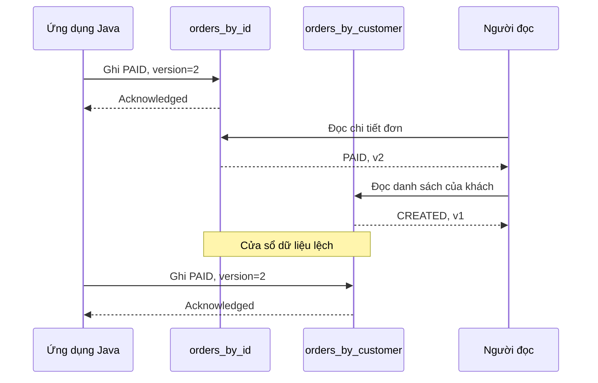
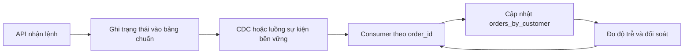

# Đồng bộ nhiều bảng và các cửa sổ dữ liệu lệch trong Apache Cassandra

## 1. Vấn đề xuất hiện từ thiết kế bảng theo truy vấn

Trong Apache Cassandra, một ứng dụng thường lưu cùng một thông tin nghiệp vụ ở **nhiều bảng phục vụ những kiểu truy vấn khác nhau**. Cassandra không có `JOIN` và khóa ngoại như cơ sở dữ liệu quan hệ; mô hình wide-column khuyến khích chọn partition key và clustering columns sao cho mỗi truy vấn quan trọng đọc được dữ liệu trực tiếp, không phải quét toàn bộ cụm. Vì vậy, dữ liệu được chủ động phi chuẩn hóa (denormalization).

Ví dụ, hệ thống bán hàng cần đồng thời:

- Tra cứu một đơn hàng theo `order_id`.
- Liệt kê các đơn của một khách hàng theo thời gian.
- Cập nhật trạng thái đơn từ `CREATED` sang `PAID` và hiển thị trạng thái đúng ở cả hai màn hình.

Hai truy vấn đầu phù hợp với hai bảng có khóa phân vùng khác nhau. Truy vấn thứ ba tạo ra một bài toán kiến trúc: **khi trạng thái đơn được sao chép vào nhiều bảng, các bản sao nghiệp vụ có thể không thay đổi cùng lúc**.

> Phân biệt hai loại “lệch”: **lệch giữa các replica** là các bản sao của *cùng một partition trong cùng một bảng* chưa đồng bộ; **lệch giữa các bảng** là hai mô hình đọc khác nhau của cùng một thực thể nghiệp vụ chưa được cập nhật đồng thời. Consistency level, hinted handoff và repair chủ yếu xử lý loại thứ nhất. Chúng không tự duy trì quan hệ nghiệp vụ giữa hai bảng.

### Mục tiêu học tập

Sau bài này, bạn có thể giải thích nguồn gốc của cửa sổ dữ liệu lệch; nhận diện những tình huống đọc trạng thái cũ; phân biệt `LOGGED BATCH`, consistency level, LWT và CDC; lựa chọn cách cập nhật hoặc xây dựng projection; đồng thời thiết kế retry, reconciliation và quan sát độ trễ cho ứng dụng Java dùng Cassandra.

## 2. Ví dụ xuyên suốt: một đơn hàng, hai mô hình đọc

Giả sử cụm Cassandra chạy một data center `dc1`, keyspace sử dụng `NetworkTopologyStrategy` và replication factor bằng 3:

```sql
CREATE KEYSPACE IF NOT EXISTS shop
WITH replication = {'class': 'NetworkTopologyStrategy', 'dc1': 3}
AND durable_writes = true;

CREATE TABLE IF NOT EXISTS shop.orders_by_id (
    order_id uuid PRIMARY KEY,
    customer_id uuid,
    created_at timestamp,
    status text,
    version bigint
);

CREATE TABLE IF NOT EXISTS shop.orders_by_customer (
    customer_id uuid,
    created_at timestamp,
    order_id uuid,
    status text,
    version bigint,
    PRIMARY KEY ((customer_id), created_at, order_id)
) WITH CLUSTERING ORDER BY (created_at DESC, order_id ASC);
```

| Bảng | Partition key | Mục đích | Cách truy vấn |
| --- | --- | --- | --- |
| `orders_by_id` | `order_id` | Nguồn đọc chi tiết đơn hàng | `WHERE order_id = ?` |
| `orders_by_customer` | `customer_id` | Danh sách đơn theo khách hàng, mới trước | `WHERE customer_id = ?` và giới hạn số kết quả |

Trường `version` là **số phiên bản nghiệp vụ do ứng dụng cấp**, không phải tính năng tự tăng hay cơ chế kiểm soát đồng thời tự động của Cassandra. Một đơn có thể mang `version = 1` khi tạo và `version = 2` sau khi thanh toán. Để cập nhật hàng trong `orders_by_customer`, ứng dụng phải biết *đầy đủ* `customer_id`, `created_at` và `order_id` dùng làm khóa chính; Cassandra không tự tìm hàng dựa trên `order_id` ở bảng này.

Ví dụ hai câu lệnh cập nhật dưới đây sử dụng `?` như **bind marker cho prepared statement** của driver:

```sql
UPDATE shop.orders_by_id
SET status = ?, version = ?
WHERE order_id = ?;

UPDATE shop.orders_by_customer
SET status = ?, version = ?
WHERE customer_id = ? AND created_at = ? AND order_id = ?;
```

Hai bảng chứa cùng `status`, nhưng mỗi bảng là một tập mutation và partition riêng. Nếu ứng dụng chạy hai câu lệnh tuần tự thì không có transaction liên bảng tự động bao trùm cả hai.

## 3. Cửa sổ dữ liệu lệch hình thành như thế nào?

Giả sử cả hai bảng ban đầu đều lưu trạng thái `CREATED` của đơn `O-17`, phiên bản 1. Người dùng thanh toán và ứng dụng cập nhật `orders_by_id` trước, sau đó mới cập nhật `orders_by_customer`.



| Thời điểm | `orders_by_id` | `orders_by_customer` | Điều người dùng có thể thấy |
| --- | --- | --- | --- |
| `t0` | `CREATED / v1` | `CREATED / v1` | Hai màn hình thống nhất |
| `t1` | `PAID / v2` | `CREATED / v1` | Chi tiết đã thanh toán, danh sách vẫn chờ thanh toán |
| `t2` | `PAID / v2` | `PAID / v2` | Hai màn hình thống nhất trở lại |

Khoảng từ `t1` đến `t2` là **cửa sổ dữ liệu lệch** (inconsistency window). Nó có thể chỉ vài mili giây khi mọi thành phần khỏe mạnh, nhưng cũng có thể kéo dài nhiều phút hoặc vô hạn nếu ứng dụng crash sau lần ghi đầu và không có cơ chế khôi phục lần ghi thứ hai. Không thể lấy một con số độ trễ đảm bảo chỉ từ replication factor hay consistency level.

Một cửa sổ khác có thể xảy ra ngay trong **cùng một bảng**: sau một write, một replica chưa nhận mutation và một read ở mức nhất quán thấp có thể thấy giá trị cũ. Hai loại lệch có nguyên nhân và phương án xử lý khác nhau, mặc dù cùng biểu hiện là “trạng thái hiển thị không giống nhau”.

## 4. Điều gì xảy ra khi mạng hoặc tiến trình gặp lỗi?

| Tình huống | Hậu quả có thể thấy | Biện pháp kiến trúc |
| --- | --- | --- |
| Ghi bảng chi tiết thành công, ứng dụng chết trước khi ghi bảng danh sách | Chi tiết mới, danh sách cũ kéo dài | Nguồn dữ liệu chuẩn cùng luồng projection có thể chạy lại; tác vụ đối soát |
| Ghi bảng danh sách trước, sau đó ghi chi tiết thất bại | Danh sách hiển thị trạng thái chưa được xác nhận bởi nguồn chuẩn | Quy định thứ tự, nguồn chuẩn và quy trình bù trừ rõ ràng |
| Client nhận timeout khi đang ghi | Không biết write đã được lưu hay chưa; timeout **không** chứng minh write thất bại | Dùng `event_id`/phiên bản ổn định, retry có kiểm soát, kiểm tra kết quả khi cần |
| Consumer nhận một sự kiện nhiều lần | Projection có thể xử lý trùng | Thao tác idempotent và ghi nhận đã xử lý |
| Sự kiện phiên bản 11 tới trước phiên bản 10 | Ghi cũ có thể đè trạng thái mới nếu xử lý tùy tiện | Bảo toàn thứ tự theo `order_id` hoặc kiểm tra phiên bản một cách nguyên tử |
| TTL, xóa dữ liệu hoặc thay đổi khóa được áp dụng không đều | Một bảng còn đơn, bảng kia đã hết hạn hoặc giữ hàng “mồ côi” | Quy tắc vòng đời dữ liệu nhất quán, delete/expiry được phát thành sự kiện, đối soát định kỳ |

**Lưu ý về retry:** với Cassandra, mutation có thể đã được áp dụng khi client thấy `WriteTimeoutException` hoặc mất kết nối. Retry kiểu “đếm thêm 1”, cộng dồn số dư hoặc phát sinh mã sự kiện mới trong mỗi lần thử có thể tạo tác dụng phụ lặp. Retry an toàn cần dựa trên định danh thao tác bền vững và ngữ nghĩa idempotent; không được coi mọi timeout là phép ghi chưa xảy ra.

## 5. Các cơ chế Cassandra giải quyết được đến đâu?

### 5.1. `LOGGED BATCH` và `UNLOGGED BATCH`

Cassandra hỗ trợ gom mutation bằng CQL `BATCH`. Nếu cần áp dụng một thay đổi nhỏ liên quan nhiều partition, có thể xem xét `LOGGED BATCH`:

```sql
BEGIN LOGGED BATCH
    UPDATE shop.orders_by_id
    SET status = 'PAID', version = 2
    WHERE order_id = 11111111-1111-1111-1111-111111111111;

    UPDATE shop.orders_by_customer
    SET status = 'PAID', version = 2
    WHERE customer_id = 22222222-2222-2222-2222-222222222222
      AND created_at = '2026-11-01 10:00:00+0000'
      AND order_id = 11111111-1111-1111-1111-111111111111;
APPLY BATCH;
```

Với logged batch nhiều partition, Cassandra dùng **batch log** nhằm bảo đảm các mutation trong batch được hoàn tất về sau nếu batch đã được chấp nhận, kể cả cần cơ chế khôi phục sau lỗi. Tuy nhiên, batch **không cung cấp transaction có isolation/snapshot nhất quán qua nhiều partition**: người đọc có thể thấy một bảng đã đổi trong khi bảng còn lại chưa đổi. `LOGGED BATCH` cũng thêm chi phí mạng, ghi log và phối hợp; gom nhiều partition vào một batch lớn có thể gây giảm thông lượng. Không dùng batch như công cụ tăng tốc hàng loạt các ghi độc lập.

`UNLOGGED BATCH` không tạo batch log để bảo đảm tính nguyên tử liên partition; nó phù hợp với một số trường hợp gom mutation đã có chủ ý, đặc biệt trong cùng partition, nhưng **không giải quyết yêu cầu đồng bộ nghiệp vụ giữa các partition**. Batch là lựa chọn cân nhắc cho tập mutation nhỏ, không thay thế cho quy trình sự kiện, theo dõi tiến độ và đối soát khi hệ thống có nhiều projection.

### 5.2. Consistency level: `LOCAL_QUORUM` không phải transaction liên bảng

Với `RF = 3` trong cùng data center, một write ở `LOCAL_QUORUM` cần xác nhận từ 2 replica; một read ở `LOCAL_QUORUM` cũng liên hệ số replica đủ quorum. Theo quy tắc giao nhau `R + W > RF`, các quorum cho **cùng một khóa dữ liệu trong cùng phạm vi replication** có replica giao nhau, hỗ trợ yêu cầu đọc giá trị cập nhật đã được xác nhận trong điều kiện hệ thống bình thường.

```sql
-- Thiết lập trong cqlsh trước khi thử đọc/ghi:
CONSISTENCY LOCAL_QUORUM;

SELECT status, version
FROM shop.orders_by_id
WHERE order_id = 11111111-1111-1111-1111-111111111111;

SELECT order_id, status, version
FROM shop.orders_by_customer
WHERE customer_id = 22222222-2222-2222-2222-222222222222
LIMIT 20;
```

Hai lệnh `SELECT` ở trên đọc **hai partition/bảng khác nhau**. Dù cả hai đều dùng `LOCAL_QUORUM`, chúng vẫn có thể trả về `PAID` và `CREATED` trong cửa sổ lệch. Hơn nữa, quorum thông thường không thay thế cơ chế serial hóa nghiệp vụ khi nhiều writer đồng thời cập nhật một đối tượng. Đối với nhiều data center, `LOCAL_QUORUM` giới hạn quorum theo data center tại chỗ; thiết kế cần nêu rõ nơi ghi, nơi đọc và chính sách failover.

### 5.3. LWT, repair và materialized view

- **Lightweight transaction (LWT)** với `IF ...` dùng cơ chế đồng thuận để kiểm tra/ghi có điều kiện cho một partition, hữu ích khi một trạng thái phải chuyển từ phiên bản dự kiến. Cấu hình consistency serial (`SERIAL`/`LOCAL_SERIAL`) thuộc đường điều kiện; LWT không tự mở rộng thành transaction cho tùy ý nhiều bảng hay nhiều partition.
- **Hinted handoff, read repair và `nodetool repair`** tập trung vào việc hội tụ các replica của dữ liệu được lưu trong từng bảng. Chúng không biết hai giá trị `status` ở `orders_by_id` và `orders_by_customer` là cùng một đơn để tự đối soát nghiệp vụ.
- **Materialized view** có thể phục vụ một số mô hình truy vấn từ bảng gốc, nhưng có ràng buộc về khóa và vận hành, cũng như đường cập nhật bất đồng bộ; nó không phải giải pháp chung cho mọi projection hay yêu cầu đọc tức thời đồng nhất qua nhiều bảng.

Điểm cần chốt: **tăng consistency level, chạy repair hoặc bật batch không tự biến nhiều bảng thành một transaction quan sát được đồng thời**.

## 6. Chọn mô hình đồng bộ cho ứng dụng

| Cách triển khai | Điểm mạnh | Đánh đổi / điều kiện áp dụng |
| --- | --- | --- |
| Dual write đồng bộ từ API | Dễ bắt đầu; cập nhật bảng đọc ngay trong request | Có khoảng trống giữa các write, kết quả mơ hồ khi timeout, cần retry và đối soát |
| `LOGGED BATCH` nhỏ | Có cơ chế batch log cho mutation nhiều partition sau khi batch được nhận | Không có isolation liên partition, tăng chi phí, khó mở rộng cho nhiều projection và hệ thống ngoài Cassandra |
| Một bảng chuẩn + CDC/event-driven projection | Có nguồn sự thật rõ ràng, dễ replay/rebuild, mở rộng nhiều bảng đọc | Chấp nhận eventual consistency; cần pipeline tin cậy và kiểm soát backlog/thứ tự |
| Dẫn người dùng đọc bảng chuẩn ở điểm quyết định | Trạng thái nghiệp vụ quan trọng có một nguồn trả lời | Tăng số lần tra cứu, cần thiết kế endpoint và có thể giảm hiệu quả của bảng danh sách |

### 6.1. Mô hình khuyến nghị khi có nhiều projection

Chọn `orders_by_id` làm **nguồn chuẩn (source of truth)** cho trạng thái đơn. Mọi quyết định quan trọng như “đã thanh toán chưa?”, “có cho phép giao hàng không?” đều xác nhận tại nguồn này. `orders_by_customer` là **projection** phục vụ đọc nhanh danh sách và được phép trễ trong giới hạn sản phẩm công bố.



Một trình tự thực thi có thể là:

1. API xác thực chuyển trạng thái hợp lệ, cấp `event_id` và phiên bản mới theo quy tắc nghiệp vụ.
2. Ghi nguồn chuẩn và chỉ công nhận chuyển trạng thái sau khi write được xác nhận theo consistency level đã chọn. Nếu cần chống hai writer cập nhật đồng thời, dùng LWT trên **partition nguồn** hoặc một cơ chế phân xử tương đương.
3. Thu nhận mutation từ cơ chế **CDC** của Cassandra và chuyển thành sự kiện chuẩn hóa, hoặc dùng một nguồn sự kiện bền vững được thiết kế riêng. Với Cassandra CDC, cần bật CDC trên bảng liên quan, vận hành dịch vụ đọc CDC log và quản lý checkpoint, giới hạn lưu trữ cùng tình huống consumer bị chậm; chỉ bật `cdc = true` không tự tạo consumer hay bảo đảm giao sự kiện đến đích.
4. Consumer cập nhật `orders_by_customer` theo `order_id` và các khóa của projection, xác nhận sự kiện sau khi projection đã ghi thành công. Nếu xảy ra lỗi, cùng `event_id` được thử lại.
5. Một job đối soát tìm projection thiếu/lệch và tạo công việc bù. Đọc nghiệp vụ quan trọng luôn quay về bảng nguồn.

**Không gọi một chuỗi “ghi bảng nguồn rồi publish message” là transactional outbox nếu hai thao tác độc lập.** Crash giữa hai thao tác vẫn làm mất sự kiện. Outbox đúng nghĩa cần một ranh giới ghi bền vững/atomic với nguồn thay đổi, hoặc một cơ chế CDC bảo đảm phát hiện mutation nguồn đã cam kết. Nếu dùng kho giao dịch khác làm nguồn chuẩn, transactional outbox có thể đặt trong cùng transaction của kho đó.

### 6.2. Phiên bản, thứ tự và tính idempotent

Sự kiện nên mang ít nhất:

```json
{
  "event_id": "33333333-3333-3333-3333-333333333333",
  "order_id": "11111111-1111-1111-1111-111111111111",
  "customer_id": "22222222-2222-2222-2222-222222222222",
  "created_at": "2026-11-01T10:00:00Z",
  "version": 2,
  "status": "PAID"
}
```

`event_id` phải được giữ nguyên qua các lần retry; `version` phản ánh thứ tự cập nhật của **cùng một đơn**. Hai bộ phận này giải quyết hai lỗi khác nhau:

- **Giao trùng:** consumer có thể nhận một event nhiều lần. Ghi cùng giá trị đích cho cùng phiên bản là idempotent về kết quả nghiệp vụ, với điều kiện không có thao tác phụ như “cộng thêm một đơn” chạy lặp. Nếu cần bảo đảm xử lý một lần ở mức nghiệp vụ, lưu dấu xử lý bền vững hoặc thiết kế lại thao tác thành phép gán theo trạng thái đích.
- **Giao sai thứ tự:** `PAID/v3` có thể tới trước `CREATED/v2`. Ghi lại `v2` sau `v3` có nguy cơ đảo trạng thái. Phân luồng tuần tự theo `order_id`; khi cần ràng buộc tại cơ sở dữ liệu, dùng LWT với phiên bản kỳ vọng trên **hàng projection cụ thể** hoặc giữ event trễ để xử lý/đối soát. Chỉ đọc `version` rồi `UPDATE` bình thường không phải kiểm tra nguyên tử, vì writer khác có thể chen vào.

Cassandra giải quyết xung đột ghi bằng timestamp của mutation, **không** tự so sánh cột `version` ứng dụng. Đừng giả định “sự kiện có version cao sẽ luôn thắng” nếu consumer vẫn ghi phiên bản cũ với timestamp mới. Việc cấp số phiên bản cũng phải được tuần tự hóa tại nguồn; nhiều instance Java cùng lấy `version + 1` từ một lần đọc cũ có thể cấp trùng nếu thiếu cơ chế phân xử.

### 6.3. Ví dụ Java: làm rõ nơi cửa sổ lệch xuất hiện

Đoạn sau dùng DataStax Java Driver 4.x minh họa hai write độc lập. Nó **cố ý phơi bày rủi ro** và không phải phương án đồng bộ hoàn chỉnh cho thanh toán:

```java
import com.datastax.oss.driver.api.core.CqlSession;
import com.datastax.oss.driver.api.core.DefaultConsistencyLevel;
import com.datastax.oss.driver.api.core.cql.PreparedStatement;
import java.time.Instant;
import java.util.UUID;

void updateBothTables(CqlSession session, UUID orderId,
                      UUID customerId, Instant createdAt, long version) {
    PreparedStatement main = session.prepare(
        "UPDATE shop.orders_by_id SET status = ?, version = ? " +
        "WHERE order_id = ?");
    PreparedStatement list = session.prepare(
        "UPDATE shop.orders_by_customer SET status = ?, version = ? " +
        "WHERE customer_id = ? AND created_at = ? AND order_id = ?");

    session.execute(main.bind("PAID", version, orderId)
        .setConsistencyLevel(DefaultConsistencyLevel.LOCAL_QUORUM));

    // Crash, timeout hoặc mất kết nối tại đây khiến hai bảng có thể lệch.
    session.execute(list.bind("PAID", version, customerId, createdAt, orderId)
        .setConsistencyLevel(DefaultConsistencyLevel.LOCAL_QUORUM));
}
```

Trong kiến trúc projection ở mục 6.1, endpoint Java chỉ ghi bảng chuẩn, còn worker cập nhật bảng danh sách từ sự kiện bền vững. Prepared statement nên được khởi tạo một lần để tái sử dụng trong lớp truy cập dữ liệu, thay vì prepare trên mỗi request như ví dụ tối giản. `CqlSession` nên được tái sử dụng, kết nối vào local data center đã cấu hình; mọi chính sách retry phải xét tính idempotent và kết quả không xác định của các lần timeout.

## 7. Quy ước nhất quán tại API và giao diện

Cần ghi rõ hợp đồng đọc cho từng màn hình. Một mô hình thực dụng:

| Tác vụ | Bảng đọc | Kỳ vọng |
| --- | --- | --- |
| Xác nhận đơn đã thanh toán để giao hàng | `orders_by_id` | Lấy trạng thái chuẩn với consistency level phù hợp |
| Hiển thị danh sách đơn hàng của khách | `orders_by_customer` | Có thể trễ; thể hiện trạng thái đồng bộ nếu sản phẩm cần |
| Vừa thanh toán xong, cần xác nhận ngay | `orders_by_id` theo `order_id` | Không dựa vào projection đang chờ cập nhật |
| Bộ lọc/thống kê trên nhiều bảng | Projection/luồng phân tích | Công bố thời điểm cập nhật gần nhất hoặc độ trễ có thể có |

Một yêu cầu kiểu “mọi màn hình phải thấy cùng kết quả ngay lập tức” cần được xem là **ràng buộc kiến trúc**: có thể phải đọc từ một nguồn duy nhất, đổi quy trình hiển thị hoặc dùng một hệ cơ sở dữ liệu có transaction phù hợp. Không nên hứa mạnh hơn khả năng quan sát thực tế của mô hình Cassandra phi chuẩn hóa.

## 8. Reconciliation và quan sát độ trễ

Khi dùng eventual consistency, nhiệm vụ vận hành không chỉ là “eventually” mà là **đo được, phát hiện được và sửa được** sự chênh lệch.

1. **Theo dõi luồng:** số event chưa xử lý, độ tuổi event lâu nhất, lỗi/độ trễ retry, consumer lag, sự kiện vào dead-letter queue và tỷ lệ xử lý trùng.
2. **Theo dõi hội tụ:** phân phối `projection_applied_at - source_committed_at` hoặc một thước đo độ trễ tương đương có kiểm soát sai lệch đồng hồ; p95/p99 và ngưỡng cảnh báo phải gắn với SLA nghiệp vụ, chẳng hạn mục tiêu nội bộ p99 dưới 5 giây nếu hệ thống thật sự đáp ứng được.
3. **Đối soát theo ID/phiên bản:** lấy danh sách các đơn đã thay đổi từ luồng thay đổi hoặc bản ghi kiểm toán, đối chiếu `version/status` giữa nguồn và projection, sau đó phát lại event hoặc cập nhật bù một cách idempotent.
4. **Quản lý dữ liệu bị xóa/hết hạn:** phát sự kiện delete/tombstone đến projection; quy định TTL phù hợp giữa nguồn và bản sao. Bảo đảm quy trình repair dữ liệu replica theo chính sách vận hành, nhưng không coi repair là đối soát nghiệp vụ.
5. **Giới hạn tác động:** job quét phải dùng partition key, token range, dữ liệu thay đổi hoặc công cụ xử lý phân tán được thiết kế phù hợp. `SELECT` quét toàn keyspace, `ALLOW FILTERING` tùy tiện hay đọc mọi partition qua API có thể gây tải lớn và timeout.

Ví dụ một chỉ báo nguy hiểm: consumer lag vẫn thấp nhưng số đơn có `orders_by_id.version > orders_by_customer.version` tăng đều. Điều đó gợi ý pipeline đã bỏ sót cập nhật hoặc quy tắc ánh xạ sai; cần reconciliation, không thể giải quyết chỉ bằng tăng `LOCAL_QUORUM`.

## 9. Bài thực hành đề xuất

**Môi trường:** cụm Cassandra thử nghiệm, `RF = 3`, hai bảng như mục 2, một script Java tạo đơn và một consumer mô phỏng. Không chạy thử lỗi/gián đoạn trên cụm production.

1. Tạo một đơn `CREATED/v1` ở cả hai bảng. Đọc riêng theo `order_id` và `customer_id` để hiểu khóa truy vấn và thứ tự clustering.
2. Chỉ cập nhật `orders_by_id` sang `PAID/v2`. Đọc hai bảng ở `LOCAL_QUORUM` và ghi nhận kết quả khác nhau. Nhận xét tại sao quorum không tự sửa projection.
3. Gửi event `PAID/v2` tới consumer, cập nhật `orders_by_customer`, đọc lại. Dừng consumer trước lần thử khác và quan sát cửa sổ lệch tăng theo thời gian dừng.
4. Phát lại hai lần cùng `event_id` và kiểm tra kết quả không thay đổi. Gửi `version = 3` rồi `version = 2`; xác nhận cơ chế thứ tự/phiên bản của consumer không làm trạng thái quay lùi.
5. Mô phỏng timeout sau khi write có khả năng đã áp dụng, chạy lại cùng ID thao tác và kiểm tra không tạo tác dụng phụ nhân đôi. Thử quét đối soát các ID đã thay đổi và phục hồi projection thiếu.
6. Thử `LOGGED BATCH` nhỏ với hai mutation, giải thích batch log đảm bảo điều gì, rồi phân tích vì sao một người đọc đồng thời vẫn có thể bắt gặp trạng thái trung gian giữa hai bảng.

**Câu hỏi tự kiểm tra:**

- Vì sao cùng một `order_id` thường cần xuất hiện trong hai bảng Cassandra thay vì thực hiện `JOIN`?
- Nếu cả hai bảng đều đọc/ghi `LOCAL_QUORUM`, còn nguyên nhân nào khiến chúng trả về trạng thái khác nhau?
- `LOGGED BATCH`, LWT và `nodetool repair` có phạm vi tác động giống nhau không?
- Làm thế nào phát hiện và sửa một đơn có `version = 8` ở bảng chuẩn nhưng `version = 6` ở bảng danh sách?
- Trong đường thanh toán, bảng nào phải được xem là nguồn quyết định và vì sao?

## 10. Ghi nhớ khi thiết kế hệ thống thực tế

Cassandra giúp tối ưu từng đường truy vấn nhờ partition key và dữ liệu phi chuẩn hóa, nhưng ứng dụng chịu trách nhiệm **duy trì ý nghĩa nhất quán giữa các mô hình đọc**. Hãy xác định nguồn chuẩn, nêu rõ màn hình nào có thể chấp nhận dữ liệu trễ, bảo đảm retry và xử lý trùng không gây tác dụng phụ, quản lý thứ tự phiên bản, đồng thời đo và đối soát độ lệch. Với những quyết định cần chính xác ngay, đọc lại dữ liệu tại nguồn chuẩn theo chính sách nhất quán phù hợp; với các projection, chuẩn bị sẵn cơ chế khôi phục khi sự kiện bị trễ hoặc bỏ sót.
