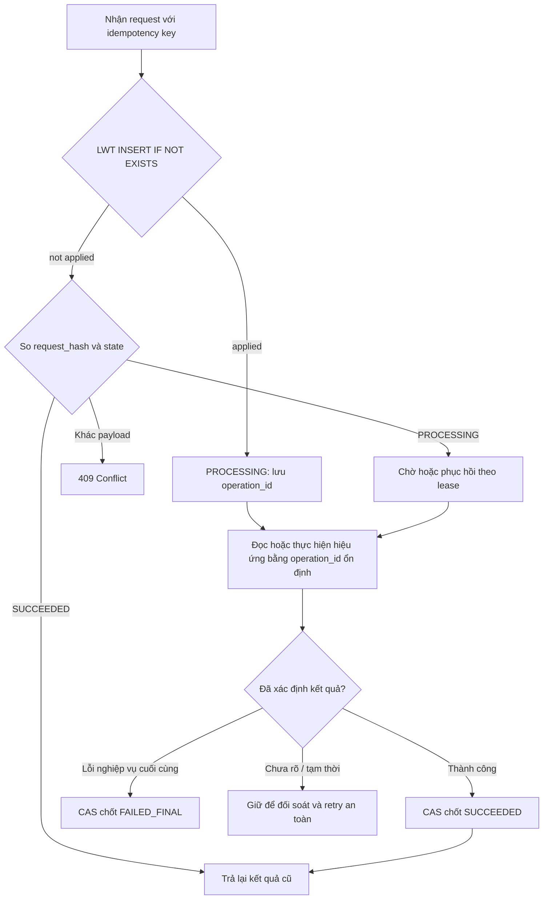
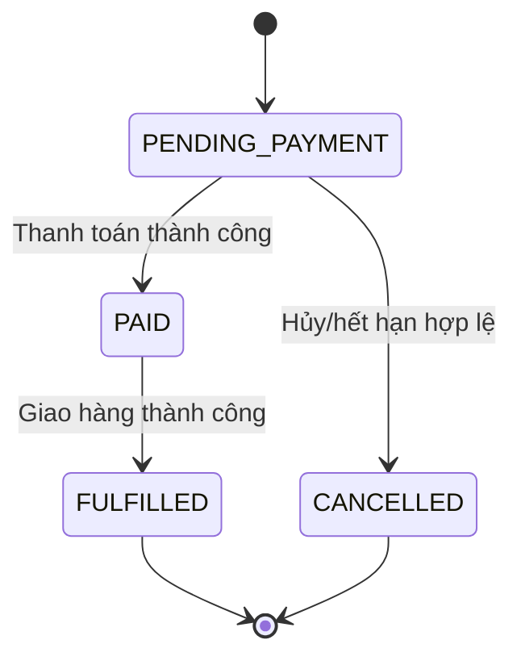

# Idempotency key, trạng thái nghiệp vụ và chống xử lý trùng

> **Chương:** Kiến trúc ứng dụng  
> **Phạm vi:** Apache Cassandra trong hệ thống Java phân tán; thiết kế bảng theo truy vấn, khóa phân vùng và mức nhất quán khi nhiều yêu cầu cùng tác động lên một nghiệp vụ.

## 1. Vì sao một thao tác có thể được thực hiện nhiều lần?

Giả sử API `POST /orders` đã tạo đơn hàng thành công trong Cassandra nhưng kết nối HTTP đứt trước khi máy khách nhận phản hồi. Máy khách không biết yêu cầu đã thành công hay chưa nên gửi lại. Tình huống tương tự xuất hiện khi load balancer tự thử lại, message broker giao lại sự kiện, worker chết giữa chừng hoặc Cassandra trả timeout dù một số replica đã ghi dữ liệu.

Trong hệ thống phân tán, **nhận lại yêu cầu không có nghĩa là người dùng muốn thực hiện thêm một nghiệp vụ**. Nếu mỗi lần retry sinh một `order_id` mới, có thể xuất hiện hai đơn hàng, hai lần trừ tiền hoặc hai lần gửi hàng. Cassandra có replication và hỗ trợ consistency level, nhưng chỉ tăng mức nhất quán đọc/ghi không tự biến toàn bộ quy trình nghiệp vụ thành thao tác thực hiện đúng một lần.

**Idempotent** là tính chất: thực hiện cùng một thao tác hợp lệ nhiều lần cho cùng một danh tính nghiệp vụ vẫn cho **một tác động cuối cùng**. Phản hồi lần đầu và lần sau có thể khác phần metadata (ví dụ thời điểm trả lời), nhưng tài nguyên và hiệu ứng nghiệp vụ không được bị nhân đôi.

| Khái niệm | Trả lời câu hỏi | Ví dụ |
| --- | --- | --- |
| **Idempotency key** | Những lần gửi nào thuộc **cùng một ý định nghiệp vụ**? | `Idempotency-Key: 7a1d...` gắn với một lần tạo đơn |
| **Operation ID** | Tác động nghiệp vụ đó mang danh tính ổn định nào? | `order_id`/`payment_attempt_id` giữ nguyên qua retry |
| **Trạng thái xử lý yêu cầu** | Thao tác này đang chạy, đã thành công hay đã kết thúc với lỗi? | `PROCESSING`, `SUCCEEDED`, `FAILED_FINAL` |
| **Trạng thái nghiệp vụ** | Thực thể đang ở bước nào của vòng đời? | `PENDING_PAYMENT`, `PAID`, `CANCELLED` |
| **LWT / CAS** | Ai được quyền ghi một thay đổi có điều kiện trên cùng partition? | `INSERT ... IF NOT EXISTS`, `UPDATE ... IF ...` |

Idempotency key và trạng thái nghiệp vụ giải quyết **hai lớp khác nhau**: key gom các lần retry của một ý định; máy trạng thái bảo vệ các chuyển trạng thái hợp lệ của đối tượng. Một đơn đã `PAID` vẫn có thể nhận sự kiện `PaymentSucceeded` lần thứ hai; mã xử lý phải nhận ra chuyển trạng thái đó đã được áp dụng.

## 2. Xác định danh tính của cùng một yêu cầu

Máy khách tạo một key khó đoán (thường UUID ngẫu nhiên) **một lần cho mỗi ý định nghiệp vụ**, lưu nó qua các lần retry và tạo key khác khi người dùng thật sự muốn tạo thao tác mới. Trên máy chủ, phạm vi định danh là bộ `(tenant_id, operation, idempotency_key)` thay vì key đơn lẻ; không được để yêu cầu của tenant này đụng độ tenant khác.

Để chống việc vô ý hoặc cố tình tái sử dụng cùng key với nội dung khác, máy chủ tính `request_hash`, chẳng hạn SHA-256 của một biểu diễn chuẩn hóa gồm phương thức, loại thao tác, phiên bản API và các trường nghiệp vụ có ý nghĩa (sản phẩm, số lượng, giá đã chốt...). Không băm các trường thay đổi vô hại như trace ID hay thứ tự khóa JSON. Việc chuẩn hóa phải **xác định và có phiên bản** để hai request tương đương cho cùng digest. Không dùng hash thay cho xác thực/phân quyền.

Ví dụ hợp đồng HTTP:

```http
POST /orders HTTP/1.1
Authorization: Bearer <token>
Idempotency-Key: 792d3e48-5657-48fa-a41e-17b113e33a0d
Content-Type: application/json

{"sku":"book-01","quantity":2}
```

Máy chủ có thể quy định:

- **Key mới, payload hợp lệ:** nhận xử lý; tạo một `operation_id` ổn định.
- **Key cũ, cùng request hash, đã thành công:** trả lại `order_id` và kết quả đã ghi nhận, không thực hiện hiệu ứng lần nữa.
- **Key cũ, cùng hash, đang xử lý:** trả `202 Accepted` kèm `Retry-After`, hoặc trạng thái đang xử lý theo hợp đồng API; không tự khởi tạo đơn thứ hai.
- **Key cũ, hash khác:** trả `409 Conflict` (hoặc mã lỗi đã quy ước) và yêu cầu khách tạo key mới cho ý định mới.
- **Không có key:** với thao tác không thể cho phép lặp, API nên từ chối theo hợp đồng thay vì âm thầm tự sinh key mới mỗi lần retry.

**Lưu ý:** Không coi giá trị key là bí mật truy cập; tránh đưa nguyên key hoặc payload nhạy cảm vào log, đồng thời kiểm tra tenant/quyền sở hữu trước khi trả lại kết quả đã lưu.

## 3. Bảng Cassandra cho idempotency

Truy vấn quyết định là: *với tenant, loại thao tác và key này, hệ thống đã ghi nhận điều gì?* Thiết kế mỗi bộ ba thành một partition để mọi lần cạnh tranh cùng key đi đến **cùng một ranh giới LWT**:

```sql
CREATE TABLE request_dedup_by_key (
    tenant_id text,
    operation text,
    idempotency_key text,
    request_hash text,
    operation_id uuid,
    state text,
    owner_token uuid,
    lease_until timestamp,
    response_status int,
    result_ref text,
    failure_code text,
    created_at timestamp,
    updated_at timestamp,
    PRIMARY KEY ((tenant_id, operation, idempotency_key))
);
```

Ở đây `operation_id` được sinh một lần khi nhận yêu cầu thành công và dùng lại cho tất cả bước sau; `result_ref` là tham chiếu đến kết quả (chẳng hạn `order_id`), thường tốt hơn lưu một HTTP response rất lớn trong row. `owner_token` phân biệt các lượt worker sở hữu thao tác, còn `lease_until` dùng để phát hiện worker có thể đã mất liên lạc. **Lease chỉ là tín hiệu phục hồi, không phải khóa toàn cục bảo đảm hiệu ứng ngoài Cassandra thực hiện đúng một lần.**

Không chọn `PRIMARY KEY ((tenant_id), idempotency_key)` cho toàn bộ request của một tenant: nó tạo partition tăng mãi và dễ quá nóng. Cách đặt đủ ba trường trong partition key ở ví dụ trên tạo nhiều partition nhỏ; truy vấn phải luôn biết đầy đủ tenant, operation và key. Dữ liệu có thể được dọn theo chính sách lưu giữ, nhưng chỉ khi cửa sổ retry và thời gian giao lại thông điệp đã được xác định rõ.

### 3.1. Ghi nhận quyền xử lý bằng LWT

```sql
INSERT INTO request_dedup_by_key (
    tenant_id, operation, idempotency_key, request_hash,
    operation_id, state, owner_token, lease_until,
    created_at, updated_at
) VALUES (
    ?, ?, ?, ?, ?, 'PROCESSING', ?, ?, ?, ?
) IF NOT EXISTS;
```

Đây là **lightweight transaction (LWT)** dựa trên Paxos. Với cùng partition, hai lệnh `INSERT ... IF NOT EXISTS` cạnh tranh không thể **cùng** báo `[applied] = true`; chỉ một lượt được ghi nhận là chủ sở hữu ban đầu. Lượt còn lại phải đọc row hiện hữu, đối chiếu `request_hash`, `state` và `operation_id` để quyết định replay, chờ hoặc báo xung đột.

```sql
SELECT request_hash, operation_id, state, owner_token,
       lease_until, response_status, result_ref, failure_code
FROM request_dedup_by_key
WHERE tenant_id = ? AND operation = ? AND idempotency_key = ?;
```

Ở cụm có replication factor 3 trong một data center, một lựa chọn thường gặp là `LOCAL_QUORUM` cho consistency của thao tác và `LOCAL_SERIAL` cho pha serial của LWT, với giả định **các thao tác cạnh tranh được điều phối trong cùng data center**. Hệ thống nhiều data center có thể cần `SERIAL` và thiết kế ownership toàn cục khác; `LOCAL_SERIAL` không tự bảo vệ cạnh tranh xuyên vùng theo mọi cách triển khai. Hãy cấu hình consistency rõ ràng ở driver và kiểm thử với topology thực tế.

Đừng thay LWT bằng mẫu sau:

```text
SELECT key -> nếu chưa có -> INSERT key
```

Giữa `SELECT` và `INSERT`, hai coordinator có thể cùng đọc “chưa tồn tại”. `LOCAL_QUORUM` cho đọc và ghi thông thường có thể giảm khả năng thấy dữ liệu cũ, nhưng **không tạo điều kiện loại trừ lẫn nhau** cho mẫu đọc-kiểm tra-ghi này.

### 3.2. Hoàn tất có điều kiện, ngăn worker cũ ghi đè

Sau khi hiệu ứng nghiệp vụ đã được xác minh, worker hiện tại có thể lưu kết quả bằng CAS:

```sql
UPDATE request_dedup_by_key
SET state = 'SUCCEEDED', response_status = 201,
    result_ref = ?, updated_at = ?
WHERE tenant_id = ? AND operation = ? AND idempotency_key = ?
IF state = 'PROCESSING' AND owner_token = ?;
```

Nếu CAS thất bại, worker cần đọc lại row: có thể một worker khác đã tiếp quản, hoặc kết quả đã được chốt. Không được trả kết luận “chưa từng chạy” chỉ vì không ghi được trạng thái. Đặc biệt, **không ghi đè bằng `UPDATE` vô điều kiện** để “sửa nhanh” trạng thái; điều đó phá vỡ kiểm tra ownership.

Khi lease hết hạn, một worker phục hồi có thể đọc trạng thái rồi xin tiếp quản bằng CAS theo `owner_token` và `lease_until` cũ đã quan sát:

```sql
UPDATE request_dedup_by_key
SET owner_token = ?, lease_until = ?, updated_at = ?
WHERE tenant_id = ? AND operation = ? AND idempotency_key = ?
IF state = 'PROCESSING' AND owner_token = ? AND lease_until = ?;
```

Ứng dụng phải kiểm tra lease thực sự đã hết hạn, tính đến độ lệch đồng hồ, rồi mới thử CAS. Một worker “mất liên lạc” có thể thực tế vẫn đang chạy, nên **cả worker cũ và mới phải sử dụng cùng `operation_id`/idempotency key ở hệ thống thực hiện hiệu ứng**. Với tài nguyên cần ownership chặt chẽ, dùng thêm cơ chế *fencing* được bên nhận tôn trọng. CAS trong bảng này chỉ ngăn worker cũ chốt lại **row idempotency**, không thể hoàn tác một API thanh toán đã gọi.

## 4. Máy trạng thái xử lý và máy trạng thái nghiệp vụ

Một luồng minh họa:



**Trạng thái request** nên đủ nhỏ và có ý nghĩa vận hành:

| Trạng thái | Ý nghĩa | Khi nhận lại cùng key |
| --- | --- | --- |
| `PROCESSING` | Đã dành danh tính thao tác, kết quả còn đang chạy hoặc chưa rõ | Chờ, kiểm tra hoặc tiếp quản có điều kiện; dùng cùng `operation_id` |
| `SUCCEEDED` | Hiệu ứng đã được xác nhận và có thể phát lại kết quả | Trả cùng tham chiếu/kết quả, không chạy lại hiệu ứng |
| `FAILED_FINAL` | Lỗi nghiệp vụ cuối cùng, ví dụ input không hợp lệ đã được chốt theo hợp đồng | Trả lại lỗi đã ghi, không coi là thao tác mới |

Timeout mạng, lỗi replica hoặc không nhận được phản hồi từ cổng thanh toán là **kết quả chưa rõ**, không tự động là `FAILED_FINAL`. Có thể dùng thêm `RETRYABLE` nếu có quy trình chuyển trạng thái và phục hồi chặt chẽ, nhưng không cần thêm trạng thái nếu chỉ muốn dùng `PROCESSING` cùng lease và tiến trình đối soát.

Máy trạng thái của đơn hàng là một ràng buộc độc lập, ví dụ:



Một event đến muộn có thể yêu cầu `PENDING_PAYMENT → PAID` khi đơn đã `CANCELLED`. Việc cùng idempotency key chỉ giúp phát hiện request lặp; **kiểm tra trạng thái hiện tại và quy tắc chuyển trạng thái** mới quyết định có được chuyển sang `PAID` hay không. Với những trường hợp có hoàn tiền, hãy thiết kế chuyển trạng thái hoặc nghiệp vụ bù rõ ràng, không tự cho phép mọi chuyển dịch chỉ vì event tồn tại.

## 5. Dữ liệu nghiệp vụ cần có danh tính ổn định

Bảng đọc đơn theo ID:

```sql
CREATE TABLE orders_by_id (
    tenant_id text,
    order_id uuid,
    state text,
    version int,
    amount_minor bigint,
    created_at timestamp,
    paid_at timestamp,
    PRIMARY KEY ((tenant_id, order_id))
);
```

Giữ `order_id = operation_id` (hoặc ánh xạ cố định một-một), từ đó mọi retry ghi/đọc **cùng hàng** thay vì sinh row mới. Để tạo đơn đúng một lần:

```sql
INSERT INTO orders_by_id (
    tenant_id, order_id, state, version, amount_minor, created_at
) VALUES (?, ?, 'PENDING_PAYMENT', 0, ?, ?)
IF NOT EXISTS;
```

Nếu `[applied] = false`, đọc đơn cũ và kiểm tra thuộc tính nghiệp vụ, không mặc định thất bại hay tạo ID thay thế. Để chỉ ghi nhận thanh toán một lần trên một đơn:

```sql
UPDATE orders_by_id
SET state = 'PAID', version = 1, paid_at = ?
WHERE tenant_id = ? AND order_id = ?
IF state = 'PENDING_PAYMENT' AND version = 0;
```

Hai worker nhận cùng sự kiện thanh toán cạnh tranh trên một row; tối đa một lượt chuyển trạng thái từ phiên bản 0 sang 1. Worker nhận `[applied] = false` phải đọc lại: nếu đơn đã `PAID` với cùng `payment_id`/kết quả xác nhận thì đó là retry hợp lệ; nếu đơn đã `CANCELLED` thì cần nhánh xử lý xung đột hoặc bù nghiệp vụ. Trong ứng dụng thật, có thể lưu thêm `payment_id` hoặc bảng thanh toán theo ID để so sánh danh tính nguồn sự kiện, tránh coi hai thanh toán khác nhau là một.

**Giới hạn quan trọng:** LWT của `request_dedup_by_key` và LWT của `orders_by_id` nằm trên **hai partition khác nhau**. Cassandra không cung cấp giao dịch ACID tổng quát để cập nhật nguyên tử hai partition này cùng với hệ thống thanh toán hoặc broker bên ngoài. `BATCH` (kể cả logged batch) không biến quy trình nhiều partition thành transaction có rollback và isolation như cơ sở dữ liệu quan hệ. Phải thiết kế phục hồi để chịu được tình trạng *đơn đã ghi nhưng trạng thái idempotency chưa chốt*.

### 5.1. Tích hợp dịch vụ ngoài và sự kiện giao lại

Nếu gọi cổng thanh toán, truyền **cùng một idempotency key hoặc payment operation ID** cho cổng thanh toán (nếu bên đó hỗ trợ), lưu mã giao dịch bên cung cấp, và truy vấn/đối soát giao dịch cũ khi không rõ kết quả. Nếu bên nhận **không** hỗ trợ dedup hay fencing, chỉ có CAS nội bộ không thể bảo đảm không gọi hiệu ứng ngoài hai lần sau crash và failover. Khi đó phải bổ sung quy trình đối soát, giới hạn retry và xử lý bù phù hợp nghiệp vụ.

Với message broker giao lại theo mô hình *at-least-once*, lấy `event_id`/`operation_id` ổn định từ thông điệp. Có thể lập bảng inbox theo `(consumer_id, event_id)` để nhận biết lần giao lại; tuy nhiên đánh dấu event đã xử lý **trước** hiệu ứng có thể làm mất hiệu ứng khi crash, còn đánh dấu **sau** hiệu ứng có thể làm lặp hiệu ứng khi crash. Do đó cần kết hợp **hiệu ứng đích idempotent**, trạng thái có thể phục hồi và/hoặc cơ chế đối soát. Nếu phải phát sự kiện sau khi ghi Cassandra, dùng một nguồn trạng thái bền vững cùng quy trình CDC/outbox và re-publish có `event_id` ổn định; consumer vẫn phải chống xử lý trùng.

## 6. Java Driver: reserve key và xử lý kết quả CAS

Ví dụ dùng DataStax/Apache Cassandra Java Driver 4.x (minh họa một phần lớp service). Chuẩn bị `PreparedStatement` một lần khi khởi tạo ứng dụng, sau đó tái sử dụng; đoạn dưới đóng gói riêng phần **dành quyền xử lý**:

```java
import com.datastax.oss.driver.api.core.CqlSession;
import com.datastax.oss.driver.api.core.DefaultConsistencyLevel;
import com.datastax.oss.driver.api.core.cql.BoundStatement;
import com.datastax.oss.driver.api.core.cql.PreparedStatement;
import java.time.Instant;
import java.util.UUID;

final class IdempotencyRepository {
    private final CqlSession session;
    private final PreparedStatement reserveStatement;

    IdempotencyRepository(CqlSession session) {
        this.session = session;
        this.reserveStatement = session.prepare(
            "INSERT INTO request_dedup_by_key " +
            "(tenant_id, operation, idempotency_key, request_hash, " +
            "operation_id, state, owner_token, lease_until, created_at, updated_at) " +
            "VALUES (?, ?, ?, ?, ?, 'PROCESSING', ?, ?, ?, ?) IF NOT EXISTS"
        );
    }

    boolean reserve(String tenantId, String operation, String key,
                    String hash, UUID operationId, UUID ownerToken,
                    Instant leaseUntil) {
        Instant now = Instant.now();
        BoundStatement statement = reserveStatement.bind(
                tenantId, operation, key, hash, operationId,
                ownerToken, leaseUntil, now, now)
            .setConsistencyLevel(DefaultConsistencyLevel.LOCAL_QUORUM)
            .setSerialConsistencyLevel(DefaultConsistencyLevel.LOCAL_SERIAL);

        return session.execute(statement).wasApplied();
    }
}
```

Phần điều phối ứng dụng phải xử lý cả ba trường hợp:

1. **`wasApplied() == true`:** giữ `operationId` và `ownerToken`; tiếp tục tác động lên đối tượng nghiệp vụ định danh bằng `operationId`, sau đó chốt kết quả bằng CAS.
2. **`wasApplied() == false`:** đọc bản ghi đã có, so `request_hash` và phân nhánh theo `state`; tuyệt đối không tự sinh operation ID khác để thử lại.
3. **Lệnh LWT timeout/exception:** kết quả có thể **không xác định**. Đừng giả định lệnh chưa ghi; tra lại theo key, và nếu vẫn chưa rõ thì retry an toàn cùng key và chính sách đối soát.

Ứng dụng thực tế cũng cần timeout, retry budget, telemetry và nhánh chuyển ownership. Không retry mù một thao tác bên ngoài có hiệu ứng không thể đảo ngược chỉ vì câu lệnh Cassandra trả lỗi.

## 7. Hỏng ở đâu, phục hồi thế nào?

| Điểm hỏng | Điều có thể đang tồn tại | Hành động an toàn |
| --- | --- | --- |
| Response của `INSERT ... IF NOT EXISTS` thất lạc | Row reserve **có thể đã được tạo** | Đọc/đối soát cùng key; không coi timeout là “chưa tạo” |
| Sau reserve, trước ghi nghiệp vụ | `PROCESSING`, chưa có đơn | Sau lease, tiếp quản bằng CAS rồi xử lý cùng `operation_id` |
| Đơn đã tạo, trước khi chốt `SUCCEEDED` | Có đơn nhưng request vẫn `PROCESSING` | Đọc đơn theo `operation_id`, xác minh và chốt/replay; không tạo đơn mới |
| Đã chốt `SUCCEEDED`, trước HTTP 201 | Có kết quả bền vững, client chưa biết | Trả lại kết quả cũ với cùng key |
| Worker cũ tiếp tục sau khi worker mới tiếp quản | Hai worker có thể cùng chạy | CAS bằng `owner_token` để chốt row; hiệu ứng ngoài cần key/fencing ổn định |
| Hai yêu cầu cùng key nhưng khác payload | Một key mang hai ý định khác nhau | Từ chối xung đột, giữ nguyên bản ghi đầu tiên |
| Event trùng hoặc đến sai thứ tự | Trạng thái nghiệp vụ có thể đã thay đổi | So `event_id` và dùng CAS theo trạng thái/phiên bản |

Trong Cassandra, `read repair`, `anti-entropy repair`, compaction và hinted handoff phục vụ hội tụ, sửa hoặc tổ chức dữ liệu replica; chúng **không thay thế** idempotency key hay CAS để bảo vệ quy trình nghiệp vụ. Timeout, retry theo consistency level và hoạt động repair đều cần được tính vào thiết kế, nhưng không thể tự giải quyết tác động trùng ở hệ thống thanh toán.

## 8. Chi phí, TTL và vận hành

- **Chi phí LWT:** Paxos đòi hỏi nhiều lượt trao đổi hơn ghi thông thường. Chỉ sử dụng ở ranh giới cần độc quyền (reserve key, chuyển trạng thái nhạy cảm), benchmark p95/p99 và lượng contention trên cùng key.
- **Consistency:** với RF = 3 trong một DC, `LOCAL_QUORUM` thường cần phản hồi từ 2 replica ở DC đó. Ràng buộc chuyển trạng thái đồng thời vẫn cần `IF`, kể cả khi đọc/ghi ở quorum.
- **TTL/retention:** TTL ngắn làm mất dấu key khi client hoặc broker vẫn có thể retry. Chỉ xóa sau khoảng giữ dấu được thỏa thuận và chấp nhận rõ hành vi của request sau khi key hết hạn. Expiry tạo tombstone; theo dõi số row, tombstone và compaction. Không bật TTL mặc định toàn bảng một cách tùy tiện.
- **Lease/clock:** đo số request kẹt `PROCESSING`, tuổi bản ghi, tỉ lệ takeover; đồng bộ đồng hồ và chấp nhận biên sai số. Lease hết hạn không chứng minh side effect cũ chưa xảy ra.
- **Quan sát:** theo dõi `dedup_hit`, `hash_conflict`, `lwt_contention`, `unknown_outcome`, `processing_stuck`, `takeover`, `replay_success`, độ trễ LWT và trường hợp `request`/`business` lệch trạng thái. Gắn `operation_id` vào trace nhưng không log thông tin nhạy cảm.
- **Tải và partition:** giữ khóa phân vùng phục vụ truy vấn chính xác, tránh partition không giới hạn theo tenant, giới hạn kích thước row và thời gian lưu lịch sử; nếu một idempotency key bị spam đồng thời, cân nhắc rate limit ở tầng API.

## 9. Bài thực hành và tiêu chí chấp nhận

Xây dựng một API Java `POST /orders` sử dụng `Idempotency-Key`; Cassandra có `request_dedup_by_key` và `orders_by_id`. Cho 50 request đồng thời cùng `(tenant, operation, key, payload)` và giả lập timeout ở ba điểm: sau reserve, sau tạo đơn và sau chốt kết quả. Tắt một worker đang giữ lease rồi chạy quy trình recovery. Sau đó đổi quantity trong request nhưng giữ key để kiểm tra từ chối xung đột.

Kết quả cần chứng minh bằng truy vấn và log:

1. Với cùng key và cùng payload, **chỉ có một `operation_id` và một đơn nghiệp vụ**; những retry trả về cùng tham chiếu đơn.
2. Cùng key nhưng payload khác **không** làm thay đổi đơn cũ.
3. Hai worker cạnh tranh `INSERT ... IF NOT EXISTS` chỉ có một lượt `[applied] = true`; CAS chuyển trạng thái không chấp nhận worker đã mất ownership.
4. Timeout bất định được xử lý bằng đọc/đối soát, không bằng khởi tạo lại đơn với ID mới.
5. Event `PaymentSucceeded` giao lại không làm đơn `PAID` hai lần; event không phù hợp trạng thái được phát hiện rõ ràng.
6. Bổ sung kiểm thử tích hợp cổng thanh toán giả lập có idempotency key và tình huống worker crash sau khi gọi cổng, trước khi cập nhật Cassandra. Xác nhận cổng chỉ ghi một thanh toán cho một operation ID.

**Ghi nhớ:** Trong Cassandra, chống xử lý trùng là kết hợp của **danh tính nghiệp vụ ổn định**, **điểm nhận yêu cầu qua LWT**, **máy trạng thái có CAS**, **đối soát sau kết quả bất định** và **idempotency ở mọi hệ thống có hiệu ứng**. Không có một consistency level hoặc một lệnh `BATCH` đơn lẻ thay thế được toàn bộ thiết kế này.
