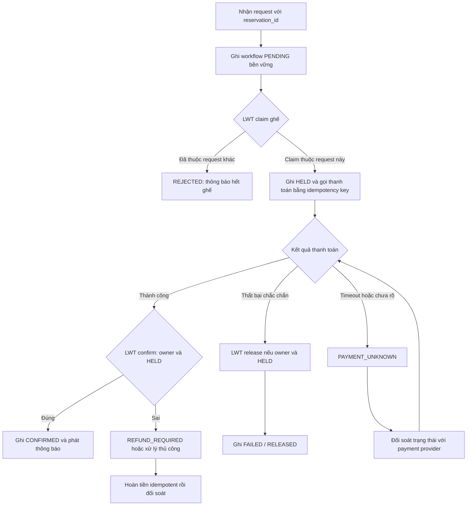

# LWT, bước bù hoặc đối soát khi bất biến vượt một thao tác

## 1. Vì sao bài toán này xuất hiện trong kiến trúc ứng dụng?

Trong module **`DATABASE_ENGINE_WIDE_COLUMN_CASSANDRA`**, Apache Cassandra được sử dụng như một cơ sở dữ liệu wide-column phân tán: chọn **khóa phân vùng** theo truy vấn, sao chép dữ liệu giữa các replica, cân nhắc **consistency level** và thao tác CQL/Java. Chương **Kiến trúc ứng dụng** đặt thêm câu hỏi: khi một quy tắc nghiệp vụ (business invariant, gọi tắt là **bất biến**) trải qua nhiều thao tác ghi, làm sao ngăn tranh chấp và khôi phục khi chỉ một phần công việc thành công?

Ví dụ, hệ thống bán vé có hai bất biến:

- **Bất biến cứng:** một ghế của một sự kiện chỉ có tối đa một chủ sở hữu đang hoạt động.
- **Bất biến liên hệ hệ thống:** nếu đã thu tiền thành công thì phải cấp vé hoặc xử lý hoàn tiền/đối soát; trạng thái vé và giao dịch thanh toán phải hội tụ về kết quả hợp lệ.

Bất biến đầu tiên có thể được bảo vệ bằng **Lightweight Transaction (LWT)** đối với một bản ghi đại diện cho ghế. Bất biến thứ hai trải qua Cassandra và cổng thanh toán, nên **không** thể được cam kết như một transaction ACID duy nhất chỉ bằng LWT. Nó cần một **quy trình bền vững**, có bước bù (compensation), idempotency và job đối soát (reconciliation).

Sau bài này, người đọc có thể:

1. Chọn giữa ghi thông thường, LWT/CAS, batch, saga và đối soát dựa trên ranh giới bất biến.
2. Dùng các cú pháp CQL `IF NOT EXISTS`, `IF` và `IF EXISTS` đúng phạm vi.
3. Phân biệt **regular consistency** với **serial consistency** của Paxos.
4. Thiết kế một quy trình nhiều bước mà vẫn phục hồi được khi timeout, crash, retry, lệch trạng thái hoặc callback đến sai thứ tự.
5. Gọi LWT bằng Cassandra Java Driver, đọc kết quả `[applied]` và tránh coi timeout là thất bại chắc chắn.

> **Phạm vi phiên bản:** Các nguyên tắc và ví dụ tập trung vào LWT dựa trên Paxos của Apache Cassandra OSS 3.11–5.0. Nếu bản triển khai có một cơ chế transaction khác (chẳng hạn tính năng Accord trên các nhánh/bản phát hành mới), phải kiểm tra tài liệu và điều kiện bật **đúng bản đang chạy**; không gộp bảo đảm của tính năng đó vào LWT.

## 2. Phân loại bất biến trước khi chọn cơ chế

| Bất biến / tình huống | Phạm vi trạng thái | Giải pháp thường phù hợp |
| --- | --- | --- |
| Chỉ tạo một khóa idempotency duy nhất | Một partition/row theo request ID | `INSERT ... IF NOT EXISTS` (LWT). |
| Trạng thái được phép chuyển từ `HELD` sang `CONFIRMED` khi owner khớp | Một partition/row | `UPDATE ... IF ...` (LWT). |
| Giảm `available` nếu còn hàng và version không đổi | Một bản ghi tồn kho | Đọc, tính giá trị mới, rồi CAS trên version và giá trị kỳ vọng. |
| Cập nhật nhiều cột hoặc row cùng partition trong một lệnh | Một partition | Mutation/batch cùng partition; dùng conditional batch khi thực sự cần CAS và phiên bản hỗ trợ. |
| Đồng thời cập nhật hai tài khoản ở **hai partition**, phải luôn giữ tổng tiền chính xác | Nhiều partition | Cần cơ chế transaction thực sự có bảo đảm tương ứng hoặc đổi mô hình; saga đơn thuần không bảo đảm bất biến tức thời. |
| Giữ ghế, ghi đơn, thu tiền qua API ngoài, gửi email | Nhiều partition và dịch vụ | LWT tại điểm tranh chấp + state machine + saga/compensation + đối soát. |
| Dữ liệu đọc phục vụ tìm kiếm/báo cáo phải cuối cùng khớp nguồn | Nhiều bảng/projection | Xuất sự kiện bền vững + consumer idempotent + backfill/đối soát. |

**Nguyên tắc thiết kế:** Xác định chính xác “điểm quyết định” của bất biến. Nếu biểu diễn được quyết định đó bằng **một khóa phân vùng ổn định**, hãy thử đặt điều kiện CAS tại đó trước. Các projection theo truy vấn khác có thể cập nhật sau và tự đối soát. Tránh dồn mọi thao tác vào một partition khổng lồ hoặc một “global lock” trở thành điểm nóng (hot partition).

## 3. Vì sao đọc rồi ghi thông thường vẫn có race condition?

Giả sử bảng tồn kho có `sku='TICKET-01'`, `available=1`:

```text
A: SELECT available -> 1
B: SELECT available -> 1
A: UPDATE available = 0
B: UPDATE available = 0
A và B cùng phát hành vé
```

Dù cả A và B đọc/ghi với `LOCAL_QUORUM` hoặc `QUORUM`, việc **đọc một lần rồi cập nhật một lần** vẫn là **hai thao tác độc lập**. Mức nhất quán quorum không tự biến chúng thành một phép compare-and-set. Giá trị tồn kho cuối cùng là 0 không thể phản ánh thực tế đã bán **hai** vé.

LWT bổ sung phép kiểm tra *giá trị vẫn đúng như kỳ vọng thì mới ghi*. Với ví dụ trên, chỉ một yêu cầu có thể chuyển cùng phiên bản trạng thái từ `(available=1, version=8)` sang `(available=0, version=9)`; yêu cầu còn lại phải đọc lại rồi quyết định từ chối hoặc thử lại với dữ liệu mới.

### 3.1. LWT/CAS dùng Paxos

Khi CQL có điều kiện như `INSERT ... IF NOT EXISTS` hoặc `UPDATE ... IF state = 'HELD'`, Cassandra sử dụng giao thức **Paxos** để thống nhất kết quả giữa các replica liên quan. Có thể hình dung ở mức logic:

1. **Prepare/promise:** các replica tham gia xác lập một đề xuất có thể được chấp nhận.
2. **Đọc và đánh giá điều kiện:** xác định giá trị cần so sánh, xử lý đề xuất chưa hoàn tất nếu có.
3. **Propose/accept:** thống nhất mutation nếu điều kiện thỏa và phiên không bị tranh chấp.
4. **Commit/learn:** áp dụng giá trị đã thống nhất và phản hồi kết quả.

Đây là mô hình khái niệm; số vòng mạng/chi tiết triển khai có thể thay đổi theo nhánh và tối ưu hóa. LWT đắt hơn ghi thường vì cần trao đổi với nhiều replica, có thể phải retry khi tranh chấp và chịu độ trễ mạng. Sử dụng LWT cho **điểm tranh chấp cần tính đúng** thay vì mọi bản ghi log/analytics.

### 3.2. Hai mức consistency trong một LWT

| Tham số | Mục đích | Ví dụ |
| --- | --- | --- |
| **Serial consistency** | Quorum tham gia **pha Paxos/CAS**; `SERIAL` xét trên phạm vi replica theo cấu hình, `LOCAL_SERIAL` giới hạn pha serial ở DC địa phương. | `LOCAL_SERIAL` khi quy tắc và đường ghi được giới hạn rõ trong một DC. |
| **Regular consistency** | Mức xác nhận của pha ghi/commit bình thường sau khi có quyết định. | `LOCAL_QUORUM` trong DC có RF=3. |

Không suy ra rằng `LOCAL_QUORUM` tự thay thế được `LOCAL_SERIAL`, hoặc rằng `LOCAL_SERIAL` tạo giao dịch xuyên các partition. Nếu có nhiều datacenter ghi cùng khóa, chọn `SERIAL`/`LOCAL_SERIAL` theo phạm vi mong muốn và chính sách nhất quán của cả ứng dụng; cấu hình chỉ một nơi dễ dẫn tới kỳ vọng sai về bảo đảm toàn cục.

**Điều kiện sống còn:** mọi tuyến ghi làm thay đổi *cùng dữ liệu đang được bảo vệ bằng LWT* phải tuân theo giao thức/quy tắc tương thích. Một tuyến ghi thường không điều kiện có thể vượt qua kiểm tra nghiệp vụ và ghi đè trạng thái sau CAS. Tránh tùy tiện trộn `UPDATE` thường, `DELETE` thường và LWT vào cùng khóa bảo vệ.

## 4. CQL thực hành: giữ ghế bằng một khóa phân vùng

Giả sử cả ba replica ở DC `dc1`, dùng RF=3; thay tên DC, số node và chính sách khi triển khai. Khóa phân vùng `(event_id, seat_id)` làm mỗi ghế có **một dòng quyết định**. Bảng `reservations_by_id` là trạng thái quy trình riêng theo request, **không nằm cùng transaction** với bảng giữ ghế.

```sql
CREATE KEYSPACE IF NOT EXISTS booking
WITH replication = {'class': 'NetworkTopologyStrategy', 'dc1': 3};

CREATE TABLE IF NOT EXISTS booking.seat_claims (
    event_id uuid,
    seat_id text,
    reservation_id uuid,
    state text,
    PRIMARY KEY ((event_id, seat_id))
);

CREATE TABLE IF NOT EXISTS booking.reservations_by_id (
    reservation_id uuid PRIMARY KEY,
    event_id uuid,
    seat_id text,
    workflow_state text,
    payment_ref text
);
```

Đặt `event_id` và `seat_id` làm khóa của **bất biến không trùng ghế**, không dùng `reservation_id` làm khóa bảng giữ ghế vì hai request sẽ dùng hai khóa khác nhau và đều “thành công”. Nếu cần xem danh sách ghế theo sự kiện, thiết kế thêm bảng theo truy vấn hoặc projection riêng; không dùng `ALLOW FILTERING` để kiểm tra tính duy nhất.

### 4.1. Claim: tạo bản ghi nếu chưa ai chiếm

```sql
INSERT INTO booking.seat_claims
    (event_id, seat_id, reservation_id, state)
VALUES
    (11111111-1111-4111-8111-111111111111, 'A-12',
     22222222-2222-4222-8222-222222222222, 'HELD')
IF NOT EXISTS;
```

Kết quả có cột `[applied]`:

- `true`: yêu cầu này **vừa** tạo được claim.
- `false`: điều kiện không thỏa; có thể vì người khác đã chiếm, **hoặc chính request này trước đó đã thành công nhưng response bị mất**. Phải kiểm tra owner và trạng thái workflow, không mặc định `false` nghĩa là thất bại nghiệp vụ.
- **Timeout/Unavailable/Exception**: trạng thái commit **chưa biết chắc**; không được tự kết luận không có claim hoặc phát sinh thanh toán lần nữa.

### 4.2. Confirm: chỉ owner đúng và trạng thái đúng mới được chuyển

```sql
UPDATE booking.seat_claims
SET state = 'CONFIRMED'
WHERE event_id = 11111111-1111-4111-8111-111111111111
  AND seat_id = 'A-12'
IF reservation_id = 22222222-2222-4222-8222-222222222222
   AND state = 'HELD';
```

Cả hai điều kiện phải đúng. Callback thanh toán gửi trễ hoặc workflow cũ không được phép “xác nhận hộ” claim của request mới. Không dùng một câu `UPDATE ... SET state = 'CONFIRMED'` thiếu `IF` ở tuyến quan trọng này.

### 4.3. Compensation: chỉ giải phóng claim còn thuộc request

```sql
DELETE FROM booking.seat_claims
WHERE event_id = 11111111-1111-4111-8111-111111111111
  AND seat_id = 'A-12'
IF reservation_id = 22222222-2222-4222-8222-222222222222
   AND state = 'HELD';
```

Nếu claim đã được xác nhận, bị thay bởi request khác hoặc đang trong trạng thái khác, lệnh bù **không** được phép xóa. Sự từ chối này cần chuyển sang điều tra quy trình thay vì cố ép xóa.

> **Không sử dụng TTL như cách duy nhất để bảo vệ giữ chỗ:** TTL làm cell hết hạn theo thời gian nhưng không bảo đảm callback thanh toán, worker và lệnh bù chạy đúng trình tự. Nếu có hạn giữ ghế, cần mô hình hóa `expires_at`/lease, cơ chế thu hồi có điều kiện, xử lý thanh toán đến muộn và đối soát. Chọn retention/tombstone hợp lý, không dùng việc cell biến mất để suy ra tiền đã được hoàn.

### 4.4. CAS bằng version cho trạng thái cùng một bản ghi

Khi chỉ có **một** partition tồn kho, có thể đọc `available` và `version` rồi ghi kết quả cụ thể nếu phiên bản chưa đổi. Ví dụ đã đọc `available=8`, `version=10`:

```sql
CREATE TABLE IF NOT EXISTS booking.inventory_by_sku (
    sku text PRIMARY KEY,
    available int,
    version bigint
);

UPDATE booking.inventory_by_sku
SET available = 7,
    version = 11
WHERE sku = 'TICKET-01'
IF available = 8 AND version = 10;
```

Nếu `[applied]=false`, đọc lại và tính lại theo trạng thái mới; **không** tự tăng version hoặc retry vô hạn với giá trị cũ. Bảo đảm chỉ đúng nếu mọi writer sử dụng cùng quy tắc CAS. Cassandra không hỗ trợ phép trừ tùy ý `available = available - 1` trên cột `int` thông thường như một SQL RDBMS; **counter** có ngữ nghĩa riêng, không phải lựa chọn tự nhiên để bảo vệ tồn kho tuyệt đối hoặc chuyển tiền.

## 5. LWT, BATCH và transaction đa partition: đừng đánh đồng

| Cơ chế | Làm được | Không bảo đảm |
| --- | --- | --- |
| Ghi CQL thường | Upsert nhanh theo khóa; consistency level có thể điều chỉnh. | Kiểm tra điều kiện và ghi như một hành động CAS. |
| LWT `IF` | Quyết định CAS có thứ tự tuyến tính trong **phạm vi đối tượng được bảo vệ**. | Commit đồng thời nhiều partition/dịch vụ ngoài với rollback chung. |
| Batch trong **cùng partition** | Gom mutation có tính cô lập theo partition; có thể hỗ trợ conditional batch theo hạn chế của bản Cassandra. | Tự chạy nhiều bước nghiệp vụ có đọc–tính–ghi phức tạp. |
| `LOGGED BATCH` **nhiều partition** | Batchlog giúp các mutation đã nhận được hoàn thành cuối cùng sau lỗi; phù hợp với một số lần ghi cùng nghiệp vụ. | Khả năng hiển thị atomically/isolation xuyên partition; trong lúc thực thi, có thể thấy chỉ một phần cập nhật. |
| Saga/compensation | Phân rã một quy trình nhiều hệ thống thành bước và bước bù có thể retry. | Bất biến xuyên hệ thống được giữ **tức thời**, hoặc rollback ACID tự động. |
| Reconciliation | Phát hiện và sửa lệch khi retry, callback, mất kết nối hoặc sự cố kéo dài. | Ngăn mọi trạng thái tạm thời không nhất quán trước khi chạy. |

**Conditional batch** không phải transaction SQL tổng quát: với CQL/Paxos truyền thống, việc dùng `IF` trong batch bị giới hạn theo partition và các ràng buộc của bản Cassandra, không tạo được CAS xuyên nhiều partition khác nhau. Không dùng `BEGIN BATCH` để “chuyển tiền atomically” giữa hai tài khoản ở hai partition hoặc để gói thao tác với REST API.

Nếu bất biến bắt buộc phải **đúng tại mọi thời điểm** trên nhiều partition (ví dụ bảo toàn số dư sổ cái), cần thay đổi cách đặt ranh giới dữ liệu/điểm quyết định hoặc chọn công cụ có giao dịch phân tán đúng yêu cầu; **không** chỉ thêm bước bù rồi tuyên bố đã có ACID.

## 6. Ví dụ đầy đủ: saga giữ ghế → thanh toán → xác nhận

Hệ thống có ba thành phần: API/worker Java, Cassandra và payment provider. Mỗi yêu cầu mua vé được cấp một `reservation_id` (hoặc idempotency key) ổn định; mỗi lần retry **dùng lại ID này**.



**Điểm ranh giới:** chỉ LWT trên `seat_claims` bảo vệ quyền sở hữu ghế, còn cập nhật `reservations_by_id`, thanh toán, callback và gửi thông báo nằm ở các bước khác nhau. Trong một khoảng ngắn, hai bảng có thể chưa đồng bộ; quy trình phải **tiến tới trạng thái đúng** thay vì giả vờ mọi bước xảy ra cùng một lúc.

### 6.1. Thiết kế state machine bền vững

Một state machine tối thiểu có thể dùng các trạng thái (tên là ví dụ, được định nghĩa ở tầng ứng dụng):

| Trạng thái | Ý nghĩa | Bước tiếp theo an toàn |
| --- | --- | --- |
| `PENDING` | Đã ghi yêu cầu, chưa rõ có claim hay chưa. | Kiểm tra hoặc thực hiện CAS claim bằng ID cũ. |
| `HELD` | Claim thuộc reservation hiện tại. | Gọi/check payment bằng idempotency key. |
| `PAYMENT_UNKNOWN` | Gọi thanh toán timeout/chưa nhận callback dứt điểm. | Truy vấn provider; không thu tiền lần hai với khóa mới. |
| `PAID` | Provider đã xác nhận thanh toán. | Confirm claim bằng CAS; nếu không thành công, xử lý hoàn tiền. |
| `CONFIRMED` | Ghế đã xác nhận; quyền lợi nghiệp vụ hoàn tất. | Phát vé/thông báo idempotent. |
| `RELEASING` | Thanh toán thất bại và đang bù. | CAS release theo đúng owner và state. |
| `REFUND_REQUIRED` | Đã thu tiền nhưng không thể cấp ghế. | Refund bằng idempotency key, xác minh provider. |
| `REJECTED` / `REFUNDED` | Kết thúc sau từ chối/bù. | Chỉ đối soát hoặc phản hồi idempotent khi request lặp. |
| `NEEDS_REVIEW` | Tình huống quá retry hoặc kết quả mâu thuẫn. | Mở công việc vận hành có đầy đủ correlation ID. |

Lưu **bước đã hoàn tất**, `reservation_id`, `payment_ref`, số lần thử, lần retry tiếp theo và nguyên nhân cuối cùng. Đảm bảo chuyển trạng thái **một chiều theo quy tắc** bằng CAS/version hoặc writer serialization; callback đến muộn không được phép đưa `CONFIRMED` trở lại `HELD`.

Không dựa vào một trường `status` và phép `UPDATE` thường tùy ý nếu có nhiều worker: một worker cũ có thể ghi đè kết quả mới. Việc cập nhật workflow và seat_claim nằm ở hai partition nên state machine vẫn cần **đối soát**, ngay cả khi từng bước riêng dùng LWT.

### 6.2. Bước bù là nghiệp vụ mới, không phải “UNDO”

Ví dụ, payment đã thành công nhưng lệnh confirm ghế thất bại. Lúc này:

1. Xác nhận từ **nguồn sự thật** của giao dịch thanh toán (provider) dựa trên cùng `payment_ref`/idempotency key.
2. Thử xác minh claim hiện tại; nếu không còn thuộc request, **không** chiếm ghế bằng ghi thường.
3. Ghi `REFUND_REQUIRED` vào workflow và thực hiện refund idempotent.
4. Nếu refund timeout, truy vấn lại provider; không gửi refund mới với một key khác.
5. Chỉ đánh dấu `REFUNDED` khi provider xác nhận; nếu không thể xác định, giữ `NEEDS_REVIEW` và alert.

Refund tạo ra một **giao dịch mới** có phí, độ trễ và khả năng thất bại; nó không xóa lịch sử thanh toán. Các bước bù khác như trả tồn kho, hủy vận đơn hoặc thu hồi quyền truy cập cũng cần cùng nguyên tắc **kiểm tra owner, điều kiện hợp lệ và idempotency**.

### 6.3. Idempotency khác với LWT

- **Idempotency key** gắn với một ý định nghiệp vụ: retry cùng `reservation_id` phải nhận **cùng kết quả cuối**, kể cả khi lần đầu đã commit nhưng response mất. Có thể dùng bảng keyed theo request ID với `IF NOT EXISTS` để nhận diện yêu cầu lần đầu.
- **LWT** bảo vệ một giá trị/điều kiện ngay lúc ra quyết định.
- **Outbox/event log/CDC** có thể giúp worker và hệ thống đích xử lý thay đổi theo kiểu at-least-once; consumer phải khử lặp, vì replay có thể phát sự kiện thêm lần nữa.
- **Reconciliation** sửa lệch do lỗi kéo dài hoặc vì các bước không cùng transaction. Nó không thay thế LWT ở điểm tranh chấp.

Khi phát sự kiện ở cùng partition với trạng thái nguồn, có thể thiết kế outbox theo partition đó để giảm cửa sổ mất sự kiện. Nhưng điều này **không** biến thanh toán ở hệ thống ngoài hoặc trạng thái của partition khác thành một giao dịch chung. Cần kiểm tra thiết kế outbox theo khả năng query và retention của Cassandra.

## 7. Xử lý timeout, retry, mất node và kết quả mơ hồ

Một vấn đề thường gây sai nghiệp vụ là đồng nhất “request lỗi” với “mutation chưa được ghi”. Với LWT, timeout có thể xảy ra **sau khi** quyết định đã đạt được nhưng **trước khi** client nhận kết quả. Ngoài ra, client có thể gặp tranh chấp Paxos, thiếu replica hoặc lỗi mạng từng DC.

| Kết quả từ Cassandra | Ý nghĩa | Cách xử lý |
| --- | --- | --- |
| `[applied]=true` | Điều kiện đúng và yêu cầu được áp dụng theo phản hồi. | Ghi mốc workflow, tiến tới bước kế tiếp. |
| `[applied]=false` | Điều kiện không đúng tại lần thực hiện này. | Kiểm tra owner/version và workflow; request có thể đã claim từ lần thử trước. |
| Timeout khi CAS | **Không xác định** đã áp dụng hay chưa. | Đánh dấu `UNKNOWN`, đọc/đối soát với serial semantics hoặc chạy lại thao tác idempotent đúng cùng ID; không tự đổi chủ sở hữu. |
| Unavailable/lỗi cluster | Có thể không đủ replica để tiếp tục. | Backoff có giới hạn, giám sát, không tạo request nghiệp vụ mới. |
| Payment API timeout | Kết quả phía provider **chưa biết**. | Truy vấn theo idempotency key; không gửi khoản thu mới bằng key mới. |
| Crash giữa hai bước | Một phần trạng thái tồn tại. | Worker khởi động lại từ workflow bền vững và thực thi bước còn thiếu. |

Ở những workflow có LWT, cần hiểu khác biệt giữa **quorum read thông thường** và **serial read** có khả năng hoàn tất đề xuất Paxos đang dở. Dùng đúng API/consistency của phiên bản/driver để chẩn đoán trạng thái; kiểm tra owner và kết quả nguồn ngoài, đừng tự suy luận chỉ từ một lần `SELECT` cũ hoặc log của một node.

Retry phải có **giới hạn**, exponential backoff kèm jitter và cơ chế đưa workflow “kẹt” sang `NEEDS_REVIEW`. Retry liên tục tại một khóa nóng vừa làm tăng CAS contention vừa khiến tình trạng mất replica trầm trọng hơn.

## 8. Kết nối từ Java: gọi CAS và xử lý kết quả

Ví dụ dưới dùng **Apache Cassandra Java Driver 4.x**. Service đã có `CqlSession` được cấu hình tới đúng DC; mã dưới thể hiện hai thao tác CAS tại bảng `seat_claims`.

```java
import com.datastax.oss.driver.api.core.CqlSession;
import com.datastax.oss.driver.api.core.DefaultConsistencyLevel;
import com.datastax.oss.driver.api.core.cql.BoundStatement;
import com.datastax.oss.driver.api.core.cql.PreparedStatement;

import java.util.UUID;

public final class SeatClaimRepository {
    private final CqlSession session;
    private final PreparedStatement claim;
    private final PreparedStatement release;

    public SeatClaimRepository(CqlSession session) {
        this.session = session;
        this.claim = session.prepare(
            "INSERT INTO booking.seat_claims " +
            "(event_id, seat_id, reservation_id, state) " +
            "VALUES (?, ?, ?, 'HELD') IF NOT EXISTS");

        this.release = session.prepare(
            "DELETE FROM booking.seat_claims " +
            "WHERE event_id = ? AND seat_id = ? " +
            "IF reservation_id = ? AND state = 'HELD'");
    }

    private BoundStatement withConsistency(BoundStatement statement) {
        return statement
            .setConsistencyLevel(DefaultConsistencyLevel.LOCAL_QUORUM)
            .setSerialConsistencyLevel(DefaultConsistencyLevel.LOCAL_SERIAL);
    }

    public boolean tryClaim(UUID eventId, String seatId, UUID reservationId) {
        BoundStatement statement = withConsistency(
            claim.bind(eventId, seatId, reservationId));
        return session.execute(statement).wasApplied();
    }

    public boolean releaseIfStillOwned(
            UUID eventId, String seatId, UUID reservationId) {
        BoundStatement statement = withConsistency(
            release.bind(eventId, seatId, reservationId));
        return session.execute(statement).wasApplied();
    }
}
```

Đọc kết quả qua `ResultSet.wasApplied()` để phân biệt điều kiện không thỏa; **đừng chỉ xem việc `session.execute()` trả về không có exception là giao dịch thành công**. Đoạn mã trên cố ý để exception lan ra: orchestration layer phải ghi nhận trạng thái chưa chắc chắn, xác minh trước khi tiếp tục và **không retry payment bừa bãi**. Mã còn cần logging có correlation ID, timeout/retry policy, quản lý vòng đời session và test với cluster thật.

Ví dụ xử lý logic phía service (pseudocode, **không phải Java có thể chạy nguyên xi**):

```text
reserve(request):
    workflow = createOrLoadByIdempotencyKey(request.id)

    if workflow is terminal:
        return samePreviousResult

    ensureClaimBelongsTo(workflow.reservationId)
        // CAS IF NOT EXISTS; nếu false/timeout phải kiểm tra owner
    persistTransition(workflow, HELD)

    payment = chargeOrGetStatus(idempotencyKey = workflow.reservationId)
    if payment == SUCCESS:
        persistTransition(workflow, PAID)
        if confirmSeatWithCAS(owner = workflow.reservationId):
            persistTransition(workflow, CONFIRMED)
        else:
            persistTransition(workflow, REFUND_REQUIRED)
    else if payment == DEFINITIVELY_FAILED:
        persistTransition(workflow, RELEASING)
        releaseSeatWithCAS(owner = workflow.reservationId)
        persistTransition(workflow, REJECTED)
    else:
        persistTransition(workflow, PAYMENT_UNKNOWN)
        enqueueReconciliation(workflow)
```

Các hàm `ensureClaimBelongsTo`, `persistTransition` và `chargeOrGetStatus` phải được hiện thực với **idempotency/conditional updates** thật; không bỏ qua các trường hợp bị tranh chấp chỉ vì pseudocode nhìn tuần tự.

## 9. Thiết kế job đối soát trong Cassandra

Khi một invariant vượt qua nhiều mutation, **đối soát là thành phần chính thức của thiết kế**, không phải script ứng cứu duy nhất. Job đối soát có thể chạy định kỳ và kích hoạt ngay từ queue khi gặp timeout.

### 9.1. Những nguồn sự thật cần so sánh

- **Workflow theo request ID:** trạng thái bước, mốc đã bền vững, retry count, lỗi cuối.
- **Claim theo event + seat:** owner và trạng thái `HELD`/`CONFIRMED`. Đây là nơi đưa ra quyết định độc quyền ghế.
- **Payment provider:** đã capture, authorize, void, refund hay chỉ pending.
- **Projection, vé đã phát, thông báo:** có thể sửa/replay sau khi đã xác định trạng thái chuẩn.

Một bộ quy tắc đối soát ví dụ:

| Quan sát | Hành động có điều kiện |
| --- | --- |
| `HELD` quá thời hạn nhưng payment chưa thành công | Xác minh provider, CAS release theo owner, cập nhật workflow. |
| Payment `SUCCESS`, claim còn `HELD` đúng owner | CAS confirm rồi cập nhật `CONFIRMED`. |
| Payment `SUCCESS`, claim không còn thuộc request | Chuyển `REFUND_REQUIRED`, refund idempotent; không giành ghế mới bằng ghi thường. |
| Claim `CONFIRMED`, workflow chưa `CONFIRMED` | Kiểm tra payment, bổ sung bước workflow còn thiếu hoặc mở điều tra. |
| Workflow `CONFIRMED` nhưng projection/vé thiếu | Phát lại sự kiện/materialize idempotent. |
| Refund chưa rõ kết quả | Tra cứu provider theo cùng key/ref trước khi retry. |

### 9.2. Không quét toàn bộ bảng nghiệp vụ mỗi phút

Cassandra được thiết kế theo truy vấn. Lệnh kiểu:

```sql
-- Tránh coi đây là cơ chế lập lịch production:
-- SELECT * FROM booking.reservations_by_id
-- WHERE workflow_state = 'PAYMENT_UNKNOWN' ALLOW FILTERING;
```

có thể gây full scan tốn kém. Hãy có **queue bền vững**, hoặc một bảng theo `bucket thời gian + next_retry_at` để quét các workflow đến hạn; mỗi key được đưa vào retry idempotently. Bản ghi scheduling là **chỉ mục phụ theo quy trình**, nên phải có job kiểm tra định kỳ/đối chiếu từ workflow gốc để phát hiện các sự kiện enqueue bị mất vì hai partition không cập nhật atomically.

Cần quy định rõ **SLA của trạng thái chưa hội tụ**: ví dụ quá 2 phút chưa biết trạng thái payment thì alert, quá 15 phút thì escalations/manual review. Các ngưỡng là quyết định nghiệp vụ; đo theo P95/P99 độ trễ thực tế của provider và tải Cassandra.

## 10. Vận hành: chỉ số và test quan trọng

Apache Cassandra có các metrics CAS ở coordinator, ví dụ `ClientRequest.CASWrite` / `ClientRequest.CASRead` với `Latency`, `Timeouts`, `Failures`, `Unavailables`, `ConditionNotMet`, `ContentionHistogram`. Tại bảng còn có `CasPrepare`, `CasPropose` và `CasCommit`. Thu thập theo **node**, tổng hợp theo cluster/DC, phân biệt điều kiện nghiệp vụ không thỏa (có thể bình thường) với timeout/error (bất thường).

| Kiểm tra | Kết quả mong muốn |
| --- | --- |
| 100 request đồng thời giữ cùng `(event_id, seat_id)` | Chỉ **một owner** có thể claim thành công; các request còn lại nhận kết quả phù hợp. |
| LWT commit thành công nhưng client timeout | Retry cùng request ID không cấp ghế/thu tiền thêm lần nữa. |
| Crash sau claim nhưng trước khi ghi workflow `HELD` | Reconciler tìm được owner, tiếp tục hoặc bù đúng claim. |
| Crash sau khi payment thành công nhưng trước confirm | Truy vấn lại provider, confirm hoặc refund theo quy tắc. |
| Callback `FAILED` đến sau `CONFIRMED` | Không hồi quy trạng thái, không xóa claim đã confirm. |
| Hai worker chạy compensation đồng thời | CAS theo owner/state bảo đảm không giải phóng claim của request khác. |
| Một replica/DC không khả dụng | App xử lý timeout/unavailable có giới hạn và quan sát được; không phá bất biến. |
| Sink hoặc outbox replay cùng event nhiều lần | Projection và email/vé có idempotency, không nhân đôi side effect. |

**Lưu ý replication và repair:** RF=3, `LOCAL_QUORUM`, `LOCAL_SERIAL` trong ví dụ không loại trừ mọi sự cố mạng. Cần hoạch định repair, schema/config giống nhau giữa các node và hiệu năng Paxos khi tải cao. Không chọn consistency level chỉ theo tốc độ nếu nó làm mất yêu cầu của invariant.

## 11. Bài tập tự đánh giá

1. Tại sao hai client dùng `QUORUM` để đọc và cập nhật `available=1` vẫn có thể bán trùng một đơn vị hàng? Viết lại thao tác bằng CAS/version.
2. Bạn cần đảm bảo email không trùng và lưu hồ sơ người dùng theo `user_id`. Hãy chọn khóa của bảng quyết định tính duy nhất, chỉ ra khoảng thời gian hai bảng có thể lệch và cách bù khi tạo hồ sơ thất bại.
3. Người dùng giữ ghế thành công, payment timeout, rồi retry API với `request_id` cũ. Nêu các bước phải kiểm tra trước khi gửi thêm một lệnh thu tiền.
4. Một `LOGGED BATCH` ghi hai partition có thể hiển thị một bên trước bên kia không? Nếu invariant bắt buộc đúng tức thời, bạn cần thay đổi kiến trúc gì?
5. Nếu `DELETE ... IF reservation_id = ? AND state = 'HELD'` trả `false`, vì sao không được sửa thành `DELETE` vô điều kiện?
6. Thiết kế metrics và SLA cho những workflow ở `PAYMENT_UNKNOWN` hơn 15 phút; nêu cách chọn partition key cho bảng lịch đối soát.

### Đáp án gợi ý

1. `QUORUM` áp dụng cho từng thao tác; cần CAS vì điều kiện và ghi phải cùng quyết định.
2. Khóa email chuẩn hóa phải là khóa quyết định duy nhất (ví dụ một claim row keyed theo email); hồ sơ theo user ID là projection khác, nên cần workflow/sửa lệch.
3. Truy vấn workflow, owner claim, trạng thái provider bằng idempotency key; nếu đã thu tiền, thực hiện confirm/hoàn tiền, không charge lần nữa.
4. Có, batchlog không cung cấp cô lập/atomic visibility xuyên partition; cần đưa quyết định vào cùng partition, chọn cơ chế transaction hỗ trợ, hoặc nới invariant thành eventual convergence có bù.
5. Kết quả `false` có thể vì đã confirm hoặc owner khác; xóa thường có thể làm mất ghế của người khác.
6. Theo dõi số workflow tồn, tuổi tối đa, số lần retry, độ trễ provider, tỉ lệ refund và sự kiện cần xử lý tay; bucket theo thời gian và phân tán tải để tránh hot partition.

## 12. Tài liệu tham khảo

- [Apache Cassandra 5.0 — Guarantees](https://cassandra.apache.org/doc/5.0/cassandra/architecture/guarantees.html): Paxos/LWT, consistency và giới hạn batch.
- [Apache Cassandra 5.0 — CQL Data Manipulation](https://cassandra.apache.org/doc/5.0/cassandra/developing/cql/dml.html): `INSERT`, `UPDATE`, `DELETE` với `IF` và ngữ nghĩa của `BATCH`.
- [Apache Cassandra 5.0 — Monitoring metrics](https://cassandra.apache.org/doc/5.0/cassandra/managing/operating/metrics.html): metrics CAS, timeout, contention theo node.
- [Apache Cassandra Java Driver 4.19 — Statement API](https://apache.github.io/cassandra-java-driver/4.19.0/api/com/datastax/oss/driver/api/core/cql/Statement.html): cấu hình regular/serial consistency cho statement.
- [DataStax Java Driver 4.10 — ResultSet.wasApplied()](https://docs.datastax.com/en/drivers/java/4.10/com/datastax/oss/driver/api/core/cql/ResultSet.html): cách đọc kết quả của conditional update.

Tài liệu tham khảo trên nói về **LWT trong Cassandra OSS** và API driver tương ứng. Trước khi vận hành hoặc nâng cấp, cần kiểm tra tài liệu **minor/patch version** của cluster và driver; mỗi thành phần saga/payment/queue có hợp đồng giao nhận và điều kiện idempotency riêng.
