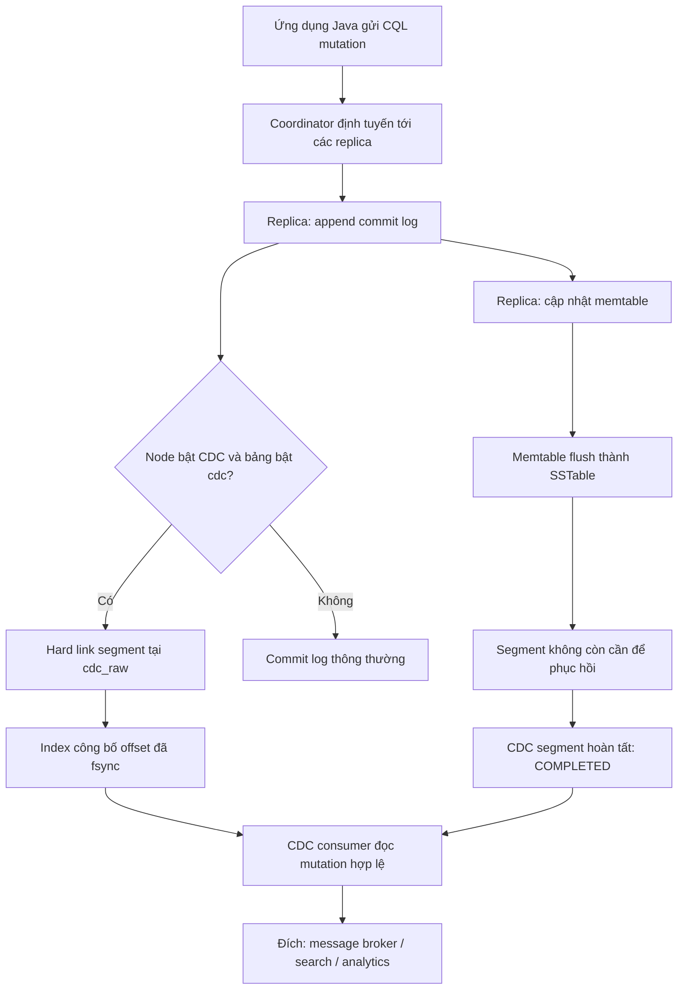

# CDC/commit log và điều kiện khai thác theo phiên bản trong Apache Cassandra

## 1. Mục tiêu và bối cảnh kiến trúc

Trong chương **Kiến trúc ứng dụng** của `DATABASE_ENGINE_WIDE_COLUMN_CASSANDRA`, bài này giải thích cách Apache Cassandra ghi dữ liệu vào **commit log**, cách **Change Data Capture (CDC)** tận dụng log đó để cung cấp các thay đổi cho hệ thống bên ngoài, và những điều kiện phải kiểm tra trước khi triển khai trên từng phiên bản. Đây là nền tảng để thiết kế ứng dụng Java, đồng bộ dữ liệu sang hệ thống tìm kiếm/phân tích, giám sát vận hành và xử lý sự cố trong một cơ sở dữ liệu wide-column phân tán.

Sau bài học, người đọc có thể:

1. Phân biệt commit log dùng để phục hồi node với CDC dùng để xuất thay đổi.
2. Giải thích đường đi của mutation từ ứng dụng tới replica, memtable, SSTable và `cdc_raw`.
3. Bật CDC đúng ở **node** và **bảng**, đọc offset an toàn, và nhận biết điều kiện đầy dung lượng.
4. Chọn cấu hình phù hợp với Cassandra 3.11, 4.0, 4.1 hoặc 5.0; tránh áp dụng tên tham số của phiên bản khác.
5. Thiết kế CDC consumer có checkpoint, xử lý trùng lặp, hồi phục và quan sát được.

> **Phạm vi:** Đây là CDC tích hợp trong **Apache Cassandra OSS**, dựa trên các đoạn commit log tại từng node. Không đồng nhất nó với CDC của dịch vụ tương thích CQL trên đám mây hoặc một connector thương mại: các sản phẩm đó có API, bảo đảm và tính năng riêng.

## 2. Commit log là gì, CDC thêm điều gì?

Mỗi lần một replica chấp nhận một **mutation** (ghi, cập nhật hoặc xóa), Cassandra đưa mutation vào **commit log** dạng append-only và vào **memtable** trong bộ nhớ. Memtable sau đó được **flush** thành SSTable bất biến. Nếu tiến trình bị dừng trước khi memtable được flush, commit log còn cần thiết sẽ được **replay** khi khởi động lại. Các segment không còn chứa dữ liệu cần phục hồi có thể được loại bỏ khỏi vòng đời commit log thông thường.

CDC là cơ chế chọn những bảng cần theo dõi (`WITH cdc = true`), lưu lại quyền truy cập vào commit log segment và cung cấp thông tin về phần bytes đã đồng bộ an toàn ra đĩa để **một tiến trình tiêu thụ bên ngoài** đọc và xử lý. Cassandra OSS không tự tạo một topic Kafka, webhook hay bảng sự kiện chuẩn hóa cho ứng dụng. Một agent hoặc consumer riêng phải đọc, giải mã và chuyển đổi mutation thành định dạng đích.

| Thành phần | Trách nhiệm | Vòng đời và lưu ý |
| --- | --- | --- |
| `commitlog_directory` | Ghi trước mutation để hỗ trợ phục hồi node | Cassandra tự quản lý segment phục vụ write path. Không được coi đây là hàng đợi dành cho ứng dụng. |
| Memtable / SSTable | Cập nhật trạng thái dữ liệu có thể truy vấn; flush từ RAM xuống SSTable | Flush/compaction là hoạt động của storage engine, không phải thao tác xuất CDC. |
| `cdc_raw_directory` | Nơi cung cấp các hard link tới segment liên quan CDC, kèm chỉ mục tiến độ | Consumer chịu trách nhiệm xử lý và dọn các file CDC đã hoàn tất, theo đúng giao thức. |
| `<segment>_cdc.idx` | Chứa offset tối đa đã được fsync; khi hoàn tất có thêm `COMPLETED` | Chỉ đọc dữ liệu tới offset được công bố; phải xử lý tình huống file index tạm thời rỗng. |

**Điểm phân biệt quan trọng:** commit log trên node hỗ trợ *độ bền của lần ghi tại node đó*, không phải nhật ký sự kiện toàn cluster với thứ tự toàn cục. CDC cũng không tự biến Cassandra thành event broker có exactly-once delivery.

## 3. Đường đi của một mutation



Đường đi trên là mô hình logic cho **mỗi replica**. Lưu ý những mốc thời gian khác nhau:

1. **CQL write được coordinator phản hồi** theo consistency level và chế độ đồng bộ commit log; chưa có nghĩa hệ thống nhận CDC đã xử lý xong.
2. **Commit log fsync**: phần bytes được xác nhận trong file chỉ mục có thể được consumer đọc như dữ liệu đã lưu bền vững trên đĩa. Với `commitlog_sync: periodic`, ACK của thao tác ghi có thể tới trước lần fsync; với `batch`, ACK phải chờ fsync theo ngữ nghĩa của chế độ này.
3. **Flush memtable**: chuyển trạng thái trong RAM thành SSTable; không đồng nghĩa toàn bộ sự kiện CDC đã được gửi tới đích.
4. **Consumer ghi vào đích và checkpoint**: là mốc nghiệp vụ riêng, do ứng dụng CDC kiểm soát. Nếu đích chậm hoặc consumer dừng, độ trễ CDC tăng dù Cassandra vẫn có thể đang chấp nhận ghi.

Một segment có thể chứa mutation của **nhiều bảng**. Vì vậy phải lọc đúng keyspace/table khi giải mã; không được giả định mọi mutation nằm trong một file `cdc_raw` đều thuộc bảng cần đồng bộ.

## 4. Bật CDC bằng CQL và cấu hình node

### 4.1. Ví dụ bảng wide-column theo truy vấn

Giả sử dịch vụ đơn hàng cần đọc đơn theo `tenant_id` + `order_id`, đồng thời chuyển các thay đổi trạng thái sang hệ thống tìm kiếm.

```sql
-- Ví dụ cho cluster nhiều node, với tên DC thực tế là dc1.
CREATE KEYSPACE IF NOT EXISTS commerce
WITH replication = {'class': 'NetworkTopologyStrategy', 'dc1': 3};

CREATE TABLE IF NOT EXISTS commerce.orders_by_id (
    tenant_id text,
    order_id uuid,
    status text,
    total decimal,
    updated_at timestamp,
    PRIMARY KEY ((tenant_id, order_id))
) WITH cdc = true;

-- Nếu bảng đã tồn tại, có thể kích hoạt CDC cho các mutation tiếp theo:
ALTER TABLE commerce.orders_by_id WITH cdc = true;

INSERT INTO commerce.orders_by_id
    (tenant_id, order_id, status, total, updated_at)
VALUES
    ('tenant-01', 11111111-1111-4111-8111-111111111111,
     'CREATED', 120000.00, toTimestamp(now()));

UPDATE commerce.orders_by_id
SET status = 'PAID', updated_at = toTimestamp(now())
WHERE tenant_id = 'tenant-01'
  AND order_id = 11111111-1111-4111-8111-111111111111;

DELETE FROM commerce.orders_by_id
WHERE tenant_id = 'tenant-01'
  AND order_id = 11111111-1111-4111-8111-111111111111;

-- Tắt thu thập cho các mutation tương lai khi thực sự không còn nhu cầu:
-- ALTER TABLE commerce.orders_by_id WITH cdc = false;
```

`PRIMARY KEY ((tenant_id, order_id))` tạo **khóa phân vùng tổng hợp**. Đây chỉ là ví dụ tra cứu đơn theo ID; với mô hình truy vấn khác, cần tạo bảng riêng và đánh giá phân bố khóa phân vùng. Đổi `dc1`, replication factor, địa chỉ node và quyền CQL theo cluster thật. Ví dụ không phù hợp với cluster một node nhưng đặt RF = 3.

CDC chỉ phản ánh các mutation **kể từ lúc đã bật** trên các node được cấu hình thích hợp. `ALTER TABLE ... WITH cdc = true` không tự xuất dữ liệu cũ đã có trong SSTable. Nếu cần đồng bộ đầy đủ, hãy làm một lần **snapshot/backfill** và thiết kế thời điểm chuyển sang theo dõi CDC để tránh mất khoảng chuyển tiếp hoặc xử lý trùng.

### 4.2. Cấu hình trên từng node

Trong `cassandra.yaml`, cần bật `cdc_enabled: true` trên **mọi node liên quan** và khởi động lại theo quy trình tương ứng với phiên bản/cluster. Có thể chỉnh thư mục lưu CDC để tránh cạnh tranh I/O không mong muốn và đặt ngưỡng dung lượng cho hệ thống. Tên tham số dung lượng khác nhau theo bản phát hành:

```yaml
# Cassandra 3.11 / 4.0 (ví dụ, đơn vị trong tên trường)
cdc_enabled: true
cdc_raw_directory: /var/lib/cassandra/cdc_raw
cdc_free_space_in_mb: 4096
cdc_free_space_check_interval_ms: 250
```

```yaml
# Cassandra 4.1 / 5.0 (ví dụ với kiểu đơn vị tường minh)
cdc_enabled: true
cdc_raw_directory: /var/lib/cassandra/cdc_raw
cdc_total_space: 4096MiB
cdc_free_space_check_interval: 250ms
```

Các giá trị trên chỉ minh họa **đúng tên trường** theo nhánh, chưa phải sizing cho production. Theo tài liệu Apache, `cdc_enabled` mặc định `false`; ngưỡng CDC mặc định là giá trị nhỏ hơn giữa **4096 MiB** và **1/8 dung lượng volume** chứa `cdc_raw`. Cần cân đối với tốc độ ghi trên từng node, kích thước segment, thời gian consumer có thể ngừng hoạt động và dung lượng dành cho hệ điều hành. Không copy nguyên một mẫu cấu hình khác phiên bản vào cluster đang chạy.

> **Điều kiện để bật trên production:** nâng cấp xong toàn bộ cluster tới phiên bản hỗ trợ, kiểm tra config trên từng node, xác nhận consumer đã hoạt động và có phương án tăng/dọn dung lượng. Tài liệu Cassandra 3.8 cảnh báo **không bật CDC trên cluster đang trộn phiên bản trong quá trình nâng cấp**.

## 5. Điều kiện khai thác theo phiên bản

Các nhánh Apache Cassandra không có cùng tên cấu hình, cơ chế hiển thị và tùy chọn điều hành. Hãy khóa tài liệu triển khai theo **minor/patch version cụ thể**, vì một số cải tiến CDC từng được backport.

| Nhánh | Cơ sở có thể dựa vào | Điều phải kiểm tra trước khi triển khai |
| --- | --- | --- |
| **Trước 3.8** | Không có CDC tích hợp theo cơ chế `WITH cdc = true` được giới thiệu ở 3.8. | Cần giải pháp khác (ví dụ dual write/outbox ở tầng ứng dụng), hoặc nâng cấp cluster. |
| **3.8–3.10** | CDC mới được giới thiệu; quá trình lưu segment sau flush là ràng buộc quan trọng của thiết kế ban đầu. | Không mặc định có khả năng đọc gần thời gian thực như các patch sau; kiểm tra chính xác hành vi `cdc_raw` và khả năng consumer hỗ trợ bản đang chạy. Không bật trên mixed-version cluster. |
| **3.11** | Tài liệu 3.11 mô tả `<segment>_cdc.idx`, offset đã fsync, dấu `COMPLETED` và `cdc_free_space_in_mb`. | Kiểm tra patch và tính tương thích parser; tên biến dùng hậu tố `_in_mb` / `_ms`. |
| **4.0** | Tài liệu 4.0 tiếp tục mô tả hard link, index, `COMPLETED` và đọc đến offset bền vững. | Vẫn dùng `cdc_free_space_in_mb` và `cdc_free_space_check_interval_ms` trong tài liệu nhánh 4.0. |
| **4.1** | Hỗ trợ mô hình CDC qua commit log; cấu hình sử dụng `cdc_total_space` và `cdc_free_space_check_interval` có đơn vị tường minh. | Điều chỉnh cấu hình khi nâng từ nhánh 4.0; test lại giới hạn dung lượng và agent. |
| **5.0** | Tiếp tục CDC trên commit log; tài liệu cấu hình 5.0 có `cdc_block_writes` và `cdc_on_repair_enabled`. | Cần xác định chính sách khi đầy CDC và tác động của repair/streaming; xác minh từng tùy chọn ở đúng bản build, không áp dụng ngược cho các nhánh cũ. |

**Đặc biệt ở 5.0** (theo tài liệu `cassandra.yaml` của Apache):

- `cdc_block_writes: true` (mặc định) sẽ **chặn các ghi có CDC** khi vượt giới hạn để giữ tính toàn vẹn của dòng thay đổi. Nếu đặt `false`, Cassandra có thể xóa CDC segment cũ để tiếp tục nhận ghi, đồng nghĩa consumer **có thể mất lịch sử thay đổi**. Chỉ chọn phương án này khi nghiệp vụ chấp nhận mất CDC và đã thiết kế khôi phục/backfill.
- `cdc_on_repair_enabled: true` (mặc định trong tài liệu 5.0) cho phép mutation liên quan streaming/repair đi qua write path/commit log; đặt `false` có thể giúp streaming nhanh hơn nhưng phải hiểu khả năng thiếu sự kiện CDC ở một số tình huống khôi phục replica. Việc repair có thể làm phát sinh sự kiện lặp; consumer phải chịu được.

Đừng suy ra rằng một connector ghi nhãn “hỗ trợ Cassandra 4.x” chắc chắn hiểu mọi định dạng segment/behavior trong 4.0 và 4.1. Với mỗi lần nâng phiên bản, nên thử **upgrade + CDC reader** trên cluster staging, bao gồm restart node, lưu lượng lớn, schema changes, repair và đầy dung lượng.

## 6. Đọc `cdc_raw` đúng cách

Một consumer đọc commit log trực tiếp cần hiểu đây là **định dạng binary nội bộ** theo phiên bản; không thể dùng `tail -f` và parse thành CQL. Apache Cassandra có `CommitLogReader`/`CommitLogReadHandler` trong Java để tham khảo, nhưng đây là API phía server, không phải API ổn định của Java CQL driver. Đối với production, cân nhắc một agent/connector hỗ trợ đúng phiên bản thay vì tự duy trì binary parser.

Quy trình logic an toàn cho một **node** và một **segment**:

1. Theo dõi segment trong `cdc_raw` và file index đi kèm. Nếu index chưa tồn tại/chưa có offset hợp lệ, chưa tự suy diễn vị trí byte có thể đọc.
2. Đọc offset `durableEnd` trong `<segment>_cdc.idx`. Một số phiên bản/tình huống I/O có thể đọc được file index tạm thời rỗng; **retry** thay vì coi đó là offset 0 hoặc file bị hỏng.
3. Chỉ giải mã các mutation hoàn chỉnh trong phạm vi **từ checkpoint tới `durableEnd`**. Không đọc bytes vượt chỉ mục dù file segment đã tăng kích thước trong page cache.
4. Lọc bảng có CDC và chuyển mutation thành bản ghi đích; giữ metadata cần thiết (node, segment, vị trí, bảng, partition key, timestamp của cell/tombstone...).
5. Sau khi đích **xác nhận bền vững**, lưu checkpoint của consumer. Nếu xảy ra sự cố giữa ghi đích và lưu checkpoint, chấp nhận replay và xử lý trùng bằng idempotency.
6. Khi index có `COMPLETED`, **toàn bộ bytes hợp lệ** đã xử lý và checkpoint bền vững, mới dọn hard link/file index CDC của segment đó. Không xóa file CDC còn đang được writer dùng hoặc khi consumer chưa bắt kịp.

Ví dụ thuật toán (mã giả, **không phải Java API có thể chạy ngay**):

```text
for each node and CDC segment in stable order:
    checkpoint = loadCheckpoint(nodeId, segmentId)
    (durableEnd, completed) = readIndexOrRetry(segment.idx)

    for mutation in decodeCompleteMutations(segment, checkpoint, durableEnd):
        if mutation.belongsToWatchedTable():
            event = toSinkRecord(mutation, nodeId, segmentId, mutation.offset)
            publishAndConfirm(event)       # đích đã nhận bền vững
        saveCheckpoint(nodeId, segmentId, mutation.nextOffset)

    if completed and checkpointReachesEnd() and sinkIsDurable():
        deleteOwnedCdcFiles(segment)       # chỉ các file CDC đã xử lý xong
```

Thuật toán còn phải hiện thực kiểm tra checksum, ghi checkpoint nguyên tử, thứ tự segment, retry, phân vùng workload và giới hạn bộ nhớ. Không tự xóa dữ liệu chỉ dựa trên việc đã *đọc* file vào RAM.

### 6.1. Mutation không nhất thiết là “sự kiện nghiệp vụ”

- Một `UPDATE` Cassandra có thể chỉ chứa **các cell đã thay đổi**, không phải ảnh đầy đủ trước/sau của cả row. `DELETE` được biểu diễn bằng **tombstone** (bao gồm xóa row/range/cell). Muốn tạo ảnh *after* đầy đủ, sink phải có logic materialize trạng thái hoặc truy vấn bổ sung, đồng thời chấp nhận race condition.
- Ghi có **TTL** mang thông tin hết hạn theo cell; việc dữ liệu tự hết hạn theo thời gian **không nên được giả định** là luôn phát sinh mutation CDC mới giống một câu lệnh `DELETE`. Thiết kế sink phải xử lý TTL bằng metadata/quy trình đối soát phù hợp.
- Một yêu cầu ghi có thể đến **nhiều replica**, vì vậy consumer gom CDC từ nhiều node có thể gặp sự kiện trùng về mặt dữ liệu; retry, hinted handoff, repair/streaming cũng làm tình huống phức tạp hơn. Không dựa vào một luồng toàn cluster có thứ tự tuyệt đối.
- Không dùng duy nhất `(partition_key, writetime)` làm khóa khử trùng, vì nhiều cell/mutation có thể chia sẻ timestamp. Có thể dùng `(nodeId, segmentId, offset)` để khử *replay cùng vị trí*, rồi xây cơ chế hòa giải trạng thái theo khóa + timestamp/tombstone của Cassandra tại sink.

### 6.2. Kết nối từ ứng dụng Java

Ứng dụng Java thông thường dùng **Apache Cassandra Java Driver** để gửi CQL tới Cassandra, không đọc `cdc_raw` qua driver. Ví dụ producer cập nhật bảng đã bật CDC:

```java
import com.datastax.oss.driver.api.core.CqlSession;
import com.datastax.oss.driver.api.core.DefaultConsistencyLevel;
import com.datastax.oss.driver.api.core.cql.PreparedStatement;
import com.datastax.oss.driver.api.core.cql.BoundStatement;

import java.net.InetSocketAddress;
import java.util.UUID;

try (CqlSession session = CqlSession.builder()
        .addContactPoint(new InetSocketAddress("127.0.0.1", 9042))
        .withLocalDatacenter("dc1")
        .build()) {

    PreparedStatement ps = session.prepare(
        "UPDATE commerce.orders_by_id SET status = ?, updated_at = toTimestamp(now()) " +
        "WHERE tenant_id = ? AND order_id = ?");

    BoundStatement write = ps.bind("PAID", "tenant-01",
            UUID.fromString("11111111-1111-4111-8111-111111111111"))
        .setConsistencyLevel(DefaultConsistencyLevel.LOCAL_QUORUM);

    session.execute(write);
}
```

Với `RF = 3` trong cùng datacenter, `LOCAL_QUORUM` yêu cầu đủ số replica phản hồi theo mức nhất quán đặt ra; **không có nghĩa** consumer CDC đã nhận hoặc đẩy xong sự kiện. Consumer thường chạy như tiến trình **riêng**, có quyền đọc thư mục trên từng Cassandra node (hoặc agent cài tại node) và xuất tới hệ thống đích. Cần thống nhất chính sách metadata, checkpoint, retry và bảo mật cho đường truyền ra ngoài.

## 7. Sizing, giám sát và xử lý lỗi

### 7.1. Dung lượng CDC là một tài nguyên có giới hạn

Tốc độ tạo CDC chịu ảnh hưởng của lượng mutation ghi vào từng replica, kích thước thực tế được serialize, tốc độ xoay segment, replication factor và cả mutation của bảng khác trong segment được giữ lại. Để lập kế hoạch, ước lượng theo **node**:

```text
CDC_bytes_moi_giay_tren_node
  ~= mutations_co_CDC_moi_giay_tren_node * kich_thuoc_mutation_da_ma_hoa
     + chi_phi_segment_va_mixed_table

thoi_gian_dem_tru_toan_ly_thuyet
  ~= dung_luong_kha_dung_cho_CDC / (toc_do_sinh_CDC - toc_do_tieu_thu)
```

Nếu tốc độ tiêu thụ lớn hơn hoặc bằng tốc độ sinh thì backlog không nhất thiết tăng liên tục, nhưng vẫn cần dung lượng dự phòng cho burst và sự cố. Mức `cdc_total_space` / `cdc_free_space_in_mb` tính cả **các active commit log segment có cho phép CDC** và các segment đã hoàn tất đang nằm tại `cdc_raw`; do đó không thể đo an toàn chỉ bằng kích thước file đã flush ở thư mục CDC.

### 7.2. Checklist vận hành

| Cần theo dõi | Dấu hiệu nguy hiểm | Cách xử lý |
| --- | --- | --- |
| Dung lượng/giới hạn CDC trên **từng node** | Gần ngưỡng, write tới bảng CDC bị từ chối | Kiểm tra consumer, tăng throughput xuất, xem lại sizing; không xóa mù segment chưa checkpoint. |
| **Lag** từ offset fsync tới checkpoint đích | CDC chậm dù CQL write vẫn thành công | Đo backlog theo node/segment, độ trễ sink, retry và lỗi parser. |
| Thông báo từ Cassandra | `Rejecting Mutation containing CDC-enabled table` hoặc lỗi ghi khi hết CDC | Ưu tiên khôi phục consumer và giải phóng các segment đã xử lý bền vững. |
| Restart/crash node/consumer | Replay một phần segment, sự kiện đích bị lặp | Resume từ checkpoint; sink phải xử lý idempotent và đối soát. |
| Repair, streaming, nâng cấp | Thay đổi tập mutation CDC hoặc định dạng reader | Chạy test tương thích, đối soát sink với snapshot nguồn. |
| Dung lượng ổ chứa commit log/CDC | Cạnh tranh I/O, đầy volume | Dành volume/dung lượng đủ lớn, giám sát theo node, phân quyền thư mục phù hợp. |

**Khi bị chặn ghi do đầy CDC**, thứ tự ứng phó an toàn là: xác nhận nguyên nhân trong log và metrics → kiểm tra consumer/đích → tiếp tục xử lý backlog và checkpoint → dọn **chỉ** file CDC đã xử lý hoàn chỉnh → tăng giới hạn hoặc công suất khi cần. Dọn thủ công các segment chưa tiêu thụ có thể khôi phục khả năng ghi nhưng sẽ tạo **lỗ hổng sự kiện**; phải có quyết định nghiệp vụ và phương án backfill trước khi làm.

**Lưu ý về consistency:** `ONE`, `LOCAL_QUORUM`, `QUORUM`... điều khiển số replica xác nhận thao tác CQL; chúng không xác nhận rằng toàn bộ CDC đã được xuất. Khi một replica chậm/mất kết nối rồi bắt kịp qua cơ chế phân tán, luồng CDC quan sát ở các node có thể không đồng bộ theo thời gian. Chỉ số theo dõi nên tách *write availability*, *CDC lag*, *sink completeness* và *độ trễ đối soát*.

## 8. Khi nào nên dùng CDC, khi nào cần kiến trúc khác?

| Nhu cầu | Hướng triển khai | Lý do |
| --- | --- | --- |
| Đồng bộ thay đổi **sau khi ghi** sang search/analytics, chấp nhận eventual consistency | CDC + agent/consumer + sink idempotent | Tận dụng mutation đã vào commit log, giảm việc sửa mọi tuyến ghi ứng dụng. |
| Khởi tạo kho dữ liệu mới từ bảng đang có hàng triệu row | Snapshot/backfill **kết hợp** CDC | CDC không phải công cụ tự động truy xuất toàn bộ lịch sử có sẵn. |
| Bắt buộc một sự kiện nghiệp vụ duy nhất, có schema ổn định, ordering theo aggregate | Thiết kế event/outbox ở tầng nghiệp vụ và cơ chế giao nhận riêng | Mutation cấp storage không mang toàn bộ ngữ nghĩa domain hay thứ tự toàn cục. |
| Cần ảnh `before/after` đầy đủ cho mọi row | Hệ thống materialization/changelog riêng hoặc pipeline hỗ trợ phù hợp | Commit log CDC chứa mutation, không mặc nhiên chứa ảnh trước/sau. |
| Không có người vận hành consumer, không giám sát được backlog/ổ đĩa | Chưa bật CDC production | Khi đầy vùng CDC, write availability hoặc độ đầy đủ CDC sẽ bị ảnh hưởng tùy chính sách. |

### Bài tập kiến trúc

Một cluster 3 node có keyspace `RF = 3`, bảng đơn hàng bật CDC, sink phân tích có thể dừng trong 30 phút. Hãy phác thảo thiết kế trả lời đủ các câu hỏi sau:

1. Dung lượng CDC phải dự phòng **trên mỗi node** như thế nào nếu toàn bộ 3 replica đều ghi mutation và sink ngưng trong 30 phút?
2. Một ACK CQL với `LOCAL_QUORUM` có bảo đảm bản ghi đã tồn tại trong Kafka không? Vì sao?
3. Consumer đang đọc offset `12000`, index công bố `15000`, sau đó tiến trình crash trước khi lưu checkpoint: khi chạy lại có thể xuất trùng ra sao?
4. Nếu bật CDC cho bảng đã có dữ liệu năm trước, cần backfill/snapshot thế nào để tránh bỏ sót giai đoạn chuyển tiếp?
5. Nếu chạy Cassandra 4.0 rồi nâng lên 4.1, tên hai cấu hình ngưỡng và chu kỳ kiểm tra CDC phải thay đổi ra sao?

**Gợi ý tự kiểm tra:** ACK CQL và ACK sink khác nhau; `COMPLETED` chưa đủ để xóa file nếu sink chưa bền vững; checkpoint theo node/segment/offset là điểm khởi động lại; mỗi nhánh Cassandra có tên cấu hình và khả năng tương thích reader cần đối chiếu.

## 9. Tài liệu gốc để đối chiếu trước khi vận hành

- [Apache Cassandra 3.11 — Change Data Capture](https://cassandra.apache.org/doc/3.11/cassandra/operating/cdc.html): index file, giới hạn CDC và tên tham số nhánh 3.11.
- [Apache Cassandra 4.0 — Change Data Capture](https://cassandra.apache.org/doc/4.0/cassandra/operating/cdc.html): quy trình CDC và tham số nhánh 4.0.
- [Apache Cassandra 4.1 — Change Data Capture](https://cassandra.apache.org/doc/4.1/cassandra/operating/cdc.html): tham số có đơn vị tường minh.
- [Apache Cassandra 5.0 — Change Data Capture](https://cassandra.apache.org/doc/5.0/cassandra/managing/operating/cdc.html): cách đọc segment và tiến độ fsync.
- [Apache Cassandra 5.0 — `cassandra.yaml` configuration](https://cassandra.apache.org/doc/5.0/cassandra/managing/configuration/cass_yaml_file.html): `cdc_block_writes`, `cdc_on_repair_enabled`, `cdc_total_space`, các mặc định và tác động.
- [Apache Cassandra — Learn How CommitLog Works](https://cassandra.apache.org/_/blog/Learn-How-CommitLog-Works-in-Apache-Cassandra.html): write path, vòng đời segment và mối quan hệ với CDC.

Các URL được ghim theo **nhánh phiên bản** để tránh nhầm giữa cấu hình mới và cũ. Hãy kiểm tra thêm tài liệu/release note của **patch version thực tế** đang triển khai và tính tương thích của agent/connector trước khi chuyển sang production.
