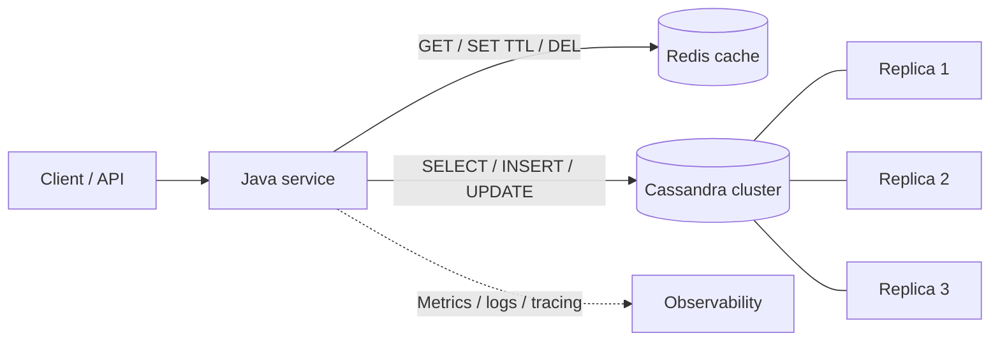
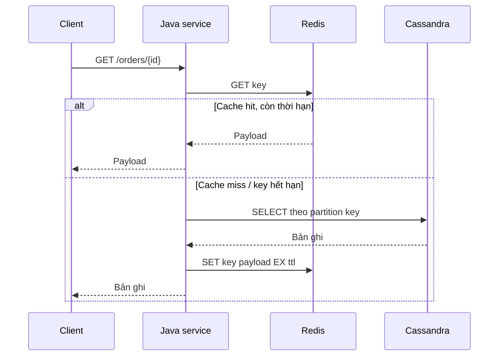
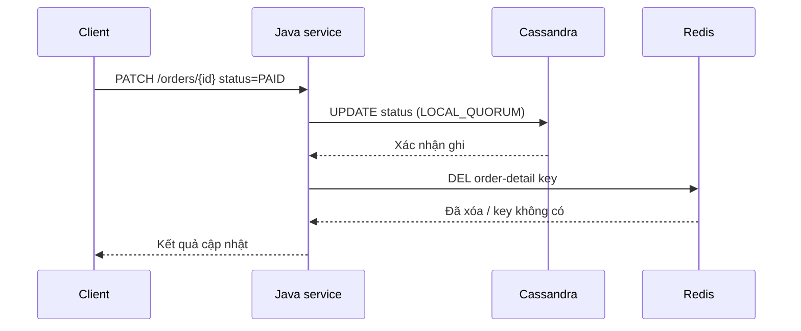

# Cache trước Cassandra và chính sách độ mới dữ liệu

## 1. Mục tiêu và bối cảnh

Trong hệ thống dùng **Apache Cassandra** làm kho dữ liệu wide-column phân tán, ứng dụng thường phải đáp ứng đồng thời hai yêu cầu: đọc nhanh cho hàng nghìn yêu cầu lặp lại và hiển thị dữ liệu đủ mới sau khi cập nhật. Đặt Redis, Memcached hoặc cache trong tiến trình Java trước Cassandra có thể giảm độ trễ và tải đọc, nhưng cũng tạo ra một bản sao dữ liệu nằm ngoài cơ chế nhất quán của Cassandra.

Bài này thuộc chương **Kiến trúc ứng dụng**, tập trung vào việc thiết kế cache theo các truy vấn Cassandra, kiểm soát độ cũ dữ liệu, chọn mức nhất quán đọc/ghi, xử lý race condition và lỗi vận hành khi kết nối từ ứng dụng Java.

Sau bài học, bạn có thể:

1. Phân biệt **consistency level của Cassandra**, **TTL lưu trữ trong Cassandra** và **TTL của cache ứng dụng**.
2. Chọn dữ liệu nên cache, thiết kế key có đủ ngữ cảnh truy vấn/tenant và nhận diện truy vấn không phù hợp để cache.
3. Triển khai quy trình **cache-aside** (đọc từ cache, miss thì đọc Cassandra) và **ghi Cassandra rồi vô hiệu hóa cache**.
4. Xác định một **ngân sách độ cũ dữ liệu** (freshness budget) theo nhu cầu nghiệp vụ thay vì chọn TTL tùy ý.
5. Phân tích lỗi ghi, mất sự kiện invalidation, cache stampede, đọc đồng thời và truy cập liên vùng.
6. Tổ chức mã Java, thử nghiệm và giám sát để cache giảm tải mà không che khuất vấn đề dữ liệu.

### 1.1. Tình huống xuyên suốt

Một dịch vụ quản lý đơn hàng sử dụng Cassandra để lưu trạng thái đơn. Người dùng mở trang chi tiết đơn liên tục, còn hệ thống thanh toán có thể cập nhật trạng thái `CREATED → PAID → SHIPPED`.

- Truy vấn chi tiết được gọi nhiều, dữ liệu thường không thay đổi trong vài giây: **có thể cache ngắn hạn**.
- Trạng thái đơn vừa được người dùng thanh toán: **nên đọc được trạng thái mới ngay trong luồng xác nhận**, hoặc có chính sách làm mới và thông báo rõ ràng.
- Quyết định có thu tiền lần nữa hay không: **không dựa vào giá trị cache có thể cũ**; cần đọc/ghi qua đường nghiệp vụ được kiểm soát nhất quán.

Vì vậy, “cache hit” là kết quả về tốc độ, **không tự động là bằng chứng dữ liệu mới**.

## 2. Đặt cache ở đâu trong kiến trúc?



Đây là **cache-aside**: ứng dụng quyết định khi nào đọc, nạp và xóa cache; Cassandra là nguồn dữ liệu có thẩm quyền đối với các bản ghi được mô tả trong ví dụ. Cache không tham gia vào quorum của Cassandra và không tự nhận thông báo khi một replica đổi giá trị.

| Tầng | Trách nhiệm | Điều không thể suy ra |
|---|---|---|
| Cassandra | Lưu trữ bền vững, phân vùng và nhân bản; đọc/ghi với consistency level đã chọn | Trả về giá trị từ cache ứng dụng hay xóa khóa Redis sau một lần ghi |
| Cache phân tán (ví dụ Redis) | Phục vụ bản sao theo khóa với TTL và thao tác invalidation | Luôn chứa phiên bản mới nhất của Cassandra |
| Cache cục bộ trong JVM (L1) | Giảm thêm một lần truy cập mạng cho dữ liệu rất nóng | Các JVM khác tự biết khóa cần xóa |
| Dịch vụ Java | Chọn key, thời hạn lưu, fallback, chính sách ghi và giám sát | Có giao dịch nguyên tử mặc định giữa Cassandra và Redis |

### 2.1. Khi nào nên cache?

Ưu tiên dữ liệu **được đọc lặp lại**, tốn chi phí tính toán hoặc tổng hợp, có working set vừa khả năng lưu cache và chấp nhận được một khoảng trễ nhỏ: thông tin hiển thị của sản phẩm, cấu hình ít đổi, chi tiết đơn dùng cho giao diện, danh sách có truy vấn ổn định. Đánh giá bằng số liệu hit rate dự kiến, kích thước giá trị, tần suất cập nhật, chi phí invalidation và thời gian tối đa dữ liệu được phép cũ.

Không nên tự động cache các quyết định đòi hỏi trạng thái tức thời như cấp quyền, hạn mức giao dịch, khấu trừ tiền hoặc kiểm tra tính duy nhất. Có thể cache phần **hiển thị** của các đối tượng đó nếu nghiệp vụ quy định rõ giới hạn độ cũ và kiểm tra quyết định quan trọng trên đường ghi có tính nhất quán thích hợp.

**Không cache mọi truy vấn.** Cassandra vốn được thiết kế bảng theo mẫu truy vấn; cache nên tăng tốc các query shape thực sự phổ biến, không phải che lỗi partition key hoặc quét dữ liệu. Nếu câu truy vấn Cassandra cần `ALLOW FILTERING` để phục vụ một đường nóng, trước hết phải xem lại mô hình bảng và partition key.

## 3. Thiết kế CQL theo truy vấn trước khi thiết kế khóa cache

Ví dụ một bảng phục vụ truy vấn `lấy đơn theo tenant_id + order_id`:

```sql
-- dc1 chỉ là tên datacenter minh họa; thay bằng tên DC thực tế.
CREATE KEYSPACE IF NOT EXISTS commerce
WITH replication = {'class': 'NetworkTopologyStrategy', 'dc1': 3};

CREATE TABLE IF NOT EXISTS commerce.orders_by_id (
    tenant_id  uuid,
    order_id   uuid,
    status     text,
    updated_at timestamp,
    PRIMARY KEY ((tenant_id, order_id))
);

-- Truy vấn đủ partition key: không cần quét các partition khác.
SELECT status, updated_at
FROM commerce.orders_by_id
WHERE tenant_id = 11111111-1111-1111-1111-111111111111
  AND order_id = 22222222-2222-2222-2222-222222222222;
```

Trong bảng này, mỗi cặp `(tenant_id, order_id)` là một partition key tổng hợp. Khi cần **danh sách đơn theo khách hàng và tháng**, nên thiết kế thêm bảng truy vấn riêng, chẳng hạn partition `(tenant_id, customer_id, year_month)` và clustering key theo thời gian. Tránh gom tất cả đơn của một tenant thành một partition lớn. Một bảng bổ sung kéo theo **một nhóm cache key và quy tắc invalidation bổ sung**.

### 3.1. Cache key phải biểu diễn chính xác kết quả truy vấn

Ví dụ cho chi tiết đơn:

```text
order-detail:v2:tenant=11111111-1111-1111-1111-111111111111:order=22222222-2222-2222-2222-222222222222
```

Ví dụ cho danh sách phân trang:

```text
order-list:v3:tenant=<tenant>:customer=<customer>:month=2026-11:page=0:size=20:sort=desc:status=PAID
```

Quy tắc chính:

- Thêm **tenant và phạm vi quyền truy cập** vào key khi chúng ảnh hưởng kết quả. Dữ liệu của tenant A tuyệt đối không được xuất hiện từ key tenant B. Tenant cần lấy từ ngữ cảnh xác thực đã kiểm chứng, không tin mù quáng giá trị client gửi.
- Bao gồm mọi yếu tố làm thay đổi đáp án: bộ lọc, sort, page/cursor, ngôn ngữ, projection, phiên bản API. Chuẩn hóa thứ tự tham số để các yêu cầu tương đương tạo cùng key.
- Dùng tiền tố phiên bản `v2`, `v3` khi định dạng payload hoặc ngữ nghĩa thay đổi. Khi triển khai phiên bản mới, khóa cũ sẽ tự hết hạn.
- Không đưa token truy cập, mật khẩu, dữ liệu nhạy cảm hoặc chuỗi truy vấn chứa thông tin riêng tư vào key/nhật ký. Kiểm soát truy cập ngay cả khi cache hit; mã hóa và đặt chính sách lưu trữ thích hợp nếu có PII.
- Với danh sách nhiều bộ lọc, một thay đổi đơn hàng có thể ảnh hưởng hàng loạt key. Cân nhắc **TTL ngắn cho danh sách** hoặc dùng chỉ mục nhóm key có thời hạn; không cố quét toàn bộ key Redis trong đường ghi.

## 4. Cache-aside: đường đọc cơ bản



Các bước thực thi:

1. Xác minh quyền truy cập, tạo key từ tham số truy vấn đã chuẩn hóa.
2. Đọc cache; nếu hit hợp lệ theo chính sách độ mới thì trả về.
3. Nếu miss, đọc Cassandra với consistency level phù hợp.
4. Với kết quả hiện hữu, ghi payload cùng TTL hữu hạn vào cache rồi trả cho client. **Lỗi ghi cache không nên làm mất kết quả đọc Cassandra** ở các API được phép fallback.
5. Với kết quả `không tồn tại`, chỉ negative-cache bằng sentinel và TTL rất ngắn nếu đã xem xét tác động lên luồng tạo mới.

Cache-aside tiết kiệm truy vấn Cassandra khi các lần đọc tiếp theo trúng cùng key. Nhưng ở bước 4 có cửa sổ cạnh tranh với một lệnh ghi, nên chỉ TTL + `DEL` chưa đủ cho mọi chính sách tức thời; xem mục 7.

### 4.1. Cache miss không đồng nghĩa bản ghi không tồn tại

`cache miss` chỉ nói **Redis không có key**. Cassandra có thể trả kết quả khác nhau tùy consistency level và thời điểm replica nhận dữ liệu. Nếu cache cả `NOT_FOUND`, một bản ghi vừa tạo có thể bị che cho đến khi sentinel hết hạn hoặc bị xóa. Đặc biệt với API tạo đơn rồi lập tức đọc đơn:

- Ưu tiên không cache `NOT_FOUND` trên đường cần thấy bản ghi mới ngay.
- Nếu phải chống các truy vấn ID không tồn tại, dùng TTL ngắn (ví dụ 1–3 giây tùy SLA) và xóa sentinel sau thao tác tạo thành công.
- Phân biệt lỗi Cassandra/timeout với `không có bản ghi`: **không cache lỗi hạ tầng thành `NOT_FOUND`**.

## 5. Đường ghi: cập nhật Cassandra rồi invalidation

Quy tắc mặc định cho trạng thái thay đổi thường xuyên là **ghi Cassandra trước, xóa cache sau**:



Với cache-aside, **xóa** thường dễ duy trì hơn ghi đè tất cả bản sao hoặc mọi dạng danh sách liên quan. `DEL` thành công làm lần đọc tiếp theo miss và nạp lại dữ liệu; `DEL` một key không có sẵn cũng được xem là kết quả hợp lệ. Không coi `SET cache` là một phần của transaction Cassandra.

Điểm cần làm rõ: Cassandra và Redis không có một commit nguyên tử chung. Kể cả khi Cassandra trả ghi thành công, JVM có thể crash trước `DEL`; hoặc Redis không sẵn sàng. Khi đó cache cũ vẫn có thể được phục vụ cho đến khi hết TTL. Do đó:

- **Chấp nhận cũ có giới hạn:** cache có TTL ngắn, ghi lỗi invalidation vào metric và hàng retry, để TTL đóng vai trò chặn cuối cùng.
- **Yêu cầu mới gần tức thì:** phát lệnh invalidation đáng tin cậy, hoặc dùng đường đọc bỏ qua cache sau khi ghi; nếu có nhiều writer, cần thêm quy tắc phiên bản/đồng bộ.
- **Yêu cầu chính xác tuyệt đối tại thời điểm quyết định:** bỏ qua cache cho quyết định đó, sử dụng thao tác Cassandra thích hợp (có thể cần LWT hay điều phối trạng thái nghiệp vụ) thay vì dựa vào cache-aside.

Đối với timeout khi ghi Cassandra, kết quả có thể **không rõ đã được áp dụng hay chưa**. Vô hiệu hóa key một cách phòng ngừa, truy vấn lại và thiết kế retry idempotent; tuyệt đối không mặc định timeout nghĩa là chắc chắn chưa ghi.

## 6. Độ mới dữ liệu là một hợp đồng nghiệp vụ

**Freshness** trả lời câu hỏi: “Bản ghi hiển thị có được phép khác trạng thái đã xác nhận trong Cassandra bao lâu?”. Các lớp thời gian sau không thay thế cho nhau:

| Cơ chế | Cấu hình/điều kiện | Ý nghĩa |
|---|---|---|
| Cassandra consistency level | Ví dụ đọc `LOCAL_ONE` hay `LOCAL_QUORUM`, ghi `LOCAL_QUORUM` | Số replica cần phản hồi; ảnh hưởng khả năng nhìn thấy ghi đã xác nhận |
| Cassandra TTL | `INSERT/UPDATE ... USING TTL <seconds>` hoặc TTL mặc định của bảng | Thời gian tồn tại của **giá trị lưu trữ**; hết hạn chuyển thành tombstone |
| Cache TTL | Ví dụ Redis `SET key value EX 20` | Thời gian cache giữ bản sao trước khi tự hết hạn |
| Invalidation | `DEL key`, sự kiện từ writer hoặc CDC | Cắt ngắn thời gian giữ bản sao sau khi dữ liệu đổi, nếu thông báo đến đúng và kịp |
| Freshness budget | Ví dụ UI cho phép chậm tối đa 30 giây | Cam kết do nghiệp vụ quyết định và phải được kiểm thử trên toàn đường dữ liệu |

### 6.1. Vì sao TTL không phải lời hứa “mới tối đa N giây” vô điều kiện?

Nếu mỗi cache miss luôn đọc được trạng thái hiện hành từ Cassandra và không kéo dài TTL bằng cách đọc lại cache, một entry có TTL `T` không tồn tại quá `T` từ lúc được nạp. Nhưng dữ liệu có thể cũ **ngay tại thời điểm nạp** nếu `LOCAL_ONE` đọc replica chưa nhận ghi, nếu sự kiện đồng bộ liên vùng đang trễ hoặc nếu có race đọc/ghi. Một miss sau đó có thể lại nạp cùng phiên bản cũ và đặt TTL mới. Vì thế, muốn **bảo đảm** độ cũ cần đo và kiểm soát cả:

```text
Độ cũ quan sát được = thời gian bản sao/cache không theo kịp nguồn hiện hành
                       + độ trễ đọc/nhân bản/invalidation, tùy đường thực tế

Mục tiêu SLO: P99 (now - source_updated_at của response) <= ngân sách độ cũ
```

`source_updated_at` chỉ đo được khi đồng hồ hệ thống được đồng bộ và ý nghĩa timestamp được xác định rõ. Nếu dùng nhiều writer, phải có **revision tăng đơn điệu hoặc thứ tự sự kiện được kiểm soát**; chỉ so sánh timestamp từ máy khách không đủ để chứng minh thứ tự thay đổi.

### 6.2. Chọn chính sách theo truy vấn, không theo toàn bộ hệ thống

| Trường hợp | Mức độ mới cần thiết (ví dụ minh họa) | Lựa chọn ban đầu để thử nghiệm |
|---|---|---|
| Danh mục sản phẩm, bài viết | Chấp nhận chậm vài phút | Cache-aside, TTL 1–5 phút, invalidation khi quản trị sửa |
| Danh sách đơn trên dashboard | Chấp nhận chậm vài chục giây | TTL 10–30 giây, cache key đủ filter/page, làm mới khi người dùng yêu cầu |
| Chi tiết đơn vừa cập nhật | Cần thấy thay đổi ngay trong phiên | `LOCAL_QUORUM` phù hợp DC, invalidation, client cập nhật kết quả ghi hoặc bypass cache cho lần đọc kế |
| Kiểm tra quyền/điều kiện thanh toán | Không chấp nhận quyết định trên trạng thái cũ | Không lấy quyết định từ cache; thao tác có kiểm soát ở nguồn dữ liệu |

Các số TTL trên là **giá trị khởi tạo để đo**, không phải thông số Cassandra/Redis bắt buộc. Chọn ngắn hơn khi rủi ro cũ cao, dài hơn khi truy vấn ổn định và việc giảm tải quan trọng; sau đó đo hit rate, chi phí miss và độ cũ thực tế.

### 6.3. Jitter và stale-while-revalidate

Không để hàng triệu key được nạp cùng lúc cùng hết hạn tại giây thứ 30. Có thể thêm **jitter** ngẫu nhiên nhỏ quanh TTL (ví dụ 20–30%) để giảm cache stampede, nhưng thời hạn dài nhất sau jitter phải vẫn nằm trong giới hạn nghiệp vụ.

**Stale-while-revalidate (SWR)** cho phép trả bản sao đã quá ngưỡng fresh trong một cửa sổ giới hạn, đồng thời làm mới nền. Khi dùng SWR, lưu riêng `fresh_until` và `stale_until`, đo số response phục vụ stale và không áp dụng cho đường yêu cầu trạng thái tức thời. SWR có chủ ý **nới dài thời gian cũ**; không được vừa bật SWR vừa công bố độ mới bằng TTL fresh ban đầu.

## 7. Những race condition quan trọng

### 7.1. Đọc cũ ghi lại vào cache sau khi đã `DEL`

```text
T0  Request A: cache miss, SELECT Cassandra nhận status=CREATED (A chưa SET)
T1  Request B: UPDATE Cassandra status=PAID thành công
T2  Request B: DEL cache key thành công
T3  Request A: SET cache key với status=CREATED, TTL=30s
T4  Request C: GET cache -> CREATED (cũ dù B đã DEL)
```

Đây là lỗ hổng thực của mô hình cache-aside đơn giản, ngay cả với `LOCAL_QUORUM`: truy vấn A hoàn thành trước khi B ghi. Có thể giảm xác suất bằng **double delete** (xóa khi ghi và xóa trễ một lần nữa), nhưng khoảng trễ tùy ý không tạo bảo đảm tuyệt đối.

Khi SLA chặt hơn, dùng một trong các chiến lược có thiết kế rõ:

1. **Versioned cache entry**: writer cung cấp revision tăng đơn điệu cho một aggregate; cache chỉ chấp nhận bản có revision không thấp hơn watermark đã công bố. Việc so sánh và ghi cache phải nguyên tử (ví dụ Redis Lua), và watermark phải đến đúng thứ tự. Đảm bảo chỉ hoạt động khi hệ thống có cơ chế cấp revision tin cậy.
2. **Bỏ qua cache ở đường read-after-write** trong phiên đã cập nhật; trả về snapshot từ kết quả ghi hoặc buộc đọc Cassandra. Nếu nhiều thiết bị/cụm dịch vụ cùng đọc, cần chính sách toàn hệ thống tương ứng.
3. **TTL ngắn + invalidation sau ghi** khi nghiệp vụ chấp nhận cửa sổ cũ hữu hạn và có giám sát. Đây thường là điểm xuất phát ít phức tạp nhất.

### 7.2. Hai writer cạnh tranh

Nếu writer X và Y cùng cập nhật một đơn, thứ tự `DEL` không cho biết thay đổi nào là cuối cùng. Cassandra giải quyết xung đột thông thường theo **timestamp ở mức giá trị (last-write-wins)**; timestamp không đại diện cho một transaction nghiệp vụ có thứ tự toàn cục. Với chuyển trạng thái hợp lệ (không thể chuyển `SHIPPED` về `CREATED`), cân nhắc **lightweight transaction** (`UPDATE ... IF ...`) hoặc một tác nhân điều phối từng aggregate, và kiểm soát idempotency. Cache không giải quyết được xung đột ghi tại nguồn.

### 7.3. Cập nhật một bản ghi ảnh hưởng nhiều view

`orders_by_id` có thể được cache cùng với danh sách `orders_by_customer_month`. Một lần đổi `status` ảnh hưởng key chi tiết và những danh sách có bộ lọc `status`. Lựa chọn thường gặp:

- Chi tiết: invalidation theo key chính xác.
- Danh sách/filter nhiều biến thể: TTL ngắn, hoặc đánh version theo nhóm (`customer-month`) để key cũ hết hiệu lực logic.
- Dashboard tổng hợp: chỉ invalidate các view có phụ thuộc được khai báo; không quét tất cả khóa bằng pattern trên đường xử lý request.

Denormalization trong Cassandra yêu cầu application duy trì nhiều bảng và view. Không giả định `BATCH` giữa nhiều partition tương đương một giao dịch ACID có isolation; nếu dữ liệu cần nhất quán đa bảng, thiết kế trạng thái trung gian và đối soát rõ ràng.

## 8. Consistency level của Cassandra và cache

Với replication factor **RF = 3 trong cùng một datacenter**, `LOCAL_QUORUM` đòi đa số replica trong DC đó, tức **2 replica** phản hồi. Khi cả read và write dùng `LOCAL_QUORUM`, tập replica đọc và ghi có giao nhau (`R + W > RF`), hỗ trợ việc nhìn thấy một ghi đã được xác nhận trong cùng DC, với các giả định của mô hình Cassandra. Sự bảo đảm này **không áp dụng cho cache hit**, vì Redis nằm ngoài tập replica.

| Ghi Cassandra | Đọc Cassandra sau ghi | Điều cần chú ý khi có cache |
|---|---|---|
| `LOCAL_QUORUM` | `LOCAL_QUORUM` cùng DC | Quorum giao nhau; vẫn phải invalidation/bypass cache; cần xét ghi đồng thời và timestamp |
| `LOCAL_ONE` | `LOCAL_ONE` | Có thể đọc replica chưa nhận mutation, rồi cache lại dữ liệu cũ |
| `LOCAL_QUORUM` tại DC A | `LOCAL_QUORUM` tại DC B | Quorum cục bộ mỗi DC không tự bảo đảm đọc ngay ghi ở DC khác; replication liên DC có độ trễ |
| Ghi timeout/không rõ kết quả | Bất kỳ CL nào | Không coi dữ liệu nguồn chắc chắn giữ nguyên; phải xử lý retry và invalidation phòng ngừa |

Ví dụ đặt consistency trong `cqlsh` để quan sát:

```sql
CONSISTENCY LOCAL_QUORUM;

INSERT INTO commerce.orders_by_id
    (tenant_id, order_id, status, updated_at)
VALUES
    (11111111-1111-1111-1111-111111111111,
     22222222-2222-2222-2222-222222222222,
     'CREATED', toTimestamp(now()));

SELECT status, updated_at
FROM commerce.orders_by_id
WHERE tenant_id = 11111111-1111-1111-1111-111111111111
  AND order_id = 22222222-2222-2222-2222-222222222222;
```

`now()` ở ví dụ là hàm sinh timeuuid dùng để tạo timestamp minh họa; không nên dùng `updated_at` từ các writer khác đồng hồ làm revision tuyệt đối. Đối với read-after-write sau một lệnh ghi mới, ứng dụng cũng cần xét mức nhất quán của **toàn bộ đường đọc**, khả năng timeout, chuyển vùng và các lần ghi đồng thời.

## 9. Cassandra TTL khác Redis TTL như thế nào?

```sql
-- Dữ liệu nguồn có thời hạn 24 giờ (ví dụ một snapshot tạm thời).
INSERT INTO commerce.orders_by_id
    (tenant_id, order_id, status, updated_at)
VALUES
    (11111111-1111-1111-1111-111111111111,
     33333333-3333-3333-3333-333333333333,
     'TEMPORARY', toTimestamp(now()))
USING TTL 86400;

-- Kiểm tra TTL còn lại của cột status (giây).
SELECT status, TTL(status)
FROM commerce.orders_by_id
WHERE tenant_id = 11111111-1111-1111-1111-111111111111
  AND order_id = 33333333-3333-3333-3333-333333333333;
```

Trong Cassandra, TTL áp lên các giá trị được ghi; một cập nhật sau đó có thể đặt lại hoặc loại bỏ TTL của cột tương ứng. Khi dữ liệu hết TTL, Cassandra biểu diễn việc hết hạn bằng **tombstone**, được quản lý bởi cơ chế compaction, `gc_grace_seconds` và repair. TTL dài/khác nhau trong cùng partition cũng ảnh hưởng hiệu năng compaction. Đây là chính sách **vòng đời dữ liệu ở nguồn**.

Trong Redis, `SET order-detail:key payload EX 30` chỉ xóa bản sao khỏi cache sau khoảng 30 giây. **Không có quan hệ tự động** giữa TTL Redis và TTL Cassandra. Nếu Cassandra đã hết hạn nhưng cache còn entry, API vẫn có thể trả dữ liệu không còn ở nguồn. Nếu nguồn có thời điểm hết hạn, hãy lưu `expires_at` trong payload hoặc tính TTL cache không vượt quá thời gian sống còn lại của dữ liệu, có chừa sai số đồng hồ và độ trễ.

Xóa/expire dữ liệu Cassandra sinh tombstone; việc dọn tombstone phụ thuộc vận hành compaction và repair. **Không dùng xóa Redis thay cho xóa dữ liệu nguồn**, nhất là khi có nghĩa vụ xóa dữ liệu lâu dài.

## 10. Kết nối từ Java: cấu trúc dễ kiểm soát

Mã dưới đây dùng **Apache Cassandra Java Driver 4.x** cho truy vấn đã chuẩn bị và một `CachePort` trừu tượng có thể cài bằng Redis/Lettuce/Jedis. Ví dụ minh họa cơ chế read-through qua service và invalidation; cần bổ sung cấu hình driver, serializer, metrics, timeout và retry phù hợp trước khi chạy production.

```java
import java.time.Duration;
import java.time.Instant;
import java.util.Optional;
import java.util.UUID;

import com.datastax.oss.driver.api.core.CqlSession;
import com.datastax.oss.driver.api.core.DefaultConsistencyLevel;
import com.datastax.oss.driver.api.core.cql.PreparedStatement;
import com.datastax.oss.driver.api.core.cql.Row;

record OrderDetail(UUID tenantId, UUID orderId, String status, Instant updatedAt) {}

interface CachePort {
    Optional<OrderDetail> get(String key);
    void put(String key, OrderDetail detail, Duration ttl);
    void evict(String key);
}

final class OrderService {
    private static final Duration CACHE_TTL = Duration.ofSeconds(20);

    private final CqlSession session;
    private final CachePort cache;
    private final PreparedStatement selectOrder;
    private final PreparedStatement updateStatus;

    OrderService(CqlSession session, CachePort cache) {
        this.session = session;
        this.cache = cache;
        this.selectOrder = session.prepare(
            "SELECT status, updated_at FROM commerce.orders_by_id " +
            "WHERE tenant_id = ? AND order_id = ?"
        );
        this.updateStatus = session.prepare(
            "UPDATE commerce.orders_by_id SET status = ?, updated_at = ? " +
            "WHERE tenant_id = ? AND order_id = ?"
        );
    }

    Optional<OrderDetail> find(UUID tenantId, UUID orderId) {
        // tenantId phải đến từ ngữ cảnh xác thực đã kiểm chứng.
        String key = cacheKey(tenantId, orderId);
        try {
            Optional<OrderDetail> cached = cache.get(key);
            if (cached.isPresent()) return cached;
        } catch (RuntimeException cacheFailure) {
            // Ghi metric / trace; fallback sang Cassandra nếu API cho phép.
        }

        Row row = session.execute(
            selectOrder.bind(tenantId, orderId)
                .setConsistencyLevel(DefaultConsistencyLevel.LOCAL_QUORUM)
        ).one();
        if (row == null) return Optional.empty(); // Không negative-cache trong ví dụ.

        OrderDetail current = new OrderDetail(
            tenantId, orderId, row.getString("status"), row.getInstant("updated_at")
        );
        try {
            cache.put(key, current, CACHE_TTL);
        } catch (RuntimeException cacheFailure) {
            // Truy vấn nguồn thành công vẫn được trả cho client.
        }
        return Optional.of(current);
    }

    void changeStatus(UUID tenantId, UUID orderId, String status) {
        String key = cacheKey(tenantId, orderId);
        try {
            session.execute(
                updateStatus.bind(status, Instant.now(), tenantId, orderId)
                    .setConsistencyLevel(DefaultConsistencyLevel.LOCAL_QUORUM)
            );
        } finally {
            // Kể cả khi Cassandra timeout, mutation có thể đã được áp dụng.
            try {
                cache.evict(key);
            } catch (RuntimeException cacheFailure) {
                // Đếm lỗi; gửi retry bền vững nếu freshness SLA yêu cầu.
                // TTL hữu hạn chỉ là cơ chế chặn cuối cùng.
            }
        }
    }

    private static String cacheKey(UUID tenantId, UUID orderId) {
        return "order-detail:v2:tenant=" + tenantId + ":order=" + orderId;
    }
}
```

**Giới hạn chủ động của ví dụ:** `UPDATE` ở Cassandra có ngữ nghĩa upsert; ví dụ giả định đơn đã tồn tại và một luồng nghiệp vụ khác xác nhận quyền đổi trạng thái. `finally` vô hiệu hóa cache cả khi ghi thất bại hoặc kết quả không chắc chắn, nhưng không tự tạo atomicity giữa hai hệ thống. Đường đọc `find` có race ghi-đọc tại mục 7; nếu yêu cầu freshness nghiêm ngặt, bổ sung revision/bypass theo hợp đồng. Trong sản phẩm thật, cần đo và ghi lỗi vào hệ thống observability, không để các `catch` rỗng như một chính sách xử lý lỗi.

### 10.1. Tích hợp CachePort với Redis

Cài đặt `CachePort` cần ít nhất ba lệnh: `GET`, `SET` có thời hạn, `DEL`. Ví dụ ngữ nghĩa qua Redis CLI:

```redis
SET order-detail:v2:tenant=demo:order=demo '{"status":"CREATED"}' EX 20
GET order-detail:v2:tenant=demo:order=demo
TTL order-detail:v2:tenant=demo:order=demo
DEL order-detail:v2:tenant=demo:order=demo
```

Trong sản phẩm thật, serializer phải kiểm tra schema/version, kích thước payload và dữ liệu thiếu; Redis `GET`/`SET` có thể timeout. Với TTL ngắn, không nên đặt lại TTL mỗi lần **GET** (sliding expiration) nếu freshness budget dựa trên thời điểm nạp ban đầu, vì mỗi cache hit có thể kéo dài cuộc sống của một giá trị cũ.

## 11. Các chiến lược invalidation mở rộng

| Chiến lược | Khi phù hợp | Rủi ro/chú ý |
|---|---|---|
| Cache-aside + xóa sau ghi | Dịch vụ kiểm soát mọi writer, độ cũ nhỏ có thể chấp nhận | Crash sau commit, race cache refill, nhiều view cần xóa |
| TTL ngắn, không chủ động xóa | Nội dung thay đổi hiếm, chấp nhận stale theo thời gian | Tốn Cassandra miss hơn, không thấy ngay thay đổi |
| Sự kiện `OrderChanged` qua hàng bền vững | Có nhiều service ghi/đọc cùng dữ liệu | At-least-once, trễ, mất/thứ tự sự kiện; consumer phải idempotent |
| CDC Cassandra → consumer invalidation | Có writer không đi qua một Java service | CDC cần được bật/vận hành, tiêu thụ log và theo dõi dung lượng; không phải cơ chế đồng bộ tức thì |
| Version/watermark trong cache | Có revision có thứ tự, SLA chặt hơn | Cần cập nhật và kiểm tra nguyên tử; thiết kế nhất quán version end-to-end |
| Không dùng cache cho truy vấn quan trọng | Quyết định không chấp nhận stale | Tốn chi phí Cassandra, cần kiểm soát throughput |

Nếu chọn **outbox/event-driven invalidation**, phải bảo đảm sự kiện không bị mất khi ứng dụng crash giữa ghi và publish. Một đường gửi sự kiện **best effort** không thể bảo đảm việc xóa cache. Hãy thiết kế durable publication và cơ chế đối soát theo hạ tầng thực tế; không giả định multi-partition batch của Cassandra là một transaction ACID có isolation.

Với **CDC**, Cassandra cung cấp cơ chế ghi thông tin thay đổi ở cấp bảng; phải cấu hình và quản lý consumer đọc commit log/CDC files. Nếu consumer bị chậm hoặc không xử lý dữ liệu, không thể hứa cache đã được xóa ngay; dung lượng log cũng là một rủi ro vận hành. Giám sát lag và kịch bản khôi phục trước khi dựa vào CDC cho chính sách độ mới.

### 11.1. Hai tầng cache và hai datacenter

Khi có `L1` trong từng JVM và `L2` Redis dùng chung, `DEL` ở Redis **không xóa L1**. Cần TTL L1 ngắn hơn, kênh invalidation/broadcast hoặc version check. Nếu một message bị bỏ lỡ, L1 có thể giữ giá trị cũ dù Redis đã mới.

Trong cụm Cassandra nhiều datacenter, bố trí cache theo region/DC và xem rõ người dùng đang đọc ở đâu. `LOCAL_QUORUM` tại DC B không mặc nhiên cho thấy ngay ghi được xác nhận tại DC A. Nếu yêu cầu **read-your-writes khi chuyển region**, có thể sticky-route về nơi ghi, gửi revision cần đọc, hoặc dùng đường đọc có cơ chế kiểm tra. Không nhầm lẫn consistency level ở Cassandra với phân phối sự kiện invalidation giữa các cache ở nhiều region.

## 12. Cache stampede, hot key và khả năng chịu lỗi

**Cache stampede** xuất hiện khi key rất nóng cùng lúc hết hạn, khiến nhiều request đồng thời miss và gửi truy vấn giống nhau đến Cassandra. Cách xử lý theo mức độ:

1. Jitter TTL và prewarm những key có traffic ổn định.
2. `singleflight` ở từng JVM: chỉ một request cho mỗi key được phép nạp; các request khác chia sẻ kết quả trong thời gian ngắn.
3. Nếu nhiều JVM cùng miss, dùng distributed lock ngắn có owner token, deadline và cơ chế nhả lock đúng chủ sở hữu; tránh giữ lock vô hạn. Không coi lock cache là lock bảo đảm toàn vẹn nghiệp vụ.
4. Giới hạn số truy vấn Cassandra đang chạy, request timeout, circuit breaker và bulkhead để không làm cluster sụp khi Redis mất kết nối.

Khi **Redis bị lỗi** và Cassandra còn khỏe, API đọc thường có thể đi thẳng Cassandra với giới hạn concurrency và timeout. Khi **Cassandra bị lỗi**, chỉ phục vụ stale nếu endpoint/khách hàng đã cho phép và payload chưa vượt `stale_until`; dữ liệu dùng quyết định tài chính/quyền truy cập phải trả lỗi rõ ràng hơn là tự dùng bản sao cũ. Khi cả hai tầng quá tải, áp dụng backpressure và trả lỗi có kiểm soát.

Tránh hot partition tại Cassandra, ngay cả khi hit rate cao: cache có thể biến mất bất ngờ. Thiết kế partition key, giới hạn kích thước partition và khả năng chịu tải miss vẫn phải độc lập hợp lý.

## 13. Giám sát và kiểm chứng freshness

### 13.1. Bộ chỉ số nên có

| Chỉ số | Câu hỏi cần trả lời |
|---|---|
| `cache_hit_rate`, `miss_rate` theo endpoint/query | Cache có thực sự giảm tải đọc? |
| `cache_get/set/del_latency_p95/p99`, `cache_errors` | Cache có thêm độ trễ hoặc tạo một điểm lỗi mới? |
| `cassandra_read/write_latency`, timeout và CL | Đường fallback chịu được tải không? |
| `invalidation_failure_count`, `event_consumer_lag` | Bản sao cũ có nguy cơ sống quá chính sách không? |
| `response_staleness_seconds` theo percentiles | Người dùng đang nhận dữ liệu cũ bao nhiêu giây? |
| `stampede_suppressed`, `hot_key_rate`, cache memory/evictions | Có key nóng hay hết dung lượng dẫn đến miss hàng loạt không? |
| `negative_cache_hit`, `stale_served_count` | Có đang che bản ghi mới hoặc phục vụ stale quá mức không? |

Việc đo độ mới cần một mốc thời gian/revision nguồn đáng tin. Nếu có nhiều writer và clock skew, dùng revision tăng theo quy tắc nghiệp vụ, so sánh với watermark từ event log, hoặc dùng kiểm thử đối chiếu có kiểm soát; tránh đọc `updated_at` rồi tuyên bố luôn có độ cũ chính xác tuyệt đối.

### 13.2. Ma trận thử nghiệm bắt buộc trước production

| Kịch bản | Hành động | Kỳ vọng |
|---|---|---|
| Hit và miss thông thường | Đọc cùng đơn hai lần | Lần đầu truy Cassandra và nạp cache; lần sau hit, khi TTL hết lại miss |
| Ghi thành công | `UPDATE` rồi `DEL` | Lần đọc sau nạp phiên bản mới trong điều kiện không có race |
| Cache chết | Chặn Redis tạm thời | API được phép fallback đọc Cassandra có giới hạn tải; metric báo lỗi |
| Cassandra timeout khi ghi | Tiêm timeout trong lúc update | Ứng dụng không đoán sai kết quả ghi, invalidation phòng ngừa và retry/đối soát |
| Read-refill race | Cố ý trì hoãn A sau `SELECT`, cho B ghi + `DEL`, rồi cho A `SET` | Quan sát cache bị cũ; đánh giá versioning hoặc TTL theo SLA |
| Nhiều request miss cùng key | Cho key nóng hết hạn, gửi tải đồng thời | Số truy vấn Cassandra được khống chế, không thành stampede |
| Bản ghi mới sau negative cache | Trước tiên đọc `NOT_FOUND`, sau đó tạo bản ghi | Không bị sentinel che quá TTL cho phép |
| Multi-DC / L1 | Ghi DC A, đọc DC B hoặc qua JVM khác | Hiểu độ trễ replication/invalidation và kiểm tra SLO theo vùng |
| TTL nguồn hết hạn | Đặt TTL Cassandra ngắn hơn cache và quan sát | Không còn phục vụ bản sao của dữ liệu đã hết hiệu lực theo quy định |

## 14. Bài thực hành tổng hợp

**Bài toán:** Dịch vụ Java phục vụ 2.000 lượt đọc chi tiết đơn/giây, trung bình một đơn được đọc 10 lần trong khoảng 20 giây. Trạng thái đơn có thể thay đổi; giao diện chấp nhận trễ tối đa khoảng 15 giây trong luồng xem thông thường, nhưng phải thấy kết quả thanh toán ngay sau thao tác của chính người dùng. Không dùng cache để quyết định có thu tiền.

**Yêu cầu triển khai:**

1. Dùng bảng `commerce.orders_by_id` được phân vùng theo `(tenant_id, order_id)`; ghi và đọc đường xác nhận trong một DC ở `LOCAL_QUORUM` khi RF cục bộ bằng 3.
2. Định nghĩa cache key chi tiết có tenant + order + schema version; chọn TTL khởi điểm **10 giây** (cộng jitter chỉ khi tổng thời hạn tối đa vẫn trong ngân sách) và `DEL` sau ghi.
3. Trả ngay trạng thái `PAID` từ kết quả thao tác thanh toán cho client, hoặc bypass cache ở lần đọc sau khi xác nhận; giữ truy vấn quyết định thanh toán trên đường nghiệp vụ authoritative.
4. Mô phỏng 100 request đồng thời sau cache expiry, quan sát truy vấn Cassandra; triển khai singleflight nếu cần.
5. Tái hiện timeline race mục 7.1 và ghi rõ vì sao `DEL` một lần không thể bảo đảm “không bao giờ đọc cũ”. Chọn chính sách khắc phục phù hợp với rủi ro chấp nhận.
6. Theo dõi hit rate, P95 độ trễ, staleness P99, số lỗi invalidation và tải Cassandra khi cache chết; điều chỉnh TTL dựa trên số liệu.

**Câu hỏi tự kiểm tra:**

1. Vì sao read/write `LOCAL_QUORUM` vẫn không đảm bảo cache hit trả dữ liệu mới?
2. Nếu `GET` Redis thành công, vì sao vẫn cần có `expires_at` hoặc revision đối với dữ liệu nhạy về thời điểm?
3. Điều gì xảy ra nếu JVM crash sau `UPDATE` Cassandra nhưng trước `DEL` cache?
4. Một người dùng tạo đơn rồi nhận `NOT_FOUND` từ cache trong 5 giây: có những nguyên nhân và cách khắc phục nào?
5. Khi một bảng Cassandra có TTL 24 giờ, đặt Redis TTL 48 giờ có rủi ro gì?
6. `LOCAL_QUORUM` ở DC B sau khi ghi ở DC A có tương đương read-after-write trong cùng DC không?

**Tiêu chí hoàn thành:** Giải pháp phải chỉ rõ đường đọc, đường ghi, khóa cache, TTL, phạm vi dữ liệu được phép cũ, cách xử lý miss/lỗi/race, tính nhất quán của Cassandra và phép đo chứng minh SLA. Một hit rate cao mà không có phép đo freshness không đủ để kết luận thiết kế thành công.

## 15. Ghi nhớ khi thiết kế

- **Cassandra consistency level** điều chỉnh số replica cần phản hồi; **cache invalidation** quản lý bản sao nằm ngoài Cassandra. Hai cơ chế cần thiết kế song song.
- **Cache TTL** là thời hạn bản sao; **Cassandra TTL** là thời hạn giá trị ở nguồn và khi hết hạn có thể tạo tombstone.
- Cache key phải đi theo **query shape**, tenant, phân trang, bộ lọc và phiên bản payload; không lấy cache làm cách sửa một truy vấn Cassandra thiết kế sai.
- Đường cơ bản là **cache-aside + ghi nguồn rồi xóa cache**. Quy trình này tốt cho nhiều API đọc nhiều/ghi ít nhưng vẫn có race và lỗi giữa hai hệ thống.
- **Freshness là hợp đồng theo nghiệp vụ**, cần nguồn timestamp/revision đáng tin, kiểm thử tình huống lỗi và đo thực tế theo percentile.
- Với quyết định không chấp nhận dữ liệu cũ, dùng đường dữ liệu có kiểm soát nhất quán; đừng để độ trễ thấp của cache đánh đổi thành sai lệch trạng thái nghiệp vụ.

### Tài liệu tham khảo

- Apache Cassandra Documentation, *Dynamo architecture and consistency levels*: https://cassandra.apache.org/doc/stable/cassandra/architecture/dynamo
- Apache Cassandra Documentation, *CQL Data Manipulation (`USING TTL`)*: https://cassandra.apache.org/doc/latest/cassandra/developing/cql/dml.html
- Apache Cassandra Documentation, *Tombstones, compaction, `gc_grace_seconds`*: https://cassandra.apache.org/doc/stable/cassandra/managing/operating/compaction/tombstones.html
- Apache Cassandra Documentation, *Change Data Capture*: https://cassandra.apache.org/doc/stable/cassandra/managing/operating/cdc.html
- Redis Documentation, *Cache-aside pattern*: https://redis.io/docs/latest/develop/use-cases/cache-aside/
