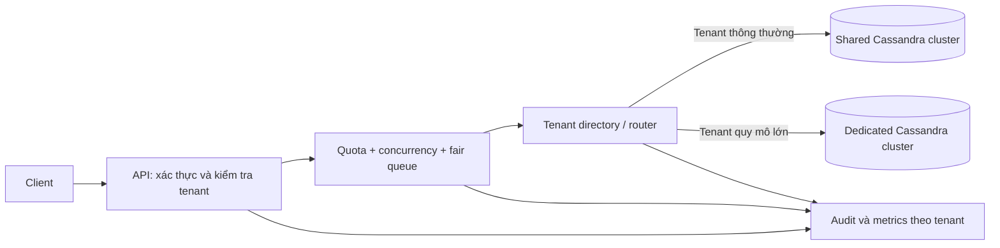

# Phân tách tenant, hạn mức tài nguyên và tenant có quy mô lớn trong Apache Cassandra

## 1. Bối cảnh và mục tiêu

Một hệ thống SaaS thường phục vụ nhiều **tenant** (tổ chức, khách hàng hoặc không gian làm việc) trên cùng một nền tảng. Mỗi tenant có người dùng, dữ liệu, quyền truy cập, lưu lượng và yêu cầu vận hành riêng. Với **Apache Cassandra**, bài toán đa tenant không chỉ là thêm cột `tenant_id`: Cassandra phân phối dữ liệu theo **partition key**, và các tenant dùng chung một cluster vẫn cạnh tranh CPU, mạng, ổ đĩa, compaction và năng lực xử lý request.

Bài này thuộc chương **Kiến trúc ứng dụng**, tập trung vào kiến trúc phân tán và mô hình wide-column của Cassandra, cách thiết kế bảng **theo truy vấn**, tổ chức partition/replication, cân nhắc mức nhất quán đọc ghi, cùng cơ chế giới hạn tài nguyên, vận hành, xử lý sự cố và tích hợp Java.

Sau khi học, bạn có thể:

- Chọn mức phân tách tenant phù hợp với quy mô, bảo mật và ngân sách.
- Thiết kế partition key giúp truy vấn được giới hạn theo tenant mà không hình thành partition quá lớn hoặc quá nóng.
- Xây dựng quota, admission control và backpressure ở lớp ứng dụng để giảm hiện tượng *noisy neighbor*.
- Nhận biết khi nào cần chuyển tenant lớn sang keyspace, cluster hoặc tuyến xử lý riêng.
- Lập kế hoạch giám sát, chuyển dữ liệu và kiểm thử tính cách ly trong môi trường Cassandra.

**Phạm vi:** Các ví dụ dùng CQL và các nguyên tắc phổ biến của Cassandra tự quản lý. Tính năng quota hoặc cô lập tài nguyên do một dịch vụ Cassandra được quản lý cung cấp có thể khác nhau; phải kiểm tra khả năng của sản phẩm và phiên bản cụ thể.

## 2. Ba loại cô lập cần tách bạch

Khi nói “tách tenant”, hãy xác định chính xác cần cô lập điều gì:

| Khía cạnh | Câu hỏi thiết kế | Biện pháp thường dùng |
| --- | --- | --- |
| **Dữ liệu và quyền truy cập** | Tenant A có thể xem hoặc sửa dữ liệu tenant B không? | Xác thực, ủy quyền, ánh xạ tenant tin cậy, predicate theo tenant trong mọi truy vấn, quyền CQL phù hợp |
| **Hiệu năng và tài nguyên** | Một tenant tải lớn có thể làm tenant khác tăng latency không? | Rate limit, concurrency limit, fair queue, tách luồng xử lý; cluster riêng nếu cần cô lập mạnh |
| **Vận hành và vòng đời dữ liệu** | Có thể đặt retention, sao lưu, phục hồi, schema hoặc lịch bảo trì riêng không? | Bảng/keyspace/cluster riêng tùy yêu cầu và chi phí |

**Cảnh báo:** `tenant_id` trong primary key giúp tổ chức dữ liệu và định tuyến truy vấn, **không tự động bảo đảm an toàn truy cập**. Cassandra không biết người dùng của API đang thuộc tenant nào. Lớp ứng dụng phải xác định tenant từ phiên đăng nhập hoặc token đã xác minh; không tin `tenant_id` do client tự gửi nếu chưa kiểm tra quyền.

## 3. Chọn mô hình lưu trữ đa tenant

### 3.1. So sánh các mô hình

| Mô hình | Mô tả | Ưu điểm | Giới hạn và khi nên dùng |
| --- | --- | --- | --- |
| **Shared tables, shared keyspace** | Nhiều tenant dùng chung bảng, primary key chứa tenant và các chiều phân vùng khác | Ít schema, dễ triển khai và giám sát; phù hợp số lượng tenant lớn | Cần kiểm soát quyền tại ứng dụng; cùng chịu tải, TTL, compaction và backup của bảng |
| **Keyspace/table riêng theo tenant trên cùng cluster** | Tenant có keyspace và bộ bảng riêng; replication thiết lập theo keyspace | Dễ phân quyền CQL theo keyspace, chọn schema/retention/replication hoặc vận hành theo nhóm tenant | Tăng số schema object và chi phí điều phối; vẫn chia sẻ node, CPU, disk, I/O và mạng; không tạo hard quota |
| **Cluster riêng theo tenant hoặc nhóm tenant** | Dữ liệu và lưu lượng ở hạ tầng Cassandra riêng | Cô lập hiệu năng, thay đổi cấu hình và sự cố tốt hơn; phù hợp hợp đồng/SLO đặc thù | Tốn vận hành, dung lượng dự phòng, giám sát, backup và chi phí tối thiểu mỗi cluster |
| **Hybrid** | Tenant nhỏ trên cụm chung, tenant lớn/nhạy cảm được định tuyến đến cụm riêng | Cân bằng chi phí và độ cô lập; cho phép mở rộng theo cấp dịch vụ | Cần tenant directory, router, kế hoạch di chuyển, giám sát và kiểm thử đường chuyển đổi |

Một **keyspace riêng** cho tenant là ranh giới cấu hình/ủy quyền và schema, **không phải** ranh giới tài nguyên vật lý. Ngược lại, cluster riêng có thể tạo ranh giới hạ tầng mạnh hơn nhưng vẫn phải cấu hình mạng, IAM, khóa mã hóa và quy trình vận hành tương ứng.

### 3.2. Cách ra quyết định

1. **Số tenant, tốc độ tăng tenant:** Hàng nghìn tenant nhỏ thường khiến “mỗi tenant một keyspace và nhiều bảng” trở nên cồng kềnh; shared tables thường đơn giản hơn.
2. **Độ lệch tải:** Một số tenant có throughput lớn vượt xa phần còn lại có thể cần luồng ingest riêng hoặc cluster riêng.
3. **Yêu cầu an ninh và hợp đồng:** Dữ liệu, vị trí lưu trữ, backup/restore và khả năng cô lập sự cố có thể buộc phải chọn mô hình riêng.
4. **Mẫu truy vấn:** Cấu trúc key phải phục vụ truy vấn phổ biến, không chỉ thuận tiện cho việc phân tách tenant.
5. **Khả năng vận hành:** Nếu chọn hybrid, hệ thống phải có cách biết tenant đang ở đâu và chuyển đổi an toàn.

Không nên áp một ngưỡng cố định như “trên 1 triệu bản ghi thì tách cluster”: quyết định phụ thuộc kích thước record, tốc độ đọc ghi, đặc điểm partition, retention, hot keys, replication factor và SLO.

## 4. Thiết kế bảng theo truy vấn và partition key

### 4.1. Vì sao `PRIMARY KEY (tenant_id, ...)` có thể gây hiểu lầm?

Cassandra dùng **partition key** để tính token và phân tán partition lên các replica. Với cú pháp:

```sql
PRIMARY KEY ((tenant_id, event_hour, shard), event_time, event_id)
```

- `(tenant_id, event_hour, shard)` là **composite partition key**, quyết định partition.
- `(event_time, event_id)` là **clustering columns**, quyết định thứ tự bản ghi bên trong partition.
- Thêm `tenant_id` vào partition key **không đồng nghĩa** mọi dữ liệu của một tenant được ghim vào một node hoặc một tập node riêng. Mỗi tổ hợp key được băm độc lập.
- Nếu chỉ dùng `tenant_id` làm partition key cho một bảng sự kiện tăng không giới hạn, một tenant lớn có thể tạo **wide/hot partition**: khó đọc, làm nặng compaction và tập trung lưu lượng trên các replica lưu partition đó.

Ví dụ dễ mắc lỗi:

```sql
-- Không phù hợp cho dòng sự kiện tăng liên tục của tenant.
CREATE TABLE events_bad (
    tenant_id uuid,
    event_time timestamp,
    event_id timeuuid,
    payload text,
    PRIMARY KEY ((tenant_id), event_time, event_id)
);
```

Partition của tenant sẽ không có giới hạn tự nhiên nếu dữ liệu được giữ lâu. `LIMIT 100` trên câu SELECT chỉ giới hạn số hàng trả về, **không làm partition đang lưu trở nên nhỏ hơn**.

### 4.2. Thiết kế cho truy vấn sự kiện theo giờ

Giả sử ứng dụng cần: “Lấy sự kiện mới nhất của tenant X trong một giờ”, với dữ liệu sự kiện bất biến và retention 14 ngày. Chọn bucket theo **giờ UTC** và shard để chia tải:

```sql
-- dc1 chỉ là tên ví dụ; thay bằng tên datacenter thật.
CREATE KEYSPACE saas_app
WITH replication = {
    'class': 'NetworkTopologyStrategy',
    'dc1': 3
};

CREATE TABLE saas_app.events_by_tenant_hour_shard (
    tenant_id uuid,
    event_hour timestamp,       -- Đầu giờ UTC: ví dụ 2026-11-21T08:00:00Z
    shard smallint,             -- Từ 0 đến N-1
    event_time timestamp,
    event_id timeuuid,
    event_type text,
    payload text,
    PRIMARY KEY (
        (tenant_id, event_hour, shard),
        event_time,
        event_id
    )
) WITH CLUSTERING ORDER BY (event_time DESC, event_id DESC)
  AND default_time_to_live = 1209600; -- 14 ngày, tính bằng giây
```

Câu truy vấn đọc đúng một partition và khoảng clustering key:

```sql
SELECT event_time, event_id, event_type, payload
FROM saas_app.events_by_tenant_hour_shard
WHERE tenant_id = ?
  AND event_hour = ?
  AND shard = ?
  AND event_time >= ?
  AND event_time < ?
LIMIT 100;
```

**Đánh đổi:** Với `N` shard, truy vấn “mọi sự kiện của tenant trong một giờ” phải đọc nhiều partition (có thể tới `N`), sau đó ứng dụng **merge theo thời gian**, phân trang và giới hạn tổng số kết quả. Không dùng `ALLOW FILTERING` để tránh phải thiết kế truy vấn đúng partition key. Một token phân trang phía API có thể cần lưu trạng thái của từng shard, khóa sắp xếp và thời điểm truy vấn; token cần được bảo vệ khỏi sửa đổi.

**Shard phải xác định được khi ghi và đọc:** ví dụ `shard = hash(event_id) mod N` với hàm hash ổn định, hoặc theo `source_id` nếu truy vấn luôn biết nguồn. Không thay `N` trực tiếp cho dữ liệu cũ vì sẽ gây sai định tuyến; dùng version của cấu hình shard, triển khai đọc cả thế hệ cũ và mới trong giai đoạn chuyển đổi, rồi backfill hoặc chờ TTL phù hợp.

### 4.3. Có cần bảng truy vấn theo ID?

Nếu API còn cần “lấy một sự kiện theo `event_id`”, bảng trên không đủ vì chỉ có `event_id` sẽ không xác định được `event_hour` và `shard`. Với Cassandra, thường **phi chuẩn hóa và viết nhiều bảng theo các truy vấn quan trọng**:

```sql
CREATE TABLE saas_app.event_by_tenant_id (
    tenant_id uuid,
    event_id timeuuid,
    event_time timestamp,
    event_type text,
    payload text,
    PRIMARY KEY ((tenant_id, event_id))
) WITH default_time_to_live = 1209600;

SELECT event_time, event_type, payload
FROM saas_app.event_by_tenant_id
WHERE tenant_id = ? AND event_id = ?;
```

Hai bảng lưu hai cách truy xuất cùng sự kiện. Việc ghi cần được thiết kế **idempotent** bằng ID ổn định, theo dõi lỗi ghi từng bảng và có cơ chế bù/đối soát nếu một lần ghi chỉ thành công một phần. Không mặc định rằng hai lệnh ghi sang hai partition là một giao dịch ACID xuyên partition. Tránh tạo logged batch lớn hoặc batch nhiều partition chỉ để tăng throughput; Cassandra batch không thay thế hàng đợi ingest có backpressure.

### 4.4. Kiểm soát kích thước partition và fan-out

Quy trình thiết kế bắt đầu từ truy vấn, rồi ước lượng:

\[
\text{dung lượng partition xấp xỉ} =
\frac{\text{số sự kiện mỗi bucket} \times \text{byte/sự kiện}}{\text{số shard}}
\]

Ước lượng này bỏ qua metadata, index, tombstone, nén, overhead trên đĩa và khác biệt phân bố. Cassandra không có một ngưỡng kích thước partition “tối ưu” cho mọi workload; với dữ liệu dạng log, nên hướng tới partition đủ nhỏ để đọc và compaction có thể dự đoán, thường xét cỡ **vài chục MiB** như một mốc đo thử, rồi kiểm chứng bằng tải thực tế và chỉ số partition size/tombstone.

Cân nhắc cùng lúc:

- **Bucket ngắn hơn** → partition nhỏ, nhiều partition hơn và fan-out tăng khi đọc khoảng thời gian dài.
- **Shard nhiều hơn** → giảm tập trung ghi trên một partition, tăng số truy vấn/merge khi đọc toàn bộ tenant.
- **Shard theo chiều truy vấn** (như `source_id`, `device_id`) → hiệu quả nếu API thường đọc theo nguồn; không hữu ích nếu mọi truy vấn đều cần timeline toàn tenant.
- **Partition quá nhiều hàng/tombstone** → tăng chi phí đọc và compaction; TTL không xóa dữ liệu ngay tại thời điểm hết hạn.

Nếu API luôn yêu cầu timeline toàn tenant theo thời gian thực ở tốc độ rất cao, hãy cân nhắc duy trì một **read model** chuyên cho timeline/aggregated view bên cạnh dữ liệu gốc; việc cố gắng dùng một partition key cho mọi truy vấn thường tạo fan-out lớn hoặc hot partition.

## 5. Kiến trúc ứng dụng: định danh, định tuyến và quyền truy cập



Luồng request đáng tin cậy:

1. API xác thực principal; lấy `tenant_id` từ membership/claims đã xác minh, rồi kiểm tra quyền với tài nguyên cụ thể. Nếu API cho phép chọn tenant, phải đối chiếu tenant đã chọn với membership.
2. Admission control tính **chi phí request** và xét quota trước khi chạm Cassandra.
3. Router đọc `tenant_directory` (tenant → placement, version, mức dịch vụ, trạng thái migration). Cache có TTL và cơ chế làm mới, nhưng không cho một request đi nhầm cluster do config cũ.
4. Repository dùng **prepared statement có ràng buộc tenant** và đúng bảng theo mẫu truy vấn. Không đưa tên keyspace/table chưa kiểm duyệt từ input client vào CQL động.
5. Ghi metric/audit và trả lỗi rõ ràng; mỗi trang kết quả hoặc tác vụ async tiếp theo đều phải tuân thủ ngân sách tài nguyên.

**Quy tắc bảo mật bắt buộc:** Mọi API truy vấn/bulk export/cập nhật/xóa phải mang ngữ cảnh tenant và có kiểm tra ủy quyền. Test phải chứng minh request của A không thể đọc/sửa dữ liệu B, kể cả khi sử dụng ID tài nguyên hợp lệ của B. Với shared table, quyền CQL thường nằm ở tài khoản dịch vụ ứng dụng và **không thay** kiểm tra tenant ở ứng dụng.

## 6. Hạn mức tài nguyên: kiểm soát ở đâu?

### 6.1. Các quota thực tế

| Nhóm quota | Ví dụ | Điểm thực thi phù hợp |
| --- | --- | --- |
| **Tốc độ request** | 100 read/s, 30 write/s mỗi tenant, cho phép burst ngắn | API gateway/ingest worker, token bucket hoặc leaky bucket |
| **Đồng thời** | Tối đa 20 CQL requests đang xử lý cho một tenant | Semaphore/limiter tập trung theo tenant trước driver |
| **Độ lớn công việc** | Kích thước payload, số bản ghi tối đa/batch, số page/bộ lọc, phạm vi thời gian | Validation tầng API/worker |
| **Tốc độ ingest** | Byte/s hoặc event/s, có hàng đợi và backpressure | Kafka/queue partitioning, fair scheduler theo tenant |
| **Lưu trữ và retention** | Ngân sách GB hoặc số ngày dữ liệu theo gói | Theo dõi logical usage, TTL, retention policy, cảnh báo/khóa ingest có kiểm soát |
| **Truy vấn đắt tiền** | Giới hạn fan-out, aggregate hoặc export đồng thời | Query planner, scheduler, job queue |

Trong Cassandra OSS, quota cứng theo tenant cho CPU, RAM, network hoặc disk của **shared table** không phải cơ chế mặc định có thể dựa vào. Giới hạn API giúp kiểm soát tải vào, nhưng không chứng minh hai tenant đã được cô lập hoàn toàn: compaction, repair, GC, disk và các request ngoài API vẫn dùng tài nguyên cluster chung.

Đặc biệt, **TTL chỉ là chính sách giữ dữ liệu**, không phải hard quota về dung lượng. Dữ liệu đã hết hạn tồn tại dưới dạng tombstone/được dọn theo quy trình compaction và điều kiện an toàn; tốc độ thu hồi dung lượng không tức thời. Nếu hợp đồng đòi giới hạn lưu trữ chặt, cần theo dõi usage và cơ chế chủ động từ chối/giảm ingest, đồng thời tính dung lượng dự phòng.

### 6.2. Token bucket và concurrency limit

Mỗi tenant có bucket với tốc độ nạp `r` token/giây, sức chứa `B`. Tại thời điểm `t`:

\[
tokens(t)=\min\big(B,\ tokens(t_0)+r\times(t-t_0)\big)
\]

Request có `cost` được nhận nếu `tokens ≥ cost`; nếu không, trả `429 Too Many Requests` hoặc đưa vào hàng đợi có giới hạn, kèm chính sách retry/backoff. `cost` có thể lớn hơn 1 cho một truy vấn fan-out, export hoặc ghi payload lớn. **Giới hạn concurrency** bổ sung vì request/s thấp nhưng mỗi request rất lâu vẫn làm đầy hàng đợi của Cassandra.

Ví dụ luồng xử lý (mã giả):

```text
principal = authenticate(request)
tenant = authorizeTenant(principal, request.resource)
plan = planQuery(request)              # xác định partition, fan-out, page size
validate(plan.maxPartitions, plan.maxRows, plan.timeRange)
if not tenantRateLimiter.consume(tenant, plan.cost):
    return HTTP 429 with retry hint
permit = tenantConcurrencyLimiter.tryAcquire(tenant, plan.kind)
if permit is absent:
    return HTTP 429 or bounded queue
try:
    placement = tenantDirectory.resolve(tenant)
    return executeWithTimeoutAndPaging(placement, plan)
finally:
    permit.release()
```

Nếu hệ thống chạy nhiều instance API, quota phân tán cần chia ngân sách giữa instance hoặc dùng coordinator chung (ví dụ Redis + thao tác nguyên tử). Chỉ dùng map/token bucket trong từng pod sẽ nhân giới hạn thực tế lên theo số pod. Với outage của hệ thống quota, phải **xác định chính sách fail-open/fail-closed theo nghiệp vụ**; không mặc định bỏ qua quota trên mọi đường ingest.

### 6.3. Ngăn tenant ồn làm chậm cả hệ thống

- Tách read/write/export thành **hàng đợi và pool xử lý** phù hợp; ưu tiên tác vụ tương tác hơn bulk job.
- Giới hạn inflight và số tác vụ pending **theo tenant và toàn hệ thống** để tránh queue không giới hạn.
- Dùng weighted fair scheduling nếu các gói dịch vụ có ngân sách khác nhau; luôn có giới hạn tổng bảo vệ cluster.
- Giới hạn page size, khoảng thời gian truy vấn, fan-out và timeout; không cho client tạo truy vấn quét cluster.
- Retry có **exponential backoff + jitter**, deadline tổng và ngân sách retry. Retry đồng loạt khi cluster đang nghẽn có thể khuếch đại quá tải.
- Giữ pool/session Cassandra có vòng đời dài theo cluster; không tạo session mới trên mỗi request hoặc mỗi tenant ở mô hình shared cluster.

## 7. Tenant lớn (*whale tenant*): phát hiện, xử lý, di chuyển

### 7.1. Dấu hiệu một tenant cần tuyến riêng

Quan sát theo tenant tại application layer: request/s, byte/s, dung lượng và tốc độ tăng, tổng số partition chạm mỗi truy vấn, latency p95/p99, timeout, retry, tỷ lệ quota bị từ chối, backlog ingest. Ở Cassandra layer: partition size, hot partitions, write/read latency, dropped messages, pending compactions, tombstone warnings, disk usage và GC.

Nếu một tenant gây tải đỉnh làm tăng p99 cho tenant khác mặc dù đã chia bucket/shard và giới hạn request, cần cân nhắc **dedicated ingest workers**, **keyspace/table riêng để tách retention/schema**, rồi **cluster riêng** khi cần cô lập tài nguyên vật lý/SLO.

### 7.2. Bài toán dung lượng mẫu

Một tenant sinh trung bình **120 event/s**, khoảng **1 KiB/event**, giữ **14 ngày**, replication factor **3**:

- Số event trong 14 ngày: `120 × 86.400 × 14 = 145.152.000`.
- Dữ liệu logic ước tính: `145.152.000 × 1 KiB ≈ 138,4 GiB`.
- Ba bản sao: `≈ 415,3 GiB` trước overhead, compaction headroom, snapshot và dự phòng.
- Mỗi giờ khoảng `120 × 3.600 = 432.000` event, tức **~422 MiB** dữ liệu logic. Với 16 shard chia đều, mỗi partition một giờ khoảng **26,4 MiB** trước overhead.

Đây chỉ là ước lượng để mở đầu load test. 16 shard đồng nghĩa truy vấn timeline toàn giờ có thể phải đọc 16 partition; nếu truy vấn 24 giờ, fan-out có thể tới 384 partition. Tăng số shard để giảm partition size sẽ làm truy vấn gom kết quả tốn kém hơn. Phải kiểm thử với phân bố tải và query mix thực tế; không suy ra cluster size chỉ từ dung lượng nhân replication factor.

### 7.3. Tenant directory và định tuyến hybrid

Một bản ghi directory (nằm ở control plane tin cậy) có thể bao gồm:

```json
{
  "tenantId": "2b28c6f1-2f68-4c90-b76c-baf199e784c3",
  "placement": "shared-ap-southeast",
  "schemaVersion": 3,
  "shardConfigVersion": 2,
  "state": "ACTIVE",
  "routeVersion": 17
}
```

Tên placement phải ánh xạ qua cấu hình server, không nối trực tiếp thành CQL từ request. Đổi placement là một **sự kiện kiến trúc**: cần quản lý phiên bản route, cache invalidation, drain các request cũ và nhất quán giữa writer/reader.

### 7.4. Quy trình chuyển tenant sang cluster riêng

1. **Khảo sát và chốt ranh giới:** Liệt kê đầy đủ bảng theo truy vấn, bucket/shard đã dùng, TTL, tombstone, secondary index/materialized view nếu có, đối tượng liên quan và SLO. Xác định source of truth cho từng loại dữ liệu.
2. **Chuẩn bị đích:** Tạo keyspace/table, replica placement, quyền, driver/session, backup, metrics và quy trình phục hồi. Chạy load test trên mẫu workload của tenant.
3. **Đồng bộ dữ liệu lịch sử:** Backfill theo manifest các partition/bucket của tenant; tiến hành theo lô, throttle và checkpoint. Không giả định lọc `tenant_id` trên bảng chung luôn truy vấn được nếu partition key cần thêm bucket/shard.
4. **Bắt kịp delta:** Có thể sử dụng event log/outbox có thứ tự và idempotent consumer, CDC nếu đã xây dựng pipeline đúng, hoặc dual-write có đối soát. Cần mô hình xử lý ghi lỗi một phía và sửa sai; dual-write đơn thuần không tự bảo đảm atomicity.
5. **Đối soát:** So sánh đếm bản ghi có kiểm soát, checksum theo partition/bucket, mẫu truy vấn, trường hợp update/delete/TTL và trạng thái recent writes; theo dõi độ trễ đồng bộ.
6. **Chuyển route có kiểm soát:** Chốt điểm cutover, hạn chế writer cũ hoặc dùng fencing/version, làm mới router cache, cho đọc đích và quan sát kết quả. Lưu đường rollback cùng tiêu chí rõ ràng.
7. **Theo dõi và thu dọn:** Chỉ ngừng dữ liệu cũ khi đã hoàn tất khoảng quan sát/rollback và xác nhận consistency. Xóa/đóng tài nguyên theo quy trình có khả năng khôi phục.

Với sự kiện bất biến, ghi idempotent thường dễ hơn dữ liệu cập nhật/xóa thường xuyên. Với dữ liệu có nhiều sửa đổi, timestamp, TTL, tombstone và thứ tự sự kiện có thể khiến backfill ghi đè dữ liệu mới; cần chiến lược version và chống ghi trễ cụ thể.

## 8. Replication, consistency và vận hành trong mô hình đa tenant

### 8.1. Replication và mức nhất quán

`NetworkTopologyStrategy` cho phép cấu hình số replica theo datacenter tại **keyspace**. Nếu dùng chung keyspace, các bảng/tenant trong keyspace dùng cùng chiến lược replication. Tách keyspace có thể đặt replication riêng, nhưng các keyspace trong cùng cluster vẫn chia sẻ hạ tầng.

Ví dụ với `RF=3` trong `dc1`:

- `LOCAL_ONE`: thường độ trễ thấp và chịu lỗi đọc/ghi tốt hơn trong một số trường hợp, nhưng có thể đọc dữ liệu chưa phản ánh ghi gần nhất.
- `LOCAL_QUORUM`: cần phản hồi từ đa số replica cục bộ (2/3); nếu cả ghi và đọc cùng dùng `LOCAL_QUORUM` và điều kiện replica/topology phù hợp, quorum giao nhau, giúp đạt cam kết nhất quán mạnh hơn so với `ONE`.
- Consistency level **không biến một chuỗi thao tác nhiều bảng thành transaction**. Khi cần so sánh/đặt điều kiện trên một thực thể, cân nhắc **lightweight transaction (LWT)** với giới hạn phạm vi và chi phí latency.

Chọn consistency level theo **yêu cầu nghiệp vụ**, không chỉ theo tier tenant. Tenant lớn ghi nhiều có thể cần throughput cao, nhưng chọn `LOCAL_ONE` thay `LOCAL_QUORUM` phải dựa trên việc ứng dụng chấp nhận stale read hay không. Luôn ghi rõ read/write CL, retry policy và timeout trong hợp đồng API.

### 8.2. TTL, compaction, repair và backup

| Chủ đề | Tác động đến đa tenant |
| --- | --- |
| **TTL/tombstones** | Tenant sinh nhiều bản ghi hết hạn có thể làm đọc/compaction chậm cho các tenant khác trong bảng chung; tránh quét partition rộng qua nhiều tombstone |
| **Compaction** | Chính sách compaction đặt theo **table**, không phải mỗi tenant trong shared table; dữ liệu time-series có TTL theo cửa sổ có thể cân nhắc TWCS nếu pattern phù hợp và kiểm tra tác động của ghi trễ |
| **Repair** | Anti-entropy repair cần được vận hành đúng lịch và theo phạm vi hỗ trợ của phiên bản; dữ liệu shared table vẫn là tài nguyên chung, repair có thể tăng tải cho mọi tenant |
| **Backup/restore** | Snapshot/backup Cassandra thường được thao tác theo node/keyspace/table; restore **một tenant trong shared table** cần công cụ lọc/khôi phục và kiểm tra logic riêng |
| **Schema change** | Thay đổi shared table ảnh hưởng mọi tenant. Keyspace/table riêng giúp khác biệt schema nhưng tăng chi phí triển khai và kiểm soát phiên bản |

Không sử dụng compaction hoặc repair như công cụ quota tức thời. Trước các tác vụ bảo trì lớn, kiểm tra disk headroom, traffic và giới hạn IO; theo dõi ảnh hưởng đến p99 ứng dụng của từng nhóm tenant.

### 8.3. Xử lý sự cố *noisy neighbor*

Giả sử p99 read của toàn hệ thống tăng đúng lúc một tenant thực hiện bulk export:

1. Dùng metric ứng dụng xác định tenant, endpoint, lượng fan-out, concurrency và retry đang tăng.
2. Kiểm tra latency/dropped requests/compaction/disk/GC tại Cassandra để tìm nút cổ chai thực sự; tránh quy mọi sự cố cho tenant có request/s cao nhất.
3. Giảm tốc/quy mô export bằng rate/concurrency cap; ưu tiên request tương tác, áp dụng queue có giới hạn và thông báo `429`/trạng thái job phù hợp.
4. Xác minh p95/p99 và lỗi của **các tenant khác** hồi phục; đồng thời đo tiến độ và backlog của tenant đang bị throttling.
5. Nếu tái diễn, sửa query model, giảm fan-out, bố trí dedicated workers hoặc chuyển placement; ghi lại ngưỡng cảnh báo và kịch bản xử lý.

## 9. Kết nối từ ứng dụng Java

Với Java driver Cassandra 4.x, **tái sử dụng `CqlSession` dài hạn theo cluster** và `PreparedStatement` theo phiên làm việc. Với kiến trúc hybrid, một session registry có thể ánh xạ placement hợp lệ đến session tương ứng. Không khởi tạo `CqlSession` trên mỗi HTTP request.

Ví dụ minh họa truy vấn đã biết tenant, bucket và shard (sau khi authorization và quota đã thông qua):

```java
// Khai báo một lần khi khởi tạo repository trên session phù hợp.
PreparedStatement findEvents = session.prepare(
    "SELECT event_time, event_id, event_type, payload " +
    "FROM saas_app.events_by_tenant_hour_shard " +
    "WHERE tenant_id = ? AND event_hour = ? AND shard = ? " +
    "AND event_time >= ? AND event_time < ? LIMIT 100"
);

// tenantId phải đến từ AuthContext đã xác minh, không lấy mù từ URL/body.
BoundStatement query = findEvents.bind(
        tenantId, hourStart, shard, fromInclusive, toExclusive)
    .setConsistencyLevel(DefaultConsistencyLevel.LOCAL_QUORUM)
    .setPageSize(100)
    .setTimeout(Duration.ofSeconds(2));

CompletionStage<AsyncResultSet> firstPage = session.executeAsync(query);
// Ứng dụng chuyển currentPage() thành DTO; khi cần fetchNextPage(),
// tiếp tục tính chi phí, deadline và giới hạn concurrency.
```

Các kiểu Java `hourStart`, `fromInclusive`, `toExclusive` cần phù hợp ánh xạ driver cho CQL `timestamp` (thông thường `Instant`). `shard` là `short` phù hợp `smallint`; `tenantId` là `UUID`. `session` và prepared statement thuộc cùng placement; không chuyển statement đã prepare ở cluster này sang session khác. Lưu ý `setPageSize` chỉ phân trang kết quả driver, còn `LIMIT 100` ở CQL là giới hạn số hàng của **một câu truy vấn**.

**Không trả trực tiếp** `AsyncResultSet` cho lớp HTTP: chuyển thành DTO và page token được ký, tính tổng ngân sách cho các trang, propagate cancellation/deadline, giới hạn số partition truy cập và số request đồng thời. Đường đọc nhiều shard cần coordinator gom k-way merge, xử lý thứ tự ổn định, duplicate và tình huống một shard lỗi.

Với writer Java, dùng asynchronous bounded concurrency, request idempotent theo `event_id`, cấu hình retry có ngân sách và thống kê lỗi theo tenant. Chỉ thực hiện các thao tác CQL sau khi đã xác thực, phân quyền, chọn placement và đi qua quota.

## 10. Kiểm thử và checklist trước khi triển khai

### 10.1. Các kịch bản bắt buộc

| Bài kiểm thử | Điều cần chứng minh |
| --- | --- |
| **Cross-tenant access** | Principal của tenant A không đọc/sửa/xóa/export được bản ghi B, kể cả biết ID của B |
| **Tenant lớn và tenant nhỏ chạy đồng thời** | Trong burst/ingest/export của tenant lớn, p95/p99 và lỗi của tenant nhỏ vẫn trong SLO, hoặc cơ chế throttling kích hoạt đúng |
| **Partition & fan-out** | Truy vấn phổ biến dùng đúng partition key; kích thước partition, số shard/page và số round-trip ở mức đã thiết kế |
| **Quota phân tán** | Scale API từ 2 lên nhiều instance không làm vượt giới hạn tổng; limiter lỗi hoạt động đúng chính sách |
| **Sự cố replica và CL** | Kết quả read/write khi replica/node mất liên lạc đúng yêu cầu availability/consistency đã công bố |
| **TTL, compaction, repair** | Đọc qua dữ liệu cũ/tombstone không gây timeout hoặc tăng disk/latency ngoài ngân sách |
| **Migration/rollback** | Backfill + delta, so sánh dữ liệu, đổi route, lỗi giữa chừng và rollback không mất/nhân đôi tác động nghiệp vụ |
| **Client retry & paging** | Retry không gây bão request, page token không tiết lộ tenant khác, dừng đọc khi vượt deadline/quota |

### 10.2. Checklist review thiết kế

- [ ] Có danh sách truy vấn/endpoint kèm tenant context, partition key và chi phí dự kiến.
- [ ] Không có đường CQL của shared table bỏ qua điều kiện tenant hoặc nhận tenant tùy ý từ client.
- [ ] Partition được giới hạn bằng bucket/shard phù hợp; có giới hạn fan-out và thiết kế phân trang thực sự.
- [ ] Có rate limit, concurrency cap, quota storage/retention, retry budget và backpressure theo tenant.
- [ ] Có metric ứng dụng theo tenant (kiểm soát cardinality của metric labels), metric cluster và alert SLO.
- [ ] Đã kiểm thử load hỗn hợp, tenant có lưu lượng cực lớn, mất replica, compaction và repair.
- [ ] Với hybrid: tenant directory có version, migration có checkpoint/đối soát/cutover/rollback.
- [ ] Đã xác nhận yêu cầu dữ liệu nhạy cảm, quyền service account, audit, backup/restore và xóa dữ liệu theo hợp đồng.

## 11. Lỗi thiết kế thường gặp và cách sửa

| Sai lầm | Hệ quả | Cách sửa |
| --- | --- | --- |
| Chỉ dùng `tenant_id` làm partition key cho bảng log bất tận | Partition phình to, hot partition | Bucket theo thời gian/khóa truy vấn và shard có kiểm soát |
| Bỏ `tenant_id` khỏi key hoặc tin input tenant chưa xác minh | Rò rỉ/ghi nhầm dữ liệu tenant | Tenant context từ auth và kiểm tra quyền tại mọi endpoint |
| Dùng `ALLOW FILTERING` cho truy vấn theo tenant | Quét nhiều dữ liệu, latency khó dự đoán | Thiết kế bảng truy vấn riêng với partition key đầy đủ |
| Tưởng keyspace riêng có quota CPU/I/O cứng | Tenant khác vẫn bị ảnh hưởng | Admission control và nếu cần cô lập tài nguyên, cluster riêng |
| Tăng số shard vô hạn để xử lý write hot | Fan-out đọc, merge và số request tăng | Đồng thiết kế query/read model, đo partition và fan-out |
| Coi TTL hoặc disk usage là quota chính xác tức thời | Vượt ngân sách và bất ngờ về tombstone/compaction | Usage tracking + ingress cap + disk headroom |
| Retry không giới hạn khi `ReadTimeout`/`WriteTimeout` | Khuếch đại quá tải, ghi lặp với tác vụ không idempotent | Deadline, retry budget, jitter, idempotency và circuit/backpressure |
| Di chuyển tenant bằng snapshot bảng chung rồi đổi route ngay | Thiếu dữ liệu delta hoặc trùng/ghi sai khi cutover | Backfill tenant-aware, đồng bộ thay đổi, đối soát, route version và rollback |

## 12. Câu hỏi tự đánh giá

1. Vì sao `tenant_id` trong composite partition key không có nghĩa là dữ liệu tenant được đặt trên một node riêng?
2. Một tenant ghi 500 event/s với truy vấn “100 sự kiện mới nhất trong 1 giờ”. Bạn chọn bucket/shard và chiến lược merge như thế nào để cân bằng hot partition với fan-out?
3. Tại sao keyspace riêng có thể hữu ích cho schema/quyền truy cập nhưng chưa đủ để cam kết p99 latency độc lập?
4. Vì sao cần cả token bucket **và** concurrency limit? Hạn chế gì nếu limiter nằm riêng trong từng API pod?
5. Nếu quá trình di chuyển tenant bị lỗi sau khi backfill hoàn tất nhưng trước khi chuyển route, cần dữ liệu và cơ chế gì để retry an toàn?
6. Với RF=3 và các mức `LOCAL_ONE`, `LOCAL_QUORUM`, điều gì thay đổi về độ trễ, khả năng sẵn sàng và tính nhất quán? Có được suy ra giao dịch nguyên tử xuyên hai bảng không?

**Kết luận:** Thiết kế đa tenant trên Cassandra phải đi từ **truy vấn và partition key**, sau đó bảo vệ dữ liệu bằng **authorization**, bảo vệ tài nguyên bằng **admission control**, và chỉ nâng cấp lên keyspace/cluster riêng khi nhu cầu cô lập thực tế đòi hỏi. Tenant lớn cần cả bài toán **dung lượng, hot partitions, fan-out, consistency, migration và vận hành**, không chỉ một ngưỡng số lượng bản ghi.
