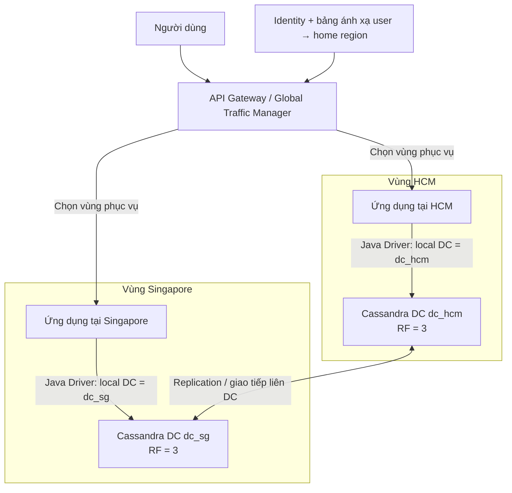

# Thiết kế truy cập nhiều datacenter theo yêu cầu người dùng

> **Chương:** Kiến trúc ứng dụng  
> **Phạm vi:** Apache Cassandra trong hệ thống phân tán, mô hình wide-column và ứng dụng Java. Bài này tập trung vào cách chọn datacenter phục vụ từng người dùng, tổ chức truy cập dữ liệu theo vùng, quyết định mức nhất quán và xử lý sự cố liên vùng.

## Mục tiêu học tập

Sau bài học, bạn có thể:

1. Chuyển yêu cầu của người dùng về độ trễ, nơi lưu dữ liệu, tính sẵn sàng và độ mới dữ liệu thành chính sách định tuyến rõ ràng.
2. Phân biệt **datacenter (DC) phục vụ ứng dụng**, **DC chứa replica**, **coordinator** và **consistency level (CL)** trong Cassandra.
3. Thiết kế hệ thống nhiều DC dùng `NetworkTopologyStrategy`, `LOCAL_QUORUM` và Java Driver theo nguyên tắc ưu tiên truy cập nội vùng.
4. Giải thích vì sao chuyển một yêu cầu từ DC A sang DC B có thể trả về dữ liệu cũ, dù hai DC thuộc cùng một cluster.
5. Xây dựng chính sách failover, kiểm thử tình huống lỗi và giám sát để đáp ứng yêu cầu kinh doanh.

## 1. Xuất phát từ yêu cầu của người dùng

Giả sử một ứng dụng có người dùng tại Việt Nam và Singapore, triển khai ứng dụng tại hai vùng gần tương ứng:

- **`dc_hcm`:** Cassandra DC tại vùng phục vụ người dùng Việt Nam.
- **`dc_sg`:** Cassandra DC tại vùng phục vụ người dùng Singapore.

Cùng một người có thể đăng nhập khi ở Việt Nam, sau đó đi Singapore. Yêu cầu không chỉ là “có hai DC”; sản phẩm cần quy định **người này được phục vụ ở đâu**, **dữ liệu nào có mặt ở DC nào** và **hành vi khi một DC gặp sự cố**.

| Yêu cầu của người dùng / sản phẩm | Câu hỏi kiến trúc cần trả lời | Quyết định điển hình |
| --- | --- | --- |
| Phản hồi nhanh tại nơi đang truy cập | Ứng dụng và coordinator ở DC nào? | Đưa yêu cầu đến ứng dụng gần người dùng; ứng dụng truy cập Cassandra DC cùng vùng. |
| Người dùng thuộc vùng dữ liệu cố định | Dùng vị trí hiện tại hay vùng gốc (`home region`)? | Lấy `home region` từ hồ sơ tin cậy và định tuyến theo chính sách sản phẩm. |
| Đọc được cập nhật mới ngay sau khi chuyển vùng | Bản ghi đã được xác nhận ở DC đích chưa? | Xác định yêu cầu nhất quán liên DC; chọn CL và quy trình chuyển vùng phù hợp. |
| Vẫn phục vụ khi mất một DC | Được chấp nhận mất độ mới, giảm chức năng hay từ chối ghi? | Thiết lập phương án dự phòng và tiêu chí RTO/RPO trước khi triển khai. |
| Dữ liệu không được rời một quốc gia | Có thể sao chép sang DC nước khác không? | Tách phạm vi lưu trữ theo vùng; không cấu hình replica tại DC trái quy định. |

**Không đánh đồng các mục tiêu:** DC gần nhất tối ưu độ trễ; DC gốc phản ánh chính sách dữ liệu; DC còn sống phản ánh khả năng phục hồi. Ba lựa chọn có thể khác nhau.

Trước khi thiết kế, hãy viết ra các điều kiện kiểm chứng được. Ví dụ: “Đọc hồ sơ người dùng tại vùng chính với p95 dưới 150 ms”, “Mỗi yêu cầu ghi đã xác nhận phải có bản sao ở vùng dự phòng”, hoặc “Dữ liệu nhóm X chỉ được lưu ở vùng Y”. Các con số này là **giả định minh họa**, cần đo và thống nhất với chủ sản phẩm; Cassandra không tự bảo đảm một SLO cụ thể.

## 2. Hiểu đúng cách Cassandra hoạt động trên nhiều DC

Trong **một cluster Cassandra nhiều DC**, mỗi DC chứa các node được gán topology; `NetworkTopologyStrategy` chọn số replica **trên từng DC** cho mỗi keyspace. Với `dc_hcm: 3` và `dc_sg: 3`, mỗi partition được sao chép đến ba node ở mỗi DC, tổng sáu replica (giả định đủ node và cấu hình rack hợp lệ).

**Coordinator** là node nhận một truy vấn từ driver. Nó liên hệ các replica và đợi số phản hồi cần thiết theo CL. **Driver** quyết định coordinator nào được ưu tiên; **partition key** xác định dữ liệu nằm ở các replica nào. Vì vậy, chọn một DC theo người dùng **không làm partition key đổi** và cũng **không tự di chuyển partition**.



Có hai tuyến khác nhau:

1. **Tuyến người dùng → ứng dụng:** API Gateway hoặc tầng điều phối vùng chọn dịch vụ ứng dụng.
2. **Tuyến ứng dụng → Cassandra:** Java Driver ưu tiên các coordinator trong DC được cấu hình là `local-datacenter`; Cassandra xử lý replica và CL.

Một ứng dụng đặt ở HCM nhưng luôn kết nối đến coordinator tại Singapore vẫn có thể hoạt động, song phải trả chi phí đường truyền WAN và làm sai giả định độ trễ của thiết kế. Mô hình mặc định nên là **mỗi vùng có ứng dụng riêng, mỗi ứng dụng dùng coordinator Cassandra nội vùng**.

## 3. Chọn chính sách định tuyến phù hợp yêu cầu

### 3.1. Ba kiểu định tuyến phổ biến

| Chính sách | Cách chọn vùng | Thích hợp khi | Đánh đổi |
| --- | --- | --- | --- |
| **Theo vị trí hiện tại** (geo routing) | Chọn vùng ứng dụng gần mạng của người dùng | Nội dung ít nhạy cảm với độ mới, trải nghiệm ưu tiên độ trễ | Người dùng di chuyển giữa vùng có thể quan sát dữ liệu chưa hội tụ. |
| **Theo vùng gốc** (`home region affinity`) | Mỗi người dùng/tenant có một vùng chính được lưu trong bảng ánh xạ | Ghi vào hồ sơ/tài khoản, cần đường đi ổn định | Người đi xa có thêm độ trễ WAN đến vùng chính. |
| **Theo ràng buộc dữ liệu** (data residency) | Chỉ chọn vùng được phép lưu/xử lý dữ liệu | Quy định pháp lý, hợp đồng, phân loại dữ liệu | Không thể tùy ý failover ra ngoài phạm vi được phép. |

Một sản phẩm có thể kết hợp: nội dung công khai dùng geo routing; thao tác tài khoản dùng `home region`; dữ liệu nhạy cảm phải ở vùng cho phép. **Phân loại theo API và loại dữ liệu trước khi tối ưu tuyến**.

### 3.2. Nguồn xác định vùng phải đáng tin cậy

Quy trình gợi ý:

1. Xác thực người dùng ở API Gateway và lấy `userId` từ phiên/token đã kiểm tra.
2. Tra cứu ánh xạ `userId → homeRegion` trong hệ thống quản lý vùng (directory) đáng tin cậy.
3. Kiểm tra quyền truy cập và quy tắc cư trú dữ liệu trước khi chọn vùng.
4. Đưa yêu cầu đến cụm ứng dụng tại vùng được chọn; chuyển tiếp theo TLS và giữ correlation ID.
5. Ứng dụng thực thi CQL qua Java Driver đã cấu hình local DC của **chính vùng ứng dụng**.

Không lấy `homeRegion` trực tiếp từ header do client tự gửi rồi tin tưởng tuyệt đối. Dữ liệu directory có thể cache với TTL thích hợp, nhưng cần cơ chế vô hiệu hóa cache khi thay đổi vùng và xử lý sai lệch trong giai đoạn chuyển đổi.

**Lưu ý về data residency:** Một keyspace có `'dc_hcm': 3, 'dc_sg': 3` sẽ có replica của dữ liệu keyspace đó tại **cả hai** DC, không phụ thuộc người dùng đang truy cập ở đâu. Nếu chính sách cấm lưu dữ liệu ở Singapore, cấu hình sao chép hai DC như vậy **không đáp ứng**. Cần dùng keyspace/cluster với phạm vi replication được phê duyệt; nếu chọn các cluster độc lập, ứng dụng phải tự thiết kế cơ chế chuyển hoặc đồng bộ dữ liệu giữa chúng khi được phép.

## 4. Cấu hình topology và mô hình bảng theo truy vấn

### 4.1. Keyspace nhiều DC

Ví dụ CQL cho một keyspace **được phép sao chép dữ liệu tới cả hai vùng**:

```cql
CREATE KEYSPACE user_app
WITH replication = {
  'class': 'NetworkTopologyStrategy',
  'dc_hcm': 3,
  'dc_sg': 3
}
AND durable_writes = true;
```

Các tên `dc_hcm` và `dc_sg` phải khớp chính xác với datacenter name mà các node báo cáo. Mỗi DC cần đủ node, rack được cấu hình đúng và kết nối liên DC ổn định. Không dùng `SimpleStrategy` cho cluster production nhiều DC.

Kiểm tra từ môi trường vận hành:

```bash
nodetool status
```

Có thể xem định nghĩa keyspace bằng `DESCRIBE KEYSPACE user_app` trong `cqlsh`. Nếu đang **tăng replication factor** hoặc thêm một DC mới cho dữ liệu đã tồn tại, cần lập kế hoạch truyền dữ liệu và chạy repair/full repair phù hợp; thay đổi định nghĩa keyspace không có nghĩa mọi replica mới đã chứa đầy đủ dữ liệu ngay.

### 4.2. Thiết kế bảng theo đường truy cập

Để đọc hồ sơ theo `userId`:

```cql
CREATE TABLE user_app.profile_by_user (
    user_id uuid PRIMARY KEY,
    display_name text,
    locale text,
    updated_at timestamp
);

SELECT display_name, locale, updated_at
FROM user_app.profile_by_user
WHERE user_id = 8d64d650-cc1a-4a2b-9f1d-920722e7cba1;
```

Để đọc lịch sử sự kiện theo **người dùng và ngày** với giới hạn dữ liệu mỗi partition:

```cql
CREATE TABLE user_app.events_by_user_day (
    user_id uuid,
    event_day date,
    occurred_at timeuuid,
    event_type text,
    payload text,
    PRIMARY KEY ((user_id, event_day), occurred_at)
) WITH CLUSTERING ORDER BY (occurred_at DESC);

SELECT occurred_at, event_type, payload
FROM user_app.events_by_user_day
WHERE user_id = 8d64d650-cc1a-4a2b-9f1d-920722e7cba1
  AND event_day = '2026-11-21'
LIMIT 50;
```

Hai truy vấn đều cung cấp đầy đủ **partition key**; Driver có thể dùng metadata token để ưu tiên replica phù hợp trong DC local. Phân vùng theo ngày giúp tránh một partition lịch sử tăng mãi, nhưng cần tính kích thước và lưu lượng thực tế để điều chỉnh bucket.

Đừng thiết kế truy vấn `WHERE home_region = ?` trên bảng chỉ có khóa `user_id` rồi thêm `ALLOW FILTERING` để tìm người dùng theo vùng. Directory và bảng Cassandra phục vụ hai nhu cầu khác nhau. Nếu thực sự cần truy vấn theo vùng, thiết kế **bảng truy cập riêng** với partition key thích hợp và cơ chế cập nhật nhất quán với nghiệp vụ.

## 5. Quyết định mức nhất quán khi có nhiều DC

Giả sử `user_app` có `RF(dc_hcm)=3` và `RF(dc_sg)=3`. Với một DC, quorum là `floor(3/2)+1 = 2` replica. Với tổng RF bằng sáu, quorum toàn cluster là `floor(6/2)+1 = 4` replica.

| Consistency level | Điều kiện phản hồi trong ví dụ | Đặc tính chính |
| --- | --- | --- |
| `LOCAL_ONE` | 1 replica tại DC của coordinator | Độ trễ thấp, có thể đọc phiên bản cũ. |
| `LOCAL_QUORUM` | 2/3 replica tại **DC của coordinator** | Phù hợp đọc/ghi nội vùng; quorum trong DC A không bảo đảm đọc mới tại DC B ngay lập tức. |
| `QUORUM` | 4/6 replica tính trên toàn cluster | Với cả đọc và ghi cùng mức `QUORUM`, các quorum giao nhau; chi phí WAN và mức sẵn sàng cần đánh giá. |
| `EACH_QUORUM` | **Ghi:** 2 replica ở *mỗi* DC | Chỉ áp dụng cho ghi; có xác nhận quorum tại cả hai DC trước khi báo thành công nhưng phụ thuộc cả hai DC. |
| `ALL` | Toàn bộ 6 replica | Phụ thuộc từng replica; dễ mất khả năng phục vụ khi lỗi node. |

**Ví dụ quan trọng:**

1. Người dùng cập nhật tên tại HCM bằng ghi `LOCAL_QUORUM`; hai replica HCM xác nhận, ứng dụng trả thành công.
2. Ngay sau đó người dùng được điều hướng sang Singapore; đọc `LOCAL_QUORUM` tại Singapore hỏi hai replica Singapore.
3. Nếu cập nhật chưa kịp đến các replica Singapore, lần đọc có thể trả về tên cũ. Cả hai thao tác đều đáp ứng CL của **DC tương ứng**.

Vì thế **`LOCAL_QUORUM` ở hai DC khác nhau không đồng nghĩa với tính nhất quán mạnh xuyên DC**. Công thức giao nhau `R + W > RF` chỉ áp dụng khi tập quorum được lựa chọn có bảo đảm giao nhau trong phạm vi RF đang xét; không thể cộng hai quorum local của hai DC riêng thành một bảo đảm toàn cluster.

Nếu yêu cầu nghiệp vụ là “ghi đã xác nhận tại HCM phải đọc được ngay khi chuyển sang Singapore”, có các phương án với chi phí khác nhau:

- **Giữ affinity về vùng ghi chính** cho các thao tác cần đọc lại ngay, trong khi replica vùng phụ vẫn hội tụ.
- **Ghi `EACH_QUORUM`**, rồi đọc `LOCAL_QUORUM` ở bất kỳ DC được cấu hình RF=3: write quorum tại DC đó giao với read quorum tại cùng DC (trong điều kiện không có ghi cạnh tranh làm thay đổi kết quả). Đổi lại, DC bất khả dụng có thể làm ghi thất bại.
- **Dùng đọc và ghi `QUORUM` toàn cluster** cho luồng cần quorum giao nhau, chấp nhận truy cập WAN và đánh giá hành vi lúc mất DC.
- Với ràng buộc tuyến tính hóa hoặc uniqueness trên cùng partition, **đánh giá lightweight transaction (LWT), `SERIAL`/`LOCAL_SERIAL`** và giới hạn của chúng trong thiết kế phân tán; CL thường và quy tắc timestamp không tự tạo serializability.

Các lựa chọn trên cần được kiểm chứng bằng thử nghiệm với topology và loại lỗi thực tế. Cassandra xử lý xung đột ghi dựa trên timestamp và cơ chế hòa giải replica; “hai vùng đều chấp nhận ghi độc lập” không có nghĩa hệ thống tự hiểu xung đột nghiệp vụ như cộng tiền, giữ chỗ hay phiên bản hồ sơ.

## 6. Java Driver: mỗi vùng sử dụng local datacenter của mình

Với Java Driver 4.x, `DefaultLoadBalancingPolicy` mặc định ưu tiên các node trong DC local và có khả năng định tuyến theo token khi truy vấn cung cấp routing information. Trong triển khai thông thường, **một tiến trình ứng dụng có một `CqlSession` dùng lâu dài**, được tạo khi khởi động và đóng khi dừng, không tạo session mới cho mỗi người dùng hoặc mỗi HTTP request.

Ví dụ DAO đọc hồ sơ bằng Java (dùng namespace `com.datastax.oss.driver` của Driver 4.x):

```java
import com.datastax.oss.driver.api.core.CqlSession;
import com.datastax.oss.driver.api.core.DefaultConsistencyLevel;
import com.datastax.oss.driver.api.core.cql.BoundStatement;
import com.datastax.oss.driver.api.core.cql.PreparedStatement;
import com.datastax.oss.driver.api.core.cql.Row;

import java.net.InetSocketAddress;
import java.util.Optional;
import java.util.UUID;

public final class ProfileDao implements AutoCloseable {
    private final CqlSession session;
    private final PreparedStatement findProfile;

    public ProfileDao(String localContactHost, String localDc) {
        this.session = CqlSession.builder()
            .addContactPoint(new InetSocketAddress(localContactHost, 9042))
            .withLocalDatacenter(localDc)
            .build();

        this.findProfile = session.prepare(
            "SELECT display_name FROM user_app.profile_by_user WHERE user_id = ?");
    }

    public Optional<String> findDisplayName(UUID userId) {
        BoundStatement query = findProfile.bind(userId)
            .setConsistencyLevel(DefaultConsistencyLevel.LOCAL_QUORUM)
            .setIdempotent(true);

        Row row = session.execute(query).one();
        return row == null
            ? Optional.empty()
            : Optional.ofNullable(row.getString("display_name"));
    }

    @Override
    public void close() {
        session.close();
    }
}
```

Khởi tạo tương ứng ở mỗi vùng (địa chỉ ví dụ phải thay bằng địa chỉ node hợp lệ trong mạng của môi trường triển khai):

```java
// Service chạy tại HCM
ProfileDao hcmDao = new ProfileDao("10.10.1.11", "dc_hcm");

// Service chạy tại Singapore (một deployment khác)
ProfileDao sgDao = new ProfileDao("10.20.1.11", "dc_sg");
```

Trong production, nên lấy DC/contact points từ cấu hình môi trường hoặc secret/config management, cung cấp nhiều contact points nội vùng và cấu hình TLS, xác thực, timeout, pool và quan sát lỗi. Ví dụ trên cố ý rút gọn để làm rõ **mỗi deployment có một DC local**, không phải tạo cả hai DAO trong một request.

Ví dụ ghi, khi nghiệp vụ chỉ cần quorum nội vùng:

```java
PreparedStatement update = session.prepare(
    "UPDATE user_app.profile_by_user " +
    "SET display_name = ?, updated_at = ? WHERE user_id = ?");

BoundStatement write = update.bind(
    newName, java.time.Instant.now(), userId)
    .setConsistencyLevel(DefaultConsistencyLevel.LOCAL_QUORUM);

session.execute(write);
```

Đoạn ghi này minh họa cách đặt CL cho một statement trong một DAO đang giữ `session`; `newName` và `userId` là biến nghiệp vụ. Nếu endpoint yêu cầu phải có xác nhận ở **cả hai DC** trước khi trả thành công, cân nhắc `DefaultConsistencyLevel.EACH_QUORUM` cho **ghi đó** sau khi đánh giá độ trễ và availability. Chỉ đánh dấu thao tác ghi là idempotent khi ngữ nghĩa thật sự cho phép retry an toàn; với thao tác có tác dụng phụ hoặc điều kiện nghiệp vụ, cần kiểm soát retry, timeout và kết quả ghi không chắc chắn.

### 6.1. Vì sao không đổi local DC theo từng request?

`withLocalDatacenter("dc_hcm")` cấu hình cho **session/driver policy**, không phải thuộc tính tự do của mỗi query. Nếu một API instance ở HCM phục vụ người dùng `homeRegion=sg`, hãy điều hướng HTTP/gRPC đến service tại Singapore; service đó đã có session đúng DC. Tránh tạo session cho từng request hoặc dùng client-provided region để thay đổi cấu hình driver liên tục.

Java Driver 4.10+ có tùy chọn *cross-datacenter failover*, nhưng mặc định bị tắt; cấu hình remote nodes là quyết định vận hành cần kiểm soát. Khi sử dụng `LOCAL_ONE`/`LOCAL_QUORUM`, chuyển coordinator sang DC khác có thể thay đổi **phạm vi quorum** và RF áp dụng. Vì vậy, ưu tiên **failover ở tầng dịch vụ/vùng** với chính sách đọc/ghi được định nghĩa rõ, thay vì mặc định driver phải tự nhảy DC.

## 7. Thiết kế luồng truy cập và failover theo loại API

Một ứng dụng thực tế nên phân nhóm endpoint theo yêu cầu dữ liệu:

| Luồng | Vùng phục vụ bình thường | CL gợi ý để bắt đầu đánh giá | Hành vi khi mất DC chính |
| --- | --- | --- | --- |
| Xem danh sách nội dung ít nhạy cảm | Vùng gần người dùng | `LOCAL_ONE` hoặc `LOCAL_QUORUM` | Chuyển vùng nếu dữ liệu dự phòng đủ dùng; công bố khả năng chậm cập nhật. |
| Đọc/đổi thông tin hồ sơ | `home region` | `LOCAL_QUORUM` đọc/ghi | Chỉ mở ghi ở vùng phụ nếu chính sách xử lý xung đột và RPO cho phép. |
| Ghi yêu cầu cần hiện diện ở cả hai DC | Vùng gốc | `EACH_QUORUM` ghi; đọc phù hợp yêu cầu | Có thể từ chối ghi trong lúc DC thứ hai mất kết nối. |
| Dữ liệu có yêu cầu cư trú nghiêm ngặt | Vùng được phép | CL trong cluster/vùng hợp lệ | Chỉ chuyển sang vùng dự phòng cũng hợp lệ; không tự vượt ranh giới dữ liệu. |

Đây là **các điểm khởi đầu để thiết kế**, không phải CL mặc định bắt buộc cho mọi ứng dụng. Nếu yêu cầu đọc sau ghi cùng phiên rất quan trọng, lưu ý đến chính sách sticky routing, trạng thái đồng bộ và tính chất của thao tác; Cassandra không cấp một session token toàn cầu tự bảo đảm mọi lần đọc xuyên DC đều thấy lần ghi gần nhất.

### 7.1. Ma trận tình huống lỗi

| Tình huống | Điều có thể xảy ra | Hành động dự kiến |
| --- | --- | --- |
| Một node trong DC chính down, DC còn đủ quorum | `LOCAL_QUORUM` có thể tiếp tục phục vụ | Driver dùng node còn khỏe; theo dõi repair/hints. |
| Đường truyền WAN chậm hoặc đứt, hai DC còn chạy | Ghi `LOCAL_QUORUM` tại mỗi DC vẫn có thể thành công; bản sao liên DC chậm hội tụ | Cảnh báo độ trễ đồng bộ, hạn chế ghi cạnh tranh; tránh hứa đọc mới giữa vùng. |
| Cả DC chính mất kết nối | Session local không còn coordinator khả dụng; giao dịch đang thực hiện có thể timeout | Global routing chuyển đến app vùng phụ theo policy; chọn chế độ read-only, degraded hoặc write-enabled có kiểm soát. |
| DC phụ mất khi đang ghi `EACH_QUORUM` | Ghi cần quorum ở mọi DC nên có thể không thành công | Trả lỗi nghiệp vụ phù hợp hoặc dùng quy trình hạ cấp CL được phê duyệt và ghi nhận rủi ro RPO. |
| DC khôi phục sau một khoảng offline | Các replica có thể thiếu mutation đã ghi trong lúc offline | Theo dõi hints, chạy repair theo lịch, kiểm tra hội tụ trước khi mở lại đầy đủ lưu lượng. |
| Trả về lỗi timeout khi ghi | Client không biết chắc mutation đã được áp dụng ở replica nào | Không tự coi là “chắc chắn chưa ghi”; cần khóa idempotency/kiểm tra trạng thái nghiệp vụ trước khi thử lại. |

**RTO** mô tả thời gian khôi phục dịch vụ, còn **RPO** mô tả mức dữ liệu có thể mất/chưa hiện diện ở vùng dự phòng tại thời điểm sự cố. Hai chỉ tiêu cần được mô tả riêng cho từng API. Chẳng hạn, ghi `LOCAL_QUORUM` tại HCM rồi mất toàn bộ HCM ngay sau khi xác nhận có thể chưa có bản sao cập nhật ở Singapore; không thể tuyên bố RPO bằng 0 chỉ vì cluster có hai DC.

### 7.2. Tránh xung đột khi hai DC cùng ghi

Nếu người dùng đăng nhập từ nhiều thiết bị ở hai vùng, cập nhật đồng thời cùng một cột có thể dẫn đến kết quả phụ thuộc timestamp ghi. Chọn một trong các giải pháp theo nghiệp vụ:

- Tập trung ghi cho một user/aggregate tại `home region`; vùng khác chuyển tiếp về đó.
- Dùng version hoặc điều kiện cập nhật có cơ chế phối hợp phù hợp (đánh giá LWT nếu cần điều kiện mạnh trên cùng partition).
- Với sự kiện không thể ghi đè, dùng khóa định danh sự kiện và mô hình append-only; thiết kế xử lý trùng lặp và thứ tự ở tầng nghiệp vụ.
- Ghi nhận quyết định xung đột bằng audit log để truy vết khi hỗ trợ người dùng.

Đặc biệt, các trường hợp số dư, hạn mức, đặt chỗ và tài nguyên duy nhất không nên dựa thuần vào “last write wins” để bảo đảm bất biến kinh doanh.

## 8. Vận hành, bảo mật và khả năng quan sát

**Topology và dữ liệu**

- Kiểm tra `nodetool status` theo DC/rack; theo dõi node up/down và phân phối tải.
- Đối chiếu RF của từng keyspace, không chỉ RF của cluster nói chung.
- Lập lịch repair cho tất cả các token range/DC liên quan. Hinted handoff là hỗ trợ *best effort*, **không thay thế repair**; chú ý lịch repair và `gc_grace_seconds` để tránh rủi ro tombstone/data resurrection.
- Kiểm thử backup/restore của dữ liệu và metadata; phục hồi từ bản sao liên DC không thay thế chiến lược backup.

**Chỉ số ứng dụng**

- Tỷ lệ request vào đúng `home region` và tỷ lệ route sang vùng dự phòng.
- p50/p95/p99 latency theo endpoint, vùng người dùng, vùng ứng dụng và DC.
- Timeout, `UnavailableException`, retry, tỷ lệ lỗi theo CL và endpoint; tăng đột biến traffic WAN.
- Độ trễ quan sát được của một bản ghi được cập nhật giữa DC A và DC B bằng kiểm thử tổng hợp (synthetic probe), không suy ra trực tiếp từ số node up.
- Tần suất failover, thời gian failback, backlog hints/repair và các sự cố đọc dữ liệu cũ.

**Bảo mật**

- TLS cho kết nối client–node và node–node; giới hạn kết nối giữa vùng, xác thực/ủy quyền theo service.
- Phân vùng network và dữ liệu theo yêu cầu pháp lý; kiểm tra cả bản sao, backup, log và dữ liệu phân tích.
- Không tin dữ liệu region do client tự khai; mọi thay đổi `home region` cần xác thực, phân quyền và audit.

**Thay đổi home region** cần có quy trình: khóa hoặc điều phối các ghi liên quan, xác nhận dữ liệu tại vùng đích, cập nhật directory với version, làm mới cache và chỉ sau đó chuyển lưu lượng. Nếu dữ liệu phải *di trú* giữa các cluster tách biệt, cần thêm quy trình xuất/nhập, kiểm chứng và xóa dữ liệu nguồn theo chính sách; không coi việc đổi giá trị directory là đã chuyển dữ liệu.

## 9. Bài toán thiết kế mẫu

**Đề bài.** Một nền tảng phục vụ tài khoản ở HCM và Singapore. Người dùng có thể di chuyển, chỉnh sửa hồ sơ và xem lịch sử hoạt động. Sản phẩm yêu cầu:

1. Phần lớn thao tác thông thường dùng DC gần ứng dụng để giảm độ trễ.
2. Một lần đổi email thành công phải đọc thấy ở vùng dự phòng khi người dùng được chuyển vùng ngay sau đó.
3. Trong lúc mất toàn bộ một DC, xem lịch sử có thể chậm cập nhật; thao tác đổi email không được ghi thành công nếu chưa đáp ứng yêu cầu của mục 2.
4. Một số dữ liệu hợp đồng được phân loại chỉ lưu trong lãnh thổ cho phép.

**Một phương án hợp lý:**

- Triển khai app ở HCM và Singapore, local Java Driver session cho từng vùng; dùng directory `userId → homeRegion` và gateway định tuyến theo nhóm API.
- Với hồ sơ **được phép nhân bản qua hai vùng**, keyspace dùng `NetworkTopologyStrategy` và RF=3 mỗi DC. Cột email tra cứu bằng `userId`; cân nhắc ràng buộc uniqueness riêng nếu email phải duy nhất trên toàn hệ thống.
- Đối với **đổi email**, chọn ghi `EACH_QUORUM` (hoặc thiết kế nhất quán khác được chứng minh đáp ứng điều kiện đọc sau chuyển vùng) trước khi xác nhận thành công; đọc bằng `LOCAL_QUORUM` tại vùng phục vụ. Nếu DC phụ mất, endpoint có thể báo không sẵn sàng thay vì báo thành công sai cam kết.
- Đối với **xem lịch sử**, cho phép đọc `LOCAL_ONE` hoặc `LOCAL_QUORUM` tại DC local, chỉ rõ dữ liệu có thể chậm hội tụ khi failover; dùng partition theo user và ngày.
- Dữ liệu hợp đồng chỉ lưu tại cluster/keyspace có replication và backup thuộc các vùng hợp lệ; không dùng keyspace nhân bản sang Singapore cho dữ liệu bị cấm sao chép sang đó.
- Chạy kiểm thử failover và quan sát thực tế độ trễ liên DC, khả năng từ chối ghi, cập nhật chậm và thời gian phục hồi.

### Thực hành có hướng dẫn

1. Trên cluster thử nghiệm gồm hai DC, tạo keyspace `NetworkTopologyStrategy` với RF phù hợp số node thực tế; xác minh bằng `nodetool status` và `DESCRIBE KEYSPACE`.
2. Tạo bảng `profile_by_user`, ghi một hồ sơ tại DC A với `LOCAL_QUORUM`, đọc tại DC B bằng `LOCAL_QUORUM`. Đo thời điểm bản ghi mới xuất hiện; **đừng giả định** độ trễ cố định.
3. Lặp lại với ghi `EACH_QUORUM` và đọc `LOCAL_QUORUM` từ DC B. Ghi lại độ trễ và tác động khi tắt kết nối DC B.
4. Tắt một node, sau đó mô phỏng mất cả DC trong môi trường test; đánh giá các endpoint theo ma trận lỗi ở mục 7.
5. Bật lại DC, quan sát quá trình hội tụ và repair; hoàn thành báo cáo RTO/RPO thực nghiệm cho từng loại thao tác.

Không thực hiện mô phỏng mất node, sửa RF hoặc repair trên production nếu chưa có kế hoạch vận hành và kiểm soát tác động.

## 10. Tự kiểm tra kiến thức

**Câu 1.** Một người đang ở Singapore được gateway gửi đến ứng dụng Singapore. Vì sao thao tác này chưa chắc đọc được lần ghi vừa xác nhận tại HCM?  
**Gợi ý:** `LOCAL_QUORUM` xét các replica thuộc DC của coordinator; các quorum ở hai DC riêng biệt không bắt buộc giao nhau.

**Câu 2.** Có thể buộc dữ liệu của một người dùng chỉ nằm ở HCM bằng cách đặt `homeRegion=hcm` trong JWT và để keyspace nhân bản RF=3 ở cả hai DC không?  
**Đáp án:** Không. Quyết định dữ liệu được nhân bản ở DC nào nằm ở replication topology/keyspace, không phải trường region trong JWT.

**Câu 3.** Vì sao driver chỉ định `local-datacenter` không thay thế việc global gateway định tuyến ứng dụng?  
**Đáp án:** Driver chọn coordinator Cassandra, còn gateway chọn phiên bản ứng dụng phục vụ request; nếu ứng dụng và DC lệch vùng vẫn phải đi WAN.

**Câu 4.** Khi DC B mất, `EACH_QUORUM` ghi có thể thất bại; có nên tự động hạ xuống `LOCAL_ONE`?  
**Đáp án:** Chỉ nếu sản phẩm/chủ dữ liệu đã chấp thuận thay đổi về RPO, độ mới và bất biến nghiệp vụ. Tự động hạ CL âm thầm có thể phá cam kết trả về thành công.

**Câu 5.** Tại sao repair quan trọng nếu Cassandra đã có replication và hints?  
**Đáp án:** Hints không bảo đảm chuyển đủ mọi mutation bỏ lỡ. Repair đối chiếu các token range để sửa khác biệt, đặc biệt sau outage và trước khi dữ liệu cũ hết khoảng bảo vệ tombstone.

## Tài liệu tham khảo

- [Apache Cassandra — Production recommendations](https://cassandra.apache.org/doc/stable/cassandra/getting-started/production.html): khuyến nghị `NetworkTopologyStrategy` cho production.
- [Apache Cassandra — Dynamo architecture and consistency](https://cassandra.apache.org/doc/stable/cassandra/architecture/dynamo): định nghĩa `LOCAL_QUORUM`, `QUORUM`, `EACH_QUORUM` và cách coordinator đợi replica.
- [Apache Cassandra — CQL Data Definition](https://cassandra.apache.org/doc/stable/cassandra/developing/cql/ddl.html): khai báo keyspace, replication và bảng.
- [Apache Cassandra Java Driver 4.19 — Load balancing](https://apache.github.io/cassandra-java-driver/4.19.0/core/load_balancing/): DC local, token-aware routing và failover liên DC.
- [Apache Cassandra — Repair](https://cassandra.apache.org/doc/stable/cassandra/managing/operating/repair.html): nguyên tắc repair, hints và đồng bộ replica sau sự cố.
