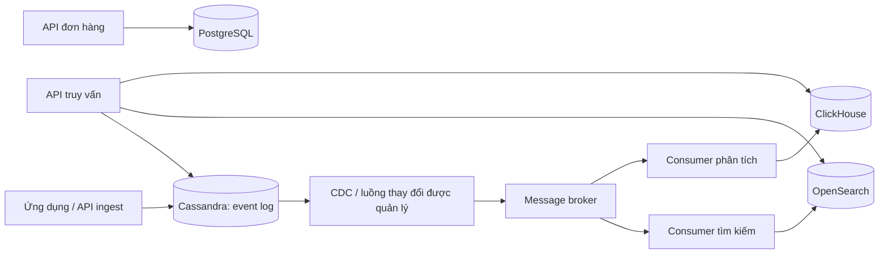

# Giới hạn truy vấn không phù hợp và phối hợp với hệ lưu trữ khác

## 1. Bối cảnh và mục tiêu

Apache Cassandra là cơ sở dữ liệu phân tán dạng **wide-column**, được thiết kế để ghi và đọc với độ trễ dự đoán được trên nhiều nút, mở rộng theo chiều ngang và duy trì khả năng phục vụ khi một số nút gặp sự cố. Khi xây dựng kiến trúc ứng dụng, lợi thế đó chỉ phát huy nếu **mô hình bảng bám sát các truy vấn cần phục vụ**.

Trong Cassandra, **partition key** quyết định dữ liệu nằm ở phân vùng logic nào, còn **clustering columns** quyết định thứ tự các hàng bên trong phân vùng. Replication factor và consistency level điều khiển cách các bản sao tham gia đọc/ghi; chúng không biến Cassandra thành một công cụ truy vấn quan hệ hoặc phân tích tùy ý. Vì thế, bài toán kiến trúc không chỉ là “lưu dữ liệu nào vào Cassandra?” mà còn là “truy vấn nào nên được Cassandra xử lý, truy vấn nào nên chuyển cho hệ khác?”.

Sau bài này, người học có thể:

- Nhận diện giới hạn của CQL đối với lọc tùy ý, JOIN, tổng hợp, tìm kiếm toàn văn, sắp xếp toàn cục và giao dịch nhiều thực thể.
- Phân biệt truy vấn nên giải quyết bằng **thiết kế thêm bảng Cassandra** với truy vấn cần một hệ lưu trữ chuyên dụng.
- Thiết kế luồng đồng bộ dữ liệu giữa Cassandra, cơ sở dữ liệu quan hệ, công cụ tìm kiếm và hệ phân tích.
- Giải thích được các rủi ro về nhất quán, độ trễ đồng bộ, xóa dữ liệu, xử lý trùng và khôi phục sau sự cố.

## 2. Vì sao không thể dùng một bảng Cassandra cho mọi kiểu truy vấn?

Khác với việc chuẩn hóa mô hình quan hệ rồi bổ sung chỉ mục cho nhiều câu SQL phát sinh sau này, Cassandra thường bắt đầu từ **truy vấn đã biết** rồi lựa chọn khóa chính, phân vùng và thứ tự lưu dữ liệu. Một bảng có thể được tổ chức để lấy các sự kiện của một khách hàng trong một ngày theo thời gian, nhưng cấu trúc đó không đồng thời tối ưu cho “tìm mọi sự kiện chứa một cụm từ trên toàn bộ khách hàng”.

Các nguyên tắc thực tế:

1. Truy vấn hiệu quả thường xác định được **partition key** (hoặc tập partition key nhỏ, có giới hạn). Cassandra có thể đọc một dải **clustering key** trong các partition đã xác định.
2. `ORDER BY` trong CQL dựa vào thứ tự clustering được thiết kế cho bảng và các ràng buộc truy vấn tương ứng; đây không phải phép sắp xếp tự do trên tất cả hàng của mọi partition.
3. Cassandra không cung cấp `JOIN` quan hệ thông thường. Các góc nhìn dữ liệu được biểu diễn bằng **nhiều bảng phi chuẩn hóa**, mỗi bảng phục vụ một đường truy cập.
4. CQL có một số hàm tổng hợp, `GROUP BY` với giới hạn và các cơ chế chỉ mục như secondary index/Storage-Attached Index (SAI) ở phiên bản, cấu hình phù hợp. Những khả năng này **không tương đương** bộ máy SQL phân tích hoặc công cụ full-text search.
5. `ALLOW FILTERING` cho phép một số truy vấn vượt khỏi đường truy cập tối ưu, nhưng có thể phải đọc và loại bỏ rất nhiều hàng, khiến độ trễ tăng theo lượng dữ liệu. Không coi nó là cách sửa thiết kế khóa.

Một câu hỏi quyết định trước khi viết CQL là: **Có thể biết trước khóa phân vùng từ yêu cầu nghiệp vụ và giới hạn được số phân vùng cần đọc không?** Nếu câu trả lời thường xuyên là không, cần xem lại thiết kế hoặc bổ sung hệ chuyên dụng.

## 3. Ví dụ: truy vấn sự kiện theo khách hàng và ngày

Giả sử ứng dụng nhận luồng sự kiện lớn từ nhiều khách hàng (*tenant*) và cần hiển thị 100 sự kiện gần nhất trong một ngày. Thiết kế bảng phù hợp:

```sql
CREATE TABLE events_by_tenant_day (
    tenant_id uuid,
    day_bucket date,
    occurred_at timestamp,
    event_id uuid,
    event_type text,
    summary text,
    PRIMARY KEY ((tenant_id, day_bucket), occurred_at, event_id)
) WITH CLUSTERING ORDER BY (occurred_at DESC, event_id ASC);
```

- `(tenant_id, day_bucket)` là **composite partition key**: chia dữ liệu theo khách hàng và ngày để tránh một phân vùng tăng không giới hạn. Kích thước bucket phải dựa trên lưu lượng thực tế: khách hàng có lưu lượng rất cao có thể cần bucket theo giờ hoặc thêm một thành phần chia nhỏ có thể truy xuất được.
- `(occurred_at, event_id)` là **clustering columns**: trả kết quả theo thời gian giảm dần; `event_id` tạo thứ tự phân biệt khi hai sự kiện có cùng timestamp.
- `event_type`, `summary` là dữ liệu đi kèm, không tự động trở thành điều kiện lọc tối ưu.

Truy vấn đúng đường truy cập:

```sql
SELECT event_id, occurred_at, event_type, summary
FROM events_by_tenant_day
WHERE tenant_id = ?
  AND day_bucket = ?
  AND occurred_at >= ?
  AND occurred_at < ?
LIMIT 100;
```

Truy vấn kiểu “tìm các sự kiện loại `PAYMENT_FAILED` của mọi khách hàng trong 90 ngày rồi sắp xếp mới nhất trên toàn hệ thống” **không được bảng này phục vụ hiệu quả**: thiếu cách truy cập trực tiếp theo `event_type` trên nhiều partition, đồng thời cần hợp nhất và sắp xếp kết quả toàn cục. Tương tự, điều kiện `WHERE summary LIKE '%timeout%'` không phải tìm kiếm full-text khả dụng bằng khóa chính của bảng.

Nếu sản phẩm chỉ cần thêm truy vấn **theo loại sự kiện trong từng khách hàng/ngày**, có thể chủ động ghi thêm một bảng:

```sql
CREATE TABLE events_by_tenant_type_day (
    tenant_id uuid,
    event_type text,
    day_bucket date,
    occurred_at timestamp,
    event_id uuid,
    summary text,
    PRIMARY KEY ((tenant_id, event_type, day_bucket), occurred_at, event_id)
) WITH CLUSTERING ORDER BY (occurred_at DESC, event_id ASC);

SELECT event_id, occurred_at, summary
FROM events_by_tenant_type_day
WHERE tenant_id = ? AND event_type = ? AND day_bucket = ?
LIMIT 100;
```

Đây là **denormalization theo truy vấn**: đổi thêm chi phí ghi, lưu trữ và đồng bộ giữa các bảng để có đường đọc ổn định. Nếu có hàng chục bộ lọc kết hợp tự do, số bảng tương ứng sẽ tăng rất nhanh; lúc đó một search engine hoặc hệ phân tích phù hợp hơn việc nhân bản bảng không giới hạn.

### Những cách “chữa cháy” dễ gây lỗi hiệu năng

| Cách làm | Vấn đề thực tế | Cách tiếp cận tốt hơn |
| --- | --- | --- |
| Thêm `ALLOW FILTERING` vào truy vấn không theo khóa | Có thể phải đọc nhiều dữ liệu rồi mới lọc; chi phí thay đổi lớn khi dữ liệu tăng | Chọn lại khóa, thêm bảng theo truy vấn hoặc dùng hệ tìm kiếm |
| Đọc mọi partition vào ứng dụng rồi lọc/sắp xếp | Fan-out lớn, băng thông và bộ nhớ tăng, nguy cơ timeout | Thu hẹp truy vấn bằng partition key hoặc đẩy sang engine chuyên dụng |
| Đặt mọi sự kiện của một khách hàng vào một partition | Partition tăng quá lớn, đọc/compaction/repair khó kiểm soát | Dùng time bucket và cân bằng khóa phân vùng |
| Dùng `COUNT(*)` trên tập dữ liệu rất lớn để làm dashboard tức thời | Tổng hợp phải đọc nhiều dữ liệu; không có bảng thống kê tự động cho mọi chiều | Duy trì rollup hoặc đưa dữ liệu sang OLAP |
| Dùng nhiều secondary index/SAI như thay thế cho mô hình truy vấn | Kết quả và chi phí phụ thuộc phiên bản, độ chọn lọc, kích thước dữ liệu, mẫu truy vấn | Benchmark truy vấn thật; với tìm kiếm linh hoạt, cân nhắc OpenSearch/Elasticsearch |
| Giả định có `OFFSET` và `ORDER BY` tự do như SQL | Phân trang kiểu offset và sắp xếp toàn cục không phải mô hình truy cập của Cassandra | Dùng paging state của driver, khóa truy vấn ổn định; hoặc search engine nếu cần global sort |

> **Lưu ý:** Không phải mọi truy vấn thiếu partition key đều tuyệt đối không chạy được; chỉ mục và những cú pháp CQL cụ thể có thể cho phép thực thi. Điều cần đánh giá là độ trễ, số partition/hàng phải chạm tới, tải lên coordinator và tính ổn định khi dữ liệu lớn dần.

## 4. Phân định trách nhiệm giữa các hệ lưu trữ

Kiến trúc **polyglot persistence** sử dụng nhiều công cụ, mỗi công cụ chịu trách nhiệm cho kiểu truy vấn mà nó thực hiện tốt. Không cần dùng tất cả hệ sau; chọn theo yêu cầu có thật.

| Nhu cầu ứng dụng | Vai trò phù hợp | Lý do và ranh giới |
| --- | --- | --- |
| Ghi nhiều sự kiện; đọc theo tenant, thiết bị, thời gian; truy vấn đã biết | **Cassandra** | Ghi phân tán, replication và đường truy cập theo partition/clustering key; cần kiểm soát hotspot và kích thước partition |
| Đơn hàng, thanh toán, ràng buộc tham chiếu, giao dịch nhiều bảng | **PostgreSQL/MySQL** | Ràng buộc và giao dịch quan hệ; Cassandra LWT/CAS không thay thế giao dịch ACID tùy ý trên nhiều thực thể |
| Tìm cụm từ, fuzzy match, nhiều bộ lọc, xếp hạng theo mức liên quan | **OpenSearch/Elasticsearch** | Inverted index và search DSL; kết quả thường là một projection được đồng bộ trễ |
| Phân tích lịch sử, `JOIN`, `GROUP BY` nhiều chiều, báo cáo ad hoc | **ClickHouse, warehouse hoặc Spark/Trino trên dữ liệu phân tích** | Tối ưu quét cột/tập lớn và tổng hợp; độ mới của dữ liệu phụ thuộc pipeline |
| Cache hot keys, phiên đăng nhập, leaderboard ngắn hạn | **Redis** | Độ trễ thấp cho trạng thái tạm và một số cấu trúc dữ liệu chuyên dụng; cần quy tắc hết hạn và phục hồi cache |
| Ảnh, tệp lớn, bản ghi thô kích thước lớn | **Object storage** | Chi phí và vòng đời tệp; Cassandra có thể giữ metadata, ID, URI tham chiếu |

Hai cách mở rộng cần phân biệt:

- **Thêm bảng trong Cassandra** khi số mẫu truy vấn ít, cố định, có partition key rõ ràng và có thể nhân bản dữ liệu một cách kiểm soát.
- **Thêm hệ lưu trữ khác** khi cần tìm kiếm toàn văn, sắp xếp xếp hạng toàn cục, phân tích không dự đoán trước hoặc giao dịch quan hệ; những yêu cầu này đi ngược mô hình truy cập chính của Cassandra.

Ví dụ một API có thể tách thành: `GET /tenants/{id}/events?day=...` đọc Cassandra; `GET /events/search?q=...` đọc search index; `GET /analytics/events?groupBy=...` đọc OLAP; `POST /orders` ghi hệ quan hệ. Điều quan trọng là **định nghĩa rõ nguồn dữ liệu có thẩm quyền** cho từng loại thực thể, không để các bản sao tranh nhau quyết định dữ liệu nào đúng.

## 5. Kiến trúc phối hợp: ghi một nguồn, phát thay đổi, tạo các projection

Giả sử **Cassandra là nguồn có thẩm quyền của dữ liệu sự kiện**; OpenSearch phục vụ tìm kiếm, ClickHouse phục vụ phân tích và PostgreSQL quản lý các giao dịch đơn hàng độc lập. Một kiến trúc tham khảo:



Khi API ghi một sự kiện vào Cassandra thành công, dịch vụ **không được mặc định** rằng sự kiện đã có mặt ngay trong OpenSearch/ClickHouse. CDC hoặc luồng thay đổi đưa sự kiện sang message broker, rồi consumer cập nhật từng projection. Đây là mô hình **nhất quán cuối cùng giữa các hệ** (*eventual consistency*), cần được công khai trong cam kết sản phẩm.

Trong thực tế, cách ghi nhận thay đổi tùy thuộc nguồn dữ liệu:

1. **Nguồn là PostgreSQL:** cập nhật bản ghi nghiệp vụ và **outbox** trong cùng một giao dịch; CDC/relay đưa outbox sang broker. Đây là lựa chọn thông dụng khi cần tính nguyên tử giữa dữ liệu nghiệp vụ và sự kiện xuất bản.
2. **Nguồn là Cassandra:** dùng tính năng CDC/connector hoặc luồng ingest bền vững được thiết kế phù hợp với phiên bản/nhà cung cấp. Phải kiểm tra cấu hình CDC, lưu lượng, thời gian giữ log, áp lực đĩa và khả năng phát lại. Không coi hai thao tác độc lập “ghi Cassandra rồi publish Kafka” là một giao dịch nguyên tử.
3. **Nguồn là message log:** nếu nghiệp vụ cho phép, ghi sự kiện vào broker bền vững trước, rồi các consumer dựng Cassandra, search và OLAP. Cần xác định rõ khi nào API trả thành công và nguồn thẩm quyền nằm ở log nào.

Không cần phối hợp truy vấn qua tất cả các hệ trong một request. API nên **định tuyến theo khả năng**: timeline lấy từ Cassandra; tìm kiếm lấy danh sách khóa từ OpenSearch, khi cần thì đọc bản ghi chi tiết trong Cassandra; báo cáo tổng hợp lấy từ ClickHouse. Khi search trả ID, tài liệu chỉ mục nên giữ **đủ thông tin định vị khóa Cassandra** (`tenant_id`, `day_bucket`, `occurred_at`, `event_id`) để tránh phải quét tìm dữ liệu gốc.

### Thiết kế hợp đồng sự kiện

Một sự kiện đồng bộ có thể mang:

```json
{
  "eventId": "bff4b7fa-04ca-4bc7-9cb4-b04ba7f8e923",
  "eventType": "EventRecorded",
  "schemaVersion": 1,
  "tenantId": "8b60dcdb-7ad7-449b-8e6d-68d8dc2aa447",
  "dayBucket": "2026-11-21",
  "occurredAt": "2026-11-21T08:30:00Z",
  "recordVersion": 12,
  "operation": "UPSERT",
  "payload": {"category": "PAYMENT_FAILED", "summary": "Gateway timeout"}
}
```

- `eventId` dùng để nhận diện thông điệp và hỗ trợ **idempotency**. Khóa của bản ghi nguồn phải được mang theo đầy đủ để consumer cập nhật đúng đối tượng.
- `recordVersion` hoặc cơ chế phiên bản/tổng thứ tự **được nguồn bảo đảm** giúp tránh sự kiện cũ ghi đè dữ liệu mới. Không giả định timestamp từ nhiều máy tự tạo ra thứ tự đáng tin cậy trên toàn hệ.
- `schemaVersion` hỗ trợ thay đổi cấu trúc payload khi hệ thống vận hành lâu dài.
- `operation` cần phân biệt `UPSERT` và `DELETE`; quy tắc hết hạn dữ liệu (`TTL`) cũng phải được truyền đạt/thiết kế cho các projection.

Trong ví dụ, `recordVersion` chỉ có ý nghĩa nếu hệ thống tạo nó theo một quy tắc tăng nhất quán trong phạm vi bản ghi; Cassandra không tự cấp một sequence tăng toàn cục cho mọi sự kiện.

## 6. Các bài toán nhất quán và lỗi phải giải quyết

### 6.1. Nhất quán bên trong Cassandra khác với độ mới của search index

Với replication factor bằng 3 trong một datacenter, phối hợp đọc và ghi ở `LOCAL_QUORUM` thường yêu cầu hai replica xác nhận mỗi thao tác trong datacenter đó. Đây là quyết định về **các bản sao Cassandra**, không hề bảo đảm OpenSearch đã nhận sự kiện. Ngay cả khi `INSERT` trả thành công, tìm kiếm sau đó có thể chưa thấy bản ghi vì consumer đang trễ.

Đề xuất hợp đồng API: các trang timeline dùng Cassandra nếu cần thấy dữ liệu theo khóa ngay sau ghi; trang search có thể hiển thị thông tin “kết quả được cập nhật với độ trễ”, hoặc cung cấp cơ chế đọc trực tiếp bản ghi mới theo khóa. Đừng tuyên bố *read-your-writes xuyên mọi hệ* nếu chưa xây cơ chế cụ thể để bảo đảm.

### 6.2. Ghi trùng, sai thứ tự và lỗi từng phần

Một broker/consumer thường có thể giao lại sự kiện sau retry. Consumer phải xử lý **at-least-once** bằng thao tác idempotent theo khóa và phiên bản, thay vì tăng tổng bằng một phép cộng mù mỗi khi nhận thông điệp. Khi các thông điệp của cùng bản ghi đến sai thứ tự, dùng phiên bản có thẩm quyền hoặc phương án hợp nhất được định nghĩa rõ.

| Sự cố | Hậu quả có thể thấy | Ứng xử đề xuất |
| --- | --- | --- |
| Cassandra ghi thành công, pipeline chậm | Timeline có dữ liệu; search chưa tìm thấy | Theo dõi lag; cung cấp trạng thái đồng bộ và kỳ vọng độ trễ |
| Consumer nhận cùng sự kiện nhiều lần | Chỉ mục/trị đếm sai nếu áp dụng hai lần | Idempotent upsert, dedup theo event ID hoặc quản lý phiên bản |
| Sự kiện xóa đến sau sự kiện tạo/sửa mới | Dữ liệu bị xóa nhầm nếu thiếu thứ tự | Kiểm tra phiên bản, chiến lược tombstone và khóa bản ghi |
| Search/OLAP ngừng hoạt động | Truy vấn chuyên dụng lỗi hoặc dữ liệu cũ | Buffer bền vững, retry có backoff, dead-letter queue, khả năng replay |
| CDC mất dữ liệu do vượt thời gian giữ log | Projection thiếu bản ghi lâu dài | Cảnh báo sớm, backfill từ nguồn, reconciliation có kiểm chứng |

**Xóa và TTL cần thiết kế riêng.** Cassandra dùng tombstone khi xóa/hết hạn dữ liệu và có cơ chế compaction, repair giữa replica. Việc một hàng hết TTL **không đồng nghĩa** hệ tìm kiếm sẽ tự nhận được sự kiện xóa đúng thời điểm. Cần chính sách retention tương ứng tại search/OLAP, lệnh xóa tường minh, hoặc quá trình đối soát và dọn dữ liệu. Đồng thời, `repair` của Cassandra sửa sai lệch **giữa các replica Cassandra**, không tự sửa projection ở OpenSearch/ClickHouse.

### 6.3. Mức độ sẵn sàng của luồng đồng bộ

Vận hành phải đo được: độ trễ từ ghi nguồn đến index, số thông điệp backlog, lỗi consumer, số lần retry, dead-letter queue, độ chênh số lượng bản ghi, thời gian backfill, tải compaction và CDC trên Cassandra. Đặt mục tiêu cụ thể, chẳng hạn “95% sự kiện xuất hiện trong search trong 10 giây”, rồi kiểm chứng dưới lưu lượng đỉnh, khi mất một nút và khi replay.

Các lựa chọn chịu lỗi cần tính cả **khả năng mất thông điệp**, **thứ tự cập nhật**, **khôi phục sau outage** và **dữ liệu xóa**; chỉ đo throughput thành công là chưa đủ.

## 7. Kết nối từ ứng dụng Java và định tuyến truy vấn

Trong ứng dụng Java, lớp truy cập Cassandra nên thể hiện rõ **mục đích truy vấn**; không tạo một repository chung nhận `Map<String,Object>` rồi ghép điều kiện CQL tùy ý. Ví dụ với Java Driver 4.x:

```java
import com.datastax.oss.driver.api.core.CqlSession;
import com.datastax.oss.driver.api.core.cql.BoundStatement;
import com.datastax.oss.driver.api.core.cql.PreparedStatement;
import com.datastax.oss.driver.api.core.cql.ResultSet;
import java.time.Instant;
import java.time.LocalDate;
import java.util.UUID;

// Session nên được quản lý và tái sử dụng trong vòng đời ứng dụng.
public ResultSet findTenantEvents(
        CqlSession session, UUID tenantId, LocalDate day,
        Instant fromInclusive, Instant toExclusive) {
    PreparedStatement ps = session.prepare(
        "SELECT event_id, occurred_at, event_type, summary " +
        "FROM events_by_tenant_day " +
        "WHERE tenant_id = ? AND day_bucket = ? " +
        "AND occurred_at >= ? AND occurred_at < ? LIMIT 100");

    BoundStatement statement = ps.bind(tenantId, day, fromInclusive, toExclusive)
                                 .setPageSize(50);
    return session.execute(statement);
}
```

Ví dụ tập trung vào việc **ràng buộc đầy đủ partition key** và dùng prepared statement. Trong ứng dụng thật, cache `PreparedStatement`, quản lý session qua dependency injection, cấu hình timeout/retry theo SLA và trả về DTO thay vì để tầng HTTP phụ thuộc trực tiếp `ResultSet`. `setPageSize` điều khiển kích thước trang mà driver lấy từ Cassandra; nếu xây API phân trang, cần quản lý paging state theo thiết kế driver và bảo vệ token với ngữ cảnh truy vấn. Nó không phải `OFFSET` kiểu SQL.

Gợi ý hợp đồng cho lớp dịch vụ:

```text
TimelineService.listByTenantAndDay(...)  -> Cassandra
EventSearchService.searchTextAndFilters(...) -> Search engine
EventAnalyticsService.aggregateByDimension(...) -> OLAP
OrderService.commitPayment(...) -> RDBMS
```

Nếu một trang search cần lấy chi tiết từ Cassandra, search engine trả **khóa định vị đầy đủ**, ứng dụng thực hiện các truy vấn có giới hạn theo khóa và đối phó với bản ghi đã bị xóa hoặc chưa được đồng bộ. Tránh truy vấn hàng nghìn partition đồng thời chỉ để dựng một màn hình.

## 8. Quy trình ra quyết định cho một truy vấn mới

Khi nhóm sản phẩm đề xuất một bộ lọc hoặc báo cáo mới, thực hiện theo thứ tự:

1. **Viết truy vấn bằng ngôn ngữ nghiệp vụ:** ai lọc dữ liệu gì, thời gian bao lâu, tần suất, độ trễ tối đa, độ mới chấp nhận được, cần số trang/kết quả hay tổng hợp.
2. **Xác định khả năng định vị partition:** từ input có biết đủ partition key không; một truy vấn chạm bao nhiêu partition ở giờ cao điểm; có thể dùng time bucket không?
3. **Chọn đường đọc:** một bảng Cassandra hiện có, bảng Cassandra mới với query pattern cố định, search index, OLAP hoặc RDBMS tùy ngữ nghĩa.
4. **Tính chi phí đồng bộ:** thêm một bảng làm tăng ghi và dung lượng; thêm hệ khác làm tăng hạ tầng và độ trễ projection. Chỉ có một nơi có thẩm quyền cho mỗi dữ liệu nghiệp vụ.
5. **Kiểm chứng ở quy mô gần thực tế:** phân bố partition, tenant lớn nhất, số hàng mỗi bucket, p95/p99 latency, throughput, timeout, ảnh hưởng đến compaction/repair và lag pipeline khi lỗi.
6. **Định nghĩa hành vi khi không đồng bộ:** trả kết quả cũ đến mức nào, cách retry/replay, xử lý xóa và cơ chế đối soát sau sự cố.

### Bài tập tình huống

Một hệ thống giám sát lưu 300 triệu sự kiện/ngày ở Cassandra. Sản phẩm muốn thêm: (A) lấy 50 log mới nhất của một thiết bị trong 1 giờ; (B) tìm chuỗi lỗi gần đúng trong toàn bộ log 30 ngày; (C) thống kê tỷ lệ lỗi theo vùng và phiên bản ứng dụng trong 12 tháng; (D) ghi đơn hàng và trừ tồn kho trong một giao dịch.

**Hướng giải tham khảo:**

- **A:** Cassandra với partition key gồm thiết bị và bucket thời gian, clustering theo thời gian; đọc có giới hạn và phân trang theo khóa.
- **B:** Search engine với chỉ mục full-text và các bộ lọc; đồng bộ bất đồng bộ từ luồng sự kiện, chấp nhận hoặc bù trễ index.
- **C:** Hệ OLAP/warehouse xử lý dữ liệu lịch sử và tổng hợp nhiều chiều; có thể dựng bảng rollup khi số chiều cố định.
- **D:** Cơ sở dữ liệu quan hệ cho ranh giới giao dịch nghiệp vụ; có thể phát event/outbox sau commit để cập nhật các hệ đọc khác.

Không cố biến `ALLOW FILTERING`, secondary index hay `LOCAL_QUORUM` thành giải pháp chung cho cả bốn yêu cầu: mỗi lựa chọn giải quyết một **loại vấn đề khác nhau**.

## 9. Tự kiểm tra trước khi triển khai

- Mỗi API đọc Cassandra có biết và giới hạn rõ partition key, dải clustering, `LIMIT` và cách phân trang không?
- Có truy vấn dự kiến dùng `ALLOW FILTERING` hay tổng hợp toàn tập dữ liệu trên đường request nóng không? Nếu có, đã benchmark hoặc chuyển hệ chưa?
- Đã chỉ định nguồn dữ liệu có thẩm quyền và cơ chế chuyển thay đổi đáng tin cậy chưa?
- Consumer có idempotency, kiểm soát sai thứ tự, retry/replay và cảnh báo lag không?
- Quy tắc xóa, TTL, thời gian lưu trữ và đối soát giữa Cassandra, search, OLAP có thống nhất không?
- Thử nghiệm đã bao gồm partition lệch tải, outage, quá trình repair/compaction và khôi phục projection chưa?

**Kết luận:** Cassandra phù hợp nhất khi ứng dụng truy cập dữ liệu qua các khóa và mẫu truy vấn được thiết kế trước. Khi sản phẩm cần tìm kiếm linh hoạt, phân tích ad hoc hoặc giao dịch quan hệ, nên phối hợp với hệ chuyên dụng qua một luồng dữ liệu có nguồn thẩm quyền, quy tắc nhất quán và khả năng khôi phục rõ ràng. Mức nhất quán đọc/ghi của Cassandra bảo vệ các bản sao trong Cassandra; độ đúng của toàn kiến trúc còn phụ thuộc cách đồng bộ và vận hành các hệ còn lại.
