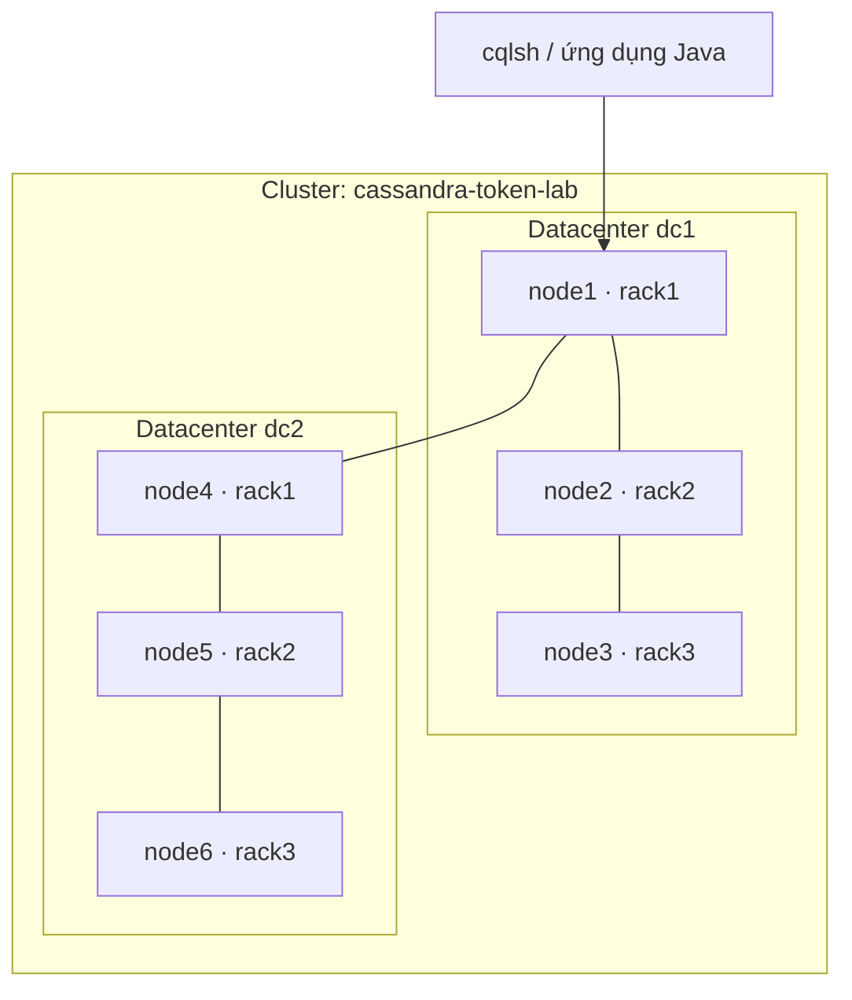
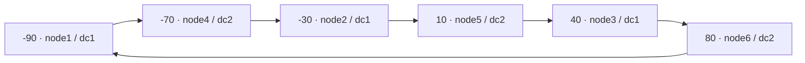
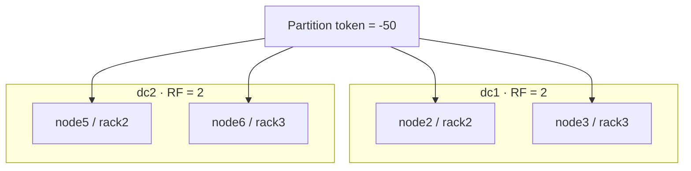

# Dựng cụm thử và lập sơ đồ token, bản sao, datacenter

> **Chương:** Thực hành tổng hợp  
> **Module:** `DATABASE_ENGINE_WIDE_COLUMN_CASSANDRA`  
> **Bài toán:** Dựng một cụm Apache Cassandra nhiều datacenter, tạo bảng theo truy vấn, tìm token của khóa phân vùng, xác định các replica thật và lập sơ đồ có căn cứ từ kết quả quan sát.

## 1. Mục tiêu và sản phẩm cần nộp

Sau bài này, bạn có thể:

1. Dựng cụm Cassandra **6 node, 2 datacenter, 3 rack mỗi datacenter** bằng Docker Compose; phân biệt node, datacenter, rack và seed.
2. Giải thích vì sao **partition key** được băm thành token và token được dùng để tìm các replica trong mô hình wide-column phân tán.
3. Tạo keyspace dùng `NetworkTopologyStrategy`, đọc hệ số sao chép (replication factor, RF) và phân biệt nó với mức nhất quán (consistency level, CL).
4. Dùng `nodetool status`, `nodetool ring`, `nodetool getendpoints` và CQL để **vẽ sơ đồ token–replica–datacenter dựa trên dữ liệu thật**.
5. Thử lỗi một replica, giải thích ảnh hưởng lên `LOCAL_ONE` và `LOCAL_QUORUM`; nêu các bước cần lưu ý khi node phục hồi và ứng dụng Java kết nối.

**Sản phẩm cuối:** file `compose.yaml`, các lệnh và kết quả quan sát, một sơ đồ topology, một sơ đồ tuyến token/replica cho khóa `c001`, cùng giải thích tình huống mất node.

**Giới hạn phòng lab:** Tất cả các container chạy trên **cùng một máy Docker**, nên `dc1`, `dc2` và các rack chỉ mô phỏng cấu trúc logic. Đây không phải mô hình chịu lỗi của hai datacenter vật lý.

## 2. Kiến thức nền đủ để làm lab

| Khái niệm | Ý nghĩa trong bài |
|---|---|
| Cluster | Tập hợp các node Cassandra hoạt động cùng tên cluster, trao đổi thông tin topology bằng gossip. |
| Node | Một instance Cassandra; mọi node đều có thể đóng vai trò **coordinator** cho truy vấn nhận được. |
| Datacenter (DC) | Nhóm node theo vị trí/vùng triển khai; ảnh hưởng tới đặt replica và nhất quán cục bộ. |
| Rack | Đơn vị bố trí node nhằm phân tán replica giữa các miền lỗi trong một DC. |
| Partition key | Một hoặc nhiều cột đầu tiên trong khóa chính, xác định nơi phân vùng được lưu. |
| Token | Giá trị do partitioner tạo từ partition key; với `Murmur3Partitioner`, token là số nguyên có dấu 64 bit. |
| Virtual node (vnodes) | Một node giữ nhiều token/range; lab dùng `num_tokens = 8` cho mỗi node. |
| RF | Số bản sao **mỗi phân vùng** trong **mỗi DC** khi dùng `NetworkTopologyStrategy`. |
| CL | Số phản hồi cần nhận để một thao tác đọc/ghi được xem là thành công; không làm thay đổi số replica. |

Với token ring, mỗi token của node đại diện cho một vùng khóa kết thúc tại token đó (vùng `(token_trước, token_hiện_tại]`, tính theo chiều vòng tròn). Cassandra băm **giá trị partition key** bằng partitioner; các replica được chọn theo thứ tự vòng token **và quy tắc topology/rack của replication strategy**. Token không được tính từ giá trị clustering key, vì clustering key chỉ sắp xếp bản ghi **bên trong partition**.

**Điểm phân biệt quan trọng:** Seed node chỉ là điểm liên lạc ban đầu khi khám phá cụm; seed **không** là master, không tự động giữ toàn bộ dữ liệu và không là coordinator duy nhất.

## 3. Sơ đồ topology sẽ dựng



- `node1` là seed để các node tìm nhau; nó cũng là một node chứa dữ liệu bình thường.
- Keyspace của lab dùng `RF = 2` ở **dc1** và `RF = 2` ở **dc2**. Do mỗi DC có 3 node, **một partition có 4 replica** (2 ở mỗi DC), còn node thứ ba ở từng DC không nhất thiết lưu partition đó.
- Ba rack trong mỗi DC giúp quan sát mục tiêu phân tán replica sang các rack khác nhau. Cách đặt rack ở đây là nhãn mô phỏng.

## 4. Khởi tạo cụm bằng Docker Compose

**Điều kiện:** Docker Engine/Docker Desktop và Docker Compose v2 hoạt động; nên có máy khoảng **16 GB RAM trở lên** để chạy đồng thời 6 Cassandra node với heap 1 GB/node và phần bộ nhớ ngoài heap. Dùng thư mục lab riêng, ví dụ `cassandra-token-lab`.

Tạo file `compose.yaml` với nội dung:

```yaml
name: cassandra-token-lab

x-cassandra-base: &cassandra-base
  image: cassandra:5.0
  restart: "no"
  networks:
    - lab
  environment: &common-env
    CASSANDRA_CLUSTER_NAME: cassandra-token-lab
    CASSANDRA_SEEDS: node1
    CASSANDRA_ENDPOINT_SNITCH: GossipingPropertyFileSnitch
    CASSANDRA_NUM_TOKENS: 8
    MAX_HEAP_SIZE: 1G

services:
  node1:
    <<: *cassandra-base
    hostname: node1
    environment:
      <<: *common-env
      CASSANDRA_DC: dc1
      CASSANDRA_RACK: rack1
    volumes:
      - node1_data:/var/lib/cassandra

  node2:
    <<: *cassandra-base
    hostname: node2
    environment:
      <<: *common-env
      CASSANDRA_DC: dc1
      CASSANDRA_RACK: rack2
    volumes:
      - node2_data:/var/lib/cassandra

  node3:
    <<: *cassandra-base
    hostname: node3
    environment:
      <<: *common-env
      CASSANDRA_DC: dc1
      CASSANDRA_RACK: rack3
    volumes:
      - node3_data:/var/lib/cassandra

  node4:
    <<: *cassandra-base
    hostname: node4
    environment:
      <<: *common-env
      CASSANDRA_DC: dc2
      CASSANDRA_RACK: rack1
    volumes:
      - node4_data:/var/lib/cassandra

  node5:
    <<: *cassandra-base
    hostname: node5
    environment:
      <<: *common-env
      CASSANDRA_DC: dc2
      CASSANDRA_RACK: rack2
    volumes:
      - node5_data:/var/lib/cassandra

  node6:
    <<: *cassandra-base
    hostname: node6
    environment:
      <<: *common-env
      CASSANDRA_DC: dc2
      CASSANDRA_RACK: rack3
    volumes:
      - node6_data:/var/lib/cassandra

networks:
  lab:
    name: cassandra-lab-net

volumes:
  node1_data:
  node2_data:
  node3_data:
  node4_data:
  node5_data:
  node6_data:
```

**Giải thích cấu hình:**

- `CASSANDRA_CLUSTER_NAME` giống nhau ở mọi node, để tất cả thuộc cùng cluster.
- `CASSANDRA_SEEDS=node1` dùng DNS nội bộ của Compose để các node kết nối với seed. Seed phải có thể phân giải từ các container khác.
- `GossipingPropertyFileSnitch` nhận cấu hình DC/rack từ `CASSANDRA_DC` và `CASSANDRA_RACK` trong image Docker chính thức.
- `CASSANDRA_NUM_TOKENS=8` giúp giới hạn số token cần đọc trong bài; giá trị token thực được sinh khi node khởi tạo và sẽ khác sơ đồ minh họa ở phần sau.
- Volume riêng bảo toàn trạng thái từng node qua `docker compose stop/start`. Không tái sử dụng cùng volume cho nhiều node.

Khởi động seed trước, rồi các node còn lại:

```powershell
docker compose config
docker compose up -d node1
docker compose exec node1 nodetool status
docker compose up -d node2 node3 node4 node5 node6
docker compose exec node1 nodetool status
```

Cassandra khởi động chậm hơn một dịch vụ web thông thường. Khi `nodetool` báo chưa kết nối được, hãy xem log rồi thực hiện lại lệnh kiểm tra sau khi node sẵn sàng:

```powershell
docker compose ps
docker compose logs --tail=80 node1
docker compose exec node1 nodetool status
```

**Tiêu chí đạt:** `nodetool status` liệt kê **2 datacenter**, mỗi DC **3 node trạng thái `UN`** (Up/Normal), với **8 tokens/node**. Địa chỉ IP và thứ tự node là dữ liệu động, không được chép cố định từ tài liệu.

Ghi lại đầu ra `nodetool status` để ánh xạ mỗi IP sang DC. Nếu cần xác định IP nào là container nào, chạy lần lượt:

```powershell
docker compose exec node1 hostname -i
docker compose exec node2 hostname -i
docker compose exec node3 hostname -i
docker compose exec node4 hostname -i
docker compose exec node5 hostname -i
docker compose exec node6 hostname -i
```

## 5. Tạo keyspace và bảng phục vụ một kiểu truy vấn

Bài toán: ứng dụng bán hàng cần xem **đơn hàng gần đây của một khách hàng**. Truy vấn chính biết `customer_id` và cần lấy các đơn theo thời gian giảm dần. Vì Cassandra thiết kế bảng theo truy vấn, ta đặt `customer_id` là partition key và `order_id` kiểu `timeuuid` là clustering key.

Mở CQL shell bên trong node1:

```powershell
docker compose exec node1 cqlsh
```

Trong `cqlsh`, chạy:

```sql
CREATE KEYSPACE topology_lab
WITH replication = {
  'class': 'NetworkTopologyStrategy',
  'dc1': 2,
  'dc2': 2
}
AND durable_writes = true;

CREATE TABLE topology_lab.orders_by_customer (
  customer_id text,
  order_id timeuuid,
  total_vnd bigint,
  PRIMARY KEY (customer_id, order_id)
) WITH CLUSTERING ORDER BY (order_id DESC);

DESCRIBE KEYSPACE topology_lab;

CONSISTENCY LOCAL_QUORUM;

INSERT INTO topology_lab.orders_by_customer
  (customer_id, order_id, total_vnd)
VALUES ('c001', now(), 150000);

INSERT INTO topology_lab.orders_by_customer
  (customer_id, order_id, total_vnd)
VALUES ('c001', now(), 275000);

INSERT INTO topology_lab.orders_by_customer
  (customer_id, order_id, total_vnd)
VALUES ('c002', now(), 99000);

SELECT customer_id, order_id, total_vnd
FROM topology_lab.orders_by_customer
WHERE customer_id = 'c001';
```

Kết quả cuối cần có **2 đơn của c001**, theo `order_id DESC`. Truy vấn theo đúng partition key không cần `ALLOW FILTERING`. Với bảng demo này, một khách có thể tạo partition quá lớn khi số đơn tăng vô hạn; trong sản phẩm thực tế có thể cần thêm bucket thời gian, ví dụ partition key ghép `(customer_id, order_month)`, tùy truy vấn và kích thước dữ liệu.

**Giải thích CL:** `LOCAL_QUORUM` ở `dc1` với RF=2 yêu cầu **2 phản hồi từ các replica ở dc1**. Nó không chờ quorum của `dc2` để trả thành công, dù Cassandra vẫn gửi đột biến ghi tới các replica ở DC khác. `LOCAL_ONE` chỉ yêu cầu một replica tại DC cục bộ. Việc chọn CL không đổi phân bố bản sao đã quy định bởi keyspace.

## 6. Tìm token và replica thật

Đầu tiên, lấy token của partition từ dữ liệu vừa ghi, trong `cqlsh`:

```sql
SELECT token(customer_id) AS partition_token,
       customer_id, order_id, total_vnd
FROM topology_lab.orders_by_customer
WHERE customer_id = 'c001';
```

Hai hàng của `c001` có **cùng một `partition_token`**, dù `order_id` khác nhau; vì token chỉ phụ thuộc `customer_id`. Hàng của `c002` thường có token khác. Token là kết quả băm, không phải số thứ tự khách hàng và cũng không thể dự đoán chính xác nếu chưa tính toán.

Thoát `cqlsh` bằng `EXIT;`, rồi chạy trong terminal:

```powershell
docker compose exec node1 nodetool status
docker compose exec node1 nodetool ring topology_lab
docker compose exec node1 nodetool getendpoints topology_lab orders_by_customer c001
docker compose exec node1 nodetool getendpoints topology_lab orders_by_customer c002
```

Ý nghĩa từng lệnh:

| Công cụ | Kết quả cần lấy |
|---|---|
| `nodetool status` | Tên DC, IP của node, trạng thái Up/Down, số token. |
| `nodetool ring topology_lab` | Các token range thực và node/endpoints gắn với chúng. Một node xuất hiện nhiều lần vì dùng vnodes. |
| `nodetool getendpoints ... c001` | **Các endpoint replica thật** của partition có `customer_id='c001'`. |
| `nodetool getendpoints ... c002` | Một khóa thứ hai để so sánh phân bố bản sao. |

Với đủ 6 node `UN` và keyspace RF=2 tại mỗi DC, kết quả `getendpoints` của **mỗi khóa** phải gồm **4 IP phân biệt: 2 trong dc1 và 2 trong dc2**. Tên node và token cụ thể phụ thuộc cụm đã tạo. Hai partition có thể tình cờ có cùng tập replica; điều đó không có nghĩa là token của chúng trùng nhau.

**Lưu ý:** `getendpoints` mô tả **quy hoạch replica theo token/topology**; nó không chứng nhận replica đang `UN` hay đã có dữ liệu mới nhất. Kết hợp đầu ra này với `nodetool status` khi phân tích sự cố.

## 7. Cách đọc vòng token và vẽ sơ đồ

Đây là **ví dụ giả định** với mỗi node chỉ có **một token** để nhìn rõ thuật toán; các con số **không phải** token đo được từ lab (lab dùng 8 vnodes/node):

| Thứ tự chiều kim đồng hồ | Token minh họa | Node | Datacenter / rack |
|---:|---:|---|---|
| 1 | -90 | node1 | dc1 / rack1 |
| 2 | -70 | node4 | dc2 / rack1 |
| 3 | -30 | node2 | dc1 / rack2 |
| 4 | 10 | node5 | dc2 / rack2 |
| 5 | 40 | node3 | dc1 / rack3 |
| 6 | 80 | node6 | dc2 / rack3 |



Giả sử một partition có token **-50**:

1. Đi theo vòng token tới token **-30** ở `node2`, là điểm đầu tiên không nhỏ hơn -50.
2. Duyệt theo chiều vòng token để tìm đủ **2 node khác nhau tại dc1** và **2 node khác nhau tại dc2**, tôn trọng quy tắc phân tán rack của `NetworkTopologyStrategy`.
3. Trong ví dụ đơn giản này: **dc1 → node2, node3**; **dc2 → node5, node6**. Đó là **4 replica** của partition giả định.
4. Vì vòng có tính chu kỳ, sau token lớn nhất lại quay về token nhỏ nhất. Với **vnodes**, một node xuất hiện tại nhiều vị trí; không thể vẽ chính xác cụm thật bằng sáu token giả định trên.

Sơ đồ dưới đây thể hiện đường đi **minh họa** của partition token -50:



**Nhiệm vụ lập sơ đồ thực tế:**

1. Chép token của `c001` từ CQL và tập IP từ `getendpoints`.
2. Ánh xạ IP → node → DC/rack bằng `nodetool status` và thông tin cấu hình lab.
3. Dùng `nodetool ring topology_lab` xác định vị trí token của partition trong vòng token thực, ghi lại vài token liền kề xung quanh nó. Với 8 vnodes/node, cần đọc **tất cả token thực liên quan**, không thay bằng số token giả định.
4. Vẽ một khối partition và **4 mũi tên** tới đúng các node replica; nhóm node theo `dc1`/`dc2` và ghi rack.
5. Làm tương tự với `c002`, nhận xét replica nào trùng và khác.

Mẫu ghi kết quả (tự điền từ lệnh, không coi dấu `…` là giá trị thật):

| Dữ liệu quan sát | Giá trị của bạn |
|---|---|
| Token của `c001` | … |
| Replica ở `dc1` (node/IP/rack) | … và … |
| Replica ở `dc2` (node/IP/rack) | … và … |
| Token của `c002` | … |
| Sự khác nhau giữa hai bộ replica | … |
| Những token/range liền kề cần đưa vào sơ đồ | … |

**Câu hỏi giải thích:** Nếu đổi `customer_id`, vì sao replica có thể thay đổi dù không đổi bảng? Nếu chỉ đổi `total_vnd` hoặc `order_id` mà vẫn giữ cùng `customer_id`, vì sao partition token không đổi?

## 8. Thử mất một replica và quan sát consistency

Chỉ thực hiện sau khi bước 6 hoạt động ổn định. Để kịch bản có ý nghĩa, **chọn một node thuộc dc1, có trong kết quả `getendpoints ... c001`, và không phải `node1`** (vì ta dùng node1 làm điểm chạy `cqlsh`). Trong tập 2 replica của dc1 trên 3 node, luôn có ít nhất một node như vậy.

Ví dụ **chỉ khi node2 thực sự là replica của c001**:

```powershell
docker compose stop node2
docker compose exec node1 nodetool status
docker compose exec node1 cqlsh
```

Đợi `nodetool status` phản ánh node bị dừng. Trong `cqlsh`:

```sql
CONSISTENCY LOCAL_QUORUM;
SELECT * FROM topology_lab.orders_by_customer
WHERE customer_id = 'c001';

CONSISTENCY LOCAL_ONE;
SELECT * FROM topology_lab.orders_by_customer
WHERE customer_id = 'c001';
```

Dự đoán:

- Vì RF ở `dc1` bằng 2, `LOCAL_QUORUM` cần **cả 2 replica dc1** phản hồi. Khi một replica của `c001` trong dc1 không hoạt động, truy vấn ở CL này sẽ không thỏa được yêu cầu; có thể thấy lỗi `Unavailable` hoặc timeout tùy thời điểm phát hiện lỗi.
- `LOCAL_ONE` chỉ cần **1 replica còn sống trong dc1**, vì vậy truy vấn dự kiến vẫn đọc được dữ liệu đã ghi. Ở mức nhất quán yếu hơn, nếu dữ liệu ghi gần đây chưa hội tụ thì vẫn cần xem xét rủi ro đọc cũ.
- Replica ở `dc2` **không thay thế** replica `dc1` trong phép tính `LOCAL_QUORUM`. `EACH_QUORUM` lại yêu cầu quorum ở **từng DC** và do đó cũng không cứu được DC thiếu quorum.

Thoát `cqlsh` và khôi phục node đã dừng (thay `node2` bằng đúng node bạn thực sự dừng):

```powershell
docker compose start node2
docker compose exec node1 nodetool status
```

Chờ node trở lại `UN`, sau đó chạy lại truy vấn với `LOCAL_QUORUM`. Ghi chú thời điểm node bị dừng, mức CL, kết quả và lý do.

**Hạn chế quan trọng:** `UN` có nghĩa node đã về trạng thái Up/Normal, không phải bảo đảm mọi replica đã có cùng phiên bản dữ liệu. Trong vận hành thực tế, các cơ chế hint, streaming và **repair** giúp đồng bộ bản sao sau lỗi; lịch repair cần được thiết kế theo thời gian giữ tombstone và khả năng đồng bộ. `nodetool compactionstats` cho biết tác vụ compaction đang chạy, nhưng **compaction không thay cho repair**. Có thể quan sát hai loại trạng thái này trên cụm thử:

```powershell
docker compose exec node1 nodetool compactionstats
docker compose exec node1 nodetool netstats
```

## 9. Liên hệ với ứng dụng Java

Ứng dụng Java dùng driver Cassandra 4.x có thể đặt contact point là node1 và **chỉ rõ local datacenter `dc1`**. Ví dụ tối giản dưới đây giả định ứng dụng chạy trong **cùng Docker network `cassandra-lab-net`**, nơi DNS `node1` phân giải được (ứng dụng chạy trực tiếp trên host Windows/macOS không tự nhìn thấy DNS đó):

```java
import com.datastax.oss.driver.api.core.CqlSession;
import com.datastax.oss.driver.api.core.DefaultConsistencyLevel;
import com.datastax.oss.driver.api.core.cql.BoundStatement;
import com.datastax.oss.driver.api.core.cql.PreparedStatement;
import java.net.InetSocketAddress;

try (CqlSession session = CqlSession.builder()
        .addContactPoint(new InetSocketAddress("node1", 9042))
        .withLocalDatacenter("dc1")
        .build()) {
    PreparedStatement statement = session.prepare(
        "SELECT order_id, total_vnd " +
        "FROM topology_lab.orders_by_customer WHERE customer_id = ?");
    BoundStatement query = statement.bind("c001")
        .setConsistencyLevel(DefaultConsistencyLevel.LOCAL_QUORUM);

    session.execute(query).forEach(row ->
        System.out.println(row.getUuid("order_id") + ": "
            + row.getLong("total_vnd")));
}
```

Để chạy đoạn Java cần khai báo dependency Java driver tương ứng trong dự án. Trong triển khai thật, cấu hình contact points, TLS/xác thực, retry và địa chỉ node mà driver có thể truy cập phải khớp môi trường mạng. Đặt `localDatacenter` theo tên được khai báo trong Cassandra; lựa chọn này ảnh hưởng đường đi tới coordinator cục bộ và cách dùng các consistency level dạng `LOCAL_*`.

## 10. Kiểm tra kết quả, lỗi thường gặp và dọn lab

| Tình huống | Cách phân tích / xử lý |
|---|---|
| `nodetool status` chưa thấy đủ 6 node `UN` | Kiểm tra `docker compose ps` và `docker compose logs --tail=80 <node>`; đợi node bootstrap ổn định rồi kiểm tra lại. |
| Node gia nhập sai DC hoặc rack | Xem `CASSANDRA_DC`, `CASSANDRA_RACK` và snitch **trước khi khởi tạo dữ liệu**; data volume cũ giữ thông tin cluster nên thay cấu hình trên container đã dùng không đảm bảo di chuyển DC an toàn. |
| `LOCAL_QUORUM` không thành công sau khi dừng node | Kiểm tra node dừng có phải replica của partition không và RF tại DC cục bộ là bao nhiêu; với RF=2, quorum=2. |
| Có 4 endpoint nhưng không phải 4 node `UN` | `getendpoints` liệt kê replica được quy hoạch; kiểm tra trạng thái thực qua `nodetool status`. |
| Token hoặc replica khác hình minh họa | Bình thường: token thực được Cassandra phân bổ khi node khởi tạo; hình minh họa chỉ có 1 token/node, còn lab có 8 vnodes/node. |
| Dữ liệu hoặc token vẫn còn khi chạy lại Compose | Named volumes lưu trạng thái. Dùng `docker compose down` để dừng và xóa container/network **mà giữ volumes**. |

Kết thúc lab:

```powershell
docker compose down
```

Chỉ khi **muốn xóa toàn bộ dữ liệu lab và tạo lại từ đầu**, chạy trong đúng thư mục Compose của bài:

```powershell
docker compose down -v
```

**Checklist nộp bài:**

- [ ] Có 6 node `UN` ở 2 DC (3 node/DC), ghi rõ rack của mỗi node.
- [ ] Keyspace `topology_lab` dùng `NetworkTopologyStrategy` với `dc1:2` và `dc2:2`.
- [ ] Truy vấn lấy 2 đơn của `c001` không dùng `ALLOW FILTERING`.
- [ ] Đã ghi token `c001` và `c002`, địa chỉ 4 replica/khóa và IP → node/DC/rack.
- [ ] Sơ đồ ring sử dụng token **đo từ cụm thật**; sơ đồ replica thể hiện 2 node ở mỗi DC.
- [ ] Có giải thích kết quả mất một replica ở `dc1` dưới `LOCAL_QUORUM` và `LOCAL_ONE`.
- [ ] Phân biệt được token/replication/consistency, cũng như repair/compaction và vai trò seed/coordinator.

**Câu hỏi nâng cao:** Nếu yêu cầu vẫn đọc/ghi bằng `LOCAL_QUORUM` khi mất 1 node trong một DC, cần xem xét thay đổi **số node/RF theo DC** ra sao? Với 3 node/DC và RF=3, quorum=2 cho phép mất 1 replica nhưng mỗi partition sẽ nằm trên cả 3 node DC đó; đổi lại, chi phí lưu trữ và ghi tăng. Hãy phân tích đánh đổi này trước khi kết luận cấu hình nào phù hợp sản phẩm thực tế.
