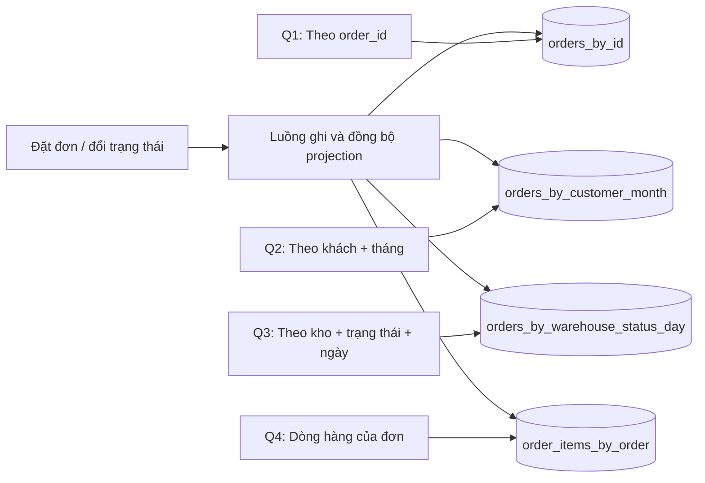

# Thực hành tổng hợp: Mô hình hóa cùng nghiệp vụ bằng các bảng phục vụ truy vấn khác nhau

## 1. Mục tiêu và bối cảnh

Apache Cassandra là cơ sở dữ liệu **wide-column phân tán**. Khi thiết kế dữ liệu, câu hỏi đầu tiên không phải “nghiệp vụ có những thực thể nào?” mà là **“ứng dụng phải đọc dữ liệu bằng những truy vấn nào?”**. Một đơn hàng có thể xuất hiện ở nhiều bảng với khóa phân vùng và thứ tự sắp xếp khác nhau. Đây là cách chủ động đánh đổi không gian lưu trữ và công sức đồng bộ để mỗi truy vấn quan trọng đọc đúng phân vùng, không cần `JOIN` hoặc quét toàn bảng.

Trong bài này, bạn đóng vai kỹ sư xây dựng dịch vụ quản lý đơn hàng cho một hệ thống bán hàng nhiều kho. Sau bài thực hành, bạn có thể:

1. Chuyển yêu cầu màn hình/API thành danh sách truy vấn và chọn `partition key`, `clustering key` phù hợp cho từng truy vấn.
2. Dùng CQL tạo nhiều bảng biểu diễn **cùng một đơn hàng**, nạp dữ liệu và chứng minh rằng các truy vấn hoạt động như dự kiến.
3. Thiết kế luồng ghi nhiều bảng, xử lý đổi trạng thái và nhận diện rủi ro dữ liệu tạm thời không khớp.
4. Giải thích ảnh hưởng của replication, mức nhất quán đọc/ghi, phân vùng lớn, tombstone, compaction và repair đến mô hình đã chọn.
5. Hình dung cách ứng dụng Java dùng prepared statement và một quy trình cập nhật có thể phục hồi sau lỗi.

### Nghiệp vụ cần hỗ trợ

Một đơn hàng có các thuộc tính: `order_id`, `customer_id`, `warehouse_id`, `placed_at`, `status`, `total_minor`, `currency` và danh sách mặt hàng. Hệ thống cần phục vụ các API:

| Mã | API và truy vấn cần chạy | Thứ tự/điều kiện |
| --- | --- | --- |
| Q1 | `GET /orders/{orderId}`: lấy thông tin đơn theo ID | Một đơn cụ thể |
| Q2 | `GET /customers/{id}/orders?month=2026-11`: xem lịch sử đơn của khách trong một tháng | Mới nhất trước, phân trang |
| Q3 | `GET /warehouses/{id}/orders?status=PLACED&day=2026-11-20`: lấy hàng đợi xử lý của kho | Cũ nhất trước, giới hạn số bản ghi |
| Q4 | `GET /orders/{orderId}/items`: xem các dòng hàng của đơn | Theo `line_no` tăng dần |

Giả định thực hành: `order_id` không thay đổi; thời điểm đặt đơn không đổi sau khi tạo; trạng thái có thể chuyển `PLACED → PACKING → SHIPPED`; tiền lưu ở đơn vị nhỏ nhất của tiền tệ (ví dụ VND là đồng, không dùng số thực). Mỗi tháng và ngày được tính nhất quán theo **UTC** trong bài; khi ứng dụng sử dụng múi giờ kinh doanh, phải xác định một quy tắc chuyển đổi duy nhất trước khi tạo khóa phân vùng.

## 2. Từ câu truy vấn đến mô hình bảng

### 2.1. Bản đồ truy vấn

| Truy vấn | Bảng phục vụ | Partition key | Clustering key | Lý do |
| --- | --- | --- | --- | --- |
| Q1 | `orders_by_id` | `order_id` | Không có | Truy cập trực tiếp một đơn |
| Q2 | `orders_by_customer_month` | `(customer_id, order_month)` | `placed_at DESC, order_id DESC` | Gom đơn của một khách trong một tháng; trả về mới nhất trước |
| Q3 | `orders_by_warehouse_status_day` | `(warehouse_id, status, order_day)` | `placed_at ASC, order_id ASC` | Đọc hàng đợi một trạng thái của một kho trong một ngày |
| Q4 | `order_items_by_order` | `order_id` | `line_no ASC` | Lấy tất cả mặt hàng thuộc một đơn theo thứ tự |

Lưu ý:

- Trong khóa chính `PRIMARY KEY ((a, b), c)`, **(a, b) là một khóa phân vùng ghép**, còn `c` là khóa phân cụm. Thiếu một thành phần khóa phân vùng thường khiến truy vấn không thực hiện được theo cách dự kiến.
- Thêm `order_id` vào clustering key của Q2/Q3 giúp hai đơn có cùng `placed_at` vẫn là hai dòng khác nhau; nếu chỉ dùng thời gian, bản ghi có thể ghi đè nhau.
- `order_month` và `order_day` là các giá trị **bucket** được tính khi ghi. Chúng giới hạn độ rộng phân vùng và là thành phần phải có trong truy vấn, không phải thuộc tính để Cassandra tự suy ra từ `placed_at`.
- Không có một bảng phù hợp tối ưu cho cả bốn API. Cố gộp tất cả bằng một bảng rồi dùng `ALLOW FILTERING` có thể tạo ra những truy vấn đắt đỏ và khó dự đoán độ trễ khi dữ liệu lớn.



Đây là **denormalization có chủ đích**: cùng một đơn hàng được sao chép sang ba bảng tra cứu khác nhau. Bảng `order_items_by_order` lưu các dòng hàng, cũng được thiết kế cho một truy vấn cụ thể. Cassandra không tự duy trì tính nhất quán nghiệp vụ giữa những bảng này; ứng dụng phải đảm nhận việc đó.

## 3. Chuẩn bị môi trường

Cần một Cassandra đang hoạt động và `cqlsh` kết nối được đến cluster. Kiểm tra tên datacenter bằng `nodetool status` trên một node (hoặc cấu hình cluster đang sử dụng). Ví dụ bên dưới giả sử datacenter tên `datacenter1` và môi trường **thực hành một node**:

```sql
CREATE KEYSPACE IF NOT EXISTS shop_practice
WITH replication = {
  'class': 'NetworkTopologyStrategy',
  'datacenter1': 1
}
AND durable_writes = true;

USE shop_practice;
```

Nếu dùng cluster ba replica trong cùng datacenter, cấu hình replication factor của datacenter đó thành `3` và bảo đảm có đủ node. Trong môi trường nhiều datacenter, chỉ định RF riêng cho từng datacenter. `RF = 1` ở trên giúp chạy lab đơn giản, **không chịu được mất node chứa replica** và không đại diện cho cấu hình production. Nếu tên datacenter khác, thay `datacenter1` trong CQL bằng tên thực tế.

## 4. Tạo bốn bảng với CQL

### 4.1. Tra cứu theo mã đơn

```sql
CREATE TABLE IF NOT EXISTS orders_by_id (
    order_id uuid PRIMARY KEY,
    customer_id uuid,
    warehouse_id text,
    placed_at timestamp,
    order_month text,
    status text,
    total_minor bigint,
    currency text
);
```

Mỗi `order_id` là một partition key. Các trường `customer_id`, `placed_at`, `order_month` được lưu tại đây để phục vụ dữ liệu đơn và quá trình đối soát/cập nhật các bảng còn lại.

### 4.2. Lịch sử đơn theo khách và tháng

```sql
CREATE TABLE IF NOT EXISTS orders_by_customer_month (
    customer_id uuid,
    order_month text,
    placed_at timestamp,
    order_id uuid,
    status text,
    total_minor bigint,
    currency text,
    PRIMARY KEY ((customer_id, order_month), placed_at, order_id)
) WITH CLUSTERING ORDER BY (placed_at DESC, order_id DESC);
```

Câu hỏi của màn hình lịch sử luôn có `customer_id` và `month`. Cassandra đưa các đơn cùng cặp khóa đó vào một phân vùng và sắp thứ tự theo clustering key. Đọc các tháng liên tiếp cần thực hiện nhiều truy vấn theo từng bucket và gộp kết quả ở ứng dụng.

### 4.3. Hàng đợi đơn theo kho, trạng thái và ngày

```sql
CREATE TABLE IF NOT EXISTS orders_by_warehouse_status_day (
    warehouse_id text,
    status text,
    order_day date,
    placed_at timestamp,
    order_id uuid,
    customer_id uuid,
    total_minor bigint,
    PRIMARY KEY ((warehouse_id, status, order_day), placed_at, order_id)
) WITH CLUSTERING ORDER BY (placed_at ASC, order_id ASC);
```

Đây là **bảng chỉ mục nghiệp vụ do ứng dụng quản lý**, cho phép nhân viên kho lấy các đơn cũ nhất đang chờ xử lý. Vì `status` nằm trong partition key, việc đổi trạng thái **không thể chỉ `UPDATE status` trên bảng này**. Phải tạo dòng tại phân vùng trạng thái mới và xóa dòng cũ.

Bucket theo ngày giúp khống chế kích thước partition nhưng vẫn có thể quá lớn nếu một kho nhận quá nhiều đơn/ngày. Khi lưu lượng tăng, cần đo kích thước và số dòng mỗi phân vùng để quyết định chia theo giờ hoặc thêm shard. Nếu thêm shard, ứng dụng cũng phải truy vấn/gộp nhiều shard.

### 4.4. Dòng hàng của đơn

```sql
CREATE TABLE IF NOT EXISTS order_items_by_order (
    order_id uuid,
    line_no int,
    product_id text,
    quantity int,
    unit_price_minor bigint,
    PRIMARY KEY (order_id, line_no)
) WITH CLUSTERING ORDER BY (line_no ASC);
```

Một đơn có nhiều dòng hàng trong cùng phân vùng. `line_no` phải duy nhất trong một đơn. Khóa chính không tự thực thi ràng buộc số lượng dương, giá không âm hay tính đúng tổng tiền; các quy tắc đó do tầng nghiệp vụ kiểm tra.

## 5. Ghi một đơn vào các bảng phục vụ truy vấn

Trong `cqlsh`, thực hiện lần lượt các lệnh dưới đây. Dữ liệu cố định giúp dễ đối chiếu kết quả:

| Thuộc tính | Giá trị |
| --- | --- |
| `order_id` | `aaaaaaaa-aaaa-4aaa-8aaa-aaaaaaaaaaaa` |
| `customer_id` | `11111111-1111-4111-8111-111111111111` |
| `warehouse_id` | `WH_HCM_01` |
| `placed_at` | `2026-11-20T09:30:00Z` |
| `order_month` / `order_day` | `2026-11` / `2026-11-20` |
| `status` | `PLACED` |
| `total_minor` / `currency` | `249000` / `VND` |

```sql
-- 1. Dòng tra cứu chi tiết
INSERT INTO orders_by_id (
    order_id, customer_id, warehouse_id, placed_at,
    order_month, status, total_minor, currency
) VALUES (
    aaaaaaaa-aaaa-4aaa-8aaa-aaaaaaaaaaaa,
    11111111-1111-4111-8111-111111111111,
    'WH_HCM_01', '2026-11-20T09:30:00Z',
    '2026-11', 'PLACED', 249000, 'VND'
);

-- 2. Dòng phục vụ lịch sử khách hàng
INSERT INTO orders_by_customer_month (
    customer_id, order_month, placed_at, order_id,
    status, total_minor, currency
) VALUES (
    11111111-1111-4111-8111-111111111111,
    '2026-11', '2026-11-20T09:30:00Z',
    aaaaaaaa-aaaa-4aaa-8aaa-aaaaaaaaaaaa,
    'PLACED', 249000, 'VND'
);

-- 3. Dòng phục vụ hàng đợi của kho
INSERT INTO orders_by_warehouse_status_day (
    warehouse_id, status, order_day, placed_at,
    order_id, customer_id, total_minor
) VALUES (
    'WH_HCM_01', 'PLACED', '2026-11-20',
    '2026-11-20T09:30:00Z',
    aaaaaaaa-aaaa-4aaa-8aaa-aaaaaaaaaaaa,
    11111111-1111-4111-8111-111111111111,
    249000
);

-- 4. Hai dòng hàng: 2 x 99000 + 1 x 51000 = 249000
INSERT INTO order_items_by_order (
    order_id, line_no, product_id, quantity, unit_price_minor
) VALUES (
    aaaaaaaa-aaaa-4aaa-8aaa-aaaaaaaaaaaa, 1, 'BOOK-CAS-01', 2, 99000
);

INSERT INTO order_items_by_order (
    order_id, line_no, product_id, quantity, unit_price_minor
) VALUES (
    aaaaaaaa-aaaa-4aaa-8aaa-aaaaaaaaaaaa, 2, 'BOOK-JAVA-02', 1, 51000
);
```

**Cần hiểu đúng về ghi nhiều bảng:** năm lệnh `INSERT` trên không tạo thành một transaction xuyên các phân vùng. Nếu mạng hoặc tiến trình lỗi giữa chừng, có thể chỉ một số bảng được cập nhật. `LOGGED BATCH` có cơ chế ghi batch log để các mutation trong batch cuối cùng được áp dụng nhưng không cung cấp cô lập giao dịch như RDBMS và có chi phí, nhất là batch qua nhiều partition; không dùng nó để che giấu nhu cầu xử lý lỗi nghiệp vụ. Với production, cần một quy trình ghi, retry có kiểm soát, bản ghi/sự kiện bền vững và job đối soát để hoàn thiện các projection còn thiếu.

## 6. Chạy các truy vấn thực tế

### Q1 — Tìm đúng một đơn

```sql
SELECT order_id, customer_id, warehouse_id, placed_at,
       status, total_minor, currency
FROM orders_by_id
WHERE order_id = aaaaaaaa-aaaa-4aaa-8aaa-aaaaaaaaaaaa;
```

**Kỳ vọng:** một dòng, `status = 'PLACED'` và `total_minor = 249000`.

### Q2 — Đọc đơn của một khách trong tháng, mới nhất trước

```sql
SELECT placed_at, order_id, status, total_minor
FROM orders_by_customer_month
WHERE customer_id = 11111111-1111-4111-8111-111111111111
  AND order_month = '2026-11'
ORDER BY placed_at DESC, order_id DESC
LIMIT 20;
```

**Kỳ vọng:** đơn vừa tạo xuất hiện. Hãy thêm hai đơn khác của cùng khách, cùng tháng, có thời gian khác nhau để kiểm tra thứ tự giảm dần. Khi làm phân trang thật, dùng `pagingState`/page size của Cassandra driver; `LIMIT` chỉ giới hạn kết quả, không thay thế được cơ chế phân trang ổn định. Không dùng cách phân trang `OFFSET` của SQL quan hệ.

### Q3 — Hàng đợi của một kho trong một ngày, cũ nhất trước

```sql
SELECT placed_at, order_id, customer_id, total_minor
FROM orders_by_warehouse_status_day
WHERE warehouse_id = 'WH_HCM_01'
  AND status = 'PLACED'
  AND order_day = '2026-11-20'
ORDER BY placed_at ASC, order_id ASC
LIMIT 20;
```

**Kỳ vọng:** đơn nằm trong hàng đợi `PLACED`. API cần xem đơn ở nhiều ngày phải truy vấn từng bucket, giới hạn số bucket và gộp kết quả theo quy tắc của ứng dụng.

### Q4 — Lấy các dòng hàng

```sql
SELECT line_no, product_id, quantity, unit_price_minor
FROM order_items_by_order
WHERE order_id = aaaaaaaa-aaaa-4aaa-8aaa-aaaaaaaaaaaa
ORDER BY line_no ASC;
```

**Kỳ vọng:** hai dòng hàng theo thứ tự `1` rồi `2`. Phép tính tổng `2 × 99000 + 1 × 51000 = 249000` do ứng dụng thực hiện và xác nhận; Cassandra không tự JOIN bảng hàng với bảng đơn để tính tổng.

Thử bỏ `order_month` ở Q2 hoặc `status` ở Q3: truy vấn không còn định vị chính xác khóa phân vùng như thiết kế. **Đừng sửa bằng cách thêm `ALLOW FILTERING` chỉ để cho câu lệnh chạy.** Nếu API thực sự cần lọc theo điều kiện mới, hãy xác định lại nhu cầu, độ lớn dữ liệu và cân nhắc tạo bảng dành cho truy vấn đó.

## 7. Thực hành chuyển trạng thái: một đơn, nhiều bản biểu diễn

Giả sử kho bắt đầu đóng gói đơn, chuyển từ `PLACED` sang `PACKING`. Ba projection lưu trạng thái phải được phản ánh. Thực hiện trong lab:

```sql
-- 1. Cập nhật thông tin đơn
UPDATE orders_by_id
SET status = 'PACKING'
WHERE order_id = aaaaaaaa-aaaa-4aaa-8aaa-aaaaaaaaaaaa;

-- 2. Cập nhật bản hiển thị ở lịch sử khách
UPDATE orders_by_customer_month
SET status = 'PACKING'
WHERE customer_id = 11111111-1111-4111-8111-111111111111
  AND order_month = '2026-11'
  AND placed_at = '2026-11-20T09:30:00Z'
  AND order_id = aaaaaaaa-aaaa-4aaa-8aaa-aaaaaaaaaaaa;

-- 3. Tạo dòng ở hàng đợi trạng thái mới
INSERT INTO orders_by_warehouse_status_day (
    warehouse_id, status, order_day, placed_at,
    order_id, customer_id, total_minor
) VALUES (
    'WH_HCM_01', 'PACKING', '2026-11-20',
    '2026-11-20T09:30:00Z',
    aaaaaaaa-aaaa-4aaa-8aaa-aaaaaaaaaaaa,
    11111111-1111-4111-8111-111111111111,
    249000
);

-- 4. Xóa dòng khỏi hàng đợi trạng thái cũ
DELETE FROM orders_by_warehouse_status_day
WHERE warehouse_id = 'WH_HCM_01'
  AND status = 'PLACED'
  AND order_day = '2026-11-20'
  AND placed_at = '2026-11-20T09:30:00Z'
  AND order_id = aaaaaaaa-aaaa-4aaa-8aaa-aaaaaaaaaaaa;
```

Kiểm tra lại Q1, Q2 và hai phiên bản Q3 với `status = 'PLACED'` và `status = 'PACKING'`. Khi tất cả mutation đã thành công và được đọc ở mức nhất quán phù hợp, trạng thái ở bảng chi tiết và lịch sử là `PACKING`; hàng đợi `PLACED` không còn đơn đó và hàng đợi `PACKING` có đúng một dòng.

Trong thực tế, **thứ tự các lệnh trên là một minh họa đơn giản, không đủ bảo đảm cập nhật nghiệp vụ nguyên tử**. Giữa các lệnh có thể có khoảng thời gian trạng thái mâu thuẫn; retry và sự kiện đến sai thứ tự có thể làm xuất hiện lại dòng ở trạng thái cũ. Một phương án triển khai chắc chắn hơn:

1. Xác định nguồn sự thật (ví dụ `orders_by_id` hoặc nhật ký sự kiện đơn hàng), đồng thời kiểm tra tính hợp lệ của chuyển trạng thái bằng quy tắc nghiệp vụ.
2. Gắn `event_id` và số phiên bản trạng thái tăng đơn điệu cho mỗi chuyển đổi. Ghi nhận sự kiện bền vững; xử lý theo thứ tự riêng cho từng `order_id`.
3. Cập nhật các bảng phục vụ truy vấn theo khóa chính xác; thiết kế retry có thể thực thi nhiều lần, kiểm tra phiên bản để sự kiện cũ không ghi đè trạng thái mới.
4. Dùng job đối soát/khôi phục projection khi một phần thao tác thất bại, đồng thời giám sát độ trễ cập nhật và số bản ghi sai lệch.

Không có ràng buộc khóa ngoại hay transaction nhiều bảng để Cassandra tự đảm bảo các bước này. Nếu nghiệp vụ yêu cầu một quyết định đồng thời, tuyến tính hóa nghiêm ngặt cho mọi truy vấn, cần đánh giá lại yêu cầu nhất quán và kiến trúc trước khi chọn các bảng denormalized.

## 8. Replication, consistency và lỗi node

**Replication** bảo vệ nhiều bản sao *trong cùng một bảng/partition*, còn các bảng `orders_by_*` là các **biểu diễn dữ liệu khác nhau** cho các truy vấn. Hai khái niệm này độc lập:

- Với `RF = 3` ở một datacenter, `LOCAL_ONE` đọc/ghi tại một replica; `LOCAL_QUORUM` cần ít nhất hai replica phản hồi trong datacenter đó.
- Chọn `LOCAL_QUORUM` cho cả đọc và ghi trên **cùng keyspace/partition** giúp hai tập replica có phần giao nhau (`R + W > RF`), nhưng không biến việc ghi ba bảng thành một transaction và không tự ngăn xung đột “last write wins”.
- Trên lab `RF = 1`, `LOCAL_QUORUM` chỉ có một replica để hỏi. Muốn quan sát tác động của replica bị lỗi, hãy chuẩn bị cluster có đủ node và RF phù hợp trước khi thử.
- Nếu một ghi thành công vào `orders_by_id` nhưng không ghi được vào `orders_by_customer_month`, tăng consistency level không tự tạo dòng còn thiếu. Cần cơ chế retry/đối soát ở tầng ứng dụng.

Có thể thử trong `cqlsh`:

```text
CONSISTENCY LOCAL_ONE
CONSISTENCY LOCAL_QUORUM
```

Sau mỗi lựa chọn, chạy lại Q1/Q2 và quan sát kết quả/độ trễ trong môi trường thử nghiệm. Với cluster ba replica, hãy phân biệt lỗi replica không khả dụng với lỗi luồng ghi projection. Dùng `nodetool status` để theo dõi node, `nodetool tablestats shop_practice.orders_by_customer_month` để khảo sát thống kê bảng, và `nodetool compactionstats` để xem tình trạng compaction (tùy phiên bản Cassandra). Thử dừng node hoặc sửa RF **chỉ trong cluster lab**, theo quy trình của môi trường đó.

**Repair không sửa được mọi kiểu sai lệch.** `nodetool repair` giúp đồng bộ replica của dữ liệu Cassandra theo token ranges; nó **không** đọc `orders_by_id` rồi tự bù một dòng bị thiếu ở `orders_by_customer_month`. Việc bù projection thiếu là công việc của quy trình đối soát nghiệp vụ.

### Những hệ quả vận hành của thiết kế

| Vấn đề | Xuất hiện ở đâu | Cách theo dõi/giảm thiểu |
| --- | --- | --- |
| Partition quá rộng hoặc hotspot | Khách có quá nhiều đơn/tháng; kho có quá nhiều đơn cùng trạng thái/ngày | Đo kích thước/số dòng, độ trễ và tải theo partition; thêm bucket nhỏ hoặc shard có chủ đích |
| Tombstone khi xóa hàng đợi cũ | `orders_by_warehouse_status_day` sau mỗi lần đổi trạng thái | Giới hạn số lần chuyển, theo dõi tombstone/độ trễ đọc; chọn chiến lược compaction phù hợp |
| Ghi khuếch đại | Một sự kiện đặt đơn ghi nhiều bảng | Tính thêm chi phí ghi, lưu trữ, replica, retry và backfill |
| Projection chậm hoặc thiếu | Khi ứng dụng lỗi sau một số thao tác ghi | Sự kiện bền vững, xử lý lại idempotent, đối soát định kỳ, metric độ trễ |
| TTL xóa dữ liệu không đồng thời | Các bảng có cấu hình TTL khác nhau | Xây chính sách lưu trữ thống nhất; kiểm tra tác động TTL/tombstone trước khi áp dụng |

Compaction cần dựa vào tính chất dữ liệu và workload. Hàng đợi cập nhật/xóa theo trạng thái tạo tombstone, vì vậy không nên áp dụng mặc định `TimeWindowCompactionStrategy` chỉ vì có trường thời gian; TWCS phù hợp hơn với dữ liệu gần như bất biến và được ghi/xóa theo cửa sổ thời gian với TTL tương thích. Khi cân nhắc `LeveledCompactionStrategy` hay `SizeTieredCompactionStrategy`, hãy đo read/write amplification, dung lượng và áp lực compaction thực tế.

## 9. Kết nối từ ứng dụng Java

Với Cassandra Java Driver 4.x tương thích môi trường, ứng dụng sử dụng prepared statement và truyền đúng các khóa đã thiết kế. Đoạn sau minh họa ghi bản tra cứu Q1 (đã cài dependency driver, cấu hình host/DC và tạo keyspace trước):

```java
import com.datastax.oss.driver.api.core.CqlSession;
import com.datastax.oss.driver.api.core.DefaultConsistencyLevel;
import com.datastax.oss.driver.api.core.cql.PreparedStatement;
import java.net.InetSocketAddress;
import java.time.Instant;
import java.util.UUID;

class OrderWriteExample {
    public static void main(String[] args) {
        UUID orderId = UUID.fromString("aaaaaaaa-aaaa-4aaa-8aaa-aaaaaaaaaaaa");
        UUID customerId = UUID.fromString("11111111-1111-4111-8111-111111111111");

        try (CqlSession session = CqlSession.builder()
                .addContactPoint(new InetSocketAddress("127.0.0.1", 9042))
                .withLocalDatacenter("datacenter1")
                .withKeyspace("shop_practice")
                .build()) {
            PreparedStatement insert = session.prepare(
                "INSERT INTO orders_by_id (" +
                "order_id, customer_id, warehouse_id, placed_at, " +
                "order_month, status, total_minor, currency) " +
                "VALUES (?, ?, ?, ?, ?, ?, ?, ?)");

            session.execute(insert.bind(
                    orderId, customerId, "WH_HCM_01",
                    Instant.parse("2026-11-20T09:30:00Z"),
                    "2026-11", "PLACED", 249_000L, "VND")
                .setConsistencyLevel(DefaultConsistencyLevel.LOCAL_QUORUM));
        }
    }
}
```

**Tích hợp thật:** triển khai các prepared statement tương ứng cho Q2, Q3 và Q4; truyền `order_month`/`order_day` được tính cùng quy tắc; dùng driver paging state cho danh sách; đưa các mutation vào một quy trình nghiệp vụ có retry/đối soát. Không coi lời gọi `execute` thành công với bảng Q1 là bằng chứng rằng mọi projection khác cũng đã hoàn chỉnh. Trên production, thông tin liên hệ, xác thực, TLS, timeout và số replica phải lấy từ cấu hình triển khai thay vì hard-code như lab.

## 10. Bài tập mở rộng và tiêu chí hoàn thành

Hãy thực hiện các nhiệm vụ sau, ghi lại CQL và kết quả quan sát:

1. **Kiểm tra thứ tự:** tạo thêm hai đơn cùng khách/tháng, thời gian `09:00Z` và `11:00Z`; chứng minh Q2 trả thứ tự `11:00 → 09:30 → 09:00`, còn Q3 cho các đơn cùng kho/trạng thái/ngày trả cũ nhất trước.
2. **Truy vấn mới:** sản phẩm yêu cầu “xem tất cả đơn của khách không giới hạn tháng”. Giải thích vì sao Q2 hiện tại không đáp ứng bằng một truy vấn định vị một partition; đề xuất giới hạn thời gian, truy vấn nhiều bucket hoặc một projection khác khi có SLA phù hợp.
3. **Chuyển trạng thái:** chạy mục 7, chụp/lưu kết quả Q1, Q2 và Q3 trước/sau; chứng minh không còn bản ghi ở `PLACED` sau khi cập nhật hoàn tất.
4. **Lỗi một phần:** trên dữ liệu thử nghiệm, cố ý bỏ qua thao tác ghi `orders_by_customer_month` cho một đơn mới. Quan sát Q1 có kết quả nhưng Q2 thiếu đơn; viết thao tác backfill bằng dữ liệu nguồn và xác nhận Q2 xuất hiện đủ. Phân biệt lỗi này với repair replica.
5. **Ước lượng phân vùng:** giả sử một kho có 120.000 đơn ở `PLACED` trong ngày và mỗi dòng sau lưu trữ chiếm trung bình 250 byte (ước lượng minh họa). Tính kích thước dữ liệu thô của phân vùng trước overhead/replication; đề xuất thay đổi bucket hoặc shard và cách API sẽ đọc gộp.
6. **Mức nhất quán:** với RF 3 tại một datacenter, cho biết số phản hồi cần thiết cho `LOCAL_ONE` và `LOCAL_QUORUM`; phân tích tác động khi một replica không sẵn sàng và vì sao thao tác ghi nhiều bảng vẫn có thể lệch.

Một bài nộp đạt yêu cầu cần có:

| Tiêu chí | Dấu hiệu kiểm chứng |
| --- | --- |
| Thiết kế theo truy vấn | Giải thích được khóa phân vùng/clustering của cả bốn bảng; không dùng `ALLOW FILTERING` để bù thiết kế |
| CQL hoạt động | Tạo được schema, ghi dữ liệu, Q1–Q4 trả kết quả kỳ vọng |
| Dữ liệu cùng nghiệp vụ | Cùng `order_id` và thuộc tính chính xác trên các projection liên quan |
| Chuyển trạng thái | Cập nhật Q1/Q2, chuyển dòng Q3 sang phân vùng `PACKING`, giải thích khả năng lệch tạm thời |
| Xử lý lỗi | Có cách retry/đối soát một projection thiếu; không nhầm repair replica với backfill nghiệp vụ |
| Vận hành phân tán | Lý giải được RF, consistency level, bucket/hot partition, tombstone và compaction |

### Câu hỏi tự kiểm tra

- Vì sao `PRIMARY KEY ((customer_id, order_month), placed_at, order_id)` hữu ích hơn `PRIMARY KEY (order_id)` cho danh sách đơn của khách theo tháng?
- Khi `status` thay đổi, vì sao bảng hàng đợi phải xóa dòng cũ và thêm dòng mới?
- Nếu đổi bucket tháng thành ngày ở Q2, số phân vùng mỗi lần xem lịch sử 90 ngày thay đổi thế nào?
- Vì sao chọn `LOCAL_QUORUM` không làm cho ba bảng phản ánh trạng thái mới một cách nguyên tử?
- Trong tình huống nhiều đơn/ngày, cách chọn bucket ảnh hưởng thế nào đến hotspot, kích thước phân vùng và chi phí đọc?

Thông điệp cốt lõi của bài thực hành: **trong Cassandra, một nghiệp vụ có thể cần nhiều bảng đúng theo các mẫu truy vấn khác nhau**. Chất lượng thiết kế phụ thuộc đồng thời vào khả năng định vị partition khi đọc, giới hạn kích thước partition, khả năng cập nhật nhất quán các projection và chi phí vận hành trong cluster phân tán.
