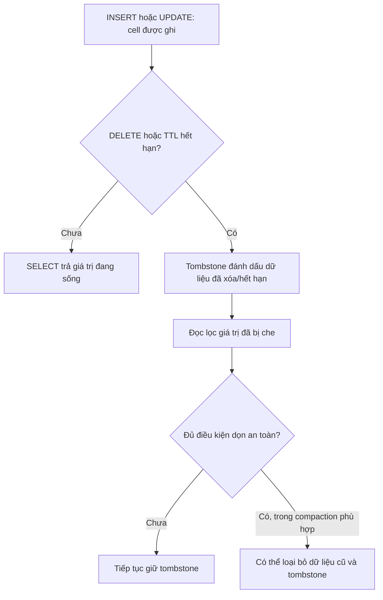

# Thực hành tổng hợp: CRUD, TTL và quan sát dữ liệu xóa/hết hạn trong Cassandra

## 1. Bài toán và kết quả cần đạt

Giả sử một hệ thống Java gửi thông báo đến người dùng. Ứng dụng cần tra cứu thông báo theo `user_id`, đánh dấu thông báo đã đọc, xóa nội dung hoặc toàn bộ thông báo và tự hết hạn những thông báo tạm thời. Đây là một tình huống phù hợp để thực hành mô hình **wide-column**, thiết kế bảng theo truy vấn và cơ chế ghi phân tán của **Apache Cassandra**.

Sau bài thực hành, bạn có thể:

1. Tạo keyspace và bảng theo mẫu truy vấn có **partition key** và **clustering key** rõ ràng.
2. Dùng CQL thực hiện `INSERT`, `SELECT`, `UPDATE`, `DELETE` ở mức cột, hàng và phân vùng.
3. Gán **TTL** cho dữ liệu, kiểm tra thời gian sống còn lại bằng `TTL(column)` và chứng minh rằng TTL áp dụng theo ô dữ liệu (cell).
4. Phân biệt **xóa logic** với **thu hồi dung lượng vật lý**; diễn giải vai trò của tombstone, `gc_grace_seconds`, compaction và repair.
5. Quan sát kết quả bằng `cqlsh`, tracing và thống kê `nodetool` mà không nhầm kết quả truy vấn với dữ liệu đã bị loại khỏi SSTable.

**Phạm vi lab:** một node Cassandra phục vụ việc học; replication factor `1`, nhất quán mức `ONE`. Cuối bài có giải thích điểm khác biệt khi chạy trên cụm nhiều node. Mọi lệnh CQL dưới đây được thực hiện lần lượt trong cùng một phiên `cqlsh`.

## 2. Chuẩn bị môi trường

Cần một Cassandra đang chạy và công cụ `cqlsh`. Nếu đã có môi trường thực hành, kết nối bằng `cqlsh` và chuyển thẳng đến phần 3. Nếu dùng Docker, có thể tạo một container riêng:

```bash
docker run -d --name cassandra-crud-ttl -p 9042:9042 cassandra:5.0
```

Khi Cassandra khởi động xong, kiểm tra node đạt trạng thái `UN` (Up/Normal), rồi mở CQL shell:

```bash
docker exec cassandra-crud-ttl nodetool status
docker exec -it cassandra-crud-ttl cqlsh
```

Nếu `cqlsh` báo không kết nối được ngay sau `docker run`, kiểm tra log bằng `docker logs cassandra-crud-ttl` và kết nối lại sau khi dịch vụ sẵn sàng. Dấu nhắc `cqlsh>` cho biết bạn có thể nhập các câu lệnh CQL ở những phần tiếp theo.

> Chỉ dùng keyspace `practice_crud_ttl` cho lab. `SimpleStrategy` và replication factor `1` ở đây dành cho một node thử nghiệm; cụm production đa datacenter thường cần `NetworkTopologyStrategy`, replication thích hợp và chính sách consistency/repair riêng.

## 3. Thiết kế bảng theo truy vấn

Truy vấn chính là: **lấy các thông báo của một người dùng**, hoặc **lấy đúng một thông báo khi biết `user_id` và `message_id`**. Vì thế, chọn `user_id` làm partition key, `message_id` làm clustering key. Không cần `ALLOW FILTERING` hay quét toàn bảng.

```sql
CREATE KEYSPACE IF NOT EXISTS practice_crud_ttl
WITH replication = {
  'class': 'SimpleStrategy',
  'replication_factor': 1
};

USE practice_crud_ttl;

CREATE TABLE IF NOT EXISTS inbox_by_user (
    user_id text,
    message_id text,
    title text,
    body text,
    status text,
    PRIMARY KEY ((user_id), message_id)
)
WITH CLUSTERING ORDER BY (message_id DESC)
 AND gc_grace_seconds = 864000;

DESCRIBE TABLE inbox_by_user;
```

| Thành phần | Ý nghĩa trong mô hình này |
|---|---|
| `user_id` | Partition key: xác định phân vùng chứa thông báo của người dùng; dùng trong mọi truy vấn lab. |
| `message_id` | Clustering key: xác định hàng trong phân vùng; thứ tự từ điển giảm dần, không đồng nghĩa với thứ tự thời gian. |
| `title`, `body`, `status` | Các cột thường: có thể ghi đè, xóa riêng, hoặc đặt TTL riêng. |
| `gc_grace_seconds = 864000` | Cửa sổ grace 10 ngày dùng trong cân nhắc dọn tombstone/đồng bộ replica; **không phải TTL** và không bảo đảm tombstone biến mất đúng sau 10 ngày. |

**Lưu ý về truy vấn:** khóa phân vùng là điều kiện bắt buộc để truy cập hiệu quả trong bài. Trong hệ thống thật, nếu cần lấy “10 thông báo mới nhất”, nên dùng khóa sắp xếp dựa trên thời gian (`timeuuid` hoặc timestamp kèm khóa duy nhất) và thiết kế truy vấn trước khi quyết định schema; không suy ra thời gian từ `message_id` kiểu `text` ở lab này.

## 4. Thực hành CRUD

### 4.1. Create — thêm dữ liệu

```sql
INSERT INTO inbox_by_user (user_id, message_id, title, body, status)
VALUES ('user-a', 'msg-001', 'Chao mung', 'Noi dung luu lau dai', 'new');

INSERT INTO inbox_by_user (user_id, message_id, title, body, status)
VALUES ('user-a', 'msg-002', 'Don hang', 'Don hang da duoc tiep nhan', 'new');

SELECT message_id, title, body, status
FROM inbox_by_user
WHERE user_id = 'user-a';
```

**Kỳ vọng:** có hai hàng `msg-002` và `msg-001` (theo `message_id DESC`). Cassandra dùng ngữ nghĩa **upsert**: `INSERT` với cùng khóa chính có thể ghi giá trị mới cho các cột được cung cấp; không có lỗi “duplicate primary key” như SQL quan hệ. Mỗi cell có write timestamp phục vụ hòa giải giá trị giữa các bản sao.

### 4.2. Read — đọc một phân vùng hoặc một hàng

```sql
SELECT * FROM inbox_by_user WHERE user_id = 'user-a';

SELECT title, body, status
FROM inbox_by_user
WHERE user_id = 'user-a' AND message_id = 'msg-001';
```

Tránh `SELECT *` khi ứng dụng chỉ cần vài trường; cột yêu cầu và điều kiện partition giúp kiểm soát lượng dữ liệu trả về. Không dùng `SELECT * FROM inbox_by_user` để mô phỏng truy vấn người dùng trong production vì nó có thể quét nhiều phân vùng.

### 4.3. Update — cập nhật một cột

```sql
UPDATE inbox_by_user
SET status = 'read'
WHERE user_id = 'user-a' AND message_id = 'msg-001';

SELECT message_id, status, WRITETIME(status), TTL(status)
FROM inbox_by_user
WHERE user_id = 'user-a' AND message_id = 'msg-001';
```

**Kỳ vọng:** `status = 'read'`; `WRITETIME(status)` là dấu thời gian ghi tính bằng **microsecond từ epoch**, còn `TTL(status)` là `null` vì bản ghi này chưa có TTL. `UPDATE` cũng có ngữ nghĩa upsert: nếu khóa chính chưa tồn tại, Cassandra có thể tạo hàng/cell tương ứng. Các cột không nằm trong `SET` không tự động bị thay đổi.

### 4.4. Delete — xóa một cột, một hàng và một phân vùng

Đầu tiên, xóa riêng `body` của `msg-002`:

```sql
DELETE body FROM inbox_by_user
WHERE user_id = 'user-a' AND message_id = 'msg-002';

SELECT message_id, title, body, status
FROM inbox_by_user
WHERE user_id = 'user-a' AND message_id = 'msg-002';
```

**Kỳ vọng:** hàng `msg-002` vẫn tồn tại, `title` và `status` còn nguyên, `body` trả về `null`. Tiếp tục xóa toàn bộ hàng:

```sql
DELETE FROM inbox_by_user
WHERE user_id = 'user-a' AND message_id = 'msg-002';

SELECT * FROM inbox_by_user
WHERE user_id = 'user-a' AND message_id = 'msg-002';
```

**Kỳ vọng:** `0 rows`. Để thấy xóa cấp phân vùng, tạo hai hàng ở `user-delete` rồi xóa theo partition key:

```sql
INSERT INTO inbox_by_user (user_id, message_id, title, status)
VALUES ('user-delete', 'msg-101', 'Thong bao A', 'new');

INSERT INTO inbox_by_user (user_id, message_id, title, status)
VALUES ('user-delete', 'msg-102', 'Thong bao B', 'new');

SELECT * FROM inbox_by_user WHERE user_id = 'user-delete';

DELETE FROM inbox_by_user WHERE user_id = 'user-delete';

SELECT * FROM inbox_by_user WHERE user_id = 'user-delete';
```

Kết quả cuối là `0 rows` cho `user-delete`. `DELETE` không phải thao tác xóa ngay các byte cũ ở mọi file SSTable. Nó ghi **tombstone** có timestamp, để những dữ liệu cũ hơn trên replica hoặc SSTable không được coi là còn sống.

## 5. Thực hành TTL theo cell và theo hàng

**TTL (Time To Live)** là số giây dữ liệu được phép tồn tại sau một lần ghi. Trong Cassandra, TTL áp dụng cho những cell được ghi bởi câu lệnh `INSERT`/`UPDATE` (và row marker phù hợp), **không đặt TTL lên chính partition key/clustering key**. `TTL(column)` là thời gian sống *còn lại*, nên số giây quan sát được có thể nhỏ hơn con số đã khai báo.

### 5.1. Chỉ cho cột `body` hết hạn

Giữ `msg-001` với `status = 'read'` từ phần 4, nhưng thay `body` bằng nội dung tạm thời có TTL 45 giây:

```sql
UPDATE inbox_by_user USING TTL 45
SET body = 'Noi dung tu het han sau 45 giay'
WHERE user_id = 'user-a' AND message_id = 'msg-001';

SELECT message_id, body, TTL(body), status, TTL(status)
FROM inbox_by_user
WHERE user_id = 'user-a' AND message_id = 'msg-001';
```

**Kỳ vọng ngay sau ghi:** `body` có nội dung mới và `TTL(body)` nằm trong khoảng `1..45`; `status = 'read'`, `TTL(status) = null`. Bây giờ **đợi ít nhất 50 giây bên ngoài `cqlsh`**, sau đó chạy:

```sql
SELECT message_id, body, TTL(body), status, TTL(status)
FROM inbox_by_user
WHERE user_id = 'user-a' AND message_id = 'msg-001';
```

**Kỳ vọng sau TTL:** hàng vẫn xuất hiện vì `status` và `title` còn sống; `body` và `TTL(body)` trở thành `null`. Giá trị `body` trước khi đặt TTL **không xuất hiện trở lại**: dấu hết hạn có tác dụng che dữ liệu cũ hơn. Nếu đã hết 45 giây trước khi kịp quan sát giá trị TTL giảm, chạy lại câu `UPDATE` để bắt đầu vòng mới.

### 5.2. Toàn bộ các cột được chèn đều có TTL

```sql
INSERT INTO inbox_by_user (user_id, message_id, title, body, status)
VALUES ('user-a', 'msg-003', 'Ma OTP tam', 'Het han som', 'new')
USING TTL 45;

SELECT message_id, title, TTL(title), body, TTL(body), status, TTL(status)
FROM inbox_by_user
WHERE user_id = 'user-a' AND message_id = 'msg-003';
```

**Kỳ vọng ngay sau ghi:** `title`, `body`, `status` đều có TTL đếm ngược. Sau hơn 45 giây, kiểm tra:

```sql
SELECT * FROM inbox_by_user
WHERE user_id = 'user-a' AND message_id = 'msg-003';
```

**Kỳ vọng:** `0 rows`, vì không còn cell/row marker sống để hiện ra như một hàng thông báo. Đừng suy ra bản ghi đã được giải phóng hoàn toàn khỏi ổ đĩa: dữ liệu hết hạn vẫn cần quy trình dọn dẹp nội bộ.

### 5.3. Ghi lại có thể thay đổi TTL

Một lần ghi mới tạo cell mới với TTL của **lần ghi đó**; việc ghi đè không tự thừa kế TTL cũ. Thử trên `msg-001`:

```sql
UPDATE inbox_by_user USING TTL 60
SET title = 'Tieu de tam'
WHERE user_id = 'user-a' AND message_id = 'msg-001';

SELECT title, TTL(title)
FROM inbox_by_user
WHERE user_id = 'user-a' AND message_id = 'msg-001';

UPDATE inbox_by_user
SET title = 'Tieu de lau dai'
WHERE user_id = 'user-a' AND message_id = 'msg-001';

SELECT title, TTL(title)
FROM inbox_by_user
WHERE user_id = 'user-a' AND message_id = 'msg-001';
```

**Kỳ vọng:** `TTL(title)` ban đầu xấp xỉ 60 giây; sau lần `UPDATE` không dùng TTL, nó thành `null` và `title = 'Tieu de lau dai'`. Đó là thay thế cell bằng dữ liệu không hết hạn. `default_time_to_live` ở cấp bảng cũng có thể thiết lập TTL mặc định, nhưng bảng lab giữ mặc định `0` để quan sát rõ TTL từng câu ghi. Không dùng TTL cho counter và không trông đợi TTL hoạt động trên thành phần khóa chính.

## 6. Quan sát tombstone và vòng đời xóa dữ liệu

Trong Cassandra, **kết quả đọc logic** và **trạng thái lưu trữ vật lý** là hai khái niệm khác nhau:



| Hiện tượng | `SELECT` thấy gì? | Bên dưới có thể còn gì? |
|---|---|---|
| `DELETE body` | `body = null`, hàng vẫn còn | Tombstone cho cell `body`, dữ liệu cũ ở memtable/SSTable. |
| `DELETE` toàn bộ hàng/phân vùng | Hàng hoặc phân vùng không trả về | Tombstone hàng/phân vùng và dữ liệu cũ chưa được compact an toàn. |
| TTL trên `body` hết hạn | `body = null`, cột khác vẫn còn | Cell hết hạn được xử lý như tombstone. |
| TTL toàn bộ nội dung hàng hết hạn | Không còn hàng sống để trả về | Cell/row marker hết hạn và SSTable chứa dữ liệu lịch sử. |

### 6.1. Xem tracing của một truy vấn đọc

Trong `cqlsh`, sau khi đã xóa `msg-002` và để `msg-003` hết hạn:

```sql
TRACING ON;

SELECT * FROM inbox_by_user
WHERE user_id = 'user-a' AND message_id = 'msg-002';

SELECT * FROM inbox_by_user
WHERE user_id = 'user-a' AND message_id = 'msg-003';

TRACING OFF;
```

Tracing cho biết các giai đoạn thực thi đọc, nơi truy vấn đi qua và thời gian xử lý. **Tùy phiên bản Cassandra, dữ liệu đang ở memtable hay SSTable và cách đọc**, một số dòng trace có thể nêu số tombstone được quét; không có dòng như vậy **không chứng minh** là không tồn tại tombstone. Trace cũng tạo overhead nên chỉ dùng để chẩn đoán, không bật thường trực trên ứng dụng.

### 6.2. Xem chỉ số trên node

Mở terminal **khác với `cqlsh`** và chạy (nếu dùng container được tạo ở phần 2):

```bash
docker exec cassandra-crud-ttl nodetool tablestats practice_crud_ttl.inbox_by_user
```

Tìm các thống kê liên quan đến tombstone, ví dụ `Average tombstones per slice (last five minutes)` và `Maximum tombstones per slice (last five minutes)` nếu phiên bản hiển thị chúng. Chúng là **chỉ số quan sát từ các lượt đọc**, không phải phép đếm chính xác mọi tombstone đang lưu trên đĩa. Với bảng nhỏ hoặc số lần đọc ít, số liệu có thể bằng 0 hoặc chưa đại diện. Bạn cũng có thể xem log/trace để đối chiếu, nhưng không dùng việc thiếu chỉ số làm bằng chứng xóa vật lý đã hoàn tất.

### 6.3. Vì sao tombstone chưa được dọn ngay?

1. Khi `DELETE` được ghi, Cassandra tạo tombstone với write timestamp để che dữ liệu cũ. Cell có TTL sẽ được xem là đã xóa về mặt logic khi hết hạn.
2. Trên cụm phân tán, một replica có thể tạm thời vắng mặt, chưa nhận thao tác xóa; tombstone cần tồn tại đủ lâu để quá trình đồng bộ/repair giúp replica không phục hồi dữ liệu cũ.
3. `gc_grace_seconds` là một điều kiện liên quan đến khả năng dọn tombstone. **Compaction** chỉ loại bỏ nó khi các điều kiện an toàn và phạm vi dữ liệu cho phép; hết grace không đồng nghĩa dọn ngay.
4. Nếu tombstone bị loại bỏ quá sớm trong khi replica còn giữ bản ghi cũ, bản ghi có thể xuất hiện lại (*zombie data*). Với cụm nhiều replica, cần thiết kế và vận hành **repair** trong cửa sổ phù hợp; không tự hạ `gc_grace_seconds` để “dọn nhanh” khi chưa phân tích replica, repair và chiến lược compaction.

Điểm thực tiễn: TTL hữu ích cho dữ liệu tự hết hạn như thông báo ngắn hạn, nhưng việc gán TTL hoặc xóa quá nhiều cell trên các phân vùng lớn có thể làm tăng tombstone được quét trong quá trình đọc. Hãy chọn partition key để phân phối dữ liệu, giới hạn kích thước partition, dùng truy vấn bám khóa và theo dõi chỉ số read latency/tombstone. Với dữ liệu có thời gian lưu trữ cố định, cân nhắc thiết kế time bucket, TWCS và TTL tương thích với workload; đây là quyết định vận hành riêng, không bắt buộc cho lab CRUD nhỏ.

## 7. Bài kiểm tra tự thực hiện

Hãy làm các yêu cầu sau mà không nhìn lại lệnh mẫu, rồi so sánh với đáp án gợi ý:

| Yêu cầu | Cách kiểm chứng |
|---|---|
| Thêm `('user-b', 'msg-201')` với `title = 'Bao tri'`, `status = 'new'`. | `SELECT ... WHERE user_id = 'user-b'` thấy một hàng. |
| Đổi riêng `status` thành `read`. | `title` không đổi; `status = 'read'`. |
| Đặt TTL 30 giây lên riêng `title`, giữ `status` không hết hạn. | `TTL(title)` đếm ngược, `TTL(status) = null`. |
| Sau 35 giây, đọc lại. | `title = null`, `status = 'read'`, hàng vẫn hiện diện. |
| Xóa `msg-201` và đọc lại. | `0 rows`, dù tombstone có thể còn trên đĩa. |

<details>
<summary>Đáp án CQL gợi ý</summary>

```sql
INSERT INTO inbox_by_user (user_id, message_id, title, status)
VALUES ('user-b', 'msg-201', 'Bao tri', 'new');

UPDATE inbox_by_user SET status = 'read'
WHERE user_id = 'user-b' AND message_id = 'msg-201';

UPDATE inbox_by_user USING TTL 30 SET title = 'Bao tri'
WHERE user_id = 'user-b' AND message_id = 'msg-201';

SELECT title, TTL(title), status, TTL(status)
FROM inbox_by_user
WHERE user_id = 'user-b' AND message_id = 'msg-201';

-- Doi hon 35 giay ben ngoai cqlsh, sau do chay lai SELECT o tren.

DELETE FROM inbox_by_user
WHERE user_id = 'user-b' AND message_id = 'msg-201';

SELECT * FROM inbox_by_user
WHERE user_id = 'user-b' AND message_id = 'msg-201';
```

</details>

Tự giải thích thêm: (a) Vì sao chỉ xóa `title` không làm `status` biến mất? (b) Vì sao `SELECT` trả `0 rows` chưa đủ để kết luận dữ liệu đã được loại khỏi SSTable? (c) Vì sao RF=`1` trong lab không chứng minh một quy trình repair đa replica đã đúng? Câu trả lời lần lượt nằm ở **TTL theo cell**, **tombstone/compaction**, và **replication/repair**.

## 8. Lỗi thường gặp và cách xử lý

| Triệu chứng | Nguyên nhân thường gặp | Hướng kiểm tra |
|---|---|---|
| `Unable to connect` khi chạy `cqlsh` | Node chưa khởi động xong hoặc cổng 9042 chưa sẵn sàng. | Kiểm tra `nodetool status`, log container, rồi kết nối lại. |
| `InvalidRequest` khi truy vấn chỉ theo `status` | `status` không phải partition key hay khóa đã được lập chỉ mục. | Dùng `WHERE user_id = ...`, hoặc thiết kế bảng khác dành riêng cho truy vấn theo trạng thái. |
| `TTL(body)` trả `null` ngay sau thao tác | Cell không được đặt TTL, đã hết hạn hoặc bị ghi đè không TTL. | Đọc lại lệnh `USING TTL`; thử lại TTL đủ dài và `SELECT` ngay sau ghi. |
| Sau `DELETE`, vẫn thấy dung lượng/chỉ số tombstone | Xóa logic không tương đương dọn dữ liệu vật lý. | Phân biệt trạng thái `SELECT` với chỉ số/compaction, giữ nguyên grace trong lab. |
| Kết quả `SELECT` không như thứ tự tạo | `message_id DESC` sắp theo chuỗi, không theo thời điểm `INSERT`. | Dùng clustering key biểu diễn thời gian nếu ứng dụng cần sắp xếp theo thời gian. |

## 9. Dọn tài nguyên và liên hệ với ứng dụng Java

Khi đã xác minh xong, có thể xóa **keyspace chỉ dành cho lab** bằng lệnh sau trong `cqlsh` (thao tác này xóa schema và dữ liệu lab, không dùng trên keyspace thật):

```sql
DROP KEYSPACE IF EXISTS practice_crud_ttl;
```

Nếu đã tự tạo container bằng phần 2 và không còn sử dụng, dừng/xóa container đó:

```bash
docker rm -f cassandra-crud-ttl
```

Trong ứng dụng Java dùng Cassandra Java Driver, các câu `INSERT`/`UPDATE`/`DELETE` tương ứng nên được thực hiện qua **prepared statements**, bind đầy đủ khóa phân vùng và clustering key. Driver chỉ nhìn thấy giá trị sống khi đọc; `null` sau `DELETE`/TTL hoặc hàng biến mất là **kết quả logic**. Đừng suy ra rằng một lệnh Java xóa thành công đồng nghĩa tất cả byte dữ liệu cũ đã bị thu hồi khỏi mọi replica ngay lập tức. Khi chuyển sang hệ thống nhiều node, cấu hình replication, consistency level và repair là phần bắt buộc của thiết kế vòng đời dữ liệu.

**Checklist hoàn thành:** đã thực hiện đủ create/read/update/delete theo khóa; chứng minh TTL chỉ hết hạn một cột trong khi cột khác còn sống; chứng minh một thông báo tạm biến mất sau TTL; xem tracing/thống kê và giải thích được tombstone, grace, compaction, repair.
