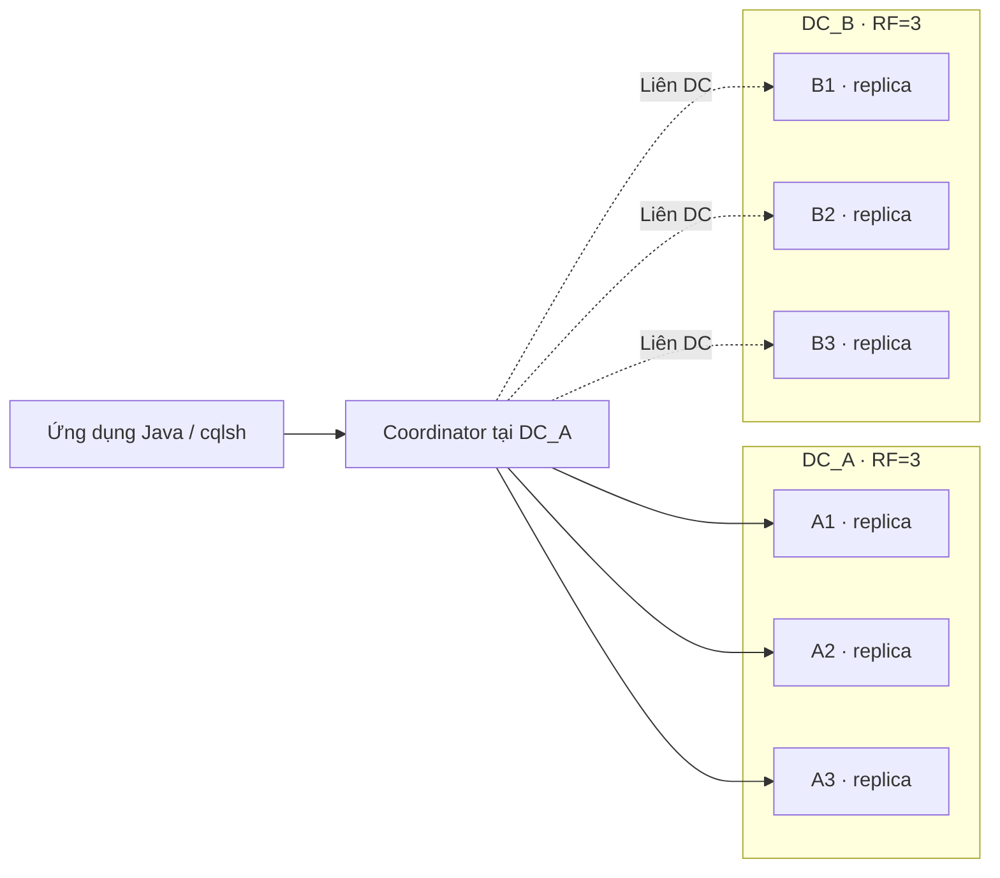

# Thực hành tổng hợp: So sánh ONE, QUORUM và LOCAL_QUORUM trong kịch bản lỗi Cassandra

## 1. Mục tiêu và phạm vi bài thực hành

Trong Apache Cassandra, một thao tác đọc/ghi có thể thành công dù một số replica không phản hồi. Mức nhất quán (*consistency level*, viết tắt **CL**) xác định số replica phải phản hồi cho **từng thao tác** trước khi coordinator báo thành công. Khi xảy ra lỗi nút hoặc đứt kết nối giữa các data center (DC), chọn CL ảnh hưởng trực tiếp đến tính sẵn sàng, độ trễ và nguy cơ đọc dữ liệu cũ.

Sau bài này, bạn cần có thể:

1. Tính ngưỡng phản hồi của `ONE`, `QUORUM` và `LOCAL_QUORUM` dựa trên replication factor (RF) và data center của coordinator.
2. Dự đoán thao tác nào còn thành công khi một số replica hoặc kết nối liên DC gặp lỗi.
3. Giải thích vì sao một lần ghi thành công chưa chắc được đọc thấy ngay ở DC còn lại, và vì sao điều kiện giao nhau của tập replica quan trọng.
4. Thực hành CQL, kiểm tra triệu chứng lỗi và đặt CL cho câu lệnh Java.

Bài học thuộc mô-đun **DATABASE_ENGINE_WIDE_COLUMN_CASSANDRA**: hiểu kiến trúc phân tán và mô hình wide-column, thiết kế bảng theo truy vấn, khóa phân vùng, replication, mức nhất quán, repair và kết nối Java. Trọng tâm ở đây là **so sánh CL trong cùng một kịch bản lỗi**; phần compaction và repair chỉ được nhắc khi cần giải thích quá trình đồng bộ sau sự cố.

> **Giới hạn của giả định:** Đề bài nêu “kịch bản lỗi đã nêu” nhưng không kèm danh sách nút lỗi cụ thể trong metadata của bài. Vì vậy, bên dưới khai báo một kịch bản chuẩn, có thể kiểm chứng, với hai DC. Khi áp dụng cho cụm khác, hãy thay số replica còn liên lạc được và tính lại ngưỡng.

## 2. Sơ đồ cụm và dữ liệu dùng để kiểm chứng

Giả sử keyspace `telemetry` được cấu hình `NetworkTopologyStrategy` với **RF = 3 ở DC_A và RF = 3 ở DC_B**. Mỗi DC có ba nút; với một partition được xét, mỗi nút trong mỗi DC giữ một replica. Ứng dụng và **coordinator** của các thử nghiệm chính nằm ở **DC_A**.



**Cần phân biệt:** “Sáu replica” là số bản sao của **một partition** theo RF, không có nghĩa mọi truy vấn phải lấy đủ sáu phản hồi. Coordinator có thể gửi yêu cầu đến nhiều replica, nhưng CL quyết định số phản hồi tối thiểu để trả kết quả thành công. Đối với `LOCAL_QUORUM`, “local” là **DC của coordinator**; cấu hình local DC và chính sách định tuyến của Java driver cần phù hợp với nơi ứng dụng chạy.

Tạo dữ liệu cảm biến để đối chiếu. Bảng wide-column sau phục vụ truy vấn “xem dữ liệu của một thiết bị trong một ngày theo thời gian”; khóa phân vùng gồm `device_id` và `event_day`, giúp tránh một partition tăng vô hạn:

```sql
CREATE KEYSPACE IF NOT EXISTS telemetry
WITH replication = {
  'class': 'NetworkTopologyStrategy',
  'dc_a': 3,
  'dc_b': 3
};

CREATE TABLE IF NOT EXISTS telemetry.sensor_events (
    device_id text,
    event_day date,
    event_time timestamp,
    temperature_c double,
    PRIMARY KEY ((device_id, event_day), event_time)
) WITH CLUSTERING ORDER BY (event_time DESC);
```

Tên `dc_a` và `dc_b` phải khớp **chính xác** với tên DC thực tế từ snitch/topology; không tự tạo hai DC chỉ bằng câu lệnh `CREATE KEYSPACE`. Câu lệnh trên giả định môi trường lab đã có đủ các nút và topology đã mô tả.

Để kiểm tra một partition cố định, dùng các câu lệnh:

```sql
INSERT INTO telemetry.sensor_events
    (device_id, event_day, event_time, temperature_c)
VALUES
    ('sensor-01', '2026-11-21', '2026-11-21T08:00:00Z', 25.0);

SELECT event_time, temperature_c
FROM telemetry.sensor_events
WHERE device_id = 'sensor-01'
  AND event_day = '2026-11-21';
```

Trong `cqlsh`, lệnh `CONSISTENCY ONE;`, `CONSISTENCY QUORUM;` hoặc `CONSISTENCY LOCAL_QUORUM;` đặt CL mặc định cho các câu lệnh tiếp theo trong phiên đó. Cú pháp này là **lệnh của cqlsh**, không phải phần của câu SQL/CQL gửi trực tiếp qua Java driver.

## 3. Tính ngưỡng xác nhận: ONE, QUORUM, LOCAL_QUORUM

Với cấu hình trên, đặt `RF_A = 3`, `RF_B = 3`, tổng RF cho partition là `RF_total = 6`:

| CL | Ngưỡng phản hồi để **đọc hoặc ghi** thành công | Phạm vi đếm |
| --- | --- | --- |
| `ONE` | **1** replica | Một replica phù hợp có thể phản hồi; thường ưu tiên gần coordinator |
| `QUORUM` | **⌊6 / 2⌋ + 1 = 4** replica | Đếm trên toàn bộ sáu replica của partition ở cả hai DC |
| `LOCAL_QUORUM` | **⌊3 / 2⌋ + 1 = 2** replica | Hai replica trong **DC_A**, vì coordinator đang ở DC_A |

Đây là ngưỡng **cùng tên nhưng áp dụng độc lập** cho read và write. Ví dụ, ghi với `ONE` không buộc lần đọc sau đó phải dùng `ONE`; từng statement có thể chọn CL riêng.

Về hành vi:

- **Ghi:** coordinator báo thành công sau khi đạt đủ số phản hồi ghi cần thiết ở CL đã chọn. Các replica chưa trả lời vẫn có thể nhận ghi sau đó; CL không bảo đảm đã ghi xong ở mọi DC.
- **Đọc:** coordinator phải thu được đủ phản hồi đọc cần thiết; với các mức đọc nhiều replica, Cassandra có thể đối chiếu phiên bản theo timestamp và thực hiện cơ chế sửa khác biệt trong quá trình đọc. Một câu đọc `ONE` có thể chỉ dựa trên một replica và trả dữ liệu cũ.
- **Độ trễ:** `ONE` thường có ngưỡng thấp nhất. `QUORUM` trong bài lab có thể cần phản hồi từ DC_B, nên nhạy với độ trễ/liên lạc giữa DC. `LOCAL_QUORUM` dựa vào DC_A, thường phù hợp hơn khi ứng dụng ưu tiên hoạt động trong một DC.

> Nếu chỉ có **một DC với RF=3**, `QUORUM` và `LOCAL_QUORUM` đều cần **2** phản hồi. Chúng khác nhau rõ nhất khi có **nhiều DC**. Không nhầm `QUORUM` (đa số trên tổng RF) với `EACH_QUORUM` (quorum ở từng DC cho thao tác ghi).

## 4. Bảng quyết định trong sáu trạng thái lỗi

Giữ coordinator ở DC_A. Mỗi cặp `(A, B)` bên dưới cho biết **số replica của partition còn có thể gửi phản hồi đúng hạn** từ DC_A và DC_B. Giả định không có lỗi ngoài những lỗi được mô tả, không có timeout do quá tải và coordinator vẫn hoạt động. Dấu ✅ nghĩa là **có đủ replica để đạt CL**, không phải lời hứa chắc chắn về độ trễ mạng hoặc đĩa.

| Trạng thái | Replica phản hồi (A, B) | `ONE`: ≥1 | `QUORUM`: ≥4 tổng | `LOCAL_QUORUM`: ≥2 tại A |
| --- | --- | --- | --- | --- |
| S0 — Bình thường | (3, 3) | ✅ | ✅ | ✅ |
| S1 — Một nút DC_A lỗi | (2, 3) | ✅ | ✅ | ✅ |
| S2 — Đứt kết nối từ DC_A sang DC_B | (3, 0) | ✅ | ❌ | ✅ |
| S3 — Đứt liên DC và thêm một nút DC_A lỗi | (2, 0) | ✅ | ❌ | ✅ |
| S4 — Hai nút DC_A lỗi, DC_B vẫn liên lạc được | (1, 3) | ✅ | ✅ | ❌ |
| S5 — Chỉ còn một replica DC_A liên lạc được | (1, 0) | ✅ | ❌ | ❌ |

Phân tích các tình huống dễ nhầm:

**S2 — Mất toàn bộ đường đến DC_B:** có ba replica nội bộ DC_A. `LOCAL_QUORUM` chỉ cần hai nên **vẫn đọc/ghi được**. `QUORUM` cần bốn trên tổng sáu, nhưng chỉ có ba nên **không đạt ngưỡng**. Không thể suy ra rằng “còn nguyên một DC thì toàn cụm đã đạt QUORUM”.

**S3 — Đứt liên DC và mất thêm A3:** hai replica A1, A2 vẫn đủ `LOCAL_QUORUM`; `ONE` cũng đủ. Chỉ cần **mất thêm một replica nội bộ** (từ S3 thành S5) thì `LOCAL_QUORUM` không thể thành công, dù `ONE` vẫn còn cơ hội.

**S4 — Chỉ một replica local nhưng DC_B bình thường:** tổng số replica liên lạc được là 1 + 3 = 4, nên `QUORUM` **có thể thành công** nếu phản hồi từ DC_B đến đúng hạn; `LOCAL_QUORUM` **không thể thành công** vì DC_A chỉ có một phản hồi. Điều này chứng minh `QUORUM` không đồng nghĩa với “phải đủ đa số ở từng DC”.

**S5 — Còn một replica local:** `ONE` có thể đọc/ghi, nhưng điểm đánh đổi rất lớn: đọc có nguy cơ cũ và nếu replica duy nhất tiếp tục lỗi, không còn nơi phục vụ. Không nên coi thành công ở `ONE` là bằng chứng dữ liệu đã sao chép an toàn.

### 4.1. Phân biệt ngưỡng đáp ứng với loại exception

Khi số replica **được coordinator biết là đang sống** không đủ ngay từ đầu, Cassandra có thể trả lỗi *unavailable* (ví dụ `UnavailableException`). Nếu ban đầu có đủ replica nhưng các phản hồi không kịp về theo CL, có thể gặp *read/write timeout*; replica báo lỗi thực thi có thể dẫn tới *read/write failure*. Vì vậy, bảng trên dự báo **khả năng đạt CL**, còn exception cụ thể phụ thuộc thời điểm và loại lỗi.

Một `WriteTimeout` **không có nghĩa ghi đã rollback**: một số replica có thể đã áp dụng thay đổi. Khi thử lại, cân nhắc tính idempotent, timestamp và xung đột cập nhật; không lặp mù quáng thao tác có tác dụng phụ.

## 5. Giao nhau giữa tập replica và việc đọc dữ liệu mới

“Có thể truy cập” và “chắc chắn đọc được phiên bản đã ghi thành công gần nhất” là hai câu hỏi khác nhau. Trong mô hình lý tưởng **một partition, không có ghi đồng thời/xung đột timestamp**, để tập replica xác nhận ghi và tập trả lời đọc **buộc phải giao nhau**, điều kiện là:

```text
R + W > RF

R: ngưỡng phản hồi đọc
W: ngưỡng xác nhận ghi
RF: số replica trong cùng phạm vi đang xét
```

| Cặp thao tác | Phạm vi tính | Kết quả về giao nhau |
| --- | --- | --- |
| Ghi `QUORUM` (4) → đọc `QUORUM` (4) | Toàn bộ hai DC, RF=6 | 4 + 4 = 8 > 6 → có giao nhau |
| Ghi `ONE` (1) → đọc `QUORUM` (4) | Toàn bộ hai DC, RF=6 | 1 + 4 = 5 ≤ 6 → **không bảo đảm** |
| Ghi `LOCAL_QUORUM` (2) tại A → đọc `LOCAL_QUORUM` (2) tại A | DC_A, RF_A=3 | 2 + 2 = 4 > 3 → có giao nhau tại A |
| Ghi `ONE` (1) tại A → đọc `LOCAL_QUORUM` (2) tại A | Chỉ xét replica trong A | 1 + 2 = 3 → **không bảo đảm**, ngay cả khi ONE phản hồi từ A |
| Ghi `LOCAL_QUORUM` tại A → đọc `LOCAL_QUORUM` tại B | Hai tập replica local khác DC | **Không có bảo đảm giao nhau** giữa hai tập |

Chẳng hạn, khi S2 xảy ra, DC_A và DC_B mất liên lạc:

1. Trước khi mất mạng, cả hai DC đã có giá trị `25.0` cho cùng một hàng.
2. Ứng dụng kết nối coordinator DC_A ghi giá trị mới `26.0` với `LOCAL_QUORUM`. Hai replica tại A phản hồi, nên ghi **thành công**.
3. Một ứng dụng khác kết nối coordinator DC_B và đọc cùng hàng với `LOCAL_QUORUM` có thể vẫn thấy `25.0`. Vì hai DC chưa trao đổi được dữ liệu, thành công tại A không tạo bảo đảm đọc ngay tại B.
4. Khi mạng phục hồi, các cơ chế truyền ghi còn thiếu, hinted handoff (nếu hint còn hợp lệ), read repair và anti-entropy repair có thể giúp đồng bộ. **Hinted handoff chỉ hỗ trợ best effort**; cần kế hoạch repair thích hợp để bảo đảm các replica được đối chiếu trong dài hạn.

**Giới hạn quan trọng:** Bất đẳng thức `R + W > RF` giúp lập luận về **quorum intersection** cho dữ liệu đã ghi thành công khi không có cập nhật đồng thời. Nó **không tự biến Cassandra thành hệ thống linearizable**. Cassandra sử dụng timestamp và quy tắc giải quyết xung đột kiểu *last-write-wins*; concurrent writes, clock skew, xóa dữ liệu (tombstones) và timeout cần được xử lý riêng. Nếu cần so sánh-và-ghi có điều kiện, tìm hiểu lightweight transactions (LWT) và serial consistency.

## 6. Thao tác thực hành và đối chiếu kết quả

Chỉ tiến hành ngắt nút/đường mạng trong **môi trường lab**. Có thể mô phỏng số replica phản hồi thay vì tác động lên cụm thật. Các lệnh dưới đây chạy từ `cqlsh` kết nối vào một coordinator ở DC_A.

### Bước 1 — Xác lập dữ liệu nền

Kiểm tra topology và trạng thái các nút bằng công cụ quản trị, chẳng hạn `nodetool status`; bảo đảm có ba replica của partition ở mỗi DC. Chạy trong phiên `cqlsh`:

```sql
CONSISTENCY LOCAL_QUORUM;

INSERT INTO telemetry.sensor_events
    (device_id, event_day, event_time, temperature_c)
VALUES
    ('sensor-01', '2026-11-21', '2026-11-21T08:00:00Z', 25.0);

SELECT temperature_c
FROM telemetry.sensor_events
WHERE device_id = 'sensor-01'
  AND event_day = '2026-11-21'
  AND event_time = '2026-11-21T08:00:00Z';
```

Để kiểm chứng trường hợp dữ liệu cũ giữa DC, trước khi gây lỗi hãy xác nhận **DC_B cũng đọc thấy `25.0`**. Chỉ ghi ở DC_A với `LOCAL_QUORUM` rồi lập tức ngắt mạng không bảo đảm DC_B đã có bản dữ liệu nền.

### Bước 2 — Chạy cùng truy vấn ở ba CL

Tạo trạng thái **S2: DC_A vẫn có A1, A2, A3 nhưng không liên lạc được với DC_B**. Trong cqlsh ở DC_A, lần lượt đổi CL và đọc cùng partition:

```sql
CONSISTENCY ONE;
SELECT temperature_c FROM telemetry.sensor_events
WHERE device_id = 'sensor-01' AND event_day = '2026-11-21';

CONSISTENCY LOCAL_QUORUM;
SELECT temperature_c FROM telemetry.sensor_events
WHERE device_id = 'sensor-01' AND event_day = '2026-11-21';

CONSISTENCY QUORUM;
SELECT temperature_c FROM telemetry.sensor_events
WHERE device_id = 'sensor-01' AND event_day = '2026-11-21';
```

**Kỳ vọng theo ngưỡng:** `ONE` và `LOCAL_QUORUM` có thể thành công; `QUORUM` không thể đạt bốn phản hồi. Lặp lại bằng câu `INSERT` cập nhật giá trị của cùng hàng để kiểm chứng **CL của ghi**, không chỉ CL của đọc. Ghi lại thời gian đáp ứng và thông báo lỗi thực tế.

### Bước 3 — Thử trường hợp “QUORUM được, LOCAL_QUORUM không”

Phục hồi kết nối liên DC, rồi tạo trạng thái **S4: DC_A chỉ còn A1 phản hồi, DC_B vẫn có B1, B2, B3**. Với coordinator ở A, dự đoán và thử lại:

- `ONE`: cần 1, có 4 replica trên toàn cụm → có thể thành công.
- `QUORUM`: cần 4, có đúng 4 → có thể thành công nếu cả bốn phản hồi kịp.
- `LOCAL_QUORUM`: cần 2 tại A, chỉ có 1 → thất bại vì thiếu replica local.

Không nên suy đoán CL chỉ từ tổng nút còn “UP” trong `nodetool status`. Hãy xét **đúng replicas của partition, khả năng coordinator liên lạc với chúng, và DC mà coordinator thuộc về**.

### Bước 4 — Tìm phản ví dụ đọc cũ giữa hai DC

Khôi phục toàn bộ các nút, đồng bộ và xác nhận cả hai DC thấy `25.0`. Sau đó ngắt liên DC theo S2 và chạy lệnh sau tại **DC_A**:

```sql
CONSISTENCY LOCAL_QUORUM;
UPDATE telemetry.sensor_events
SET temperature_c = 26.0
WHERE device_id = 'sensor-01'
  AND event_day = '2026-11-21'
  AND event_time = '2026-11-21T08:00:00Z';
```

Trong lúc liên DC vẫn bị chia cắt, đọc chính xác hàng đó ở **coordinator DC_A** và **coordinator DC_B**, cả hai đều với `LOCAL_QUORUM`. Kỳ vọng DC_A thấy `26.0`, DC_B **có thể** còn `25.0`. Đây là phản ví dụ cho nhận định sai “LOCAL_QUORUM luôn mới nhất trên mọi DC”.

Kết quả đọc stale không phải lúc nào cũng xuất hiện chỉ bằng đổi CL, bởi Cassandra thường gửi ghi tới nhiều replica và sự đồng bộ có thể diễn ra rất nhanh khi mạng bình thường. Trong lab này, **đường liên DC cần thực sự bị chia cắt** để tạo điều kiện quan sát.

### Bước 5 — Bảng ghi kết quả

| Lần thử | (A, B) thực tế | CL đọc/ghi | Dự báo theo ngưỡng | Kết quả/exception quan sát được | Giải thích khác biệt |
| --- | --- | --- | --- | --- | --- |
| 1 | (3, 0) | `ONE` | Đủ | Điền sau khi chạy | Đếm ≥1 |
| 2 | (3, 0) | `LOCAL_QUORUM` | Đủ | Điền sau khi chạy | Đếm A≥2 |
| 3 | (3, 0) | `QUORUM` | Thiếu | Điền sau khi chạy | Tổng 3<4 |
| 4 | (1, 3) | `QUORUM` | Đủ | Điền sau khi chạy | Tổng 4≥4, có thể phải chờ WAN |
| 5 | (1, 3) | `LOCAL_QUORUM` | Thiếu | Điền sau khi chạy | A=1<2 |

## 7. Đặt consistency level cho từng statement trong Java

Với **DataStax/Apache Cassandra Java Driver 4.x**, đặt CL trên từng statement giúp các API chọn mức phù hợp. Ví dụ dưới đây giả định `CqlSession session` đã được tạo và cấu hình local DC chính xác:

```java
import com.datastax.oss.driver.api.core.CqlSession;
import com.datastax.oss.driver.api.core.DefaultConsistencyLevel;
import com.datastax.oss.driver.api.core.cql.ResultSet;
import com.datastax.oss.driver.api.core.cql.SimpleStatement;
import java.time.LocalDate;

// Ghi tại DC của coordinator: yêu cầu hai replica local xác nhận.
SimpleStatement write = SimpleStatement.builder(
        "UPDATE telemetry.sensor_events SET temperature_c = ? " +
        "WHERE device_id = ? AND event_day = ? AND event_time = ?")
    .addPositionalValue(26.0)
    .addPositionalValue("sensor-01")
    .addPositionalValue(LocalDate.parse("2026-11-21"))
    .addPositionalValue(java.time.Instant.parse("2026-11-21T08:00:00Z"))
    .setConsistencyLevel(DefaultConsistencyLevel.LOCAL_QUORUM)
    .build();
session.execute(write);

// Đọc cũng tại DC đó: hai quorum local giao nhau khi RF_local=3.
SimpleStatement read = SimpleStatement.builder(
        "SELECT event_time, temperature_c FROM telemetry.sensor_events " +
        "WHERE device_id = ? AND event_day = ?")
    .addPositionalValue("sensor-01")
    .addPositionalValue(LocalDate.parse("2026-11-21"))
    .setConsistencyLevel(DefaultConsistencyLevel.LOCAL_QUORUM)
    .build();
ResultSet rows = session.execute(read);
```

Thay `DefaultConsistencyLevel.LOCAL_QUORUM` bằng `ONE` hoặc `QUORUM` để so sánh. Nên dùng prepared statements cho câu lệnh chạy thường xuyên; ví dụ dùng simple statements nhằm làm rõ vị trí đặt CL. Nếu driver chọn coordinator tại DC_B thay vì DC_A, phạm vi “local” cũng chuyển sang DC_B.

## 8. Quyết định CL theo yêu cầu nghiệp vụ

| Nhu cầu | Lựa chọn nên cân nhắc | Đánh đổi phải chấp nhận |
| --- | --- | --- |
| Dashboard telemetry chịu được dữ liệu hơi cũ, ưu tiên còn phục vụ khi nhiều replica lỗi | `ONE` cho đọc | Có thể trả phiên bản cũ; ghi `ONE` tăng rủi ro chưa sao chép đủ ở thời điểm báo thành công |
| Dịch vụ chỉ hoạt động chủ yếu trong DC_A, muốn đọc thấy các ghi đã xác nhận cùng DC | `LOCAL_QUORUM` cho **cả đọc và ghi** trong DC_A | Không bảo đảm ngay cho reader ở DC_B; thất bại nếu A còn dưới hai replica |
| Truy vấn cần giao nhau của quorum đọc/ghi trên toàn bộ RF=6 | `QUORUM` cho **cả đọc và ghi** | Cần bốn phản hồi, có thể phụ thuộc liên DC; mất liên DC trong S2 làm truy vấn thất bại |

Không có một CL “tốt nhất” cho mọi nghiệp vụ. Khi chọn, cần tính RF thực tế, data center mà coordinator xử lý, loại truy vấn, độ trễ chấp nhận được, khả năng chịu đọc cũ và hành vi khi lỗi.

**Câu hỏi tự kiểm tra**

1. Với `RF_A = RF_B = 3`, vì sao trong S2 `LOCAL_QUORUM` thành công còn `QUORUM` thất bại?
2. Trong S4, tại sao `QUORUM` có thể thành công dù chỉ một replica ở DC_A còn phản hồi?
3. Ghi `LOCAL_QUORUM` tại DC_A rồi đọc `LOCAL_QUORUM` tại DC_B có chắc thấy dữ liệu mới không? Vì sao?
4. Với `ONE` write và `QUORUM` read, `R + W` có vượt `RF_total` không?
5. Khi gặp `WriteTimeout`, vì sao không thể kết luận rằng mọi replica đều chưa nhận ghi?

**Đáp án ngắn:** (1) Local cần 2 ở A, global cần 4 tổng nhưng chỉ còn 3; (2) 1 A + 3 B = 4; (3) không, hai tập quorum local ở các DC khác nhau không buộc giao nhau; (4) 1 + 4 = 5 ≤ 6; (5) timeout chỉ nói rằng coordinator chưa nhận đủ phản hồi đúng hạn, một phần replica có thể đã ghi.
