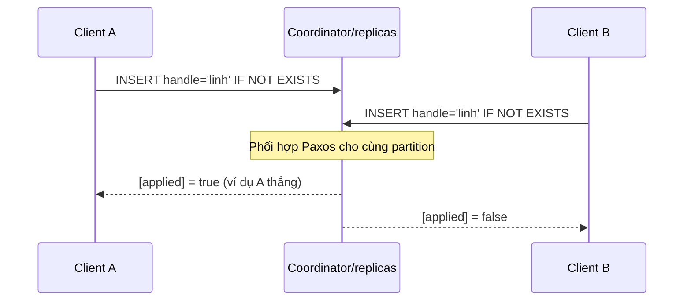

# Bảo vệ một bất biến trong phạm vi phù hợp bằng LWT

## Mục tiêu và bối cảnh

Trong Apache Cassandra, dữ liệu thường được phi chuẩn hóa thành nhiều bảng phục vụ từng truy vấn. Replication giúp dữ liệu tồn tại trên nhiều node, còn consistency level (CL) điều chỉnh số replica cần tham gia một thao tác đọc/ghi. Tuy nhiên, chỉ chọn `QUORUM` hay `LOCAL_QUORUM` **không đủ để biến chuỗi “đọc rồi kiểm tra rồi ghi” thành một thao tác nguyên tử**. Hai ứng dụng vẫn có thể cùng đọc một giá trị cũ và cùng ghi kết quả trái với quy tắc nghiệp vụ.

Bài thực hành tổng hợp này dùng **lightweight transaction (LWT)** trong CQL để bảo vệ một **bất biến** (invariant): điều kiện phải luôn đúng trước và sau mỗi thay đổi hợp lệ. Trọng tâm là chọn khóa phân vùng phù hợp, đặt điều kiện ngay trong lệnh ghi, xử lý tranh chấp và timeout ở Java, đồng thời xác định ranh giới mà LWT không giải quyết được.

Sau bài này, bạn có thể:

- Phân biệt consistency của replica với điều kiện ghi có phối hợp đồng thời.
- Thiết kế một bảng Cassandra theo truy vấn để mọi thao tác tranh chấp cùng một bất biến gặp nhau tại **cùng khóa phân vùng**.
- Sử dụng `INSERT ... IF NOT EXISTS` và `UPDATE ... IF ...`, đọc kết quả `[applied]` và xử lý retry an toàn.
- Kiểm thử hai tác nhân đồng thời, nhận diện chi phí, giới hạn và tình huống cần thiết kế khác.

## 1. Tình huống: một tên tài khoản chỉ thuộc một người

Một hệ thống đăng ký tài khoản cho phép chọn tên hiển thị công khai (handle). Quy tắc nghiệp vụ là:

> Với mỗi `handle` đã chuẩn hóa, tại một thời điểm có **tối đa một** `owner_id` sở hữu tên đó.

Biểu diễn ngắn gọn: `∀ h, count(owner_id sở hữu h) ≤ 1`.

Hai yêu cầu đến gần như cùng lúc: người A và người B đều muốn đăng ký `linh`. Nếu ứng dụng làm như sau, bất biến có thể bị phá vỡ:

```text
A: SELECT owner_id WHERE handle = 'linh'  → chưa có
B: SELECT owner_id WHERE handle = 'linh'  → chưa có
A: ghi tên cho A
B: ghi tên cho B
```

Tùy thiết kế dữ liệu, lần ghi sau có thể ghi đè lần trước hoặc cả hai người đều được ứng dụng báo đăng ký thành công. Đọc ở `LOCAL_QUORUM` cũng không tạo ra khóa cho chuỗi đọc–ghi ấy.

Ta chọn **một hàng duy nhất cho mỗi tên**, dùng `handle` làm toàn bộ partition key, rồi đặt điều kiện `IF NOT EXISTS` lên thao tác tạo hàng. Tất cả người tranh chấp tên `linh` vì thế cùng kiểm tra và ghi tại một phạm vi LWT.

### Chọn phạm vi bất biến trước khi viết CQL

| Bất biến cần bảo vệ | Khóa/ranh giới phù hợp | LWT có phù hợp? |
| --- | --- | --- |
| Mỗi `handle` chỉ có một chủ | Một partition khóa bởi `handle` | Có, `INSERT ... IF NOT EXISTS` |
| Trạng thái đơn hàng chỉ chuyển `PENDING → PAID` một lần | Một hàng/partition khóa bởi `order_id` | Có, `UPDATE ... IF state = 'PENDING'` |
| Tổng số lần sử dụng hạn mức trong **một hàng** không vượt giới hạn | Một partition khóa bởi `account_id`, kiểm tra giá trị cũ | Có thể, nếu cập nhật/kiểm tra nằm cùng partition; cân nhắc điểm nóng |
| Chuyển tiền nguyên tử giữa hai tài khoản ở **hai partition** | Hai partition khác nhau | Không; LWT riêng lẻ không tạo giao dịch ACID xuyên partition |
| Tạo profile và đặt tên đồng thời ở hai bảng/partition | Hai partition khác nhau | Không bảo đảm tất cả cùng thành công hoặc cùng thất bại |

**Điểm mấu chốt:** LWT cung cấp điều kiện ghi có tính tuần tự trong phạm vi partition liên quan; đây không phải giao dịch đa partition hay cơ chế khóa cho mọi bảng chứa bản sao dữ liệu nghiệp vụ.

## 2. Chuẩn bị môi trường Cassandra

Ví dụ giả định một cụm thử nghiệm có data center tên `dc1` và **ít nhất ba node** phục vụ replication factor 3. Nếu chạy cluster khác, sửa tên data center và replication factor cho đúng cấu hình thực tế; đừng dùng `LOCAL_QUORUM` với một cụm không đáp ứng số replica cần thiết.

```sql
CREATE KEYSPACE IF NOT EXISTS lwt_lab
WITH replication = {
  'class': 'NetworkTopologyStrategy',
  'dc1': 3
}
AND durable_writes = true;

CREATE TABLE IF NOT EXISTS lwt_lab.handle_claims (
  handle text PRIMARY KEY,
  owner_id uuid,
  claimed_at timestamp
);
```

Ở đây `handle` là **partition key hoàn chỉnh**. Bảng trả lời trực tiếp câu hỏi “Tên này đang thuộc ai?”. Mỗi `handle` chỉ có một hàng; `owner_id` là giá trị được bảo vệ.

Đừng đổi khóa thành `PRIMARY KEY ((handle), owner_id)` rồi cho mỗi người một hàng. Khi đó hai người có thể cùng chèn hai clustering row khác nhau vào partition `handle`, và điều kiện tồn tại trên từng hàng không còn diễn đạt được quy tắc “tối đa một chủ”. Cũng không được dựa vào việc Cassandra tự áp đặt unique constraint trên một cột không phải khóa: Cassandra không cung cấp unique constraint tùy ý như cơ sở dữ liệu quan hệ.

Trước khi ghi, mọi luồng ứng dụng phải **chuẩn hóa handle giống nhau** (chẳng hạn `trim`, chuẩn hóa Unicode theo quy ước sản phẩm, chuyển chữ hoa/thường nhất quán, kiểm tra ký tự/độ dài). Nếu `Linh` và `linh` là cùng một tên về mặt nghiệp vụ nhưng được lưu thành hai partition key khác nhau, LWT không thể bảo vệ quy tắc mong muốn.

## 3. Thực hành chiếm tên bằng `IF NOT EXISTS`

### Yêu cầu A đăng ký

```sql
INSERT INTO lwt_lab.handle_claims (handle, owner_id, claimed_at)
VALUES (
  'linh',
  11111111-1111-4111-8111-111111111111,
  '2026-11-21T08:00:00Z'
)
IF NOT EXISTS;
```

Nếu chưa có hàng `handle = 'linh'`, LWT chấp nhận ghi; kết quả CQL chứa `[applied] = true`.

### Yêu cầu B tranh chấp cùng tên

```sql
INSERT INTO lwt_lab.handle_claims (handle, owner_id, claimed_at)
VALUES (
  'linh',
  22222222-2222-4222-8222-222222222222,
  '2026-11-21T08:00:01Z'
)
IF NOT EXISTS;
```

Lần này, nếu A đã chiếm tên, kết quả chứa `[applied] = false`; Cassandra không ghi đè người sở hữu. Với hai thao tác thực sự chạy đồng thời trên cùng khóa, chỉ một trong hai thao tác tạo hàng từ trạng thái chưa tồn tại có thể được chấp nhận. Kết quả `false` thường kèm các giá trị đang có, nhưng ứng dụng không nên giả định mọi lỗi hoặc timeout đều trả được hàng này.

Kiểm tra trạng thái cuối:

```sql
SELECT handle, owner_id, claimed_at
FROM lwt_lab.handle_claims
WHERE handle = 'linh';
```

Kết quả cuối phải có đúng **một hàng** cho `linh`. Nếu làm tuần tự như trên, A là người sở hữu; nếu thử chạy hai lệnh trong hai client đồng thời, người thắng có thể là A hoặc B, nhưng không được có hai chủ được xác nhận từ hai lần tạo hàng.

### Vì sao LWT bảo vệ được điều kiện?

LWT sử dụng cơ chế đồng thuận dựa trên **Paxos** để phối hợp các replica của partition liên quan trước khi chấp nhận một ghi có điều kiện. Ứng dụng gửi **một câu lệnh** chứa cả điều kiện và thay đổi; các yêu cầu cạnh tranh trên cùng partition phải trải qua cơ chế phối hợp này. Vì có thêm các lượt trao đổi mạng và có thể xảy ra tranh chấp, LWT thường tốn độ trễ và tài nguyên hơn ghi thông thường.



Sơ đồ mô tả **kết quả logic**, không diễn tả toàn bộ pha hoặc thông điệp nội bộ của Paxos; thứ tự thắng thực tế không được bảo đảm.

## 4. Phân biệt hai nhóm consistency level

Khi chạy LWT từ ứng dụng, cần hiểu hai cài đặt độc lập:

| Cài đặt | Ví dụ | Vai trò |
| --- | --- | --- |
| Regular consistency level | `LOCAL_QUORUM` | Số replica tham gia đáp ứng phần đọc/ghi dữ liệu thông thường và pha commit của thao tác phù hợp |
| Serial consistency level | `LOCAL_SERIAL` hoặc `SERIAL` | Mức phối hợp của pha đồng thuận/điều kiện LWT |

Trong một ứng dụng ghi và xử lý bất biến tại **một data center**, cặp `LOCAL_QUORUM` và `LOCAL_SERIAL` thường phù hợp khi topology, replication và yêu cầu sẵn sàng đáp ứng. `SERIAL` có phạm vi phối hợp rộng hơn `LOCAL_SERIAL`; với nhiều data center cùng có quyền ghi lên cùng khóa, cần xác định rõ yêu cầu tuần tự **toàn hệ thống**, đường định tuyến và mức nhất quán thay vì mặc định chọn `LOCAL_SERIAL` ở mỗi nơi.

Lưu ý rằng `QUORUM` **không thay** `SERIAL`: một lệnh `INSERT` không có `IF` vẫn là ghi thông thường dù regular CL cao. Ngược lại, LWT không làm mọi thao tác đọc/ghi trong ứng dụng trở thành một giao dịch lớn.

## 5. Tích hợp vào Java Driver 4.x

Ví dụ dưới đây dùng `CqlSession` đã kết nối được tới cluster, bảng `lwt_lab.handle_claims` đã tạo, và `handle` đã được chuẩn hóa ở lớp nghiệp vụ. Với ứng dụng thực, nên chuẩn bị (`prepare`) câu lệnh một lần rồi dùng lại.

```java
import com.datastax.oss.driver.api.core.CqlSession;
import com.datastax.oss.driver.api.core.DefaultConsistencyLevel;
import com.datastax.oss.driver.api.core.cql.BoundStatement;
import com.datastax.oss.driver.api.core.cql.PreparedStatement;
import com.datastax.oss.driver.api.core.cql.ResultSet;
import com.datastax.oss.driver.api.core.cql.Row;
import com.datastax.oss.driver.api.core.cql.SimpleStatement;

import java.time.Instant;
import java.util.UUID;

public final class HandleClaimService {
    public enum ClaimResult { CLAIMED, ALREADY_OWNED, TAKEN }

    private final CqlSession session;
    private final PreparedStatement claimStatement;

    public HandleClaimService(CqlSession session) {
        this.session = session;
        this.claimStatement = session.prepare(
            "INSERT INTO lwt_lab.handle_claims " +
            "(handle, owner_id, claimed_at) VALUES (?, ?, ?) IF NOT EXISTS"
        );
    }

    public ClaimResult claim(String normalizedHandle, UUID ownerId) {
        BoundStatement statement = claimStatement
            .bind(normalizedHandle, ownerId, Instant.now())
            .setConsistencyLevel(DefaultConsistencyLevel.LOCAL_QUORUM)
            .setSerialConsistencyLevel(DefaultConsistencyLevel.LOCAL_SERIAL)
            .setIdempotent(false);

        ResultSet result = session.execute(statement);
        if (result.wasApplied()) {
            return ClaimResult.CLAIMED;
        }

        // Lệnh đã bị từ chối bởi điều kiện: đọc chủ hiện tại để phân biệt
        // người khác giữ tên và lần gọi lặp lại của chính chủ cũ.
        Row current = session.execute(
            SimpleStatement.builder(
                "SELECT owner_id FROM lwt_lab.handle_claims WHERE handle = ?")
                .addPositionalValue(normalizedHandle)
                .setConsistencyLevel(DefaultConsistencyLevel.LOCAL_QUORUM)
                .build()
        ).one();

        if (current != null && ownerId.equals(current.getUuid("owner_id"))) {
            return ClaimResult.ALREADY_OWNED;
        }
        return ClaimResult.TAKEN;
    }
}
```

Mã ví dụ giả định **quyền sở hữu không bị xóa hoặc chuyển đổi đồng thời** khi diễn giải kết quả đọc lại. Nếu sản phẩm hỗ trợ trả/tái cấp tên, cần mở rộng mô hình với `claim_id`/phiên bản và quy tắc chuyển trạng thái để một lần xử lý cũ không thể vô tình thu hồi quyền sở hữu mới.

Hàm `claim` chỉ trả về `TAKEN` sau khi Cassandra xác nhận điều kiện ghi **không được áp dụng**. Các ngoại lệ như timeout hoặc mất kết nối phải được xử lý riêng. Trong API đăng ký, có thể ánh xạ `TAKEN` thành HTTP `409 Conflict`; `ALREADY_OWNED` là kết quả hợp lệ của yêu cầu lặp lại cùng chủ, tùy contract của API.

### Timeout không đồng nghĩa với `false`

Giả sử yêu cầu A đã được chấp nhận nhưng kết quả trả về bị mất trên đường mạng. Client thấy timeout, còn hàng có thể đã tồn tại. Nếu trả ngay “tên đã bị người khác lấy” hoặc tự động chạy hành động bù trừ, ứng dụng có thể báo sai hoặc xóa nhầm.

Hướng xử lý cần có cho môi trường thật:

1. Gắn `owner_id` ổn định cho cùng một ý định đăng ký; không tạo `owner_id` mới mỗi lần retry.
2. Phân biệt `[applied] = false` (một phản hồi xác định từ điều kiện) với lỗi mạng/timeout (kết quả có thể **chưa xác định**).
3. Khi timeout, đối soát chủ hiện tại bằng truy vấn nhất quán phù hợp hoặc gửi lại cùng yêu cầu có điều kiện với chính `owner_id`; nếu thấy chủ là mình, xử lý như đã hoàn tất. Nếu hệ thống cho phép chuyển nhượng tên, phải đối soát thêm `claim_id`/phiên bản.
4. Giới hạn số lần retry, dùng backoff và theo dõi tranh chấp. Tránh để driver tự thử lại một lệnh CAS có kết quả chưa rõ nếu logic ứng dụng chưa định nghĩa cách đối soát.

Việc đặt `setIdempotent(false)` trong ví dụ nhắc driver không tự coi câu lệnh là an toàn để thử lại theo chính sách retry chung. Ta vẫn có thể **chủ động** gửi lại cùng ý định khi đã thiết kế quy tắc nhận diện chủ hiện tại và kết quả cuối.

## 6. Bất biến thứ hai: chuyển trạng thái một lần

`IF` không chỉ dùng khi tạo hàng. Khi một đơn hàng chỉ được chuyển từ `PENDING` sang `PAID` một lần, ta có thể gắn điều kiện vào cùng một hàng:

```sql
CREATE TABLE IF NOT EXISTS lwt_lab.order_status (
  order_id uuid PRIMARY KEY,
  state text,
  updated_at timestamp
);

INSERT INTO lwt_lab.order_status (order_id, state, updated_at)
VALUES (33333333-3333-4333-8333-333333333333, 'PENDING', '2026-11-21T08:10:00Z')
IF NOT EXISTS;

UPDATE lwt_lab.order_status
SET state = 'PAID', updated_at = '2026-11-21T08:11:00Z'
WHERE order_id = 33333333-3333-4333-8333-333333333333
IF state = 'PENDING';
```

Nếu hai worker cùng chuyển trạng thái của **chính đơn hàng đó**, chỉ một thao tác có thể chuyển từ giá trị kỳ vọng `PENDING`; thao tác còn lại nhận `[applied] = false` và phải đọc trạng thái mới để xác định bước tiếp theo. Ở đây điều kiện kiểm tra và trường thay đổi nằm trong cùng partition `order_id`.

Không được suy từ đó rằng **việc thu tiền từ cổng thanh toán** cũng thực hiện đúng một lần. Hành động bên ngoài Cassandra cần cơ chế idempotency/đối soát riêng; LWT chỉ bảo vệ trạng thái đã mô hình hóa trong Cassandra, không bao trùm hệ thống bên ngoài.

## 7. Khi nào dùng LWT, khi nào tránh?

Nên cân nhắc LWT khi **một bất biến hẹp, có ý nghĩa nghiệp vụ quan trọng** có thể biểu diễn thành điều kiện trên cùng partition: chiếm một định danh duy nhất, kiểm tra phiên bản hoặc chuyển trạng thái có điều kiện. Giá trị là có thể phát biểu chính xác cái gì được bảo vệ và kiểm thử được dưới tranh chấp.

Các giới hạn phải chấp nhận:

- **Chi phí:** nhiều vòng phối hợp hơn ghi thông thường; contention trên một khóa nóng làm tăng độ trễ, timeout và lượng công việc. Không dùng LWT tràn lan cho mọi write.
- **Phạm vi:** hai lần CAS trên hai partition khác nhau không tạo một giao dịch nguyên tử chung. `BATCH` không biến chúng thành một LWT xuyên partition.
- **Replication/topology:** chọn RF, regular CL, serial CL và chiến lược multi-DC theo yêu cầu thật; không lấy LWT làm cách chữa cho cụm đang mất quorum.
- **Bản sao dữ liệu:** sau khi chiếm handle, bảng profile phục vụ truy vấn theo `owner_id` có thể cập nhật sau. Cần retry/đối soát khi bước cập nhật phụ thất bại; bất biến “mỗi handle tối đa một chủ” vẫn đặt tại bảng claim.
- **Vòng đời dữ liệu:** đừng tùy tiện dùng TTL cho hàng giữ tên; hết hạn có thể mở lại tên trong khi profile hoặc hệ thống khác vẫn tham chiếu quyền sở hữu cũ. Nếu hỗ trợ giải phóng tên, xóa có điều kiện theo chủ/phiên bản và quy trình đối soát là bắt buộc.
- **Mô hình khóa:** LWT không sửa được lỗi chuẩn hóa khóa, partition key chọn sai hoặc yêu cầu unique trải trên các partition độc lập.

## 8. Bài kiểm thử và tiêu chí nghiệm thu

Thực hành trên môi trường thử nghiệm; chuẩn bị hai ứng dụng/cqlsh session có khả năng gửi lệnh song song và một handle **mới** cho mỗi lần chạy. Không cần sửa bảng hay xóa dữ liệu production.

| Phép thử | Thực hiện | Kỳ vọng |
| --- | --- | --- |
| Chiếm tên mới | A `INSERT ... IF NOT EXISTS` cho tên chưa tồn tại | `[applied] = true`; đọc lại đúng `owner_id` A |
| Tranh chấp đồng thời | A và B gửi điều kiện cùng một `handle` với hai `owner_id` khác nhau | Có đúng một `applied = true`; người còn lại bị từ chối; đọc cuối có một chủ |
| Gửi lặp cùng chủ | Gửi lại claim của người thắng với cùng `owner_id` | LWT báo `false` do hàng đã tồn tại; lớp nghiệp vụ nhận diện `ALREADY_OWNED` |
| Khác partition | Hai người chiếm hai handle khác nhau | Có thể đều thành công; không có tranh chấp cùng bất biến |
| Chuyển trạng thái | Hai worker cùng `UPDATE ... IF state = 'PENDING'` | Tối đa một chuyển trạng thái thành công từ `PENDING` |
| Timeout khi thử nghiệm có fault injection | Làm mất phản hồi hoặc gián đoạn kết nối đúng lúc ghi | Không suy diễn timeout thành “không ghi”; đối soát trước khi báo kết quả cuối |

Để kiểm thử đồng thời có ý nghĩa, phát cùng lúc hai yêu cầu từ **hai client độc lập**, ghi lại `owner_id`, `applied`, thời gian và lỗi của từng yêu cầu; chạy lặp với handle mới. Nếu gặp timeout, kết quả của phép thử là “chưa xác định cho tới khi đối soát”, không được cộng timeout vào nhóm `applied = false`.

### Câu hỏi tự đánh giá

1. Vì sao `SELECT` ở `LOCAL_QUORUM` rồi `INSERT` thường không thay được `INSERT ... IF NOT EXISTS`?
2. Nếu một user chỉ được có **một** handle và mỗi handle chỉ có **một** user, bảng `handle_claims` đã bảo vệ đủ cả hai chiều chưa? Giải thích theo partition key.
3. Vì sao `LOCAL_SERIAL` cần được xem xét lại nếu hai data center cùng ghi vào một tên cần tính duy nhất trên toàn hệ thống?
4. Khi `execute()` ném timeout, ứng dụng phải kiểm tra điều gì trước khi retry hoặc thông báo thất bại?
5. Nếu tạo profile thất bại sau khi claim thành công, nên thiết kế bước đối soát nào và vì sao không thể coi hai lệnh ghi ở hai partition là một giao dịch?

## Kết luận kỹ thuật

LWT hữu ích khi bất biến được **thu hẹp thành một điều kiện có thể kiểm tra và cập nhật trong cùng partition**, như “một handle tối đa một owner” hoặc “chuyển trạng thái `PENDING` đúng một lần”. Thiết kế đúng partition key quyết định phạm vi bảo vệ; `IF` đưa kiểm tra và ghi vào một thao tác phối hợp bằng Paxos; `[applied]` và chiến lược retry quyết định ứng dụng diễn giải đúng kết quả. Với bất biến liên quan nhiều partition, nhiều bảng hoặc dịch vụ ngoài Cassandra, cần một quy trình nghiệp vụ riêng có idempotency và đối soát, thay vì kỳ vọng LWT tự mở rộng phạm vi nguyên tử.
