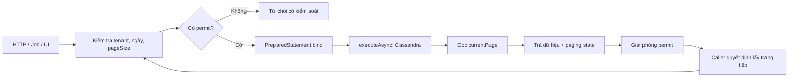

# Xây dựng luồng Java với bind, phân trang và giới hạn đồng thời

## 1. Bài toán và kết quả cần đạt

Một ứng dụng ghi lại hoạt động của người dùng trong nhiều tenant. Màn hình quản trị cần lấy các sự kiện mới nhất của **một tenant trong một ngày**, mỗi lần chỉ trả về một trang nhỏ. Trong lúc đó, nhiều yêu cầu ghi và đọc có thể đến cùng lúc. Hãy xây dựng luồng Java dùng Apache Cassandra đáp ứng ba yêu cầu:

1. **Bind tham số** của CQL qua `PreparedStatement`/`BoundStatement`, không ghép giá trị người dùng vào chuỗi truy vấn.
2. **Phân trang theo paging state** của Cassandra, đọc đến đâu lấy đến đó; không tải toàn bộ partition rồi cắt danh sách trong Java.
3. **Giới hạn số truy vấn đang xử lý** tại tầng ứng dụng và có hành vi rõ ràng khi vượt ngưỡng.

Đây là bài *Thực hành tổng hợp* cho module `DATABASE_ENGINE_WIDE_COLUMN_CASSANDRA`. Bài vận dụng kiến trúc phân tán, thiết kế bảng wide-column theo truy vấn, partition key, clustering key, replication và mức nhất quán đọc/ghi. Ví dụ sử dụng **Java 17+**, **Apache Cassandra**, **Apache Cassandra Java Driver 4.x** (API minh họa theo dòng 4.19) và CQL. Người học cần có cụm Cassandra truy cập được từ Java; các bước không yêu cầu Spring hoặc hệ thống nhắn tin.

Sơ đồ luồng xử lý:



> `pageSize` là mục tiêu số hàng **mỗi lần fetch**; server có thể trả ít hơn. `LIMIT` giới hạn tổng số hàng của truy vấn, không thay thế cho phân trang. Cassandra không có cơ chế `OFFSET` phù hợp để đi sâu qua một tập dữ liệu lớn.

## 2. Thiết kế dữ liệu từ truy vấn

**Truy vấn nghiệp vụ:** “Liệt kê sự kiện của tenant `T` trong ngày UTC `D`, theo thời gian giảm dần”. Ta tạo bảng phục vụ chính truy vấn này:

```sql
-- Ví dụ dành cho cluster có ít nhất 3 replica trong DC tên datacenter1.
-- Kiểm tra DC thực tế: SELECT data_center FROM system.local;
CREATE KEYSPACE IF NOT EXISTS cassandra_lab
WITH replication = {'class': 'NetworkTopologyStrategy', 'datacenter1': 3}
AND durable_writes = true;

CREATE TABLE IF NOT EXISTS cassandra_lab.events_by_tenant_day (
    tenant_id    uuid,
    bucket_day   date,
    happened_at  timestamp,
    event_id     uuid,
    event_type   text,
    details      text,
    PRIMARY KEY ((tenant_id, bucket_day), happened_at, event_id)
) WITH CLUSTERING ORDER BY (happened_at DESC, event_id DESC);
```

| Thành phần | Vai trò | Lý do chọn |
| --- | --- | --- |
| `(tenant_id, bucket_day)` | **Partition key tổng hợp** | Xác định partition để định tuyến truy vấn, tránh quét toàn bảng; ngày là một bucket giới hạn kích thước partition. |
| `happened_at` | Clustering key thứ nhất | Phục vụ thứ tự sự kiện mới trước trong cùng partition. |
| `event_id` | Clustering key thứ hai | Phân biệt các sự kiện có cùng millisecond và tạo thứ tự ổn định. |
| `event_type`, `details` | Regular columns | Dữ liệu hiển thị, không tham gia lọc hoặc định tuyến. |

Truy vấn hợp lệ đi kèm thiết kế bảng:

```sql
SELECT happened_at, event_id, event_type, details
FROM cassandra_lab.events_by_tenant_day
WHERE tenant_id = ? AND bucket_day = ?;
```

**Vì sao không dùng `ALLOW FILTERING`?** Mục tiêu là đọc trúng một partition bằng khóa đã biết, không lọc sau khi phải đọc hàng loạt partition. Nếu giao diện cần “mọi sự kiện của tất cả tenant” hoặc “lọc theo event_type”, đó là một truy vấn khác và thường cần bảng/view dữ liệu được thiết kế riêng.

**Giới hạn thiết kế:** Partition vẫn có thể quá lớn nếu tenant ghi hàng triệu sự kiện/ngày; khi đó cần bucket nhỏ hơn (giờ, hoặc shard có chủ đích) và thiết kế cách hợp nhất kết quả. Tránh đặt bucket quá nhỏ nếu ứng dụng thường xuyên phải đi qua hàng trăm partition để đáp ứng một màn hình. Ngày được tính theo **UTC** ở cả lúc ghi và lúc đọc.

**Lưu ý môi trường:** Nếu chỉ có một node để học cục bộ, có thể dùng replication factor `1` với đúng tên DC của node đó; `LOCAL_QUORUM` lúc ấy chỉ yêu cầu một replica, không thể kiểm chứng khả năng chịu lỗi của cluster 3 replica. Trong phần còn lại, ví dụ giả định RF = 3 trong `datacenter1`.

## 3. Chuẩn bị kết nối Java

Ví dụ Gradle (Groovy DSL):

```groovy
dependencies {
    implementation 'org.apache.cassandra:java-driver-core:4.19.4'
}
```

Tạo `CqlSession` **một lần khi ứng dụng khởi động** rồi chia sẻ qua các request. `datacenter1` và địa chỉ contact point phải thay theo cụm đang chạy; có thể đặt thêm cấu hình authentication/TLS ngoài ví dụ.

```java
try (CqlSession session = CqlSession.builder()
        .addContactPoint(new InetSocketAddress("127.0.0.1", 9042))
        .withLocalDatacenter("datacenter1")
        .withKeyspace("cassandra_lab")
        .build()) {
    // Khởi tạo repository rồi gọi các phương thức bất đồng bộ.
}
```

Trong driver 4.x, `BoundStatement` **bất biến**: `setPageSize`, `setPagingState`, `setConsistencyLevel` trả về một đối tượng mới. Phải dùng giá trị trả về. Cũng không nên gọi `session.prepare(...)` cho từng request; chuẩn bị truy vấn một lần để tái sử dụng.

## 4. Xây dựng repository: bind, đọc một trang, giới hạn in-flight

Tạo file `CassandraFlowPractice.java` với chương trình hoàn chỉnh dưới đây. `EventStore` đóng vai trò adapter lưu trữ: hai prepared statement được tạo khi khởi tạo; `Semaphore` là ngân sách **chung** cho cả đọc lẫn ghi. `tryAcquire()` từ chối tức thì khi hết chỗ, tránh chặn thread xử lý request.

```java
import com.datastax.oss.driver.api.core.CqlSession;
import com.datastax.oss.driver.api.core.DefaultConsistencyLevel;
import com.datastax.oss.driver.api.core.cql.BoundStatement;
import com.datastax.oss.driver.api.core.cql.PagingState;
import com.datastax.oss.driver.api.core.cql.PreparedStatement;
import com.datastax.oss.driver.api.core.cql.Row;

import java.net.InetSocketAddress;
import java.time.Instant;
import java.time.LocalDate;
import java.time.ZoneOffset;
import java.util.ArrayList;
import java.util.List;
import java.util.UUID;
import java.util.concurrent.CompletableFuture;
import java.util.concurrent.CompletionStage;
import java.util.concurrent.RejectedExecutionException;
import java.util.concurrent.Semaphore;
import java.util.function.Supplier;

public final class CassandraFlowPractice {

    record Event(UUID tenantId, LocalDate bucketDay, Instant happenedAt,
                 UUID eventId, String eventType, String details) { }

    // nextState == null nghĩa là đã hết dữ liệu.
    record EventPage(List<Event> events, PagingState nextState) { }

    static final class EventStore {
        private final CqlSession session;
        private final PreparedStatement insert;
        private final PreparedStatement select;
        private final Semaphore inFlight;

        EventStore(CqlSession session, int maxInFlight) {
            if (maxInFlight <= 0) {
                throw new IllegalArgumentException("maxInFlight must be positive");
            }
            this.session = session;
            this.inFlight = new Semaphore(maxInFlight);
            this.insert = session.prepare(
                "INSERT INTO cassandra_lab.events_by_tenant_day " +
                "(tenant_id, bucket_day, happened_at, event_id, event_type, details) " +
                "VALUES (?, ?, ?, ?, ?, ?)");
            this.select = session.prepare(
                "SELECT happened_at, event_id, event_type, details " +
                "FROM cassandra_lab.events_by_tenant_day " +
                "WHERE tenant_id = ? AND bucket_day = ?");
        }

        CompletionStage<Void> append(Event event) {
            BoundStatement request = insert.bind(
                    event.tenantId(), event.bucketDay(), event.happenedAt(),
                    event.eventId(), event.eventType(), event.details())
                .setConsistencyLevel(DefaultConsistencyLevel.LOCAL_QUORUM)
                .setIdempotent(true);

            return withPermit(() -> session.executeAsync(request)
                .thenApply(ignored -> (Void) null));
        }

        CompletionStage<EventPage> readPage(
                UUID tenantId, LocalDate bucketDay, int pageSize,
                PagingState pagingState) {

            if (pageSize < 1 || pageSize > 200) {
                return CompletableFuture.failedFuture(
                    new IllegalArgumentException("pageSize must be 1..200"));
            }

            BoundStatement first = select.bind(tenantId, bucketDay)
                .setPageSize(pageSize)
                .setConsistencyLevel(DefaultConsistencyLevel.LOCAL_QUORUM)
                .setIdempotent(true);
            BoundStatement request = pagingState == null
                ? first : first.setPagingState(pagingState);

            return withPermit(() -> session.executeAsync(request).thenApply(rs -> {
                List<Event> events = new ArrayList<>();
                for (Row row : rs.currentPage()) {
                    events.add(new Event(
                        tenantId,
                        bucketDay,
                        row.getInstant("happened_at"),
                        row.getUuid("event_id"),
                        row.getString("event_type"),
                        row.getString("details")));
                }

                // Chỉ lấy token SAU KHI đã đọc hết currentPage.
                PagingState next = rs.hasMorePages()
                    ? rs.getExecutionInfo().getSafePagingState()
                    : null;
                return new EventPage(List.copyOf(events), next);
            }));
        }

        private <T> CompletionStage<T> withPermit(
                Supplier<CompletionStage<T>> operation) {
            if (!inFlight.tryAcquire()) {
                return CompletableFuture.failedFuture(
                    new RejectedExecutionException("Cassandra in-flight limit reached"));
            }
            try {
                return operation.get().whenComplete((value, failure) ->
                    inFlight.release());
            } catch (RuntimeException failure) {
                // Bao gồm lỗi ném đồng bộ trước khi tạo CompletionStage.
                inFlight.release();
                return CompletableFuture.failedFuture(failure);
            }
        }
    }

    public static void main(String[] args) {
        try (CqlSession session = CqlSession.builder()
                .addContactPoint(new InetSocketAddress("127.0.0.1", 9042))
                .withLocalDatacenter("datacenter1")
                .withKeyspace("cassandra_lab")
                .build()) {

            EventStore store = new EventStore(session, 16);
            UUID tenant = UUID.randomUUID();
            LocalDate day = LocalDate.now(ZoneOffset.UTC);
            // Cố định mốc giữa ngày UTC để 23 event không tràn sang ngày khác.
            Instant base = day.atTime(12, 0).toInstant(ZoneOffset.UTC);

            // Đầu phát cũng có trách nhiệm tự hạn chế tốc độ: tối đa 8
            // write song song mỗi đợt, dưới ngưỡng toàn ứng dụng là 16.
            for (int start = 0; start < 23; start += 8) {
                List<CompletableFuture<Void>> batch = new ArrayList<>();
                for (int i = start; i < Math.min(23, start + 8); i++) {
                    Event event = new Event(tenant, day,
                        base.plusMillis(i), UUID.randomUUID(),
                        "OPEN", "demo-" + i);
                    batch.add(store.append(event).toCompletableFuture());
                }
                CompletableFuture.allOf(
                    batch.toArray(new CompletableFuture[0])).join();
            }

            PagingState cursor = null;
            int total = 0;
            int pageNumber = 0;
            do {
                EventPage page = store.readPage(tenant, day, 5, cursor)
                    .toCompletableFuture().join();
                pageNumber++;
                total += page.events().size();
                System.out.printf("Page %d: %d events%n",
                    pageNumber, page.events().size());
                page.events().forEach(event ->
                    System.out.println("  " + event.happenedAt()
                        + "  " + event.eventId()));
                cursor = page.nextState();
            } while (cursor != null);

            System.out.println("Total events = " + total); // 23
        }
    }
}
```

### Vì sao ba cơ chế này đi cùng nhau?

| Cơ chế | Xử lý vấn đề gì | Điều chưa được bảo đảm |
| --- | --- | --- |
| `prepare` + `bind` | Kiểu dữ liệu chính xác, tránh CQL injection do nối chuỗi, giảm chi phí phân tích truy vấn lặp lại. | Không sửa được truy vấn thiết kế sai partition key. |
| `setPageSize(5)` + `PagingState` | Mỗi lần chỉ tải một phần kết quả; caller tự quyết định khi nào chuyển trang. | Không phải snapshot nhất quán nếu bảng thay đổi giữa các lần đọc. |
| `Semaphore(16)` | Chặn số thao tác Cassandra đang thực thi đồng thời trong **một instance** ứng dụng. | Không phải giới hạn tổng trên mọi pod/instance; không tự tạo hàng đợi hay retry. |

Trong `append`, `setIdempotent(true)` phù hợp khi thao tác lặp dùng **cùng khóa, cùng giá trị sự kiện**. Nếu mỗi lần retry tạo `event_id` mới thì có thể ghi thêm một sự kiện khác; hãy tạo ID một lần ở ranh giới nghiệp vụ rồi tái sử dụng. Không tự đánh dấu idempotent cho phép tính cộng counter hoặc thao tác có hiệu ứng không lặp an toàn.

Trong `readPage`, `rs.currentPage()` trả về các hàng **của trang hiện tại**. Ví dụ dùng `getSafePagingState()` rồi `setPagingState(...)` để phát lệnh mới cho trang kế. Nếu muốn xử lý liên tục trong *cùng một lời gọi* thay vì đưa token cho client, API `rs.fetchNextPage()` cho phép nối các `CompletionStage` bất đồng bộ; cần tiếp tục giữ ngân sách giới hạn đồng thời phù hợp với cách fetch. Không dùng vòng `while` đồng bộ chờ future trong callback chạy trên thread I/O của driver.

## 5. Đưa paging state qua HTTP đúng cách

Trong ví dụ trên, `PagingState` là đối tượng **nội bộ Java**. Có thể chuyển thành chuỗi bằng `page.nextState().toString()` và đọc lại qua `PagingState.fromString(...)` khi cần lưu/khôi phục. Tuy nhiên, **không đưa nguyên chuỗi này cho client chưa tin cậy**: cơ chế `safe` chỉ kiểm tra tính tương thích của câu lệnh và giá trị bind; nó **không phải chữ ký chống giả mạo**.

Với API production, mã hóa/đóng gói token bằng một lớp riêng có chữ ký HMAC (hoặc cơ chế xác thực tương đương) và giới hạn kích thước/tuổi token. Ràng buộc token với `tenantId` đã xác thực, `bucketDay`, `pageSize`, phiên bản truy vấn và thời hạn hết hiệu lực. Kiểm tra quyền tenant ở mỗi request trước khi truy cập Cassandra; mapping lỗi token sai/không hợp lệ sang HTTP `400`.

Ví dụ contract API (minh họa, không chứa chuỗi paging state thật):

```http
GET /tenants/{tenantId}/events?day=2026-11-21&pageSize=5
200 OK
{
  "items": ["...5 event objects..."],
  "nextCursor": "<opaque-signed-token>"
}

GET /tenants/{tenantId}/events?day=2026-11-21&pageSize=5&cursor=<opaque-signed-token>
200 OK
{
  "items": ["...next page..."],
  "nextCursor": null
}
```

Giữ nguyên **câu CQL và toàn bộ bind values** khi tiếp tục bằng paging state. Token của tenant `A`/ngày `D` không được dùng cho tenant `B`/ngày khác; khi query hoặc cách sắp xếp thay đổi, cursor cũ cần bị từ chối. Paging state không cung cấp snapshot: insert/delete trong lúc duyệt có thể làm kết quả quan sát thay đổi; nếu cần xuất báo cáo “chính xác tại thời điểm T”, phải thiết kế quy trình chốt dữ liệu hoặc watermark riêng.

## 6. Ngân sách đồng thời và xử lý quá tải

Giả sử mỗi instance cho phép `maxInFlight = 16`. Khi có 16 thao tác đã giữ permit, yêu cầu thứ 17 nhận `RejectedExecutionException` ngay ở tầng ứng dụng. HTTP adapter có thể ánh xạ thành `429 Too Many Requests` hoặc `503 Service Unavailable` tùy hợp đồng dịch vụ; job nền có thể dùng hàng đợi **có kích thước giới hạn**, rồi retry với backoff/jitter. Không tạo hàng đợi vô hạn và không retry lập tức hàng nghìn lần.

Điểm cần nắm:

- **Không dùng** `Semaphore.acquire()` trên thread sự kiện để chờ permit; cách này có thể khóa luồng xử lý trong khi lệnh CQL đang chờ phản hồi.
- Permit chỉ được `release()` **khi giai đoạn bất đồng bộ hoàn tất** (kể cả lỗi). Đặt trong `whenComplete` giúp tránh rò permit; `catch` xử lý trường hợp `operation.get()` ném lỗi ngay.
- Với nhiều instance, giới hạn lý thuyết xấp xỉ `số instance × 16`. Cần tính ngân sách dựa trên khả năng thật của cluster, throughput, p95/p99 latency và số kết nối; con số 16 là tham số học tập, không phải hằng số tối ưu.
- Giới hạn in-flight điều tiết **truy vấn đồng thời**, không trực tiếp giới hạn kích thước partition, số hàng hay tốc độ ghi dài hạn. Giám sát queue depth (nếu có), số request bị từ chối, timeout, latency, tỷ lệ lỗi và tài nguyên cluster.

Với RF = 3, chọn `LOCAL_QUORUM` cho cả ghi và đọc yêu cầu thường là **2 replica trong DC địa phương** xác nhận mỗi thao tác; `R + W > RF` (2 + 2 > 3) giúp đọc có cơ hội phản ánh ghi đã được xác nhận trong điều kiện nhất định. Nó không thay thế quản lý concurrent updates, không bảo đảm snapshot cho nhiều trang, và khi số replica khả dụng không đủ quorum, request có thể thất bại. Cân nhắc tác động consistency/latency theo SLA thực tế.

## 7. Quy trình thực hành và tiêu chí tự kiểm tra

1. **Khởi tạo:** Xác định tên DC, tạo keyspace/table, cấu hình driver; cluster phải có số replica phù hợp với RF. Chạy `CassandraFlowPractice.main()` sau khi tạo schema.
2. **Ghi có bind:** Chương trình tạo 23 `event_id` mới của một tenant và một ngày UTC, chia ba đợt ghi (8, 8, 7), mỗi đợt chờ hoàn tất bằng `allOf`. Xác nhận không có exception.
3. **Đọc nhiều trang:** Chương trình lấy `pageSize = 5`, in từng trang và dùng `nextState` để tiếp tục. Trong trạng thái không có ghi/xóa xen vào, tổng số bản ghi phải là **23**; mỗi `event_id` xuất hiện một lần và thời gian sắp giảm dần.
4. **Kiểm tra cursor:** Thử dùng token thu được từ tenant/ngày này cho tenant/ngày khác. Driver `PagingState` an toàn sẽ từ chối khi `setPagingState` không khớp query/bind. Với HTTP phải bắt và đổi thành lỗi dữ liệu đầu vào thay vì làm lộ stack trace.
5. **Kiểm tra quá tải:** Tạo tải đồng thời đủ lớn hoặc tăng độ trễ Cassandra có kiểm soát để chiếm hết 16 permit; xác minh request vượt ngưỡng nhận lỗi từ chối, permit phục hồi sau thành công **và** lỗi. Không kết luận hệ thống giới hạn sai chỉ vì một benchmark ngắn chưa bao giờ chạm ngưỡng.
6. **Thử lỗi replica:** Trong môi trường test nhiều node, làm thiếu số replica cần thiết cho `LOCAL_QUORUM`. Quan sát lỗi/timeout, khôi phục node và đối chiếu dữ liệu. Kiểm tra tác động của repair/compaction và giám sát tombstone trong những ca có xóa hoặc TTL lớn; không chạy thao tác bảo trì tùy tiện trên production.

Các lỗi thường gặp:

| Triệu chứng | Nguyên nhân khả dĩ | Cách kiểm tra/sửa |
| --- | --- | --- |
| `UnavailableException`, read/write timeout | RF/CL không phù hợp, replica không đủ hoặc hệ thống quá tải | Xác nhận DC, RF, node sống; theo dõi latency và coordinator. |
| Không có trang tiếp theo dù còn dữ liệu | Bỏ qua/ghi đè paging state hoặc lặp lại trang đầu | Chuyển nguyên `nextState` sang lệnh mới với cùng query và bind. |
| `IllegalStateException` khi áp dụng cursor | Cursor dùng sai tenant/ngày/câu query | Kiểm tra tuple truy vấn, không tái sử dụng token sai ngữ cảnh. |
| Request tăng gây bộ nhớ cao | Đẩy toàn bộ futures vào danh sách hoặc queue vô hạn | Chia đợt/hạn chế upstream, đo số thao tác in-flight. |
| Kết quả trùng/thiếu giữa các lần bấm “trang tiếp” | Dữ liệu đang thay đổi trong khi phân trang | Phân biệt cursor với snapshot; dùng watermark/bảng lịch sử khi cần. |
| Tải chậm dù `pageSize` nhỏ | Partition quá lớn, hot partition, tombstone, CL cao | Xem phân bố partition, tracing, compaction và thiết kế bucket. |

## 8. Mở rộng sau khi hoàn thành

Nâng cấp bài thực hành bằng ba thay đổi có kiểm chứng: (1) thêm metric `in_flight`, số lần reject và p95/p99 latency; (2) viết HTTP endpoint bọc paging token bằng HMAC, hỗ trợ hủy/timeout và kiểm tra quyền tenant; (3) tạo bộ dữ liệu có nhiều tenant/ngày để đo hot partition và đánh giá bucket theo giờ. Khi chuyển sang reactive pipeline hoặc thread pool, vẫn giữ quy tắc: caller kiểm soát tốc độ phát sinh request, chỉ fetch trang tiếp khi có nhu cầu, và luôn có giới hạn tài nguyên.

### Tài liệu tham khảo

- Apache Cassandra Java Driver — [Paging](https://apache.github.io/cassandra-java-driver/4.19.0/core/paging/) và [Asynchronous programming](https://apache.github.io/cassandra-java-driver/4.19.0/core/async/).
- Apache Cassandra Java Driver — [Prepared statements](https://apache.github.io/cassandra-java-driver/4.19.0/core/statements/prepared/) và [Javadoc `PagingState`](https://apache.github.io/cassandra-java-driver/4.18.1/api/com/datastax/oss/driver/api/core/cql/PagingState.html).
- Apache Cassandra — [Cassandra Java Driver release và tài nguyên tải về](https://cassandra.apache.org/_/download.html).
