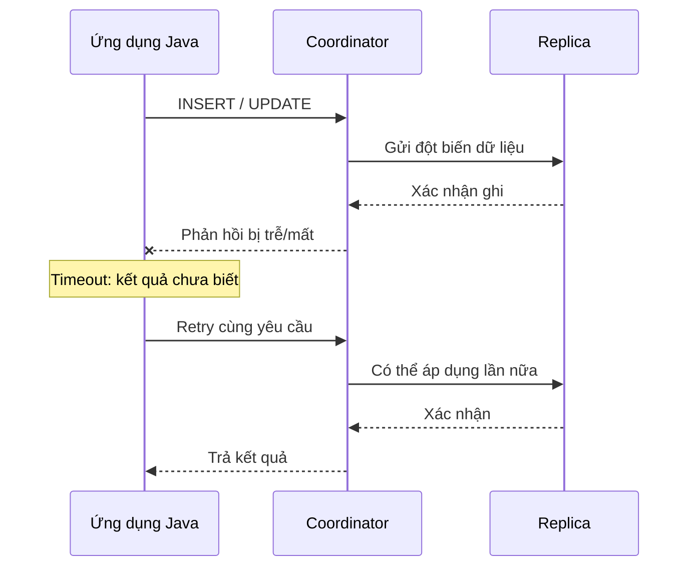
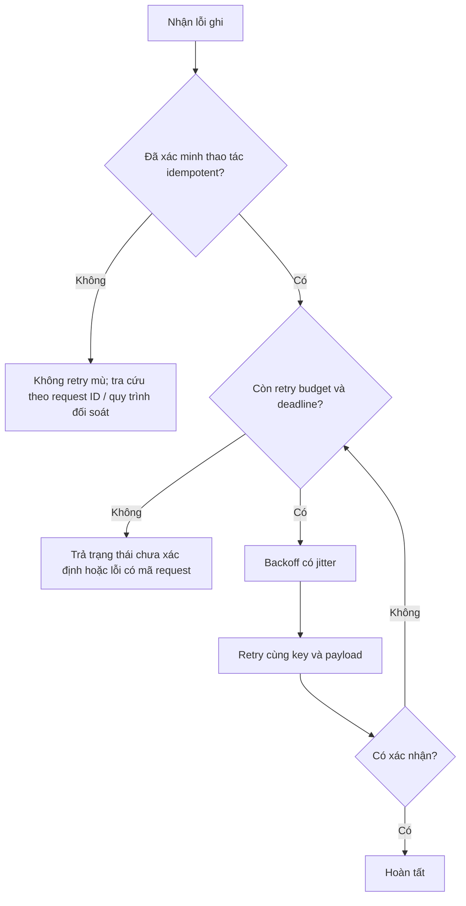

# Tái hiện timeout, retry và thao tác ghi có thể bị lặp

## 1. Mục tiêu và tình huống thực hành

Trong hệ thống phân tán, **timeout không có nghĩa là thao tác ghi chắc chắn thất bại**. Ứng dụng Java có thể gửi lệnh ghi tới Apache Cassandra, các replica đã lưu dữ liệu, nhưng phản hồi không đến ứng dụng trước thời hạn. Nếu ứng dụng tự động thử lại, **cùng một yêu cầu nghiệp vụ có thể được thực thi nhiều lần**. Tùy kiểu ghi, kết quả có thể vẫn đúng hoặc gây mất tính chính xác nghiệp vụ.

Bài **Thực hành tổng hợp** này thuộc phạm vi `DATABASE_ENGINE_WIDE_COLUMN_CASSANDRA`: vận dụng mô hình wide-column, khóa phân vùng, CQL, replication và consistency level, đồng thời kiểm tra hành vi timeout/retry từ ứng dụng Java. Trọng tâm là phân biệt thao tác **idempotent** (lặp lại vẫn cho cùng trạng thái mong muốn) với thao tác **không idempotent** (lặp lại làm biến đổi trạng thái thêm một lần).

Tình huống: một dịch vụ nhận yêu cầu tạo bản ghi sự kiện và ghi nhận số lần xử lý. Sau khi gửi ghi, client nhận timeout. Nó không biết Cassandra chưa nhận yêu cầu, đã ghi vào một số replica, hay đã ghi thành công nhưng mất phản hồi. Chúng ta sẽ tạo ra các trường hợp có kết quả quan sát được, rồi thiết kế retry an toàn.

Kết quả cần đạt:

1. Giải thích được vì sao `WriteTimeoutException` và timeout phía driver không chứng minh dữ liệu chưa được ghi.
2. Tự tạo bảng, thực thi lại cùng lệnh `INSERT`, `UPDATE counter` và `UPDATE list` rồi so sánh kết quả.
3. Tái hiện một trường hợp **mất xác nhận sau khi ghi thành công**, sau đó cho client thử lại trên cùng `request_id`.
4. Đánh dấu đúng các statement an toàn/không an toàn cho retry trong Java Driver và kiểm tra một mẫu ghi có điều kiện `IF NOT EXISTS`.
5. Đề xuất giới hạn retry, quan sát lỗi và kiểm tra hệ thống khi chạy nhiều replica.

> **Ranh giới thí nghiệm:** phần bắt buộc dùng một node Cassandra để học trực tiếp về ghi lặp; không dùng cấu hình này để kết luận về quorum hoặc khả năng chịu lỗi cụm nhiều node. Phần mở rộng cuối bài mô tả kiểm tra thêm trên cụm ba node.

## 2. Mô hình lỗi: thời gian chờ và trạng thái ghi là hai câu hỏi khác nhau

Khi ghi qua Java Driver, luồng điển hình là:



**Coordinator** là node tiếp nhận yêu cầu từ client và phối hợp các replica. **Consistency level** xác định số replica phải xác nhận để một thao tác được coi là thành công theo mức nhất quán đã chọn. Ví dụ, khi replication factor bằng 3 trong một datacenter, ghi ở `LOCAL_QUORUM` cần đủ hai xác nhận từ replica của datacenter đó. Nếu không đủ xác nhận trong thời hạn, coordinator có thể báo `WriteTimeoutException` **dù một số replica đã ghi**. Các lần ghi không được tự động rollback chỉ vì client nhận timeout.

| Kết quả phía client | Ý nghĩa có thể kết luận | Điều không được suy ra |
| --- | --- | --- |
| Ghi thành công tại consistency level đã chọn | Coordinator nhận đủ xác nhận theo mức đó | Mọi replica, hệ tìm kiếm hay dịch vụ khác đều đã cập nhật |
| `WriteTimeoutException` | Coordinator không nhận đủ phản hồi ghi trong thời hạn máy chủ | Không replica nào đã ghi |
| `DriverTimeoutException` | Driver hết thời gian chờ kết quả cho request | Request chắc chắn chưa tới Cassandra |
| Kết nối đứt sau khi gửi request | Client mất khả năng biết kết quả qua kết nối đó | Request đã thất bại hoặc chắc chắn thành công |
| `UnavailableException` | Coordinator thấy không đủ replica sẵn sàng đáp ứng consistency level yêu cầu | Có thể áp dụng cùng chính sách xử lý cho mọi loại timeout |

Các tình huống cần nhớ:

- **Timeout phía client**: thời hạn của driver kết thúc trước khi nhận kết quả; không có bằng chứng chắc chắn về việc Cassandra đã áp dụng ghi hay chưa.
- **Timeout ghi phía server**: coordinator chờ xác nhận replica quá thời hạn; một phần ghi có thể đã diễn ra.
- **Retry**: gửi thêm một yêu cầu vật lý cho cùng ý định nghiệp vụ. Retry không tự bảo đảm “chỉ thực thi một lần”.
- **Idempotency**: đặc tính của thao tác, khóa và dữ liệu. Không thể suy ra chỉ từ việc statement sử dụng cú pháp `INSERT` hay `UPDATE`.

Đặc biệt, chiến lược **last-write-wins** theo timestamp của Cassandra giúp hòa giải các giá trị ô dữ liệu, nhưng không bảo đảm rằng mọi thao tác ghi nghiệp vụ đều có thể chạy lại an toàn. Một `INSERT` cố định trên cùng primary key khác với tăng counter, nối thêm list hay phát sinh một ID mới ở mỗi lần thử.

## 3. Chuẩn bị môi trường

Yêu cầu: Docker, một terminal, `cqlsh` và nếu chạy phần Java thì JDK 17 cùng Maven. Có thể dùng Cassandra 4.x/5.x đang hoạt động thay cho Docker, miễn kết nối CQL được và biết chính xác tên datacenter.

Khởi động node lab độc lập:

```bash
docker run -d --name cassandra-timeout-lab -p 9042:9042 cassandra:5.0
docker exec cassandra-timeout-lab nodetool status
docker exec -it cassandra-timeout-lab cqlsh
```

Nếu `nodetool` hoặc `cqlsh` chưa kết nối được, Cassandra vẫn đang khởi động; chỉ tiếp tục sau khi node hoạt động. Tránh dùng keyspace của môi trường sản xuất.

Trong `cqlsh`, kiểm tra datacenter:

```sql
SELECT data_center FROM system.local;
```

Ví dụ sau dùng tên datacenter mặc định thường gặp của container là `datacenter1`. **Thay tên này bằng giá trị thật** nếu khác:

```sql
CREATE KEYSPACE IF NOT EXISTS retry_lab
WITH replication = {
    'class': 'NetworkTopologyStrategy',
    'datacenter1': 1
}
AND durable_writes = true;

USE retry_lab;
```

Replication factor bằng 1 phù hợp với **lab một node**; khi muốn khảo sát `LOCAL_QUORUM` với RF=3 phải sử dụng cụm có ít nhất ba replica phù hợp và đổi replication config. Không tự tăng RF lên 3 trên một node rồi diễn giải kết quả timeout như một hệ phân tán ba node.

### Tạo bốn bảng phục vụ bài lab

```sql
-- Ghi sự kiện theo mã định danh ổn định của yêu cầu nghiệp vụ.
CREATE TABLE IF NOT EXISTS events_by_request (
    tenant_id uuid,
    request_id uuid,
    event_at timestamp,
    payload text,
    PRIMARY KEY ((tenant_id, request_id))
);

-- Counter: mỗi phép +1 là một thay đổi nghiệp vụ mới.
CREATE TABLE IF NOT EXISTS retry_counters (
    tenant_id uuid,
    request_id uuid,
    attempts counter,
    PRIMARY KEY ((tenant_id, request_id))
);

-- List: nối thêm phần tử có thể sinh phần tử lặp.
CREATE TABLE IF NOT EXISTS retry_lists (
    tenant_id uuid,
    request_id uuid,
    steps list<text>,
    PRIMARY KEY ((tenant_id, request_id))
);

-- Chỉ cho phép tạo một bản ghi cho một request_id.
CREATE TABLE IF NOT EXISTS requests_lwt (
    tenant_id uuid,
    request_id uuid,
    payload_hash text,
    status text,
    PRIMARY KEY ((tenant_id, request_id))
);
```

Ở bốn bảng, `(tenant_id, request_id)` là **composite partition key**. Mỗi mã yêu cầu được dùng để định vị một partition nhỏ, phù hợp cho minh họa tra cứu và dedup. Trong một hệ thống thực, phân bố key, kích thước partition và loại truy vấn cần được đo theo lưu lượng thật. Các bảng ở đây cố ý tối giản; chúng không minh họa toàn bộ mô hình sự kiện lịch sử cho production.

## 4. Thí nghiệm A — Lặp lại một lệnh ghi cùng khóa và cùng giá trị

Giữ nguyên `tenant_id`, `request_id`, `event_at` và `payload` khi chạy lại lệnh. Không phát sinh UUID bên trong vòng lặp retry.

```sql
USE retry_lab;

INSERT INTO events_by_request
    (tenant_id, request_id, event_at, payload)
VALUES
    (11111111-1111-4111-8111-111111111111,
     22222222-2222-4222-8222-222222222222,
     '2026-11-21T08:30:00Z', 'payment-requested');

-- Giả lập client thử lại chính xác request trước đó.
INSERT INTO events_by_request
    (tenant_id, request_id, event_at, payload)
VALUES
    (11111111-1111-4111-8111-111111111111,
     22222222-2222-4222-8222-222222222222,
     '2026-11-21T08:30:00Z', 'payment-requested');

SELECT tenant_id, request_id, event_at, payload
FROM events_by_request
WHERE tenant_id = 11111111-1111-4111-8111-111111111111
  AND request_id = 22222222-2222-4222-8222-222222222222;
```

**Kỳ vọng:** một hàng với `payload = 'payment-requested'`. Hai request đã được gửi, nhưng bảng thể hiện **một bản ghi logic** vì chúng dùng cùng khóa chính và cùng giá trị. Đây là ví dụ về tính idempotent của một thao tác **upsert trạng thái cố định**.

Cần hiểu đúng giới hạn của kết quả này:

- Nếu mỗi lần retry tạo một `request_id` mới, Cassandra lưu thành **hai partition/hàng khác nhau**; thao tác không còn idempotent ở cấp nghiệp vụ.
- Nếu lần retry tạo `event_at = now()` hoặc payload khác, kết quả không còn là cùng trạng thái mong muốn.
- Ghi lại cùng primary key với timestamp ghi mới hơn có thể ghi đè thay đổi đồng thời của request khác. Vì vậy, quy tắc “retry INSERT là an toàn” chỉ hợp lệ khi **khóa và ngữ nghĩa dữ liệu được cố định**, đồng thời xử lý đúng cập nhật cạnh tranh.
- Nếu sử dụng `TTL`, mỗi lần ghi lại có thể thay đổi thời điểm hết hạn; kiểm soát TTL/ghi timestamp là một phần của thiết kế idempotency, không bỏ qua vì hàng trông vẫn giống nhau lúc đọc.

## 5. Thí nghiệm B — Lặp lại thao tác không idempotent

### B1. Tăng counter

```sql
UPDATE retry_counters
SET attempts = attempts + 1
WHERE tenant_id = 11111111-1111-4111-8111-111111111111
  AND request_id = 33333333-3333-4333-8333-333333333333;

-- Cùng thao tác được gửi lại sau khi phía client tưởng lần đầu lỗi.
UPDATE retry_counters
SET attempts = attempts + 1
WHERE tenant_id = 11111111-1111-4111-8111-111111111111
  AND request_id = 33333333-3333-4333-8333-333333333333;

SELECT attempts
FROM retry_counters
WHERE tenant_id = 11111111-1111-4111-8111-111111111111
  AND request_id = 33333333-3333-4333-8333-333333333333;
```

**Kỳ vọng khi thực hiện trên một bản ghi mới đúng hai lần và cả hai ghi đều hoàn tất:** `attempts = 2`. Điều này khác với lệnh `INSERT` ở thí nghiệm A. Counter có ngữ nghĩa “thêm một đơn vị” nên lặp lại là một lần tăng nữa. Nếu chạy lại bài trên chính mã yêu cầu này, giá trị sẽ tiếp tục tăng. Để quan sát lại kết quả từ đầu, dùng một `request_id` mới.

Khi một lần cập nhật counter bị timeout thực sự, không thể suy ra giá trị cuối cùng chỉ từ số lỗi ở client. Counter update **không được coi là idempotent** để driver tự retry tùy ý; cũng không phù hợp làm cơ chế duy nhất để đảm bảo tính đúng đắn của số dư, tồn kho hoặc giao dịch tiền.

### B2. Nối thêm phần tử vào list

```sql
UPDATE retry_lists
SET steps = steps + ['accepted']
WHERE tenant_id = 11111111-1111-4111-8111-111111111111
  AND request_id = 44444444-4444-4444-8444-444444444444;

UPDATE retry_lists
SET steps = steps + ['accepted']
WHERE tenant_id = 11111111-1111-4111-8111-111111111111
  AND request_id = 44444444-4444-4444-8444-444444444444;

SELECT steps
FROM retry_lists
WHERE tenant_id = 11111111-1111-4111-8111-111111111111
  AND request_id = 44444444-4444-4444-8444-444444444444;
```

**Kỳ vọng:** list chứa hai phần tử `'accepted'`. Cassandra xử lý thao tác **append**; nó không tự loại một giá trị vì giá trị đó đã từng xuất hiện. Cần phân biệt append/prepend list với gán một giá trị cố định vào một cột.

| Kiểu thay đổi | Nếu thực thi lại cùng yêu cầu | Đánh giá retry |
| --- | --- | --- |
| `INSERT` cùng primary key, cùng payload bất biến | Trạng thái cuối thường giữ nguyên | Có thể idempotent với điều kiện đã phân tích |
| `UPDATE ... SET status = 'DONE'` | Gán cùng trạng thái | Có thể idempotent nếu không ghi đè cập nhật cạnh tranh |
| `UPDATE counter SET n = n + 1` | Counter có thể tăng thêm | Không idempotent |
| `UPDATE list SET values = values + [...]` | List có thể nhận thêm phần tử | Không idempotent |
| `INSERT ...` với UUID mới mỗi lần | Tạo thêm một bản ghi logic | Không idempotent về nghiệp vụ |
| `INSERT ... IF NOT EXISTS` trên khóa ổn định | Một lần tạo; lần sau `[applied] = false` | Có thể dùng làm chốt dedup theo khóa, cần giải thích trạng thái trả về |

## 6. Thí nghiệm C — Client Java mất xác nhận sau khi ghi

Để quan sát chắc chắn nhánh **server đã ghi nhưng client xem như timeout**, đầu tiên dùng một điểm chèn lỗi có kiểm soát: ứng dụng thực hiện thành công câu lệnh, sau đó lớp mô phỏng **bỏ phản hồi thành công** và ném exception trước khi logic nghiệp vụ nhận kết quả. Thí nghiệm này tái hiện **sự không chắc chắn của client khi mất xác nhận**; exception mô phỏng không phải `DriverTimeoutException` thật do mạng hoặc coordinator phát sinh.

### Khởi tạo project Maven tối thiểu

Thêm phụ thuộc Java Driver 4.x vào `pom.xml` (phiên bản sau là ví dụ cho bài lab; trong dự án thật chọn bản đang được hỗ trợ):

```xml
<dependencies>
    <dependency>
        <groupId>com.datastax.oss</groupId>
        <artifactId>java-driver-core</artifactId>
        <version>4.17.0</version>
    </dependency>
</dependencies>
```

Tạo `src/main/java/RetryLab.java` với lớp sau. Đây là một chương trình hoàn chỉnh về hành vi cần quan sát, dùng tên datacenter tương ứng với `SELECT data_center FROM system.local` ở bước chuẩn bị.

```java
import com.datastax.oss.driver.api.core.CqlSession;
import com.datastax.oss.driver.api.core.DefaultConsistencyLevel;
import com.datastax.oss.driver.api.core.cql.BoundStatement;
import com.datastax.oss.driver.api.core.cql.PreparedStatement;
import com.datastax.oss.driver.api.core.cql.Row;
import com.datastax.oss.driver.api.core.cql.SimpleStatement;

import java.net.InetSocketAddress;
import java.time.Instant;
import java.util.UUID;

public final class RetryLab {
    public static void main(String[] args) {
        UUID tenantId = UUID.randomUUID();
        // Mỗi ý định nghiệp vụ có một ID, tạo MỘT LẦN trước mọi lần retry.
        UUID eventRequestId = UUID.randomUUID();
        UUID counterRequestId = UUID.randomUUID();
        Instant eventAt = Instant.parse("2026-11-21T08:30:00Z");

        try (CqlSession session = CqlSession.builder()
                .addContactPoint(new InetSocketAddress("127.0.0.1", 9042))
                .withLocalDatacenter("datacenter1")
                .withKeyspace("retry_lab")
                .build()) {

            PreparedStatement insertEvent = session.prepare(
                "INSERT INTO events_by_request " +
                "(tenant_id, request_id, event_at, payload) " +
                "VALUES (?, ?, ?, ?)");

            // Cùng khóa/cùng payload -> có thể gửi lại an toàn trong lab.
            BoundStatement eventWrite = insertEvent
                .bind(tenantId, eventRequestId, eventAt, "payment-requested")
                .setConsistencyLevel(DefaultConsistencyLevel.LOCAL_ONE)
                .setIdempotent(true);

            try {
                executeThenHideResponse(session, eventWrite);
            } catch (SimulatedClientTimeout e) {
                System.out.println("Client tưởng event timeout; retry cùng request_id");
                session.execute(eventWrite);
            }

            Row event = session.execute(SimpleStatement.newInstance(
                "SELECT payload FROM events_by_request " +
                "WHERE tenant_id = ? AND request_id = ?",
                tenantId, eventRequestId)).one();
            System.out.println("Event request_id = " + eventRequestId);
            System.out.println("Event payload = " +
                (event == null ? "<missing>" : event.getString("payload")));

            PreparedStatement increment = session.prepare(
                "UPDATE retry_counters SET attempts = attempts + 1 " +
                "WHERE tenant_id = ? AND request_id = ?");
            BoundStatement incrementWrite = increment
                .bind(tenantId, counterRequestId)
                .setConsistencyLevel(DefaultConsistencyLevel.LOCAL_ONE)
                .setIdempotent(false);

            // CỐ Ý retry thủ công một thao tác không idempotent để thấy lỗi.
            try {
                executeThenHideResponse(session, incrementWrite);
            } catch (SimulatedClientTimeout e) {
                System.out.println("Client tưởng counter timeout; retry +1");
                session.execute(incrementWrite);
            }

            Row counter = session.execute(SimpleStatement.newInstance(
                "SELECT attempts FROM retry_counters " +
                "WHERE tenant_id = ? AND request_id = ?",
                tenantId, counterRequestId)).one();
            System.out.println("Counter attempts = " +
                (counter == null ? "<missing>" : counter.getLong("attempts")));
        }
    }

    private static void executeThenHideResponse(
            CqlSession session, BoundStatement statement) {
        session.execute(statement); // Chắc chắn đã nhận phản hồi thành công.
        // Điểm chèn lỗi: logic gọi không được thấy phản hồi đó.
        throw new SimulatedClientTimeout("Simulated lost acknowledgement");
    }

    private static final class SimulatedClientTimeout extends RuntimeException {
        SimulatedClientTimeout(String message) {
            super(message);
        }
    }
}
```

Chạy lớp từ Maven project đã cấu hình Java 17 và plugin thực thi phù hợp, ví dụ:

```bash
mvn compile exec:java -Dexec.mainClass=RetryLab
```

**Kết quả cần quan sát:** `Event payload = payment-requested` và `Counter attempts = 2`. Hai kiểu ghi đều được gửi hai lần vì logic gọi nhận một lỗi mô phỏng; chỉ có thao tác gán dữ liệu theo khóa cố định giữ đúng trạng thái cuối. Mỗi lần chạy chương trình tạo UUID mới để số counter bắt đầu độc lập.

Ghi chú kỹ thuật:

- `.setIdempotent(true)` là thông tin để Java Driver/retry policy biết rằng statement **được ứng dụng xác nhận** là an toàn để lặp; driver không suy ra tính đúng đắn của nghiệp vụ từ CQL.
- `.setIdempotent(false)` cho counter là lựa chọn đúng khi chạy production. Trong lab, chúng ta **cố ý** gửi lại bằng lời gọi `session.execute` thứ hai để quan sát hậu quả; việc đặt cờ `false` không thể ngăn code ứng dụng tự gọi hai lần.
- `CqlSession` nên được tái sử dụng trong ứng dụng thực; `PreparedStatement` nên được chuẩn bị/cached phù hợp thay vì tạo mới cho mỗi HTTP request.
- `LOCAL_ONE` áp dụng cho lab một node. Không suy rộng kết quả này thành độ bền dữ liệu của cụm RF=3.

## 7. Thí nghiệm D — Thử gây timeout thật ở phía Java Driver

Để thử hành vi driver, đặt thời hạn rất ngắn trên **một câu ghi theo khóa ổn định**:

```java
import com.datastax.oss.driver.api.core.DriverTimeoutException;
import com.datastax.oss.driver.api.core.servererrors.WriteTimeoutException;
import java.time.Duration;

// requestId được tạo ngoài retry loop; insertEvent đã prepare ở thí nghiệm C.
BoundStatement shortDeadlineWrite = insertEvent
    .bind(tenantId, requestId, eventAt, "payment-requested")
    .setIdempotent(true)
    .setTimeout(Duration.ofMillis(1));

try {
    session.execute(shortDeadlineWrite);
    System.out.println("Received acknowledgement");
} catch (DriverTimeoutException | WriteTimeoutException e) {
    System.out.println("Outcome is UNKNOWN: " + e.getClass().getSimpleName());
    // Chỉ retry nếu chính thao tác này đã được thiết kế idempotent,
    // giữ nguyên key/payload và tuân theo retry budget.
}
```

Đoạn này là **phần chèn vào ví dụ Java**, không phải một chương trình độc lập; tạo biến `requestId` một lần trước khi gọi và dùng phiên bản driver tương thích. Ngưỡng 1 ms chỉ để tăng khả năng thấy timeout; trên máy khỏe có thể trả kết quả nhanh hoặc request hết hạn **trước khi được gửi**, nên **không có bảo đảm** rằng timeout xảy ra hay dữ liệu đã được ghi. Đọc lại theo đầy đủ primary key sau thử nghiệm chỉ cho biết trạng thái nhìn thấy **tại thời điểm đọc**, chưa thể biến một lần timeout thành kết luận tuyệt đối về việc ghi chưa bao giờ xảy ra.

Muốn tái hiện **mất hoặc trễ xác nhận mạng** gần thực tế hơn, đặt một proxy kiểm thử như Toxiproxy giữa driver và node, gây trễ ở chiều **server → client** lớn hơn timeout của driver, rồi bỏ nhiễu để kiểm tra dữ liệu. Cần bảo đảm driver thực sự gửi request qua proxy và không tự chuyển sang địa chỉ node khác khi discovery; kiểm tra cả log proxy và coordinator. Đây là bài thực hành mở rộng, vì kết quả phụ thuộc topo mạng, thời điểm injection và khả năng thử lại của driver.

Không dùng `Thread.sleep` ở ứng dụng để giả định Cassandra đã ghi xong. Trong thử nghiệm thật, hãy ghi lại request ID, thời điểm gửi, exception type, consistency level và trạng thái đọc sau khi phục hồi kết nối.

## 8. Thí nghiệm E — Dùng LWT để chặn tạo trùng theo request ID

Khi yêu cầu nghiệp vụ là **chỉ tạo một bản ghi cho mỗi mã yêu cầu**, Cassandra hỗ trợ **lightweight transaction (LWT)** với điều kiện `IF NOT EXISTS`. Điều kiện được phối hợp qua cơ chế đồng thuận cho đối tượng dữ liệu tương ứng; nó không thay thế một giao dịch ACID nhiều partition hay hành động ngoài Cassandra.

```sql
INSERT INTO requests_lwt
    (tenant_id, request_id, payload_hash, status)
VALUES
    (11111111-1111-4111-8111-111111111111,
     55555555-5555-4555-8555-555555555555,
     'sha256:payload-a', 'RECORDED')
IF NOT EXISTS;

-- Giả lập retry, giữ nguyên toàn bộ khóa và nội dung.
INSERT INTO requests_lwt
    (tenant_id, request_id, payload_hash, status)
VALUES
    (11111111-1111-4111-8111-111111111111,
     55555555-5555-4555-8555-555555555555,
     'sha256:payload-a', 'RECORDED')
IF NOT EXISTS;

SELECT payload_hash, status
FROM requests_lwt
WHERE tenant_id = 11111111-1111-4111-8111-111111111111
  AND request_id = 55555555-5555-4555-8555-555555555555;
```

Với một `request_id` chưa tồn tại và không có tranh chấp, lần đầu thường cho `[applied] = true`; lần hai cho `[applied] = false`; dữ liệu cuối là một bản ghi `RECORDED`. Cách đọc kết quả phải chú ý:

1. `[applied] = true`: lệnh điều kiện hiện tại vừa tạo bản ghi.
2. `[applied] = false`: khóa đã có bản ghi, **không phải tự động là thành công của cùng request**. Phải so sánh payload/hash và quy tắc sở hữu của request ID; nếu khác dữ liệu, trả lỗi xung đột.
3. Timeout ở lệnh điều kiện: trạng thái vẫn **không chắc chắn**. Có thể retry *cùng mã yêu cầu* và kiểm tra bản ghi đã tồn tại; không khởi tạo request ID mới.

Ví dụ kiểm tra ở Java Driver (phù hợp để gắn vào một hàm dịch vụ; `requestsLwt` và `selectByRequest` được prepare trước):

```java
PreparedStatement requestsLwt = session.prepare(
    "INSERT INTO requests_lwt " +
    "(tenant_id, request_id, payload_hash, status) " +
    "VALUES (?, ?, ?, ?) IF NOT EXISTS");
PreparedStatement selectByRequest = session.prepare(
    "SELECT payload_hash, status FROM requests_lwt " +
    "WHERE tenant_id = ? AND request_id = ?");

String hash = "sha256:payload-a"; // Ví dụ; production dùng hash thật.
boolean applied = session.execute(requestsLwt.bind(
    tenantId, requestId, hash, "RECORDED")).wasApplied();

if (!applied) {
    Row existing = session.execute(
        selectByRequest.bind(tenantId, requestId)).one();
    if (existing == null || !hash.equals(existing.getString("payload_hash"))) {
        throw new IllegalStateException("Idempotency key conflict");
    }
    // Bản ghi cùng request và cùng nội dung đã tồn tại.
}
```

**Lưu ý kiến trúc:** nếu mã yêu cầu đã được ghi vào `requests_lwt` rồi ứng dụng mới trừ tồn kho ở một partition khác, có thể xảy ra sự cố giữa hai bước. Sau đó retry nhìn thấy khóa đã tồn tại nhưng tồn kho chưa được trừ. Vì vậy, `IF NOT EXISTS` **chỉ chặn tạo trùng bản ghi trong phạm vi bảo đảm của thao tác điều kiện**, không biến chuỗi nhiều ghi hoặc gọi dịch vụ thanh toán thành một giao dịch nguyên tử. Với các side effect nhiều bước, dùng mô hình trạng thái có thể tiếp tục/bù trừ, transactional outbox ở nguồn RDBMS phù hợp, hoặc quy trình idempotency và đối soát nghiệp vụ.

Một số yêu cầu bổ sung trong production:

- Lưu request ID đủ lâu so với **cửa sổ retry, replay và lưu trữ thông điệp**; hết TTL quá sớm có thể cho phép yêu cầu cũ tạo lại.
- Không dùng LWT cho mọi ghi nếu không cần; có chi phí phối hợp đồng thuận và giảm thông lượng so với ghi thường.
- Quy định xử lý riêng khi payload thay đổi nhưng request ID giữ nguyên; đó là xung đột dữ liệu, không nên âm thầm ghi đè.
- Nếu một thao tác ghi có điều kiện trả timeout, không kết luận `applied = false`; trạng thái chỉ rõ khi nhận được kết quả hoặc xác minh đủ theo cơ chế ứng dụng.

## 9. Chính sách retry an toàn trong ứng dụng

Đừng biến mọi exception thành `while (true) retry`. Retry liên tiếp trên cụm đang quá tải gây **retry storm**, làm timeout tăng thêm. Nên phân loại lỗi, ngữ nghĩa ghi và giới hạn ngân sách thử lại:



Trong thực tế, logic retry có thể do driver retry policy, tầng ứng dụng hoặc cả hai kích hoạt. Phải biết rõ **tổng số lần gửi thực tế**, tránh vừa cấu hình driver retry vừa lồng một vòng retry không giới hạn ở service.

Khung áp dụng có kiểm soát:

| Quy tắc | Vì sao cần |
| --- | --- |
| Tạo `request_id` và mọi giá trị nghiệp vụ một lần trước retry | Giữ nguyên danh tính của thao tác |
| Chỉ đánh dấu `idempotent=true` khi đã đánh giá toàn bộ tác động | Retry policy không thể hiểu luật nghiệp vụ |
| Giới hạn số lần gửi, tổng deadline; exponential backoff + jitter | Giảm khuếch đại tải khi node chậm/lỗi |
| Phân loại timeout, unavailable, lỗi validation và xung đột LWT | Không phải lỗi nào cũng đáng thử lại |
| Log cả `request_id`, loại truy vấn, consistency, số lần retry | Có thể chẩn đoán yêu cầu đã ghi hay chưa |
| Có API tra cứu trạng thái theo `request_id` và quy trình đối soát | Cho phép phục hồi sau kết quả không chắc chắn |
| Theo dõi idempotency-key conflict và record bị lặp | Phát hiện sai lệch giữa retry vật lý và nghiệp vụ |

Ví dụ retry policy ở mức ý tưởng:

```text
function writeEventSafely(command):
    requestId = command.requestId          # Bất biến trong mọi attempt
    payload   = command.immutablePayload
    for attempt in 1..MAX_ATTEMPTS:
        try:
            writeSameKeyAndPayload(requestId, payload)
            return ACKNOWLEDGED
        catch retryableTimeout:
            if deadlineExceeded(): return UNKNOWN_WITH_REQUEST_ID
            backoffWithJitter(attempt)
    return UNKNOWN_WITH_REQUEST_ID
```

Đây là pseudocode giải thích chính sách, chưa phải triển khai Java production. Với nghiệp vụ không idempotent, dùng cơ chế dedup/trạng thái có điều kiện hoặc điều chỉnh mô hình ghi **trước khi** đưa vào retry loop. Khi trả `UNKNOWN_WITH_REQUEST_ID`, client gọi lại API bằng **cùng idempotency key**, không giả định yêu cầu ban đầu chưa tồn tại.

### Tác động của consistency và replication

Trong cụm **RF=3, LOCAL_QUORUM**, ghi đủ hai xác nhận là thành công ở mức đó. Khi mất một replica, thao tác có thể vẫn thành công nếu hai replica còn lại đáp ứng; khi hai replica không sẵn sàng hoặc trả lời chậm, request có thể gặp unavailable/timeout. Việc thay `LOCAL_ONE`, `LOCAL_QUORUM` hay mức khác ảnh hưởng xác suất nhận xác nhận, độ trễ và tính nhất quán của lần đọc tiếp theo, **không tự ngăn một lệnh counter bị áp dụng hai lần**.

Khi đọc lại sau lỗi, chọn consistency phù hợp với SLA và replication topology. Một lần đọc thấy “chưa có bản ghi” không nhất thiết chứng minh request trước chưa từng được xử lý, đặc biệt khi ghi đang in-flight hoặc khi đọc ở mức nhất quán yếu. Với LWT, cần tuân thủ ngữ nghĩa của thao tác điều kiện và cơ chế so khớp request ID.

## 10. Quan sát, khắc phục và làm sạch môi trường

Khi chạy lab, ghi bảng kết quả:

| Thử nghiệm | Dữ liệu cần ghi lại | Dấu hiệu đạt |
| --- | --- | --- |
| A — lặp `INSERT` cùng khóa | `request_id`, payload đọc lại | Một hàng, payload giữ nguyên |
| B1 — tăng counter hai lần | Counter trước/sau hai lần gọi | Tăng hai đơn vị khi hai request thành công |
| B2 — append list hai lần | Giá trị `steps` | Có hai phần tử `accepted` |
| C — mất xác nhận giả lập | Log exception, hai lần gửi, giá trị cuối | Event một hàng; counter tăng hai lần |
| D — timeout thật (có thể không tái hiện được ở mỗi lần chạy) | Loại exception, timeout, trạng thái đọc lại | Không tự suy luận từ timeout rằng ghi chưa xảy ra |
| E — ghi điều kiện `IF NOT EXISTS` | `[applied]` lần 1/lần 2, payload đã lưu | Một bản ghi cho cùng khóa; phát hiện xung đột payload |

Khi đưa sang môi trường kiểm thử nhiều node, bổ sung biểu đồ `p95/p99` của lệnh ghi, số lần timeout theo consistency level, retry attempts, rejected requests, độ lệch tải giữa partition, latency của LWT, tình trạng disk, compaction backlog và repair. **Compaction** và **repair** giúp bảo trì dữ liệu/đồng bộ replica Cassandra, nhưng không thay thế idempotency và không tự khắc phục các side effect bị lặp trong ứng dụng.

**Lỗi thường gặp và cách đọc kết quả:**

- `Connection refused` khi kết nối cổng 9042: node có thể chưa hoàn tất khởi động hoặc cổng chưa được publish.
- `Cannot connect to any contact point` hoặc lỗi datacenter: kiểm tra node, địa chỉ contact point và chuỗi `withLocalDatacenter` trùng với `system.local.data_center`.
- Retry `INSERT` cho ra hai hàng: kiểm tra client có tạo UUID mới, thay khóa phân vùng hoặc dùng timestamp/mã bản ghi biến đổi trong vòng retry hay không.
- Counter cho ra số lớn hơn 2: request ID đã được dùng từ lần chạy trước hoặc thao tác đã được gửi thêm; chọn request ID mới khi làm lại.
- `IF NOT EXISTS` trả `[applied] = false`: đã tồn tại khóa; kiểm tra payload/hash thay vì coi đó là lỗi mạng.
- Không bắt được timeout khi đặt thời hạn 1 ms: đây là kết quả có thể xảy ra; kiểm tra log hoặc dùng fault injection kiểm soát đường phản hồi, không cố đoán rằng timeout phải xuất hiện.

**Dọn lab:** khi không cần nữa, có thể dừng và xóa **container độc lập do bài này tạo**:

```bash
docker rm -f cassandra-timeout-lab
```

Lệnh này xóa container và có thể làm mất dữ liệu lab nếu không gắn volume; chỉ chạy với container mang đúng tên được tạo cho thí nghiệm, không áp dụng cho môi trường có dữ liệu thật.

## 11. Câu hỏi tự đánh giá và mở rộng

1. Một client ghi ở `LOCAL_QUORUM` nhận `WriteTimeoutException` sau khi một replica đã xác nhận. Có được khẳng định bản ghi chưa tồn tại không? Nếu retry là tăng counter, sai lệch có thể là gì?
2. Vì sao hai lần `INSERT` với cùng `request_id` và payload cho một hàng, còn hai lần `UPDATE counter = counter + 1` cho một giá trị tăng thêm?
3. Đặt `setIdempotent(true)` cho câu counter có biến counter thành idempotent không? Lỗi thiết kế nằm ở đâu?
4. Một API sinh UUID mới mỗi khi client retry POST. LWT `IF NOT EXISTS` trên UUID có ngăn hai đơn hàng không? Phải thay đổi thế nào?
5. Nếu khóa dedup có TTL 10 phút nhưng thông điệp Kafka được replay sau 24 giờ, điều gì có thể xảy ra?
6. Trong hệ xử lý thanh toán, vì sao nên tách việc ghi nhận request, thực hiện side effect, đối soát và trả trạng thái cho caller thành một quy trình có khả năng phục hồi?

**Hướng trả lời ngắn:** (1) không, replica có thể đã ghi và retry counter có thể tăng thêm; (2) upsert cùng khóa là gán trạng thái, counter là phép cộng; (3) không, cờ chỉ hướng dẫn retry policy; (4) không, phải ổn định idempotency key theo yêu cầu logic; (5) yêu cầu cũ có thể được xử lý thêm lần nữa; (6) không có một lệnh CQL đơn giản bảo đảm nguyên tử cho toàn bộ các hệ và các side effect bên ngoài.

### Thử thách thêm trên cụm ba node

Triển khai một cụm thử nghiệm có ba replica trong cùng datacenter, thiết lập `NetworkTopologyStrategy` với RF=3, đặt mức `LOCAL_QUORUM` cho đọc/ghi. Ghi một sự kiện với `request_id` ổn định; chủ động gây trễ/mất khả năng phản hồi của một replica và sau đó nhiều replica, ghi lại lỗi từ driver và dữ liệu nhìn thấy sau khi phục hồi. So sánh `LOCAL_ONE` và `LOCAL_QUORUM` theo độ trễ, số replica cần xác nhận và mức độ khó xác định trạng thái sau timeout. Kết thúc bằng việc thực hiện repair theo quy trình quản trị cụm lab và kiểm tra dữ liệu, đồng thời xác nhận repair **không xóa được các increment nghiệp vụ đã bị gửi hai lần**.

## 12. Kết luận thực hành

Một lệnh ghi Cassandra có thể **đã áp dụng dù ứng dụng nhận timeout**. Vì vậy, việc retry chỉ an toàn khi ứng dụng hiểu rõ ngữ nghĩa thay đổi dữ liệu, giữ cố định khóa định danh cùng payload và kiểm soát số lần gửi. Lệnh upsert bất biến theo khóa có thể idempotent; tăng counter, append list hay tạo UUID mới ở mỗi attempt thì không. LWT `IF NOT EXISTS` giúp ngăn tạo trùng theo khóa có điều kiện, nhưng không bảo đảm giao dịch nguyên tử xuyên nhiều partition hay dịch vụ bên ngoài.

Trước khi đưa retry vào sản phẩm Java, hãy kiểm chứng bằng thí nghiệm: **cùng request ID, cùng dữ liệu, cùng kết quả nghiệp vụ sau nhiều lần gửi**; đồng thời có cách đối soát khi kết quả cuối chưa xác định. Đây là điều kiện nền tảng để một hệ Cassandra phân tán tiếp tục xử lý đúng trong thời điểm timeout, replica chậm, compaction hoặc sự cố mạng.
